## 第一章 实验装置介绍

## 1.1 系统介绍

工业机器人工作站主要包括工业机器人、控制与通信系统、工作台架、视觉 系统、气动系统、人机交互系统等组成，如图1 所示： 

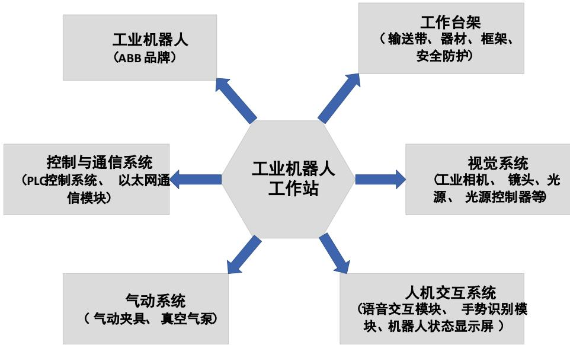

图 1.1 系统组成

其中，工业机器人为ABB 品牌的6轴机器人；控制与通信系统主要包括PLC 控制系统，以太网通信模块；气动系统包括气动夹具、真空气泵；人机交互系统 包括语音交互模块、手势识别模块、机器人状态显示屏等组成。 

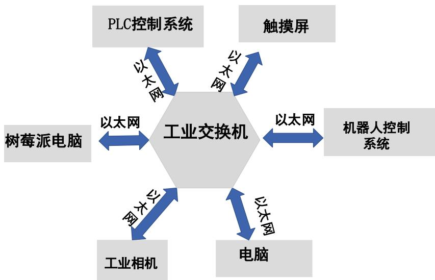

图 1.2 通信系统

工业机器人工作站主要通信为以工业交换机的以太网通信模式。PLC 控制系 统与机器人控制系统通过以太网进行数据交换；树莓派电脑与机器人控制系统进 行数据交换；工业相机控制系统与机器人控制系统进行数据交换；触摸屏与PLC 控制系统、机器人控制系统进行数据交换；电脑终端与机器人控制系统、工业相 机、树莓派电脑、PLC 控制系统、触摸屏等进行在线编程、修改程序、监控数据、 存储数据等功能。 

在以太网通信协议中，这些设备必须在同一个局域网网段范围内进行互相访 问，每台设备都定义了独一无二的IP地址如ABB机器人的IP地址为：10.70.2.252， 网关为 10.70.2.1，子网掩码为 255.255.255.0 ,DNS:211.67.208.1，在配置过程中 DNS 可以不配置。那么电脑的配置：IP 地址为：10.70.2. 240，网关为 10.70.2.1， 子网掩码为：255.255.255.0,DNS:211.67.208.1；在电脑访问每一台已知设备的 IP 时，要求电脑防火墙关闭，通过运行程序，能顺利 PING 通IP 地址后，才能进行 信息交换，否则无法进行数据交换。 

图 1.3 电脑通信测试

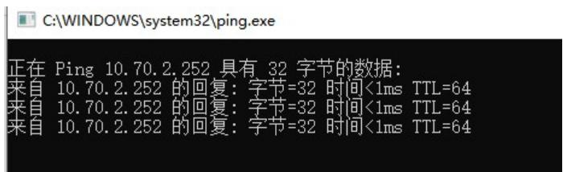

图 1.4 电脑与设备通信正常返回信息

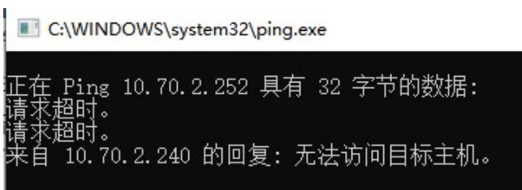

图 1.5 电脑与设备通信错误返回信息

## 1.2 设备介绍

工业机器人基础教学工作站型号MFTW-IR和CHL-JC-02-A都是由ABB工业机 器人为主体控制的工作站。两种型号的工作站都包括工业机器人、PLC 模块、工 业相机、光源、镜头、树莓派电脑、工作台、报警灯、急停按钮、安全光栅、空 压机等，如图1.6，图1.7 所示。 

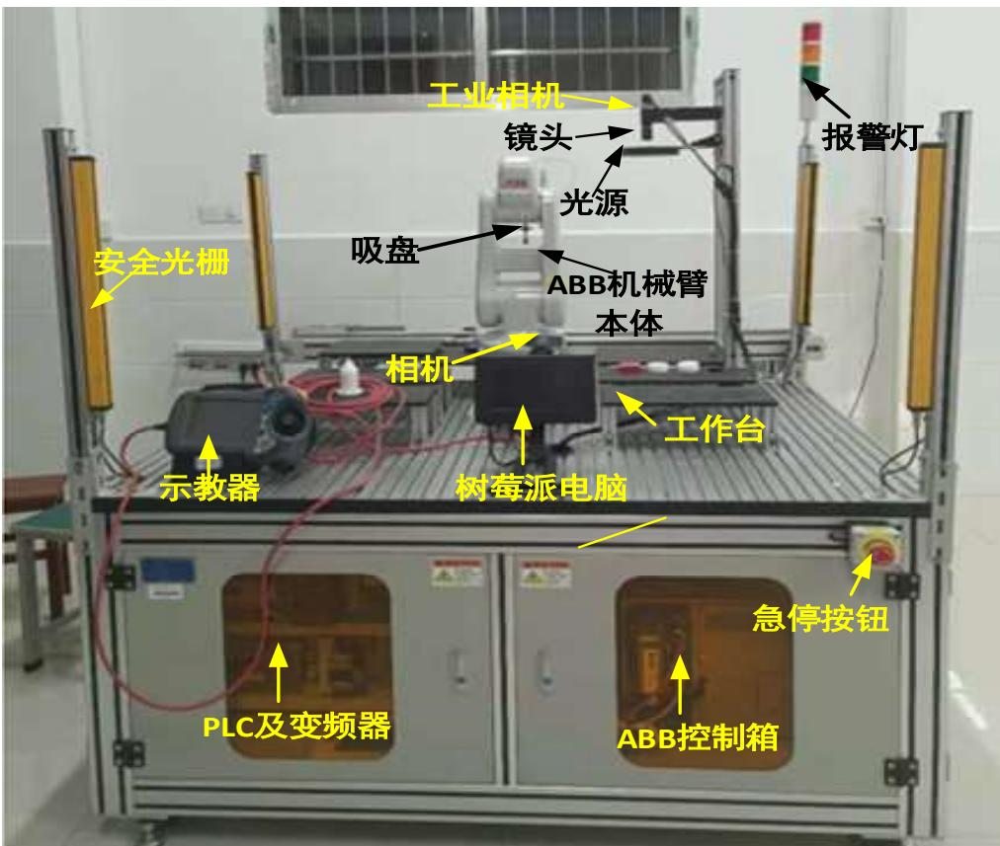

图 1.6 MFTW-IR 工作站实验台图 1

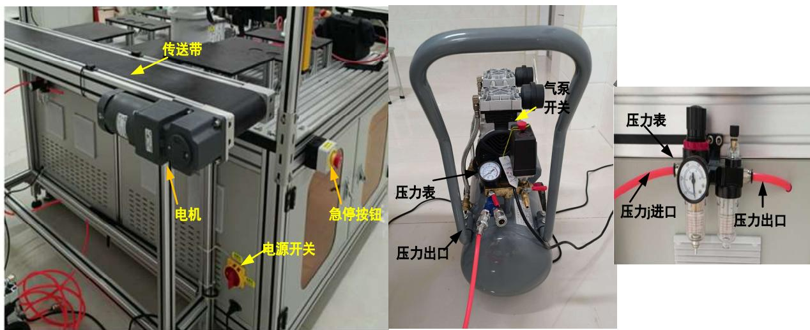

图 1.7 MFTW-IR 工作站实验台图 2

工业机器人基础教学工作站型号MFTW-IR和CHL-JC-02-A都设计有断路器进 行电源的开启和关闭。 

两种型号的工作站主要区别是： 

1、MFTW-IR工作站输送带配置的电机为交流220V，电机速度的控制为变频器面 板控制方式，变频器型号为 GD20-OR7G-S2（英威腾 GD20 系列）；CHL-JC-02-A 工 作站输送带为步进电机型号为57HS21A，通过触摸屏手动输入步进电机的速度， 控制速度快慢型号为DM542(蕾赛科技品牌)。 

2、MFTW-IR工作站工作台的尺寸与CHL-JC-02-A 工作站工作台的尺寸不一样，码 垛，堆放物体的托架尺寸也不一样。 

## 1.2.1 工业机器人

工业机器人为ABB 六轴工业机器人，PLC 控制系统中上位机软件通过网络 连接的方式可以直接读写PLC模块中的数值，PLC程序中与机器人建立了socket 通讯可以直接发送数据来控制机器人移动，在PLC 上位机软件中设置了权限， 普通用户只能对机器人的第1 轴，第 2 轴操作控制，登录管理员模式，可以对机 器人6 轴完全控制。工业机器人包括本体、控制柜、示教器三部分组成。 

## A、工业机器人本体

本体作为工作站的核心与动作执行器，其主要功能是完成控制系统所产生的 一系列行为决策。系统运动准确、可靠、稳定，且在运行过程中，系统设计有多 重防碰撞、防伤人的传感模块。此外，系统设置有紧急停止开关与柔性控制功能， 防止机器人失控，保障系统安全，本体上主要安装6 台伺服电机，减速器和皮带 轮以及预留的管道和控制线路接口。 

本体型号为IRB120，如图1.8 所示。该本体为柔性生产低负载常用本体， 本体质量相对较轻，仅重25kg，有效载荷负重3kg，垂直腕 4kg，可满足实验室 日常使用需求。机器人本体安全、可靠，防护等级达 IP30，可有效防止意外事 故的发生。机器人手腕部分集成有10 路数字信号，可实现各类传感器的安装， 集成了4 路空气气路，可有效实现气动控制。此外，系统设置有 2通道安全回路 监测和3 位启动装置，系统对EMC/EMI具有辐射屏蔽功能。 

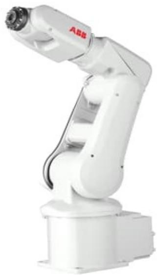

图 1.8 IRB120 机器人本体

机器人本体主要参数如下： 

（1）物理特性 

1. 机器人底座尺寸 180mm×180mm 

2. 机器人高度 700mm 

3. 重量 25kg 

4. 工作范围 580mm； 

5. 有效荷重 3kg； 

6. 重复定位精度 0.01mm。 

（2）电气特性 

1. 电源电源 200-600V，50/60Hz； 

2. 变压器额定功率 3.0kVA； 

3. 功耗 0.25kW。 

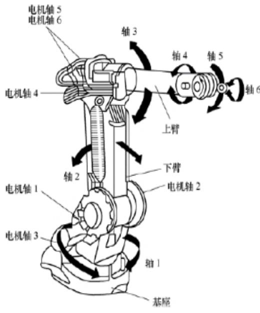

图 1.9 工业机器人的机械结构

（3）运动特性 

1. 1 轴： $+ 1 6 5 ^ { \circ } \sim _ { - 1 6 0 ^ { \circ } }$ ，最大速度 $2 5 0 \mathrm { { ^ \circ } / { s } }$ ； 

2. 2 轴： $: + 1 1 0 ^ { \circ } \sim _ { - 1 1 0 ^ { \circ } }$ ，最大速度 $2 5 0 ^ { \circ } / \mathrm { s }$ 

3. 3 轴： $+ 7 0 ^ { \circ } { \sim } \mathrm { - } 9 0 ^ { \circ }$ ，最大速度 $2 5 0 ^ { \circ } / \mathrm { s } ;$ 

4. 4 轴 $: + 1 6 0 ^ { \circ \sim } - 1 6 0 ^ { \circ }$ ，最大速度 $3 2 0 ^ { \circ } / \mathrm { s } ;$ 

5. 5 轴： $\mathrm { \Omega } ^ { \prime } + 1 2 0 ^ { \circ } \sim . 1 2 0 ^ { \circ }$ ，最大速度 $3 2 0 \mathrm { { ^ \circ } / s } ;$ 

6. 6 轴： $+ 4 0 0 ^ { \circ } \sim \_ { 4 0 0 ^ { \circ } }$ ，最大速度 $4 2 0 ^ { \circ } / \mathrm { s }$ 

## B、控制柜

（4）使用环境 

1. 运行环境温度 $+ 5 ^ { \circ } C \sim + 4 5 ^ { \circ } C$ 

2. 运输与存储时温度 $- 2 5 ^ { \circ } C ^ { \sim } + 5 5 ^ { \circ } C$ 

3. 使用时最高许可湿度95% 

4. 噪声水平小于 70dB 

工作站所选用的控制柜型号为IRC5Compact，该控制柜中有控制计算机和伺 服控制器。控制计算机通过对驱动系统的控制，使执行系统按照规定的要求进行 工作。控制硬件主要包括工控机、多处理器系统、PCI总线、大容量闪存盘、停 电备用电源、USB 存储接口。控制软件为成熟可靠的实时OS，采用高级RAPID 编程语言进行编程，系统支持PC-DOS 文件格式。吸引电源采用频率为 50-60Hz 单相 200V-600V交流电，控制轴数为 6轴，系统安全防护等级为 IP20。此外， 系统还设置有安全紧急停机、带监测功能的双通道安全回路、3位启动装置等、 5路电子限位开关安全输出、8路安全输入与监测输出。输入输出IO口最多4096 路信号、支持24VDC 或继电器数字信号，2路 0-10V模拟信号，1 路RS232 或 RS422 串口，10/100MB/S 以太网等。 

控制柜外部如图1.10 所示，控制柜上预留有各种插槽接口、按钮开关、指 示灯。如：示教器连接插槽用来连接示教器和控制柜，模式转换开关可以切换控 制机器人的两种方式即自动控制和手动控制，在示教编程和系统设置情况下，必 须切换为手动模式条件下才能进行编辑和更改。紧急停止按钮是用于出现危险情 况下，机器人停止工作的保护装置。 

抱闸按钮是保证机器人的各轴姿态在不通电的情况下，电机通过合上抱闸， 保证电机位置不变，保证机器人各轴不会受重力而跌落。如果在一些紧急情况下， 不能通过示教器操作移动机器人，此时需要通过手动松抱闸来移动机器人。松抱 闸前，必须做好安全防护。松抱闸前做好好吊装准备，以免松抱闸后机器人跌落 砸伤人员。 

1)若控制柜有电，则可以通过按机器人本体上抱闸按钮来移动机器人。 

2)若此时控制柜无电，即控制柜无法给电机抱闸提供 24V控制电，此时最快 捷方法为：.打开电机盖，将电机的动力线插头拔下，根据电路图找到抱闸端子， 直接提供24V，抱闸即可打开。 

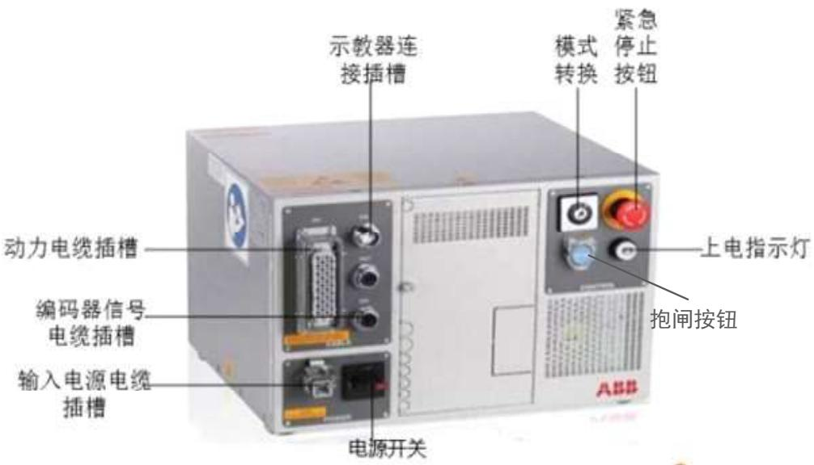

图 1.10 机器人控制柜

## C、示教器

编程示教器采用彩色图像界面触摸屏与操纵杆，示教器可热插拔，支持左右 手操作。工业机器人程序输入方式有两种：第一种利用电脑软件编程输入程序。 第二种脱离电脑利用示教器进行编程。 

在ABB 工业机器人系统中同样配备了示教器，在示教器上通过手动模式编 程控制工业机器人的运动，现对其进行简单的介绍，如图1.11所示。 

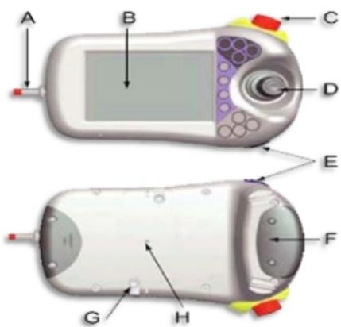

图 1.11 示教器

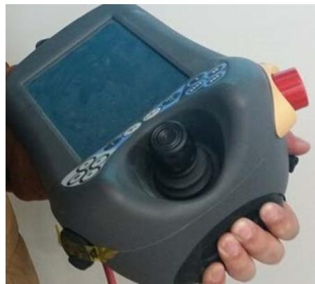

图 1.12 示教器的正确手持方式

A为连接电缆，连接了示教器和控制柜。 

B为触摸屏。 

C为急停开关，当所控制的工业机器人出现了危险运动情况时可以通过急停 开关紧急停止当前运动。 

D为手动操作摇杆，在手动操作模式下可以通过手动操作摇杆来进行机器人 各个轴运动的控制。 

E为数据备份用 USB接口，用于将备份好的数据在其他的存储设备之间传 输。 

F为使能器按钮，有两个键程，第一个键程按下时可以在手动操控模式下控 制电机开启。 

G为触摸屏用笔。 

H为示教器复位按钮。 

对于惯用手为右手的人来说，应左手握示教器，四指按在使能器按钮上，右 手进行屏幕和按钮的操作，其具体的正确的手持方式如图1.12 所示。 

## 1.2.2 通信系统

机器人通信系统集成在控制柜上，提供 RS232，以太网等通信方式，提供部 分详细通信协议，用以太网通信编程可以直接控制机器人的动作并实时监测机器 人的运动过程状态。 

PLC 控制系统模块均采用西门子 200 SMART PLC，MFTW-IR 工作站配置 PLC 型号为 CPU SR20 ,扩展模块为 EMQR16 和 EMDR16，；CHL-JC-02-A 工作 站配置 PLC 型号为 CPU ST40。 

## 1.2.3 视觉系统

视觉系统包括130 万像素工业相机、600万像素工业镜头、环形光源及数字 可编程光源控制器。视觉系统通过以太网与外界进行通信。 

视觉系统包含一台工业相机、工业定焦镜头、环形光源和光源控制器，相机 安装在机械臂末端，如图1.13 所示。 

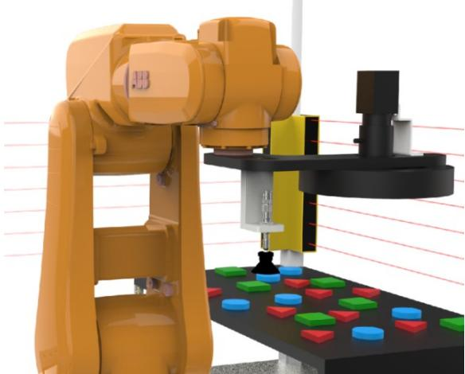

图 1.13 视觉系统安装示意图

相机选择海康威视130 万像素新款工业相机MV-CA060-10GC，如图1.14所 示。相机支持千兆以太网接口提供了1Gbps 带宽，无需中继最大传输距离可到 100m，板上缓存达 128MB，可缓存多张图片，用于突发传输或者重传，支持自 动曝光控制、用户自定义查找表LUT、Gamma 校正等，可使用硬触发或者软触 发的方式来完成多台相机或者相机与外部设备之间的同步。同时可以配合不同的 曝光模式完成相机成像采集，彩色相机植入优异的图像插值算法，更好的颜色还 原，并且支持自动白平衡，兼容GigEVision协议 V1.2，无缝链接第三方软件。 

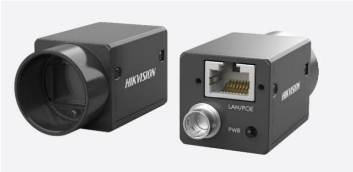

图 1.14 工业相机 MV-CA060-10GC

相机参数如表1 所示： 

表 1 MV-CE013-50GC 参数表

<table><tr><td>参数类型</td><td>参数值</td></tr><tr><td>型号</td><td>MV-CE013-50GC</td></tr><tr><td>名称</td><td>130 万像素 1/3” CMOS 千兆以太网工业面阵相机</td></tr><tr><td>传感器型号</td><td>Sharp RJ33</td></tr><tr><td>像元尺寸</td><td>3.75 μm × 3.75 μm</td></tr><tr><td>靶面尺寸</td><td>1/3”</td></tr><tr><td>分辨率</td><td>1280 × 960</td></tr><tr><td>帧率</td><td>30 fps</td></tr><tr><td>动态范围</td><td>60 dB</td></tr><tr><td>信噪比</td><td>37 dB</td></tr><tr><td>增益范围</td><td>0 dB ~ 20 dB</td></tr><tr><td>曝光时间范围</td><td>34 μs ~ 1 sec</td></tr><tr><td>快门模式</td><td>支持自动曝光、手动曝光、一键曝光模式</td></tr><tr><td>数据接口</td><td>Gigabit Ethernet (1000 Mbit/s) 兼容 Fast Ethernet (100 Mbit/s)</td></tr><tr><td>数字 I/O</td><td>6-pin Hirose 接头提供供电和 I/O:1 路光耦隔离输入(Line0),1 路光耦隔离输出(Line1),1 路双向可配置非隔离 I/O (Line2)</td></tr><tr><td>缓存容量</td><td>128 MB</td></tr><tr><td>黑白/彩色</td><td>彩色</td></tr><tr><td>接口</td><td>GigE</td></tr><tr><td>供电及功耗</td><td>电压范围 5~15 VDC;支持 PoE 供电,功耗&lt;2.6 W@12 VDC</td></tr><tr><td>温度</td><td>工作温度 0~50°C,储藏温度-30~70°C</td></tr><tr><td>外形尺寸</td><td>29 mm × 29 mm × 42 mm</td></tr><tr><td>重量</td><td>约68g</td></tr><tr><td>镜头接口</td><td>C-Mount</td></tr><tr><td>软件</td><td>MVS或者第三方支持GigE Vision协议软件</td></tr></table>

工业镜头选择海康威视 MVL-HF1628M-6MP 600 万 16mm 镜头，镜头具有 超高清晰度，支持最小2.4μm像元，外形采用超紧凑设计，如图 14所示，具有 优秀的抗振能力和高低温性能，镜头光圈为 F2.8，最大靶面 1/1.8 英寸，可支持 3MP/1.3MP/3MP/6MP/10MP 相机，低畸变，支持超短工作距，并在整个区间内 保持优秀光学性能，针对机器视觉光源和芯片特殊优化，表面多层宽带镀膜，保 证可见光和近红外波段的高透过率，全系列量产，可选焦距范围 6-50mm。 

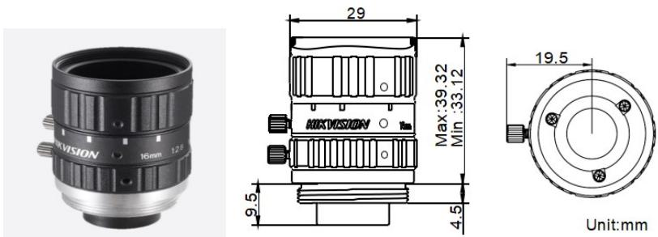

图 1.15 工业镜头 MVL-HF1628M-6MP

主要技术参数如下： 

表 2 MVL-HF1628M-6MP 工业镜头参数

<table><tr><td>参数类型</td><td>参数值</td></tr><tr><td>型号</td><td>MVL-HF1628M-6MP</td></tr><tr><td>名称</td><td>固定焦距,手动光圈,六百万像素,FA镜头</td></tr><tr><td>焦距</td><td>16mm</td></tr><tr><td>光圈</td><td>F2.8-F16</td></tr><tr><td>像面尺寸</td><td>Φ9mm(1/1.8”)</td></tr><tr><td>光学畸变</td><td>-0.38%</td></tr><tr><td>视场角</td><td>1/1.8”</td></tr><tr><td>外形尺寸</td><td>Φ29×35.36mm</td></tr><tr><td>最近摄距</td><td>0.1m</td></tr><tr><td>法兰后焦</td><td>17.526mm</td></tr><tr><td>滤镜螺纹</td><td>M27*0.5</td></tr></table>

光源选择LED环形光源RN15060-W，其采用铝合金外壳、自然风冷、带漫 射板。 

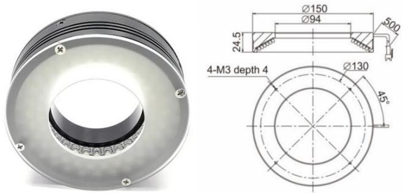

图 1.16 环形光源 RN15060-W

主要技术参数如表3 所示： 

表 3 环形光源参数表

<table><tr><td>参数类型</td><td>参数值</td></tr><tr><td>产品型号</td><td>RN15060-W</td></tr><tr><td>产品类型</td><td>60度环形光源</td></tr><tr><td>LED类型</td><td>贴片LED</td></tr><tr><td>颜色</td><td>红色</td></tr><tr><td>波长</td><td>--</td></tr><tr><td>色温</td><td>6600K</td></tr><tr><td>功率</td><td>14.4W</td></tr><tr><td>输入电压</td><td>DC 24V max.</td></tr><tr><td>线缆长度</td><td>0.5m</td></tr><tr><td>连接器型号</td><td>SMR-03V-B</td></tr><tr><td>连接器定义</td><td>1:正极(+)红色;2:留空;3:负极(-)黑色;</td></tr><tr><td>外壳材质</td><td>铝合金(表面氧化发黑处理)</td></tr><tr><td>冷却方式</td><td>自然风冷</td></tr><tr><td>外形尺寸</td><td>外径150x内径94x高24.5mm</td></tr><tr><td>使用温度和湿度</td><td>温度:0 to 40°C,湿度:20 to 85%RH(非凝结)</td></tr></table>

## 1.2.4 输送带系统

输送带系统主要包括电机、输送带、光电等，电机可以通过上位机程序软件 控制调速，完成多机器人物品传输。 

工作站台上安装输送带，通过电机控制输送带的运转并进行调速，完成两套 或四套工作机器人工作站之间的物料传输。考虑安全性，工业机器人工作站采用 错位布置，因此，输送带模块置于两工作站正中间区域。 

输送带模块主要包括输送带、调速电机、控制箱、变频器、光电传感器等， 其中调速电机供电电压为单相220V交流电，最大功率为200w，最大电流为1.69A， 调速范围为 0-180r/min。输送带采用铝合金边框，长宽为 3000mm×230mm，线 速度控制在0-0.5m/s。光电传感器器采用红外对射感应模块，输入电压为 DC12-24V，输出电流为 300mA，感应距离为 20-350cm，可以检测 1mm 以上任 何除无色透明外的物体。光电编码器指向角为3-5°，响应时间在2ms以内。 

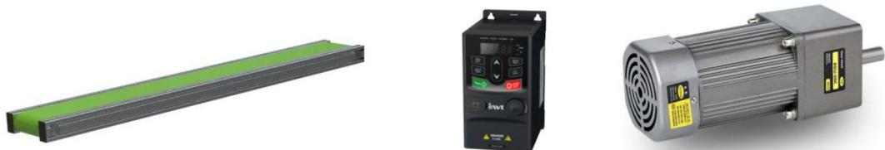

图 1.17 输送带主要模块

## 1.2.5 气动系统

气动系统主要包括电磁阀、气动夹具与真空气泵等外设，用于气动夹具的拾 取与释放等操作，系统在机器人本体末端安装气动夹具。 

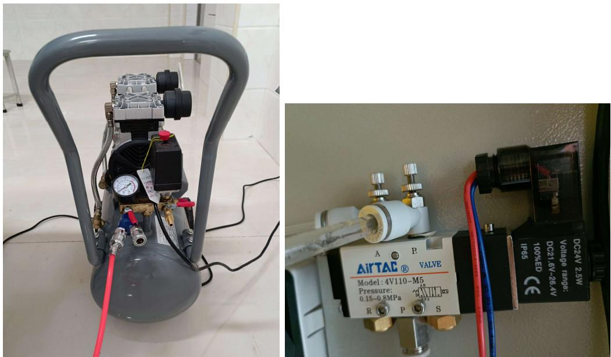

图 1.18 气动系统主要元器件

## 1.2.6 安全系统及其他

为了防止机器人系统在学生无故进入机器人工作范围而造成意外伤害，系统 增加红外光栅模块，即当系统运行时，红外光栅系统自动启动，当人为进入光栅 范围，机器人将紧急停机并预警，保障系统整个实验的安全。此外，工作台架还 主要包括用于显示机器人状态的高清显示屏、语音与图像识别模块、用于工业机 器人基础实验的码垛、拆跺、轨迹跟踪、装配等所需模块与模具，以及工业机器 人视觉检测所需的外设模块。工作台主要分为两大区域，即基础操作区与视觉自 由实验区。基础实验区各工件卡位位置固定，主要完成基础示教的搬运、码垛、 装配与轨迹跟踪，而视觉自由实验区为开放性实验区，实验者可以随意摆放工件， 可以完成视觉标定、检测、识别与智能搬运等实验。 

## 1.2.7 人机交互模块

人机交互模块主要包括三大模块，即实时显示模块，语音交互模块与手势图 像识别模块。实时显示模块为工控PC机输出显示，系统配置机器人运动检测软 件，实时查看机器人运行状态，动作类型等，为人机交互中的机器输出。语音交 互模块配置自然语言处理识别模块，完成自然语言高质量输入与预处理，用户可 根据自然语言处理算法与识别结果进行机器人显示与动作执行，完成人机交互。 手势图像识别系统为单独模块，模块采用Android系统，配置 200W摄像头，采 用7 寸液晶显示屏，分辨率为1280×800，配置网络设备，实现系统内通信。 

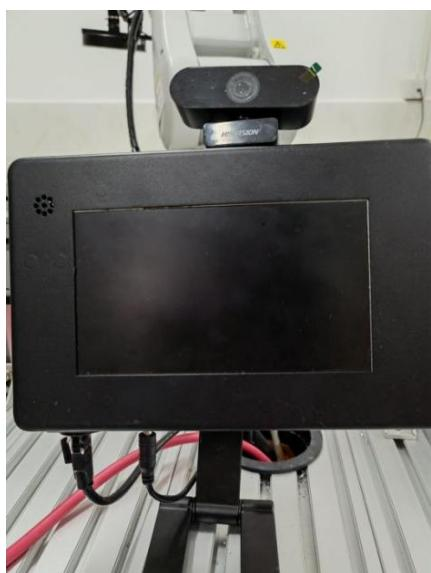

图 1.19 手势识别与语音交互集成模块

## 1.3 编程介绍

ABB 机器人的编程分为电脑软件编程和示教器上进行编程。电脑软件编程需 要安装 RobotStudio 和 RobotWare。RobotStudio 是一个集成机器人在线编程和离 线仿真的软件，同时兼具了代码备份，参数配置还有系统制作功能。RobotWare 是机器人系统库文件的总成，在运行RobotStudio时，调用RobotWare里面的库 文件实现机器人运动的各种功能。在安装RobotStudio软件版本时，软件中自动 安装了相应版本的RobotWare软件。有时候则需要独立安装其他版本的软件。 

RobotStudio 软件编程比较方便，在软件界面中可以根据需要选择各种型号 的ABB 模型库和工装夹具等，在没有实物机器臂的情况下完全可以通过仿真开 发出来，节约了设计周期。在针对复杂编程时，示教器无法比拟。示教器采用高 级RAPID 编程语言进行编程，控制器的系统配置是出厂时固定的，不能随便修 改。RAPID 编程语言属于动作语言，包含了一连串的控制机器人的指令。还包 括主模块和程序模块的之间的相互调用功能。 

RobotStudio 软件主要使用步骤： 

打开RobotStudio桌面快捷键→新建→空工作站解决方案→ABB模型库选型 号→导入模型库选工装夹具→从布局创建系统（选RobotWare 版本）→配置机器 人系统库→打开虚拟示教器→切换手动模式→打开使能按钮（Enable）→定义 I/O 变量→定义程序数据变量、常量→程序编辑器编写程序模块（调用RAPID 编程 指令）→程序编辑器编写主程序（调用RAPID 编程指令）→示教修改位置→调 式单步运行→调试连续运行→切换自动运行 

示教器编程主要使用步骤： 

打开电源启动控制柜→切换到手动状态→打开控制面板→配置系统参数（通 信配置等）→定义 I/O 变量→定义程序数据变量、常量→程序编辑器编写程序模 块（调用RAPID 编程指令）→程序编辑器编写主程序（调用RAPID 编程指令） →示教修改位置→调式单步运行→调试连续运行→切换自动运行 

## 1.4注意事项及安全概述

机器人速度快，质量重并且力度很大。运动过程中的停顿或停止都会产生危 险。即使可以预料到运动轨迹，但外部信号有可能会改变操作，会在没有任何警 告的情况下，产生料想不到的运动。因此，当机器人在运动或进入保护空间时， 务必遵循所有的安全条例。 

## 1.4.1 自身安全

为了安全操作机器人系统，请遵循下列原则： 

1. 操作机器人前，需要确认“紧急停止”按钮功能是否正常。 

2. 如果在保护空间内有工作人员，请手动操作机器人系统。 

3. 当进入保护空间时，请准备好机器人示教器或急停，以便随时控制或停止机 器人。 

4. 在示教与维护作业中，绝不允许操作人员在自动运动模式下进入机器人工 作范围内，决不允许其他无关人员进入机器人运动范围内。 

5. 注意液压、气压系统以及带点部件。即使断电，这些电路上的残余电量也 很危险。 

6. 机器人通电后，保持实验台关闭，且身体的任何部位不要进入机器人运动 范围之内。 

7. 机器人运动时始终从机器人的前方进行观察，不要背对机器人进行作业，以 便机器人工作不正常时，及时按下工作台、控制柜或示教器上的急停按钮。 

8. 始终按预先制定好的操作程序进行操作。 

9. 机器人工作时，操作人员注意查看机器人电缆状况，防止其缠绕在机器人上， 同时严禁在控制柜内随便放置配件、工具、杂物等。 

10. 机器人工作时，严禁操作者离开现场，以确保意外情况的及时处理。 

## 1.4.2 安全工具

机器人工作站配备了急停开关、安全光幕等。紧急停止和安全保护光幕机制 受到监控，以便在控制器检测到任何故障时停止机器人。 

## 1.4.3 维护控制器时确保电源关闭

高压作业可能会产生致命性后果。触碰高压可能会导致心跳停顿、灼烧或其 它严重伤害。为了避免这些伤害，请务必在作业前关闭控制器上主电源开关或整 个设备断电。 

