## 第三章 码垛实验仿真与实际操作实验

实验目的：学习码垛编程方法及实验台实际操作 

实验要求：规划码垛路线，完成基本码垛指令方法，掌握示教器使用方法 

实验设备：型号 MFTW-IR 和 CHL-JC-02-A 的工作站 

实验步骤： 

## 一、码垛实验需要用到的指令讲解

1.IO 控制指令：实验中码垛使用的抓取工具是机器人吸盘，机器人通过控制 电磁阀来实现吸盘的抓和放。控制电磁阀使用的指令是SetDo。 

## 1.209 SetDO- 改变数字信号输出信号值

<table><tr><td>手册用法</td><td>无论是否存在时间延迟或同步,SetDO用于改变数字信号输出信号的值。</td></tr><tr><td>基本示例</td><td>以下实例介绍了指令SetDO:</td></tr><tr><td>例1</td><td>SetDO do15, 1;将信号do15设置为1.</td></tr><tr><td>例2</td><td>SetDO weld, off;将信号weld设置为off.</td></tr><tr><td>例3</td><td>SetDO \SDelay := 0.2, weld, high;将信号weld设置为high,且时间延迟为0.2s。通过下一指令,继续程序执行。</td></tr><tr><td>例4</td><td>SetDO \Sync ,do1, 0;将信号do1设置为0。程序执行进入等待,直至从物理上将信号设置为指定值。</td></tr></table>

图 3.1 SetDO 指令含义

在实验中机器人电磁阀IO 的对应的点位是Do0（型号 MFTW-IR 定义）; DO10_9（型号 CHL-JC-02-A 定义） 

例：SetDO do0,1;（或 SetDO DO10_14,1）将数字输出 do0 或 DO10_14 的值 设置为1，表示打开吸盘。 

WaitTime 0.5;程序等待 0.5 秒 

SetDO do0,0; （或 SetDO DO10_14,0）将数字输出 do0 或 DO10_14 的 值设置为0，表示关闭吸盘。 

2. 获取当前位置数据函数CRobT。 

## 2.45 CRobT-读取当前位置(机器人位置)数据

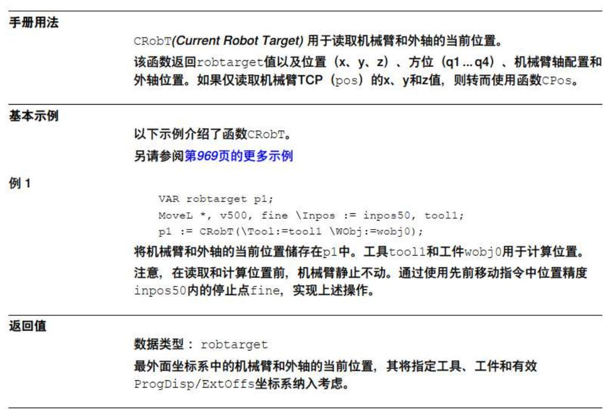

图 3.2 CrobT 指令释义

## 3. 基于位置偏移指令Offs。

## 2.108 Offs - 取代一个机械臂位置

<table><tr><td>手册用法</td><td>Offs用于在一个机械臂位置的工件坐标系中添加一个偏移量。</td></tr><tr><td>基本示例</td><td>以下示例介绍了函数Offs。另请参阅第1085页的更多示例</td></tr><tr><td>例1</td><td>MoveL Offs(p2, 0, 0, 10), v1000, z50, tool1;将机械臂移动至距位置p2(沿z方向)10 mm的一个点。</td></tr><tr><td>例2</td><td>p1 := Offs (p1, 5, 10, 15);机械臂位置p1沿x方向移动5 mm,沿y方向移动10 mm,且沿z方向移动15 mm。</td></tr><tr><td>返回值</td><td>数据类型: robtarget移动的位置数据。</td></tr></table>

图 3.3 Offs 指令释义

## 二、机器人码垛位置示教及逻辑讲解

码垛基本示意图如下图所示： 

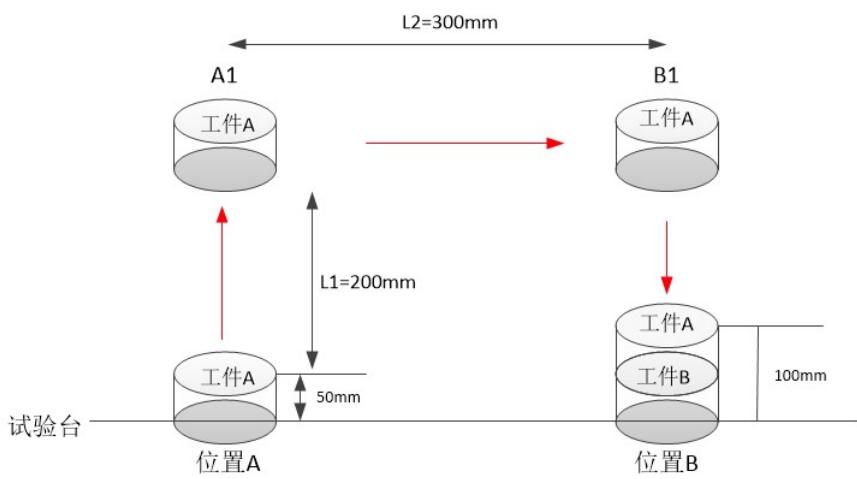

图3.4 码垛示意图

从示意图中，需要将位置A处的工件 A堆叠到同种工件B 的上方，机器人 移动到位置A打开吸盘抓取工件 A，抬升机械臂L1 长度，到达位置 A1,再从 A1 经过平移L2 距离到达 B1位置，从 B1 垂直下降L1-50mm 的高度关闭吸盘，将 工件A码垛到工件 B 上，工件需要垂直抓取和垂直码垛的目的在于防止机器人 与工件碰撞。 

示教过程：首先将机器人移动到工件A表面中心点进行示教，更改名称为 Point_A，再将机器人移动到工件 B 表面中心点进行示教，更改名称为 Point_B。 开始编程实现上述过程：首先我们创建一个新的例行程序，点击例行程序， 点击文件，新建例行程序，更改名称MaDuo。 

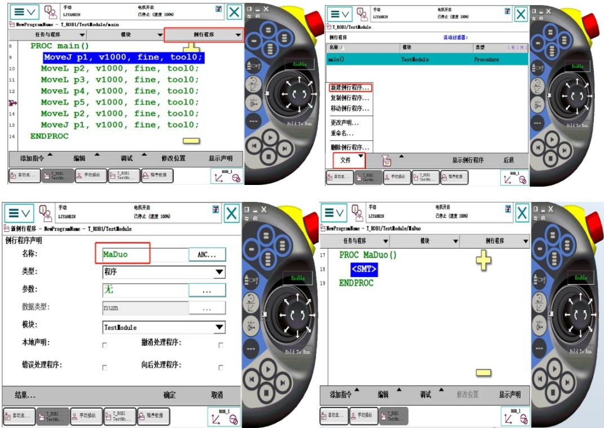

图 3.5 创建 MaDuo 例行程序步骤

## 三、编写程序

编写程序可以在示教器上进行开发，但是在示教器上面开发效率比较慢，对 于复杂的逻辑结构编程，在示教器上操作比较困难，一般在robotstudio软件上进 行编程，如下图所示。 

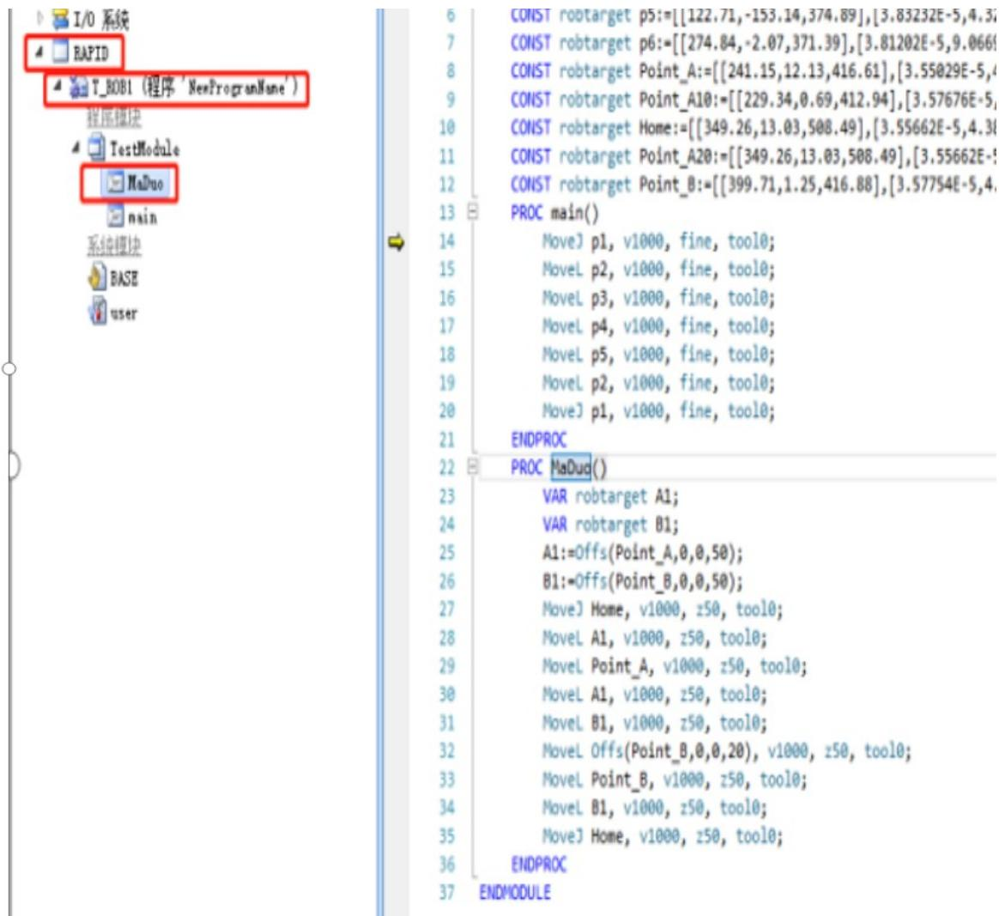

图 3.6 robotstudio 程序编辑界面

创建完系统，软件会自动创建机器人的系统文件，只需要在系统文件中的程 序文件编写代码即可。如上图所示，在T_ROB1 任务中创建了 TestModule程序 模块，TestModule模块里面包含两个例程，一个是main 程序，机器人执行主程 序，一个是例行程序MaDuo,双击MaDuo 就可以在编辑器进行程序编辑了。编辑 程序完成后，可以在手动模式下单独运行例行程序，但在自动模式下，机器人默 认从main 程序开始执行，如果在 main 程序中调用例行程序，用procCall 命令调 用。 

码垛指导程序例程： 

Var robtarget A1;声明一个 robtarget 数据类型的 A1 和 B1； 

Var robtarget B1; 

A1:=Offs(Point_A，0，0，200); 将距离 Point_A 点 Z 正方向 200mm 处的位 置赋值给A1; 

B1:=Offs(Point_B，0，0，200); 将距离 Point_B 点 Z 正方向 200mm 处的位 置赋值给B1; 

MoveJ Home, v500, z50, tool0; 从机器人的一个安全点Home位开始移动 

MoveL A1, v500, fine, tool0;从 Point_A 正上方 A1 点开始直线下降到 Point_A 

MoveL Point_A, v500, fine, tool0; 直线运动到 Point_A 

SetDO do0,1;（或 SetDO DO10_14,1）表示打开吸盘 

WaitTime 0.5;程序等待 0.5s 使吸盘稳定吸住工件 

MoveL A1, v500, fine, tool0;机械臂抬升运动到 A1 

MoveL B1, v500, fine, tool0; 直线运动到 B1 

MoveL Offs(Point_B，0,0,50)，v500, fine, tool0;运动到距离 Point_B 点 Z 正 方向上方50mm 位置 

SetDO do0,0;（或 SetDO DO10_14,0）表示关闭吸盘 

WaitTime 0.5;程序等待 0.5s 使吸盘稳定放好工件 

MoveL B1, v500, fine, tool0; 机械臂直线抬升运动到 B1 

MoveJ Home, v500, z50, tool0;机器人回到安全点 Home 

编写程序并示教好点位后就可以运行程序,运行程序操作是，点击调试，点 击PP移至例行程序，选择编写好的例行程序，电机使能，按运行程序按钮就可 以开始运行程序。 

## 四、实际操作实验

A、示教器编程方法型号为MFTW-IR 的实验台操作步骤如下： 

1、将实验台总插座插到墙上插座里，将实验台后面电源开关切换到电源 开档位。 

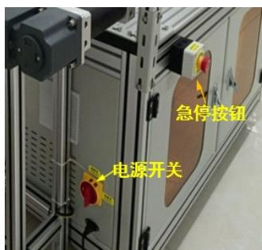

图 3.7 电源开关 

2、打开左侧控制柜门并观测里面断路器是否跳闸，如果跳闸，请重新合 上。 

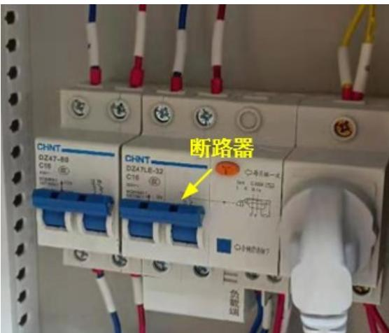

图3.8 电源开关

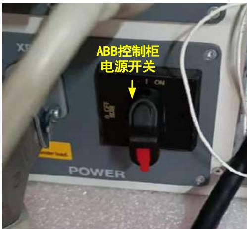

图3.9 ABB 控制柜电源开关

3、打开右侧控制柜门，将 ABB 控制柜上的电源开关切换到开状态，手动 和自动档位开关切换到手动状态。 

4、将空气压缩机电源插座插到墙上插座里，手动拔起空气压缩机，使压 缩机工作。 

5、在示教器上程序数据→视图→全部数据类型→robtarget→新建 新建变量 A1，B1，Home，Point_A，Point_B（如果其他控制方法可以修 改为其他变量名称如 P1,P2,P3,P4 等） 

6、在示教器中依次选择菜单→程序编辑器→任务与程序→显示模块→点 击 Module1 则可进入有 PROC main()这样开头的画面。当然 Module1 通过更改声 明可以把名称修改为TestModule。在 main()程序里可以直接增加程序，完成程序 的编辑工作。也可以在TestModule模块里面，新建例行程序取名为MaDuo，在 main()程序里，使用 procCall 命令调用 MaDuo 这个例行程序。 

7、手动控制机械臂6 轴运动，Home，Point_A，Point_B 的修改位置，满 足工艺要求，示教时可以利用示教器上快捷按键实现示教工作。 

方法如下：示教器上控制面板→配置可编程按键→按键1 输出（类型：输 出，按下按键：切换，允许自动模式;否）→选定数字输出信号（do0）→ 确定。 

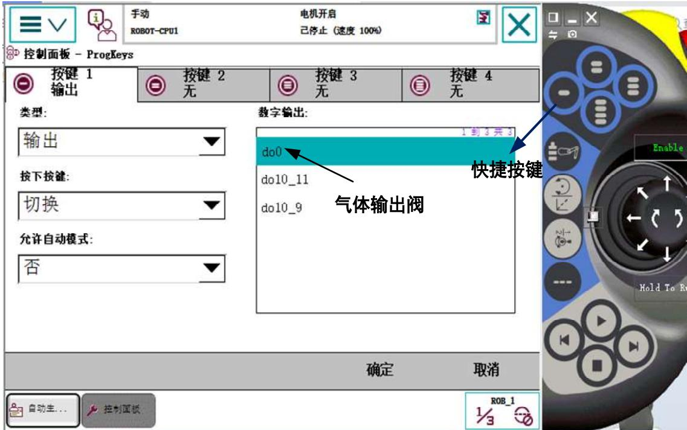

图 3.10 ABB 控制柜电源开关

这样在示教位置时，先将机器人移动到物体位置，按下快捷按键，气动阀门打开， 吸盘吸取物体，根据实际控制需要物体移动到各个指定的位置进行示教位置修改， 满足控制要求。 

8、手动调试，点击PP 移至例行程序，进行单步运行，满足控制要求。 

9、切换到连续运行状态 

10.将ABB 控制柜里面手动模式切换到自动模式，电机按钮上电，示教器选择编 号的自动运行程序，按下运行按钮，程序实现自动功能。 

11、在运行和调试过程中，身体不能进入光栅，否则机器人停止运行。 备注： 

1)该实验台ABB扩展的I/O模板主要参数如下：

A、使用来自模板的值选择：DSQC 652 24VDC I/O Device

B、 Name:d652 C、 Address ：10

D、 Product Code ： 26 ;E、 Device Type： 7

F、 Connection Type ： Change-of-State(COS)

g 、Connection output Size(byte):2(输出字节长度）

h 、Connection Input Size(byte):2(输入字节长度）

2)I/O 输入输出信号地址分配如下表：

<table><tr><td>定义名称di0</td><td>连接设备d652</td><td>信号类型(Type of Signal)Digital Input</td><td>Device mapping0</td><td>定义名称do0</td><td>连接设备d652</td><td>信号类型(Type of Signal)Digital Output</td><td>Device mapping0</td></tr><tr><td>di1</td><td>d652</td><td>Digital Input</td><td>1</td><td>do1</td><td>d652</td><td>Digital Output</td><td>1</td></tr><tr><td>di2</td><td>d652</td><td>Digital Input</td><td>2</td><td>do2</td><td>d652</td><td>Digital Output</td><td>2</td></tr><tr><td>di3</td><td>d652</td><td>Digital Input</td><td>3</td><td>do3</td><td>d652</td><td>Digital Output</td><td>3</td></tr><tr><td>di4</td><td>d652</td><td>Digital Input</td><td>4</td><td>do4</td><td>d652</td><td>Digital Output</td><td>4</td></tr><tr><td>di5</td><td>d652</td><td>Digital Input</td><td>5</td><td>do5</td><td>d652</td><td>Digital Output</td><td>5</td></tr><tr><td>di6</td><td>d652</td><td>Digital Input</td><td>6</td><td>do6</td><td>d652</td><td>Digital Output</td><td>6</td></tr><tr><td></td><td></td><td></td><td></td><td>do7</td><td>do0</td><td>Digital Output</td><td>7</td></tr><tr><td></td><td></td><td></td><td></td><td>do8</td><td>d652</td><td>Digital Output</td><td>8</td></tr><tr><td></td><td></td><td></td><td></td><td>do9</td><td>d652</td><td>Digital Output</td><td>9</td></tr></table>

B、示教器编程方法型号为 CHL-JC-02-A 的工作站的实验台操作步骤如下： 

1、将实验台总插座插到墙上插座里，打开实验台右侧上方抽屉，将抽屉里3 个 断路器拔向上方。 

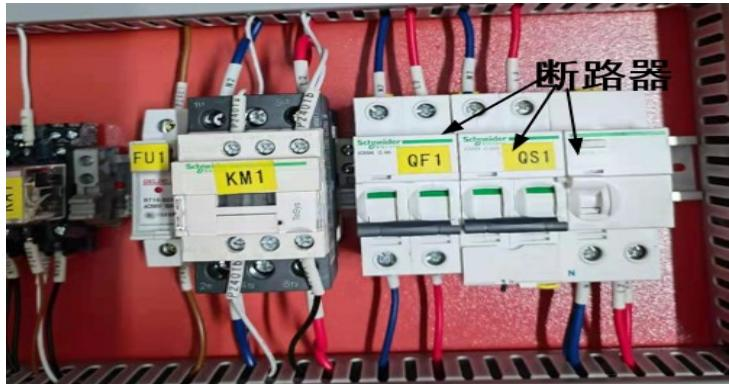

图 3.11 CHL-JC-02-A 工作站电源开关

2、实验台触摸屏左侧有两个选择按钮，其中启动/停止切换按钮，选择启动功能， 则会启动ABB 控制柜及示教器电源，空气压缩机同时也启动。写字/示教和/流 水线按钮，选择示教档位。电源指示灯亮则表示整个工作站已经供电。 

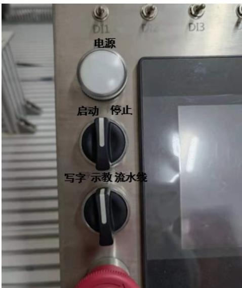

图 3.12 为 CHL-JC-02-A 的工作站部分操作面板 

3、打开左侧控制柜门，将 ABB控制柜上的电源开关切换到开状态，手动和自动 档位开关切换到手动状态。 

4、在示教器上程序数据→视图→全部数据类型→robtarget→新建 新建变量 A1，B1，Home，Point_A，Point_B（如果其他控制方法可以修 改为其他变量名称如 P1,P2,P3,P4 等） 

5、在示教器中依次选择菜单→程序编辑器→任务与程序→显示模块→点击 Module1 则可进入有 PROC main()这样开头的画面。当然 Module1 通过更改声 明可以把名称修改为TestModule。在 main()程序里可以直接增加程序，完成 程序的编辑工作。也可以在TestModule模块里面，新建例行程序取名为 MaDuo，在 main()程序里，使用 procCall 命令调用 MaDuo 这个例行程序。 

6、手动控制机械臂6轴运动，Home，Point_A，Point_B 的修改位置，满足工艺 要求，示教时可以利用示教器上快捷按键实现示教工作。 

方法如下：示教器上控制面板→配置可编程按键→按键1 输出（类型：输 出，按下按键：切换，允许自动模式;否）→选定数字输出信号(do10_14 →确定）。 

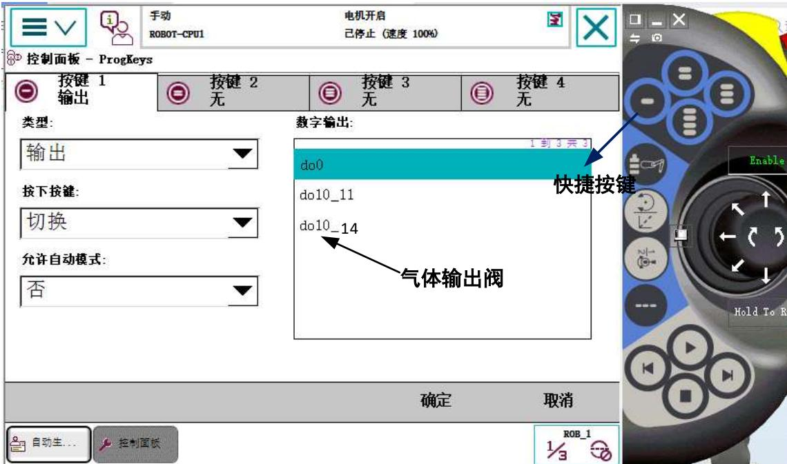

图 3.13 ABB 控制柜电源开关

这样在示教位置时，先将机器人移动到物体位置，按下快捷按键，气动阀门 打开，吸盘吸取物体，根据实际控制需要物体移动到各个指定的位置进行示教位 置修改，满足控制要求。 

7、手动调试，点击PP 移至例行程序，进行单步运行，满足控制要求。 

8、切换到连续运行状态。 

9、.将ABB 控制柜里面手动模式切换到自动模式，电机按钮上电，示教器选择 编号的自动运行程序，按下运行按钮，程序实现自动功能。 

10、在运行和调试过程中，身体不能进入光栅，否则机器人停止运行。 

## ABB在线编程方法

当然以上主程序编程和例行程序编程是基于示教器编程，还可以电脑在线编程 和离线编程，离线编程将编写的程序用U盘拷贝到ABB实验台，进行调试。 

在线编程首先确保电脑的防火墙关闭，确保实验台通电、ABB 控制器正常运 行、网线正常连接情况下，设置电脑本地网络：打开“网络和Internet”设置→ 网络共享中心→以太网→属性→Internet协议版本 4（Tcp/IPV4）→IP 地址： 10.70.2.150，子网掩码：255.255.255.0；默认网关：10.70.2.1,；DNS:211.67.208.1. 其中IP 地址第四位值根据每台电脑分配的 IP地址确定，不能相同，否则出现地 址冲突，无法正常连接机器人。输入机器人的IP 地址，能够正常 ping通，说明 ABB机器人的控制柜能够与个人电脑进行在线编程。步骤如下： 

1、打开电脑桌面的RobotStudio软件，新建空工作站解决方案，进入开发界面 选中控制器菜单，添加控制器下拉菜单中，选择添加控制器，在远程控制器 中输入ABB 控制器的IP 地址，（如：10.70.2.252，网络组要求每台ABB 的 地址唯一性），点击添加按钮。如果能正常通讯，则在网络中的控制器中能 显示系统名称、控制器名称、IP 地址和RobotWare 版本。 

双击选中该控制器，则能进行在线连接，如图所示： 

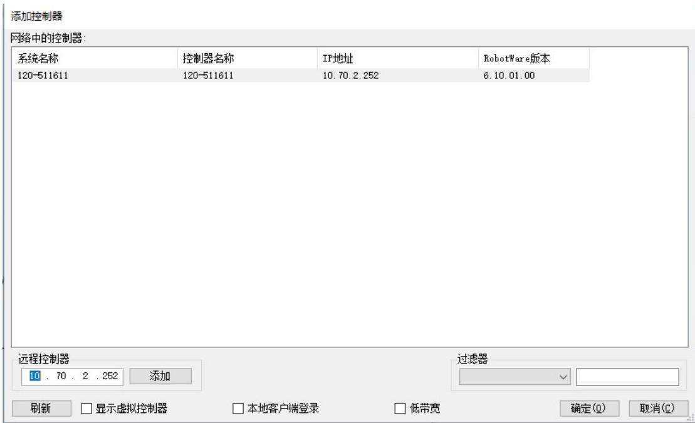

图 3.14 远程访问

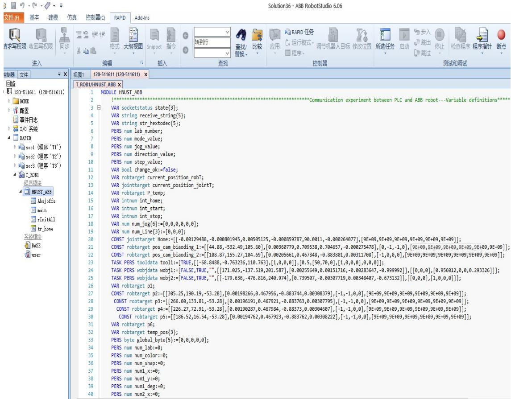

图 3.15 远程访问 ABB 程序

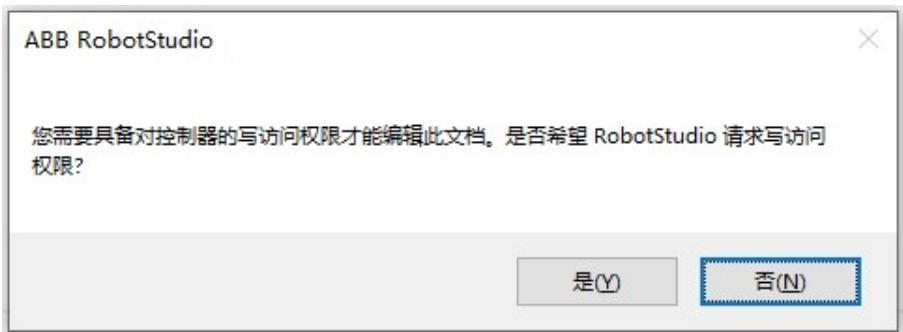

图 3.16 远程访问 ABB 请求访问权限

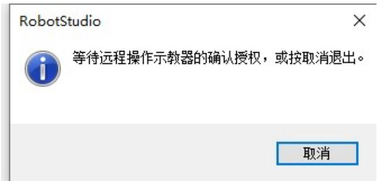

图 3.17 远程访问等待授权

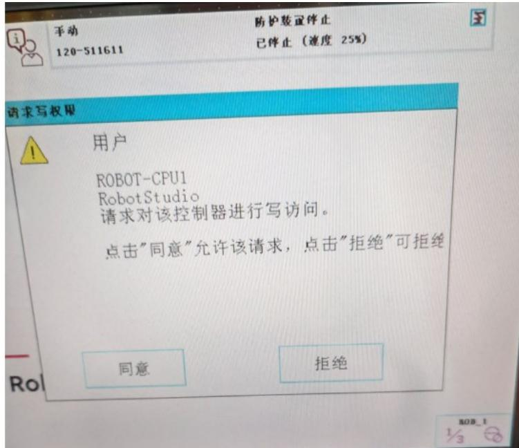

图3.18 示教器上显示是否同意远程访问

实验练习：

根据以上例程使用CrobT指令实现拆垛程序，将堆叠的工件 A和工件 B 拆 垛抓取后放置到固定的点位。 

