## 第五章 机器人轨迹示教编程实验

实验目的：学习机器人运动轨迹编程方法 

实验要求：掌握机器人运动轨迹编程方法 

实验软件：RobotStudio 

实验步骤： 

在工作站中创建一个用于轨迹示教编程的仿真模型，创建一个台体，台体的 大小为400*300*200mm,将台体放置到机器人工具工作范围内，再在台体上创建 一个200*100*50mm 矩形方块，两个直径100*高50mm 的圆柱体，将台体上三 个物体组合到一起形成部件。操作如下： 

1.首先创建一个400*300*200mm 的工作台，将工作台放置到机器人工具工 作范围内，操作方法同上节内容相同。 

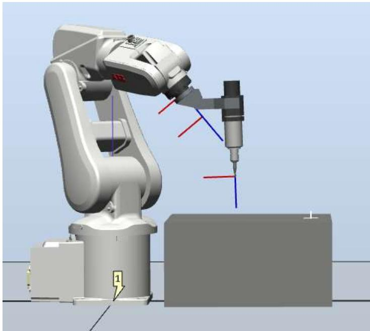


图 5.1 创建仿真工作台


2.创建 200*100*50 矩形方块和两个直径 100 高 50 的圆柱体。 

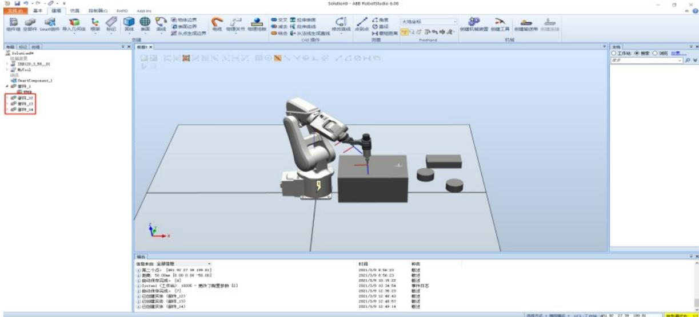


图 5.2 创建轨迹示教部件


3.将矩形方块放置到台体的中心，选中所要放置的矩形方块，右键选择位置， 点击放置，选择一个点。 

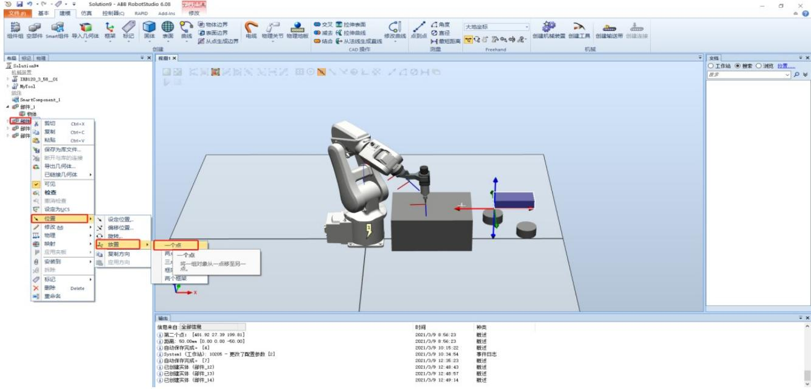


图 5.3 部件位置装配


4.点击主点-从输入框，选择自动捕捉中心，捕捉矩形方块中心。 

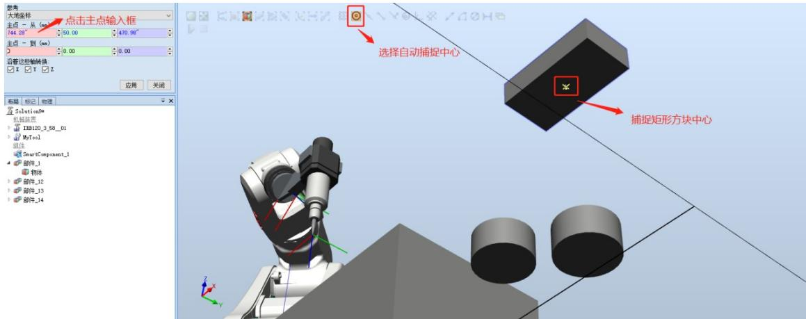


图 5.4“从”装配点选择


5.点击主点-到，选择台体的中点。 

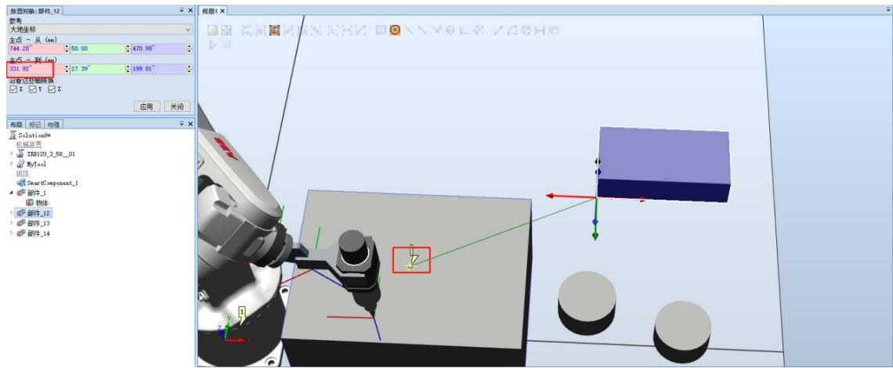


图 5.5“到”装配点选择


6.点击应用，就可以将矩形方块放置到台体的中心。 

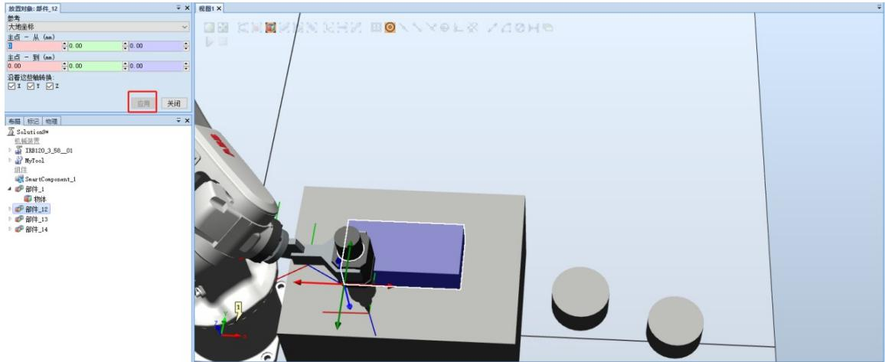


图 5.6 矩形方块装配完成


7.重复同样的操作原理，将两个圆柱体安装到矩形方块的两边。


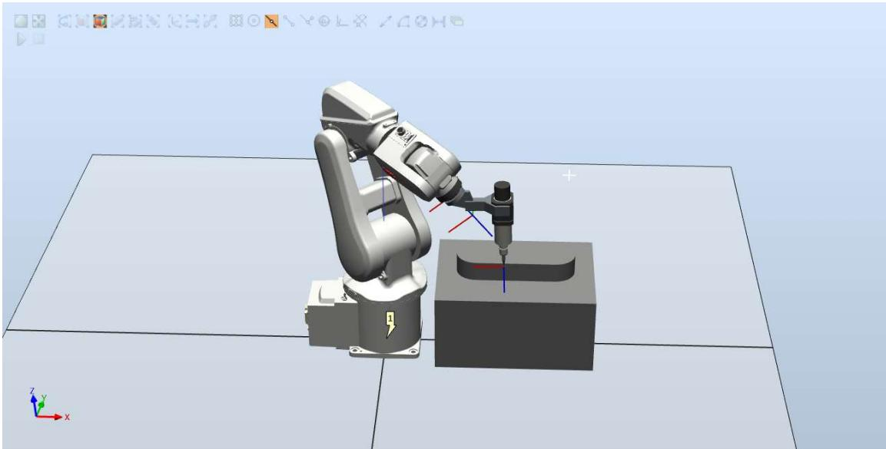


图 5.7 装配圆柱台体


8.放置好后，将三个物体组装起来，形成一个完整的新部件。选择结合， 将部件_12 物体和部件_13 物体分别选择，去掉勾选保留初始位置，点击创建， 就将两个物体组合到一起,生成一个新的部件_16。 

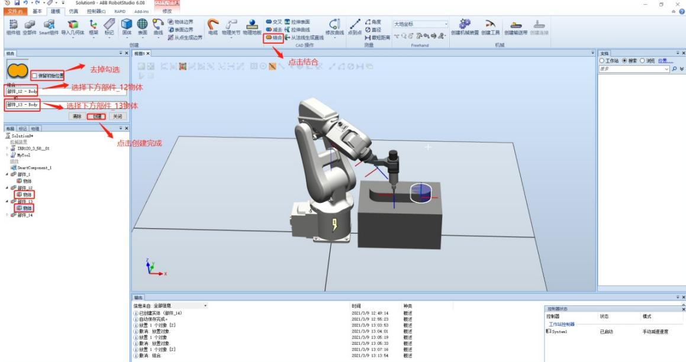


图 5.8 部件结合 1


9.重复上面的操作，将部件_16 和部件_14 组合到一起。 

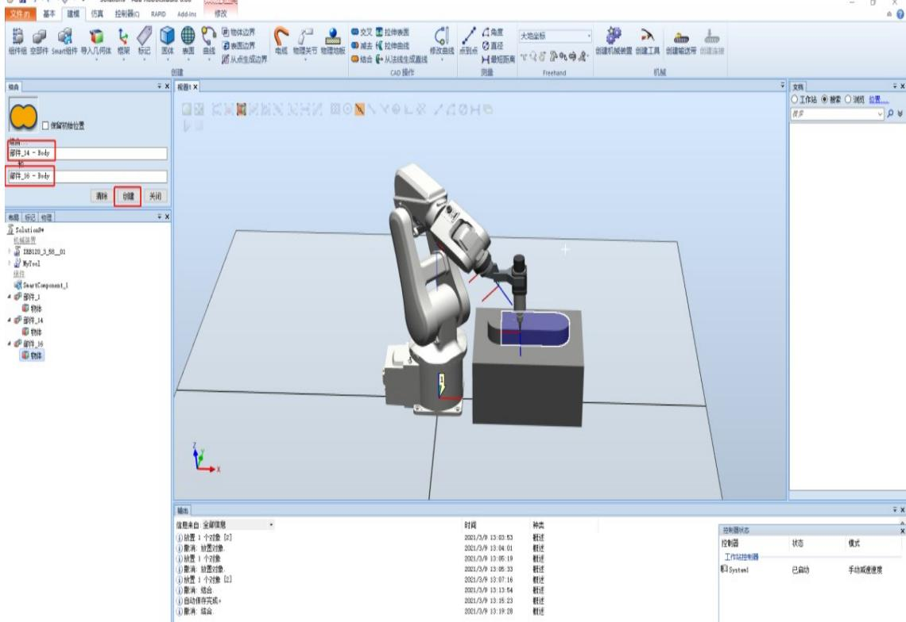


图 5.9 部件结合 2


10.得到一个新的部件_18,右键选择修改，点击设定颜色，将其颜色修改为 红色。 

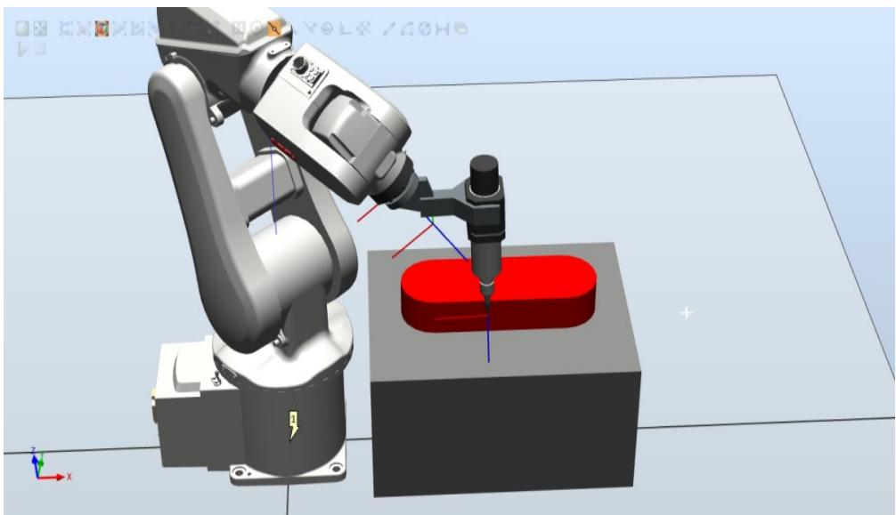


图5.10 修改部件颜色


11.开始编写程序，使机器人焊枪末端的焊嘴沿部件_18 上边沿做焊接轨迹 运动，轨迹示意图如下。 

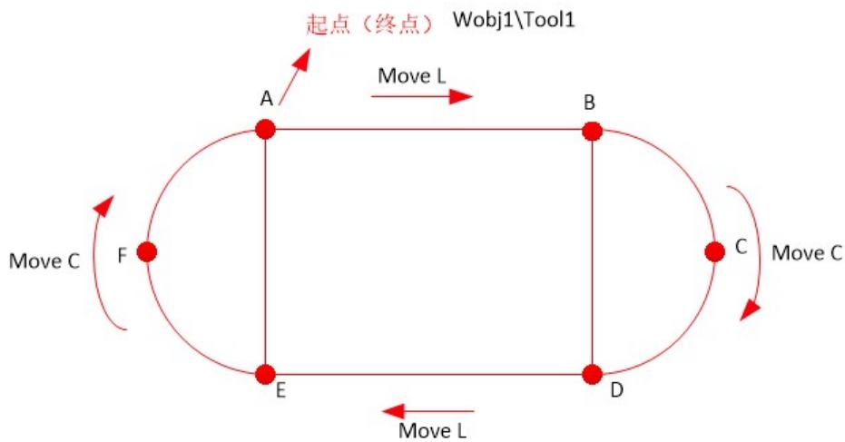


图 5.11 部件边缘轨迹示意图


12.编写上面的程序时，知道 $_ { \mathrm { A , B , C , D , E , F } }$ 之间的距离关系，只需要示教一 个点位A，就可以知道其他点位的位置，通过 offs 指令进行偏移就可以得到其 他点位的坐标。这是其中的一种方法，另一种方法就是将机器人 $_ { \mathrm { A , B , C , D , E , F } }$ 轨迹上所有的点位进行示教，然后编写运动指令代码，也可以完成上面的轨迹， 但是此方法比较笨重，需要示教很多点位。但是在实际生产过程中，不知道加 工件的尺寸及位置关系就没法进行位置偏移，这个时候就需要示教每个点位进 行轨迹运动。程序中运动位置都是基于A点进行偏移，所以可以将 A点作为 一个常量进行定义。程序中添加了工件和工具坐标系，系统程序文件会自己生 成数据如下图所示： 

```matlab
MODULE TestModule
CONST robtarget p1:=[[293.59, -9.56,497.27], [3.94407E-5,8.94529E-6,1, -1.89021E-7], [-1,0,-1,0], [9E+9,9E+9,9E+9,9E+9,9E+9,9E+9]];
CONST robtarget p2:=[[124.09,142.04,374.89], [3.83483E-5,9.05388E-6,1, -2.98581E-7], [0,-1,0,0], [9E+9,9E+9,9E+9,9E+9,9E+9,9E+9]];
CONST robtarget p3:=[[516.88,142.04,374.89], [3.84595E-5,9.09881E-6,1, -3.01482E-7], [0,-1,0,0], [9E+9,9E+9,9E+9,9E+9,9E+9,9E+9]];
CONST robtarget p4:=[[516.87, -153.14,374.89], [3.82592E-5,4.25901E-6,1,6.00488E-7], [-1,0,-1,0], [9E+9,9E+9,9E+9,9E+9,9E+9,9E+9]];
CONST robtarget p5:=[[122.71, -153.14,374.89], [3.83232E-5,4.32312E-6,1,4.9544E-7], [-1,0,-1,0], [9E+9,9E+9,9E+9,9E+9,9E+9,9E+9]];
CONST robtarget p6:=[[274.84, -2.07,371.39], [3.81202E-5,9.06695E-6,1, -2.31293E-7], [-1,0,-1,0], [9E+9,9E+9,9E+9,9E+9,9E+9,9E+9]];
CONST robtarget Point_A:=[[241.15,12.13,416.61], [3.55029E-5,4.37354E-6,1,6.44499E-7], [0,-1,0,0], [9E+9,9E+9,9E+9,9E+9,9E+9,9E+9]];
CONST robtarget Point_AL0:=[[229.34,0.69,412.94], [3.57676E-5,4.41686E-6,1,6.94945E-7], [0,0,0,0], [9E+9,9E+9,9E+9,9E+9,9E+9,9E+9]];
CONST robtarget Home:=[[349.26,13.03,508.49], [3.55662E-5,4.384E-6,1,6.59472E-7], [0,-1,0,0], [9E+9,9E+9,9E+9,9E+9,9E+9,9E+9]];
CONST robtarget Point_A20:=[[349.26,13.03,508.49], [3.55662E-5,4.384E-6,1,6.59472E-7], [0,-1,0,0], [9E+9,9E+9,9E+9,9E+9,9E+9,9E+9]];
CONST robtag Point B:=[[300.71 1.25 416 .88], [3.57754E-5 4.38057F-6 1 6.47613F-7] [0 0 , 0 , 0] [                                                                                                    <nl>
CONST robtag A:=[-5.56,.225.91,-56..88], [0..00%43377,-0..0%18%39..0..0%57%15,-0..0%41%8%13], [0,-1..0 ,0] , [           .% + E + E + E + E + E + E + E + E + E + E + E + E + E + E + E + E + E + E + E + E + E + E + E + E + E + E + E + E + E + E + E + E + E + E + E + E + E + E + E + E + E + E + E + E + E + E + E + E + E + E + I ] ; 
```


图 5.12 轨迹程序


图 5.13 部分程序图 

实验练习：在仿真软件中，创建台体的大小为500*400*300mm，再在台体上创 建一个300*100*60mm 矩形方块，两个直径100*高60mm 的圆柱体，将台体上 三个物体组合到一起形成部件，编写该部件边缘运动轨迹程序并调试出来。 

