## 第六章 基于Socket通讯控制机器人运动实验

实验目的：学习Socket通讯方法，字符数据的处理和 6轴单独运动控制 

实验要求：掌握Socket通讯方法，字符数据的处理和 6轴单独运动控制 

实验设备：型号 MFTW-IR 和 CHL-JC-02-A 的工作站 

ABB机器人通讯常用的通讯有两种方式，一种是Socket网络，一种是Profinet, 机器人能使用这两种通讯，需要机器人控制器本身具有616-1PCInterface 和 888-2 PROFINET Controller/Device 这两个功能选项。 

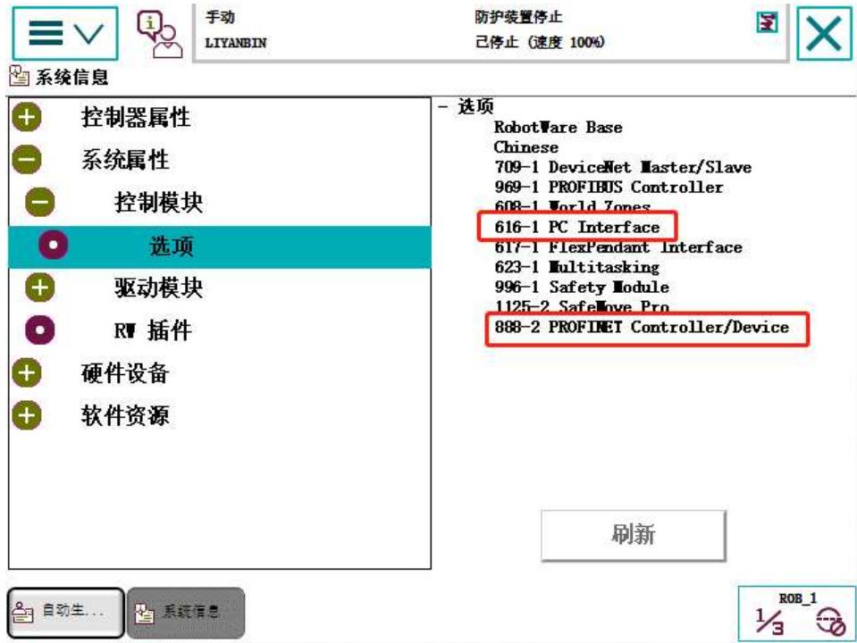


图 6.1 选项功能


Socket通讯是TCP网络通讯中的一种。Socket通讯需要有服务端和客户端。 服务端和客户端之间需要确定通讯的IP 地址和端口号。根据固定的IP 地址和端 口号进行定向接收和发送数据。服务端与客户端的区别类似于主从关系，只有在 服务端建立了一个固定的IP 地址和端口号的服务，客户端才能连接服务端，才 能建立通讯。如果服务端关闭服务，客户端就不能进行通讯连接，故服务端是主， 客户端是从。一个服务端能同时允许很多客户端连接，但一个客户端只能连接一 个服务端。根据这种关系和实际情况来创建所需要是客户端还是服务端。 

例如：在ABB 机器人控制试验中，需要通过视觉、PLC、树莓派等外部器 件与机器人通讯，故需要机器人同时连接多台设备，机器人就作为服务端，视觉、 

PLC、树莓派就作为客户端，这样机器人就能允许任何设备同时连接，通过 IP 地址和端口号，每个客户端在各自的信道通讯而相互不干扰。 

在编写通讯程序之前，学习ABB机器人用于socket 通讯的相关指令及函数； 

## 1.服务端常用指令：

SocketCreat：创建一个新套接字； 

SocketBind：将套接字的IP 与端口号绑定； 

SocketListen：监听客户端连接； 

SocketAccept：接收客户端连接； 

SocketReceive：接收数据； 

SocketSend：发送数据； 

SocketClose：关闭套接字； 

## 2.客户端常用指令：

SocketCreat：创建一个套接字； 

SocketConnect：连接服务端； 

SocketReceive：接收数据； 

SocketSend：发送数据； 

SocketClose：关闭套接字； 

指令的具体定义及用法见下表函数指令解释： 

## 1.222 SocketCreate- 创建新套接字

<table><tr><td>手册用法</td><td>SocketCreate用于针对基于通信或非连接通信的连接,创建新的套接字。带有交付保证的流型协议TCP/IP以及数据电报协议UDP/IP的套接字消息传送均得到支持。可开发服务器和客户端应用。针对数据电报协议UDP/IP,支持采用广播。</td></tr><tr><td>基本示例</td><td>以下实例介绍了指令SocketCreate:</td></tr><tr><td>例1</td><td>VAR socketdev socket1;...SocketCreate socket1;创建使用流型协议TCP/IP的新套接字设备,并分配到变量socket1。</td></tr><tr><td>例2</td><td>VAR socketdev udp_sock1;...SocketCreate udp_sock1 \UDP;创建使用数据电报协议UDP/IP的新套接字设备,并分配到变量udp_sock1。</td></tr><tr><td>变元</td><td>SocketCreate Socket [\UDP]</td></tr><tr><td>Socket</td><td>数据类型:socketdev用于储存系统内部套接字数据的变量。</td></tr><tr><td>[\UDP]</td><td>数据类型:switch指定套接字应当为数据电报型协议UDP/IP。</td></tr><tr><td>程序执行</td><td>本指令创建新的套接字设备。套接字不得业已使用。套接字在SocketCreate和SocketClose之间使用。</td></tr><tr><td>限制</td><td>可声明任意数量的套接字,但是仅可能同时使用32个套接字。通过SocketCreate ... SocketClose,避免快回路,因为在某一特定时间之前,套接字并未真正关闭(当使用TCP/IP功能时)。</td></tr><tr><td>语法</td><td>SocketCreate[Socket &#x27;:=&#x27;] &lt; variable (VAR) of socketdev&gt;[ &#x27;\&#x27; UDP ] &#x27;;&#x27;</td></tr></table>


图 6.2 SocketCreat 函数释义


1.219 SocketBind-将套接字与我的IP地址和端口绑定


<table><tr><td>手册用法</td><td colspan="2">SocketBind用于将套接字与指定服务器IP地址和端口号绑定。SocketBind仅可用于服务器应用。</td></tr><tr><td>基本示例</td><td colspan="2">以下实例介绍了指令SocketBind:</td></tr><tr><td>例1</td><td colspan="2">VAR socketdev server_socket;SocketCreate server_socket;SocketBind server_socket, &quot;192.168.0.1&quot;, 1025;创建服务器套接字,并与地址为192.168.0.1的控制器网络上的端口1025绑定。现在,可在SocketListen指令中使用服务器套接字,以监听位于该端口和地址上的输入连接。</td></tr><tr><td>变元</td><td colspan="2">SocketBind Socket LocalAddress LocalPort</td></tr><tr><td>Socket</td><td colspan="2">数据类型:socketdev有待绑定的服务器套接字。必须创建尚未绑定的套接字。</td></tr><tr><td>LocalAddress</td><td colspan="2">数据类型:string将服务器网络地址与套接字绑定。唯一有效的地址为所有公共WAN地址,或控制器服务端口地址192.168.125.1。</td></tr><tr><td>LocalPort</td><td colspan="2">数据类型:num将服务器端口号与套接字绑定。通常,可自由使用端口1025-4999。</td></tr><tr><td>程序执行</td><td colspan="2">将服务器套接字与指定服务器端口和IP地址绑定。如果已在使用指定端口,则会产生错误。在启动程序的过程中,使用SocketBind和SocketListen指令,从而使局部地址与套接字相关联,随后,监听指定端口上的输入连接。针对用到的各套接字和端口(TCP/IP),仅建议实施上述操作一次。如果通过SocketReceiveFrom(UDP/IP)来接收数据,则使用SocketBind指令。</td></tr><tr><td rowspan="2">错误处理</td><td colspan="2">系统会生成下列可恢复错误,并在错误处理器中处理这些错误。系统变量ERRNO将被设置成:</td></tr><tr><td>ERR_SOCK_CLOSED</td><td>关闭套接字(已经关闭或未创建)将SocketCreate用于创建新的套接字。</td></tr></table>


下一页继续 


图 6.3 SocketBind 函数释义 


1.223 SocketListen- 监听输入连接


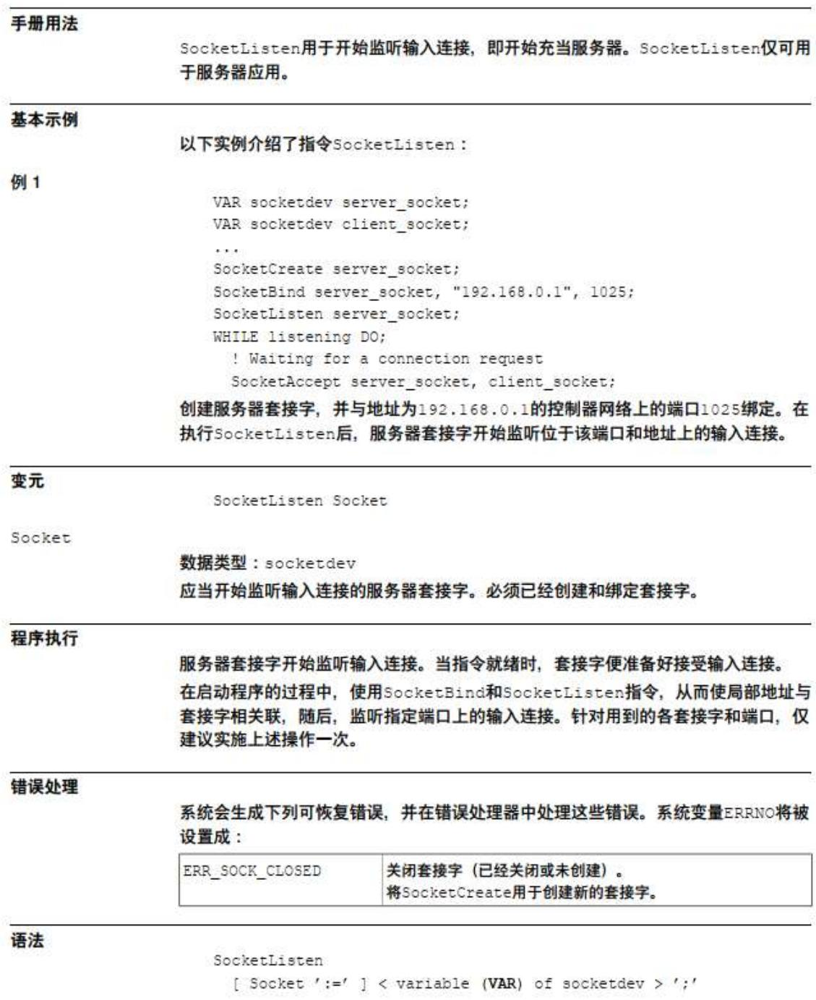


图 6.4 SocketListen 函数释义


1.218 SocketAccept- 接受输入连接


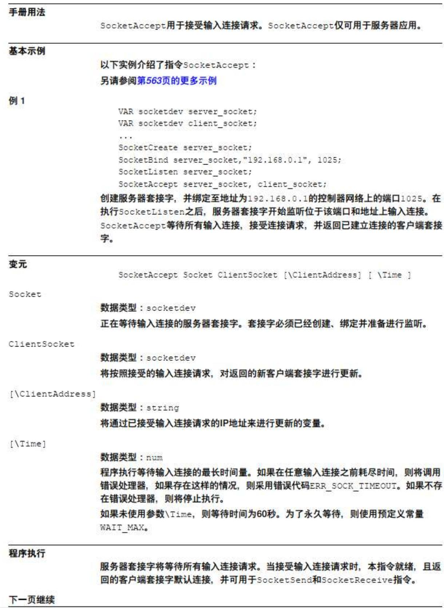


图 6. 5SocketAccept 函数释义


1.224 SocketReceive-接收来自远程计算机的数据


<table><tr><td>手册用法</td><td>SocketReceive用于从远程计算机接收数据。SocketReceive可用于客户端和服务器应用。</td></tr><tr><td>基本示例</td><td>以下实例介绍了指令SocketReceive:另请参阅第577页的更多示例</td></tr><tr><td>例1</td><td>VAR string str_data;...SocketReceive socket1 \Str := str_data;从远程计算机接收数据,并将其储存在字符串变量str_data中。</td></tr><tr><td>变元</td><td>SocketReceive Socket [ \Str ] | [ \RawData ] | [ \Data ][\ReadNoOfBytes] [\NoRecBytes] [\Time]</td></tr><tr><td>Socket</td><td>数据类型:socketdev在套接字接收数据的客户端应用中,必须已经创建和连接套接字。在套接字接收数据的服务器应用中,必须已经接受套接字。</td></tr><tr><td>[ \Str ]</td><td>数据类型:string应当储存接收string数据的变量。可处理最多80个字符。</td></tr><tr><td>[ \RawData ]</td><td>数据类型:rawbytes应当储存接收原始数据字节数据的变量。可处理最多1024个rawbytes。</td></tr><tr><td>[ \Data ]</td><td>数据类型:array of byte应当储存接收字节数据的变量。可处理最多1024个byte。仅可在同一时间使用可选参数\Str、\RawData和\Data之一。</td></tr><tr><td>[ \ReadNoOfBytes ]</td><td>Read number of Bytes数据类型:num待读取的字节数。待读取字节的最小值为1,且最大数量为所用数据类型的规模,即如果使用数据类型string的变量,则为80个字节。如果与始终发送固定字节数的客户端进行通信,则该可选参数可用于指定针对各SocketReceive指令所应读取的相同字节数量。如果发送方发送原始数据,则接收方需要指定针对已发送的各rawbytes所应接收的4个字节。</td></tr><tr><td>下一页继续</td><td></td></tr></table>


图 6.6 SocketReceive 函数释义


1.226 SocketSend- 向远程计算机发送数据


<table><tr><td>手册用法</td><td>SocketSend用于向远程计算机发送数据。SocketSend可用于客户端和服务器应用。</td></tr><tr><td>基本示例</td><td>以下实例介绍了指令SocketSend:另请参阅第585页的更多示例</td></tr><tr><td>例1</td><td>SocketSend socket1 \Str := &quot;Hello world&quot;;将消息&quot;Hello world&quot;发送给远程计算机。</td></tr><tr><td>变元</td><td>SocketSend Socket [ \Str ] | [ \RawData ] | [ \Data] [ \NoOfBytes ]</td></tr><tr><td>Socket</td><td>数据类型:socketdev在客户端应用中,必须已经创建和连接用于发送的套接字。在服务器应用中,必须已经接受用于发送的套接字。</td></tr><tr><td>[ \Str ]</td><td>数据类型:string将string发送到远程计算机。</td></tr><tr><td>[ \RawData ]</td><td>数据类型:rawbytes将rawbytes数据发送到远程计算机。</td></tr><tr><td>[ \Data ]</td><td>数据类型:array of byte将byte数组中的数据发送到远程计算机。仅可在同一时间使用可选参数\Str、\RawData或\Data之一。</td></tr><tr><td>[ \NoOfBytes ]</td><td>数据类型:num如果指定该参数,则仅将该字节数发送到远程计算机。如果\NoOfBytes大于待发送数据结构中的实际字节数,则SocketSend调用将失败。如果未指定该参数,则将整个数据结构(rawbytes的有效部分)发送到远程计算机。</td></tr></table>


图 6.7 SocketSend 函数释义


1.220 SocketClose- 关闭套接字


<table><tr><td>手册用法</td><td colspan="2">当不再使用套接字连接时,使用SocketClose。在已经关闭套接字之后,不能将其用于除SocketCreate以外的所有套接字调用。</td></tr><tr><td>基本示例</td><td colspan="2">以下实例介绍了指令SocketClose:</td></tr><tr><td>例1</td><td colspan="2">SocketClose socket1;关闭套接字,且不能再进行使用。</td></tr><tr><td>变元</td><td colspan="2">SocketClose Socket</td></tr><tr><td>Socket</td><td colspan="2">数据类型:socketdev有待关闭的套接字。</td></tr><tr><td>程序执行</td><td colspan="2">将关闭套接字,并将释放其配置资源。可在任意时间关闭任意套接字。关闭后,不能再使用套接字。在调用SocketCreate之后,可将其再次用于新的连接。</td></tr><tr><td>限制</td><td colspan="2">在通过SocketSend发送数据后,随即关闭套接字连接,这会导致失去发送的数据。因为TCP/IP套接字具有在出现通信问题时重新发送数据的内置功能。为避免有关数据丢失的此类问题,应在SocketClose之前进行以下操作:交换关闭信号,或WaitTime2通过SocketCreate...SocketClose,避免快回路,因为在某一特定时间之前,套接字并未真正关闭(TCP/IP功能)。</td></tr><tr><td>语法</td><td colspan="2">SocketClose[Socket &#x27;:=&#x27; ] &lt; variable (VAR) of socketdev &gt; &#x27;;&#x27;</td></tr><tr><td rowspan="6">相关信息</td><td colspan="2"></td></tr><tr><td>信息,关于</td><td>更多信息</td></tr><tr><td>一般的套接字通信</td><td>应用手册-控制器软件IRC5,套接字消息传送一节</td></tr><tr><td>创建新套接字</td><td>第572页的SocketCreate-创建新套接字</td></tr><tr><td>连接远程计算机(仅客户端)</td><td>第569页的SocketConnect-连接远程计算机</td></tr><tr><td>向远程计算机发送数据</td><td>第584页的SocketSend-向远程计算机发送数据</td></tr></table>


图 6.8 SocketClose 函数释义


下一页继续 


1.221 SocketConnect-连接远程计算机


<table><tr><td>手册用法</td><td>SocketConnect用于将套接字与客户端应用中的远程计算机相连。</td></tr><tr><td>基本示例</td><td>以下实例介绍了指令SocketConnect:另请参阅第569页的更多示例</td></tr><tr><td>例1</td><td>SocketConnect socket1, &quot;192.168.0.1&quot;, 1025;尝试与ip地址192.168.0.1和端口1025处的远程计算机相连。</td></tr><tr><td>变元</td><td>SocketConnect Socket Address Port [\Time]</td></tr><tr><td>Socket</td><td>数据类型:socketdev有待连接的服务器套接字。必须创建尚未连接的套接字。</td></tr><tr><td>Address</td><td>数据类型:string远程计算机的地址。必须将远程计算机指定为一个IP地址。不可能使用远程计算机的名称。</td></tr><tr><td>Port</td><td>数据类型:num位于远程计算机上的端口。通常,可自由使用端口1025-4999。可能已经采用了低于1025的端口。</td></tr><tr><td>[\Time]</td><td>数据类型:num程序执行等待接受或否定连接的最长时间量。如果在满足条件之前耗尽时间,则将调用错误处理器,如果存在这样的情况,则采用错误代码ERR_SOCK_TIMEOUT。如果不存在错误处理器,则将停止执行。如果未使用参数\Time,则等待时间为60秒。为了永久等待,则使用预定义常量WAIT_MAX。</td></tr><tr><td>程序执行</td><td>套接字试图连接指定地址和端口上的远程计算机。程序执行将等待,直至连接得以建立、失效或出现超时。</td></tr><tr><td>更多示例</td><td>有关于指令SocketConnect的更多例子阐述如下。</td></tr><tr><td>例1</td><td>VAR num retry_no := 0;VAR socketdev my_socket;</td></tr></table>


图 6.9 SocketConnect 函数释义


```txt
机器人作为服务端创建一个 Socket 程序，接收并发送字符；  
PROC SocketServer()  
VAR socketdev server_socket1;定义一个服务端；  
VAR socketdev client_socket1;定义一个客户端；  
VAR string client_ip:="10.70.2.240";定义客户端的IP地址；  
VAR string receive_string;定一个存储接收的字符串；  
SocketClose server_socket1;在创建socket之前先关闭，保证每次都能创建成功；  
SocketClose client_socket1;  
SocketCreate server_socket1;创建服务端套接字；  
SocketBind server_socket1,"10.70.2.252",3000;将机器人服务IP和端口号绑定；  
SocketListen server_socket1;开启监听；  
SocketAccept server_socket1,client_socket1\ClientAddress:=client_ip\Time:=WAIT_MAX;  
开启接收客户端连接，连接的等待时间为无限长，直到客户端连接上，如果没有连接上一直等待连接； 
```

WHILE TRUE DO 

SocketReceive client_socket1\str:=receive_string\Time:=WAIT_MAX;用于接收 

客户端发来的字符串，等待时间无无限长； 

TPWrite "receive_string="+receive_string;将接收的字符串打印输出显示； 

SocketSend client_socket1\Str:="Hello World";给客户端发送“Hello Word”； 

ENDWHILE 

ENDPROC 

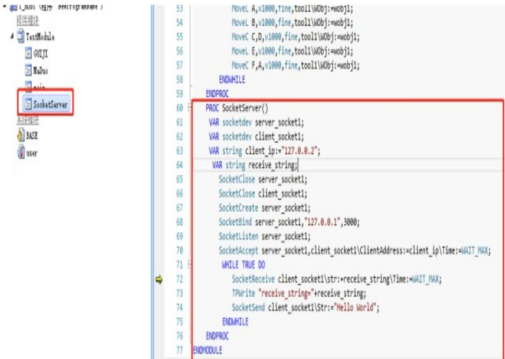


图 6.10 通讯程序图


运行示教器上的 SocketServer 例行程序； 

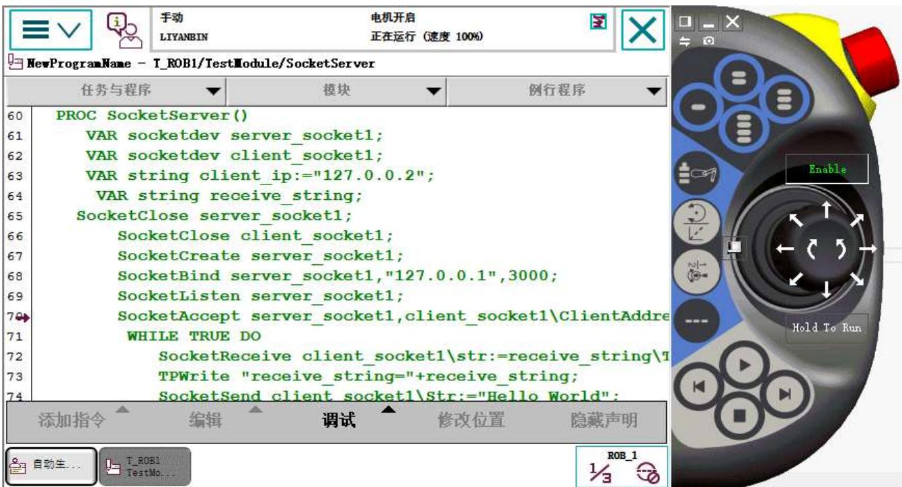


图 6.11示教器通讯程序界面


打开网络调试助手，创建一个客户端，连接服务端，发送数据： 

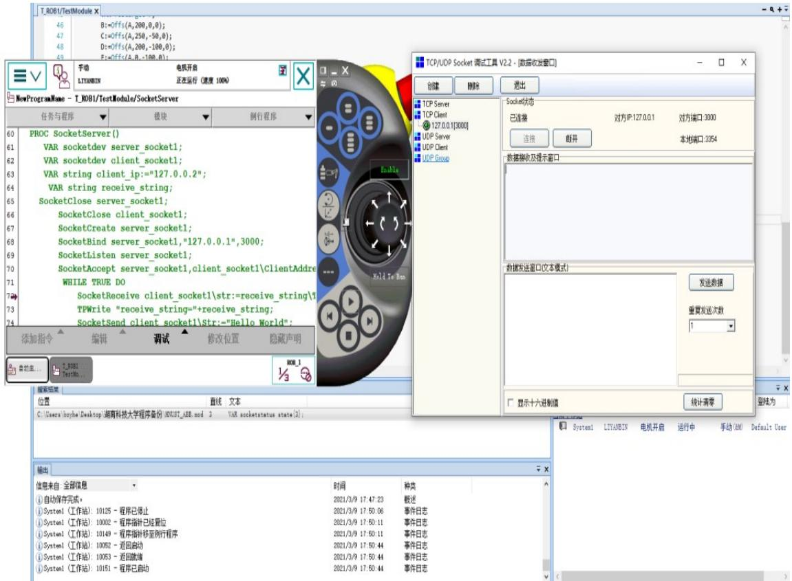


图 6.12 网络调试助手创建客户端连接


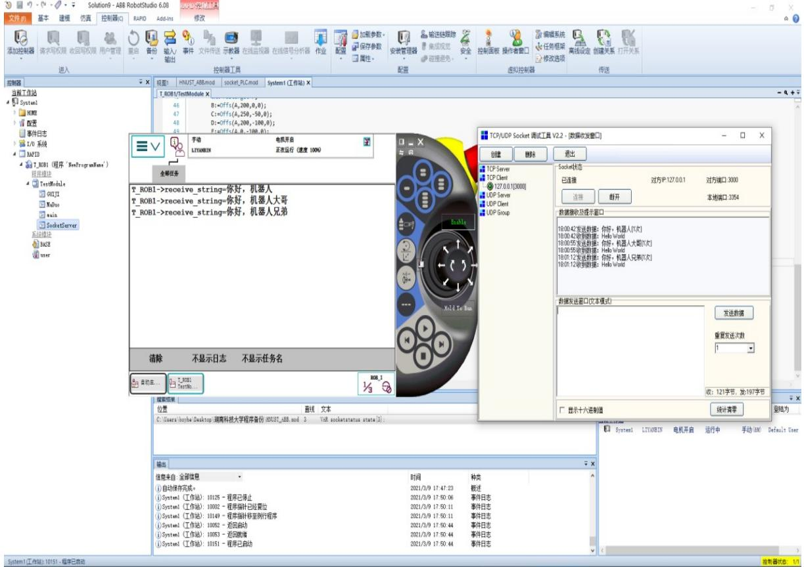


图6.13 发送数据测试


注：在真实的机器人上面实现socket通讯，需要配置电脑 IP 和机器人 Server 网口（固定 IP：192.168.125.1）或者机器人 WAN 网口，LAN 网口的 IP 地址在 同一网段。 

示教器设置方法：打开控制面板，选择配置系统参数，主题选择 Communication，选择 IP Setting，点击添加，输入相应的 IP 地址，interface 选择 定义为哪个网口的IP（LAN，LAN3，WAN），设置好确定即可。 

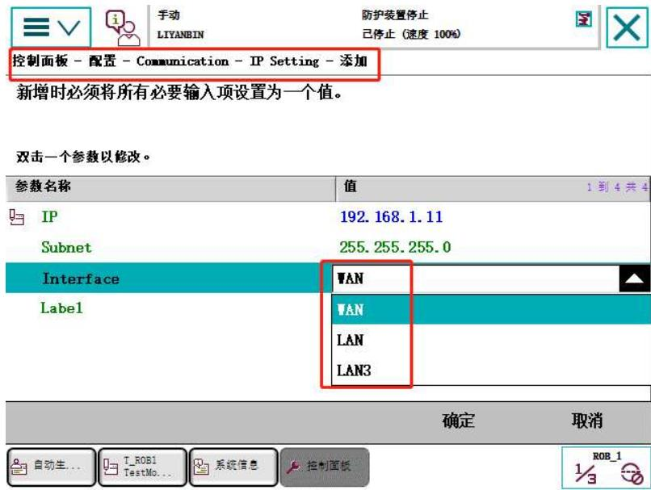


图 6.14 示教器网络端口配置


Robotstudio 软件设置方法：选择任务栏“控制器”，点击配置，选择 communication，选择 IP Setting，右键新建，输入 IP 地址，interface 选择对应网 口，点击确定即可。 

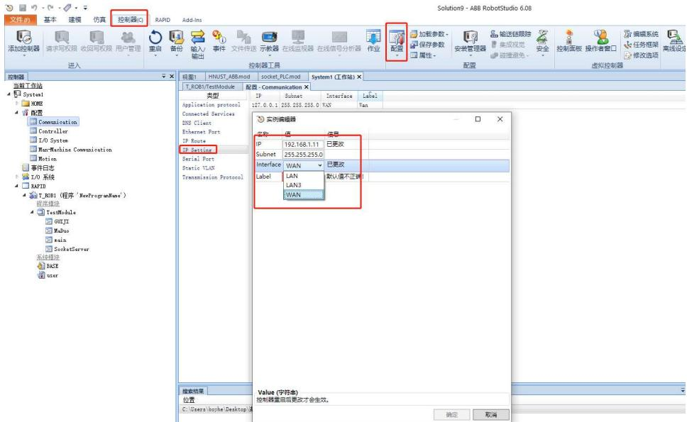


图 6.15 robotstudio 软件配置网络端口


任务：在机器人端创建客户端，用网络调试助手创建服务端，使机器人连接，并 接收和发送数据。 

基于socket通讯控制机器人运动可分为三个部分，一个是通讯程序，一个是 数据处理，一个是控制指令。 

数据处理有很多种方式，以下只讲解一种，其余的大家可以根据ABB 指令 手册去查找相关的指令，实现的方法很多，掌握其中的一种即可。 

机器人接收到数据转换为值类型数据，如果控制机器人运动，就是需要将值 类型的数据赋值给机器人点位坐标，机器人按照赋值后的点位数据进行移动，达 到控制的目的。 

机器人处理数据方法一：按位分割，将一连串任意字符的字符串按照取位数 进行任意分组，比如-123a,456;，总共是10 位字符组成的字符串，如果按照取位 数为2、3、4、1的分组方式，第一组是“-1”，第二组是“23a”,第三组是“,456”， 第四组是“;”。 


图 6.16字符串按位分组示意图


机器人数据按位分割函数：StrPart；


2.164 StrPart-寻找一部分字符串


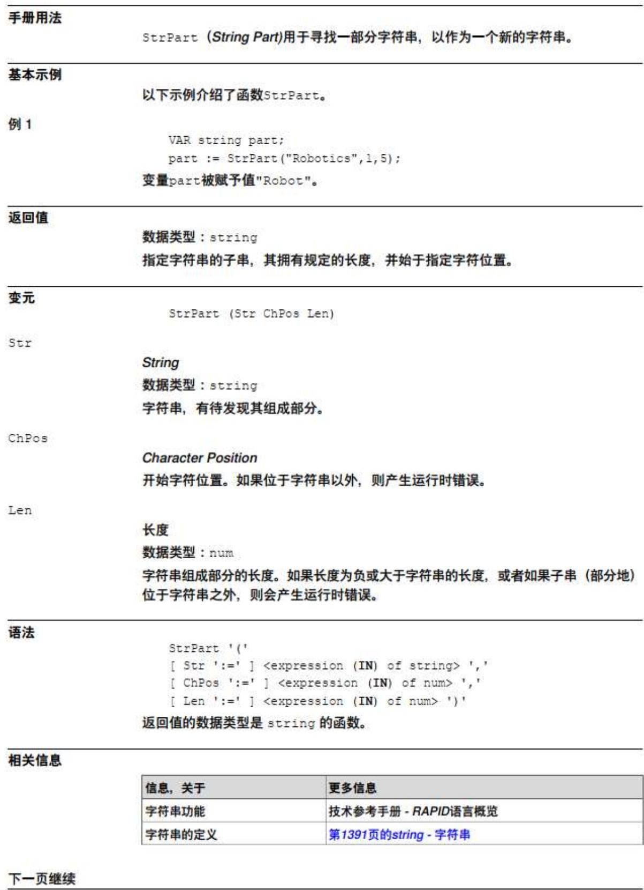


图 6.17 StrPart 函数释义


## 6.1 控制机器人6 个轴单独运动程序

```txt
基于上节程序进行更改如下：
PROC SocketServer()
VAR socketdev server_socket1;
VAR socketdev client_socket1;
VAR string client_ip:="10.70.2.240";客户端的IP地址
VAR string receive_string;
VAR string string_j1:="";定义用于分割取位后存储字符的字符串
VAR string string_j2:="";
VAR string string_j3:="";
VAR string string_j4:="";
VAR string string_j5:="";
VAR string string_j6:="";
VAR num num_j1:=0;定义将取位后的字符串转换成值类型的数据存储
VAR num num_j2:=0;
VAR num num_j3:=0;
VAR num num_j4:=0;
VAR num num_j5:=0;
VAR num num_j6:=0;
VAR bool change_ok:=false;转换标志位
VAR robtarget current_position_robT;定义robtarget类型的坐标点
VAR jointtarget current_position_jointT;定义jointtarget类型的坐标点
SocketClose server_socket1;
SocketClose client_socket1;
SocketCreate server_socket1;
SocketBind server_socket1," 10.70.2.252",3000;机器人端IP地址和端口
SocketListen server_socket1;
SocketAccept
server_socket1,client_socket1\ClientAddress:=client_ip\Time:=WAIT_MAX;
WHILE TRUE DO 
```

SocketReceive 

client_socket1\str:=receive_string\Time:=WAIT_MAX; 

TPWrite "receive_string="+receive_string; 

SocketSend client_socket1\Str:="Hello World"; 

string_j1:=StrPart(receive_string,1,6);对接收的字符串按位分割，每6位 

为一组坐标（例：-321.1保留两位 

小数，正好可以满足机器人坐标数 

string_j2:=StrPart(receive_string,7,6);第7位开始的6个字符串 

string_j3:=StrPart(receive_string,13,6); 第13位开始的6个字符串 

string_j4:=StrPart(receive_string,19,6); 第19位开始的6个字符串 

string_j5:=StrPart(receive_string,25,6); 第25位开始的6个字符串 

string_j6:=StrPart(receive_string,31,6); 第31位开始的6个字符串 

change_ok:=StrToVal(string_j1,num_j1);!j1将接收的字符串转换为值类 

型的数据（值可以是整数也可 

以是小数） 

change_ok:=StrToVal(string_j2,num_j2);!j2 

change_ok:=StrToVal(string_j3,num_j3);!j3 

change_ok:=StrToVal(string_j4,num_j4);!j4 

change_ok:=StrToVal(string_j5,num_j5);!j5 

change_ok:=StrToVal(string_j6,num_j6);!j6 

current_position_robT:= CRobT(\Tool:=tool1\wobj:=wobj1);获取当前坐 

标点的数据赋值给current_position_robT点位。 

current_position_jointT:=CalcJointT(current_position_robT,tool1 

\WObj:=wobj1);将robtarget型数据转换为jointtarget。 

current_position_jointT:=Absjoffs(current_position_jointT,num_j1,num_j2,num_j3,n 

um_j4,num_j5,num_j6);赋值函数 

MoveAbsJ current_position_jointT\NoEOffs, v1000, fine, tool1; 

ENDWHILE 

ENDPROC 

FUNC jointtarget Absjoffs(jointtarget Point,num j10ffset,num j20ffset,num J30ffset,num J40ffset,num J50ffset,num J60ffset) 偏移函数 

VAR jointtarget joint_temp; 

joint_temp:=Point; 

joint_temp.robax.rax_1:=joint_temp.robax.rax_1+J10ffset;对轴数据进行 赋值。 

joint_temp.robax.rax_2:=joint_temp.robax.rax_2+J20ffset; 

joint_temp.robax.rax_3:=joint_temp.robax.rax_3+J30ffset; 

joint_temp.robax.rax_4:=joint_temp.robax.rax_4+J40ffset; 

joint_temp.robax.rax_5:=joint_temp.robax.rax_5+J50ffset; 

joint_temp.robax.rax_6:=joint_temp.robax.rax_6+J60ffset; 

RETURN joint_temp; 

## ENDFUNC

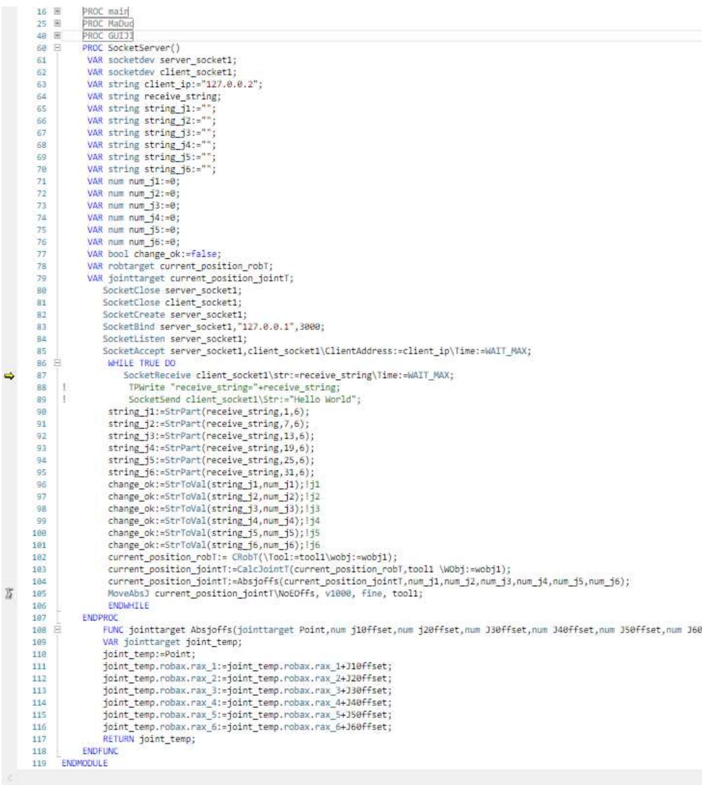


图 6.18 六轴控制程序图


例如;客户端发送 5.0000000000000000000000000000000000 机器人第一轴就 会向正方向移动 5°,发送-10.00000000000000000000000000000000 就会向第一轴 负方向移动10°总共36 位数字。 

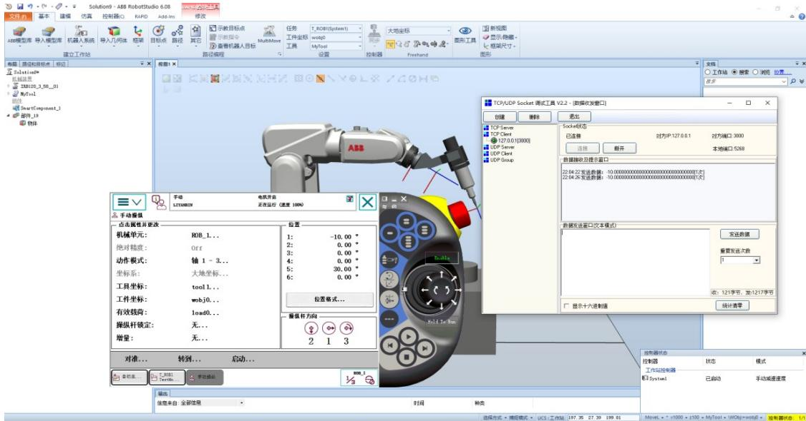


图 6.19发送移动数据测试


实验练习：通过编程实现socket 通讯发送数据控制机器人做XYZ线性运动。 提示内容：机器人线性运动坐标赋值方法。 

$$
\text { current\_position\_robT } := \text { CRobT } (\backslash \text { Tool }: = \text { tool0 } \backslash \text { wobj }: = \text { wobj1 });
$$

current_position_robT.trans.x:=current_position_robT.trans.x+num_j1; 

current_position_robT.trans.y:=current_position_robT.trans.y+num_j2; 

current_position_robT.trans.z:=current_position_robT.trans.z+num_j3; 

MoveL current_position_robT,v100,fine,tool1\wobj:=wobj1; 

如果运行出现套接字错误，改 server_socket1 变为 server_socket4 或其他， client_socket1 变为 client_socket4 或其他，端口号 3002 改为 3010 或其他，其他 的程序对应的变量依次修改。 

