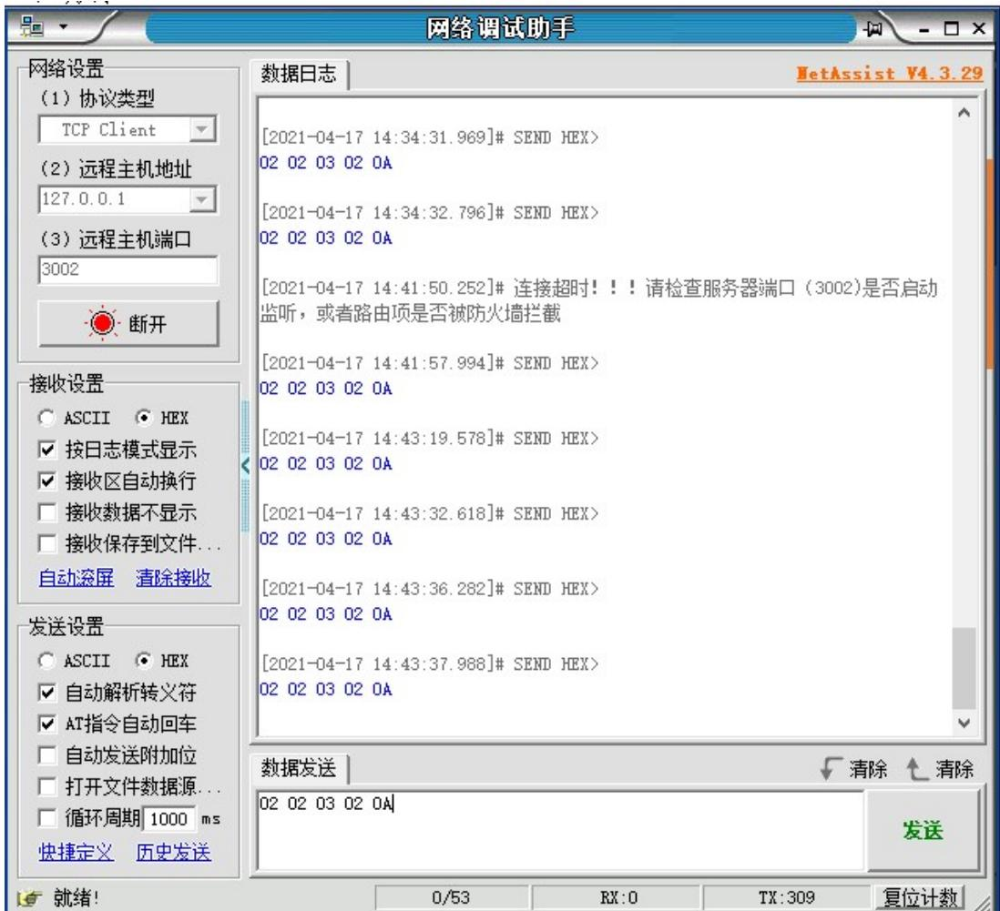
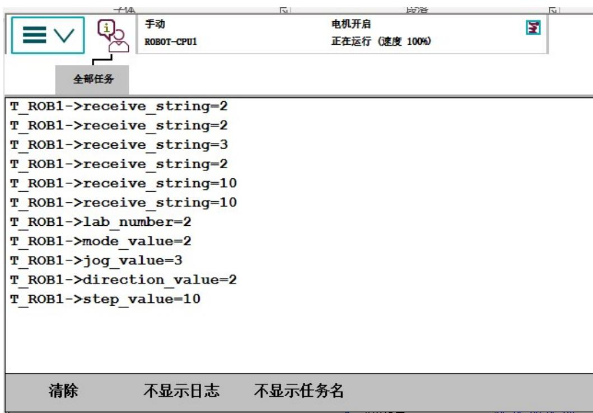
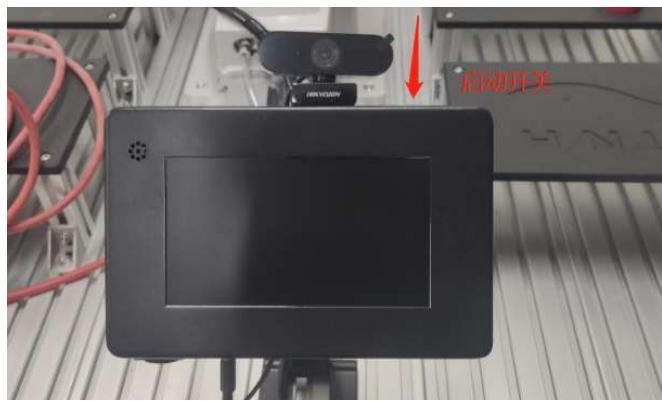
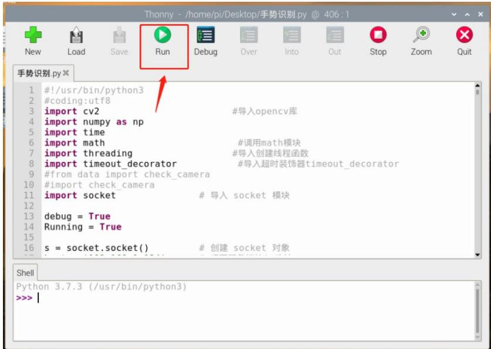
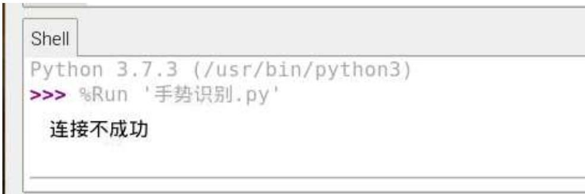
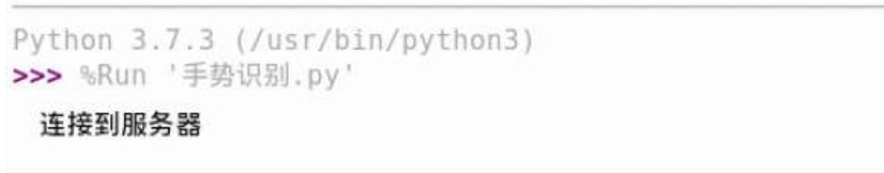
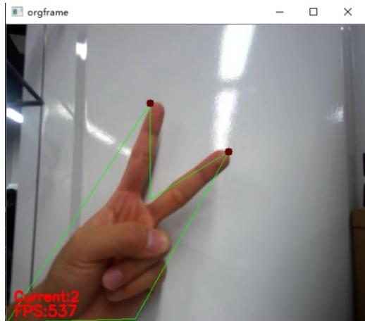

## 第七章 手势识别控制机器人运动实验

## 1、实验目的

手势识别可以来自人的身体各部位的运动，但一般是手的运动。用户可以使 用简单的手势来控制或与设备交互，让计算机理解人类的行为。其核心技术为手 势分割、手势分析以及手势识别。 

## 2、实验原理

通过 opencv 图像处理去除背景，提取手指轮廓，进行形态学滤波处理提取 区域。找到二值化的图像轮廓，对手指的轮廓面积和手指之间的角度、距离进行 判断，从而计算出出手指的个数。 

3、实验设备：型号 MFTW-IR 和 CHL-JC-02-A 的工作站。 

4、树莓派系统手势识别网络数据格式定义： 

如：0x02,0x02,0x03,0x01,0x0A（16 进制） 

第一位：实验顺序。 0x02；0x02：这是第二个实验 

第二位：控制机器人运行的模式。0x02； 

第三位：控制某个轴动作。 

第四位：控制方向。 

第五位：步长10个 

0x01：控制 x 轴，0x02：控制 y 轴， 

0x03：控制 z 轴。 

0x01：控制方向向上，0x02控制方向向下 

0x0A 控制机械手运行的速度值 10个步长 


表 1-1 具体手势和执行动作指令


<table><tr><td>手势指令</td><td>手势</td><td>机器人动作</td><td>Socket 指令</td></tr><tr><td>手势 1</td><td></td><td>机械手上升</td><td>[0x02, 0x02, 0x03, 0x01, 0x0A]</td></tr><tr><td>手势 2</td><td></td><td>机械手下降</td><td>[0x02, 0x02, 0x03, 0x02, 0x0A]</td></tr><tr><td>手势 3</td><td></td><td>机械手左移</td><td>[0x02, 0x02, 0x01, 0x01, 0x0A]</td></tr><tr><td>手势 4</td><td></td><td>机械手右移</td><td>[0x02, 0x02, 0x01, 0x02, 0x0A]</td></tr><tr><td>手势 5</td><td></td><td>机械手前进</td><td>[0x02, 0x02, 0x02, 0x01, 0x0A]</td></tr></table>

## 4、实验步骤

1）确保系统配置中有 616-1 PC Interface 功能。 

2）Robotstudio 软件中在线或离线编写程序 

VAR socketdev server_socket2; //定义变量，如果运行出现套接字错误，改 server_socket2变为server_socket4或其他 

```txt
VAR socketdev client_socket2;
VAR string client_ip:="10.70.2.249"; //树莓派IP地址。

电脑虚拟调试IP地址为："127.0.0.2"

VAR byte receive_byte{5}:=[0,0,0,0,0];
PERS byte global_byte{5}:=[0,0,0,0,0];
VAR string receive_string{5};
VAR string str_hextodec{5};
PERS num lab_number:=2;
PERS num mode_value:=0;
PERS num jog_value:=0;
PERS num direction_value:=0;
PERS num step_value:=0;
VAR bool change_ok:=false;
VAR socketstatus state{3};
VAR robtarget current_position_robT;
VAR intnum int_home;
VAR num num_Line{3}:=[0,0,0];
PERS num num2_deg:=0;
VAR robtarget P_temp;
CONST jointtarget

Home:=[[-0.00129488,-0.000801945,0.00505125,-0.000859787,90.0011,-0.000264077],[9E+09,9E+09,9E+09,9E+09,9E+09,9E+09]]
PROC main()
SocketClose server_socket2;
SocketClose client_socket2;
client_ip:="10.70.2.249"; //树莓派IP地址。

电脑虚拟调试IP地址："127.0.0.2"

SocketCreate server_socket2;
SocketBind server_socket2,"10.70.2.252",3002; //ABB机器人IP地址。

电脑虚拟调试ABB的IP地址："127.0.0.1"

SocketListen server_socket2;
SocketAccept server_socket2,client_socket2\ClientAddress:=client_ip\Time:=WAIT_MAX;

WHILE TRUE DO

SocketReceive client_socket2\Data:=receive_byte\Time:=WAIT_MAX;

FOR i FROM 1 TO 5 DO
    global_byte{i}:=receive_byte{i};

ENDFOR

FOR i FROM 1 TO 5 DO
    receive_string{i}:=ByteToStr(global_byte{i});//16进制字转化成字符
    change_ok:=StrToVal(receive_string{1},lab_number); //字符转化成值
    change_ok:=StrToVal(receive_string{2},mode_value);
    change_ok:=StrToVal(receive_string{3},jog_value);
    change_ok:=StrToVal(receive_string{4},direction_value);
    change_ok:=StrToVal(receive_string{5},step_value); 
```

```txt
ENDFOR
FOR i FROM 1 TO 5 DO
    TPWrite "receive_string="+receive_string{i};
ENDFOR
TPWrite "receive_string="+receive_string{5}; //在示教器上显示相应字符串
TPWrite "lab_number="\Num:++lab_number;
TPWrite "mode_value="\Num:++mode_value;
TPWrite "jog_value="\Num:++jog_value;
TPWrite "direction_value="\Num:++direction_value;
TPWrite "step_value="\Num:++step_value;
IF lab_number=2 THEN //实验号选择
TEST mode_value //模式测试
CASE 2:
current_position_robT:=CRobT(\Tool:=tool0\wobj:=wobj0); //机器人当前位置
FOR i FROM 1 TO 3 DO
    IF (i=jog_value) THEN //对控制轴进行判断 1=X,2=Y,3=Z
    TEST direction_value /对控制轴方向判断
    CASE 1:
    num_Line{i]:=step_value; //方向向上
    CASE 2:
    num_Line{i}:=-step_value; //方向向下
    ENDTEST
current_position_robT.trans.x:=current_position_robT.trans.x+num_Line{1};
//机器人在当前位置X轴方向增加或减少的步长后的结果赋值
current_position_robT.trans.y:=current_position_robT.trans.y+num_Line{2};
// 在当前位置Y轴方向增加或减少的步长后的结果赋值
current_position_robT.trans.z:=current_position_robT.trans.z+num_Line{3};
// 在当前位置Z轴方向增加或减少的步长后的结果赋值
MoveL current_position_robT,v100,fine,tool0\wobj:=wobj0;
//机器人赋值后直线移动到该新位置
mode_value:=0; //复位为零
jog_value:=0; //复位为零
direction_value:=0; //复位为零
step_value:=0; //复位为零
FOR i FROM 1 TO 3 DO
    num_Line{i}:=0; //数组复位为零
ENDFOR
FOR i FROM 1 TO 5 DO
    global_byte{i}:=0; //数组复位为零
ENDFOR
Endif
ENDFOR
ENDTEST
Endif 
```

## 3）调试

## 一、虚拟调试

虚拟调试就是利用电脑中robotstudio虚拟示教器手动运行程序时，在电脑中安装 的网络调试助手(NetAssistV4.3)发数据给虚拟机器人,机器人接收到数据后经过 程序解析，判断执行相应的动作。 

a)ABB主程序中的client_ip:= "10.70.2.249"; IP地址改为："127.0.0.2"， 

SocketBind server_socket2,"10.70.2.252",3002; IP地址改为："127.0.0.1"。 

b)打开桌面上网络调试助手软件NetAssistV4.3.29, 在操作界面上选择协议 类型为:TCP Client ,远程主机地址：127.0.0.1；远程主机端口：3002；接收设置选 择：HEX，按日志模式显示，接收区自动换行；发送设置选择：HEX，自动解析 转义符，AT 指令自动回车；在数据发送框中键入所要发送的数据，如：020203 020A，网络调试组手设置如图所示： 




图 7.1 网络调试助手设置


c)编写好 ABB 程序后，手动运行程序，网络调试助手设置好参数后点击 连接，然后数据发送框中输入十六进制数据，点击发送按钮，数据则传 送给虚拟机器人，机器人机械臂会根据程序做出相应的动作。虚拟示教 器上显示出发送过来的数据，如图所示，则说明程序调试成功。 




图 7.2 虚拟示教器显示传送数据


## 二、与树莓派连接调试

## a) 编写ABB 程序，并修改好IP地址。

如果运行出现套接字错误，改 server_socket2 变为 server_socket4 或其他， client_socket2 变为 client_socket4 或其他，端口号 3002 改为 3010 或其他，其 他的程序对应的变量依次修改。 

b) 该实验需要在无复杂背景下去识别，最好是纯白色背景，否则可能 会出现误识别现象。 

c) 运行程序后伸出手指在摄像头前方不要移动，然后改变手指的个数， 机械手会按照手指个数来执行机械手的预设动作，具体执行的串口动作 指令请看串口数据格式定义。 

## d）树莓派软件操作

1、将机器人试验台供电，开启机器人和树莓派系统（图7.3） 




图7.3 开启树莓派


2、找到树莓派桌面上的“手势识别. ${ \tt p y } ^ { \prime \prime }$ 的实验程序。 


图 7.4 手势识别


3. 鼠标右击系统桌面的手势识别软件，选择 Thonny Python IDE 程序打开识别软 件。 


图 7.5 Thonny Python IDE


4.用 Thonny Python IDE 打开软件后,软件菜单栏中点击 Run，执行该手势识 别程序。（图7.6） 




图 7.6 执行程序


5.若在shell显示框打印出“连接不成功”、或shell显示框没有任何显示。可 能是机器人的socket通讯程序未开启。（图7.7） 此时需要开启机器人的 socket服务端程序。 




图 7.7 连接不成功


若在shell显示框打印出“连接到服务器”，且在桌面弹出一个手势识别的识别 框。则表示程序运行成功。（图7.8，图7.9）（手势识别最好放置在白色背景下， 这样识别准确率会更高）。 




图 7.8 连接服务器成功





图7.9 识别界面（手势二）


6、根据手势动作情况，控制机器臂上升、下降、左移动、右移动、前进、后 退。 

树莓派手势识别 python部分程序： 

导入必要的模块 

import cv2 

#导入 opencv 库 

import numpy as np 

import time 

import math 

#调用 math 模块 

import threading 

#导入创建线程函数 

import timeout_decorator 

#导入超时装饰器 timeout_decorator 

from data import check_camera 

import socket 

# 导入 socket 模块 

树莓派连接机械手的socket通讯 

s = socket.socket() 

# 创建 socket 对象 

host = '10.70.2.252 

# 填写相应 abb机器人服务端的 ip地址 

port = 3002 

# 设置端口号 

try: 

s.connect((host, port)) 

print("连接到服务器") 

```python
except:
    print("连接不成功")
    exit(1)
该手势识别中有两个线程函数
get_image 该线程是实时开启摄像头的函数
def get_image():
    global orgFrame
    global ret
    global Running
    global stream, cap
    while True:
    if Running:
    try:
    if cap.isOpened(): #如果检测到摄像头开启
    ret, orgFrame = cap.read() #读取摄像头图像
    else:
    time.sleep(0.01) #否则休眠0.01
    except:
    cap = cv2.VideoCapture(stream)
    print('Restart Camera Successful!')
    else:
    time.sleep(0.01) 
```

runAction 该线程是执行动作的函数。（大约在第 366行附近） 

num_mean 是指识别到的手指个数，如果识别到手指个数为 1，将向服务端发送上升的串口指令。 

```python
def runAction():    #动作函数
    global get_hand_num, action_finish    #全局定义
    global num_mean
    while True:    #开启程序后一直循环判断 num_mean 的值
    #time.sleep(1) 
```

```python
if get_hand_num:    #如果 get_hand_num 的值为真
    #print(1)
    get_hand_num = False  #将 get_hand_num 和 action_finish 设置为 False
    action_finish = False
    if num_mean == 1:    #如果 num_mean 识别手指个数为 1
    a = [0x01, 0x02, 0x03, 0x01, 0x10]    #给串口发送上升动作的 16 进制
    b = ""
    for i in range(len(a)):
    b += chr(a[i])    #将 a 的 16 进制数据格式转化成 ascii 码
    s.send(b.encode("utf-8"))    #将数据发送给服务端
    print("1")
    num_maen = 0
    time.sleep(2)
    action_finish = True    #将 action_finish 的状态设置为 True 
```

