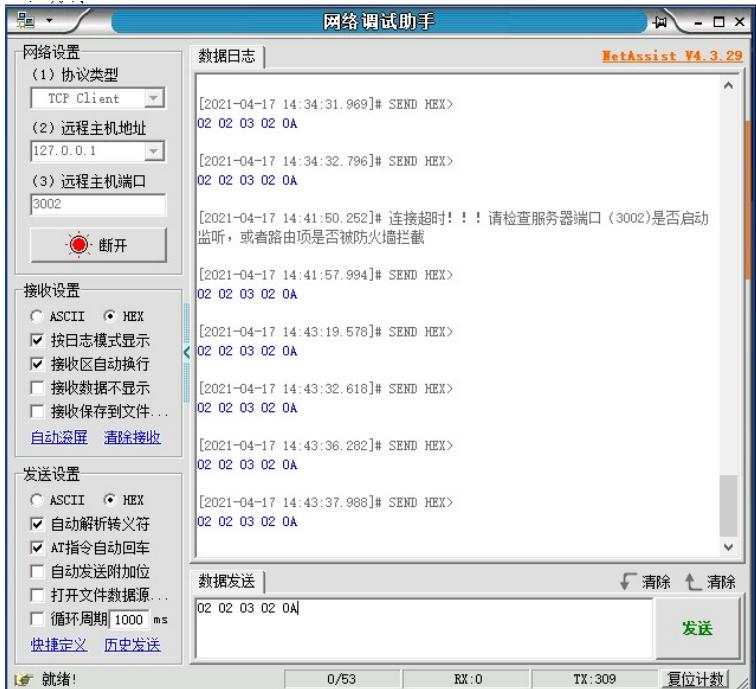
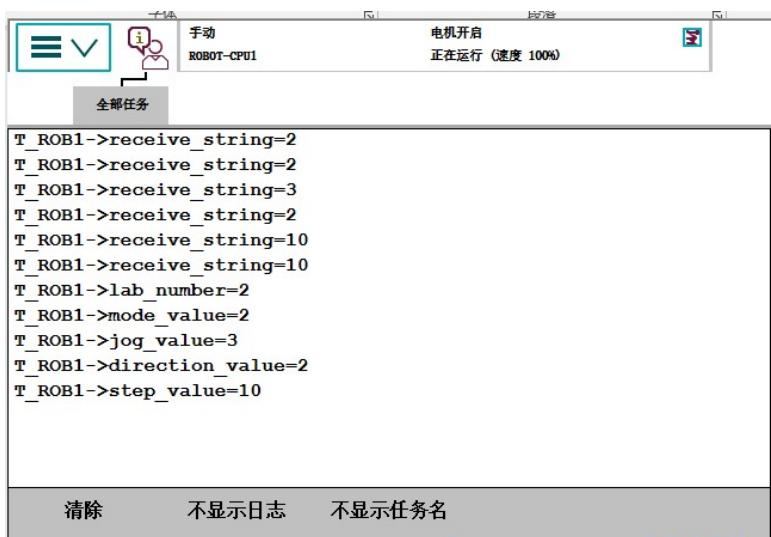
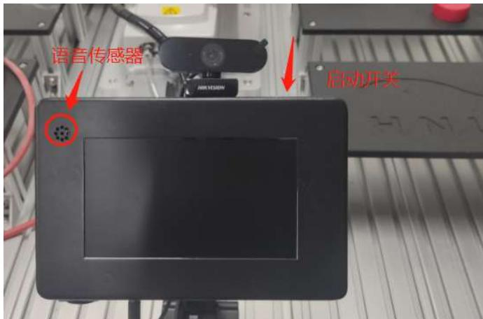
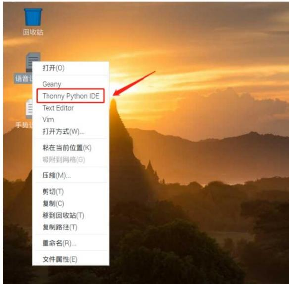
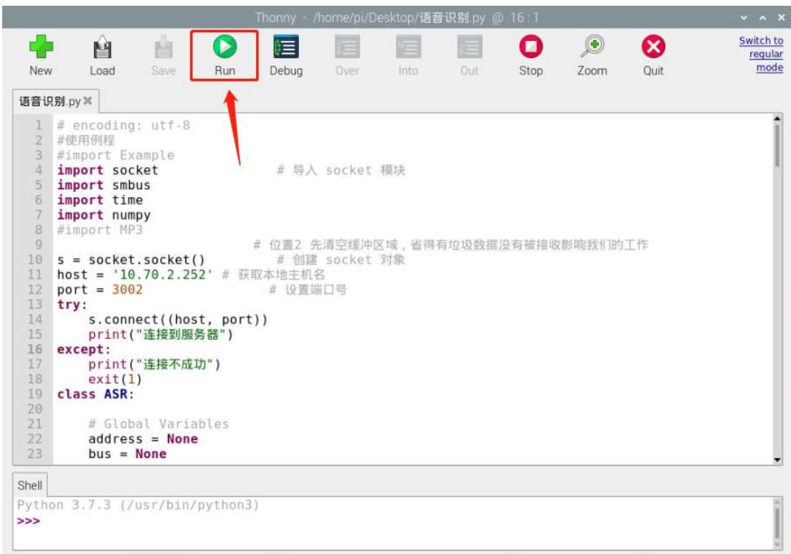
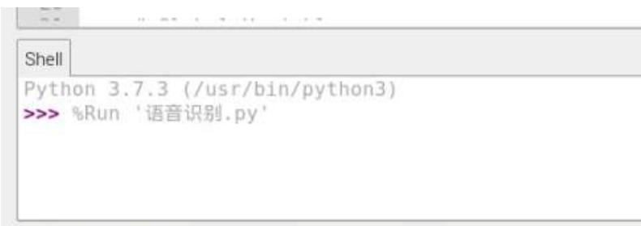
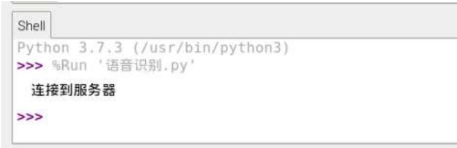
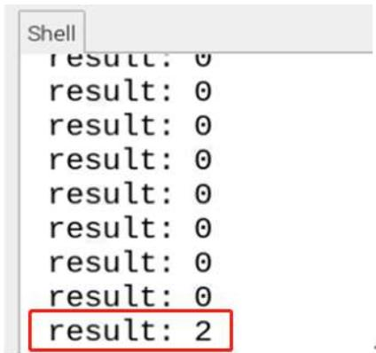

## 第八章 语音识别控制机器人运动实验

## 1、实验目的

语音识别模块是基于嵌入式的语音识别技术的模块，本实验目的主要是用语 音控制机器人的基本动作，以及播放音乐等功能。 

## 2、实验原理

采用IIC通信，用户只需要把识别的关键词语以字符串的形式传送进芯片， 即可在下次识别中立即生效。 

该模块有三种使用模式，用户可通过编程，设置两种不同的使用模式。 

按钮检测模式：系统的主控MCU 在接收到外界一个触发后（比如用户按下 按键）， 将会启动芯片上的一个定时识别过程（比如5s），此时需要用户在这 个定时过程中说出要识别的语音关键词语。当这个过程结束后，需要用户再次触 

发才能再次启动一个识别过程。 

循环检测模式：系统的主控MCU反复启动的识别过程。如果没有人说话就 没有识别结果，则每次识别过程的定时到时后会再启动一个识别过程；如果有识 别结果，则根据识别作相应处理后（比如播放某个声音作为回答）再启动一个识 别过程。 

口令检测模式：口令模式需要一个关键词来唤醒，唤醒后才可以进行识别， 默认唤醒关键词为第一句，识别结束后，想再次进行识别，还需唤醒它，类似小 艾同学。 

3、实验设备：型号 MFTW-IR 和 CHL-JC-02-A 的工作站 

4、实验步骤 

1）在 ABB 系统中配置 616-1 PC Interface 功能。 

2）Robotstudio 软件中在线或离线编写程序（ABB 程序与第七章相同） 

```txt
VAR socketdev server_socket2;    //定义变量
VAR socketdev client_socket2;
VAR string client_ip:="10.70.2.249"; //树莓派IP地址。
电脑虚拟调试IP地址为："127.0.0.2"
VAR byte receive_byte{5}:=[0,0,0,0,0];
PERS byte global_byte{5}:=[0,0,0,0,0];
VAR string receive_string{5};
VAR string str_hextodec{5};
PERS num lab_number:=2;
PERS num mode_value:=0;
PERS num jog_value:=0;
PERS num direction_value:=0;
PERS num step_value:=0;
VAR bool change_ok:=false;
VAR socketstatus state{3};
VAR robtarget current_position_robT;
VAR intnum int_home;
VAR num num_Line{3}:=[0,0,0];
PERS num num2_deg:=0;
VAR robtarget P_temp;
CONST jointtarget
Home:=[[-0.00129488,-0.000801945,0.00505125,-0.000859787,90.0011,-0.000264077],[9E+09,9E+09,9E+09,9E+09,9E+09,9E+09]]
PROC main()
SocketClose server_socket2;
SocketClose client_socket2; 
```

```verilog
client_ip:="10.70.2.249"; //树莓派IP地址。

电脑虚拟调试IP地址："127.0.0.2"

SocketCreate server_socket2;
SocketBind server_socket2,"10.70.2.252",3002; //ABB机器人IP地址。

电脑虚拟调试ABB的IP地址："127.0.0.1"

SocketListen server_socket2;
SocketAccept server_socket2,client_socket2\ClientAddress:=client_ip\Time:=WAIT_MAX;

WHILE TRUE DO

SocketReceive client_socket2\Data:=receive_byte\Time:=WAIT_MAX;

FOR i FROM 1 TO 5 DO

    global_byte{i}:=receive_byte{i};

ENDFOR

FOR i FROM 1 TO 5 DO

    receive_string{i}:=ByteToStr(global_byte{i});//16进制字转化成字符

    change_ok:=StrToVal(receive_string{1},lab_number); //字符转化成值

    change_ok:=StrToVal(receive_string{2},mode_value);

    change_ok:=StrToVal(receive_string{3},jog_value);

    change_ok:=StrToVal(receive_string{4},direction_value);

    change_ok:=StrToVal(receive_string{5},step_value);

ENDFOR

FOR i FROM 1 TO 5 DO

    TPWrite "receive_string="+receive_string{i};

ENDFOR

TPWrite "receive_string="+receive_string{5}; //在示教器上显示相应字符串

TPWrite "lab_number="\Num:++lab_number;

TPWrite "mode_value="\Num:++mode_value;

TPWrite "jog_value="\Num:++jog_value;

TPWrite "direction_value="\Num:++direction_value;

TPWrite "step_value="\Num:++step_value;

IF lab_number=2 THEN //实验号选择

TEST mode_value //模式测试

CASE 2:

current_position_robT:=CRobT(\Tool:=tool0\wobj:=wobj0); //机器人当前位置

FOR i FROM 1 TO 3 DO

IF (i=jog_value) THEN //对控制轴进行判断 1=X,2=Y,3=Z

TEST direction_value /对控制轴方向判断

CASE 1:

num_Line{i}:=step_value; //方向向上

CASE 2:

num_Line{i}:=step_value; //方向向下

ENDTEST

current_position_robT.trans.x:=current_position_robT.trans.x+num_Line{1}; //机器人在当前位置X轴方向增加或减少的步长后的结果赋值

current_position_robT.trans.y:=current_position_robT.trans.y+num_Line{2}; 
```

# // 在当前位置Y轴方向增加或减少的步长后的结果赋值

// 在当前位置Z轴方向增加或减少的步长后的结果赋值 MoveL current_position_robT,v100,fine,tool0\wobj:=wobj0; 

## 3）调试

## 一、虚拟调试

虚拟调试就是利用电脑中robotstudio虚拟示教器手动运行程序时，在电脑中安装 的网络调试助手(NetAssistV4.3)发数据给虚拟机器人,机器人接收到数据后经过 程序解析，判断执行相应的动作。 

a)ABB主程序中的client_ip:= "10.70.2.249"; IP地址改为："127.0.0.2"， 

SocketBind server_socket2,"10.70.2.252",3002; IP地址改为："127.0.0.1"。 

b)打开桌面上网络调试助手软件NetAssistV4.3.29, 在操作界面上选择协议 类型为:TCP Client ,远程主机地址：127.0.0.1；远程主机端口：3002；接收设置选 择：HEX，按日志模式显示，接收区自动换行；发送设置选择：HEX，自动解析 转义符，AT 指令自动回车；在数据发送框中键入所要发送的数据，如：020203 020A，网络调试组手设置如图所示： 




图 8.1 网络调试助手设置


c)编写好 ABB 程序后，手动运行程序，网络调试助手设置好参数后点击连接， 然后数据发送框中输入十六进制数据，点击发送按钮，数据则传送给虚拟机器人， 机器人机械臂会根据程序做出相应的动作。虚拟示教器上显示出发送过来的数据， 如图所示，则说明程序调试成功。 




图 8.2 虚拟示教器显示传送数据


## 二、与树莓派连接调试

1) 编写 ABB 程序，并修改好IP地址。 

如果运行出现套接字错误，改 server_socket2 变为 server_socket4 或其他， client_socket2 变为 client_socket4 或其他，端口号 3002 改为 3010 或其他，其 他的程序对应的变量依次修改。 

2）开启机器人和树莓派系统（图8.3） 




图 8.3 开启树莓派


3）找到树莓派桌面上的“语音识别. $\mathrm { p y } ^ { \prime \prime }$ 的实验程序。


图 8.4 语音识别 

4）鼠标右击系统桌面的语音识别软件，选择Thonny $\mathrm { P y }$ thon IDE程序打开识 别软件。（图8.4） 




图 8.5 Thonny Python IDE


5）用 Thonny Python IDE 打开软件后,软件菜单栏中点击Run，执行该语音 识别程序。 




图8.6 执行程序


6）若在shell 显示框打印出“连接不成功”、或 shell 显示框没有任何显示。 可能是机器人的socket通讯程序未开启。 此时需要开启机器人的 socket服务端程序。 




图 8.7 未连接成功


若在shell显示框打印出“连接到服务器”，则表示程序运行成功。 




图 8.8 连接服务器成功


7）语音识别程序成功启动后，传感器一直保持监听状态，并在Shell显示框返回 result。如果返回值是“0”，表示未接收到指令，则不执行任何动作。 

当对语音模块下达“下降”指令，系统接收到“下降”的指令后，在屏幕Shell 显示框输出result:2。并执行下降的动作。以下是检测与执行的代码（如图8.9） 




图 8.9 信号输出


8）具体指令和执行动作（表8-1） 


表8-1 语音具体指令


<table><tr><td>语音指令</td><td>机器人动作</td><td>Socket 指令</td></tr><tr><td>上升</td><td>机械手上升</td><td>[0x02,0x02,0x03,0x01,0x0A]</td></tr><tr><td>下降</td><td>机械手下降</td><td>[0x02,0x02,0x03,0x02,0x0A]</td></tr><tr><td>左边</td><td>机械手左边</td><td>[0x02,0x02,0x01,0x01,0x0A]</td></tr><tr><td>右边</td><td>机械手右边</td><td>[0x02,0x02,0x01,0x02,0x0A]</td></tr><tr><td>前进</td><td>机械手前进</td><td>[0x02,0x02,0x02,0x01,0x0A]</td></tr><tr><td>后退</td><td>机械手后退</td><td>[0x02,0x02,0x02,0x02,0x0A]</td></tr></table>

9）Socket通讯指令介绍： 

[0x02,0x02,0x03,0x01,0x0A] 

第一位：实验顺序。 0x02：第二个实验。 

第二位：控制机器人运行的模式。 0x02：第二个运行模式。 

第三位：控制某个轴动作。 0x01：控制x轴，0x02:控制y轴，0x03:控制 z轴。 

第四位：控制方向。 0x01：控制方向向上，0x02：控制方向向下。 

第五位：步长为0A 0x0A：控制机械手运行的速度值为 10个步长。 

10）树莓派语音识别部分代码： 

## 1.导入一些必要的库

import socket # 导入 socket 通讯模块 

import smbus #smbus 通讯协议 

import time #导入时间模块 

import numpy 

#NumPy 是 Python 语言的一个扩展程序库，支持大量的维度数组与矩阵运算，此外也针 对数组运算提供大量的数学函数库。 

以下是 python 中 socket 客户端的连接方法 

$$
\mathbf {s} = \text { socket.socket() }
$$

# 创建 socket 对象 

$$
\text { host } = ^ {\prime} 1 0. 7 0. 2. 2 5 2 ^ {\prime}
$$

# 填写服务端的 ip 地址 

$$
\mathbf {p o r t} = 3 0 0 2
$$

# 填入设置好的端口号 

try: 

#异常的用法 

$$
\mathbf {s . c o n n e c t} ((\text {host}, \text {port}))
$$

#去连接服务器端的 ip 和端口 

print("连接到服务器") 

except: 

print("连接不成功") 

exit(1) 

1.运行该 python 文件后会执行 dd()这个函数。 

if __name__ == "__main__": 

dd() 

2.首先是连接 IIC 的语音传感器 

$$
\mathbf {a d d r} = \mathbf {0 x 7 9}
$$

#连接语音传感器 iic 地址 

$$
\mathrm{asr} = \mathrm{ASR} (\mathrm{addr})
$$

#进行实例化 

3.接下来监听所设置词条指令和对应的词条地址 

if 1: 

asr.eraseWords() 

#擦出词条 

asr.setMode(1) 

#识别模式为 1 

asr.addWords(1, 'shang shen') 

#说上升口令时，在程序中赋予词条的地址是 1 

asr.addWords(2, 'xia jiang') 

#说下降口令时，在程序中赋予词条的地址是 2 

asr.addWords(3, 'zuo bian') #说左边口令时，在程序中赋予词条的地址是 3 

asr.addWords(4, 'you bian') #说右边口令时，在程序中赋予词条的地址是 4 

asr.addWords(5, 'qian jing') #说右边口令时，在程序中赋予词条的地址是 5 

asr.addWords(6, 'hou tui') #说后退口令时，在程序中赋予词条的地址是 6 

asr.addWords(7, 'tui chu') #说退出口令时，在程序中赋予词条的地址是 7 

4.当触发指令后，词条地址会赋值给 data，随后程序进入 while循环。 

（程序会发送 data 值所对应的串口指令给机器人，随后机器人执行相应的动作） 

while 1: 

$$
\text { data } = \text { asr.getResult() }
$$

#将得到的识别结果赋值给 data 

$$
\text { print } (" \text { result }:", \text { data })
$$

#在终端打打印出 data 的值 

if data==1: 

#如果 data 值等于 1 

$$
\mathbf {a} = [ \mathbf {0 x 0 2}, \mathbf {0 x 0 2}, \mathbf {0 x 0 3}, \mathbf {0 x 0 1}, \mathbf {0 x 1 0} ]
$$

#给串口发送上升动作的 16进制 

for i in range(len(a)): 

b +=chr(a[i]) 

#将 a 的 16进制数据格式转化成 ascii码 

s.send(b.encode("utf-8")) 

#将数据发送给服务端 

time.sleep(0.1) 

#发送成功后程序休眠一定时间 

