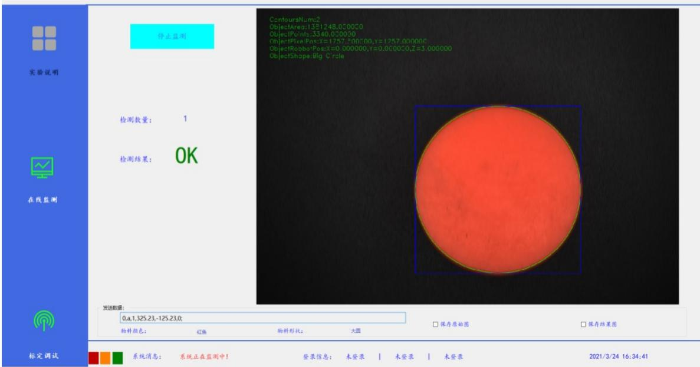

## 第九章 基于视觉识别控制机器人定位抓取实验

## 1、实验目的

基于视觉识别软件判断工件的形状颜色，通过Socket通讯的方式，发送识别 数据给机器人，机器人按照数据进行定位抓取，完成对工件按照颜色，形状进行 分类的实验。此实验主要使学生掌握视觉与机器人之间的工作原理，如何基于视 觉辅助控制机器人完成控制动作。 

## 2、实验原理

通过视觉软件拍照，经过图像处理技术得到工件中心像素坐标，通过手眼标 定原理，计算出图像坐标系与机器人坐标系之间的矩阵关系，通过像素坐标得到 机器人坐标，基于Socket通讯，将图像识别数据发送给机器人，机器人接收后 对数据进行处理，即可完成定位抓取的实验。 

## 3、实验设备：型号 MFTW-IR 和 CHL-JC-02-A 的工作站

## 4、实验过程

## 1) 视觉软件的使用说明

视觉实验部分，相机固定安装。视觉软件直接输出颜色，形状，大小， 角度，机器人坐标视觉软件作为客户端，机器人做服务端，机器人做服务端 如 IP：10.70.2.252，端口号：3003。 

## 2) 数据的定义

视觉拍照信号是通过socket通讯完成，机器人发送数字1定义为拍照信 号，发送拍照信号后机器人等待视觉返回识别信息，如果识别信息无任何数 据，发送null。 

在软件中能对颜色，形状进行映射，例如颜色对应 0-9，形状对应 a-z; 红色映射为0，形状映射为a，映射完的数字，字母具有唯一性，不能再映 射为其他工件。工件大小默认是小对应0，大对应1。 

如果没有角度默认发0。发送数据的格式是，一组数据内每项用逗号（,） 分割，结束用分号（;）举例说明：识别到红色大圆形工件发送的数据格式 是：0，a，1，-12，325.6，-128.2； 

由于实验关系，视觉软件中已经将工件形状及颜色的定义固定，其定义 如下： 

第一位：颜色 

0-红色、1-黄色、2-白色，出现其它颜色工件，默认不处理。 

第二位：形状 

a-圆形、b-方形，出现其它形状工件，默认不处理。 

第三位：大小 

0-是小 1-大，出现其它尺寸工件，默认不处理。 

第四位：X 

第五位：Y 

第六位：旋转角度 

## 3) 视觉与机器人工作逻辑

实验前视觉软件已经同机器人完成手眼标定，机器人做服务端，视觉做 客户端，故需要先运行机器人程序，视觉才能连接上机器人服务端。机器人 运行程序，与视觉连接成功，移动到工件拍照位置，给机器人发送拍照信号 “1”，视觉接收到拍照信号“1”进行拍照，机器人等待视觉拍照后返回的 数据，视觉将当前工件进行识别，发送识别后的数据 

“0,a,1,325.23,-125.23,0;”给机器人，机器人接收到数据后按照实验定 义的方法进行数据处理，坐标赋值，按照坐标位置进行移动，对工件进行分 类，实验完成。其视觉实验界面如下图所示： 


物体形状、颜色识别实验





图 9.1 视觉软件识别结果图


## 4) 机器人编程

PROC Vision_Control() 

Const robtarget 

robot_2D_position_biaoding:=[[-87.50,100,-42.42],[0.715273,0.00325326,0.00315491,-0.69883], 

<table><tr><td>VAR string receive_string;</td><td>定义接收数据的字符串</td></tr><tr><td>PERS string data{6} := [&quot;&quot;, &quot;&quot;, &quot;&quot;, &quot;&quot;, &quot;&quot;, &quot;];</td><td>用于存储分割后的字符串数组</td></tr><tr><td>VAR bool change_ok;</td><td>字符类型转换标志位</td></tr><tr><td>VAR num color;</td><td>工件颜色</td></tr><tr><td>VAR string shape;</td><td>工件形状</td></tr><tr><td>VAR num size;</td><td>工件大小</td></tr><tr><td>VAR num num_x;</td><td>工件图像坐标转为机器人的X坐标</td></tr><tr><td>VAR num num_y;</td><td>工件图像坐标转为机器人的Y坐标</td></tr><tr><td>VAR num deg;</td><td>工件角度</td></tr><tr><td>VAR socketdev server_socket1;</td><td>定义服务端socket</td></tr><tr><td>VAR socketdev client_socket1;</td><td>定义客户端socket</td></tr><tr><td>VAR string client_ip:=&quot;10.70.2.251&quot;;</td><td>相机IP地址</td></tr><tr><td>SocketClose server_socket1;</td><td>关闭服务端socket</td></tr><tr><td>SocketClose client_socket1;</td><td>关闭客户端socket</td></tr><tr><td>SocketCreate server_socket1;</td><td>创建服务端socket</td></tr><tr><td>SocketBind server_socket1,&quot;10.70.2.252&quot;,3003;</td><td>机器人绑定IP地址和端口号</td></tr><tr><td>SocketListen server_socket1;</td><td>服务端开启监听</td></tr><tr><td>SocketAccept</td><td></td></tr></table>

其值不可改变，不可进行坐标赋值操作 VAR robtarget 

robot_2D_position_wait:=[[-87.50,100,-42.42],[0.715273,0.00325326,0.00315491,0.69883],[0,0,0, 

0],[9E+09,9E+09,9E+09,9E+09,9E+09,9E+09]];拍照的基准位置，变量类型，其值可改变，可 进行坐标赋值操作 

VAR robtarget 

A:=[[103.51,-340.92,-212.06],[0.715356,0.002804,0.00528505,-0.698735],[0,0,0,0],[9E+09,9E+0 

9,9E+09,9E+09,9E+09,9E+09]];放置工价的位置，变量类型 

server_socket1,client_socket1\ClientAddress:=client_ip\Time:=WAIT_MAX; 

等待接收数据 

WHILE TRUE DO 主循环体 

Movej robot_2D_position_biaoding,vmax,z20,tool0\wobj:=wobj1; 移动到拍照位置。 

SocketSend client_socket1\Str:="1"; 

机器人发送拍照指令相机拍照 

SocketReceive client_socket1\str:=receive_string\Time:=WAIT_MAX;等待接收视觉 

处理后的数据 

SplitStr receive_string,",",data; 将接收的视觉数据进行分割处理，见SplitStr函数 

TPWrite "receive_string="+receive_string; 

打印输出接收的字符串 

change_ok:=StrToVal(data{1},color); 

将字符串转为值类型数据 

shape:=data{2}; 

change_ok:=StrToVal(data{3},size); 

change_ok:=StrToVal(data{4},num_x); 

change_ok:=StrToVal(data{5},num_y); 

change_ok:=StrToVal(data{6},deg); 

robot_2D_position_wait.trans.x:=num_x; 将视觉计算的X坐标值赋值给拍照位的基准坐标X 

robot_2D_position_wait.trans.y:=num_y; 将视觉计算的Y坐标值赋值给拍照位的基准坐标Y 

Movej robot_2D_position_wait,vmax,z20,tool0\wobj:=wobj1; 机器人按照赋值后的坐标平移 

robot_2D_position_wait.trans.z:=robot_2D_position_biaoding.trans.z-300; 

基于偏移后的基准位置Z轴下降300mm，300mm指机器人吸盘到工件表面的高度，300mm前 面是“-”或者“+”需要根据右手定则确定机器人Z轴的方向确定正负号，也可以根据示教 器上面坐标数据看出。 

Movej robot_2D_position_wait,vmax,z10,tool0\wobj:=wobj1; 移动到工件表面 

SetDO do0,1; 

打开吸盘（或SetDO Do10_14,1） 

WaitTime 0.5; 

等待0.5s 

robot_2D_position_wait.trans.z:=robot_2D_position_wait.trans.z+150; 抓取工件抬升150mm 

Movej robot_2D_position_wait,v500,z20,tool0\wobj:=wobj1; 移动到抬升位置 

TEST color 

判断工件属于哪一种类型进入到对应位置 

CASE 0: 

红色物块 

IF shape="a" THEN 

圆形 

TEST size 

CASE 0: 

小尺寸 

Movej A1,v500,z20,tool0\wobj:=wobj1; 

A1位置自己示教不同工件摆放不同位置 

<table><tr><td>case 1:</td><td>大尺寸</td><td></td></tr><tr><td colspan="2">MoveL Offs(A2,50,0,0), v500, z50, tool0;</td><td>A2位置自己示教</td></tr><tr><td colspan="2">ENDTEST</td><td></td></tr><tr><td colspan="2">ENDIF</td><td></td></tr><tr><td colspan="2">IF shape=&quot;b&quot; THEN</td><td>方形</td></tr><tr><td colspan="2">TEST size</td><td></td></tr><tr><td colspan="2">CASE 0:</td><td>小尺寸</td></tr><tr><td colspan="2">MoveL Offs(A3,100,0,0), v500, z50, tool0;</td><td>A3位置自己示教</td></tr><tr><td colspan="2">case 1:</td><td>大尺寸</td></tr><tr><td colspan="2">MoveL Offs(A4,150,0,0), v500, z50, tool0;</td><td>A4位置自己示教</td></tr><tr><td colspan="2">ENDTEST</td><td></td></tr><tr><td colspan="2">ENDIF</td><td></td></tr><tr><td colspan="2">CASE 1:</td><td>黄色物块</td></tr><tr><td colspan="2">IF shape=&quot;a&quot; THEN</td><td>圆形</td></tr><tr><td colspan="2">TEST size</td><td></td></tr><tr><td colspan="2">CASE 0:</td><td>小尺寸</td></tr><tr><td colspan="3">MoveL Offs(A5,0,50,0), v500, z50, tool0; A5位置自己示教</td></tr><tr><td colspan="2">case 1:</td><td>大尺寸</td></tr><tr><td colspan="3">MoveL Offs(A6,0,100,0), v500, z50, tool0; A6位置自己示教</td></tr><tr><td colspan="2">ENDTEST</td><td></td></tr><tr><td colspan="2">ENDIF</td><td></td></tr><tr><td colspan="2">IF shape=&quot;b&quot; THEN</td><td>方形</td></tr><tr><td colspan="2">TEST size</td><td></td></tr><tr><td colspan="2">CASE 0:</td><td>小尺寸</td></tr><tr><td colspan="3">MoveL Offs(A7,0,150,0), v500, z50, tool0; A7位置自己示教</td></tr><tr><td colspan="2">case 1:</td><td>大尺寸</td></tr><tr><td colspan="3">MoveL Offs(A8,50,50,0), v500, z50, tool0; A8位置自己示教</td></tr><tr><td colspan="2">ENDTEST</td><td></td></tr><tr><td colspan="2">ENDIF</td><td></td></tr><tr><td colspan="2">CASE 2:</td><td>白色物体</td></tr></table>

IF shape="a" THEN 圆形 

CASE 0: 小尺寸 

MoveL Offs(A9,50,100,0), v500, z50, tool0; A9位置自己示教 

MoveL Offs(A10,50,150,0), v500, z50, tool0; A10位置自己示教 ENDTEST 

## ENDIF

IF shape="b" THEN 方形 TEST size CASE 0: 小尺寸 

MoveL Offs(A11,100,50,0), v500, z50, tool0; A11位置自己示教 case 1: 大尺寸 

MoveL Offs(A12,100,100,0), v500, z50, tool0; A12位置自己示教 ENDTEST 

## ENDTEST

SetDO do0,0;关闭吸盘（或SetDO Do10_14,0） 

WaitTime 0.5;等待0.5s 

## ENDWHILE

## ENDPROC

PROC SplitStr( string inputstr,string sp,inout string data{*}) 字符串分割函：inputstr输入字符串，sp分割符，data{*}存入数据的数组 VAR string s1; VAR string s2; VAR num count:=1; VAR bool flag1; FOR i FROM 1 TO StrLen(inputstr) DO 循环遍历输入字符串 s1:=StrPart(inputstr,i,1); 每次取一位分割符字符 IF s1=sp THEN 

$$
\text { flag1 } := \text { StrToVal } (\text { s2 }, \text { data } \{\text { count } \});
$$

如果当前字符是分隔符，则将之前的字符串转化为数据并存入data{count}中 

s2:=""; 

Incr count; 

ELSE 

$$
\mathrm{s} 2 := \mathrm{s} 2 + \mathrm{s} 1;
$$

如果当前字符不是分割字符，则字符串拼接 

ENDIF 

$$
\text { flag1 } := \text { StrToVal } (\text { s2 }, \text { data } \{\text { count } \});
$$

ENDFOR 

ENDPROC 

```txt
PROC SplitStr( string inputstr, string sp, inout string data{*})
VAR string s1;
VAR string s2;
VAR num count:=1;
VAR bool flag1;
FOR i FROM 1 TO StrLen(inputstr) DO
    s1:=StrPart(inputstr,i,1);
    IF s1=sp THEN
    flag1:=StrToVal(s2,data{count});
    s2:="";
    Incr count;
    ELSE
    s2:=s2+s1;
    ENDIF
    flag1:=StrToVal(s2,data{count});
ENDFOR
ENDPROC 
```

分割函数 

```txt
PROC Vision_Control()
Const robtarget robot_2D_position_biaoding:=[[-87.50,100,-42.42],[0.715273,0.00325326,0.00315491,-0.69883],[0,0,0,0],[9E+09,9E+09,9E+09,9E+09,9E+09,9E+09]];
VAR robtarget robot_2D_position_wait:=[[-87.50,100,-42.42],[0.715273,0.00325326,0.00315491,-0.69883],[0,0,0,0],[9E+09,9E+09,9E+09,9E+09,9E+09]];
VAR robtarget A:=[[103.51,-340.92,-212.06],[0.715356,0.002804,0.00528505,-0.698735],[0,0,0,0],[9E+09,9E+09,9E+09,9E+09,9E+09]]
VAR string receive_string;
PERS string data{6}:=[", "", "", "", ""];
VAR bool change_ok;
VAR num color;
VAR string shape;
VAR num size;
VAR num num_x;
VAR num num_y;
VAR num deg;
VAR socketdev server_socket1;
VAR socketdev client_socket1;
VAR string client_ip:="127.0.0.2";
SocketClose server_socket1;
SocketClose client_socket1;
SocketCreate server_socket1;
SocketBind server_socket1,"127.0.0.1",3003;
SocketListen server_socket1;
SocketAccept server_socket1,client_socket1\ClientAddress:=client_ip\Time:=WAIT_MAX;
WHILE TRUE DO
Movej robot_2D_position_biaoding,vmax,z20,tool\wobj:=wobj1;
SocketSend client_socket1\Str:="1";
SocketReceive client_socket1\str:=receive_string\Time:=WAIT_MAX;
SplitStr receive_string,",",data;
TPWrite "receive_string="+receive_string;
change_ok:=StrToVal(data{1},color);
shape:=data{2};
change_ok:=StrToVal(data{3},size);
change_ok:=StrToVal(data{4},num_x);
change_ok:=StrToVal(data{5},num_y);
change_ok:=StrToVal(data{6},deg);
robot_2D_position_wait.trans.x:=num_x;
robot_2D_position_wait.trans.y:=num_y;
Movej robot_2D_position_wait,vmax,z20,tool\wobj:=wobj1;
robot_2D_position_wait.trans.z:=robot_2D_position_biaoding.trans.z-300;
Movej robot_2D_position_wait,vmax,z10,tool\wobj:=wobj1;
SetDO do0,1;
WaitTime 0.5;
robot_2D_position_wait.trans.z:=robot_2D_position_wait.trans.z+150; 
```

```txt
Movej robot_2D_position_wait, v500, z20, tool0\wobj := wobj1;
TEST color
CASE 0:
IF shape="a" THEN
TEST size
CASE 0:
Movej A, v500, z20, tool0\wobj := wobj1;
case 1:
MoveL Offs(A, 50, 0, 0), v500, z50, tool0;
ENDTEST
ENDIF
IF shape="b" THEN
TEST size
CASE 0:
MoveL Offs(A, 100, 0, 0), v500, z50, tool0;
case 1:
MoveL Offs(A, 150, 0, 0), v500, z50, tool0;
ENDTEST
ENDIF
CASE 1:
IF shape="a" THEN
TEST size
CASE 0:
MoveL Offs(A, 0, 50, 0), v500, z50, tool0;
case 1:
MoveL Offs(A, 0, 100, 0), v500, z50, tool0;
ENDTEST
ENDIF
IF shape="b" THEN
TEST size
CASE 0:
MoveL Offs(A, 0, 150, 0), v500, z50, tool0;
case 1:
MoveL Offs(A, 50, 50, 0), v500, z50, tool0;
ENDTEST
ENDIF
CASE 2:
IF shape="a" THEN
TEST size
CASE 0:
MoveL Offs(A, 50, 100, 0), v500, z50, tool0;
case 1:
MoveL Offs(A, 50, 150, 0), v500, z50, tool0;
ENDTEST
ENDIF
IF shape="b" THEN
TEST size 
```


图 9.2 机器人视觉定位抓取程序图


