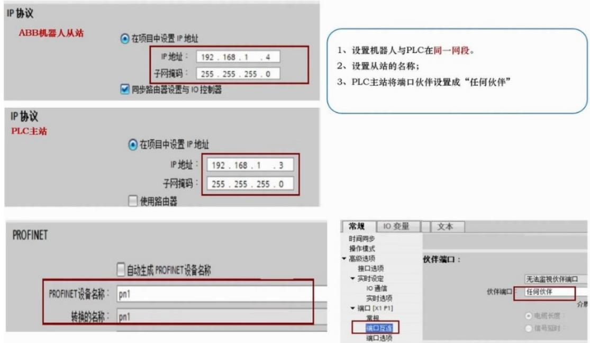
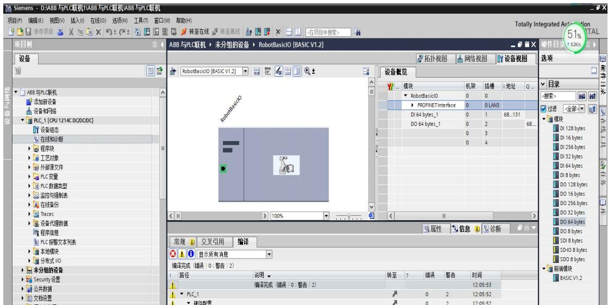
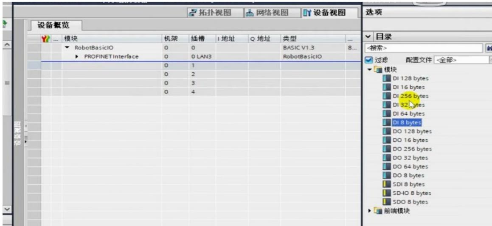
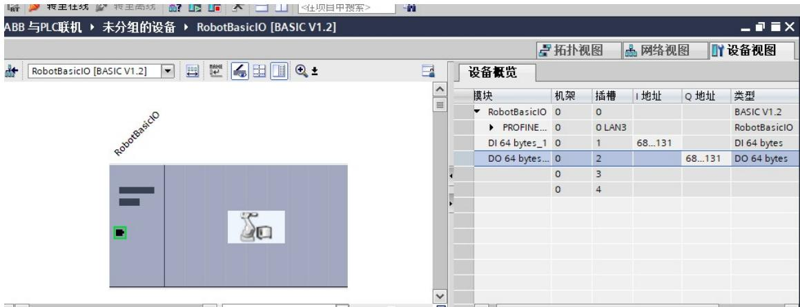
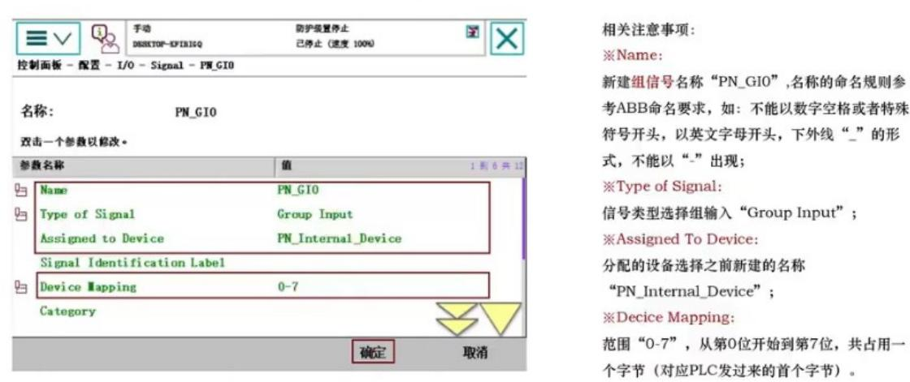
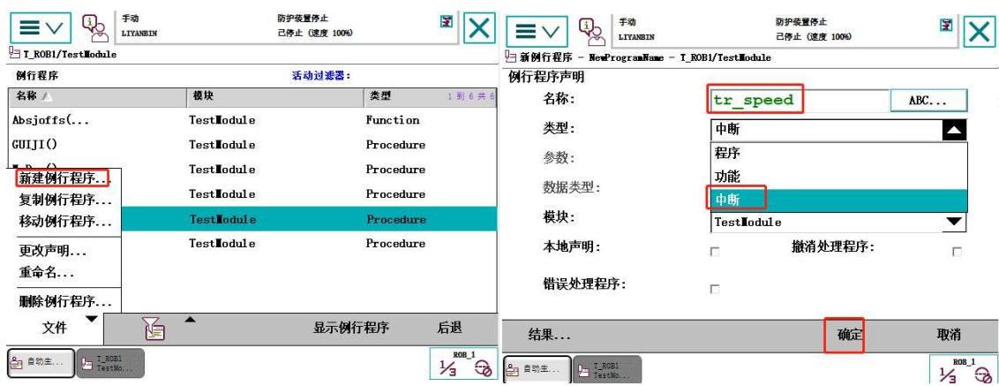
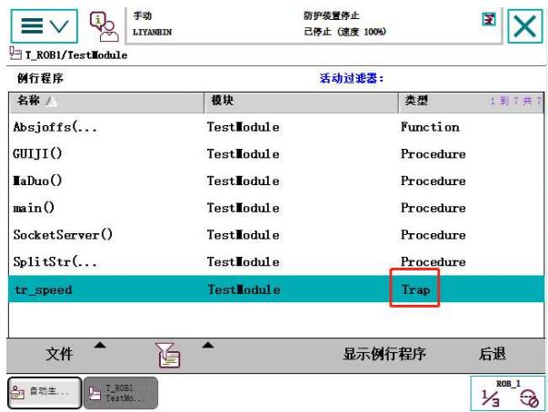
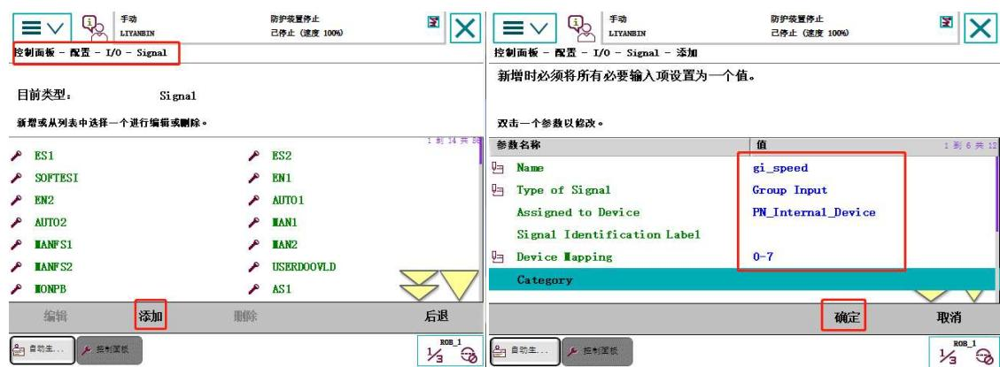

## 第十章 基于 Profinet通讯控制机器人速度实验

实验目的：学习Profinet 通讯配置方法，学习中断使用方法 

实验要求：掌握Profinet通讯配置，掌握中断使用方法 

实验设备：型号 MFTW-IR 和 CHL-JC-02-A 的工作站 

实验步骤： 

A、西门子 S7-1200 PLC 与机器人 Profinet 通讯配置流程 

1、获取配置文件（GSDML）（机器人或其他设备驱动文件） 

步骤一：安装目录下查找。 

步骤二：软件中查找。 

步骤三：在示教器系统中查找: 

在示教器中查找方法：资源管理器→硬盘驱动→1200—510076—2019→ 

products→robotware→6.07.1011→utility→service→GSDML→ 

GSDML-V2.33-ABB-ROBOTICS-ROBOT-DEVICE-20 

(GSDML-V2.33-ABB-ROBOTICS-ROBOT-DEVICE-20这个驱动为888-2/888-3选 项的文件。 

## B、 PLC 组态软件配置(博途软件中的配置）

1.在西门子博图软件中导入GSDML 文件。 

## 2.设备组态:

挂 ABB 机器人的设备组态：其他现场设备→profinet I/O→I/O→ABB 

ROBOTICS→ROBOT DEVICE→前端模块→BASIC V1.2。 

3.分配 IP 地址，站号（PROFINET Station Name） 

3.1.PLC 设备 IP 分配 

1）.IP 地址,如 192.168.1.3 ，子网 255.255.255.0 

2）.端口→端口互联→伙伴端口，选择任何伙伴。 

3.2.博图软件中机器人的设置 

1）.ip 地址,如 192.168.1.4 ，子网 255.255.255.0 

2）.从站名称：profinet 设备名称如：pn1（最好改名不要自动生成 profinet 设备名称）。 

3.3.通讯数据分配 

在博图软件中→网路视图→选中 ABB 机器人图标→设备视图 

→硬件目录中选择模块下拉菜单→选择 DI 128/16/256/32/64/8 bytes DO 128/16/256/32/64/8 bytes ,这么多字节选项中，可根据需 要选择数据大小。如选择 DI 64bytes,DO 64bytes，生成通讯数据分 配的组态在 robotbasicIO profnet interface 下，可根据编程需要对地址 进行修改，如 DI地址68-131，DO地址也可以改成68-131。64字节 为 512位，一个字节为 8位。1）.定义的DI68-131 的地址中，表示 PLC 接收ABB 机器人传输过来的数据，也就是512个位的数据。2）. 在定义的 DO68-131 的地址中，表示PLC 发出数据给ABB 机器人 也是 512个位的数据。 




图 10.1 PLC 中 IP 地址设置





图10.2 与机器人组态





图 10.3 通讯数据为分配





图 10.4 通讯数据为地址


## C、 ABB 机器人设备上 PROFINET 通讯配置

## 1.设置 IP

1）.ABB 示教器在手动模式下操作：控制面板→控制器设置→左下角的‘设 置’→网络→设置 WAN口 IP 地址 A.B.C.X。 

2）.ABB 示教器在手动模式下操作：控制面板→配置→Communication→IP Setting → PROFINET Network → （ IP 值 ： A.B.C.X ； Subnet:255.255.255.0; Interface:WAN；Label:PROFINET Network）。 

## 2.新建 PROFINET 工业网络

ABB 示教器在手动模式下操作：控制面板→配置→主题→I/O→Industrial 

Network→PROFINET→单击添加（来自模块的值：选择 PROFINET ， Connection:PROFINET Network;PROFINET Staion Name:pn1 ） 其 中 PROFINET Staion Name 中设定的名称要和 PLC 组态 ABB 从站的站名一 样（ABB 从站的改名方法：1.进入博图软件中左边设备与网络界面 2.双 击 ABB模块上的名称改名）。 

## 3.建立设备

ABB 示教器在手动模式下操作：控制面板→配置→主题→I/O→ PROFINET Internal Device→PN_Internal_Device→单击添加(自模块的值： 选 择 PN_Internal_Device;Network:PROFINET;Input Size :64;Output Size :64)其中 Input Size 和 Output Size 具体字节数据根据 PLC 中 ABB 组态中DI 和DO数据的长度进行一一对应设置。 

## 4.通讯数据分配对应

ABB 示教器在手动模式下操作：控制面板→配置→主题→I/O→Signal→ 单 击 显 示 全 部 → 添 加 （ Name:PN_GI0;Type of Signal:Group Input;Assigned to Device:PN_Internal_Device;Device Mapping :0-7）这 个信号设置为组输入信号0-7，即为PLC组态中ABB数据区DO端前0-7 位数据传输人 ABB 设备中名字为 PN_GI0 存储。根据实际需要添加完所 有的组输入和组输出信号，便于数据的发送和接收。 

5、编辑信号名称，选择组输入，选择通讯设备，编辑通讯地址范围 




图 10.5 机器人组态Io 地址与 PLC 对应分配


表 1：PLC 与机器人通讯地址输出位对应表


<table><tr><td>在 PLC 中 ABB 设置的地址(PLC 发送信号)</td><td>Mapping</td><td>ABB 机器人组名称(机器人接收 PLC 的组信号)</td></tr><tr><td>QB68(发送起始)</td><td>0-7</td><td>PN_GI0</td></tr><tr><td>QB69</td><td>8-15</td><td>PN_GI1</td></tr><tr><td>QB70</td><td>16-23</td><td>PN_GI2</td></tr><tr><td>---</td><td>---</td><td>---</td></tr><tr><td>QB131</td><td>504-511</td><td>PN_GI63</td></tr></table>


表 2：PLC 与机器人通讯地址输入位对应表


<table><tr><td>在 PLC 中 ABB 设置的地址(PLC 接收信号)</td><td>Mapping</td><td>ABB 机器人组名称(机器人发送到 PLC 的组信号)</td></tr><tr><td>IB68(接收起始)</td><td>0-7</td><td>PN_GO0</td></tr><tr><td>IB69</td><td>8-15</td><td>PN_GO1</td></tr><tr><td>IB70</td><td>16-23</td><td>PN_GO2</td></tr><tr><td>---</td><td>---</td><td>---</td></tr><tr><td>IB131</td><td>504-511</td><td>PN_GO63</td></tr></table>


D、PLC 通过 Profinet 通讯控制调节机器人速度示例 


## 1.机器人中断程序创建

程序中断解释:中断是指机器人执当前行任务过程中，中间突然需要去执行 另一个任务，需要暂停当前的任务去完成另一个任务，当另一个任务完成后再继 续执行当前任务，类似C 语言中Goto 用法。 

新建例行程序tr_speed,设置为中断程序操作如下所示 




图 10.6 新建例行程序


图 10.7 新建中断程序


新建完中断程序后，程序类型就是中断类型:





图 10.8 中断程序类型


## 2.在机器人添加组输入信号。

配置好Profinet通讯后，添加组输入信号，组输入信号命名为 gi_speed，创建 完成后重启控制器，操作如下： 




图 10.9 添加组信号


图 10.10 添加组信号定义


## 3.编写速度控制程序

编写程序时需要用到以下指令，其释义如下： 

```txt
更多示例
有关于指令SpeedRefresh的更多例子阐述如下。
例 1
VAR intnum time_int;
VAR num override;
...
PROC main()
CONNECT time_int WITH speed_refresh;
ITimer 0.1, time_int;
ISleep time_int;
...
MoveL p1, v100, fine, tool2;
! Read current speed override set from FlexPendant 
```

## 1.232 SpeedRefresh- 更新持续运动速度覆盖

## 手册用法

SpeedRefresh用于改变当前运动程序任务中进行中的机械臂移动的速度。通过该指 令，可能创建关干某些传感器输入的某种粗速度适应。 本指令仅可用于主任务TROB1，或者如果在MultiMove系统中，则可用于任何运动任 务中。 

## 基本示例

以下实例介绍了指令SpeedRefresh 

例1 

```txt
VAR num change_speed:=70;
SpeedRefresh change_speed;
这将把当前速度覆盖改变为70%。 
```

## 变元

```txt
SpeedRefresh Override 
```

Override 

数据类型：num范围0... $100\%$ 内的速度覆盖值。 

## 程序执行

将更新当前运动程序任务中关于机械臂和处部单元进行中的移动的实际速度覆盖值 当前运动任务中任意机械单元的所有速度数据分量均将受到影响。 


## 注意

根据SpeedRefresh设置的速度覆盖，不等于根据FlexPendant示教器而设置速度。 这是两种不同的值。这两种值的结果以及编程的速度将成为移动中使用的速度。 

如果完成PP到Main或已加载新的程序，则将重置通过SpeedRefresh设置的速度 并将应用根据FlexPendant示教器而设置的速度。 

## 下一页继续

604 

```txt
基本示例
以下实例介绍了指令CONNECT：
例 1
VAR intnum feeder_low;
PROC main()
    CONNECT feeder_low WITH feeder_empty;
    ISignalDI di1, 1, feeder_low;
...
创建中断识别号feeder_low，并将其与软中断程序feeder_empty相连。当输入di1变高时，将会出现中断。换句话说，当信号变高时，执行feeder_empty软中断程序。 
```

```txt
手册用法
IDelete（中断删除）用于取消（删除）中断预定。
如果中断仅临时禁用，则应当使用指令ISleep或IDisable。 
```

```txt
语法
IDelete [ Interrupt ':=' ] < variable (VAR) of intnum > ';' 
```


1.88 IDelete - 取消中断


## 1.40 CONNECT- 将中断与软中断程序相连

## 1.110ISignalGI-下达一组数字信号输入信号中断的指令

## 手册用法

ISiqnalGI（中断信号组数字信号输入）用于下达和启用一组数字信号输入信号中断 的指令。 

```txt
基本示例
以下实例介绍了指令ISignalGI：
例 1
VAR intnum sig1int;
PROC main()
CONNECT sig1int WITH iroutine1;
ISignalGI gi1, sig1int;
当数字信号输入组信号变异数值时，下达中断指令。 
```

## ！控制主程序

PROC Profinet_Control() 

VAR intnum sig1int;！声明一个中断识别号 

IDelete sig1int;！连接中断之前先取消中断，防止连接失败 

CONNECT sig1int WITH tr_speed;！将中断识别号同中断程序相连 

ISignalGI gi_speed,sig1int;！组输入信号变化时，执行中断指令 

```txt
WHILE TRUE DO !主程序循环 
```

SocketServer; 

ENDWHILE 

ENDPROC 

TRAP tr_speed 

SpeedRefresh gi_speed; ！执行中断程序就能控制机器人速度； 

ENDTRAP 

## ENDMODULE

```sql
PROC Profinet_Control()
VAR intnum sig1int;
IDelete sig1int;
CONNECT sig1int WITH tr_speed;
ISignalGI gi_speed, sig1int;
WHILE TRUE DO
SocketServer;
!主程序循环
ENDWHILE
ENDPROC

TRAP tr_speed
SpeedRefresh gi_speed;
ENDTRAP
ENDMODULE 
```

