## 第十一章 简单码垛生产线实验

## 实验目的

1. 学习 ABB工业机器人的控制语句的使用。 

2. 学习 ABB工业机器人中对于I/O 信号的操作。 

3. 初步认识ABB工业机器人生产线硬件的设计。 

4、初步认识ABB工业机器人生产线程序的编写。 

## 实验要求

根据生产线，利用机器人完成搬运、送料、运送、冲压、检测、码放成品的 任务。 

## 实验设备：型号 CHL-JC-02-A 的工作站

预习要点 

1. 预习 ABB工业机器人编程指令中控制指令的用法。 

2. 预习 ABB工业机器人编程指令中I/O操作指令的用法。 

3. 了解实验室ABB工业机器人的I/O口接入。 

## A、控制系统整体架构

设计的码垛生产线控制系统主要由以下7个部分组成：ABB Robot 控制器、 机械臂、PLC、示教器、工作台、触摸屏以及电脑。其中以ABB Robot控制器和 PLC为控制部分，机械臂和工作台为执行任务的部分，示教器和电脑作为可编程 终端，设计机器人控制程序，触摸屏可控制PLC,进行人机交互。在ABB Robot 控制器上扩展有DSQC652（简称d652信号板）输入输出信号板，该信号板为 16 点数字量输入和16点数字量输出，如图11.1所示。 

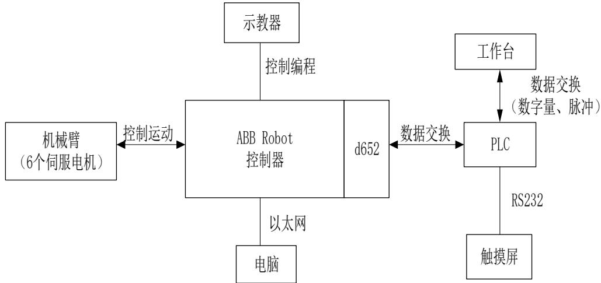


图 11.1 整体架构图


机器人与PLC I/O通信接线图 

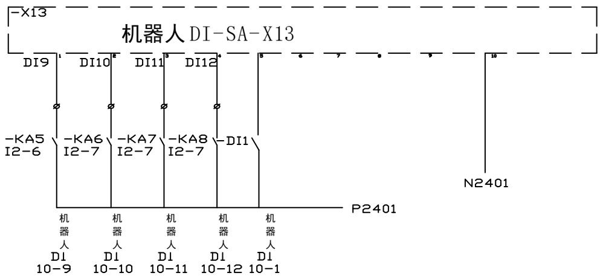


图 11.2 机器人输入端接线图


其中：1、DI10_9检测物体是否传输到输送带末端信号。


2、DI10_10检测冲压是否完成信号。 

3、DI10_11与DI10_1检测是否开启流水线工作模式信号。 

4、DI10_12 作为备用部分。 

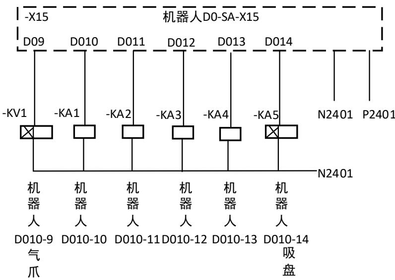


图11.3 机器人输出端接线图


其中：1、DO10_9控制机械臂上夹爪的闭合与松开。 

2、DO10_10控制启动冲压信号。 

3、DO10_11控制开始模拟检测信号。 

4、DO10_12 与机器人 DO10_13 作为备用部分。 

5、DO10_14 控制机械臂吸盘吸起物体或放下物体。 

为了实现机器人生产线所要求的任务，机器人与PLC 之间需要进行信号交换， 信号交换特别说明。 

（1）信号 DI10_9，当物块被传送带运输到末端，皮带侧安装的光电传感器 检测到物块时，PLC数字量输出端Q1.0就会给机器人端口 DI10_9发送信号，机 器人接收到信号后控制机械臂夹取物块放至冲压前区域。 

（2）信号DO10_10,当物块被机器人放至到冲压前区域时，机器人信号板输 出端DO10_10给PLC数字量输入端I0.5发送信号，此时冲压前光电传感器检测 到该物块，工作台启动冲压功能。 

（3）信号DI10_10，当物块冲压完成后,光电传感器检测到该物块，PLC数 字量输出端Q1.1发送信号到机器人输入端DI10_10，机器人接收到信号后控制 机械臂移动至冲压后区域并夹取物块。 

（4）信号 DO10_11,机器人控制机械臂夹取物块后，移动至成品检测区，完 成该任务后，机器人信号板输出端DO10_11给PLC发送信号，PLC开关量输入端 I0.6接收到信号后，对该物块进行模拟成品检测。 

（5）信号DO10_14控制机械臂上的吸盘信号。当此信号被置位时，吸盘吸 起物体；当此信号被复位时，吸盘松开物体。 

（6）信号 DI10_11 和 DI10_1 为开启流水线模式的信号。当信号 DI10_11 为1，信号DI10_1为0时，流水线模式才能运行。 

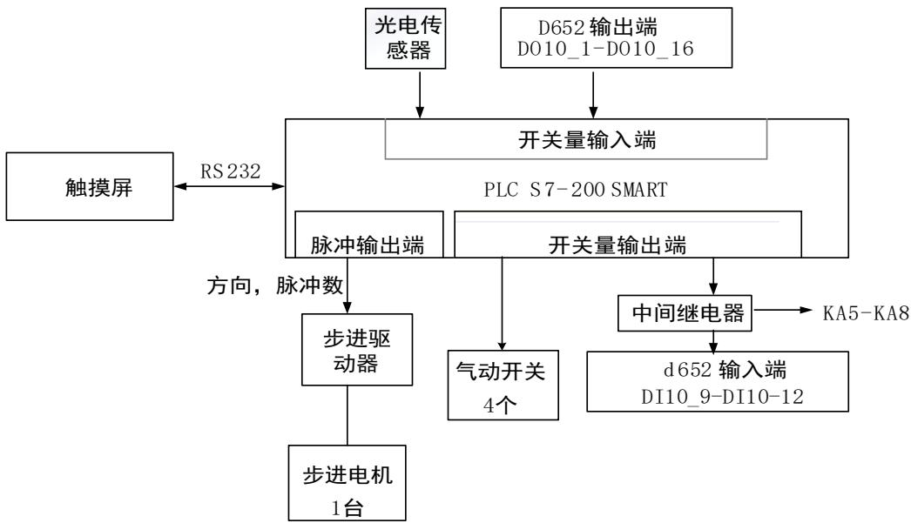


图 11.4 PLC 整体框架图


如图 11.4 所示，整个机器人码垛生产线以 PLC 控制器为核心，PLC 控制器 采集光电传感器的信号、机器人信号板输出的信号和触摸屏信号，根据生产工艺 需要控制步进电机、气动开关、中间继电器工作。其中中间继电器工作后，输出 的开关量信号进入机器人信号板输入端，控制机器人工作，满足生产工艺要求。 

## 7.4.2 PLC 的 I/O 分配表

## （1）PLC输入地址分配

<table><tr><td>符号</td><td>地址</td><td>注释</td></tr><tr><td>流水线</td><td>I0.0</td><td></td></tr><tr><td>启动</td><td>I0.2</td><td></td></tr><tr><td>停止</td><td>I0.3</td><td></td></tr><tr><td>机器人信号1</td><td>I0.5</td><td>机器人信号板接口D010_10给PLC发送信号</td></tr><tr><td>机器人信号2</td><td>I0.6</td><td>机器人信号板接口D010_11给PLC发送信号</td></tr><tr><td>原料检测</td><td>I1.3</td><td></td></tr><tr><td>送料气缸前限位</td><td>I1.4</td><td></td></tr><tr><td>送料气缸后限位</td><td>I1.5</td><td></td></tr><tr><td>冲压1气缸前限位</td><td>I1.6</td><td></td></tr><tr><td>冲压1气缸后限位</td><td>I1.7</td><td></td></tr><tr><td>冲压2气缸前限位</td><td>I2.0</td><td></td></tr><tr><td>冲压2气缸后限位</td><td>I2.1</td><td></td></tr><tr><td>冲压3气缸前限位</td><td>I2.2</td><td></td></tr><tr><td>冲压3气缸后限位</td><td>I2.3</td><td></td></tr><tr><td>皮带光电</td><td>I2.4</td><td></td></tr><tr><td>冲压前检测</td><td>I2.5</td><td></td></tr><tr><td>冲压完成检测</td><td>I2.6</td><td></td></tr><tr><td>检测成品</td><td>I2.7</td><td></td></tr></table>

## （2）PLC输出地址分配

<table><tr><td>符号</td><td>地址</td><td>注释</td></tr><tr><td>机器人1信号</td><td>Q1.0</td><td>PLC给机器人信号板接口DI10_9发送信号</td></tr><tr><td>机器人2信号</td><td>Q1.1</td><td>PLC给机器人信号板接口DI10_10发送信号</td></tr><tr><td>送料,气缸</td><td>Q1.4</td><td></td></tr><tr><td>冲压气缸1</td><td>Q1.5</td><td></td></tr><tr><td>冲压气缸2</td><td>Q1.6</td><td></td></tr><tr><td>冲压气缸3</td><td>Q1.7</td><td></td></tr></table>


步进驱动器与步进电机 


将电脉冲转化为角位移的执行机构称为步进驱动器。当它接收到一个脉冲信 号，就驱动步进电机按照设定好的方向转动一个固定的角度，它的转动是以固定 的角度一步一步运行的。图11.5为步进驱动器与步进电机之间的接线图，其中 Q0.0为脉冲信号，Q0.1为方向信号。 

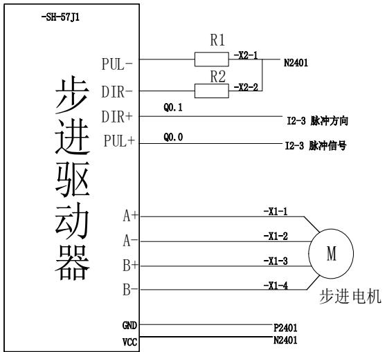


图11.5 步进驱动器与步进电机接线图


## B、 动力电源接线图及 PLC电气原理图

机器人生产线设备的启动只需将QF 断路器与 QS隔离开关闭合，再将机器人 电源插头与空压机电源插头插入插座，最后按下启动按钮，便可启动整套设备并 亮起电源指示灯，图11.6为机器人生产线设备的动力电源接线图。 

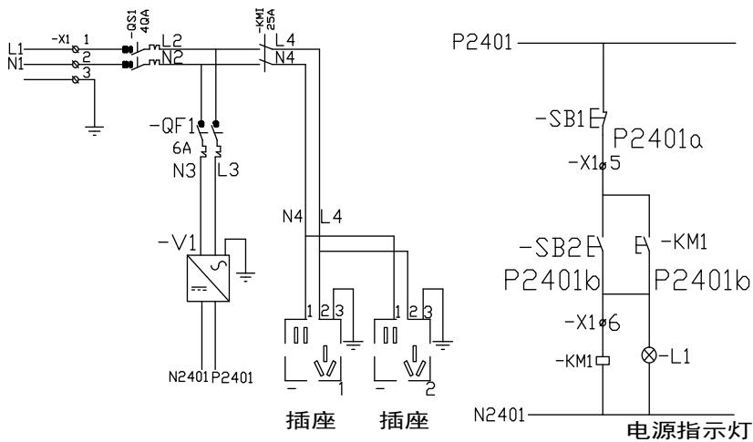


图11.6 动力电源接线图


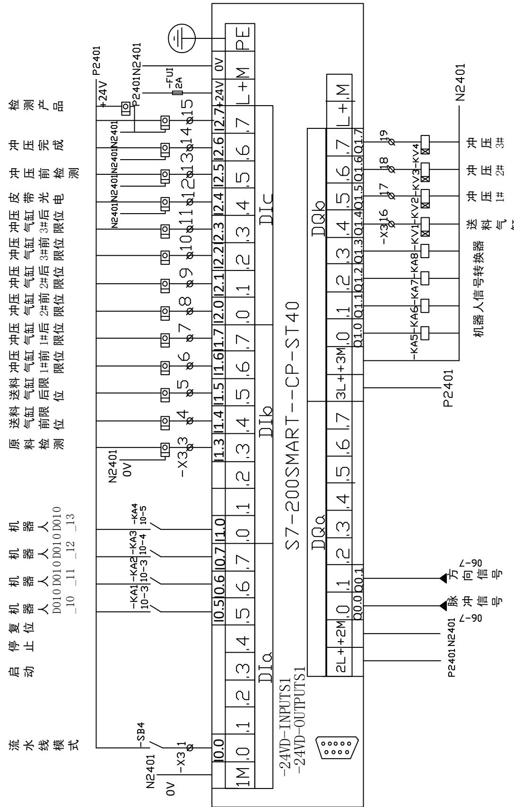


图 11.7 PLC 电气原理图


## C、参考程序流程图

1）生产线工艺流程图 

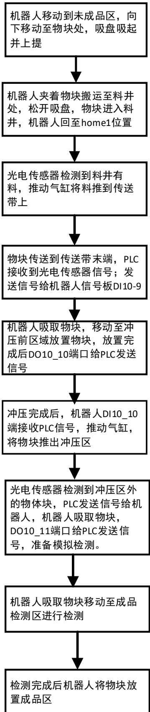


图11.8 生产线工艺流程


2）未成品区和码垛成品区物块位置码垛图及计算方法 

1、物块为尺寸相同的长方体物块，尺寸为:长×宽 $\scriptstyle \times { \frac { \vec { \boxdot { \square } } } { \vec { \boxdot { \square } } } } = 6 0 \times 3 0 \times 3 0$ （单位：毫 米） 

2、未成品区和码垛成品区物块码垛的托盘尺寸相同，如图 11.9 所示。 

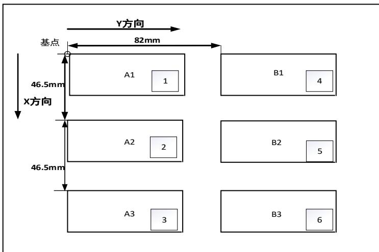


图11.9 托盘主要尺寸图


该托盘有6 小格，可摆放6块长方体物块。如果以基点为坐标作偏移，则 A1,A2...B3 左上角的坐标值如下表表示： 

<table><tr><td>名称</td><td>X方向坐标</td><td>Y方向坐标</td><td>名称</td><td>X方向坐标</td><td>Y方向坐标</td></tr><tr><td>A1</td><td>0mm</td><td>0mm</td><td>B1</td><td>0mm</td><td>82mm</td></tr><tr><td>A2</td><td>46.5mm</td><td>0mm</td><td>B2</td><td>46.5mm</td><td>82mm</td></tr><tr><td>A3</td><td>93mm</td><td>0mm</td><td>B3</td><td>93mm</td><td>82mm</td></tr></table>

3、如果未成品区每个小格已码垛好物块，先从 A1区域拿取物块，经过工艺流程 码垛到另一个托盘上，码垛位置同样为A1区域，机器人在未成品区拿取物块的 顺序依次为 A1,A2,A3,B1,B2,B3,码垛的顺序同样为 A1,A2,A3,B1,B2,B3，则可编 子程序实现码垛取和码垛放子程序。 

码垛相关子程序算法包含两个二维数组，分别为 count1{a,1}（X 轴方向偏 移的值）和 count1{a,2}（Y 轴方向偏移的值），本次共夹取6个物块，每完成一 个物块的整个环节，a值便会加 1，则机械臂下次移至未成品区的具体位置与上 次位置不同。 

X轴与Y 轴偏移量计算公式如下： 

$$
x = x _ {0} + 4 6 5 i; \quad y = y _ {0} + 8 2 j
$$

i 的取值为 0-2，j 的取值为 0-1 

X轴的偏移公式为内循环，Y轴的偏移公式为外循环，即j先取值为 0，Y 轴的偏移量为 0，i 依次取值为 0,1,2，X轴的偏移量分别为 0,46.5,93；j 再取 值为1，Y轴的偏移量为82，i依次取值为0,1,2，X轴的偏移量分别为0,46.5,93。 

由以上公式可得以下12个二维数组： 

count1{1,1}的值为 0，count1{1,2}的值为 0 

count1{2,1}的值为 46.5，count1{2,2}的值为 0 

count1{3,1}的值为 93，count1{3,2}的值为 0 

count1{4,1}的值为 0，count1{4,2}的值为 82 

count1{5,1}的值为 46.5，count1{5,2}的值为 82 

count1{6,1}的值为 93，count1{6,2}的值为 82 

4）参考程序操作步骤如下： 

1、定义 I/O变量（PLC与机器人通信） 

1.1在示教器或虚拟示教器上打开控制面板→配置系统参数 →主题 →I/O→ Devicenet Device→ 查看是否有 d652,如果没有请添加该模块，过程如下： 打开控制面板→配置系统参数 →主题 →I/O→ Devicenet Device→ 添加 需要修改的主要参数如下： 

1）使用来自模板的值选择：DSQC 652 24VDC I/O Device 

2）Name:d652 

3）Address ：10 

4）Product Code ： 26 

5）Device Type： 7 

6）Connection Type ： Change-of-State(COS) 

7）Connection output Size(byte):2(输出字节长度） 

8）Connection Input Size(byte):2(输入字节长度） 

1.2控制面板→配置系统参数 →主题 →I/O→signal→添加 

<table><tr><td>名称</td><td>连接设备</td><td>信号类型(Type of Signal)</td><td>Device mapping</td><td>名称</td><td>连接设备</td><td>信号类型(Type of Signal)</td><td>Device mapping</td></tr><tr><td>DI10_1</td><td>d652</td><td>Digital Input</td><td>0</td><td>D010_1</td><td>d652</td><td>Digital Output</td><td>0</td></tr><tr><td>DI10_2</td><td>d652</td><td>Digital Input</td><td>1</td><td>D010_2</td><td>d652</td><td>Digital Output</td><td>1</td></tr><tr><td>DI10_3</td><td>d652</td><td>Digital Input</td><td>2</td><td>D010_3</td><td>d652</td><td>Digital Output</td><td>2</td></tr><tr><td>DI10_4</td><td>d652</td><td>Digital Input</td><td>3</td><td>D010_4</td><td>d652</td><td>Digital Output</td><td>3</td></tr><tr><td>DI10_5</td><td>d652</td><td>Digital Input</td><td>4</td><td>D010_5</td><td>d652</td><td>Digital Output</td><td>4</td></tr><tr><td>DI10_6</td><td>d652</td><td>Digital Input</td><td>5</td><td>D010_6</td><td>d652</td><td>Digital Output</td><td>5</td></tr><tr><td>DI10_7</td><td>d652</td><td>Digital Input</td><td>6</td><td>D010_7</td><td>d652</td><td>Digital Output</td><td>6</td></tr><tr><td>DI10_8</td><td>d652</td><td>Digital Input</td><td>7</td><td>D010_8</td><td>d652</td><td>Digital Output</td><td>7</td></tr><tr><td>DI10_9</td><td>d652</td><td>Digital Input</td><td>8</td><td>D010_9</td><td>d652</td><td>Digital Output</td><td>8</td></tr><tr><td>DI10_10</td><td>d652</td><td>Digital Input</td><td>9</td><td>D010_10</td><td>d652</td><td>Digital Output</td><td>9</td></tr><tr><td>DI10_11</td><td>d652</td><td>Digital Input</td><td>10</td><td>D010_11</td><td>d652</td><td>Digital Output</td><td>10</td></tr><tr><td>DI10_12</td><td>d652</td><td>Digital Input</td><td>11</td><td>D010_12</td><td>d652</td><td>Digital Output</td><td>11</td></tr><tr><td>DI10_13</td><td>d652</td><td>Digital Input</td><td>12</td><td>D010_13</td><td>d652</td><td>Digital Output</td><td>12</td></tr><tr><td>DI10_14</td><td>d652</td><td>Digital Input</td><td>13</td><td>D010_14</td><td>d652</td><td>Digital Output</td><td>13</td></tr><tr><td>DI10_15</td><td>d652</td><td>Digital Input</td><td>14</td><td>D010_15</td><td>d652</td><td>Digital Output</td><td>14</td></tr><tr><td>DI10_16</td><td>d652</td><td>Digital Input</td><td>15</td><td>D010_16</td><td>d652</td><td>Digital Output</td><td>15</td></tr></table>

2、定义程序数据 

2.1 定义 num 类型数据 

程序数据→视图→全部数据类型→num→新建 

2.1.1 数据名称a,初始值为7，全局，可变量。 

数据名称b,初始值为1，全局，可变量。 

数组名称：count1，全局，可变量，维数，2，{6,2}（系统自带软数 字输入键，不可电脑键盘输入）。 

<table><tr><td>组件(数组)</td><td>值</td><td>组件(数组)</td><td>值</td><td>组件(数组)</td><td>值</td></tr><tr><td>{1,1}</td><td>0</td><td>{3,1}</td><td>93</td><td>{5,1}</td><td>46.5</td></tr><tr><td>{1,2}</td><td>0</td><td>{3,2}</td><td>0</td><td>{5,2}</td><td>82</td></tr><tr><td>{2,1}</td><td>46.5</td><td>{4,1}</td><td>0</td><td>{6,1}</td><td>93</td></tr><tr><td>{2,2}</td><td>0</td><td>{4,2}</td><td>82</td><td>{6,2}</td><td>82</td></tr></table>

2.2 定义 BOOL 类型数据 

程序数据→视图→全部数据类型→bool→新建 

数据名称Finish ，初始值为TRUE，全局，可变量。 

2.2 定义 robtarget 类型数据 

程序数据→视图→全部数据类型→robtarget→新建 

数据名称： Area_1，全局，常量 （物块在未成品区位置1的示教） 

Area_2 ，全局，常量；（物块在物料口位置2的示教） 

Area_3 ，全局，常量；（物块在输送皮带末端位置3的示教） 

Area_4 ，全局，常量；（物块在冲压前区位置4 的示教） 

Area_5 ，全局，常量；（物块在冲压后区位置5 的示教） 

Area_6 ，全局，常量；（物块在检验区位置6的示教） 

Area_7 ，全局，常量；（物块在成品区位置7的示教） 

Home1 ，全局，常量；（机器人返回到归位区位置 8的示教） 

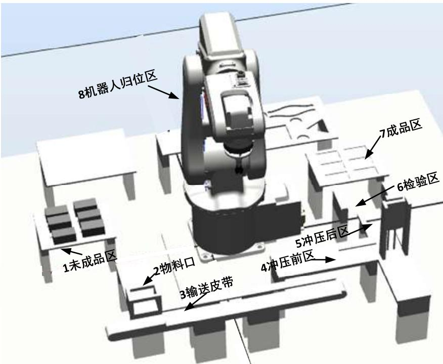


图11.10 机器人各位置标定示意图


## 3、编写程序

启动ABB工业机器人，将操作模式选到手动操作模式下，才能在示教器上或 虚拟示教器上编写主程序和子程序，主程序调用子程序。 

## 子程序编辑：

1、在示教器中依次选择菜单→程序编辑器→任务与程序→显示模块→文件 →新建模块。新模块名称：shenchanxian,类型：Program。 

双击shenchanxian，点击例行程序→文件→新建例行程序，在例行程序声明中， 名称：chushihua，类型：程序，参数：无，模块：shenchanxian； 

重复这样的步骤，分别建立 4 个子程序：chushihua，quhuo，banyun，fanghuo。 双击chushihua，则进入编程界面，4个子程序参考如下： 

```txt
PROC chushihua() //初始化程序
VAR robtarget here;
here:=CRobT();
MoveL offs(here,0,0,home1.trans.z-here.trans.z),v1000,z50,tool0;
MoveJ home1,v1000,z50,tool0;
a:=1;
b:=1;
Reset D010_9;
Reset D010_14;
Finish:=TRUE;

ENDPROC
PROC quhuo() //机器人取物体程序（偏移量算法）
MoveJ Offs(Area_1,count1{a,1},count1{a,2},80),v1000,fine,tool0;
Movel Offs(Area_1,count1{a,1},count1{a,2},0),v1000,fine,tool0;
Set D010_14;
WaitTime 1; 
```

```txt
Movel Offs(Area_1, count1{a, 1}, count1{a, 2}, 300), v1000, fine, tool0; ENDPROC 
```

```csv
PROC banyun() //搬运程序
    MoveJ Offs(Area_2,0,0,50),v1000,fine,tool0;
    Movel Area_2,v1000,fine,tool0;
    Reset D010_14;
    waittime 1;
    Movel offs(Area_2,0,0,50),v1000,fine,tool0;
    MoveJ home,v1000,z20,tool0;
    WaitDI DI10_9,1;
    MoveJ Offs(Area_3,0,0,250),v1000,fine,tool0;
    Movel Area_3,v1000,fine,tool0;
    set D010_14;
    waittime 1;
    Movel offs(Area_3,0,0,200),v1000,fine,tool0;
    MoveJ offs(Area_4,0,0,200),v1000,fine,tool0;
    Movel Area_4,v1000,fine,tool0;
    reset D010_14;
    waittime 1;
    Movel Offs(Area_4,0,0,250),v1000,fine,tool0;
    PulseDO\PLength:=0.5,D010_10;
    WaitDI DI10_10,1;
    MoveJ Offs(Area_5,0,0,250),v1000,fine,tool0;
    MoveJ offs(Area_5,0,0,100),v1000,fine,tool0;
    Movel Area_5,v1000,fine,tool0;
    set D010_14;
    waittime 1;
    Movel offs(Area_5,0,0,200),v1000,fine,tool0;
    PulseDO\PLength:=0.5,D010_11;
    MoveJ offs(Area_6,0,0,100),v1000,fine,tool0;
    Movel Area_6,v1000,fine,tool0;
    WaitTime 1;
    Movel offs(Area_6,0,0,200),v1000,fine,tool0;

ENDPROC

PROC fanghuo() //码垛程序
    MoveJ Offs(Area_7,count1{a,1},count1{a,2},200),v1000,z50,tooio;
    Movel Offs(Area_7,count1{a,1},count1{a,2},o),v1000,fine,toio;
    reSet D010_14;
    WaitTime 1;
    Movel Offs(Area_7,count1{a,1},count1{a,2},2O),v10O,O,fine,toio;
    Incr a;

ENDPROC 
```

```txt
2、主程序编辑： 
```

在示教器中依次选择菜单→程序编辑器→任务与程序→显示模块→点击 Module1 则可进入有 PROC main()这样开头的画面。当然 Module1 通过更改声明可以 把名称修改为其他名称。 

```asm
MODULE Module1（主程序）chushihua, quhuo, banyun, fanghuo
PROC main2()
    chushihua;
    WHILE DI10_11=1 AND DI10_1=0 AND Finish=TRUE DO
    quhuo;
    banyun;
    fanghuo;
    MoveJ home1, v1000, z20, tool0;
    IF a=7then
    stop;
    ENDWHILE
    WHILE DI10_12=1 AND DI10_1=0 AND Finish=TRUE DO
    MoveJ home1, v1000, z20, tool0;
    TPWrite "Please install the tool on the jig";
    Break;
    set D010_14;
    Break;
    MoveJ home1, v1000, z20, tool0;
    TPWrite "Please put the jig on the tool";
    Break;
    Reset D010_14;
    Break;
    Finish :=FALSE;
    ENDWHILE
    IF Finish=FALSE TPWrite"Failed to initialize";
    IF DI10_11=0 AND DI10_12=0 TPWrite"The current in the teaching mode";
    IF DI10_1=1 TPWrite"you should turn off the DI10_1";
ENDPROC
ENDMODULE 
```

## 3、调试

程序编程完成后，利用示教器进行手动调试，运行过程中出现报警，根 据报警提示进行修改，直到报警解除。在生产线运行的各个阶段示教 robtarget 中变量的位置，即修改 Area_1，Area_2，Area_3，Area_4，Area_5， Area_6，Area_7 及 home1。 

## 连续运行

手动调试结束，一切都正常后，将ABB控制箱按钮切换到自动状态，电 机按钮上电，PLC触摸屏上启动PLC，设置输送带速度，6块物块放置在托盘 上，在示教器上打开程序编辑器，进入主程序 Module1，将 PP 移至 main， 设置运动速度，通常设置 50%左右，启动示教器上右下方按钮运行按钮▲， 程序连续运行，如出现故障按下停止按钮■，程序停止运行。 

## D、工作台工作流程

工作台上要执行将物块推出料井，运输，冲压，成品检测的任务，具体流程 见图 11.11 

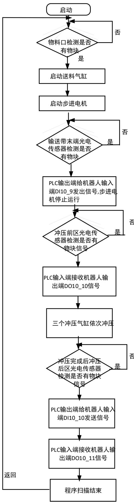


图11.11 工作台工作流程


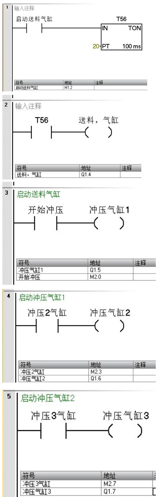


## 1） PLC梯形图设计

PLC程序设计分为主程序和子程序。 

子程序有 2 个，分别命名为 shuchu，bujindianji。 

1）子程序 shuchu 

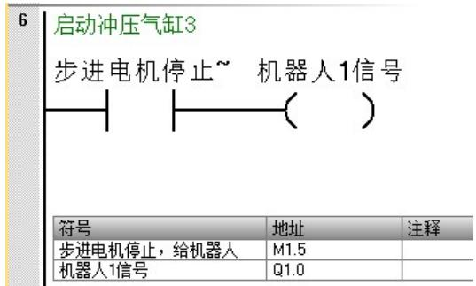


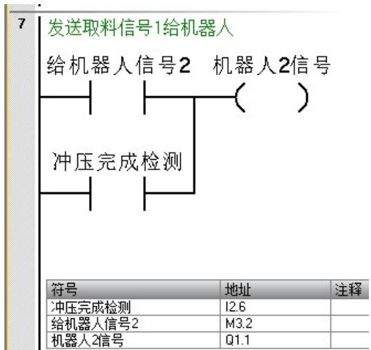


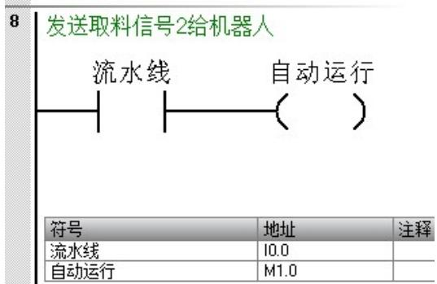


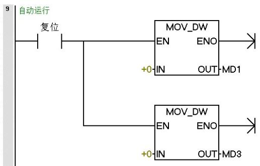


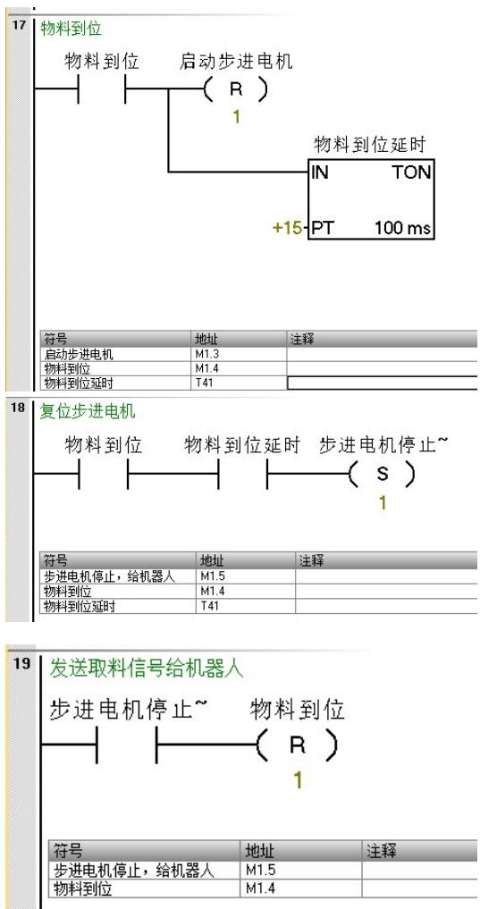


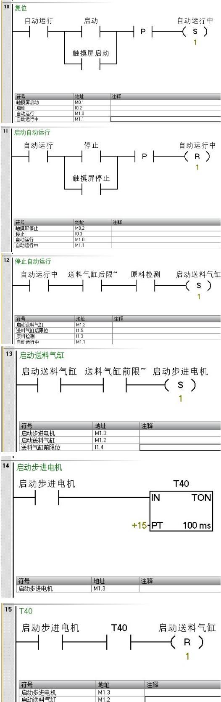


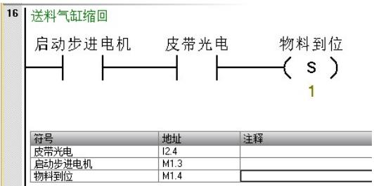


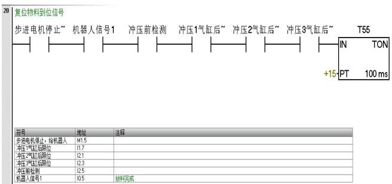


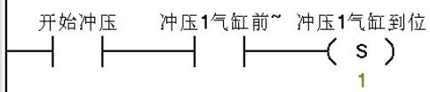


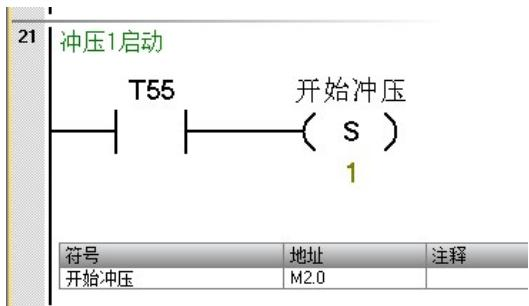


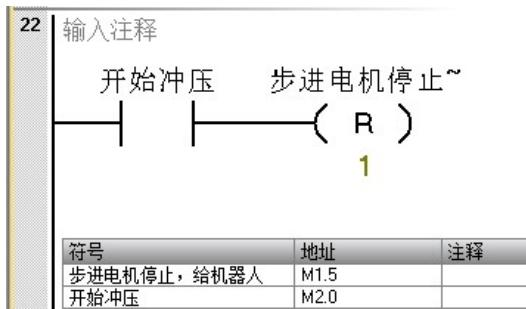


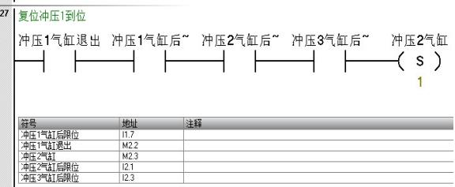


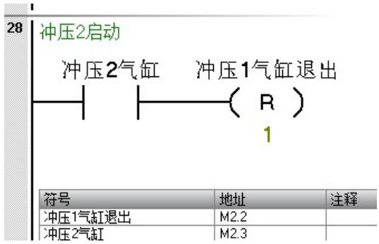


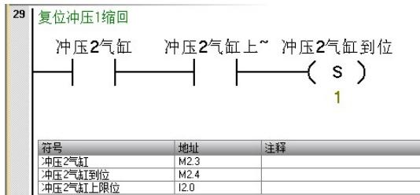


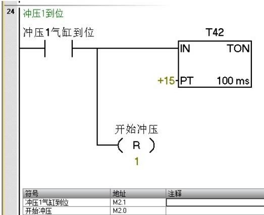


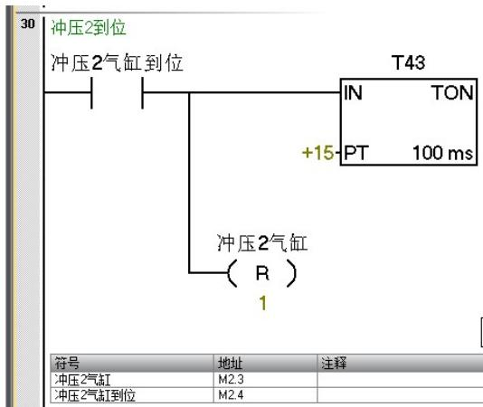


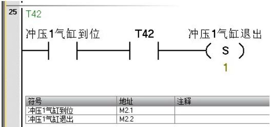


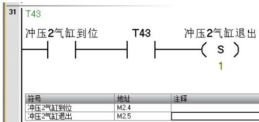


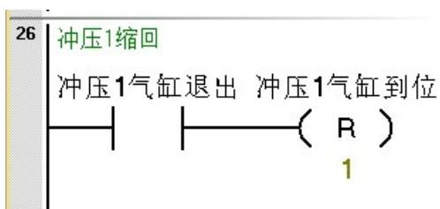


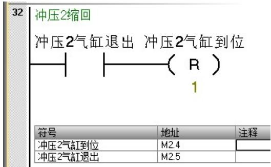


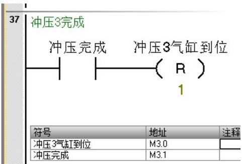


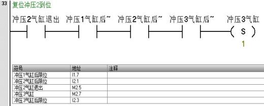


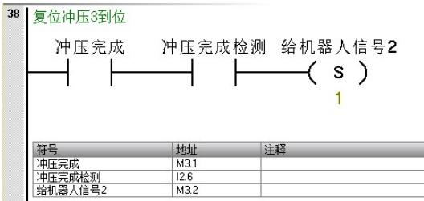


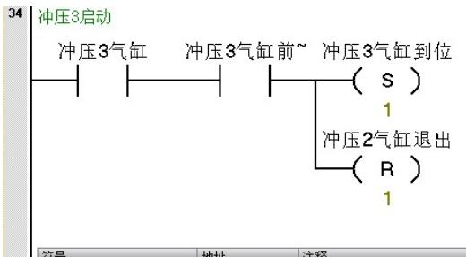


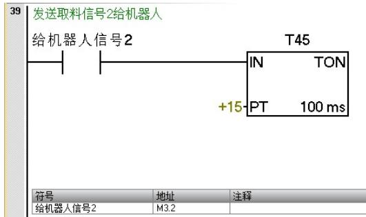


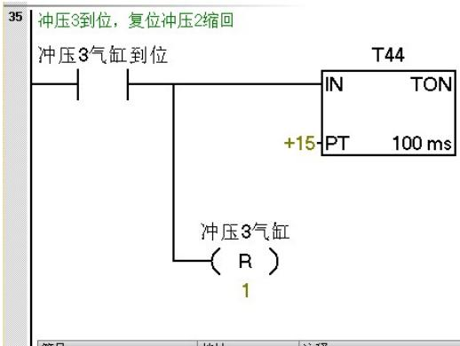


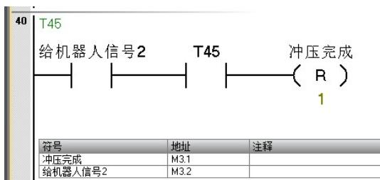


<table><tr><td>符号</td><td>地址</td><td>注释</td></tr><tr><td>冲压3气缸</td><td>M2.7</td><td></td></tr><tr><td>冲压3气缸到位</td><td>M3.0</td><td></td></tr></table>

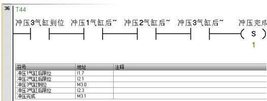


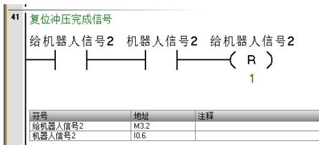


子程序shuchu编程说明： 

传感器检测到物块后，原料检测开关闭合，接通延时继电器（T55）1.5秒后 接通启动送料气缸，送料气缸将物块推送至传送带上，送料气缸前限位开关 接通，步进电机被启动，接通延时继电器（T40）1.5秒后将送料气缸复位， 皮带光电传感器检测到物块时，复位步进电机，接通物料到位延时并进行下 一步。 

（2）物料到位延时接通1.5秒后，步进电机停止同时给机器人发送 1信号， 机械臂会将物块从传送带末端搬运到冲压前区域，准备开始冲压。 

（3）物块到达冲压前位置，光电传感器检测到物块并接通冲压前检测开关， 开始第一次冲压，第一次冲压到位后，接通延时继电器（T42）1.5 秒后复位 冲压1气缸，开始第二次冲压。 

（4）物块到达第二次冲压位置，物块被检测到后，开始第二次冲压，第二 次冲压结束后，将要开始第三次冲压。 

（5）第三次冲压完成后，物块被推到冲压后区域，光电传感器检测到物块， PLC给机器人发送2信号。 

（6）机器人接收到2信号后，机械臂将物块从冲压后区域搬运至成品检测 区并进行检测。 

（7）整条生产流水线的启动和停止可通过触摸屏来进行控制。 

（8）系统复位程序。 

2）子程序 bujindianji 

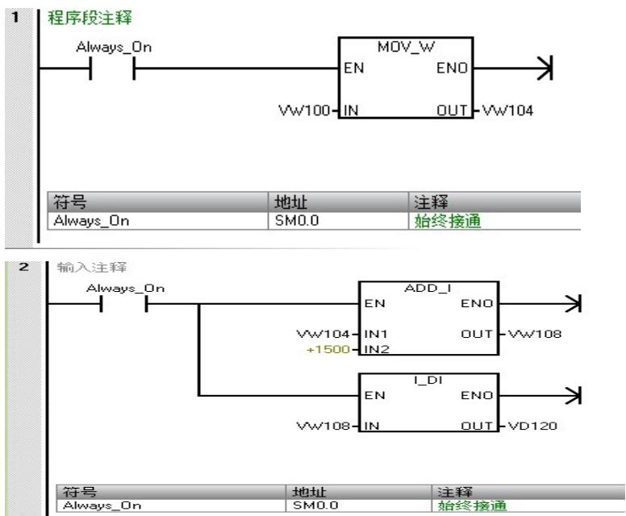


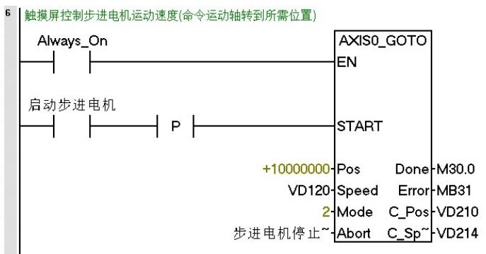


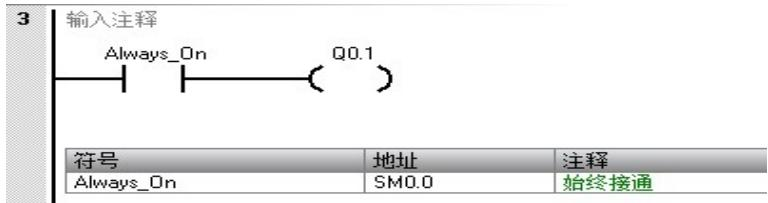


子程序bujindianji程序主要功能是利用触摸屏变量VW100输入步进电 机的速度数值，速度数值加上1500后，输出的整数值转化成双精度整数值 存入到VD120中，VD120数据为控制步进电机的运动速度值，Q0.1为步进电 机方向，Q0.1=1 为正方向，Q0.1=0 为反方向。Q0.0 为步进电机脉冲输出端。 3）主程序 MAIN 

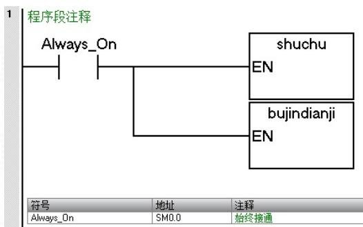


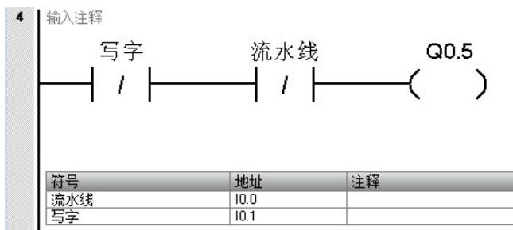


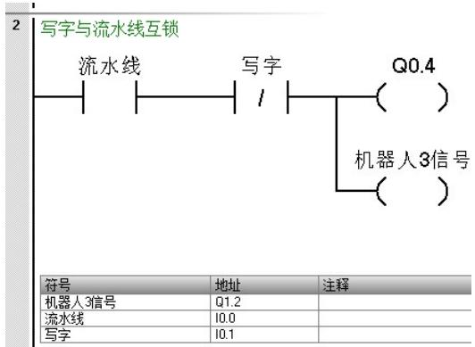


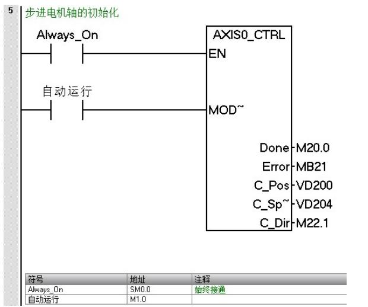


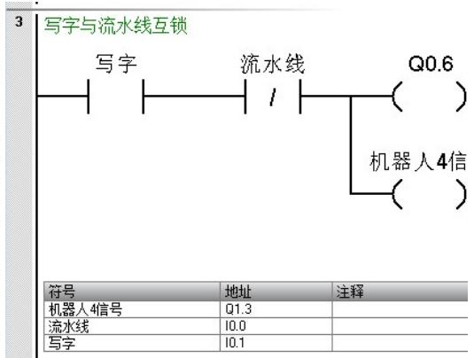


<table><tr><td>符号</td><td>地址</td><td>注释</td></tr><tr><td>机器人4信号</td><td>Q1.3</td><td></td></tr><tr><td>流水线</td><td>I0.0</td><td></td></tr><tr><td>写字</td><td>I0.1</td><td></td></tr></table>

<table><tr><td>符号</td><td>地址</td><td>注释</td></tr><tr><td>Always_On</td><td>SM0.0</td><td>始终接通</td></tr><tr><td>步进电机停止,给机器人</td><td>M1.5</td><td></td></tr><tr><td>启动步进电机</td><td>M1.3</td><td></td></tr></table>


9M5.0按钮低电平时数据清零


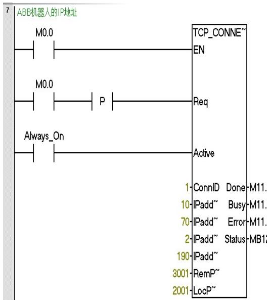


A）MOD，EN 参数必须开启，才能启用其它运动控制子例程向运动轴发送命


令。如果 MOD，EN 参数关闭，则运动轴将中止进行中的任何指令并执行减 速停止。 

B）当运动轴完成任何一个子例程时，Done 参数会开启。 

C）Error 参数包含该子例程的结果:C_Pos 参数表示运动轴的当前位置。根 据测量单位，该值是脉冲数 (DINT) 或工程单位数 (REAL)；C_Speed 参数 提供运动轴的当前速度。如果您针对脉冲组态运动轴的测量系统，C_Speed 是一个 DINT 数值，其中包含脉冲数/每秒。如果您针对工程单位组态测量 系统，C_Speed 是一个 REAL 数值，其中包含选择的工程单位数/每秒 (REAL)。 

D）C_Dir 参数表示电机的当前方向：信号状态 0 为 正向，信号状态 1 为 反向。 


A）开启 EN 位会启用此子例程。确保 EN 位保持开启，直至 DONE 位指示 子例程执行已经完成。 

B）开启 START 参数会向运动轴发出 GOTO 命令。 对于在 START 参数开启 且运动轴当前不繁忙时执行的每次扫描，该子例程向运动轴发送一个 GOTO 命令。 为了确保仅发送了一个 GOTO 命令，请使用边沿检测元素用脉冲方 式开启 START 参数。 

C）Pos 参数包含一个数值，指示要移动的位置（绝对移动）或要移动的距 离（相对移动）。 根据所选的测量单位，该值是脉冲数 (DINT) 或工程单位 数 (REAL)。 

D）Speed 参数确定该移动的最高速度。根据所选的测量单位，该值是脉冲 数/每秒 (DINT) 或工程单位数/每秒 (REAL)。 

Mode 参数选择移动的类型：0为绝对位置；1为相对位置；2 为单速连续正 向旋转；3为单速连续反向旋转。 

当运动轴完成此子例程时，Done 参数会开启。 

G)开启 Abort 参数会命令运动轴停止执行此命令并减速，直至电机停止。 

H)Error 参数包含该子例程的结果: C_Pos 参数包含运动轴的当前位置。根 据测量单位，该值是脉冲数 (DINT) 或工程单位数 (REAL);C_Speed 参数包 含运动轴的当前速度。根据所选的测量单位，该值是脉冲数/每秒 (DINT) 或 工程单位数/每秒 (REAL)。 

主程序MAIN编程功能说明： 

调用两个子程序：shuchu 和 bujindianji 

写字、流水线或其他的按钮选择，其中流水线才能控制有效，写字和其他无 效。 

步进电机的初始化AXISO_CTRL以及步进电机速度和方向AXISO_GOTO控制设 置。 

I)运动控制设置：在200SMART PLC 编程软件中向导→运动控制，对应控制 步进驱动器的参数设置如下： 

<table><tr><td>名称</td><td>功能设置</td></tr><tr><td>映射</td><td>I/O 映射表 轴 0;类型: P0;地址 Q0.0轴 1;类型:P1;地址 Q0.2</td></tr><tr><td>测量系统</td><td>相对脉冲</td></tr><tr><td>方向控制</td><td>双相(2)输出,极性正(P0 为正向运动脉冲输出)</td></tr><tr><td>电机速度</td><td>最大电机速度 5000 个脉冲/s,最小电机速度 20 个脉冲/s电机启动/停止速度 1000 个脉冲/s。</td></tr><tr><td>JOG</td><td>电机的点动速度 1000 个脉冲/s,增量 1 个脉冲。</td></tr><tr><td>储存器分配</td><td>VB218-VB310</td></tr><tr><td>组件</td><td>AXISO-DATA 组态置于 VB218-VB310AXISO-SYS 为此组态创建符号表AXISO-CTRL 子程序初始化位置模块AXISO-CFG 子程序重新加载组态AXISO-DIS 子程序激活 DIS 输出AXISO-GOTO 子程序转到移动AXISO-LDOFF 子程序加载参考点偏移量AXISO-LDPOS 子程序加载位置AXISO-MAN 子程序手动模式AXISO-RSEEK 子程序查找参考点位置AXISO-RUN 子程序运行曲线</td></tr></table>

