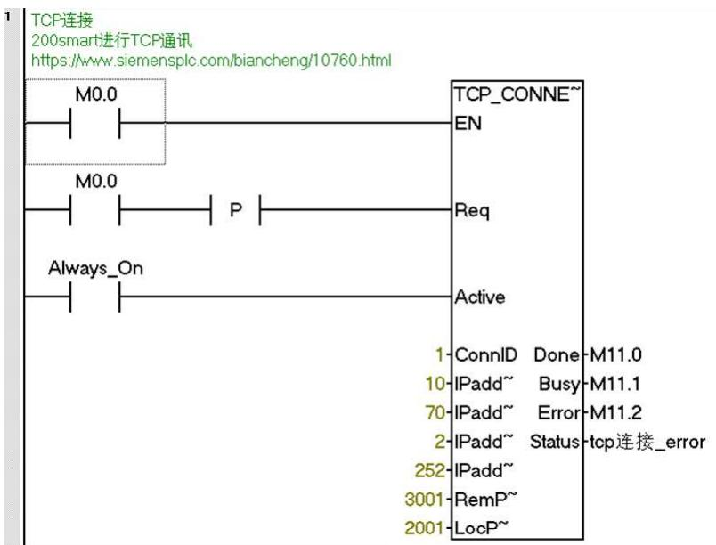
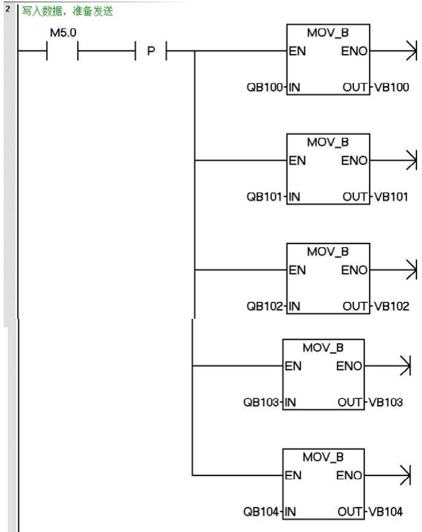
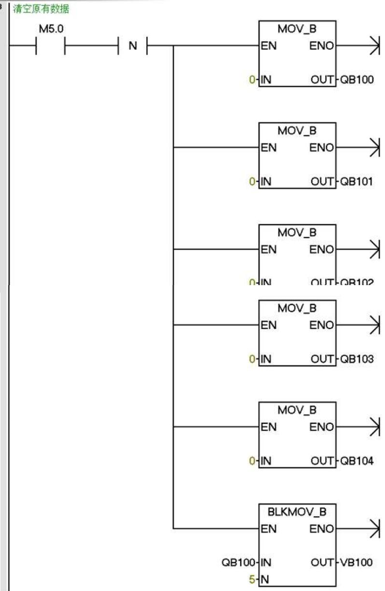
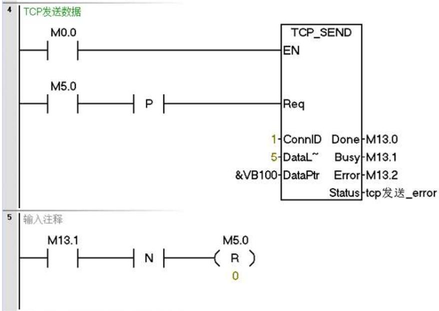
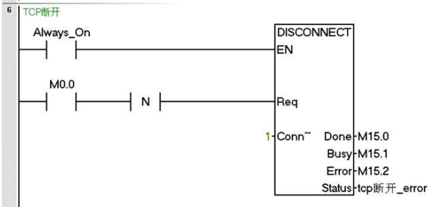
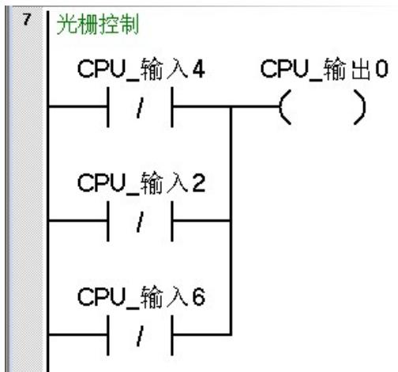
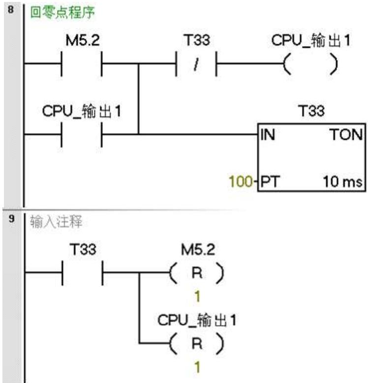
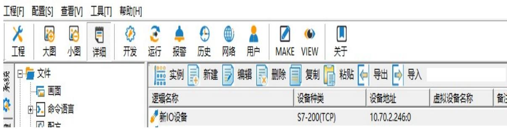
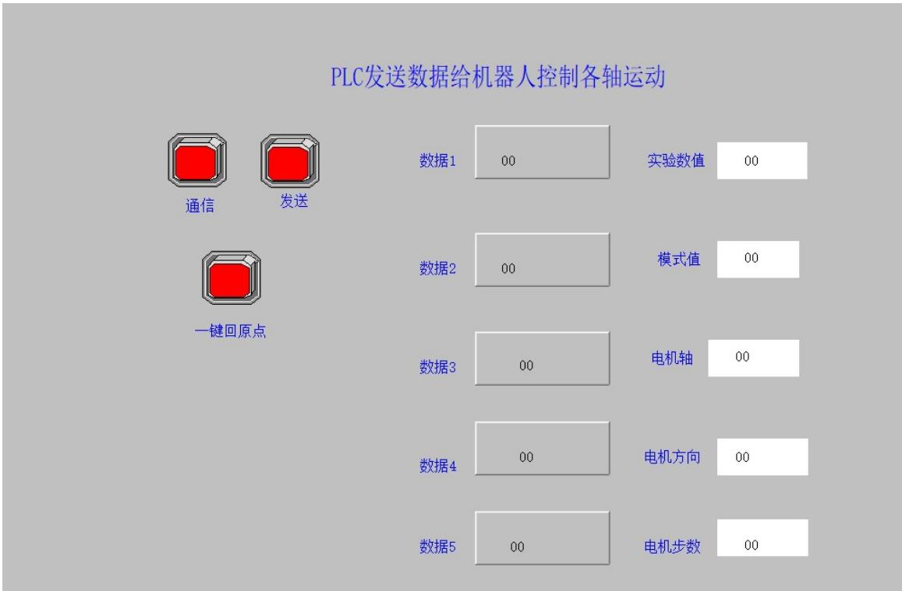

# 第十二章 组态王与PLC控制机器人实验

## 一、实验目的

1. 学习组态王与PLC之间的通信。 

2. 学习 PLC通过以太网控制ABB机器人。 

## 二、要求

利用组态王软件设计界面，发送数据包控制机器人动作。 

三、 实验设备：型号 MFTW-IR 和 CHL-JC-02-A 的工作站 

## 四、 实验步骤

a、实验台PLC设置及程序情况（已编好程序） 

<table><tr><td></td><td>模块</td><td>版本</td><td>输入</td><td>输出</td><td>订货号</td></tr><tr><td>CPU</td><td>CPU SR20 (AC/DC/Relay)</td><td>V02.05.00_00.00...</td><td>10.0</td><td>Q0.0</td><td>6ES7 288-1SR20-0AA0</td></tr><tr><td>SB</td><td></td><td></td><td></td><td></td><td></td></tr><tr><td>EM 0</td><td></td><td></td><td></td><td></td><td></td></tr><tr><td>EM 1</td><td></td><td></td><td></td><td></td><td></td></tr><tr><td>EM 2</td><td></td><td></td><td></td><td></td><td></td></tr><tr><td>EM 3</td><td></td><td></td><td></td><td></td><td></td></tr><tr><td>EM 4</td><td></td><td></td><td></td><td></td><td></td></tr><tr><td>EM 5</td><td></td><td></td><td></td><td></td><td></td></tr></table>


图 12.1 PLC 模块通信设置


由于每台设备对应的PLC 地址不一样，根据现场进行修改。 

<table><tr><td></td><td colspan="3">符号</td><td>地址</td></tr><tr><td>1</td><td></td><td colspan="2">CPU_输入0</td><td>I0.0</td></tr><tr><td>2</td><td></td><td colspan="2">CPU_输入1</td><td>I0.1</td></tr><tr><td>3</td><td></td><td colspan="2">CPU_输入2</td><td>I0.2</td></tr><tr><td>4</td><td></td><td colspan="2">CPU_输入3</td><td>I0.3</td></tr><tr><td>5</td><td></td><td colspan="2">CPU_输入4</td><td>I0.4</td></tr><tr><td>6</td><td></td><td colspan="2">CPU_输入5</td><td>I0.5</td></tr><tr><td>7</td><td></td><td colspan="2">CPU_输入6</td><td>I0.6</td></tr><tr><td>8</td><td></td><td colspan="2">CPU_输入7</td><td>I0.7</td></tr><tr><td>9</td><td></td><td colspan="2">CPU_输入8</td><td>I1.0</td></tr><tr><td>10</td><td></td><td colspan="2">CPU_输入9</td><td>I1.1</td></tr><tr><td>11</td><td></td><td colspan="2">CPU_输入10</td><td>I1.2</td></tr><tr><td>12</td><td></td><td colspan="2">CPU_输入11</td><td>I1.3</td></tr><tr><td>13</td><td></td><td colspan="2">CPU_输出0</td><td>Q0.0</td></tr><tr><td>14</td><td></td><td colspan="2">CPU_输出1</td><td>Q0.1</td></tr><tr><td>15</td><td></td><td colspan="2">CPU_输出2</td><td>Q0.2</td></tr><tr><td>16</td><td></td><td colspan="2">CPU_输出3</td><td>Q0.3</td></tr><tr><td>17</td><td></td><td colspan="2">CPU_输出4</td><td>Q0.4</td></tr><tr><td>18</td><td></td><td colspan="2">CPU_输出5</td><td>Q0.5</td></tr><tr><td>19</td><td></td><td colspan="2">CPU_输出6</td><td>Q0.6</td></tr><tr><td>20</td><td></td><td colspan="2">CPU_输出7</td><td>Q0.7</td></tr></table>


图 12.2 I/O 端口部分符号表





机器人的 IP 地址





PLC 发送通过组态王或其他界面发送数据给ABB机器人执行动作

















B、组态王界面开发 

1、定义设备 

组态王KingView7.5 界面中，根据每台设备的具体IP定义设备，如下图： 

## 工程浏览器--我223




图12.3 组态王 PLC设备地址


## 2、定义数据词典

数据词典如下图： 

<table><tr><td>#NetStatus</td><td>内存类型</td><td>17</td><td></td><td></td></tr><tr><td>通信</td><td>I/O离散</td><td>21</td><td>新IO设备</td><td>M0.0</td></tr><tr><td>数据发送</td><td>I/O离散</td><td>22</td><td>新IO设备</td><td>M5.0</td></tr><tr><td>发送数据1</td><td>I/O整型</td><td>23</td><td>新IO设备</td><td>Q100</td></tr><tr><td>发送数据2</td><td>I/O整型</td><td>24</td><td>新IO设备</td><td>Q101</td></tr><tr><td>发送数据3</td><td>I/O整型</td><td>25</td><td>新IO设备</td><td>Q102</td></tr><tr><td>发送数据4</td><td>I/O整型</td><td>26</td><td>新IO设备</td><td>Q103</td></tr><tr><td>发送数据5</td><td>I/O整型</td><td>27</td><td>新IO设备</td><td>Q104</td></tr><tr><td>VB100</td><td>I/O整型</td><td>28</td><td>新IO设备</td><td>V100</td></tr><tr><td>VB101</td><td>I/O整型</td><td>29</td><td>新IO设备</td><td>V101</td></tr><tr><td>VB102</td><td>I/O整型</td><td>30</td><td>新IO设备</td><td>V102</td></tr><tr><td>VB103</td><td>I/O整型</td><td>31</td><td>新IO设备</td><td>V103</td></tr><tr><td>VB104</td><td>I/O整型</td><td>32</td><td>新IO设备</td><td>V104</td></tr><tr><td>一键回原点</td><td>I/O离散</td><td>33</td><td>新IO设备</td><td>M5.2</td></tr><tr><td>新建</td><td></td><td></td><td></td><td></td></tr></table>


图 12.3 组态王数据定义


## C、界面开发和动画连接

主画面如下图： 




图 12.3 组态王画面定义


动画连接变量表


<table><tr><td>名称</td><td>动画连接变量</td><td>名称</td><td>动画连接变量</td></tr><tr><td>数据 1</td><td>Q100</td><td>实验数值</td><td>V100</td></tr><tr><td>数据 2</td><td>Q101</td><td>模式值</td><td>V101</td></tr><tr><td>数据 3</td><td>Q102</td><td>电机轴</td><td>V102</td></tr><tr><td>数据 4</td><td>Q103</td><td>电机方向</td><td>V103</td></tr><tr><td>数据 5</td><td>Q104</td><td>电机步数</td><td>V104</td></tr><tr><td>通信</td><td>M0.0</td><td>发送</td><td>M5.0</td></tr><tr><td>一键回原点</td><td>M5.2</td><td></td><td></td></tr></table>

数据1的数值为1，2可选（实验数据） 

数据2为1 （模式值） 

数据3为1，2，3，4，5，6可选（电机 6个轴中选择一个轴） 

数据4 为1，2（电机方向1 为正转，2 为反转） 

数据5 为0-20值（电机行走的步数） 

当在组态王运行时，打开通信，从数据 1到数据 5分别输入 5个数据，点击 发送按钮，可控制机械臂中6 个轴中的任意一个轴做正向或反向运动，点击一键 回原点时电机回到原点。 

```txt
PLC 控制机器人的程序 Robotstudio 参考程序：
VAR socketdev server_socket2;
VAR socketdev client_socket2;
VAR string client_ip:="10.70.2.250";
VAR byte receive_byte{5}:=[0,0,0,0,0];
PERS byte global_byte{5}:=[0,0,0,0,0];
VAR string receive_string{5};
VAR string str_hextodec{5};
PERS num lab_number:=2;
PERS num mode_value:=0;
PERS num jog_value:=0;
PERS num direction_value:=0;
PERS num step_value:=0;
VAR bool change_ok:=false;
VAR socketstatus state{3};
VAR robtarget current_position_robT;
VAR jointtarget current_position_jointT;
VAR intnum int_home;
VAR num num_jog{6}:=[0,0,0,0,0,0];
PERS num num2_deg:=0;
VAR robtarget P_temp;
CONST jointtarget
Home:=[-0.00129488,-0.000801945,0.00505125,-0.000859787,90.0011,-0.000264077],[9E+09,9E+09,9E+09,9E+09,9E+09,9E+09,9E+09]];
PROC main2()
    SocketClose server_socket2;
    SocketClose client_socket2;
    client_ip:="10.70.2.250";
    SocketCreate server_socket2;
    SocketBind server_socket2,"10.70.2.252",3002; //ABB机器人IP地址。
    SocketListen server_socket2;
SocketAccept server_socket2,client_socket2\ClientAddress:=client_ip\Time:=WAIT_MAX;
WHILE TRUE DO
SocketReceive client_socket2\Data:=receive_byte\Time:=WAIT_MAX;
FOR i FROM 1 TO 5 DO
    global_byte{i}:=receive_byte{i};
ENDFOR
FOR i FROM 1 TO 5 DO
    receive_string{i}:=ByteToStr(global_byte{i});//16进制字转化成字符
    change_ok:=StrToVal(receive_string{1},lab_number); //字符转化成值
    change_ok:=StrToVal(receive_string{2},mode_value);
    change_ok:=StrToVal(receive_string{3},jog_value);
    change_ok:=StrToVal(receive_string{4},direction_value); 
```

change_ok:=StrToVal(receive_string{5},step_value); ENDFOR FOR i FROM 1 TO 5 DO TPWrite "receive_string="+receive_string{i}; ENDFOR TPWrite "receive_string="+receive_string{5}; //在示教器上显示相应字符串 TPWrite "lab_number="\Num:=+lab_number; TPWrite "mode_value="\Num:=+mode_value; TPWrite "jog_value="\Num:=+jog_value; TPWrite "direction_value="\Num:=+direction_value; TPWrite "step_value="\Num:=+step_value; IF lab_number=1 OR lab_number=2 THEN //实验号选择 TEST mode_value //模式测试 CASE 1: current_position_robT:=CRobT(\Tool:=tool0\wobj:=wobj0); //机器人当前位置 current_position_jointT:=CalcJointT(current_position_robT,tool0\WObj:=wobj0); FOR i FROM 1 TO 6 DO IF (i=jog_value) THEN TEST direction_value/对控制轴方向判断 CASE 1: num_jog{i}:=step_value; //方向向上 CASE 2: num_jog{i}:=-step_value; //方向向下 ENDTEST current_position_jointT:=Absjoffs(current_position_jointT,num_jog{1},num_jog{2 num_jog{3},num_jog{4},num_jog{5},num_jog{6}); 

MoveAbsJ current_position_jointT\NoEOffs,v300,fine,tool0; lab_number:= 0; mode_value:=0; //复位为零 jog_value:=0; //复位为零 direction_value:=0; //复位为零 step_value:=0; //复位为零 FOR i FROM 1 TO 6 DO num_jog{i}:=0; //数组复位为零 ENDFOR FOR i FROM 1 TO 5 DO global_byte{i}:=0; //数组复位为零 ENDFOR Endif ENDFOR ENDTEST Endif ENDWHILE 

## ENDPROC

VAR jointtarget joint_temp; 

joint_temp:=Point; 

joint_temp.robax.rax_1:=joint_temp.robax.rax_1+J10ffset; 

joint_temp.robax.rax_2:=joint_temp.robax.rax_2+J20ffset; 

joint_temp.robax.rax_3:=joint_temp.robax.rax_3+J30ffset; 

joint_temp.robax.rax_4:=joint_temp.robax.rax_4+J40ffset; 

joint_temp.robax.rax_5:=joint_temp.robax.rax_5+J50ffset; 

joint_temp.robax.rax_6:=joint_temp.robax.rax_6+J60ffset; 

RETURN joint_temp; 

ENDFUNC 

ENDMODULE 

如果运行出现套接字错误，改 server_socket2 变为 server_socket4 或其他， client_socket2 变为 client_socket4 或其他，端口号 3002 改为 3010 或其他，其 他的程序对应的变量依次修改。 

