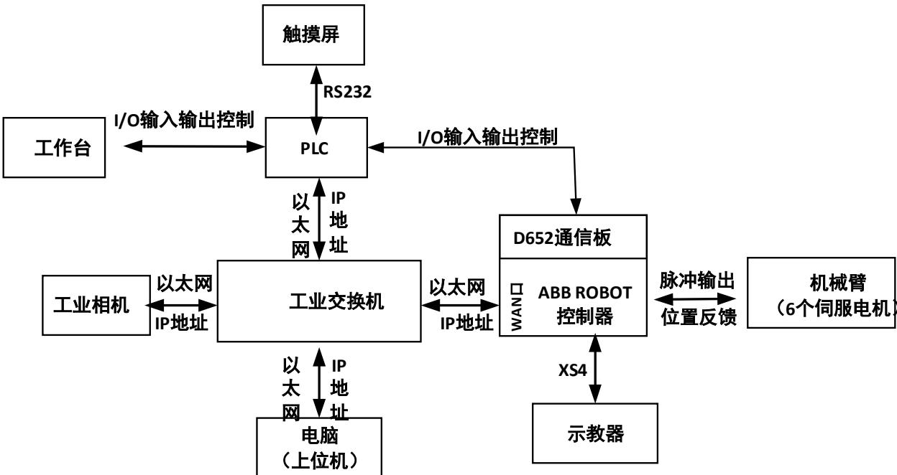

# 第十三章 工业相机物体识别码垛生产线实验

## 实验目的

1. 掌握 ABB工业相机的基本使用方法。 

2. 掌握 ABB工业机器人与PLCI/O端口信号交互功能。 

3. 掌握码垛生产线程序的编写方法。 

## 实验要求

在实验平台上随意摆放 6块尺寸大小相同的物体，利用工业相机完成6块物 体的分拣、搬运、送料、运送、冲压、检测、码垛成品的任务。 

实验设备：型号 CHL-JC-02-A 的工作站 

## 预习要点

1. 预习 ABB工业机器人编程指令中通信指令的用法。 

2. 预习 ABB工业机器人编程指令中I/O操作指令的用法。 

3. 了解工业相机图像处理方法。 

## A、控制系统整体架构

设计的工业相机物体识别码垛生产线控制系统主要由以下9 个部分组成： ABB Robot控制器、机械臂、PLC、示教器、工作台、触摸屏、电脑、工业交换 机和工业相机，如图13.1所示。其中ABBRobot控制器、PLC、电脑和工业相机 连接到工业以太网，该 4台设备之间以太网通信方式进行数据交换。ABB Robot 控制器上的扩展模块D652有16路开关量输入和16路开关量输出，可分别与PLC 开关量输出、开关量输入进行数据交换。实现机器人与PLC控制的生产线之间进 行数据交换，满足码垛生产线工艺要求。触摸屏上主要有简单的启动、停止复位 按钮、输送带速度输入窗口等。 

图 13.1 整体架构图

