## 第十四章 视觉工程项目软件架构及源码说明

## 一、软件基本框架

视觉工程项目软件采用 C#和 C++联合开发，前端UI 界面基于 C#开发，UI 界面功能包 括软件前端操作控件、相机图像采集部分、网络通讯等，后端图像处理算法部分采用 C++ 动态库形式开发。此种架构开发是机器视觉工程项目中常用、高效的方法，前端 UI 和后端 图像处理算法之间通过接口函数进行传参。 

为什么采用这种架构进行开发而不使用一种语言进行开发呢？因为在工程项目中 C#在 开发图形界面时比较方便和高效，只需要花费比较少的时间就可以完成一个简单的工程项目 的 UI 设计，而且很多常用的库都有基于.NET 平台，开发起来大大提高了工程项目的调试效 率。图像处理算法基于 C++开发，是因为最常用的开源图像处理算法库 OpenCV 是基于 C++ 开发，调用起来非常方便，再者 C++适合做底层算法开发，运行效率高，这一点在实际工程 项目中非常的重要。 

当然这只是其中的一种开发架构，对于喜欢研究的同学可以尝试不同的方法，比如基于 Python+C++开发，基于 Java+C++,全部基于 C++或者全部基于 Python 开发都是可以的。只 要能满足实际工程应用项目，采用任何开发方法都是可以的，一般都是基于自己最擅长的方 式进行开发。所以在以下介绍时基于 C#和 C++联合开发。 

注意确定自己的开发平台及版本，以下所有开发是基于 Microsoft Visual Studio 2015 进 行开发。 

## 二、软件工程文件说明

在开发此项目时，将所有的工程文件都分类放在一个项目中，目的是方便移植和调试， 因为我们在自己电脑开发完成需要移植到别的电脑上去，这个时候就有可能出现软件运行环 境不适配等各种问题，导致软件打开失败，奔溃等问题。这个时候就需要找各种依赖文件， 各种库，非常的麻烦和费时间而且调试不方便。所以我们在开发的起始就需要在我们的工程 项目中把软件开发需要用的库，环境等搭建好，这样就不会出现上述的情况。下面将从本项 目实际开发介绍。 

在电脑中创建一个 ABB_Develop–dll文件夹，文件夹的名字自己定义，自己方便知道 含义即可。文件夹 ABB_Develop–dll里面包含了基于视觉定位抓取项目所有的工程文件， 如下图所示： 

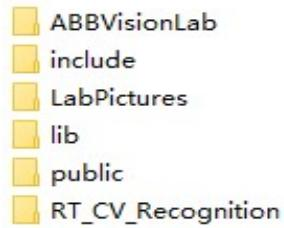


图1.工程文件分类


ABBVisionLab 文件夹是前端 UI 工程项目文件，包括 UI 控件，相机图像采集，通讯等源代码； include文件夹是项目中用到的 OpenCV 版本对应的函数引用库所有文件；LabPictures是保存 测试图片的文件夹；lib 文件夹是项目中用到的 OpenCV 版本的静态链接库所有文件。Public 文件夹是软件编译生成可执行文件及所有依赖项集合，也是最后使用的可执行文件 exe文件 夹，我们可以在编译的 IDE 中将生成的可执行文件的路径进行自定义改变默认的bin 文件夹 路径变为 public 文件夹路径具体方法参考网上说明或者通过项目工程属性查看具体设置。 RT_CV_Recognition 是创建的 C++动态链接库所在的工程文件。 

## 三、UI 界面及相机采集

首先需要了解 C#的基本语法和开发过程。这个部分内容需要自己学习，可通过网上教 学视频和书籍等资料学习。 

在对 C#语法有一定的了解后可以开始相机的采集程序的编写及调试。相机采集程序是 每个嵌入式工业相机的开发接口说明及例程，因为工业相机底层是不会开放，每个厂家的工 业相机都是进过封装后开放了调用接口，对照每个相机提供的开发文档和基本开发例程就可 以进行工业相机的二次开发。基本上每个工业相机都会提供 C#,C++,Python 等版本的开发例 程，选择合适的即可。 

当前视觉工程项目所使用的工业相机是海康威视生产的。我们在其官网下载官方相机的 软件包 MVS，下载链接：海康机器人-机器视觉-下载中心 (hikrobotics.com) 进入该链接下载 海康威视机器视觉工业相机客户端MVSV3.3.1 最新版的即可； 


机器视觉工业相机客户端MVS V3.3.1 (Windows) 


图 2.海康威视工业相机下载


下载好后再Windows 电脑安装该软件，安装好之后就可以通过该软件连接相机，进行采图， 相机调试等操作。 

相机的 SDK 在相机安装目录中..\MVS\Development\Samples 文件家中，如下图所示： 


电脑 本地磁盘(C:) Program Files(x86)  MVS Development Samples


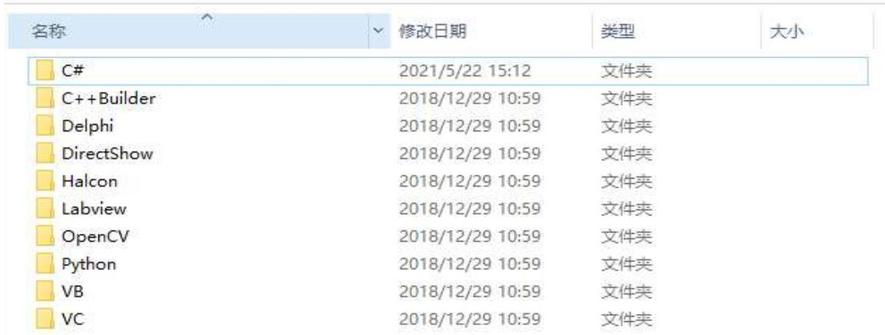


图 3.相机 SDK采集程序文件夹路径


打开 C#文件运行相机采集程序解决方案 CSharpDotNetSamples_VS2008.sln 界面如下图所示： 

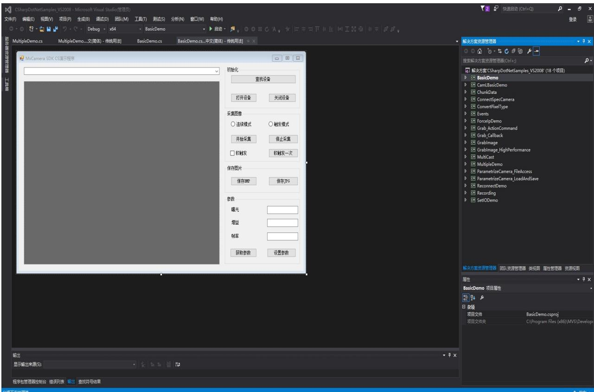


图 4.相机采集 SDK源码 

工程文件的左边是对应项目的代码显示区，右边是工程文件的项目栏，里面包含了海康 威视提供的相机二次开发所使用的所有的 demo 程序。通过查看代码就可以知道相机采集程 序的流程。以第一个工程 BasicDemo项目为例此项目是单相机采集的基本开发流程例程。 

展开 BasicDemo 项目，双击 BasicDemo.cs 打开软件的 UI 编辑界面，如下图所示： 

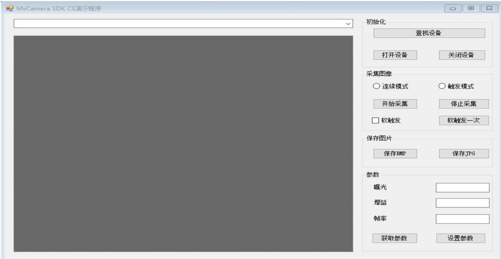


图 5.相机的采集 demo 界面


从图中可以看到相机采集界面的基本控件，每个控件对应一个功能，从控件的顺序及命 名基本上可以知道控件的作用。 

界面按照从上到下，从左到右的顺序查看，右边第一个控件是ComboBox,是一个列表下 拉框用于显示搜索到的相机列表名称。右边第二个是一个 PictureBox控件，用于显示采集到 的图像。左边第一个是控件集合，是相机进行初始化相关操作的控件，初始化中第一个控件 是查找设备，即搜索连接的相机，第二个控件是打开设备，即搜索到相机后打开相机设备， 第三个是关闭设备。第二个控件集合是图像采集相关的控件，第一个是 Radiobutton用于选 择的控件，在属性里面设置了默认为选中状态为相机连续模式。点击开始采集按钮，此时 picturebox控件就有图像显示了。到此整个图像的采集过程完成。总结相机采集整个过程的 起始：1.相机进行初始化操作，搜索相机设备；2.搜索到相机设备后打开相机设备；3.打开 相机设备后设置相机的采集模式；4.开始采集图像；基本上分为四个步骤。 

## 1.相机进行初始化采集操作

我们查看 UI 界面的代码程序，在窗口的构造函数 publicForm1()中看窗口在初始化过程中 做了哪些操作； 

```txt
public Form1()
{
    InitializeComponent(); // 初始化先关操作，比如控件大小，属性等设置，变量的获取
    等窗口显示前的先关初始化，自动完成。
    m_pDeviceList = new MyCamera.MV_CC_DEVICE_INFO_LIST(); // 实例化申明的相机对象
    m_bGrabbing = false; // 图像数据获取的标志位，用控制什么时候获取图像
    DeviceListAcq(); // 查找相机
} 
```

可以看到在程序中看到界面在初始化过程中就已经连接搜索了相机。相机查找函数是 DeviceListAcq()，通过此函数可以查找相机，查找到相机后将相机的名称显示在下拉列 

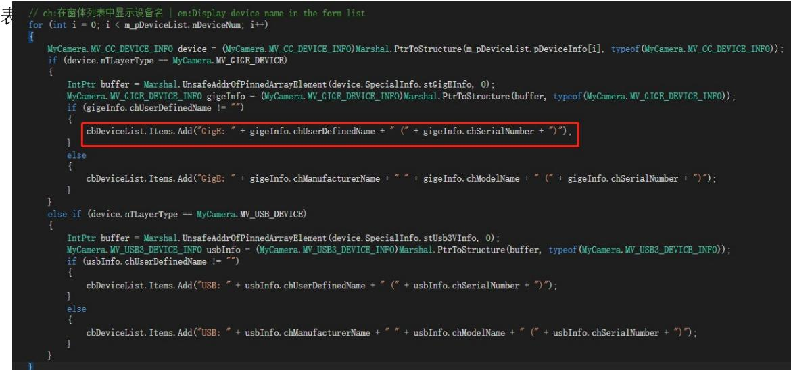


图 6.搜索相机并显示相机列表


同样双击“查找设备按钮”里面运行的函数也是 DeviceListAcq()，与界面初始化时搜索相机 一致。 

双击“打开设备”按钮查看里面的代码做了什么,请查看注释。 

private void bnOpen_Click(object sender, EventArgs e)//打开设备按钮点击事件 

```c
if (m_pDeviceList.nDeviceNum == 0 || cbDeviceList.SelectedIndex == -1)
{
    ShowErrorMsg("No device, please select", 0);
    return;
} // 判断有没有搜索到相机
int nRet = -1;

// ch: 获取选择的设备信息 | en: Get selected device information
MyCamera.MV_CC_DEVICE_INFO device =
(MyCamera.MV_CC_DEVICE_INFO) Marshal.PtrToStructure(m_pDeviceList.pDeviceInfo[cbDeviceList.SelectedIndex],
typeof(MyCamera.MV_CC_DEVICE_INFO)); // 获取连接的相机设备
// ch: 打开设备 | en: Open device
if (null == m_pMyCamera)
{
    m_pMyCamera = new MyCamera(); // 实例化相机对象
    if (null == m_pMyCamera)
    {
    return;
    }
}
nRet = m_pMyCamera.MV_CC_CreateDevice_NET(ref device); // 创建搜索到信息的相机设备，返回创建息值，等于0表示创建正常
if (MyCamera.MV_OK != nRet) // 判断有没有创建成功，没有则返回
{
    return;
}
nRet = m_pMyCamera.MV_CC_OpenDevice_NET(); // 开启相机设备 
```

```txt
if (MyCamera.MV_OK != nRet) //判断有没有开启成功，没有则销毁创建的设备
{
    m_pMyCamera.MV_CC_DestroyDevice_NET(); //开启失败，销毁创建的设备信息，防止下次重新创建被占用

    ShowErrorMsg("Device open fail!", nRet); //显示错误日志，相机打开失败原因
    return;
}

// ch:探测网络最佳包大小(只对GigE相机有效) | en:Detection network optimal package size(It only works for the GigE camera)

if (device.nTLayerType == MyCamera.MV_GIGE_DEVICE)
{
    int nPacketSize = m_pMyCamera.MV_CC_GetOptimalPacketSize_NET();
    if (nPacketSize > 0)
    {
    nRet = m_pMyCamera.MV_CC_SetIntValue_NET("GevSCPSPacketSize", (uint)nPacketSize);

    if (nRet != MyCamera.MV_OK)
    {
    Console.WriteLine("Warning: Set Packet Size failed {0:x8}", nRet);
    }
    }
    else
    {
    Console.WriteLine("Warning: Get Packet Size failed {0:x8}", nPacketSize);
    }
}

// ch:设置采集连续模式 | en:Set Continues Acquisition Mode
m_pMyCamera.MV_CC_SetEnumValue_NET("AcquisitionMode", 2); // ch:工作在连续模式 | en:Acquisition On Continuous Mode 
```

```txt
m_pMyCamera.MV_CC_SetEnumValue_NET("TriggerMode", 0); // ch:连续模式 | en:Continuous

bnGetParam_Click(null, null); // ch:获取参数 | en:Get parameters
// ch:控件操作 | en:Control operation
SetCtrlWhenOpen();
}

双击“开始采集”按钮查看里面的代码

private void bnStartGrab_Click(object sender, EventArgs e) // 开始采集控件点击事件
{
    int nRet;
    // ch:开始采集 | en:Start Grabbing
    nRet = m_pMyCamera.MV_CC_StartGrabbing_NET(); // 开始采集
    if (MyCamera.MV_OK != nRet)
    {
    ShowErrorMsg("Trigger Fail!", nRet);
    return;
    }

    // ch:控件操作 | en:Control Operation
    SetCtrlWhenStartGrab();

    // ch:标志位置位true | en:Set position bit true
    m_bGrabbing = true; // 控制图像数据的获取与否
    // ch:显示 | en:Display
    nRet = m_pMyCamera.MV_CC_Display_NET(pictureBox1.Handle); // 传入窗口的句柄进行显示

    if (MyCamera.MV_OK != nRet)
    {
    ShowErrorMsg("Display Fail! ", nRet);
    }
} 
```

以上操作就是相机采集的一般过程，里面包含了相机采集所用到的基本函数及相机采集 过程中处理方法。对照上面的注释说明，其他控件里面的代码同理，根据相机命名的函数名 称就可以知道当前函数的作用是什么。 

## 四、自己创建相机采集工程项目

在理解了上述代码后需要自己动手根据海康相机的 SDK程序，写一个相机采集，按照 上述的方式及操作完成相机采集的基本程序，并显示图像成功，可以在程序界面对相机的基 本参数（曝光、增益、白平衡、触发模式等）进行设置。自己在开发中，需要引用海康相机 的动态库 MvCameraControl.Net.dll，这个动态库封装了海康相机的所有接口功能函数，所以 开发时一定要注意。 

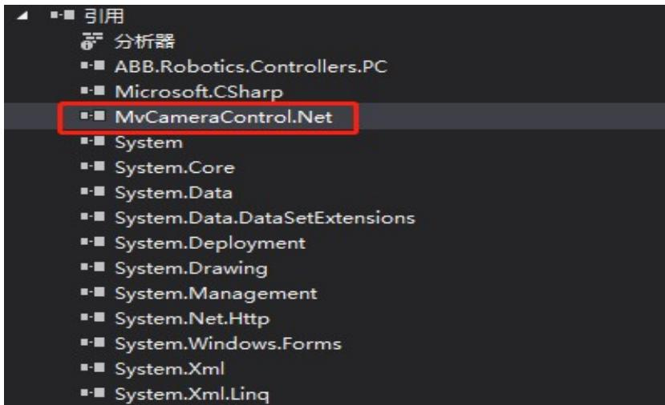


图 7.引用相机的动态链接库


在开发过程中可以参考 ABBVisionLab.sln 的代码进行开发，实现的效果如下图界面，实 现的方法都是一样的，在ABBVisionLab.sln 解决方案中，将相机的相关的采集、设置参数等 相关的参数使用函数进行了整理，汇总在 HIKCameraHelper.cs类文件中，大家在开发项目时 可以直接引用改类，调用里面的函数直接开发使用，大大缩小时间和工作量。 

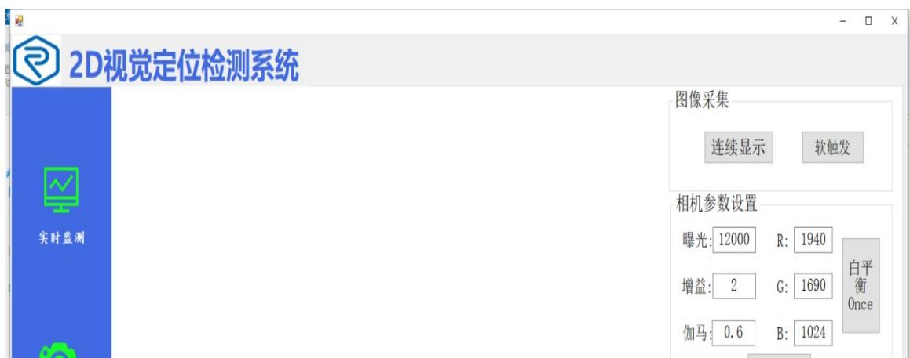


图8.相机参数界面


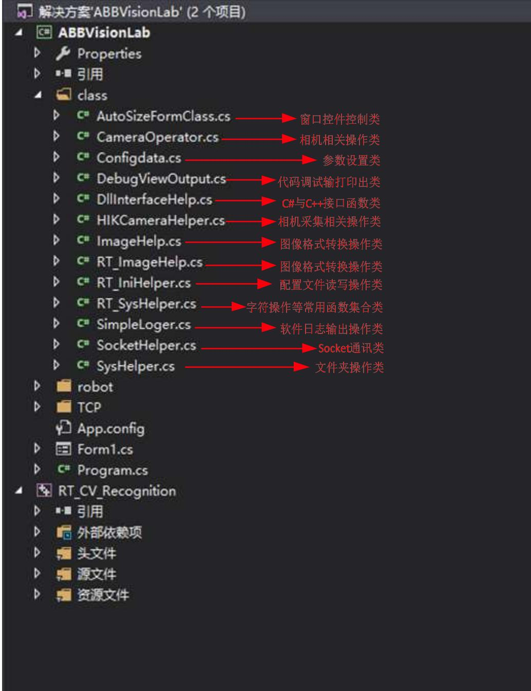


图 9 项目常用类说明 

同学们在开发过程中可以查看项目中常用“类”，看类中的函数是做什么用的，函数都 做了说明，或者根据函数名即可知道函数的功能。这样将实现某一块功能的各种函数整合到 类中是一种常用的类的封装，方便代码的调试、查看、整理。如果所有的函数写在同一个文 件中，各种功能函数掺杂在一起没有分类，代码可读性大大降低，后期也不好维护，出了问 题不知道在哪里，所以“类”的封装是一种常用的开发手段，也是后期代码量增加时，更容 易维护和调试的前提，所以一定要学会这种方法，后期维护调试会大大的方便很多。 

## 五、C++图像处理

C++图像处理部分是基于开源的计算机视觉算法库 OpenCV，本项目开发是基于 OpenCV3.1版本进行开发，同学们可以自己选择相应的版本。在基于OpenCV 开发前需要在 工程项目中配置OpenCV，才能调用 OpenCV 的函数，配置的方法同学们参考这篇文章： VS2017 配置 OpenCV 4.3.0（https://blog.csdn.net/weixin_44737922/article/details/105375574） 项目开发中使用的 VS2015+OpenCV3.1 的配置方法同连接的一致，只需要对应相应的版本即 可。 

在配置好 OpenCV 后引用 OpenCV 库的头文件即可调用 OpenCV 的函数了； 

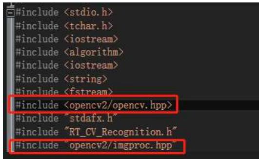


图 1.引用 OpenCV 库头文件


引用完 OpenCV 库头文件即可进行图像算法的开发了，一般开发流程是，图像读入-图 像预处理-图像二值化-根据二值化效果再判断处理调参得到满意的二值效果-提取轮廓-选择 轮廓-求取轮廓的中心点（最小外接矩形等）。 

图像处理一般的开发流程大概就以上几点，同学们在掌握后再做其他深入的研究增加算 法的鲁棒性。 

以下以流水线白色方块检测中心点及角度代码为例，说明图像处理的一般方法及过程； //方块中心像素点及角度检测函数 

```cpp
void RT_CV_Recognition::Shap_check(Mat src, float str_center[])
{
    try
    {
    Mat m_cImageProcess = src.clone(); // 将原图像分别克隆给多个Mat中间对象，目的是不改变原图像。
    Mat m_cImageColor = src.clone();
    Mat m_cImageRgb = src.clone();
    cv::Mat imgGray, img_gray;
    cv::cvtColor(m_cImageProcess, img_gray, cv::COLOR_RGB2GRAY); // 将原图像转换为灰度图
    GaussianBlur(img_gray, img_gray, Size(5, 5), 2); // 高斯滤波 
```

```cpp
Mat element = getStructuringElement(MORPH_RECT, Size(30, 30)); // 将图像变为30*30像素大小的结构，是图像腐蚀大小的尺度

erode(img_gray, img_gray, element); // 图像腐蚀，目的是将粘连的方块分开
threshold(img_gray, img_gray, 110, 180, cv::THRESH_BINARY); // 阈值化
imgGray = img_gray.clone();
Mat distShow;
distShow = Mat::zeros(imgGray.size(), CV_8UC1); // 将每个通道像素值变为0，图像初始化，目的是将轮廓显示在一张纯黑的图像上，方便查看。

std::vector<cv::Vec4i> hierarchy;
std::vector<std::vector<cv::Point>> Contours;
cv::findContours(imgGray, Contours, hierarchy, CV_RETR_LIST, CV_CHAIN_APPROX_SIMPLE); // 找轮廓

int Numbers = (int)Contours.size();
Scalar color = Scalar(0, 255, 0);
int index = -1, maxArea = 0;
for (int i = 0; i < Numbers; i++) // 遍历轮廓，根据限制条件查找需要的轮廓
{
    int area = contourArea(Contours[i]); // 轮廓的面积
    if (area > 10000 && area < 30000)
    {
    if (area > maxArea)
    {
    index = i;
    maxArea = area;
    }
    }
}

// drawContours(m_cImageProcess, Contours, i, color, 3, 8, hierarchy); // 将最大区域的轮廓画出来（后面有画，这里就不重复）

cv::Rect boundRect;
RotatedRect Rect;
Rect = minAreaRect(Contours[index]); // 求取轮廓的最小外接矩形
Point2f rect_points[4];
Rect.points(rect_points);
str_center[0] = Rect.center.x; // 将最小外接矩形的中心像素点赋值给传参变量
str_center[1] = Rect.center.y;
// 最小外接矩阵的角度，根据角度对最小外接矩阵旋转
float angle_rotation;
if ((Rect.size.width/ Rect.size.height) < 1)
    angle_rotation = 90 + Rect.angle;
else
    angle_rotation = Rect.angle;
str_center[2] = angle_rotation; // 将获得旋转角度赋值给传参变量，顺时针为负，逆时针为正。 
```

```txt
circle(m_cImageProcess, Point(Rect.center.x, Rect.center.y), 8, CV_RGB(255, 0, 0), CV_FILLED); // 画出中心像素点 
```

```cpp
for (int j = 0; j < 4; j++)
{
    cv::line(m_cImageProcess, rect_points[j], rect_points[(j + 1) % 4], Scalar(0, 0, 255), 2, 8); //绘制最小外接矩形每条边 
```

```cpp
cv::putText(m_cImageProcess, to_string(index), cvPoint(Rect.center.x + 10, Rect.center.y + 10), CV_FONT_HERSHEY_COMPLEX, 1, cv::Scalar(0, 0, 255), 1, 5, 0); // 将满足条件轮廓的索引号写在矩形中心像素点旁边 
```

```txt
cv::putText(m_cImageProcess, to_string(index) + ":X=" + to_string(Rect.center.x) + ", " + "Y=" + to_string(Rect.center.y) + ", " + "Angle=" + to_string(angle_rotation), cvPoint(20, 50), CV_FONT_HERSHEY_COMPLEX, 1, cv::Scalar(0, 0, 255), 1, 5, 0); // 将矩形的中心坐标及角度写在图像左上角上 
```

```javascript
p_RT_CV_Recognition->zy_Camera_Display(m_cImageProcess, m_cImageProcess.rows, m_cImageProcess.cols); // 将结果图像显示 
```

```cpp
int m_Src_count_1 = 1;
char*pImageName = (char*)malloc(20);
sprintf_s(pImageName, 20, "Pictures//%03d.jpg", m_Src_count_1);
imwrite(pImageName, m_cImageProcess); //保存结果图像
m_Src_count_1++;
catch (cv::Exception cvExc)
{
    std::cout << cvExc.msg << std::endl; //如果程序中断输出错误信息
} 
```

以上就是检测方块中心点像素坐标及角度的方法和过程。 

## 六、C#与 C++接口函数及传参

前面我们讲了图像处理部分得到矩形方块的像素中心坐标及矩形方块的角度，那么这个得 到的数据是在 C++中申明的变量存储，如何传参到 C#中使用呢？这就用到了 C++与 C#事先 定义好的接口函数，C++定义好外部输出的函数接口，C#定义好外部输入的函数接口，函数 的类型需要一样即函数的返回值及参数类型一致即可。这样就可以通过函数参数进行传值， C++具体操作如下代码所示： 

```c
// OPENCV函数END
+ /// ...
+ ZYDLL bool __stdcall EX_zy_System_Init(void* m_hDispWindow, int icam, int mode) { ... }
+ /// ...
+ ZYDLL void __stdcall SetCallback(Camera_PResHook callback, int iIndex) { ... }
+ ZYDLL bool __stdcall EX_RT_calibrateCam(float *camCoordinates, float *handCoordinates, float _transMat[]) { ... }
+ /// ...
+ ZYDLL bool __stdcall EX_RT_initcalibrateCamParam(float _transMat[]) { ... }
+ /// ...
+ ZYDLL bool __stdcall EX_RT_transCoord(float *camCoordinates, float handCood[]) { ... } 
```

以上折叠代码函数表示定义的外部接口函数，格式：宏定义ZYDLL+返回值类型+_stdcall+ 函数（参数1，参数 2，参数 3）；里面是对函数进行了封装，用到了之前图像处理的函数， 形成一个完整的功能进行封装。 

为了外部调用需要在头文件中对这些封装函数进行申明，申明如下： 

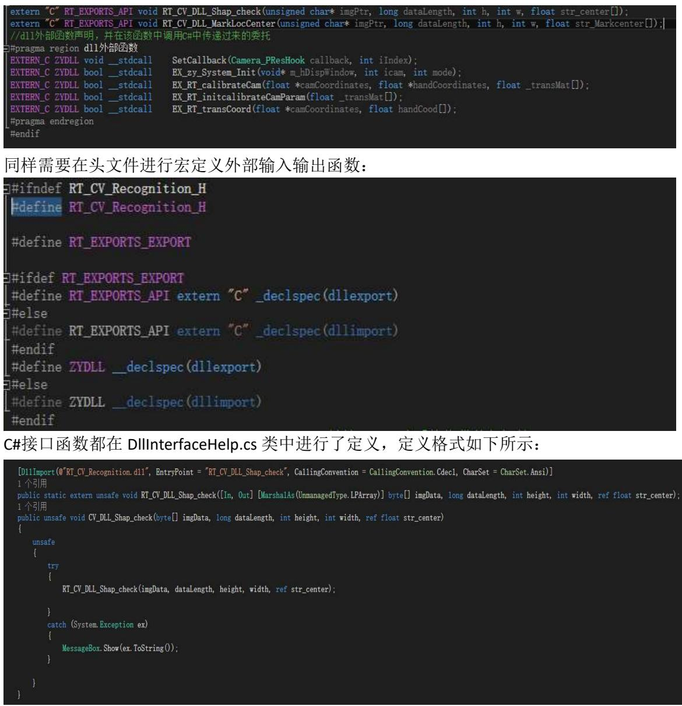


将需要传参的数据通过在参数前加上“ref”按引用传递值。 

## 七、像素坐标与机器人坐标标定方法

图像坐标与机器人坐标的标定是建立像素坐标与机器人坐标的矩阵转换关系 AX=XB，通 过求解 X 就知道图像坐标与机器人坐标的转换关系。A表示图像坐标矩阵，B 表示机器人坐 标矩阵，X 就是转换关系矩阵。 

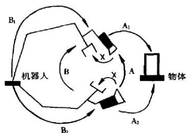


关于标定的详细数学理论知识参考以下几个博客： 

```cpp
关于标定的详细数学理论知识参考以下几个博客：
http://blog.csdn.net/PINBODEXIAOZHU/article/details/27495951 机器人 工具坐标系的标定
http://blog.csdn.net/yunlinwang/article/details/51871520 经典手眼标定算法之 Navy 的 OpenCV 实现

http://blog.csdn.net/yunlinwang/article/details/51622143 经典手眼标定算法之 Tsai-Lenz 的 OpenCV 实现

在项目中标定函数如下（去掉了打印输出代码）：
bool RT_CV_Recognition::calibrateCam(float *camCoordinates, float *handCoordinates, float _transMat[])
{
    try
    {
    Point2f camPoints[3], handPoints[3];
    for (int i = 0; i < 3; i++)
    {
    camPoints[i] = Point2f(camCoordinates[2 * i], camCoordinates[2 * i + 1]);
    //像素坐标（3组）
    handPoints[i] = Point2f(handCoordinates[2 * i], handCoordinates[2 * i + 1]);
    //机器人坐标（3组）
    }
    Mat tmpMat = getAffineTransform(camPoints, handPoints); //矩阵仿射变换
    tmpMat.convertTo(tmpMat, CV_32FC1);
    for (int i = 0; i < tmpMat.rows; i++)
    for (int j = 0; j < tmpMat.cols; j++)
    {
    _transMat[i * tmpMat.cols + j] = tmpMat.at<float>(i, j);
    }
    transMat = tmpMat.clone();
    return true;
    }
}

手眼转换函数(去掉打印输出部分):
void RT_CV_Recognition::transCoord(float *camCood, float handCood[])
{
    if (transMat.data == NULL) 
```

```txt
return;
Mat camMat(3, 1, CV_32FC1, camCood);
Mat handMat = transMat * camMat; // 将相机坐标转换为机器人坐标
handCood[0] = handMat.at<float>(0, 0);
handCood[1] = handMat.at<float>(1, 0); 
```

通过以上关键函数代码就可以了解整个标定的过程，第一部分是机器人坐标与像素坐标 的关系求解，第二部分就是得到了像素坐标通过关系解计算出机器人坐标，发送给机器人就 可以按照位置进行移动。 

## 八、Socket 通讯

Socket通讯是 TCP/IP 中的一种网络通讯方式，需要有客户端和服务端，两者之间需要 先握手（建立通讯属性关系）才能相互收发数据，主要是稳定性高，但是不适合传输大文件， 因为频繁握手效率低。所以 socket的通讯机制大家一定要了解清楚，还有 UDP，一种广播 的形式，没有握手机制，速度快，适用于传输大文件，但是稳定性安全性不高，因为没有握 手机制。这些常用的网络通讯大家自己网上查阅，区别和用法讲的比我好太多，我知道怎么 用，要说原理性的知识，在下实在是学术浅薄，不好意思了各位同学。如果你能坚持看到这 里，并且将我所说所写的点理解到位，那么恭喜你机器视觉入门，你基本会了。按照我的方 法可以开发常用的工业项目。大体的框架都差不多，只是需要做的处理的多少，写程序不是 简单的考虑功能的实现，还是有软件操作的易用性，稳定性，后期调试维护等等，那么考虑 到这些情况的时候，就需要额外增加很多处理机制在里面，废话不多说，下面开始 socket 通讯的讲解。 

Socket通讯我在程序中已经添加好了类 SocketHelper.cs（网上 copy的），直接调用函数 即可，知道怎么用就行。 

将 SocketHelper.cs类中的各个函数看一遍后，根据解释及函数名大概知道函数是做什么 用的，这里就不再一一解释各个函数了，如果学到这里函数都看不懂，建议回头再学习，如 果前面讲的都会了，不用说就知道，不要懒，自己多学多看多写就会了，你目前所有不懂的 问题都可以在网上查找到，不要简单一句话看不懂就不管，那不是你会，而是你的懒惰，懒 的去查找问题与解决问题。 

首先在窗口载入的时候需要实例化客户端对象。（如果你问为什么要实例化对象，说明 你前面的 C#白学了）。在程序中为了使用了一个定时器进行相关参数的初始化，使用定时器 的目的是在于初始化的过程中不会出问题，因为相机初始化连接需要一定的时间，如果程序 没做处理，相机没上就进行下面的相关操作就有可能出问题。 

```txt
private void Form1_Load(object sender, EventArgs e)
{
    label_Title.BringToFront();
    //this.WindowState = FormWindowState.Maximized;
    System.Timers.Timer t = new System.Timers.Timer(2000);//实例化Timer类，设置间隔时间为1000毫秒 就是1秒；
    t.Elapsed += new System.Timers.ElapsedEventHandler(timer_init);//到达时间的时候执行事件；
    t.AutoReset = false;//设置是执行一次（false）还是一直执行(true);
    t.Enabled = true;//是否执行System.Timers.Timer.Elapsed事件； 
```

```txt
send_datas_list.Clear();
tabControl1.SelectedTab = tabControl1.TabPages[0];
}
在 timer_init 函数中进行了通讯的相关操作，创建 socket 连接，实例化客户端对象，绑定 IP 和端口号。
public void timer_init(object source, System.Timers.ElapsedEventArgs e)
{ 
```

```cs
#region 通讯初始化
    SocketHelper.pushSockets = new SocketHelper.PushSockets(Rec); // 建立socket连接
    client = new SocketHelper.TcpClients();
    ip = configdata.server_Ip;
    port = configdata.server_Port;
    txtIP.Text = configdata.server_Ip;
    txtPort.Text = configdata.server_Port;
    try
    {
    client.InitSocket(ip, int.Parse(port)); // 绑定端口与IP
    client.Start();
    lxb_show.Items.Add("连接服务器成功。");
    }
    catch (Exception ex)
    {
    lxb_show.Items.Add(string.Format("启动失败!原因：{0}", ex.Message));
    }
    #endregion
    System_Init_Main(); // 获取主显示句柄
    }
}

以上就是建立 socket 通讯的相关操作，建立通讯后就可以发送数据，函数如下所示：
private void Send_Robot_Datas()
{
    while (true)
    {
    if (receive_robot_datas=="1") // 如果机器人发“1”就发送数据
    {
    if (send_datas_list.Count() > 0)
    {
    receive_robot_datas = "0";
    string[] data = send_datas_list.ElementAt(0);
    send_datas_list.RemoveAt(0);
    try
    {
    client.SendData(data[0] + ", " + data[1] + ", " + data[2]); // 发送数据 
```

```javascript
lxb_show.Items.Add(data[0] + ", " + data[1] + ", " + data[2]);
}
catch (Exception)
{
    if (lxb_show.InvokeRequired)
    {
    this.Invoke(new EventHandler(delegate
    {
    lxb_show.Items.Add("机器人没有打开通信端口");
    });
    }
    else
    {
    lxb_show.Items.Add("机器人没有打开通信端口");
    }
    }
}
Thread.Sleep(10);
} 
```

总结：以上就是C++与 C#联合开发的机器视觉项目。开发的架构，希望大家了解，对以后自己进 行工业项目开发有实际的帮助。以上的先关知识搞懂后，不管是上位机开发，界面开发，图像处理算 法开发都可以基于此种方式开发。这只是简单的机器视觉入门，但是大的框架是不变的。所以在学习 完以上的知识后，能运用此框架在自己的项目中后，就着手重点知识的学习，比如数字图像处理的相 关知识，涉及到C++的开发非常多，而且比较复杂，这需要自己去沉淀。懂了相机 SDK的开发，其他 的相关硬件的开发都是差不多，不管是相机还是PLC，机器人（ABB也有上位机控制程序，通过调用 SDK直接控制机器人）开发的方式都差不多，官网提供先关的SDK开发说明照着写代码即可。所以这 部分的知识是应用，知道怎么用就行。希望同学们好好学习，对你们以后科研或是工作都有极大的帮 助，写的都是实用的东西，就是工业常用的，所以你们学习后，就可以进行相关项目的开发。 

## 附件一 树莓派语音识别源代码

# encoding: utf-8 

import socket 

import smbus 

import time 

import numpy #NumPy 是 Python 语言的一个扩展程序库，支持大量的维度数组与矩 阵运算，此外也针对数组运算提供大量的数学函数库。 

s = socket.socket() # 创建 socket 对象 

host = '10.70.2.252 # 填写服务端的 ip 地址 

port = 3002 # 填入设置好的端口号 

try: #如果当 try 后的语句执行时发生异常，python就跳回到 try 并执行第一个匹配该异常的 except 子句，异常处理完毕，控制流就通过整个 try语句（除 非在处理异常时又引发新的异常）。 

s.connect((host, port)) 

#去连接服务器端的 ip 和端口 

print("连接到服务器") 

except: 

print("连接不成功") 

exit(1) 

class ASR: 

#一个 ASR 的类 

# Global Variables 

address = None 

bus = None 

ASR_RESULT_ADDR = 100 

#识别结果存放处，通过不断读取此地址的值判断是否识别到语音，不同的值对应不同 的语音 

ASR_WORDS_ERASE_ADDR = 101 

#擦除所有词条 

ASR_MODE_ADDR = 102 

#识别模式设置，值范围 1~3 

#1：循环识别模式。状态灯常亮（默认模式） 

#2：口令模式，以第一个词条为口令。状态灯常灭，当识别到口令词时常亮，等待识 别到新的语音,并且读取识别结果后即灭掉 

#3：按键模式，按下开始识别，不按不识别。支持掉电保存。状态灯随按键按下而亮 起，不按不亮 

ASR_ADD_WORDS_ADDR = 160 

#词条添加的地址，支持掉电保存 

def __init__(self, address, bus=1): 

self.address = address 

self.bus = smbus.SMBus(bus) 

def readByte(self): 

return self.bus.read_byte(self.address) 

def writeByte(self, val): 

value = self.bus.write_byte(self.address, val) 

if value != 0: 

return False 

return True 

def writeData(self, reg, val): 

self.bus.write_byte(self.address, reg) 

self.bus.write_byte(self.address, val) 

def getResult(self): 

#识别结果函数 

if ASR.writeByte(self, self.ASR_RESULT_ADDR): 

return -1 

value = self.bus.read_byte(self.address) 

return value 

1 

* 添加词条函数， 

*idNum：词条对应的识别号，1~255随意设置。识别到该号码对应的词条语音时， 

* 会将识别号存放到 ASR_RESULT_ADDR处，等待主机读取，读取后清 0 

*words：要识别汉字词条的拼音，汉字之间用空格隔开 

* 执行该函数，词条是自动往后排队添加的。 

1 

def addWords(self, idNum, words): #添加词条地址函数 

buf = [idNum] 

for i in range(0, len(words)): 

buf.append(eval(hex(ord(words[i])))) 

self.bus.write_i2c_block_data(self.address, self.ASR_ADD_WORDS_ADDR, buf) 

time.sleep(0.05) 

def eraseWords(self): #擦出词条函数 

result = self.bus.write_byte_data(self.address, self.ASR_WORDS_ERASE_ADDR, 

0) time.sleep(0.06) 

if result != 0: 

return False 

return True 

def setMode(self, mode): #识别模式函数 

result = self.bus.write_byte_data(self.address, self.ASR_MODE_ADDR, mode) 

if result != 0: 

return False 

return True 

def dd(): 

addr = 0x79 

#连接语音传感器 iic 地址 

asr = ASR(addr) 

#进行实例化 

if 1: 

asr.eraseWords() #擦出词条 

asr.setMode(1) #识别模式为 1 

asr.addWords(1, 'shang shen') #说上升口令时，在程序中赋予词条的地址是 1 

asr.addWords(2, 'xia jiang') #说下降口令时，在程序中赋予词条的地址是 2 

asr.addWords(3, 'qian jing') #说左边口令时，在程序中赋予词条的地址是 3 

asr.addWords(4, 'hou tui') 

#说右边口令时，在程序中赋予词条的地址是 4 

asr.addWords(5, 'zuo bian') 

#说右边口令时，在程序中赋予词条的地址是 5 

asr.addWords(6, 'you bian') 

#说后退口令时，在程序中赋予词条的地址是 6 

asr.addWords(7, 'tui chu') 

#说退出口令时，在程序中赋予词条的地址是 7 

#第一位：实验顺序 第二位：运行模式 第三位：控制 z轴动作 第四位：控制方向向 

上 第五位：步长 10个 

while 1: 

data = asr.getResult() 

#将得到的识别结果赋值给 data 

print("result:", data) 

#在终端打打印出 data 的值 

if data==1: 

$$
\mathbf {a} = [ \mathbf {0 x 0 2}, \mathbf {0 x 0 2}, \mathbf {0 x 0 3}, \mathbf {0 x 0 1}, \mathbf {0 x 1 0} ]
$$

$$
\mathbf {b} = ""
$$

for i in range(len(a)): 

$$
\mathbf {b} + = \operatorname{chr} (\mathbf {a} [ \mathbf {i} ])
$$

s.send(b.encode("utf-8")) 

time.sleep(0.1) 

# print("shang shen") 

elif data==2: 

a = [0x02,0x02,0x03,0x02,0x10] 

```txt
b = "" 
```

for i in range(len(a)): 

b +=chr(a[i]) 

s.send(b.encode("utf-8")) 

time.sleep(0.1) 

# print("xia jiang") 

elif data==3: 

$$
\mathbf {a} = [ \mathbf {0 x 0 2}, \mathbf {0 x 0 2}, \mathbf {0 x 0 2}, \mathbf {0 x 0 1}, \mathbf {0 x 1 0} ]
$$

$$
\mathbf {b} = ""
$$

for i in range(len(a)): 

$$
\mathbf {b} + = \operatorname{chr} (\mathbf {a} [ \mathbf {i} ])
$$

s.send(b.encode("utf-8")) 

#如果 data 值等于 1 

#给网口发送上升动作的 16进制 

#将 a 的 16进制数据格式转化成 ascii码 

#将数据发送给服务端 

#发送成功后程序休眠一定时间 

#如果 data 的值等于 2 

#给串口发送下降动作的 16进制 

#将 a 的 16进制数据格式转化成 ascii码 

#将数据发送给服务端 

#如果 data 的值等于 3 

#给串口发送下降动作的 16进制 

#将 a 的 16进制数据格式转化成 ascii码 

#将数据发送给服务端 

time.sleep(0.1) 

# print("qian jing") 

elif data==4: 

$$
\mathbf {a} = [ 0 \mathrm{x} 0 2, 0 \mathrm{x} 0 2, 0 \mathrm{x} 0 2, 0 \mathrm{x} 0 2, 0 \mathrm{x} 1 0 ]
$$

for i in range(len(a)): 

b +=chr(a[i]) 

s.send(b.encode("utf-8")) 

time.sleep(0.1) 

#print("hou tui") 

elif data==5: 

$$
\mathbf {a} = [ \mathbf {0 x 0 2}, \mathbf {0 x 0 2}, \mathbf {0 x 0 1}, \mathbf {0 x 0 1}, \mathbf {0 x 1 0} ]
$$

for i in range(len(a)): 

b +=chr(a[i]) 

s.send(b.encode("utf-8")) 

time.sleep(0.1) 

# print("zuo bian") 

elif data==6: 

$$
\mathbf {a} = [ \mathbf {0 x 0 2}, \mathbf {0 x 0 2}, \mathbf {0 x 0 1}, \mathbf {0 x 0 2}, \mathbf {0 x 1 0} ]
$$

$$
\mathbf {b} = ""
$$

for i in range(len(a)): 

#如果 data 的值等于 4 

#给串口发送右边动作的 16进制 

#将 a 的 16进制数据格式转化成 ascii码 

#将数据发送给服务端 

#给串口发送左边动作的 16进制 

#给串口发送右边动作的 16 进制 

b +=chr(a[i]) 

s.send(b.encode("utf-8")) 

time.sleep(0.1) 

# print("you bian") 

elif data==7: 

#s.send("4".encode("utf-8")) 

break; 

#如果 data 的值是 7。退出当前循环 

print("tui chu") 

time.sleep(0.1) 

time.sleep(0.2) 

dd() 

## 附件二 树莓派手势识别源代码

#!/usr/bin/python3 #coding:utf8 import cv2 import numpy as np import time import math import threading import timeout_decorator from data import check_camera import socket # 导入 socket 模块 debug = True Running = True s = socket.socket() # 创建 socket 对象 host = '10.70.2.252' # 获取本地主机名 port = 3002 # 设置端口号 try: s.connect((host, port)) 

```python
print("连接到服务器")
except:
    print("连接不成功")
    exit(1)
#print (s.recv(1024))

#摄像头默认分辨率 640x480,处理图像时会相应的缩小图像进行处理，这样可以加快运行速度
#缩小时保持比例 4: 3,且缩小后的分辨率应该是整数
c = 80
width, height = c*6, c*5

class Point(object):#一个坐标点
    x = 0
    y = 0
    def __init__(self, x=0, y=0):
    self.x = x
    self.y = y
class Line(object):#一条线
    def __init__(self, p1, p2):
    self.p1 = p1
    self.p2 = p2
def GetCrossAngle(l1, l2):
    '''
    求两直线之间的夹角
    :param l1:
    :param l2:
    :return:
    '''
    arr_0 = np.array([(l1.p2.x - l1.p1.x), (l1.p2.y - l1.p1.y)])
    arr_1 = np.array([(l2.p2.x - l2.p1.x), (l2.p2.y - l2.p1.y)])
    cos_value = (float(arr_0.dot(arr_1)) / (np.sqrt(arr_0.dot(arr_0)) * np.sqrt(arr_1.dot(arr_1))) # 注意转成浮点数运算
    return np.arccos(cos_value) * (180 / np.pi)
def two_distance(start, end):
    """
    计算两点的距离
    :param start: 开始点
    :param end: 结束点
    :return: 返回两点之间的距离
    """
    s_x = start[0]
    s_y = start[1]
    e_x = end[0] 
```

```python
e_y = end[1]
x = s_x - e_x
y = s_y - e_y
return math.sqrt((x**2)+(y**2))
#cv2.namedWindow('YCC_frame')
#cv2.namedWindow('Cr')
#cv2.namedWindow('Cr_inrange')
#cv2.namedWindow('opend')
cv2.namedWindow('orgframe')
#cv2.moveWindow('YCC_frame',0, 100)
#cv2.moveWindow('Cr',0, 100 + height + 75)
#cv2.moveWindow('Cr_inrange', (width + 125), 100)
#cv2.moveWindow('opend', (width + 125), 100 + height + 75)
#cv2.moveWindow('orgframe', 2*(width + 125), 100)
cv2.moveWindow('orgframe', 500, 500)
def image_process(image):#hsv
    """
    # 光线影响，请修改 cb 的范围
    # 正常黄种人的 Cr 分量大约在 140~160 之间
    识别肤色
    :param image: 图像
    :return: 识别后的二值图像
    """

    YCC_frame = cv2.cvtColor(image, cv2.COLOR_BGR2YCR_CB)    # 将图片转化为 YCrCb
    #cv2.imshow('YCC_frame', YCC_frame)
    Y, Cr, Cb = cv2.split(YCC_frame)    # 分割 YCrCb
    #cv2.imshow('Cr', Cr)
    Cr_inrange = cv2.inRange(Cr, 132, 175)
    #cv2.imshow('Cr_inrange', Cr_inrange)
    # 开运算，去除噪点
    open_element = cv2.getStructuringElement(cv2.MORPH_RECT, (5, 5))
    opend = cv2.morphologyEx(Cr_inrange, cv2.MORPH_OPEN, open_element)
    #cv2.imshow('opend', opend)
    return opend

def get_defects_far(defects, contours, img):
    """
    获取凸包中最远的点
    """
    if defects is None and contours is None:
    return None
    far_list = []
    for i in range(defects.shape[0]):
    s, e, f, d = defects[i, 0] 
```

```python
start = tuple(contours[s][0])
end = tuple(contours[e][0])
far = tuple(contours[f][0])
# 求两点之间的距离
a = two_distance(start, end)
b = two_distance(start, far)
c = two_distance(end, far)
# print('a=', a)
# print('b=', b)
# print('c=', c)
# 求出手指之间的角度
angle = math.acos((b ** 2 + c ** 2 - a ** 2) / (2 * b * c)) * 180 / math.pi
# 手指之间的角度一般不会大于 100 度
# 小于 90 度
if angle <= 75:    # 90:
    # cv.circle(img, far, 10, [0, 0, 255], 1)
    far_list.append(far)
return far_list

def get_max_coutour(cou, max_area):
    """
找出最大的轮廓
根据面积来计算，找到最大后，判断是否小于最小面积，如果小于侧放弃
:param cou: 轮廓
:return: 返回最大轮廓
"""
max_coutours = 0
r_c = None
if len(cou) < 1:
    return None
else:
    for c in cou:
    # 计算面积
    temp_coutours = math.fabs(cv2.contourArea(c))
    if temp_coutours > max_coutours:
    max_coutours = temp_coutours
    cc = c
    # 判断所有轮廓中最大的面积
    if max_coutours > max_area:
    r_c = cc
    return r_c

def find_contours(binary, max_area):
    """
mode 提取模式.
CV_RETR_EXTERNAL - 只提取最外层的轮廓 
```

```python
CV_RETR_LIST - 提取所有轮廓，并且放置在 list 中
CV_RETR_CCOMP - 提取所有轮廓，并且将其组织为两层的 hierarchy: 顶层为连通域的外围边界，次层为洞的内层边界。
CV_RETR_TREE - 提取所有轮廓，并且重构嵌套轮廓的全部 hierarchy method 逼近方法 (对所有节点，不包括使用内部逼近的 CV_RETR_RUNS).
CV_CHAIN_CODE - Freeman 链码的输出轮廓. 其它方法输出多边形(定点序列).
CV_CHAIN_APPROX_NONE - 将所有点由链码形式翻译(转化)为点序列形式
CV_CHAIN_APPROX_SIMPLE - 压缩水平、垂直和对角分割，即函数只保留末端的象素点;
CV_CHAIN_APPROX_TC89_L1,
CV_CHAIN_APPROX_TC89_KCOS - 应用 Teh-Chin 链逼近算法.
CV_LINK_RUNS - 通过连接为 1 的水平碎片使用完全不同的轮廓提取算法
:param binary: 传入的二值图像
:return: 返回最大轮廓
````

# 找出所有轮廓

contours = cv2.findContours(binary, cv2.RETR_EXTERNAL, cv2.CHAIN_APPROX_NONE)[-2]

# 返回最大轮廓

return get_max_coutour(contours, max_area)
def get_hand_number(binary_image, rgb_image):

````
返回手指的个数
:param binary_image:
:param rgb_image:
:return:
````

## 2、找出手指尖的位置

## 查找轮廓，返回最大轮廓

x = 0
y = 0
contours = find_contours(binary_image, 1000)
coord_list = []
if contours is not None:
    # 周长 0.035 根据识别情况修改，识别越好，越小
    epsilon = 0.025 * cv2.arcLength(contours, True)
    # 轮廓相似
    approx = cv2.approxPolyDP(contours, epsilon, True)
    #cv2.approxPolyDP()的参数 2(epsilon)是一个距离值，表示多边形的轮廓接近实际轮廓的程度，值越小，越精确；参数 3 表示是否闭合
    cv2.polylines(rgb_image, [approx], True, (0, 255, 0), 1)#画多边形
    if approx.shape[0] >= 3:    # 有三个点以上#多边形最小为三角形，三角形需要三个点 

```
```python
approx_list = []
for j in range(approx.shape[0]): # 将多边形所有的点储存在一个列表里
    # cv2.circle(rgb_image, (approx[j][0][0], approx[j][0][1]), 5, [255, 0, 0], -1)
    approx_list.append(approx[j][0])
    approx_list.append(approx[0][0])    # 在末尾添加第一个点
    approx_list.append(approx[1][0])    # 在末尾添加第二个点

for i in range(1, len(approx_list) - 1):
    p1 = Point(approx_list[i - 1][0], approx_list[i - 1][1])    # 声明一个点
    p2 = Point(approx_list[i][0], approx_list[i][1])
    p3 = Point(approx_list[i + 1][0], approx_list[i + 1][1])
    line1 = Line(p1, p2)    # 声明一条直线
    line2 = Line(p2, p3)
    angle = GetCrossAngle(line1, line2)    # 获取两条直线的夹角
    angle = 180 - angle    #
    # print angle
    if angle < 42:    # 求出两线相交的角度，并小于37度的
    # cv2.circle(rgb_image, tuple(approx_list[i]), 5, [255, 0, 0], -1)
    coord_list.append(tuple_list[i]))
# 去除手指间的点
# 1、获取凸包缺陷点，最远点点
# cv.drawContours(rgb_image, contours, -1, (255, 0, 0), 1)
hull = cv2.convexHull(contours, returnPoints=False)
# 找凸包缺陷点。返回的数据，【起点，终点，最远的点，到最远点的近似距离】
defects = cv2.convexityDefects(contours, hull)
# 返回手指间的点
hand_coord = get_defects_far(defects, contours, rgb_image)
# print 'h', hand_coord
# print 'c', coord_list
# 2、从coord_list去除最远点
new_hand_list = []    # 获取最终的手指间坐标
alike_flag = False
if len(coord_list) > 0:
    for l in range(len(coord_list)):
    for k in range(len(hand_coord)):
    if (-10 <= coord_list[l][0] - hand_coord[k][0] <= 10 and
    -10 <= coord_list[l][1] - hand_coord[k][1] <= 10):    # 最比较X,Y轴，相近的去除
    alike_flag = True
    break    #
    if alike_flag is False:
    new_hand_list.append(coord_list[l])
    alike_flag = False 
```

```python
# print new_hand_list
# 获取指尖的坐标列表并显示
for i in new_hand_list:
    cv2.circle(rgb_image, tuple(i), 5, [0, 0, 100], -1)
    if new_hand_list is []:
    return 0
    else:
    return len(new_hand_list)
    else:
    return 0
@timeout_decorator.timeout(0.5, use_signals=False)
def Camera_isOpened():
    global stream, cap
    cap = cv2.VideoCapture(stream)
orgFrame = None
Running = True
ret = False
#stream = "http://127.0.0.1:8080/?action=stream?dummy=param.mjpg"
stream = 0
try:
    Camera_isOpened()
    cap = cv2.VideoCapture(stream)
except:
    print('Unable to detect camera! \n')
    check_camera.CheckCamera()

def get_image():
    global orgFrame
    global ret
    global Running
    global stream, cap
    while True:
    if Running:
    try:
    if cap.isOpened():
    ret, orgFrame = cap.read()
    else:
    time.sleep(0.01)
    except:
    cap = cv2.VideoCapture(stream)
    print('Restart Camera Successful!')
    else:
    time.sleep(0.01)
th1 = threading.Thread(target = get_image) 
```

```python
th1.setDaemon(True)
th1.start()
#执行动作组
get_hand_num = False
action_finish = True
def runAction():
    print("laile")
    global get_hand_num, action_finish
    global num_mean
    while True:
    #time.sleep(1)
    if get_hand_num:
    #print(1)
    get_hand_num = False
    action_finish = False
    if num_mean == 1:
    a = [0x01,0x02,0x03,0x01,0x10]
    b = ""
    for i in range(len(a)):
    b += chr(a[i])
    s.send(b.encode("utf-8"))
    print("1")
    num_maen = 0
    time.sleep(2)
    action_finish = True

elif num_mean == 2:
    a = [0x02,0x02,0x03,0x02,0x10]
    b = ""
    for i in range(len(a)):
    b += chr(a[i])
    s.send(b.encode("utf-8"))
    print("2")
    num_mean = 0
    time.sleep(2)
    action_finish = True

elif num_mean == 3:
    a = [0x03,0x02,0x01,0x01,0x10]
    b = ""
    for i in range(len(a)):
    b += chr(a[i])
    s.send(b.encode("utf-8"))
    print("3") 
```

```python
num_mean = 0
time.sleep(2)
action_finish = True

elif num_mean == 4:
    a = [0x04,0x02,0x01,0x02,0x10]
    b = ""
    for i in range(len(a)):
    b += chr(a[i])
    s.send(b.encode("utf-8"))
    print("4")
    num_mean = 0
    time.sleep(2)
    action_finish = True

elif num_mean == 5:
    a = [0x0,0x02,0x02,0x01,0x10]
    b = ""
    for i in range(len(a)):
    b += chr(a[i])
    s.send(b.encode("utf-8"))
    print("5")
    num_mean = 0
    time.sleep(2)
    action_finish = True

else:
    action_finish = True
    time.sleep(0.01)

else:
    #print(2)
    time.sleep(0.01)

#启动动作在运行线程
th2 = threading.Thread(target=runAction)
th2.setDaemon(True)
th2.start()

num = []
num_mean = 0

while True:
    if orgFrame is not None and ret:
    t1 = cv2.getTickCount()
    orgframe = cv2.resize(orgFrame, (width,height), interpolation = cv2.INTER_CUBIC) #将图片缩放
    frame = orgframe 
```

```python
binary = image_process(frame)#处理图像
hand_num = get_hand_number(binary, frame)#获取手指个数
num.append(hand_num)
if len(num) == 10:
    num_mean = int(round(np.mean(num)))
    num = num[1:]
    if action_finish:
    get_hand_num = True
t2 = cv2.getTickCount()
time_r = (t2 - t1) / cv2.getTickCount()
fps = 1.0/time_r
cv2.putString(orgframe, "FPS:" + str(int(fps)),
(10, orgframe.shape[0] - 10), cv2.FONT_HERSHEY_SIMPLEX, 0.65, (0, 0, 255), 2) #(0, 0, 255)BGR
cv2.putString(orgframe, "Current:" + str(num_mean),
(10, orgframe.shape[0] - 30), cv2.FONT_HERSHEY_SIMPLEX, 0.6, (0, 0, 255), 2)#显示当前检测到的手指个数，(0, 0, 255)BGR
cv2.imshow("orgframe", orgframe)
if cv2.waitKey(1) & 0xff == ord('q'):
    break;

#cv2.waitKey(1)
else:
    time.sleep(0.01)
cap.release()
cv2.destroyAllWindows()
exit(1) 
```