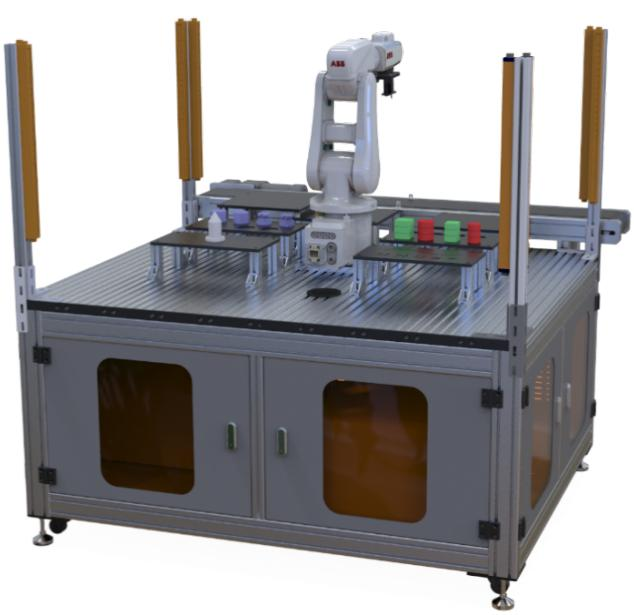

## ABB机器人实验台实验指导书

编著：文 丽 李艳斌 何 维等 

湖南科技大学信息与电气工程学院 

## 前言

工业机器人是面向工业领域的多关节机械手或多自由度的机器装置，它能自 动执行工作，是靠自身动力和控制能力来实现各种功能的一种机器。它可以接受 人类指挥，也可以按照预先编排的程序运行。 

目前工业机器人由主体、驱动系统和控制系统三个基本部分组成。主体即机 座和执行机构，包括臂部、腕部和手部。驱动系统包括动力装置和传动机构，用 以使执行机构产生相应的动作；控制系统是按照输入的程序对驱动系统和执行机 构发出指令信号，并进行控制。另外根据目前科学技术，工业机器人可增加视觉、 触觉、力觉或语音功能，能在更复杂的环境下工作，通过算法能实现自我学习， 自我编程，最终变为智能型工业机器人。 

目前全球主要工业机器人品牌包括瑞典艾波比机器人（ABB），日本安川机 器人（Yaskawa），德国库卡机器人（Kuka），日本发那科机器人（Fanuc），日本 爱普生机器人（Epson），中国沈阳新松机器人（SIASUN）。其中ABB 市场占有 率最高，其次是 Fanuc，Yaskawa，和 Kuka。 

本实验指导书以ABB 工业机器人为主的工作站作为实验平台，编写书共11 章节，主要包括实验装置介绍，机器人仿真系统基本使用实验，码垛实验仿真与 实际操作实验，机器人各坐标系定义实验，机器人轨迹示教编程实验等10 节实 验内容，如有疏漏、错误之处，望批评指出！ 

## 目录

前言....2
第一章 实验装置介绍....4
1.1 系统介绍....4
1.2 设备介绍....6
1.3 编程介绍....17
1.4 注意事项及安全概述....17
第二章 机器人仿真系统基本使用实验....19
第三章 码垛实验仿真与实际操作实验....39
第四章 机器人各坐标系定义实验....52
第五章 机器人轨迹示教编程实验....77
第六章 基于 Socket 通讯控制机器人运动实验....85
第七章 手势识别控制机器人运动实验....105
第八章 语音识别控制机器人运动实验....115
第九章 基于视觉识别控制机器人定位抓取实验....125
第十章 基于 Profinet 通讯控制机器人速度实验....135
第十一章 简单码垛生产线实验....144
第十二章 组态王与 PLC 控制机器人实验....168
第十三章 工业相机物体识别码垛生产线实验....178
第十四章 视觉工程项目软件架构及源码说明....179
附件一 树莓派语音识别源代码....196
附件二 树莓派手势识别源代码....203 

