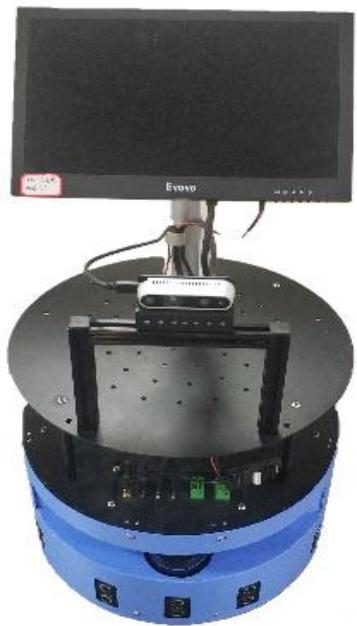
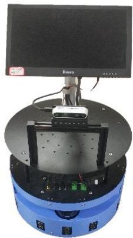
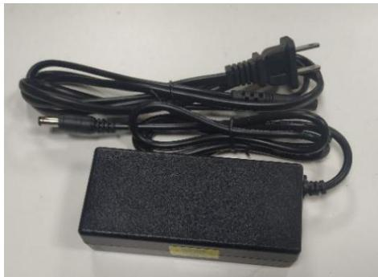
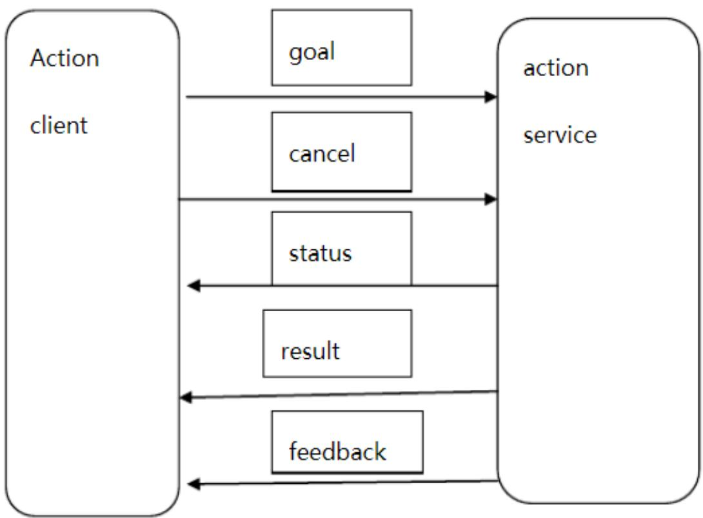

## 第 1 章 产品简介

## 1.1 产品介绍

## 1.1.1 简介

Aimibot教育机器人是本公司自主研发生产的一款教学机器人底盘，可搭载各种传感器设备，平台上可集成激光雷达、REALSENSE深度相机、NUC迷你电脑、七自由度机械臂，扩展性强。解决了市场上机器人地盘“性能单一”的缺点，与其它同类产品相比功能更加 多、优、稳 。 教育机器人采用目前最先进的移动控制技术，拥有安全稳定的工作性能，在运动过程中不会发生驱动轮架空的现象，机器人运行平稳，噪音小，拥有安全避障、精准建图、路径规划等核心技术。本产品支持代码开源，适合深度二次开发。

所有产品都经过生产人员的系统测试，质量保证，安全可靠，我们尽最大的努力使您在体验Aimibot教育机器人时感到舒适，同时在拆包时请您仔细检查组件完整。

## 1.1.2 视频简介

## 1.2 发货清单

  
图 1.1 产品主体

  
图 1.2Aimibot 教育机器人充电器

<table><tr><td rowspan="5">基础部件(全部发货)</td><td>移动Aimibot教育机器人平台、教育机器人充电器</td></tr><tr><td>NUC机载电脑、高清显示屏</td></tr><tr><td>激光雷达</td></tr><tr><td>windows下Aimibot教育机器人软件、机器人使用文档</td></tr><tr><td>配套示例源代码</td></tr><tr><td rowspan="3">可选配件</td><td>7自由度机械手臂</td></tr><tr><td>REASENSE深度相机</td></tr><tr><td>ROS教学代码包</td></tr></table>

## 1.3 Aimibot 教育机器人平台介绍

Aimibot教育机器人平台包含现实环境中用于感知和导航的所有基本组件，每一个移动机器人平台都配有坚固铁制车身，平衡的驱动系统(带两个万向轮两个直驱动轮)、可逆直流电机、电机控制和驱动电子设备、高分辨率运动编码器和电池电源，可由由 windows下移动机器人服务器软件和 linux下ros进行管理。

Aimibot教育机器人平台还附带了许多先进的机器人控制客户端软件应用程序和应用程序开发环境。软件开发包括我们自己的基础应用程序高级机器人接ros。并完成与完全文档化的c++和Python库和源代码。可供用户参考使用。

## 1.4 Aimibot 教育机器人功能介绍

） 操作系统和 系统安装例程

2）在Ubuntu操作系统和 ros系统下运行的电机驱动控制例程

3) 双轮差速移动机器人运动控制例程

4）里程计数据采集例程

5）IMU数据采集例程

6）超声波数据采集例程

7）防跌落数据采集例程

8）基于轮式里程计信息的移动机器人轨迹控制例程

9）基于惯导传感器信息和倾角传感器信息的移动机器人斜坡运动姿态控制例程

10）基于超声波传感器信息的移动机器人运动避障控制例程

11）基于超声波传感器信息的移动机器人目标跟踪控制例程

12）移动机器人防跌落保护控制例程

13）里程计、IMU、超声波传感器额防跌落传感器的多信息综合运动控制例程

）深度视觉传感器数据采集例程

15）视觉SLAM导航例程

16）移动机器人 SLAM例程

17）激光雷达数据采集例程

18）激光雷达扫描创建地图例程

19）基于激光雷达的移动机器人导航定位例程

20）机械臂单轴驱动控制例程

21）机械臂运动控制例程例程

22）移动机器人结合机械臂的组合运动抓取控制例程

23）机械臂目标抓取控制例程

24）目标识别、移动抓取和运动运输综合控制例程

## 1.5 ROS 简介

ROS是一个用于编写软件的灵活框架，它集成了大量的工具、库、协议，提供了类似操作系统提供所提供的功能， 包括硬件抽象描述、底层驱动程序管理、共用功能的执行、程序间的消息传递、程序发行包的管理，可以极大的简化繁杂多样的机器人平台 下的复杂任务创建与稳定行为控制。

## 1.6 ROS 的设计目标

ROS的设计目标是提高机器人研发中的软件复用率，所以它被设计成为一种分布式结构，使得框架中的每个功能模块都能被单独设计、 编译，并且在运行时以松散耦合的方式结合在一起。而且ROS中的功能模块都封装于独立的功能包（Package ）,便于在社区中共享与分发。

## 1.7 ROS 的特点

ROS核心一一分布式网络，使用Tcp/ip的通信方式，实现模块间点对点的松耦合连接，可以执行若干类型的通信，包括基于话题的（ Topic ）的异步数据流通信，基于服务（service ）的同步数据流通信，还有参数服务器上的数据存储等

（1） 点对点的设计

在ROS中，每一个进程都以一个节点的形式运行，可以布于多个不同的主机。节点间的通信消息通过一个带有发布和订阅功能的，节点间的通信消息通过一个带有发布和订阅功能的 传输系统，从发布节点传送到接收节点。这种点对点的设计可以分散定位、导航等功能带来的实时讨算压力，适应多机器人的协同工作。

多语言支撑：Python、C++、Java、Octave、LISP 等

架构精简、集成度高：

在已有的机器人应用中，软件的复用性是一个巨大的问题。很多的驱动程序、 应用算法、功能模块在设计时过于混乱，导致其很难在其他机器人或应用中进行移植和二次开发。而

ROS 框架具有模块化特点使得每个功能节点可以进行单独编译，并且使用统一的消息接口让模块的移植、复用更加便捷。组织化工具包丰富移动机器人的开发往往需要一些友好的可视化工具和仿真软件,的方法将这些工具和软件集成到系统中可以作为一个组件直接使用。例如 3D可视化工具 rviz,开发者可以根据ROS定义的接口在其显示机器人 3D模型、周围环境地图、机器人导航路线等消息。此外，ROS中还有消息查看工具、物理仿真环境等组件，提高了机器人开发的效率。免费并且开源 ROS 遵照的 BSD 许可给使用者较大的自由，允许其修改和重新发布其中的应用代码，甚至可以进行商业化的开发和销售

## 1.8 通信方式

opic 通信

ROS中的异步通信方式

node 之间通过 publish-subscribe 机制通信

parameter server

启动ros时自动启动参数服务器存储各种参数和配置的字典

可以用命令行，launch文件和node读写

<table><tr><td>Key</td><td>/rosdistro</td><td>/rosversion</td><td>/use_sim_time</td></tr><tr><td>Value</td><td>&#x27;kinetic&#x27;</td><td>&#x27;1.12.7&#x27;</td><td>true</td></tr></table>

一般将不常改变的参数和配置写入参数服务器内

rosparam list// 列出当前所有的参数

rosparam get param\_key// 显示莫个参数的值 (gazebo\_gui/gravity\_z)

(4)Action 通信

类似于service,带有状态反馈的通讯方式。经常在长时间，可抢占的任务中（例如小车导航，机械臂运动）

