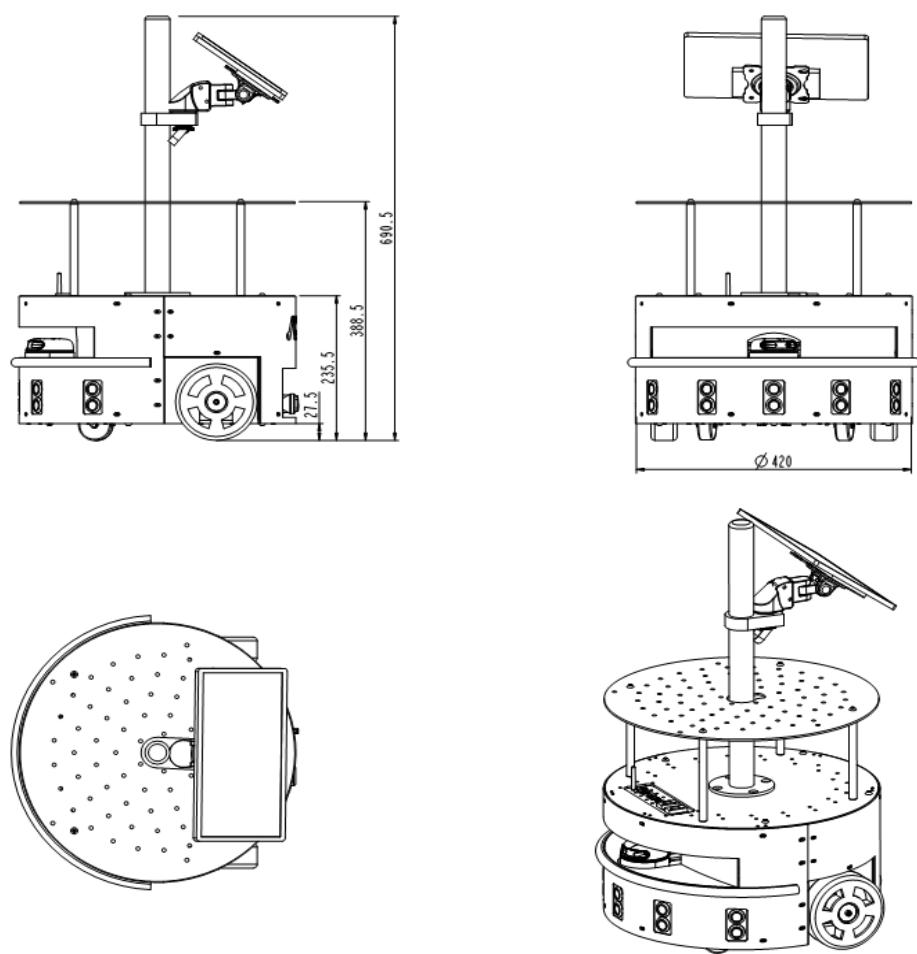
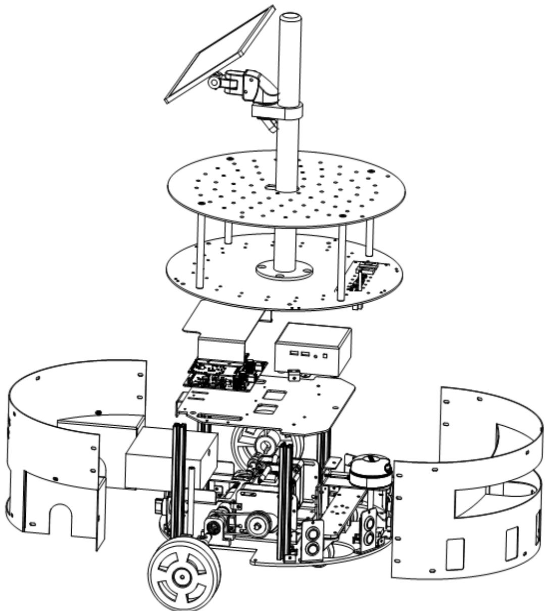
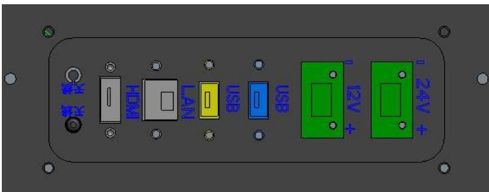
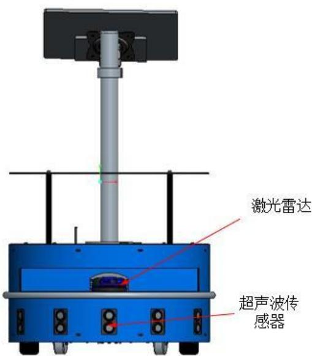
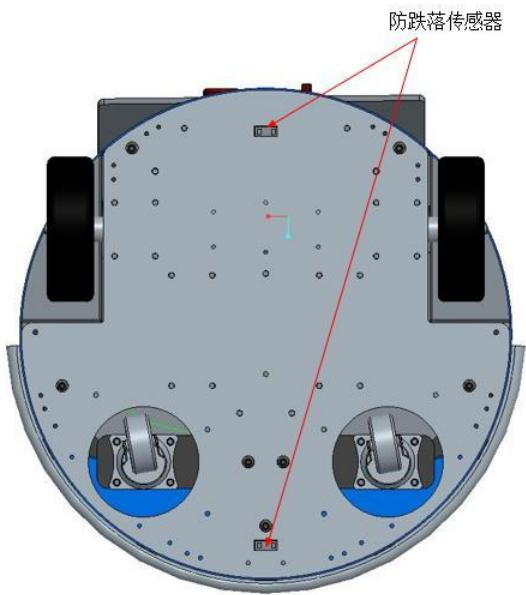
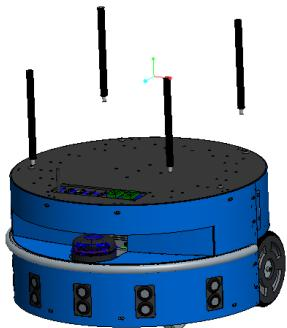
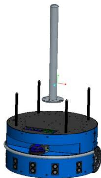
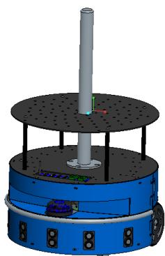
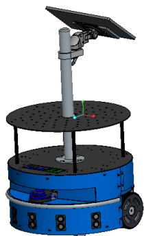

## 第 3 章 硬件手册

## 3.1 简介

Aimibot教育机器人拥有一系列令人印象深刻的智能移动机器人能力，足以与更大、更昂贵的机器相匹敌。与其他商用机器人不同，Aimibot教育机器人的尺寸适中，载重大，非常适合在狭小的空间里导航，比如教室、实验室和小办公室。在ros机器人模式下，能通过激光雷达精确检测周围环境建立实时地图并可进行路径规划与自主导航。

## 3.2 Aimibot 教育机器人规格

## 3.2.1 规格

基础的Aimibot教育机器人体重为 20kg，其坚固的铁机身和坚固的结构使它们几乎坚不可摧这些特性也使得它们能够承载非常大的载荷，Aimibot教育机器人可以承载 50kg的额外重量，可轻松完成各种室内搬运任务。其三维尺寸如下图所示

  
3.1Aimibot教育机器人尺寸图

  
3.2 Aimibot 教育机器人爆炸图

## 3.2.2 机器人参数

<table><tr><td>产品名称</td><td>Aimibot 教育机器人</td><td>型号</td><td>AIMI-JY01</td></tr><tr><td>行走方向</td><td>前后左右360°旋转</td><td>额定负载</td><td>50kg</td></tr><tr><td>爬坡角度</td><td>25°</td><td>平台类型</td><td>两轮差速</td></tr><tr><td>最大载重</td><td>60kg</td><td>电池规格</td><td>锂电池24V-14AH</td></tr><tr><td>运行速度</td><td>最大1m/s</td><td>内部通讯方式</td><td>RS232</td></tr><tr><td>供电电压</td><td>24V</td><td>驱动电机</td><td>直流无刷电机</td></tr><tr><td>平台自重</td><td>20kg</td><td>外部接口类型</td><td>2*USB/1*HDMI/1*LAN</td></tr><tr><td>控制模式</td><td>速度/位置</td><td>控制终端</td><td>键盘/手柄/软件</td></tr><tr><td>定位精度</td><td>±1mm</td><td>驱动库</td><td>ROS/MATLAB</td></tr><tr><td>控制接口</td><td>远程软件/API,二次开发接口</td><td>编码器分辨率</td><td>500pluses/rev</td></tr><tr><td>平台尺寸(mm)</td><td>420*420*690</td><td>外部输出电源</td><td>持续24±3V/12V,电流4A</td></tr></table>

## 3.2.3 机器人组件

Aimibot教育机器人的组件主要包括：车体、拓展接口面板、用户控制面板、电机、轮子和编码器、电池电源、超声波传感器、防跌落传感器、数字姿态传感器、蜂鸣器、激光雷达、NUC机载电脑、高清显示屏，可额外搭载深度相机、7自由度机械手臂等，可根据用户不同需求，自行选择。

## 3.3 Aimibot 教育机器人顶部面板

Aimibot教育机器人顶部装有铝制顶板，主要为高清显示屏，可承载不大于 50kg的重物，主要用加装深度相机、机械手臂、等附加装置或传感器。

## 3.4 机器人本体

Aimibot教育机器人车体主要由铝制顶板以及碳钢组成，机身容纳电池，驱动电机，电子产品和其他常见部件，包括超声波、防跌落传感器、数字姿态传感器,内部直接搭载NUC机载电脑。机身可附加装两块顶部面板（详情见 1.4产品安装说明）有足够的空间以支持各种机器人配件，包括无线电以太网，激光测距仪和机械手臂等或更多。

## 3.5 Aimibot 教育机器人拓展接口面板

Aimibot教育机器人顶部面板安装有一个拓展接口面板，上面集成了两个 USB口、一个网口、一个 接口，以及电脑天线。下部面板包含机器人充电接口，信号指示灯，急停按钮。

  
图3.2Aimibot教育机器人扩展接口面板

## 3.5.1 外部接口

外部接口包含NUC机载电脑直连的HDMI接口，两个 USB接口，一个网口，电脑外接天线。

## 3.5.2 电机急停按钮

所有Aimibot教育机器人在他们的拓展接口面板有一个停止按钮。按下并松开，立即断开机器人的电机电源。机器人将立即停止，并导致机器人内置蜂鸣器持续鸣叫，再次松开急停按钮将停止鸣叫。

请注意，当用户按钮急停按钮后，再次松开急停按钮，需要重启机器人才能再次控制机器人运动。

## 3.5.3 电源开关

Aimibot教育机器人电源开关安装在用户控制面板上，里面内置有环形LED灯，当旋转电源开关按钮后LED灯亮（红色），机器人通电开始运行，机器人运行的额定电压在24v。

## 3.6.3 指示灯

通讯指示灯，电源开启时，电源指示灯常亮，注意：当电源指示灯频闪时，请停止相关活动，使用充电器给机器人充电。

## 3.6.4 充电口

当 Aimibot教育机器人电池电量小于 20V时，电源指示灯频闪，可用标准配置充电器与机器人充电口连接，充电器指示灯显示红色，机器人正常充电。

## 3.7 电机、车轮和编码器

Aimibot教育机器人采用直流伺服电机进行驱动，每一个电机都配有高分辨率的光学正交轴编码器，用于精确的位置和速度感知和先进的航迹推算。每个电机都配有外部减速器，输出轴连接主同步轮，主同步轮和从同步轮之间通过同步带连接，编码器通过联轴器直接连接车轮输出轴。

## 3.8 电池电源

Aimibot教育机器人内置24V密封锂电池，通过用户控制面板充电口连接，进行充电；电池寿命取决于配置的配件和电机的活动，充电时间在3个小时之间。Aimibot教育机器人满负荷可连续运行 10个小时或更长时间，如果你不使用这些马达，你的机器人的微控制器只需一次充电就可以运行好几天。

Aimibot教育机器人电池电压小于 20V时，内置蜂鸣器将间断持续蜂鸣，建议当电池电量小于20V时开始充电否则将减少电池的使用寿命。

当插上充电器充电时，充电器指示灯将显示红色，当指示灯显示绿色是机器人电池充满，注意当电池充满时应当将充电器拔出，不宜一直对机器人进行充电，否则将损耗电池寿命。

## 3.9 超声波传感器

本Aimibot教育机器人前端安装有五个超声波传感器 ，每个超声波的有效监测范围为3m，检测幅度为15°，为避免碰撞、特征识别、定位和导航提供目标检测和距离信息。

  
图3.4超声波传感器和激光雷达装配图

## 3.10 防跌落传感器

Aimibot教育机器人底盘前后端安装有两个防跌落传感器，其检测范围为 15cm，为机器人避免在凹凸不平地面运行时，跌落到无法运行的凹槽处，提供前后落差距离。

  
图3.5机器人轮子及防跌落传感器装配图

## 3.11 数字姿态传感器

Aimibot教育机器人内部中心位置给机器人安装有数字姿态传感器，可检测机器人的加速度、角速度和角度。分辨率分别为加速度 ，角速度： 为避免碰撞、特征识别、定位和导航提供机器人动态信息。

## 3.12 激光雷达

Aimibot教育机器人可选配激光雷达传感器，与 linux下的 ros相结合进行激光建图、自主导航避障。为机器人提供检测目标的距离、方位、高度、速度、姿态、形状等参数特征信息。

## 3.13 深度相机

Aimibot教育机器人可选配深度相机，与机器人内部可选配的小型工控机进行配合进行视觉SLAM的研究、以及目标识别、目标跟踪、物体分拣等功能。深度相机为机器人提供检测目标的姿态、形状、位置等参数特征信息。

## 3.14 七自由度机械手臂

Aimibot教育机器人可选配 7自由度机器人手臂，与机器人内部可选配的小型工控机、深度相机等进行配合，实现目标抓取、分拣等功能。

## 3.15 Aimibot 教育机器人基本使用流程

1）将Aimibot教育机器人拆封后，将铝柱支撑杆旋钮至底盘。

2）将显示屏支架用螺丝固定在底盘上面。

3）将二层板安装孔对准铝柱螺纹孔，用螺丝固定。

4）将电脑显示器安装到显示器上面，可自由调节角度和高度。

5）将配套的显示器电源线，和HDMI线连接显示器，特别注意：显示器电源线正负反接

7）旋钮电源开关，打开显示器电源开关，等待一段时间件待机器人正常开机。

8）进入linux系统界面，用户可根据基本例程学习机器人使用或者进行二次开发，验证试验。

9）实验完成后，用户先关闭机载电脑电源，后关闭机器人电源

## 初级部分

## 配套补充实验

[实验十 智能移动机器人跟踪乒乓球实验](../../experiments/10/index.md)
