## 第 4 章 初级 ROS 开发

## 4.1 Github 源代码获取与编译

## 4.1.1 新建 ROS 工作空间

1）在Home目录下空白处右击，点击New Folder建立一个文件夹，命名为Amos\_WS

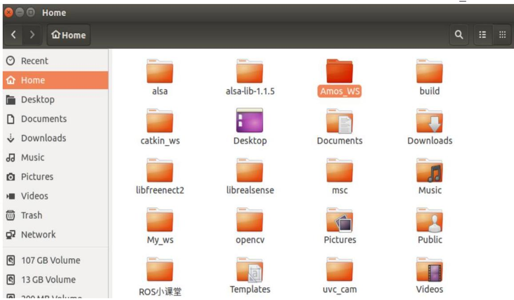  
2）在Amos\_WS文件夹内建立 src文件夹

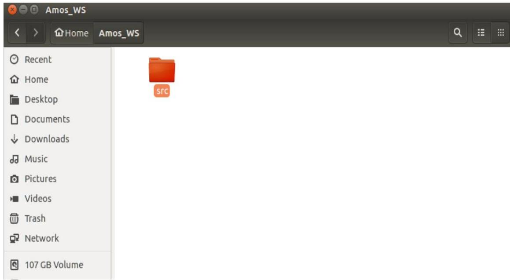  
注：以上两步也可通过执行命令完成：

```batch
mkdir -p Amos_WS/src
```

3）编译工作空间，在Amos\_WS目录下打开终端，执行 catkin\_make，可以看到Amos\_WS 里生成 build 和 devel 两个文件夹

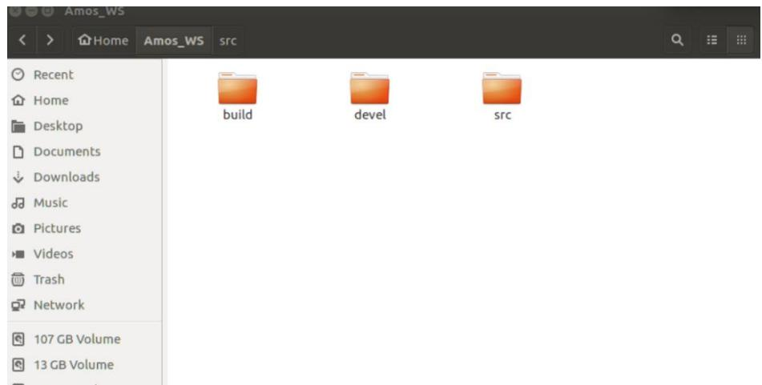

4）设置环境变量，设置环境变量是为了让系统知道功能包的位置在哪，以便能找到。每次打开终端，系统都会先执行 home目录下的.bashrc文件（默认隐藏，crtl+h查看）。所以我们将加载此工作空间的环境变量的命令添加到脚本文件，执行：

## 5）建立工作空间完成，可关闭终端

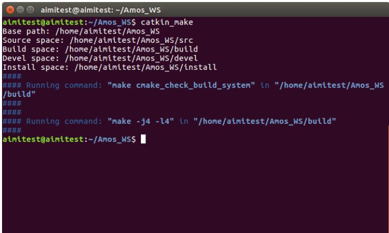

## 4.1.2 获取 aimibot 源代码并编译

Aimibot的ros功能包已经同步到代码仓库 GitHub，用户可通过git命令下载，在 ros中的使用方法如下：

cd src

1）将 ros 功能包克隆到工作空间的 src 文件夹下(需安装 git 工具：sudo apt install git)获取底层驱动：

git clone https://github.com/AimiplusTech/aimibotV2.git

获取仿真模型驱动：

git clone https://github.com/AimiplusTech/aimibotV2\_description.git

获取激光雷达驱动：

git clone https://github.com/AimiplusTech/ls01b\_v2.git

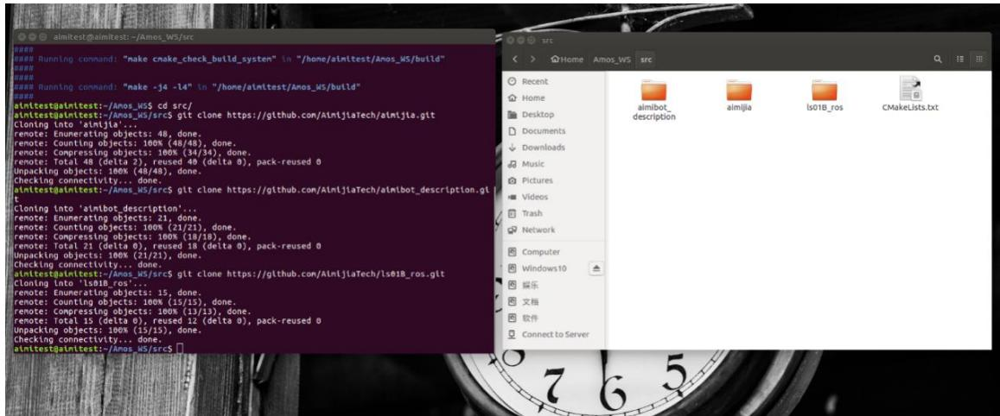

## 2）编译工作空间

安装工程依赖包，执行：

sudo apt-get install ros-kinetic-serial

sudo apt-get install ros-kinetic-ecl-exceptions

sudo apt-get install ros-kinetic-ecl-sigslots

sudo apt-get install ros-kinetic-ecl-streams

sudo apt-get install ros-kinetic-ecl-mobile-robot

sudo apt-get install ros-kinetic-ecl-command-line

sudo apt-get install ros-kinetic-turtlebot

sudo apt-get install ros-kinetic-turtlebot-\*

编译：在工程目录 Amos\_WS 下使用 catkin\_make :  
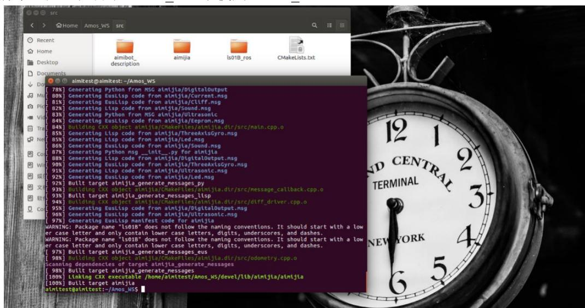

```txt
source devel/setup.bash

或者由于之前已经将工程的环境变量加到启动脚本中，也可执行：

source ~/.bashrc
```

3）加载工程环境变量：

## 4.1.3 查看设备硬件串口号及修改永久权限：

① 当你在运行一个会读取或者写入 USB设备的进程时，进程的用户/组必须有权限这么做才行。当然你可以手动用 chmod命令改变 USB 设备的权限，但是手动的权限改变只是暂时的。USB 设备会在下次重启时恢复它的默认权限。

② 作为一个永久的方式，你可以创建一个基于 udev 的 USB 权限规则，它可以根据你的选择分配任何权限模式。下面是该如何做。

③ 使用 ls -al /dev/ttyUSB0 查看 ttyUSB0 权限 lsusb -vvv 找出 USB 设备vendorID 和 productIDsudo

```batch
gedit /etc/udev/rules.d/50-myusb.rules
```

④ 创建一个新的 udev规则内容

```txt
SUBSYSTEMS=="usb", ATTRS {idVendor}=="067b"ATTRS {idProduct}=="2303", GROUP="users", MODE="0777", SYMLINK+="aimibot"SUBSYSTEMS=="usb", ATTRS {idVendor}=="10c4"ATTRS {idProduct}=="ea60", GROUP="users", MODE="0777", SYMLINK+="laser"sudo udevadm control --reload 重新加载 udev 规则，然后重启电脑。
```

5）测试底盘通信与激光雷达：

打开一个终端执行:

与底层通信正常如图所示。

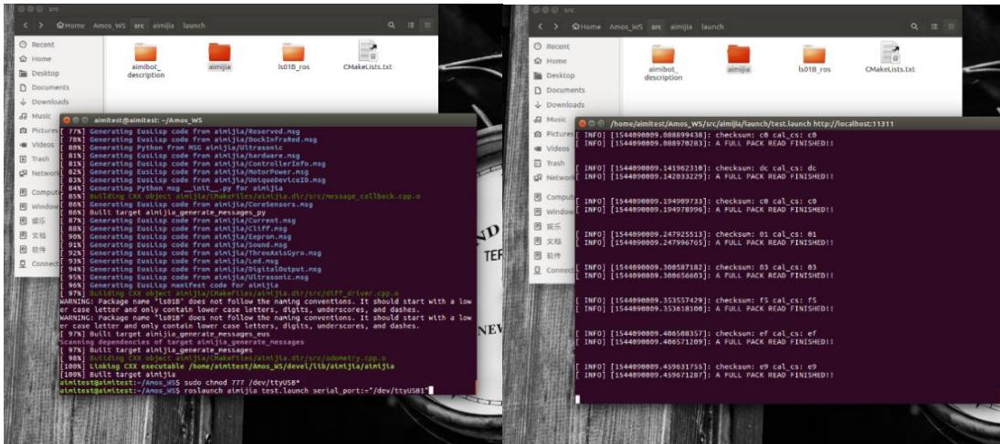  
另开终端执行:

## roslaunch aimibot ls01B\_laser.launch

与激光雷达正常如图所示。

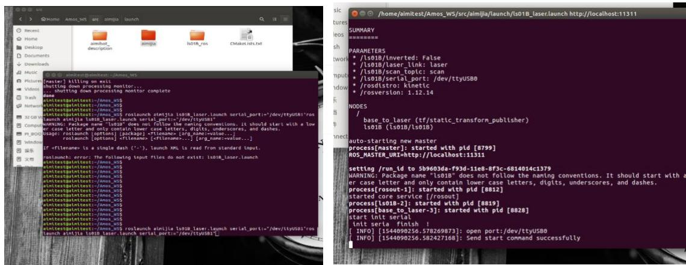

## 4.1.4 查看数据结构

Aimibot通过自定义的 ROS的消息存放底层驱动板通过串口上传的数据，消息文件存于aimibotV2/msg目录中。通过ROS的可视化查看数据类型与数值操作如下：

## 1）打开一个终端执行:

roslaunch aimibot test.launch

## 2）另开终端执行：

rosrun rqt\_topic rqt\_topic

得到 aimibotV2驱动发布的 ROS话题如下图所示，也可通过 rostopic list查看发布的话题，其中包括：

/aimibot/CoreSensors：发布控制系统核心数据，包括防跌落传感器(cliff)、左/右轮编码器(left\_encoder:65364,right\_encoder:65234)、左/右轮电机接收的 PWM 值

(left\_pwm,right\_pwm，暂无数据)、外部按键、电池电压（battery:例如 17.64）、输出电流；

/aimibot/GpInput：发布检测到的外部接口的输入值（analog\_input,digtal\_input（模拟信号和数字信号）暂无）

/aimibot/Ultrasonic：发布超声波传感器数值(disl1\~disl6：数值大概在 0-150)

/aimibot/cliff：发布防跌落传感器数值: bottom（3，0，3）

/aimibot/controller\_info：发布机器人的内部信息（d\_gain,i\_gain,p\_gain,type）

/aimibot/current：发布电源输出电流（无）

/aimibot/sensors/dock\_ir：发布红外传感器数据（docking,暂无）

/aimibot/sensors/imu\_data：发布陀螺仪数据（三轴加速度与机器人的偏转角度和角速度）

/aimibot/sensors/imu\_data\_raw

/aimibot/unique\_id：发布机器人特有的 ID 识别号

/aimibot/version\_info：发布机器人的版本信息

/joint\_states：发布机器人的驱动电机状态

/odom：发布里程计信息

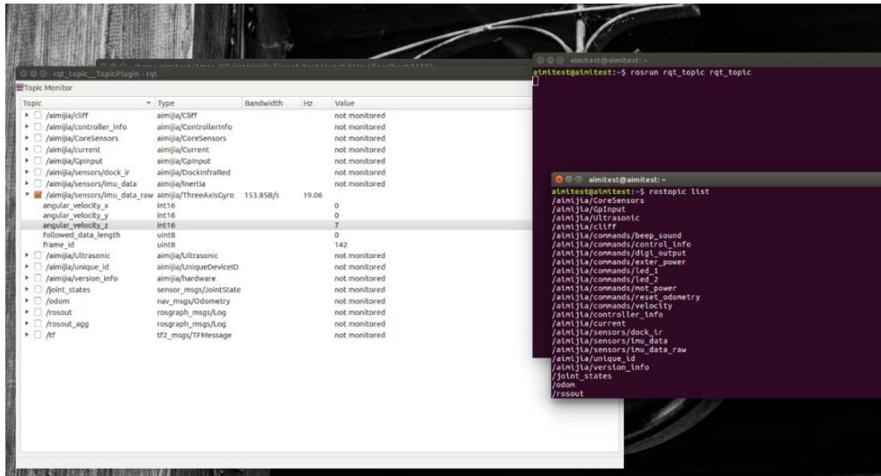  
可通过 ROS 中的 rostopic type（打印话题类型） + rostopic echo（打印话题数据->消息）具体查看某项数据格式及具体数值，例如查看 Imu数据执行如下命令：  
rostopic type /aimibot/sensors/imu\_data rostopic echo /aimibot/sensors/imu\_data

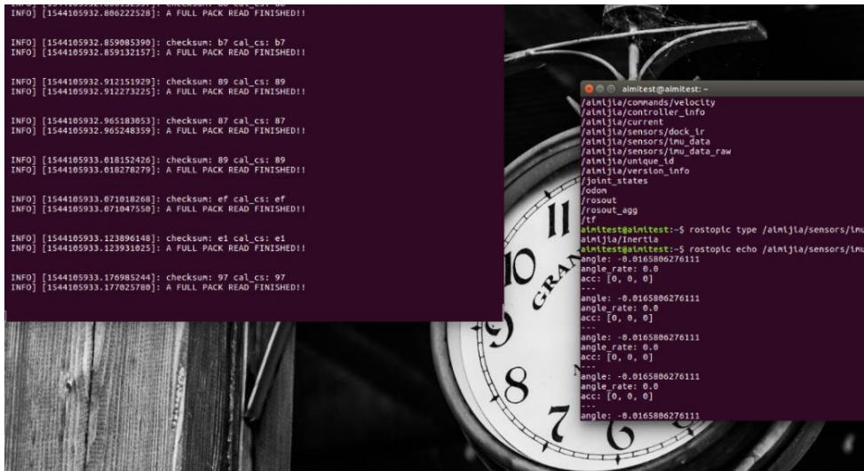

通过rqt\_plot可视化数据,在“Topic”栏中输入 要查看的消息，点击 添加到绘图界面，使用 调整绘图界面的数据波形位置

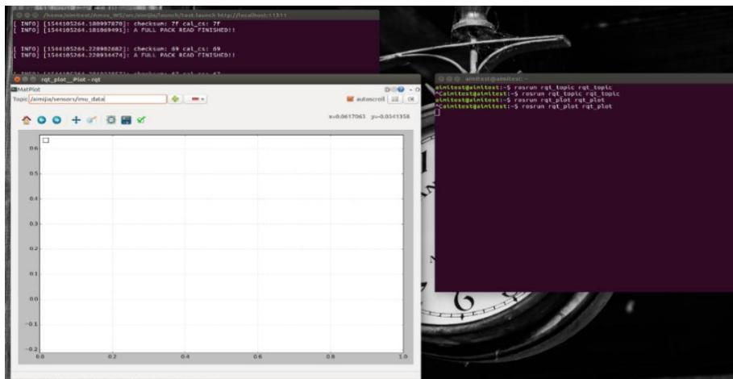

如图所示，我们在显示界面中看到机器人的偏转角度和角速度波形，此时可适当碰触机器人，正常情况下可看到角速度数据产生波动。

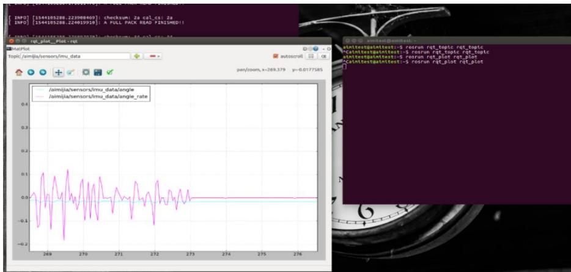


## 配套补充实验

[实验二 通过rqt查看机器人的数据结构](../../experiments/02/index.md)
