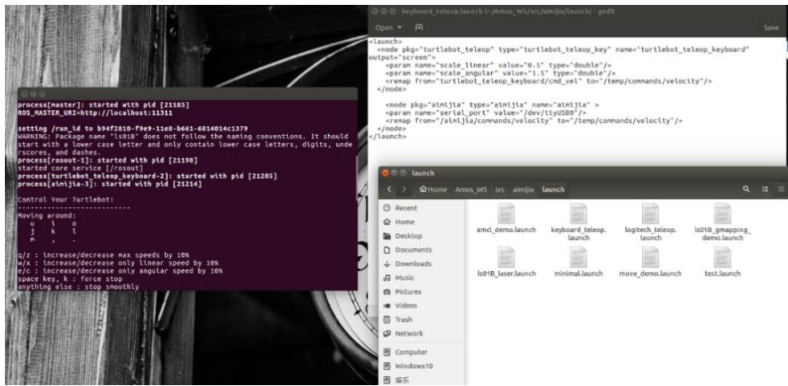
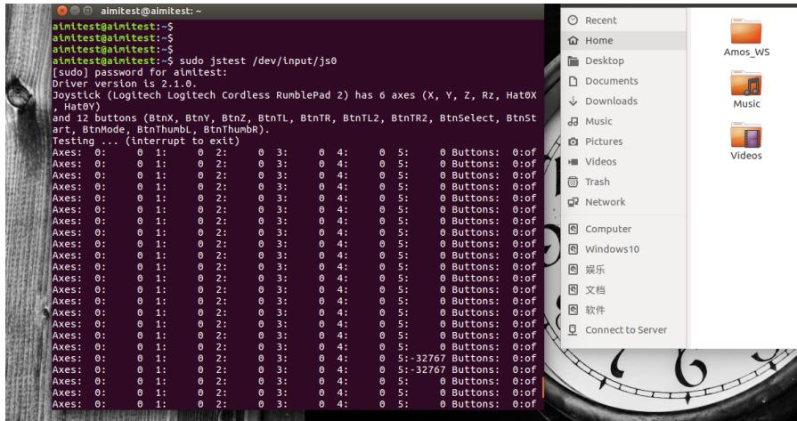
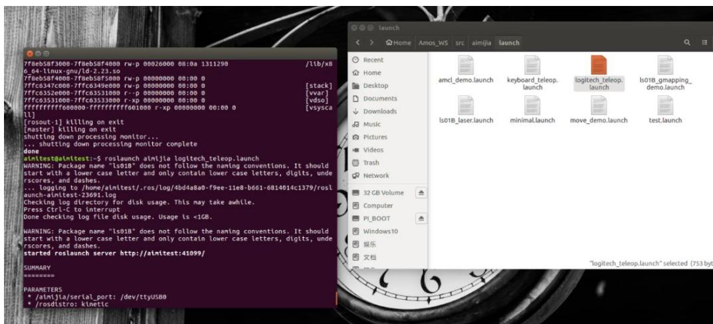
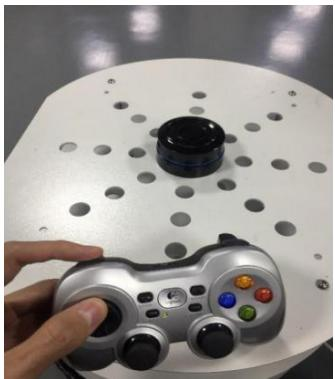
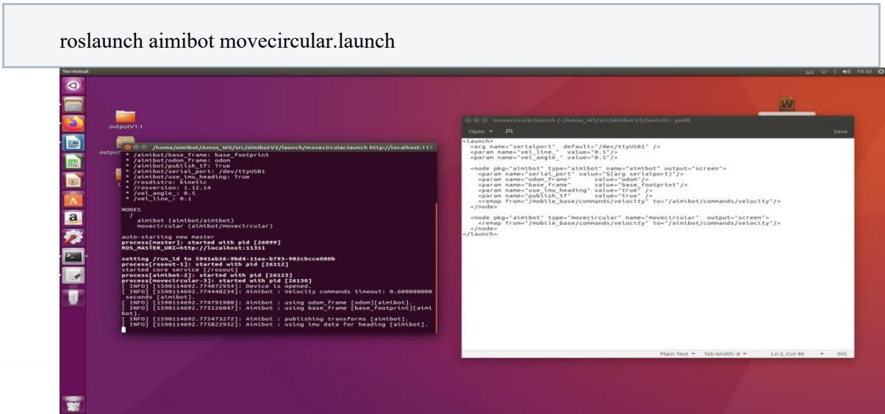

## 第 5 章 控制 Aimibot 运动示例

## 5.1 运动控制原理简介

Aimibot通过键盘和罗技手柄等外设，进行简单运动，还可以通过程序设定，进行规则运动（圆形）。

## 5.2 keyboard 键盘控制

进入 Amos\_WS/src/aimibotV2/scripts，给 aimibot\_teleop\_key 权限，操作如下:

打开一个终端执行:

roslaunch aimibot keyboard\_teleop.launch

如下图所示，在终端中出现提示：  


依照终端出现提示信息，其中 u、i、o、j、k、l、m控制机器人的方向与速度，q/z、w/x、e/c.实现提速。

## 5.3 游戏手柄控制（注：两种控制方式不建议同时打开）

将手柄的无线接收器插在提供的 USB上，在使用手柄控制机器人之前，需确保 ubuntu系统安装其驱动，安装方式如下：

依次输入以下命令安装：

```shell
sudo apt-get install ros-kinetic-joy
sudo apt-get install ros-kinetic-joystick-drivers
rosdep install joy
rosmake joy
```

电脑插上游戏手柄后默认情况下游戏手柄接口名称为js0，其默认的所有者和群组都是root，即需要root权限才能进行操作。可以输入以下命令进行查看：

```shell
ls -l /dev/input/js0
```

输入以下命令更改js0的root群组为dialout群组：

```txt
sudo chgrp dialout /dev/input/js0
```

再次输入：

```shell
ls -l /dev/input/js0
```

查看，若输出以下信息，则表示更改成功：

```txt
crw-rw-r--+1 root dialout 13,0 10 月 5 09:03 /dev/input/js0
```

安装完成后查看是否能读到键值，执行：

```batch
sudo jstest /dev/input/js0
```

推动摇杆或按下按键，观察数据变化情况，随着摇杆或者按键的调整，数值也跟着发生变化，如图所示，则驱动安装成功。

  
打开一终端执行:

roslaunch aimibot logitech\_teleop.launch  


摇杆控制机器人移动操作如图所示：  
  
按住左手边顶部按键，相当于打开机器人的接收使能，左手边上、下键对应机器人的

前后移动，左、右键对应机器人头部的左旋、右旋。

## 5.4 ROS 节点发布消息控制机器人以圆形轨迹运动

打开一终端执行:  
  
正常执行后，可观察到机器人开始在地面上按圆形轨迹移动  
视频展示链接：（xxx）


## 配套补充实验

[实验四 蓝牙键盘控制机器人运动](../../experiments/04/index.md)


## 配套补充实验

[实验五 ROS教育机器人圆形轨迹运动](../../experiments/05/index.md)
