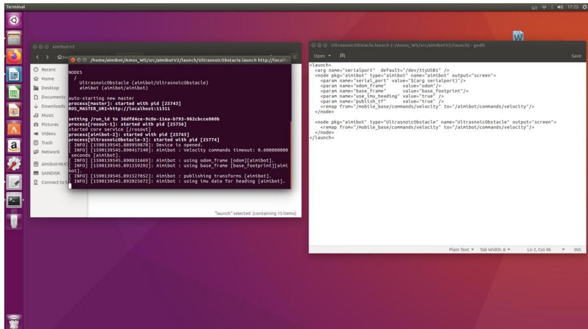

## 第 6 章 超声波避障示例

## 6.1 超声波避障简介

在 Aimibot机器人运动过程中，识别并规避障碍物达到有效的运动目的是一项重要的技术，本节示例一种采用超声波传感器的方法进行避障的方法。

## 6.2 超声波避障

（注：查看串口、获取操作权限、底盘串口与激光雷达串口的串口号的分配与上述步骤一致）

打开一终端执行:

roslaunch aimibot UltrasnoicObstacle.launch

如图所示：

启动成功后，Aimibot会自动向前运动，经过障碍物时会根据障碍物方位主动停止或者调整方位向前运动。

视频演示链接：（xxx）

## 配套补充实验

[实验六 ROS教育机器人超声波避障实验](../../experiments/06/index.md)
