## 第 7 章 建图（SLAM）示例

## 7.1 Slam 原理简介

SLAM（同时定位和地图绘制）是一种通过估计地图在任意空间中的当前位置来绘制地图的技术。（分为：激光和深度相机）

## 7.2 激光 ALAM 建图

（注：查看串口、获取操作权限、底盘串口与激光雷达串口的串口号的分配与上述步骤一致）

1）打开一终端执行：

roslaunch aimibot minimal.launch

2）新开终端启动 gmapping,用于构建地图，执行：

roslaunch aimibot ls01B\_gmapping\_demo.launch

此命令将打开rviz显示环境，我们将观察到实时建图信息，如图所示：

[INF0] [1541473289.309945672]: A FULL PACK READ FINISHED!!

INEO [1541473289.362758718]: checksum: e4 cal cs: e4 INFO [1541473289.362852385]: A FULL PACK READ FINISHED!!

INFO] [1541473289.415789425]: checksum: ea cal cs: ea INFO [1541473289.415874388]: A FULL PACK READ FINISHED11

INEO [1541473289.468708888]: checksun: e6 cal cs: e6 INFO [1541473289,469144481]: A FULL PACK READ FINISHED!!

INFO [1541473289.521671543]: checksum: d8 cal cs: d8 INFO [1541473289,521776376]: A FULL PACK READ FINISHED11

IN501 [1541473280 56064480el: che5ksvm: d6 5a] 551 d6 INFOO [1541473289.569776295]: A FULL PACK READ FINISHED!!

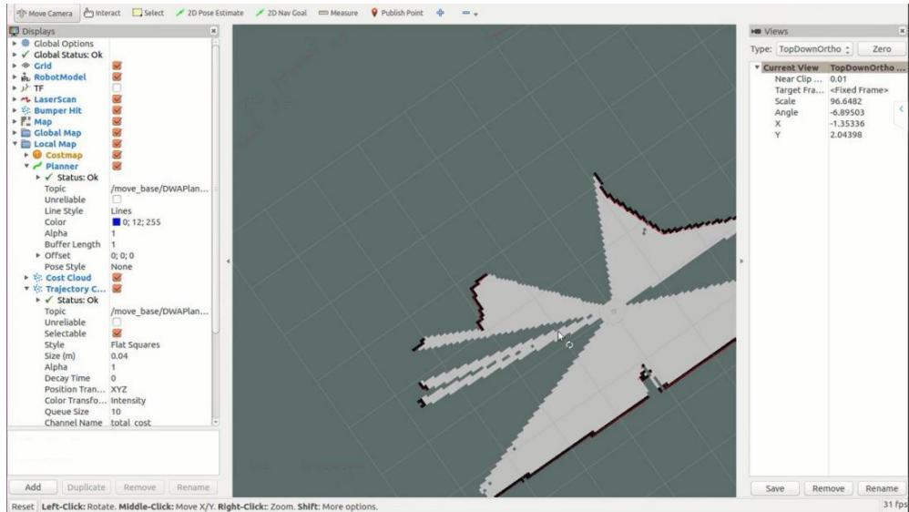  
Reset Left-Click: Rotate. Middle-Click: Move X/Y. Right-Click: Zoom. Shift: More options.

## 3）Aimibot 移动控制

打开一终端执行 roslaunch aimibot keyboard\_teleop.launch,通过键盘操作 Aimibot:

roslaunch aimibot keyboard\_teleop.launch

或者打开一终端执行 roslaunch aimibot logitech\_teleop.launch 获得串口权限,启动罗技手柄操作 Aimibot:

roslaunch aimibot logitech\_teleop.launch

注意：键盘和罗技手柄二者选其一即可

通过键盘或者罗技手柄控制底盘开始建图，控制机器人在区域中运行，并在 rviz的界面中实时显示，获得该区域的完整地图后如图所示：

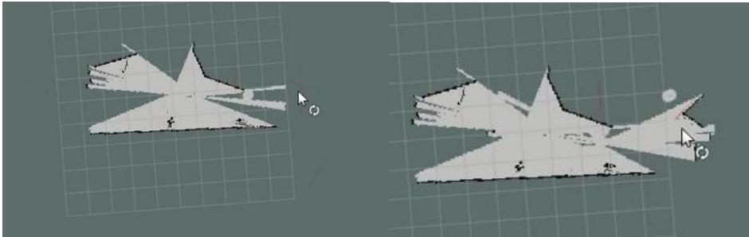

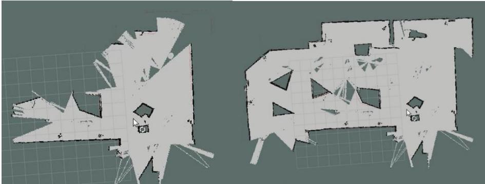

## 4）保存地图

将得到的地图信息保存在电脑中，新开一终端，执行新建文件夹命令：

mkdir -p \~/map

使用ros中的map\_server工具保存使用激光获得的地图

rosrun map\_server map\_saver -f \~/map/aimijia\_demo

在文件夹中可看到，地图文件

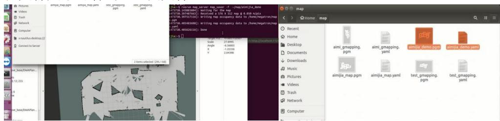

关闭所有终端。

## 7.3 视觉 SLAM 建图

## 7.3.1 安装驱动与依赖

安装realsensor驱动：注意先不要插上realsensor设备！！！安装方式可参考官方。

1）注册服务器的公钥:

```batch
sudo apt-key adv --keyserver keys.gnupg.net --recv-key F6E65AC044F831AC80A06380C8B3A55A6F3EFCDE
```

```txt
或者：sudo apt-key adv --keyserver hkp://keyserver.ubuntu.com:80 --recv-key F6E65AC044F831AC80A06380C8B3A55A6F3EFCDE
```

如果仍然无法检索公钥，请检查并指定代理设置: export

2）将服务器添加到存储库列表中:

```txt
Ubuntu 16 LTS:
sudo add-apt-repository "deb http://realsense-hw-public.s3.amazonaws.com/Debian/apt-repo xenial main" -u
Ubuntu 18 LTS:
sudo add-apt-repository "deb http://realsense-hw-public.s3.amazonaws.com/Debian/apt-repo bionic main" -u
```

3）安装库（如果升级软件包，请参阅下面的部分）:

```shell
sudo apt-get install librealsense2-dkms
sudo apt-get install librealsense2-utils
```

以上两行将部署 librealsense2 udev规则，构建并激活内核模块，运行时库以及可执行的演示和工具。

4）（可选）安装开发人员和调试软件包:

```shell
sudo apt-get install librealsense2-dev
sudo apt-get install librealsense2-dbg
```

安装了 dev 软件包后，您可以使用 g ++ -std = c ++ 11 filename.cpp -lrealsense2 或您选择的 IDE 编译具有 librealsense 的应用程序。

重新连接英特尔实感深度摄像头并运行：

打开一新的终端，运行图下指令：

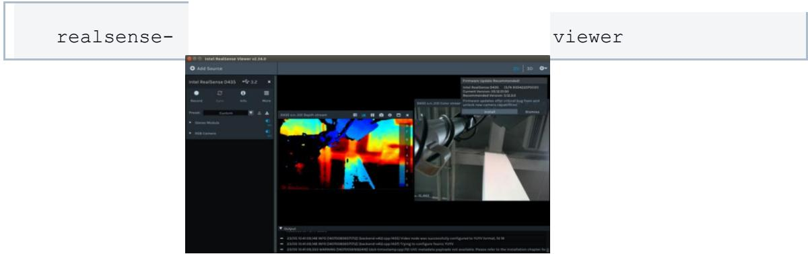

验证内核是否已更新：

modinfo uvcvideo | grep "version:"

会出现realsense字符串，如下图所示

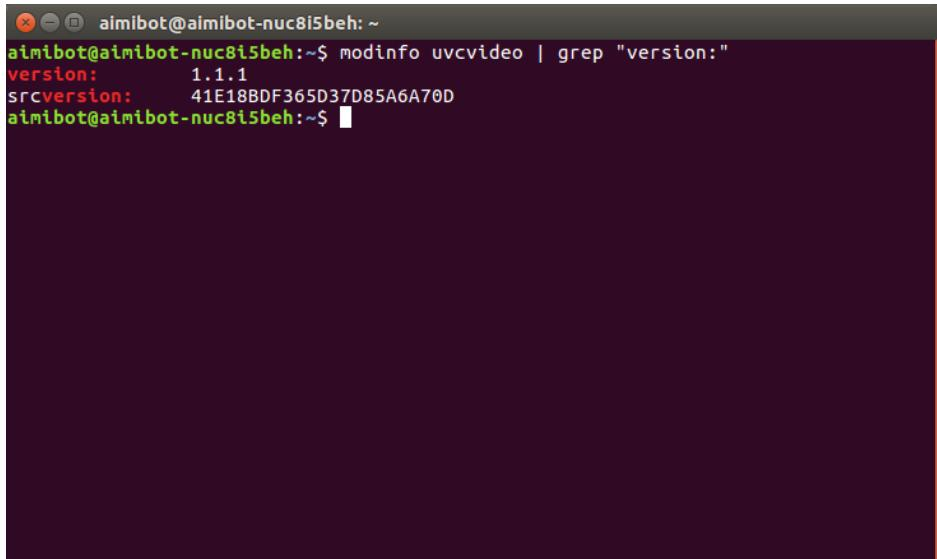

安装 realsensor ros 功能包

```batch
sudo apt-get install ros-kinetic-realsense2-camera
```

安装 rtabmap ros 功能包

```shell
sudo apt-get install ros-kinetic-rtabmap-ros
```

## 7.3.2 确定 realsensor 的位置

默认是安装了支架的，位置与 aimibotV2\_description的 urdf文件中描述的一致，可以通过 roslaunch aimibot2\_description display.launch 来查看 realsensor 安装位置是否与实际安装位置一致。且坐标系应如图所示

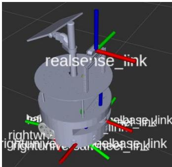

相机坐标系x轴与相机方向一致。若需要人为更改相机姿态，则需要自己设置aimibotV2\_description 的 urdf描述文件。在 aimibotV2\_description/urdf/aimibot.urdf文件中找到如下设置：

```xml
<joint
    name="realsense_joint"
    type="fixed">
    <origin
    xyz="0.22476 4.8928E-05 0.5145 "
    rpy="0 0 0" /> <!--这里设置相机姿态 -->
    <parent
    link="base_footprint" />
    <child
    link="realsense_link" />
    <axis
    xyz="0 0 0" />
</joint>
```

rpy="0 0 0"处可以设置姿态，如果位置有变动，则需要以 base\_footprint底盘坐标系作为参考，来变化

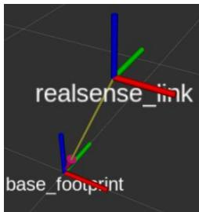

## 7.3.3 视觉建图

## 7.3.3.1 建图原理简介

建图会同时通过视觉 建立点云地图，以及激光 建立栅格地图，导航最后通过视觉点云地图来定位，通过激光的栅格地图来导航，通过激光来避障。首先进行建图，建图的期间尽量保持环境是静态的，目前的rtabmap无法剔除动态点云。建图之后保存地图文件，然后依赖地图文件进行定位与导航。

## 7.3.3.2 建图

打开一终端执行：

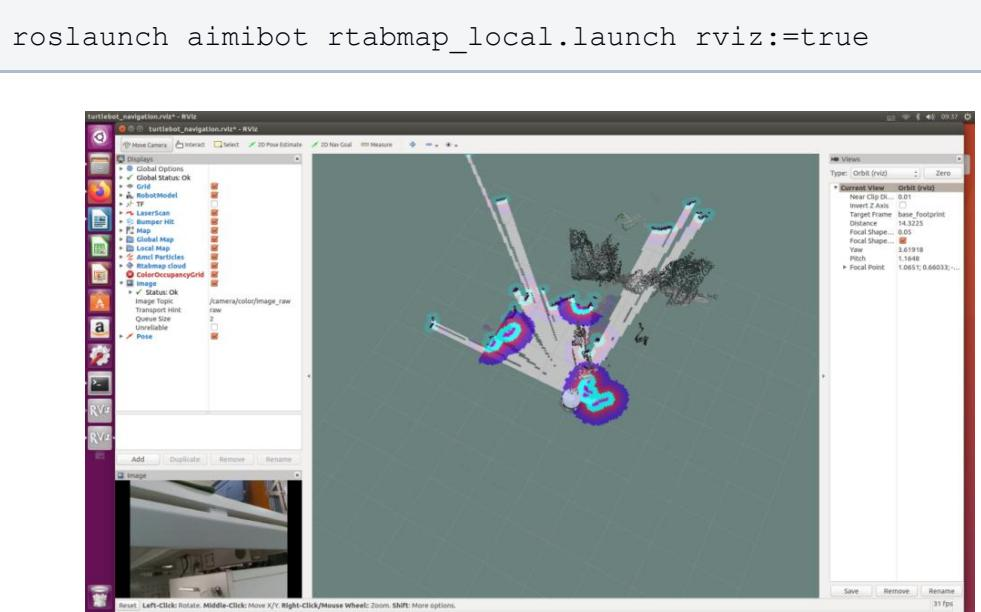  
打开一终端执行 文件，通过键盘控制机器人建图：

roslaunch aimibot keyboard\_teleop.launch

或者使用手柄控制机器人建图，建好的地图关闭软件，地图保存在\~/.ros中

## rtabmap.db。

在 Home文件下按 ctrl+h显示隐藏文件

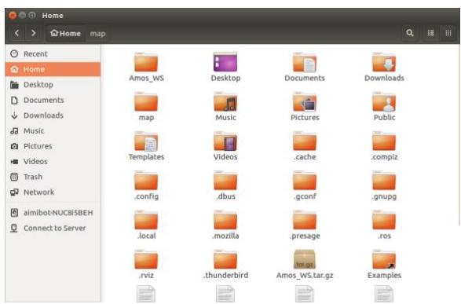  
进入.ros文件夹即

可看到保存的地图，如下图所示的 rtabmap.db

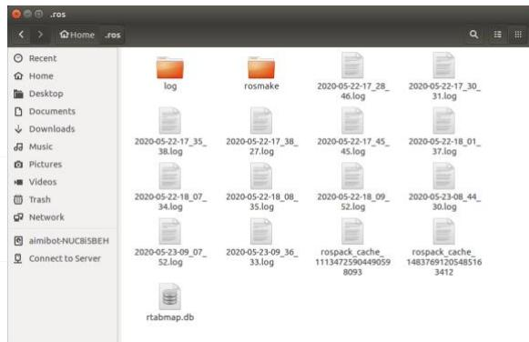


## 配套补充实验

[实验八  ROS教育机器人激光雷达建图](../../experiments/08/index.md)
