## 第 8 章 导航 （Navigation）示例

## 8.1 导航原理简介

导航是移动机器人技术的基本目的之一。机器人技术中导航非常重要，是必不可少的部分。导航是指机器人运动到一个指定的目的地，需要知道机器人本身地理位置，并要有一个给定的周围环境的地图，在各种路径中找出最优路径，在行驶中避免障碍物（如墙壁、家具、物体）等。

## 8.2 激光导航

注意：请确保您已经创建了您的地图。

1）启动底盘：

打开一个终端执行：

roslaunch aimibot minimal.launch

2）启动激光雷达：

另开一终端执行：

roslaunch aimibot ls01B\_laser.launch

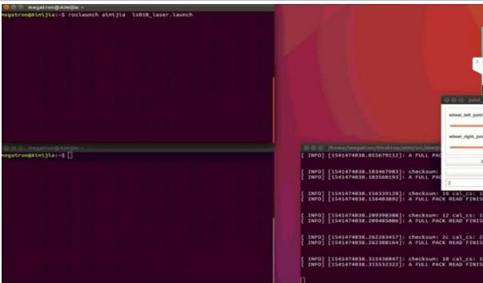

3）加载地图文件：

另开一终端，执行：

roslaunch aimibot amcl\_demo.launch map\_file:=/home/username/map/aimijia\_demo.yaml

(注：username为你的电脑用户名，如图中的 aimibot)

如果你看到odom received!说明已经正常运行。如果你收到一个警告：

Waiting on transform...，先重启 minimal.launch，重新启动 amcl\_demo.lauch。您可能需要尝试重新启动几次。同时在 rviz仿真环境中将出现机器人模型。

此时机器人的位置很可能并不是建图时的起始位置，所以我们需要在 rviz中手动校准原点位置，校准步骤如下：

## 1）估计初始姿态：

在 rviz中，点击顶部工具栏中的“2D Pose Estimate”，将鼠标放置在地图中并长按调整头部指向，当激光雷达的障碍物指示线与地图中的物体重合时，校准完成。

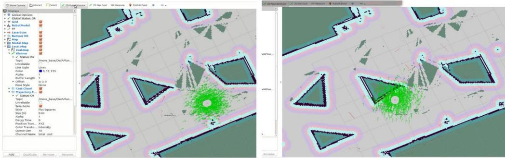

## 2）发送导航目标

校准完成后，点击顶部工具栏中的 $\mathrm { \Omega ^ { \mathrm {  } } 2 D N a v G o a l ^ { \mathrm {  } } }$ ，再将鼠标点击地图中任意位置，即可使用导航演示功能，机器人生成轨迹并自动运行，如图所示，机器人周围路径越可靠，显示的颜色越趋近于红色：

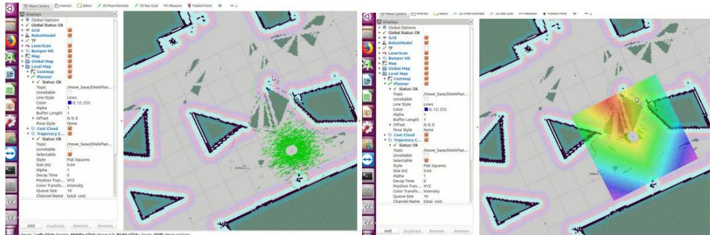

## 8.3 视觉导航

打开一个终端，执行：

roslaunch aimibot rtabmap\_local.launch rviz:=true localization:=true database\_path:=\~/map/yourmapname.db

载入后机器人会自动定位，然后可以设定目标点，机器人会导航到目标点。

## 进阶部分第 9 章 进阶 ROS 开发

## 9.1 蓝牙键盘控制机器人运动

## 一、实验目的

1、掌握Aimibot教育机器人键盘控制运动工作原理

2、熟练编写机器人键盘控制运动程序，实现蓝牙键盘控制机器人运动

## 二、实验内容

1、通过示例代码控制智能移动机器人进行运动；

2、通过修改示例代码控制智能移动机器人进行避障时的安全距离。

## 三、实验器材

1、硬件：Aimibot 教育机器人主体、键盘鼠标。

2、软件：Ubuntu16.04 + ROS

## 四、实验原理

## 1、键盘控制原理

## 2、键盘控制运动思路

该例程中，目标线速度（最高线速度）设为 0.2，目标角速度（最高角速度）设为 1，当按下控制机器人运动的按键时，目标线速度则为±0.2，目标角速度则为±1；每次主循环时，线速度增加 0.02，五次循环后（即线速度为 0.1），线速度在每次主循环时减少 0.02，角速度类似，每次增加或者减少 0.1，即机器人完成一次运动的过程是通过速度依次递增再依次递减实现的；当机器人还未停止便再次按下按键时，循环的标志位会清零，则速度会继续增加，最高速度为目标速度，即最高线速度为 0.2，最高角速度为 1；当按下控制机器人速度的按键时，则改变目标速度的值，通过改变最高速度的值来实现机器人的速度控制；当按下停止机器人运动的按键时，清空所有标志位即可。程序流程图如下：

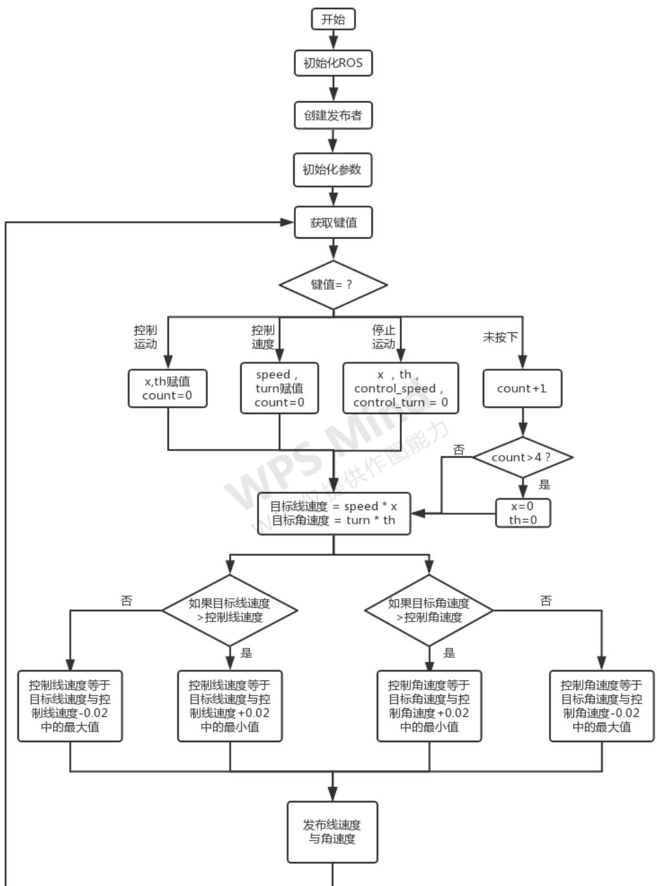

## 3、程序代码

打开 Amos\_WS/aimibotV2 文件夹，可以看到 lunch、scripts 等多个文件夹，其中keyboard\_teleop.launch 文件位于 lunch 文件夹中，aimibot\_teleop\_key 文件位于 scripts 文件夹中，依次打开两个文件，查看代码。

## （1）keyboard\_teleop.launch 文件

打开 Amos\_WS/aimibotV2/lunch/keyboard\_teleop.launch 文件，该 lunch 文件运行了aimibot 可执行文件与 aimibot\_teleop\_key 可执行文件，其中对 aimibot 可执行文件与aimibot\_teleop\_key可执行文件中的参数进行赋值，初始线速度设置为0.5，初始角速度设置

## 1.5，并对话题名称进行重映射，将话题名称重映射为一样的名称。

## 打开 keyboard\_teleop.launch 文件，代码如下：

```xml
<launch>
    <arg name="serialport" default="/dev/ttyUSB0" /> //串口使用 USB0
    <node pkg="aimibot" type="aimibot" name="aimibot" output="screen">
    <param name="serial_port" value="${arg serialport}"/>
    <param name="odom_frame" value="odom"/>
    <param name="base_frame" value="base_footprint"/>
    <param name="use_imu_heading" value="true" />
    <param name="publish_tf" value="true" />
    <remap from="/mobile_base/commands/velocity" to="/aimibot/ commands/ velocity"/> //重映射话题名称
    </node>

    <node pkg="aimibot"type="aimibot_teleop_key" name="aimibot_teleop_keyboard" output="screen">
    <param name="scale_linear" value="0.5" type="double"/> //设置线速度
    <param name="scale_angular" value="1.5" type="double"/> //设置角速度
    <remap from="aimibot_teleop_keyboard/cmd_vel"to="aimibot/commands/velocity"/> //重映射话题名称
    </node>
</launch>
```

## （2）aimibot\_teleop\_key 文件

打开 Amos\_WS/aimibotV2/scripts/aimibot\_teleop\_key 文件，该程序实现了键盘控制机器人运动的功能，主要函数为 getKey函数和main函数，其中getKey函数的功能是获取键值，main函数的功能是将键值对应的运动指令通过话题发布出去，函数代码入下：

```python
def getKey():
    tty.setraw(sys.stdin.fileno())
    rlist, _, _ = select.select([sys.stdin], [], [], 0.1)
    if rlist:    //是否按下键盘
    key = sys.stdin.read(1)
    else:
    key = "
    termios.tcsetattr(sys.stdin, termios.TCSADRAIN, settings)
    return key    //返回键值

if __name__ == "__main__":
    settings = termios.tcgetattr(sys.stdin)
```

```python
rospy.init_node('aimibot_teleop') //初始化节点
pub = rospy.Publisher(~cmd_vel', Twist, queue_size=5) //创建发布者
x = 0 //线速度方向标志位
th = 0 //角速度方向标志位
    count = 0 //运动标志位
    target_speed = 0 //目标线速度
target_turn = 0 //目标角速度
control_speed = 0 //控制线速度
control_turn = 0 //控制角速度
try:
    print(msg)
    print(vels(speed,turn))
    while(1):
    key = getKey() //获取键值
    if key in moveBindings.keys(): //按下控制运动的按键
    x = moveBindings[key][0]
    th = moveBindings[key][1]
    count = 0
    elif key in speedBindings.keys(): //按下速度运动的按键
    speed = speed * speedBindings[key][0]
    turn = turn * speedBindings[key][1]
    count = 0
    print(vels(speed,turn))
    elif key == '' or key == 'k': //按下'k'或者空格
    x = 0
    th = 0
    control_speed = 0
    control_turn = 0
    else: //未按下按键
    count = count + 1
    if count > 4:
    x = 0
    th = 0
    if (key == '\x03'):
    break
    target_speed = speed * x
    target_turn = turn * th
//线速度赋值
if target_speed > control_speed:
    control_speed = min(target_speed, control_speed + 0.02)
elif target_speed < control_speed:
    control_speed = max(target_speed, control_speed - 0.02)
else:
    control_speed = target_speed
    //角速度赋值
if target_turn > control_turn:
    control_turn = min(target_turn, control_turn + 0.1)
elif target_turn < control_turn:
```

```python
control_turn = max(target_turn, control_turn - 0.1)
else:
    control_turn = target_turn

    twist = Twist()
    twist.linear.x = control_speed; twist.linear.y = 0; twist.linear.z = 0
    twist.angular.x = 0; twist.angular.y = 0; twist.angular.z = control_turn
    pub.publish(twist) // 发布线速度与角速度

except Exception as e:
    print(e)
finally:
    twist = Twist()
    twist.linear.x = 0; twist.linear.y = 0; twist.linear.z = 0
    twist.angular.x = 0; twist.angular.y = 0; twist.angular.z = 0
    pub.publish(twist)

termios.tcsetattr(sys.stdin, termios.TCSADRAIN, settings)
```

## 五、实验步骤

1、获取串口操作权限（已映射），详见说明书第X章。

2、打开终端，启动 keyboard\_teleop.launch 文件，执行： roslaunch aimibot keyboard\_teleop.launch 如图所示：

依照终端出现提示信息，其中 u、i、o、j、k、l、m控制机器人的方向与速度，q/z、

w/x、e/c.实现提速。

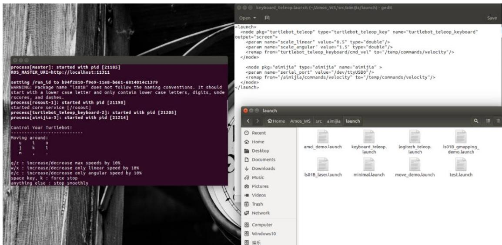

## 六、注意事项

在编写运动数据发布函数的时候，应注意运动数据订阅者的队列长度，以及机器人处理运动数据的时间间隔，经实验证明，如果主函数的循环时间过短，会导致机器人无法执行运动过程，因为机器人在接收到前一次的运动数据并处理数据的过程中，下一次的运动数据便到来了，如果我们处理消息的速度不够快，会将收到的消息缓冲下来，满了的话，后面的到达的消息将会覆盖前面的消息，最终导致机器人只能处理最后到来的数据，即速度均为0的运动数据。可使用 time.time()函数验证该程序主循环的执行时间，发现主循环的执行时间大概为0.1s，主要为getKey()函数的执行时间；可修改程序，使每次运动的执行过程在一个while循环中，即按键之后不再调用 getKey()函数，直到速度为0时跳出循环，再调用getKey()函数获取键值，发现此循环的时间大概为 0.002s，且机器人不再运动，可利用time.sleep()函数找出机器人处理运动数据最短的时间。

## 七、预习与思考题

请思考：如何在自主轨迹运动中加入超声波传感器，使得机器人在轨迹运动中遇到障碍物能自主暂停，保护移动机器人？

## 八、进阶实验

通过修改示例代码，利用超声波传感器控制机器人跟随木块运动。

## 9.2 ROS 教育机器人圆形轨迹运动

## 一、实验目的

1、掌握Aimibot 教育机器人运动工作原理

2、熟练编写机器人圆形轨迹运动程序，实现机器人圆形轨迹运动

## 二、实验内容

1、通过示例代码控制智能移动机器人进行圆形轨迹运动；

2、通过修改示例代码控制智能移动机器人进行矩形轨迹运动。

## 三、实验器材

1、硬件：Aimibot 教育机器人主体、键盘鼠标。

2、软件：Ubuntu16.04 + ROS

## 四、实验原理

## 1、圆形轨迹运动思路

该例程中，控制机器人进行圆形轨迹运动是通过不断发布一样的线速度与角速度话题实现的。程序流程图如下：

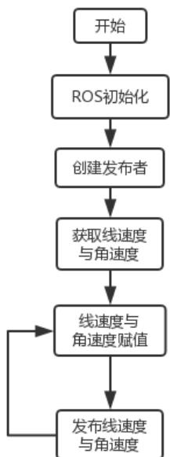

## 2、程序代码

打开 Amos\_WS/aimibotV2 文件夹，可以看到 lunch、src、include 等多个文件夹，其中 movecircular.launch 文件位于 lunch 文件夹中，movecircular.h 文件位于 include 文件夹中，movecircular.cpp 文件位于 src 文件夹中，依次打开三个文件，查看代码。

## （3）movecircular.launch 文件

打开 Amos\_WS/aimibotV2/lunch/movecircular.launch 文件，该 lunch 文件运行了 aimibot 可执行文件与 movecircular 可执行文件，其中对 aimibot 可执行文件中的参数进行赋值，对 movecircular可执行文件中线速度与角速度的参数进行赋值，并对话题名称进行重映射，

打开 movecircular.launch 文件，代码如下：

```xml
<launch>
    <arg name="serialport" default="/dev/ttyUSB0" /> //串口使用 USB0
    <param name="vel_line_" value="0.5"/> //线速度设为 0.5
    <param name="vel_angle_" value="0.5"/> //角速度设为 0.5
    <node pkg="aimibot" type="aimibot" name="aimibot" output="screen">
    <param name="serial_port" value="${arg serialport}"/>
    <param name="odom_frame" value="odom"/>
    <param name="base_frame" value="base_footprint"/>
    <param name="use_imu_heading" value="true" />
    <param name="publish_tf" value="true" />
    <remap from="/mobile_base/commands/velocity" to="/aimibot/commands/velocity"/> //重映射话题名称
    </node>
    <node pkg="aimibot" type="movecircular" name="movecircular" output="screen">
    <remap from="/mobile_base/commands/velocity" to="/aimibot/commands/velocity"/> //重映射话题名称
    </node>
</launch>
```

打开 Amos\_WS/aimibotV2/include/movecircular.h 文件，该头文件声明了一个 cirvelControl 类，对 movecircular.cpp 文件中的参数进行了定义，并创建了发布者的实例，函数代码如下：

```cpp
class cirvelControl //声明 cirvelControl 类
{
public: //公共权限
    cirvelControl(); //定义构造函数，函数名与类名相同（在这里是对构造函数进行声明）
    void init(); //初始化速度
    void velocityControl(); //运动控制
private: //私有权限
    double vel_line; //线速度
    double vel_angle; //角速度
    ros::NodeHandle handle; //创建节点句柄 handle_
    ros::Publisher vel_pub; //通过 ros::Publisher 这样一个类来创建一 vel_pub_这样一个对象，速度发布者 vel_pub_};
```

## （5）movecircular.cpp 文件

打开 Amos\_WS/aimibotV2/src/movecircular.cpp 文件，该程序实现了机器人进行圆形轨迹运动的功能，主要函数为 init函数和 velocityControl函数，init函数主要从 lunch 文件中获取/vel\_line\_与/vel\_angle\_的参数数据，velocityControl主要发布机器人的速度数据，控制机器人运动，主要函数代码入下：

```cpp
void cirvelControl::init()
{
    //从 Param 中获取线速度与角速度
    handle_.oul
    {
    handle_.el
    {
    handle_.getParam("/vel_line_ ", vel_line_) ;
    handle_.getParam("/vel_angle_ ", vel_angle_) ;
    }
    void cirvelControl::velocityControl()
    {
    geometry_msgs::Twist controlVel_;
    controlVel_.angular.z = vel_angle_; //角速度赋值
    controlVel_.linear.x = vel_line_; //线速度赋值
    controlVel_.linear.y = 0;
    controlVel_.linear.z = 0;
    vel_pub_.publish(controlVel_) ; //发布线速度与角速度
    }
    int main(int argc, char** argv)
    {
    ros::init(argc, argv, "odompubt"); //ros 初始化
    cirvelControl cirodom_vel_;
    while (ros::ok())
    {
```

```cpp
cirodom_vel_.velocityControl(); //调用运动控制函数
}
ros::spin();
return 0;
}
```

## 五、实验步骤

1、获取串口操作权限（已映射），详见说明书第 X章。

2、打开终端，启动 movecircular.launch 文件，执行： roslaunch aimibot movecircular.launch

如图所示：

启动成功后，机器人会自动进行圆形轨迹运动。

## 六、实验注意事项

由于该例程中所发布的线速度与角速度无需改变值的大小，便可实现机器人进行圆形轨迹运动，所以只需在 main 函数里循环调用发布机器人速度的函数即可。在进阶实验中需要改变机器人线速度与角速度的值，所以不能只在 main函数里循环调用发布机器人速度的函数，因为在机器人改变方向时，线速度为0，机器人直线行驶时，角速度为 0。以下提供三个思路在机器人运动的过程中改变线速度与角速度的值：

1、使用里程计：利用里程计获得机器人 Z轴的旋转角，即机器人改变方向时转过的角度，当旋转角为 90 的倍数时，使角速度为 0，控制机器人直线行驶；再利用里程计获得机器人 X 方向前进的距离，当距离为某一固定值的倍数时，使线速度为0，控制机器人转向，即可实现机器人进行矩形轨迹运动。

2、使用定时器：利用 ros::Timer timer = n.createTimer(ros::Duration(period),timerCallback)函数创建一个定时器，每隔一定时间在回调函数里改变一次线速度与角速度的值，即可实现机器人进行矩形轨迹运动。

3、使用循环标志位：该思路与例程中的思路类似，在 main函数里循环调用发布机器人速度的函数，但在发布机器人速度的函数里增加一个循环标志位，即每调用一次发布机器人速度的函数该标志位加一，每调用到一定次数时，改变线速度与角速度的值，该方法与定时器的功能类似，但程序实现较简单，需要注意，由于程序简单，执行速度快，且线速度与角速度都有为 0的时候，所以需要增加一个延时函数，否则会导致速度数据溢出，订阅者只能处理最后到来的数据，最终机器人不进行运动。

## 七、预习与思考题

## 八、进阶实验

通过修改示例代码，控制智能移动机器人进行矩形轨迹运动

## 9.3 ROS 教育机器人超声波避障实验

## 一、实验目的

1、掌握Aimibot 教育机器人超声波避障工作原理

2、熟练编写机器人超声波避障控制程序，实现机器人超声波避障

## 二、实验内容

1、通过示例代码控制智能移动机器人进行超声波避障；

2、通过修改示例代码控制智能移动机器人进行避障时的安全距离。

## 三、实验器材

1、硬件：Aimibot 教育机器人主体、键盘鼠标、超声波传感器。

2、软件：Ubuntu16.04 + ROS

## 四、实验原理

## 1、超声波测距原理

本 Aimibot 教育机器人前端安装有五个超声波传感器，每个超声波的有效监测范围为 3m，检测幅度为15°，为避免碰撞、特征识别、定位和导航提供目标检测和距离信息。模块包括超声波发射器、接收器与控制电路。实物图如下：

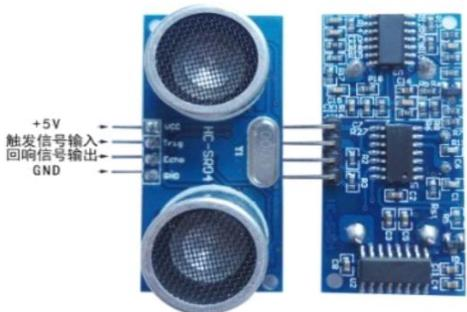  
图x.x 超声波传感器实物图

VCC供5V电源，GND为地线，TRIG触发控制信号输入，ECHO回响信号输出等四个接口端。基本工作原理如下：

（1）采用IO口TRIG触发测距，给最少 10us的高电平信号；

（2）模块自动发送 8个40khz的方波，自动检测是否有信号返回；

（3）有信号返回，通过 IO 口 ECHO 输出一个高电平，高电平持续的时间

就是超声波从发射到返回的时间；

（4）测试距离=（高电平时间\*声速（340m/s））/2。

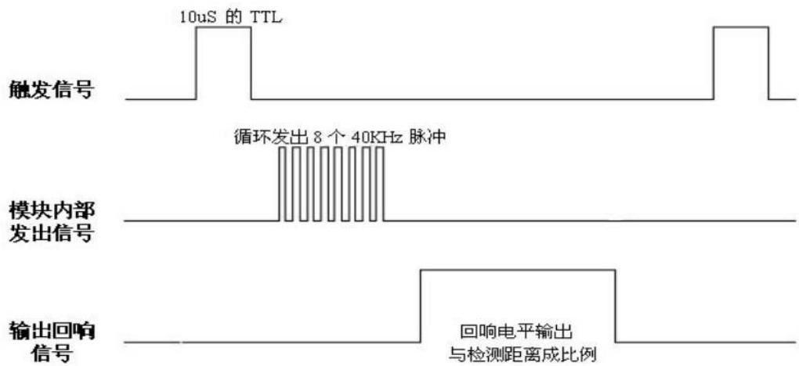  
图 x.x 超声波时序图

以上时序图表明只需要提供一个 10uS 以上脉冲触发信号，该模块内部将发出8个40kHz周期电平并检测回波。一旦检测到有回波信号则输出回响信号。

回响信号的脉冲宽度与所测的距离成正比。由此通过发射信号到收到的回响信号时间间隔可以计算得到距离。公式：uS/58=厘米或者 uS/148=英寸：或是：距离=高电平时间\*声速（340m/s）/2；建议测量周期为 60ms 以上，以防止发射信号对回响信号的影响。

## 2、超声波避障思路

机器人行走的过程中检查前方有无障碍物，如果没有就继续向前走，有的话就测距并判断距离是否达到避障的条件（避障安全距离可视实际情况而定，可在程序中设置），如障碍物较多，为避免机器人不停左右转动，设置为默认左转，再根据障碍物方位主动停止或者调整方位向前运动。流程图如下图所

示：

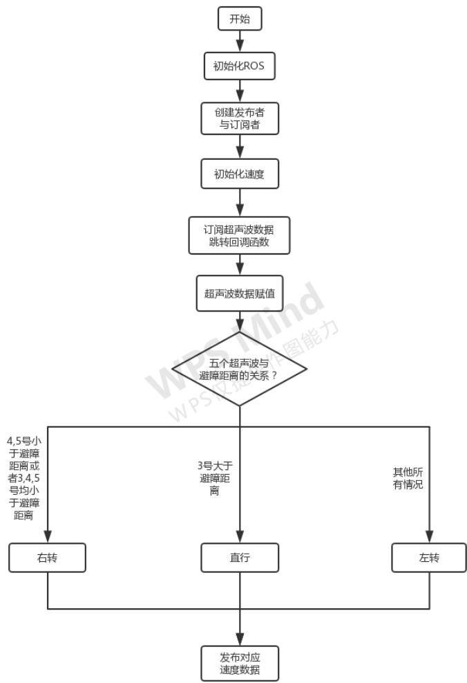

## 3、程序代码

打开 Amos\_WS/aimibotV2 文件夹，可以看到 lunch、src、include 等多个文件 夹 ， 其 中 UltrasnoicObstacle.launch 文 件 位 于 lunch 文 件 夹 中 ，UltrasnoicObstacle.h 文件位于 include 文件夹中，UltrasnoicObstacle.cpp 文件位于src 文件夹中，依次打开三个文件，查看代码。

（6）UltrasnoicObstacle.launch 文件

打开 Amos\_WS/aimibotV2/lunch/UltrasnoicObstacle.launch 文件，该 lunch 文件运行了 aimibot 可执行文件与 UltrasnoicObstacle 可执行文件，其中对 aimibot可执行文件中的参数进行赋值，并对话题名称进行重映射。

打开 UltrasnoicObstacle.launch 文件，代码如下：

```xml
<launch>
    <arg name="serialport" default="/dev/ttyUSB0" /> //串口使用 USB0
    <node pkg="aimibot" type="aimibot" name="aimibot" output="screen">
    <param name="serial_port" value="${arg serialport}">
    <param name="odom_frame" value="odom"/>
    <param name="base_frame" value="base_footprint"/>
    <param name="use_imu_heading" value="true" />
    <param name="publish_tf" value="true" />
    <remap from="/mobile_base/commands/velocity" to="/aimibot/ commands/ velocity"/> //重映射话题名称
    </node>
    <node pkg="aimibot" type="UltrasnoicObstacle" name="UltrasnoicObstacle" output="screen">
    <remapfrom="/mobile_base/commands/velocity"to="/aimibot/commands/ velocity"/> //重映射话题名称
    </node>
</launch>
```

（7）UltrasnoicObstacle.h 文件

打开 Amos\_WS/aimibotV2/include/UltrasnoicObstacle.h 文件，该头文件声明

了一个 runningtest 类，对 UltrasnoicObstacle.cpp 文件中的参数进行了定义，并

创建了发布者与订阅者的实例，函数如下：

```cpp
class runningtest //声明 runningtest 类
{
public://公共权限
    runningtest(); //定义构造函数，函数名与类名相同（在这里是对构造函数进行声明）
    int state_; //机器人运动方向标志位
protected: //保护权限
    void runningtestultrasonic_data_callback(const aimibot::Ultrasonic::ConstPtr &sonic_pubdata);
private: //私有权限
    unsigned short ObstacDis_; //避障安全距离
    double vel_line_; //线速度
    double vel_angle_; //角速度
```

```cpp
ros::NodeHandle handle_; //创建节点句柄 handle_
ros::Publisher vel_pub_; //通过 ros::Publisher 这样一个类来创建一 vel_pub_这样一个对象，速度发布者 vel_pub_
ros::Subscriber sub_sonic_; //通过 ros::Subscriber 这样一个类来创建一个 sub_sonic_这样一个对象，超声波传感器信息订阅者 sub_sonic_
bool init(); //对应 UltrasnoicObstacle.cpp 中的 bool runningtest::init()，利用构造函数赋初值
bool velocityControl(); //速度控制
};
```

## （8）UltrasnoicObstacle.cpp 文件

打开 Amos\_WS/aimibotV2/src/UltrasnoicObstacle.cpp 文件，该程序实现了机器人超声波避障的功能，主要函数为 runningtestultrasonic\_data\_callback 函数和velocityControl 函数，其中 runningtest::runningtestultrasonic\_data\_callback(constaimibot:: UltrasonicConstPtr& sonic\_pubdata)，这是在 ROS 里面一个固定格式的一个调用。msg 是 sonic\_pubdata，aimibot::Ultrasonic 是消息的结构，后面调用它是一个长指针 ConstPtr& sonic\_pubdata。&sonic\_pubdata 进来之后，就会以一个长指针的形式指向“/aimibot/Ultrasonic”所有数据内容。函数入下：

```cpp
void runningtest::runningtestultrasonic_data_callback(const aimibot::Ultraso nicConstPtr&sonic_pubdata)
{
    //五个超声波传感器的数据赋值
    curr_dis_.disl1 = sonic_pubdata->disl1;//L1
    curr_dis_.disl2 = sonic_pubdata->disl2;//L2
    curr_dis_.disl3 = sonic_pubdata->disl3;//M
    curr_dis_.disl4 = sonic_pubdata->disl4;//R4
    curr_dis_.disl5 = sonic_pubdata->disl5;//R5
    //避障安全距离判断
    if ((curr_dis_.disl4 <= ObstacDis_) ||(curr_dis_.disl5 <= ObstacDis_) ||
    (curr_dis_.disl4 <= ObstacDis_&&curr_dis_.disl5 <= ObstacDis_) ||
    (curr_dis_.disl3 <= ObstacDis_&&curr_dis_.disl4 <= ObstacDis_&&curr_dis_.disl5 <= ObstacDis_))
    {
    state_ = 1;//右转
    }
    else if ((curr_dis_.disl1 <= ObstacDis_) ||(curr_dis_.disl2 <= ObstacDis_) ||
    (curr_dis_.disl1 <= ObstacDis_&&curr_dis_.disl2 <= ObstacDis_)||
```

```cpp
(curr_dis_.disl3 <= ObstacDis_&&curr_dis_.disl2 <= ObstacDis_&&curr_dis_.disl1 <= ObstacDis_))
{
    state_ = 2; // 左转
}
else if (curr_dis_.disl3 > ObstacDis_)
{
    state_ = 0; // 直行
}
else if ((curr_dis_.disl1 <= ObstacDis_&&curr_dis_.disl2 <= ObstacDis_&&curr_dis_.disl3 <= ObstacDis_&&curr_dis_.disl4 <= ObstacDis_&&curr_dis_.disl5 <= ObstacDis_) || (curr_dis_.disl2 <= ObstacDis_&&curr_dis_.disl3 <= ObstacDis_&&curr_dis_.disl4 <= ObstacDis_) ||
(curr_dis_.disl3 <= ObstacDis_&&curr_dis_.disl2 <= ObstacDis_&&curr_dis_.disl1 <= ObstacDis_) ||
(curr_dis_.disl3 <= ObstacDis_&&curr_dis_.disl4 <= ObstacDis_) ||
(curr_dis_.disl3 <= ObstacDis_&&curr_dis_.disl2 <= ObstacDis_) ||
(curr_dis_.disl3 <= ObstacDis_&&curr_dis_.disl2 <= ObstacDis_)||
(curr_dis_.disl3 <= ObstacDis_) {
    state_ = 2; // 默认左转
}
velocityControl();
}

void runningtest::velocityControl() // 速度控制
{
    geometry_msgs::Twist controlVel_;
    switch (state_)
    {
    case 0: // 前进
    controlVel_.angular.z = 0;
    controlVel_.linear.x = vel_line_; // 线速度
    controlVel_.linear.y = 0;
    controlVel_.linear.z = 0;
    break;
    case 1: // 右转
    controlVel_.angular.z = vel_angle_; // 角速度
    controlVel_.linear.x = 0;
    controlVel_.linear.y = 0;
    controlVel_.linear.z = 0;
    break;
    case 2: // 左转
    controlVel_.angular.z = -vel_angle_;
    controlVel_.linear.x = 0;
    controlVel_.linear.y = 0;
    controlVel_.linear.z = 0;
    break;
    default: // 无障碍物直行
    controlVel_.angular.z = 0.0;
```

```txt
controlVel_.linear.x = vel_line_;
controlVel_.linear.y = 0;
controlVel_.linear.z = 0;
break;
}
vel_pub_.publish(controlVel_); // 发布运动话题
}
```

## 五、实验步骤

1、获取串口操作权限（已映射），详见说明书第 X章。

2、打开终端，启动 UltrasnoicObstacle.launch 文件，执行：roslaunch aimibot UltrasnoicObstacle.launch如图所示：

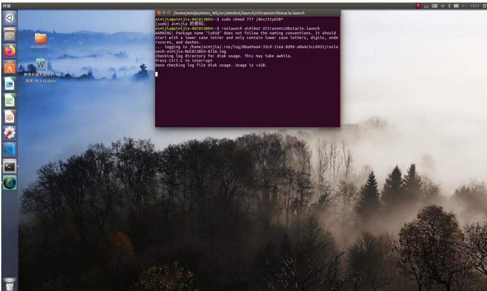

启动成功后，机器人会自动向前运动，经过障碍物时会根据障碍物方位主动停止或者调整方位向前运动。

## 六、实验注意事项

实验场地范围大体为 5m × 5m 的正方形区域，内有几个障碍物，每个障碍物之间的距离及长度不小于 20cm。避障时，障碍物有以下要求：

1、被测物体面积不宜少于 0.5平方米且尽量要求平整，否则会影响超声波传感器距离测量结果。

2、前方有平滑物体(如图书封面，镜面，墙体)与传感器夹角大于 45 度(非垂直反射)时误差明显，且在 5-40cm 范围内超声波传感器测距结果读数不稳定。其中可能会出现的误差有三角误差、镜面反射、多次反射等。

3、前方有毛衣，毛毯等吸音材料时，超声波传感器测距结果读数不稳定。

## 七、预习与思考题

请思考：如何在自主轨迹运动中加入超声波传感器，使得机器人在轨迹运动中遇到障碍物能自主暂停，保护移动机器人？

## 八、进阶实验

通过修改示例代码，利用超声波传感器控制机器人跟随木块运动。

## 9.4 ROS 教育机器人激光雷达建图

## 一、实验目的

1、掌握Aimibot 教育机器人激光雷达建图工作原理

2、熟练编写机器人激光雷达建图程序，实现机器人激光雷达建

## 二、实验内容

1、通过示例代码控制智能移动机器人进行激光雷达建图；

2、通过修改示例代码控制智能移动机器人进行避障时的安全距离。

## 三、实验器材

1、硬件：Aimibot教育机器人主体、键盘鼠标、激光雷达。

2、软件：Ubuntu16.04 + ROS

## 四、实验原理

1、激光雷达原理

2、建图（gmapping）原理

3、激光雷达建图思路

激光雷达主要获取机器人前方物体的距离数据，程序流程图如下图所示：

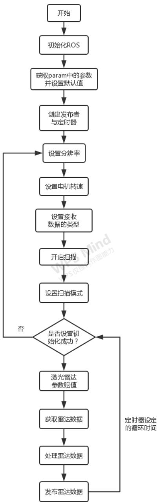

gmapping 的作用是根据激光雷达和里程计的信息，对环境地图进行构建，并且对自身状态进行估计。因此它得输入应当包括激光雷达和里程计的数据，而输出应当有自身位置和地图。gmapping 算法的实际运行中的结构如下

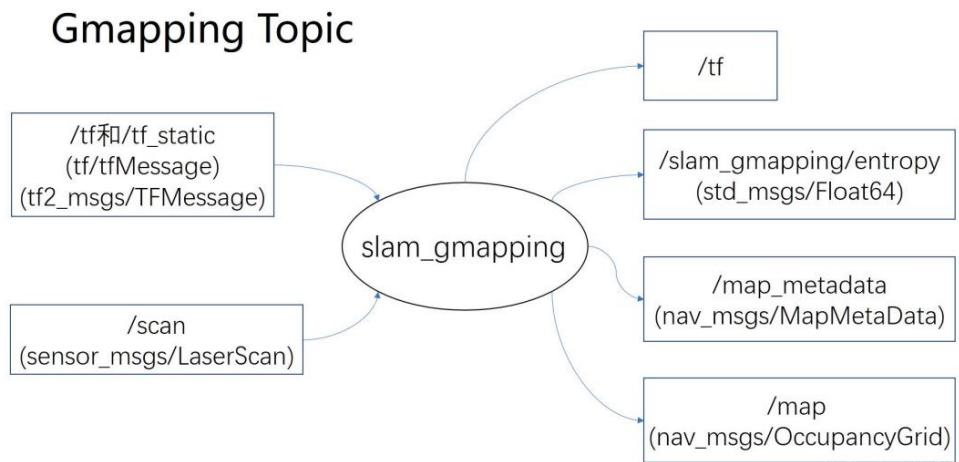

图所示：

gmapping 的输出：

（1）/tf：主要是输出 map\_frame 和 odom\_frame 之间的变换。

（2）/slam\_gmapping/entropy：反映了机器人位姿估计的分散程度。

（3）/map：slam\_gmapping：建立的地图。

（4）/map\_metadata：地图的相关信息。

gmapping 的输入：

输入包括tf坐标变换与激光雷达数据，其中一定得提供的有两个tf变换，一个是 base\_frame 与 laser\_frame 之间的 tf 变换，即机器人底盘和激光雷达之间的坐标变换；另一个是 base\_frame 与 odom\_frame 之间的 tf 变换，即底盘和里程计原点之间的坐标变换。tf 坐标变换维护了整个 ROS 三维世界里的转换关系，而 slam\_gmapping 要从中读取的数据是 base\_frame 与 laser\_frame 之间的tf 变换,只有这样才能够把周围障碍物变换到机器人坐标系下，更重要的是base\_frame 与 odom\_frame 之间的 tf 变换，这个 tf 变换反映了里程计（电机的光电码盘、视觉里程计、IMU）的监测数据，也就是机器人里程计测得走了多少距离，它会把这段变换发布到 odom\_frame 和 laser\_frame 之间。

gmapping 利用激光雷达的数据通过基于 RBpf 粒子滤波的算法，构建出机器人所在环境中的地图。

## 3、程序代码

打开 Amos\_WS/aimibotV2 文件夹与 Amos\_WS/ls01b\_v2 文件夹，可以看到lunch、src、include 等多个文件夹，其中 ls01B\_gmapping\_demo.launch 文件位于aimibotV2/lunch 文件夹中，ls01b.h 文件与 ls01b\_node.h 位于 ls01b\_v2/include 文件夹中，ls01b.cpp 文件与 ls01b\_node.cpp 文件位于 ls01b\_v2/src 文件夹中，依次打开五个文件，查看代码。

## （9）ls01B\_gmapping\_demo.launch 文件

打开 Amos\_WS/aimibotV2/lunch/ls01B\_gmapping\_demo.launch 文件，该 lunch文件运行了 ls01b 可执行文件、gmaping 可执行文件以及打开 rviz，其中对 ls01b可执行文件与 gmaping 可执行文件中的参数进行赋值。

打开 ls01B\_gmapping\_demo.launch 文件，代码如下：

```txt
<launch>
    <arg name="laser_type" default="ls01B" />
    <node name="ls01b_v2" pkg="ls01b_v2" type="ls01b_v2" output="screen">
    <param name="scan_topic" value="scan"/> //设置激光数据 topic 名称
    <param name="frame_id" value="laser_link"/> //激光坐标
    <param name="serial_port" value="/dev/ttyUSB1"/> //雷达连接的串口
    <param name="baud_rate" value="460800"/> //雷达连接的串口波特率
    <param name="angle_resolution" value="0.25"/> //雷达角度分辨率
    <param name="zero_as_max" value="false"/> //设置为 true 探测不到区域会变成最大值
    <param name="min_as_zero" value="false"/> // true：探测不到区域为 0，false：探测不到区域为 inf
    <param name="angle_disable_min_0" value="90"/> //角度制，从 angle_disable_min 到 angle_disable_max 之前的值为 0
    <param name="angle_disable_max_0" value="270"/> 
    <param name="angle_disable_min_1" value="-1"/> //角度制，从 angle_disable_min 到 angle_disable_max 之前的值为 0
    <param name="angle_disable_max_1" value="-1"/> 
    <param name="angle_disable_min_2" value="-1"/> //角度制，从 angle_disable_min 到 angle_disable_max 之前的值为 0
    <param name="angle_disable_max_2" value="-1"/> 
    <param name="angle_disable_min_3" value="-1"/> //角度制，从 angle_disable_min 到
```

```txt
angle_disable_max 之前的值为 0
    <param name="angle_disable_max_3" value="-1"/>
    <param name="angle_disable_min_4" value="-1"/> //角度制，从 angle_disable_min 到 angle_disable_max 之前的值为 0
    <param name="angle_disable_max_4" value="-1"/>
    <param name="robot_radius" value="0.15"/> //机器人半径
    <param name="center_x" value="-0.255"/> //雷达坐标系下机器人中心位置
    <param name="center_y" value="0"/>
    </node>

    <arg name="scan_topic" default="scan" />
    <arg name="base_frame" default="base_footprint"/>
    <arg name="odom_frame" default="odom"/>

    <node pkg="gmapping" type="slam_gmapping" name="slam_gmapping" output="screen">
    <param name="base_frame" value="${arg base_frame}">
    <param name="odom_frame" value="${arg odom_frame}">
    <param name="map_update_interval" value="0.5"/> //地图更新间隔
    <param name="maxUrange" value="15"/> //激光最大可用范围
    <param name="maxRange" value="20"/> //传感器最大范围
    <param name="sigma" value="0.05"/> //贪婪端点匹配使用的 sigma
    <param name="kernelSize" value="3"/> //寻找通信的内核
    <param name="lstep" value="0.05"/> //翻译中的优化步骤
    <param name="astep" value="0.05"/> //旋转优化步骤
    <param name="iterations" value="5"/> //扫描器迭代的次数
    <param name="lsigma" value="0.075"/> //用于似然计算的波束的σ
    <param name="ogain" value="3.0"/> //评估可能性时要使用的增益，用于平滑重采样效果

    <param name="lskip" value="0"/> //每次扫描中要跳过的光束数。计算匹配时，仅每隔 (n+1) 条激光光线采集一次 (0=采集所有光线)
    <param name="minimumScore" value="30"/> //考虑扫描匹配结果良好的最低分数
    <param name="srr" value="0.01"/> //作为翻译函数的翻译中的里程计误差
    <param name="srt" value="0.02"/> //作为旋转函数的平移里程计误差
    <param name="str" value="0.01"/> //作为平移函数的旋转里程计误差
    <param name="stt" value="0.02"/> //旋转中的里程计误差作为旋转的函数
    <param name="linearUpdate" value="0.05"/> //每次机器人平移到这么远的地方都会处理一次扫描
    <param name="angularUpdate" value="0.0436"/> //每次机器人旋转这么远，都会处理一次扫描
    <param name="temporalUpdate" value="-1.0"/> //如果上次处理的扫描早于更新时间 (以秒为单位)，则处理扫描。小于零的值将关闭基于时间的更新
    <param name="resampleThreshold" value="0.5"/> //基于 NEFF 的重采样阈值
    <param name="particles" value="30"/> //过滤器中的粒子数
    <param name="xmin" value="-1.0"/> //初始地图大小
    <param name="ymin" value="-1.0"/> //初始地图大小
```

```xml
<param name="xmax" value="1.0"/> //初始地图大小
<param name="ymax" value="1.0"/> //初始地图大小
<param name="delta" value="0.05"/> //地图分辨率
<param name="llsamplerange" value="0.01"/> //似然率的平移抽样范围
<param name="llsamplestep" value="0.01"/> //似然率的平移抽样步长
<param name="lasamplerange" value="0.005"/> //似然率的角度采样步长
<param name="lasamplestep" value="0.005"/> //似然率的角度采样步长
<remap from="scan" to="${arg scan_topic}"/> //重映射
</node>
<node name="rviz" pkg="rviz" type="rviz" args="-d $(find aimibot)/rviz/navigation.rviz"/>
//打开 rviz
</launch>
```

```txt
(10) ls01b.h 文件
```

打开 Amos\_WS/ls01b\_v2/include/ls01b.h 文件，该头文件声明了一个 LS01B

类，对ls01b.cpp文件中的参数进行了定义，函数代码如下：

```cpp
class LS01B //声明 LS01B 类
{
public://公共权限
~LS01B(); //析构函数
* 实例化雷达
* port: 串口号,
* baud_rate: 波特率 460800
* resolution: 雷达角度分辨率 1.0 度 0.5 度 0.25 度
static LS01B* instance(std::string port, int baud_rate, double resolution);
bool isHealth(); //判断雷达是否有效
bool resetHealth(); //恢复雷达状态
int getScan(std::vector<ScanPoint> &points, ros::Time &scan_time, float &scan_duration); //获取雷达数据
int getVersion(std::string &version); //获取软件版本号
int getRate();
int startScan(); //开始扫描
int stopScan(); //停止扫描
int setScanMode(bool is_continuous); //设置连续扫描或者单次扫描
int stopRecvData(); //停止接收数据
int switchData(bool use_angle); //选择接收数据的类型
int setMotorSpeed(int rpm); //设置电机转速
int setResolution(double resolution); //设置雷达数据分辨率
double getRPM();
private://私有权限
LS01B(std::string port, int baud_rate, double resolution = 0.25); //构造函数
```

```txt
void recvThread();
uint16_t checkSum(const uint8_t *p_byte);
std::vector<ScanPoint> scan_points_; //定义数据类型
std::vector<ScanPoint> scan_points_bak_;
LSIOSR * serial_;
boost::thread *recv_thread_;
boost::mutex mutex_;
bool is_shutdown_; // shutdown recvthread
bool is_start_; // begin to read data from lidar
bool use_angle_;
int scan_health_; // 0 OK
double resolution_;
int data_len_;
int points_size_;
int rpm_;
double real_rpm_;
ros::Time pre_time_;
ros::Time time_;
};
```

## （11）ls01b\_node.h 文件

打开 Amos\_WS/ls01b\_v2/include/ls01b\_node.h 文件，该头文件声明了一个LS01B\_Node 类，对 ls01b\_node.cpp 文件中的参数进行了定义，并创建了发布者

## 的实例，函数代码如下：

```cpp
class LS01B_Node    ///声明 LS01B_Node 类
{
public://公共权限
    LS01B_Node();    //构造函数
    ~LS01B_Node();    //析构函数
    void run();    //雷达初始化
private://私有权限
    void initParam();    //初始化参数
    void publishScan(const ros::TimerEvent&);    //发布雷达数据
    ros::NodeHandle n_;    //创建节点句柄 n_
    ros::Publisher pub_;    //通过 ros::Publisher 这样一个类来创建一 pub_这样一个对象，速度发布者 pub_
    ros::Timer timer_;
    LS01B *ls01b_;
    //定义参数
    std::string serial_port_;
    int baud_rate_;
    double angle_resolution_;
    std::string scan_topic_;
```

```txt
std::string frame_id_;
DisableAngle dis_angle_[5];
double robot_radius_;
double center_x_;
double center_y_;
double angle_disable_min_0;
double angle_disable_max_0;
double angle_disable_min_1;
double angle_disable_max_1;
double angle_disable_min_2;
double angle_disable_max_2;
double angle_disable_min_3;
double angle_disable_max_3;
double angle_disable_min_4;
double angle_disable_max_4;
bool is_shutdown_;
};
```

## （4）ls01b.cpp 文件

打开 Amos\_WS/ls01b\_v2/src/ls01b.cpp 文件,该程序的的功能包括判断激光雷达是否初始化成功、重置初始化标志位、雷达扫描数据赋值、获取版本号、开始扫描、停止扫描、设置扫描模式、停止接收数据、选择接收数据的类型、设置电机转速、设置分辨率、获取雷达数据等；其中只有获取雷达数据的函数是读取雷达通过串口传输来的数据，其他函数均是通过串口向雷达写入数据指令，程序实现方法类似，只需向串口写入不同的数据即可。获取雷达数据的函数如下：

```cpp
void LS01B::recvThread()
{
    uint8_t start_count = 0;
    char header[6];
    uint8_t temp_char;
    char *packet_bytes = new char[data_len_];
    if (packet_bytes == NULL)
    {
    packet_bytes = NULL;
    }
    boost::posix_time::ptime t1,t2;
    t1 = boost::posix_time::microsec_clock::universal_time();
    while(!is_shutdown_) {
```

```cpp
while(!is_start_) {
    usleep(300000);
}
int count = serial_->read(&header[start_count], 1);
if (count <= 0)
{
    start_count = 0;
    scan_health_ = -3;
    continue;
}
if (0 == start_count) {
    if (0xA5 == (header[start_count]&0xff)) {
    start_count = 1;
    }
    else {
    start_count = 0;
    }
}
else if (1 == start_count) {
    if (0x6A == (header[start_count]&0xff) || 0x5A == (header[start_count]&0xff))
    {
    if (0x6A == (header[start_count]&0xff))
    {
    t2 = boost::posix_time::microsec_clock::universal_time();
    boost::posix_time::millisec_posix_time_system_config::time_duration_type t_ elapse;
    t_ elapse = t2 - t1;
    real_rpm_ = 1000000.0 / t_ elapse.ticks();
    t1 = t2;
    boost::unique_lock<boost::mutex> lock(mutex_);
    scan_points_bak_.resize(scan_points_.size());
    scan_points_bak_.assign(scan_points_.begin(), scan_points_.end());
    pre_time_ = time_;
    lock.unlock();
    time_ = ros::Time::now();
    }
    start_count = 2;
    int count = serial_->read(&header[start_count], 4);
    if (count != 4)
    {
    start_count = 0;
    scan_health_ = -3;
    continue;
    }
    rpm_ = ((header[2]&0x7f) << 8) + (header[3]&0xff);
    int flag = ((header[2] & 0x80) == 0) ? 0 : 1;
    int angular_resolution = (header[4]&0xff) >> 1;
    int start_angle = ((header[4] & 0x01) << 8) + (header[5]&0xff);
    count = serial_->read(packet_bytes, data_len_);
    if (count != data_len_)
    {
    start_count = 0;
```

```cpp
scan_health_ = -3;
continue;
}
for (int i = 0; i < data_len_; i = i + 3)
{
    int idx = start_angle / resolution_ + i / 3;
    double distance = ((packet_bytes[i + 1] & 0xFF) << 8) | (packet_bytes[i + 2] & 0xFF);
    double degree = start_angle + idx * resolution_;
    boost::unique_lock<boost::mutex> lock(mutex_);
    scan_points_[idx].degree = degree;
    scan_points_[idx].range = distance / 1000.0;
    if(use_angle_) {
    scan_points_[idx].intensity = 0;
    }
    else
    {
    scan_points_[idx].intensity = packet_bytes[i] & 0xFF;
    }
    lock.unlock();
    }
    start_count = 0;
    }
    else {
    start_count = 0;
    }
    }
}
if (packet_bytes)
{
    packet_bytes = NULL;
    delete packet_bytes;
}
```

（4）ls01b\_node.cpp 文件

打开 Amos\_WS/ls01b\_v2/src/ls01b\_node.cpp 文件,该程序的的功能主要是初始化激光雷达以及发布激光雷达的数据，该程序利用定时器每隔 0.1s发布一次雷达数据的话题，主要函数代码如下：

```cpp
void LS01B_Node::run() //初始化激光雷达
{
    ls01b_->setResolution(angle_resolution_); //设置分辨率
    ls01b_->setMotorSpeed(600); //设置电机转速
    ls01b_->switchData(false); //选择接收数据类型
```

```cpp
ls01b_->startScan();    //开始扫描
ls01b_->setScanMode(true);    //设置连续扫描
}

void LS01B_Node::publishScan(const ros::TimerEvent &)
{
    bool is_health = ls01b_->isHealth();
    if (!is_health)    //是否初始化成功
    {
    ls01b_->resetHealth();    //重置初始化标志位
    ls01b_ = LS01B::instance(serial_port_, baud_rate_, angle_resolution_);
    run();    //重新初始化
    return;
    }
    std::vector<ScanPoint> points;    //定义一个名为 points 的容器
    ros::Time start_time;
    float scan_time;
    ls01b_->getScan(points, start_time, scan_time);    //获取雷达数据
    int count = points.size();
    if (count <= 0)
    return;
    sensor_msgs::LaserScan msg;    //定义一个名为 msg 的雷达数据类型
    //雷达数据赋值
    msg.header.frame_id = frame_id_;
    msg.header.stamp = start_time;
    msg.angle_min = 0.0;
    msg.angle_max = 2*M_PI;
    msg.angle_increment = (msg.angle_max - msg.angle_min) / count;
    msg.range_min = 0.01;
    msg.range_max = 25;
    msg_ranges.resize(count);
    msg.intensities.resize(count);
    msg.scan_time = scan_time;
    msg.time_increment = scan_time / (double)(count - 1);
    //雷达数据转换
    for (int i = count - 1; i >= 0; i--)
    {
    if (
    ((i >= (angle_disable_min_0 * count/360)) && (i < (angle_disable_max_0 * count/360)))
    || ((i >= (angle_disable_min_1 * count/360)) && (i < (angle_disable_max_1 * count/360)))
    || ((i >= (angle_disable_min_2 * count/360)) && (i < (angle_disable_max_2 * count/360)))
    || ((i >= (angle_disable_min_3 * count/360)) && (i < (angle_disable_max_3 * count/360)))
    || ((i >= (angle_disable_min_4 * count/360)) && (i < (angle_disable_max_4 * count/360)))
    )
    {
```

```txt
msg_ranges[i] = std::numeric_limits<float>::infinity();
msg.intensities[i] = 0;
}
else if (points[count - i - 1].range == 0.0)
{
msg_ranges[i] = std::numeric_limits<float>::infinity();
msg.intensities[i] = 0;
}
else
{
msg_ranges[i] = points[count - i - 1].range;
msg.intensities[i] = points[count - i - 1].intensity;
}
double point_dist = msg_ranges[i];
if(point_dist < 1.0 && point_dist > 0.06)
{
double x = point_dist*cos(i*angle_resolution_*M_PI/180);
double y = point_dist*sin(i*angle_resolution_*M_PI/180);
double dist2center = sqrt((y-center_y_)*(y-center_y_) + (x-center_x_)*(x-center_x_));
if(dist2center < robot_radius_)
msg_ranges[i] = std::numeric_limits<float>::infinity();
}
pub_.publish(msg); //发布雷达数据
}
```

## 五、实验步骤

1、获取串口操作权限（已映射），详见说明书第 X章。

2、打开终端，启动底盘，执行：

roslaunch aimibot minmal.launch

3、新开终端启动 gmapping,用于构建地图，执行：

roslaunch aimibot ls01B\_gmapping\_demo.launch

此命令将打开rviz 显示环境，我们将观察到实时建图信息，如图所示：

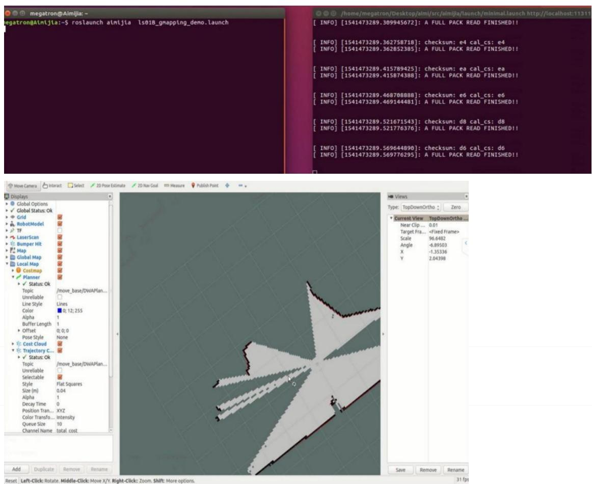

## 4、打开一终端启动键盘键盘操作 Aimibot，执行：

## roslaunch aimibot keyboard\_teleop.launch

通过键盘或者罗技手柄控制底盘开始建图，控制机器人在区域中运行，并在 rviz 的界面中实时显示，获得该区域的完整地图后，如图所示：

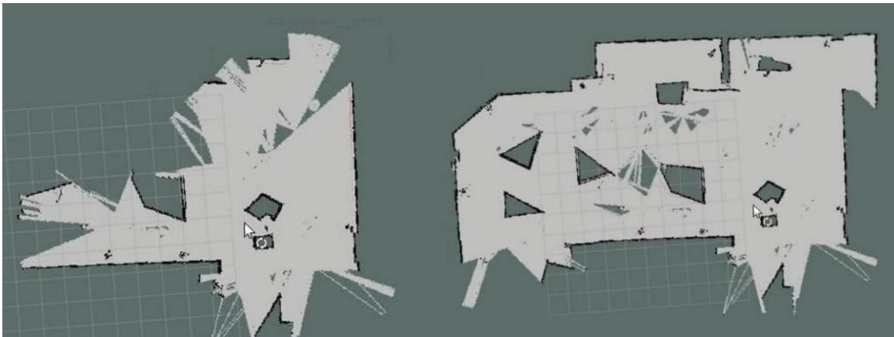

## 5、保存地图

将得到的地图信息保存在电脑中，新开一终端，执行新建文件夹命令：

$$
\mathrm{mkdir-p} \sim / \mathrm{map}
$$

6、使用 ros 中的 map\_server 工具保存使用激光获得的地图rosrun map\_server map\_saver -f \~/map/aimijia\_demo

在文件夹中可看到，地图文件，如图所示：

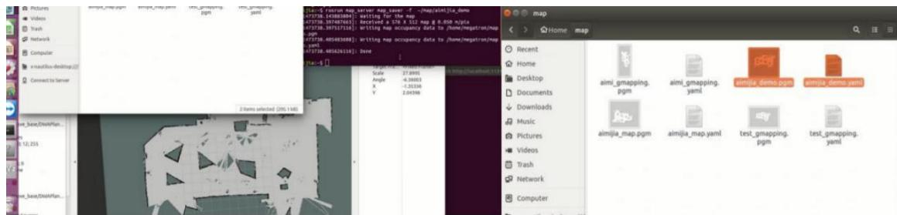

## 六、实验注意事项

1．建图过程控制机器人速度不宜过快，最好实时观察建图窗口观察建图的实时过程。

2．控制机器人运动时，注意机器人 前端时候有障碍物，保障机器人正常运动。

3．建图过程中，不能有人为遮挡激光，会对实验结果造成误差。

## 七、预习与思考题

## 八、进阶实验