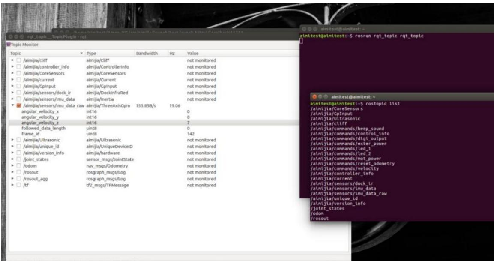

# 实验二 通过rqt查看机器人的数据结构

实验类型：演示/实践/仿真 实验学时：2 小时 实验要求：必修

## 一、实验目的

1、掌握查看Aimibot教育机器人数据结构的方法；

2、熟练编写ROS 话题发布者与订阅者的程序。

## 二、实验内容

1、通过 ROS 的可视化查看数据类型与数值操作。

## 三、实验器材

1、硬件：Aimibot 教育机器人主体、键盘鼠标。

2、软件：Ubuntu16.04 + ROS

## 四、实验原理

1、话题通信原理

2、程序代码

打开 Amos\_WS/aimibotV2 文件夹，可以看到 lunch、src、include 等多个文件夹，其中 test.launch 文件位于 lunch 文件夹中，aimibot.h 文件位于 include 文件夹中，main.cpp 文件位于 src 文件夹中，依次打开三个文件，查看代码。

（1）test.launch 文件

打开 Amos\_WS/aimibotV2/lunch/test.launch 文件，该 lunch 文件运行了 aimibot可执行文件，其中对 aimibot 可执行文件中的参数进行赋值，该函数代码如下：

```xml
<launch>
    <arg name="serialport" default="/dev/ttyUSB0" /> //串口使用 USB0
    <node pkg="aimibot" type="aimibot" name="aimibot" output="screen">
    <param name="serial_port" value="${arg serialport}">
    <param name="odom_frame" value="odom"/>
    <param name="base_frame" value="base_footprint"/>
    <param name="use_imu_heading" value="true"/>
    <param name="publish_tf" value="true"/>
</node>
</launch>
```

## （2）aimibot.h 文件

打开 Amos\_WS/aimibotV2/include/aimibot.h 文件，该头文件创建了如下话题：

/aimibot/CoreSensors：发布控制系统核心数据，包括防跌落传感器(cliff)、左/右轮编码器(left\_encoder:65364,right\_encoder:65234)、左/右轮电机接收的 PWM值 (left\_pwm,right\_pwm，暂无数据)、外部按键、电池电压（battery:例如 17.64）、输出电流；

/aimibot/GpInput：发布检测到的外部接口的输入值（analog\_input,digtal\_input（模拟信号和数字信号）

/aimibot/Ultrasonic：发布超声波传感器数值(disl1\~disl6：数值大概在 0-150)

/aimibot/cliff：发布防跌落传感器数值: bottom（3，0，3）

/aimibot/controller\_info：发布机器人的内部信息（d\_gain,i\_gain,p\_gain,type）

/aimibot/current：发布电源输出电流（无）

/aimibot/sensors/dock\_ir：发布红外传感器数据（docking,暂无）

```cpp
void subscribeTopics(ros::NodeHandle& nh)
{
    velocity_command_subscriber=nh.subscribe<geometry_msgs::Twist>("/aimibot/commands/velocity", 10, &subscribeVelocityCommand);

    led1_command_subscriber=nh.subscribe<aimibot::Led>("/aimibot/commands/led_1", 10, &subscribeLed1Command);

    led2_command_subscriber=nh.subscribe<aimibot::Led>("/aimibot/commands/led_2", 10, &subscribeLed2Command);

    digital_output_command_subscriber=nh.subscribe<aimibot::DigitalOutput>("/aimibot/commands/digi_output", 10, &subscribeDigitalOutputCommand);

    external_power_command_subscriber=nh.subscribe<aimibot::DigitalOutput>("/aimibot/commands/exter_power", 10, &subscribeExternalPowerCommand);

    sound_command_subscriber=nh.subscribe<aimibot::Sound>("/aimibot/commands/beep_sound", 10, &subscribeSoundCommand);

    reset_odometry_subscriber=nh.subscribe<std_msgs::Empty>("/aimibot/commands/reset_odometry", 10, &subscribeResetOdometry);
```

/aimibot/sensors/imu\_data：发布陀螺仪数据（三轴加速度与机器人的偏转角度和角速度）

/aimibot/sensors/imu\_data\_raw

/aimibot/unique\_id：发布机器人特有的 ID 识别号

/aimibot/version\_info：发布机器人的版本信息

/joint\_states：发布机器人的驱动电机状态

/odom：发布里程计信息

并创建了对应的发布者与订阅者，函数如下：

```cpp
motor_power_subscriber=nh.subscribe<aimibot::MotorPower>("/aimibot/commands/mot_power", 10, &subscribeMotorPower);

controller_info_command_subscriber=nh.subscribe<aimibot::ControllerInfo>("/aimibot/commands/control_info", 10, &subscribeControllerInfoCommand);
}

void advertiseTopics(ros::NodeHandle& nh)
{
    cliff_state_publisher = nh.advertise <aimibot::Cliff>("/aimibot/cliff", 100);
    joint_state_publisher = nh.advertise
    <aimibot::CoreSensors>("/aimibot/CoreSensors", 100);
    version_info_publisher = nh.advertise <aimibot::hardware>
    ("/aimibot/version_info", 100, true); // latched publisher
    controller_info_publisher = nh.advertise <aimibot::ControllerInfo>
    ("/aimibot/controller_info", 100, true); // latched publisher
    dock_ir_publisher = nh.advertise <aimibot::DockInfraRed>
    ("/aimibot/sensors/dock_ir", 100);
    inertia_publisher = nh.advertise <aimibot::Inertia> ("/aimibot/sensors/imu_data", 100);
    raw_imu_data_publisher = nh.advertise <aimibot::ThreeAxisGyro>
    ("/aimibot/sensors/imu_data_raw", 100);
    unique_id_publisher = nh.advertise<aimibot::UniqueDeviceID>
    ("/aimibot/unique_id", 100);
    current_publisher = nh.advertise<aimibot::Current> ("/aimibot/current", 100);
    gpinput_publisher = nh.advertise<aimibot::GpInput> ("/aimibot/GpInput", 100);
```

```rust
ultrasonic_data_publisher = nh.advertise<aimibot::Ultrasonic>("/aimibot/Ultrasonic", 100);
```

（3）main.cpp 文件

打开 Amos\_WS/aimibotV2/src/main.cpp 文件，

函数入下：

```cpp
int main(int argc, char** argv)
{
    ros::init(argc, argv, "serial_port"); //ROS 初始化
    ros::NodeHandle nh; //创建句柄
    ros::NodeHandle nh_p("~");
    signal(SIGINT, shutdown); //按下 Ctrl+c 关闭串口
    advertiseTopics(nh); //创建发布者
    subscribeTopics(nh); //创建订阅者
    ros::param::get(~serial_port", port); //获取串口
    try //配置串口
    {
    serial::Timeout to = serial::Timeout::simpleTimeout(1000); //创建 timeout
    sp.setPort(port); //设置要打开的串口名
    sp.setBaudrate(115200); //设置串口通信的波特率
    sp.setTimeout(to); //串口设置 timeout
```

```cpp
sp.open(); //打开串口
}
catch(serial::IOException& e) //获取串口异常信息
{
ROS_ERROR_STREAM("Unable to open port.");
return -1;
}
//判断串口是否打开成功
if(sp.isOpen())
ROS_INFO_STREAM("Device is opened.");
else
return -1;

ros::Rate loop_rate(100); //设置循环频率
ros::Time last_getdata = ros::Time::now(); //获取当前时间
uint8_t temp_buffer[256];
uint8_t buffer[256];
uint8_t i = 0;
ros::Publisher joint_state_publisher=nh.advertise
<sensor_msgs::JointState>("joint_states",100); //创建驱动电机状态的发布
ecl::Angle<double>gethand;
```

```cpp
sensor_msgs::JointState joint_states;
ecl::LegacyPose2D<double> pose_update;
ecl::linear_algebra::Vector3d pose_update_rates;
joint_states.name.push_back("leftwheel_joint");
joint_states.name.push_back("rightwheel_joint");
while(ros::ok())
{
    size_t n = sp.read(temp_buffer, ready_get);    //获取缓冲区内的字节数
    if(n==0)    //串口没有传输数据
    {
    std::cout<<"waiting for data 10s" << std::endl;
    if(ros::Time::now() - last_getdata > ros::Duration(10.0))    //等待超时
    {
    std::cout<< "TIME OUT!CLOSE SERIAL!"<<std::endl;
    sp.close();    //关闭串口
    ros::shutdown();    //关闭 ROS
    }continue;
    }
    if(findpack_update(temp_buffer,n))    //读到串口数据
    {
    if(!head_init) { heading_offset = init_head(); head_init = true;}
    last_getdata=ros::Time::now();    //获取当前时间
```

```rust
rostopic_pub(coresensors_data,
    ultrasonic_data,
    gpin_data,
    threeAG_data,
    firmware_Data,
    hardware_data,
    current_data,
    cliff_Data,
    iner_data,
    dockin_data); //发布话题
    joint_states.position.resize(2,0.0); //初始化joint_states默认值
    joint_states.velocity.resize(2,0.0);
    joint_states.effort.resize(2,0.0);
if(ros::ok())
{
    joint_states.header.stamp = ros::Time::now();
    joint_state_publisher.publish(joint_states); //发布驱动电机状态
}
ros::spinOnce();
//关闭串口
```

```txt
sp.close();
return 0;
}
```

## 五、实验步骤

1、获取串口操作权限（已映射），详见说明书第 X章。

2、打开终端，启动 test.launch 文件，执行：

roslaunch aimibot test.launch

3、另开终端执行：

rosrun rqt\_topic rqt\_topic

如图所示：



## 六、实验注意事项

## 七、预习与思考题

八、进阶实验