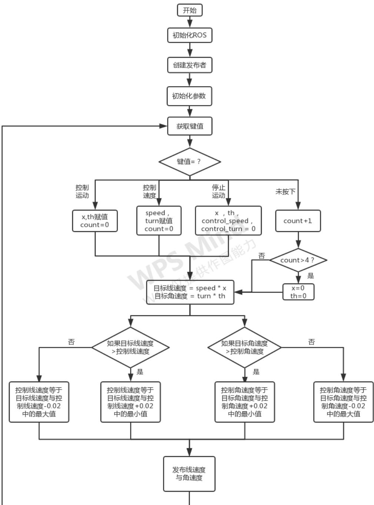
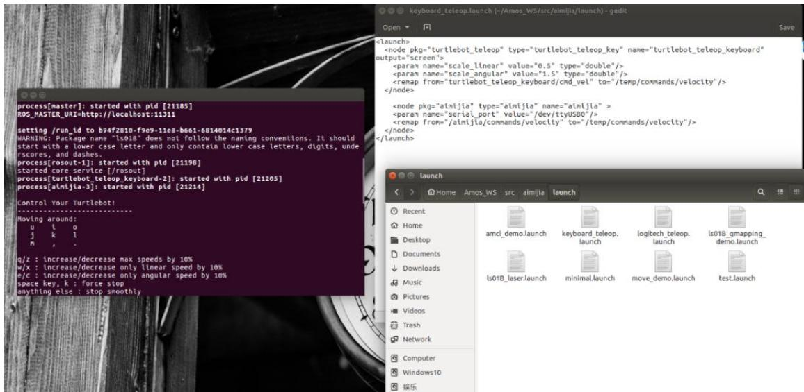

# 实验四 蓝牙键盘控制机器人运动

实验类型：演示/实践/仿真 实验学时：2 小时 实验要求：必修

## 一、实验目的

1、掌握Aimibot 教育机器人键盘控制运动工作原理

2、熟练编写机器人键盘控制运动程序，实现蓝牙键盘控制机器人运动

## 二、实验内容

1、通过示例代码控制智能移动机器人进行运动；

2、通过修改示例代码控制智能移动机器人进行避障时的安全距离。

## 三、实验器材

1、硬件：Aimibot 教育机器人主体、键盘鼠标。

2、软件：Ubuntu16.04 + ROS

## 四、实验原理

1、键盘控制原理

2、键盘控制运动思路

该例程中，目标线速度（最高线速度）设为 0.2，目标角速度（最高角速度）设为1，当按下控制机器人运动的按键时，目标线速度则为±0.2，目标角速度则为±1；每次主循环时，线速度增加 0.02，五次循环后（即线速度为 0.1），线速度在每次主循环时减少 0.02，角速度类似，每次增加或者减少 0.1，即机器人完成一次运动的过程是通过速度依次递增再依次递减实现的；当机器人还未停止便再次按下按键时，循环的标志位会清零，则速度会继续增加，最高速度为目标速度，即最高线速度为 0.2，最高角速度为 1；当按下控制机器人速度的按键时，则改变目标速度的值，通过改变最高速度的值来实现机器人的速度控制；当按下停止机器人运动的按键时，清空所有标志位即可。程序流程图如下：



## 3、程序代码

打开 Amos\_WS/aimibotV2 文件夹，可以看到 lunch、scripts 等多个文件夹，其中 keyboard\_teleop.launch 文件位于 lunch 文件夹中，aimibot\_teleop\_key 文件位于scripts 文件夹中，依次打开两个文件，查看代码。

## （1）keyboard\_teleop.launch 文件

打开 Amos\_WS/aimibotV2/lunch/keyboard\_teleop.launch 文件，该 lunch 文件运行了 aimibot 可执行文件与 aimibot\_teleop\_key 可执行文件，其中对 aimibot 可执行文件与 aimibot\_teleop\_key 可执行文件中的参数进行赋值，初始线速度设置为0.5，初始角速度设置 1.5，并对话题名称进行重映射，将话题名称重映射为一样的名称。

打开 keyboard\_teleop.launch 文件，代码如下：

```txt
<launch>
    <arg name="serialport" default="/dev/ttyUSB0" /> //串口使用 USB0
    <node pkg="aimibot" type="aimibot" name="aimibot" output="screen">
    <param name="serial_port" value="${arg serialport}"/>
    <param name="odom_frame" value="odom"/>
    <param name="base_frame" value="base_footprint"/>
    <param name="use_imu_heading" value="true"/>
    <param name="publish_tf" value="true"/>
    <remap from="/mobile_base/commands/velocity" to="/aimibot/ commands/ velocity"/> //重映射话题名称
</node>

    <node pkg="aimibot"type="aimibot_teleop_key" name="aimibot_teleop_keyboard" output="screen">
    <param name="scale_linear" value="0.5" type="double"/> //设置线速度
    <param name="scale_angular" value="1.5" type="double"/> //设置角速度
```

```txt
<remap from="aimibot_teleop_keyboard/cmd_vel"to="aimibot/commands/velocity"/> //重映射话题名称</node>
```

## （2）aimibot\_teleop\_key 文件

打开 Amos\_WS/aimibotV2/scripts/aimibot\_teleop\_key 文件，该程序实现了键盘控制机器人运动的功能，主要函数为 getKey 函数和main函数，其中 getKey函数的功能是获取键值，main函数的功能是将键值对应的运动指令通过话题发布出去，函数代码入下：

```python
def getKey():
    tty.setraw(sys.stdin.fileno())
    rlist, _, _ = select.select([sys.stdin], [], [], 0.1)
    if rlist:    //是否按下键盘
    key = sys.stdin.read(1)
    else:
    key = "
    termios.tcsetattr(sys.stdin, termios.TCSADRAIN, settings)
    return key    //返回键值

if __name__ == "__main__":
    settings = termios.tcgetattr(sys.stdin)
    rospy.init_node('aimibot_teleop')    //初始化节点
```

```python
pub = rospy.Publisher('~cmd_vel', Twist, queue_size=5)    //创建发布者
x = 0    //线速度方向标志位
th = 0    //角速度方向标志位
count = 0    //运动标志位
target_speed = 0    //目标线速度
target_turn = 0    //目标角速度
control_speed = 0    //控制线速度
control_turn = 0    //控制角速度
try:
    print(msg)
    print(vels(speed,turn))
    while(1):
    key = getKey()    //获取键值
    if key in moveBindings.keys():    //按下控制运动的按键
    x = moveBindings[key][0]
    th = moveBindings[key][1]
    count = 0
    elif key in speedBindings.keys():    //按下速度运动的按键
    speed = speed * speedBindings[key][0]
    turn = turn * speedBindings[key][1]
    count = 0
    print(vels(speed,turn))
```

```python
elif key == '' or key == 'k':    //按下'k'或者空格
    x = 0
    th = 0
    control_speed = 0
    control_turn = 0
else:    //未按下按键
    count = count + 1
    if count > 4:
    x = 0
    th = 0
    if (key == '\x03'):
    break
    target_speed = speed * x
    target_turn = turn * th
//线速度赋值
if target_speed > control_speed:
    control_speed = min(target_speed, control_speed + 0.02)
elif target_speed < control_speed:
    control_speed = max(target_speed, control_speed - 0.02)
else:
    control_speed = target_speed
//角速度赋值
```

```txt
if target_turn > control_turn:
    control_turn = min(target_turn, control_turn + 0.1)
elif target_turn < control_turn:
    control_turn = max(target_turn, control_turn - 0.1)
else:
    control_turn = target_turn

twist = Twist()
twist.linear.x = control_speed; twist.linear.y = 0; twist.linear.z = 0
twist.angular.x = 0; twist.angular.y = 0; twist.angular.z = control_turn
pub.publish(twist) // 发布线速度与角速度
except Exception as e:
    print(e)

finally:
    twist = Twist()
    twist.linear.x = 0; twist.linear.y = 0; twist.linear.z = 0
    twist.angular.x = 0; twist.angular.y = 0; twist.angular.z = 0
    pub.publish(twist)

termios.tcsetattr(sys.stdin, termios.TCSADRAIN, settings)
```

## 五、实验步骤

1、获取串口操作权限（已映射），详见说明书第 X章。

2、打开终端，启动 keyboard\_teleop.launch 文件，执行：

roslaunch aimibot keyboard\_teleop.launch 如图所示：



依照终端出现提示信息，其中 u、i、o、j、k、l、m 控制机器人的方向与速度，q/z、w/x、e/c.实现提速。

## 六、注意事项

在编写运动数据发布函数的时候，应注意运动数据订阅者的队列长度，以及机器人处理运动数据的时间间隔，经实验证明，如果主函数的循环时间过短，会导致机器人无法执行运动过程，因为机器人在接收到前一次的运动数据并处理数据的过程中，下一次的运动数据便到来了，如果我们处理消息的速度不够快，会将收到的消息缓冲下来，满了的话，后面的到达的消息将会覆盖前面的消息，最终导致机器人只能处理最后到来的数据，即速度均为 0的运动数据。可使用time.time()函数验证该程序主循环的执行时间，发现主循环的执行时间大概为0.1s，主要为getKey()函数的执行时间；可修改程序，使每次运动的执行过程在一个while循环中，即按键之后不再调用 getKey()函数，直到速度为 0时跳出循环，再调用getKey()函数获取键值，发现此循环的时间大概为 0.002s，且机器人不再运动，可利用 time.sleep()函数找出机器人处理运动数据最短的时间。

## 七、预习与思考题

请思考：如何在自主轨迹运动中加入超声波传感器，使得机器人在轨迹运动中遇到障碍物能自主暂停，保护移动机器人？

## 八、进阶实验

通过修改示例代码，利用超声波传感器控制机器人跟随木块运动。