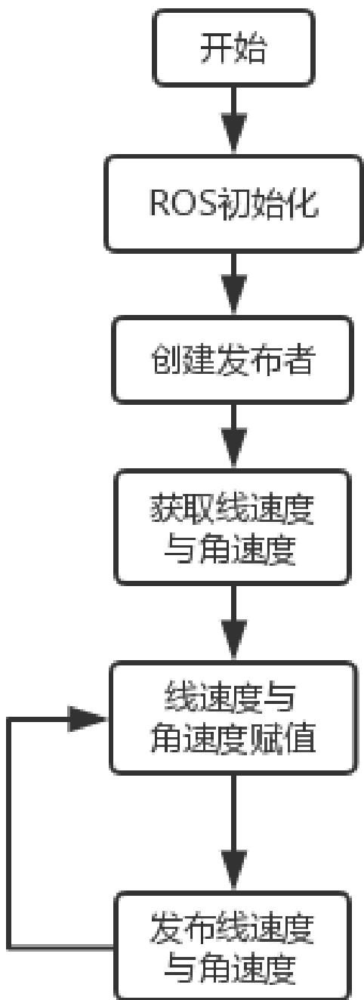

# 实验五 ROS教育机器人圆形轨迹运动

实验类型：演示/实践/仿真

实验学时：2 小时

实验要求：必修

## 一、实验目的

1、掌握Aimibot 教育机器人运动工作原理

2、熟练编写机器人圆形轨迹运动程序，实现机器人圆形轨迹运动

## 二、实验内容

1、通过示例代码控制智能移动机器人进行圆形轨迹运动；

2、通过修改示例代码控制智能移动机器人进行矩形轨迹运动。

## 三、实验器材

1、硬件：Aimibot 教育机器人主体、键盘鼠标。

2、软件：Ubuntu16.04 + ROS

## 四、实验原理

1、圆形轨迹运动思路

该例程中，控制机器人进行圆形轨迹运动是通过不断发布一样的线速度与角速度话题实现的。程序流程图如下：



## 2、程序代码

打开 Amos\_WS/aimibotV2 文件夹，可以看到 lunch、src、include 等多个文件夹，其中 movecircular.launch 文件位于 lunch 文件夹中，movecircular.h 文件位于include 文件夹中，movecircular.cpp 文件位于 src 文件夹中，依次打开三个文件，查看代码。

## （1）movecircular.launch 文件

打开 Amos\_WS/aimibotV2/lunch/movecircular.launch 文件，该 lunch 文件运行了 aimibot 可执行文件与 movecircular 可执行文件，其中对 aimibot 可执行文件中的参数进行赋值，对movecircular可执行文件中线速度与角速度的参数进行赋值，并对话题名称进行重映射，

打开 movecircular.launch 文件，代码如下：

```xml
<launch>
    <arg name="serialport" default="/dev/ttyUSB0" /> //串口使用 USB0
    <param name="vel_line_" value="0.5"/> //线速度设为 0.5
    <param name="vel_angle_" value="0.5"/> //角速度设为 0.5
    <node pkg="aimibot" type="aimibot" name="aimibot" output="screen">
    <param name="serial_port" value="${arg serialport}"/>
    <param name="odom_frame" value="odom"/>
    <param name="base_frame" value="base_footprint"/>
    <param name="use_imu_heading" value="true" />
    <param name="publish_tf" value="true" />
    <remap from="/mobile_base/commands/velocity"
    to="/aimibot/commands/velocity"/> //重映射话题名称
    </node>
    <node pkg="aimibot" type="movecircular" name="movecircular"
    output="screen">
    <remap from="/mobile_base/commands/velocity"
    to="/aimibot/commands/velocity"/> //重映射话题名称
    </node>
</launch>
```

## （2）movecircular.h 文件

打开 Amos\_WS/aimibotV2/include/movecircular.h 文件，该头文件声明了一个 cirvelControl 类，对 movecircular.cpp 文件中的参数进行了定义，并创建了发布者的实例，函数代码如下：

```cpp
class cirvelControl    //声明 cirvelControl 类
{
public:    //公共权限
    cirvelControl();    //定义构造函数，函数名与类名相同（在这里是对构造函数进行声明）
    void init();    //初始化速度
    void velocityControl();    //运动控制
private:    //私有权限
    double vel_line;    //线速度
    double vel_angle;    //角速度
    ros::NodeHandle handle;    //创建节点句柄 handle_
    ros::Publisher  vel_pub;    //通过 ros::Publisher 这样一个类来创建一
vel_pub_这样一个对象，速度发布者 vel_pub_
};
```

（3）movecircular.cpp 文件

打开 Amos\_WS/aimibotV2/src/movecircular.cpp 文件，该程序实现了机器人进行圆形轨迹运动的功能，主要函数为 init 函数和 velocityControl 函数，init 函数主要从 lunch 文件中获取/vel\_line\_与/vel\_angle\_的参数数据，velocityControl主要发布机器人的速度数据，控制机器人运动，主要函数代码入下：

```cpp
//从 Param 中获取线速度与角速度
handle_.getParam("/vel_line_", vel_line_);
handle_.getParam("/vel_angle_", vel_angle_);
void cirvelControl::velocityControl()
{
geometry_msgs::Twist controlVel_;
controlVel_.angular.z = vel_angle_; //角速度赋值
controlVel_.linear.x = vel_line_; //线速度赋值
controlVel_.linear.y = 0;
controlVel_.linear.z = 0;
vel_pub_.publish(controlVel_); //发布线速度与角速度
}
int main(int argc, char** argv)
{
ros::init(argc, argv, "odompubt"); //ros 初始化
cirvelControl cirodom_vel_;
while(ros::ok())
{
cirodom_vel_.velocityControl(); //调用运动控制函数
}
```

```txt
ros::spin();
return 0;
}
```

## 五、实验步骤

1、获取串口操作权限（已映射），详见说明书第 X章。

2、打开终端，启动 movecircular.launch 文件，执行： roslaunch aimibot movecircular.launch

如图所示：

启动成功后，机器人会自动进行圆形轨迹运动。

## 六、实验注意事项

由于该例程中所发布的线速度与角速度无需改变值的大小，便可实现机器人进行圆形轨迹运动，所以只需在 main 函数里循环调用发布机器人速度的函数即可。在进阶实验中需要改变机器人线速度与角速度的值，所以不能只在 main 函数里循环调用发布机器人速度的函数，因为在机器人改变方向时，线速度为 0，机器人直线行驶时，角速度为 0。以下提供三个思路在机器人运动的过程中改变线速度与角速度的值：

1、使用里程计：利用里程计获得机器人 Z轴的旋转角，即机器人改变方向时转过的角度，当旋转角为 90的倍数时，使角速度为 0，控制机器人直线行驶；再利用里程计获得机器人 X 方向前进的距离，当距离为某一固定值的倍数时，使线速度为0，控制机器人转向，即可实现机器人进行矩形轨迹运动。

2、使用定时器：利用 ros::Timer timer = n.createTimer(ros::Duration(period),timerCallback)函数创建一个定时器，每隔一定时间在回调函数里改变一次线速度与角速度的值，即可实现机器人进行矩形轨迹运动。

3、使用循环标志位：该思路与例程中的思路类似，在 main函数里循环调用发布机器人速度的函数，但在发布机器人速度的函数里增加一个循环标志位，即每调用一次发布机器人速度的函数该标志位加一，每调用到一定次数时，改变线速度与角速度的值，该方法与定时器的功能类似，但程序实现较简单，需要注意，由于程序简单，执行速度快，且线速度与角速度都有为 0的时候，所以需要增加一个延时函数，否则会导致速度数据溢出，订阅者只能处理最后到来的数据，最终机器人不进行运动。

## 七、预习与思考题

## 八、进阶实验

通过修改示例代码，控制智能移动机器人进行矩形轨迹运动。