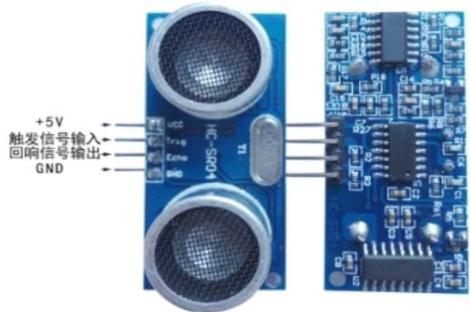
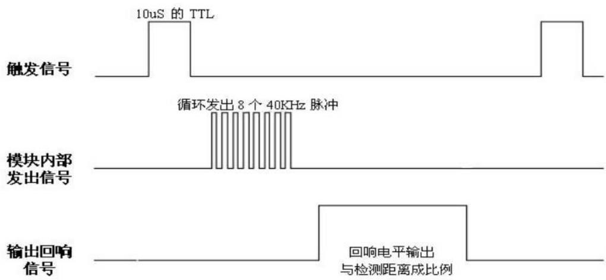
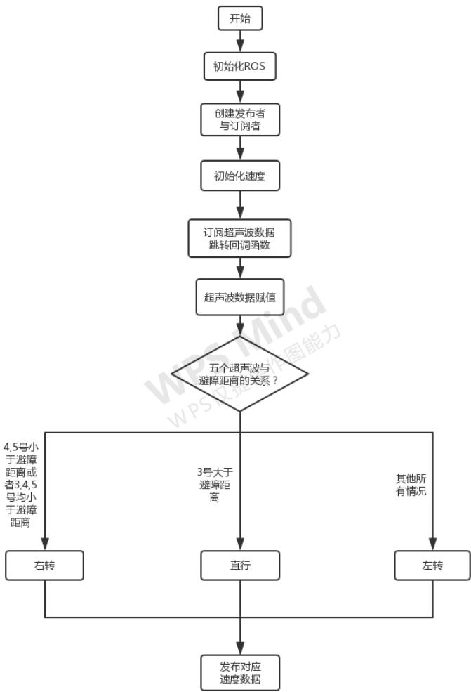
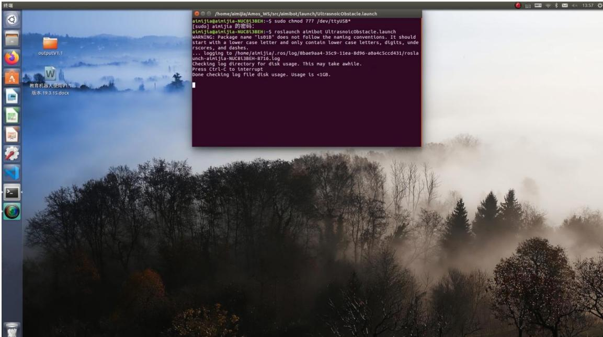

# 实验六 智能移动机器人超声波避障实验

实验类型：演示/实践/仿真 实验学时：2小时 实验要求：必修

## 一、实验目的

1、掌握Aimibot 教育机器人超声波避障工作原理

2、熟练编写机器人超声波避障控制程序，实现机器人超声波避障

## 二、实验内容

1、通过示例代码控制智能移动机器人进行超声波避障；

2、通过修改示例代码控制智能移动机器人进行避障时的安全距离。

## 三、实验器材

1、硬件：Aimibot 教育机器人主体、键盘鼠标、超声波传感器。

2、软件：Ubuntu16.04 + ROS

## 四、实验原理

1、超声波测距原理

本 Aimibot 教育机器人前端安装有五个超声波传感器，每个超声波的有效监测范围为 3m，检测幅度为 15°，为避免碰撞、特征识别、定位和导航提供目标检测和距离信息。模块包括超声波发射器、接收器与控制电路。实物图如下：

  
图 x.x 超声波传感器实物图

VCC 供5V电源，GND为地线，TRIG触发控制信号输入，ECHO 回响信号输出等四个接口端。基本工作原理如下：

（1）采用IO 口TRIG 触发测距，给最少 10us 的高电平信号；

（2）模块自动发送 8个40khz的方波，自动检测是否有信号返回；

（3）有信号返回，通过 IO 口 ECHO 输出一个高电平，高电平持续的时间就是超声波从发射到返回的时间；

（4）测试距离=（高电平时间\*声速（340m/s））/2。

  
图 x.x 超声波时序图

以上时序图表明只需要提供一个 10uS 以上脉冲触发信号，该模块内部将发出8个 40kHz周期电平并检测回波。一旦检测到有回波信号则输出回响信号。

回响信号的脉冲宽度与所测的距离成正比。由此通过发射信号到收到的回响信号时间间隔可以计算得到距离。公式：uS/58=厘米或者 uS/148=英寸：或是：距离=高电平时间\*声速（340m/s）/2；建议测量周期为 60ms 以上，以防止发射信号对回响信号的影响。

## 2、超声波避障思路

机器人行走的过程中检查前方有无障碍物，如果没有就继续向前走，有的话就测距并判断距离是否达到避障的条件（避障安全距离可视实际情况而定，可在程序中设置），如障碍物较多，为避免机器人不停左右转动，设置为默认左转，再根据障碍物方位主动停止或者调整方位向前运动。流程图如下图所示：



## 3、程序代码

打开 Amos\_WS/aimibotV2 文件夹，可以看到 lunch、src、include 等多个文件夹，其中 UltrasnoicObstacle.launch 文件位于 lunch 文件夹中，UltrasnoicObstacle.h文件位于 include 文件夹中，UltrasnoicObstacle.cpp 文件位于 src 文件夹中，依次打开三个文件，查看代码。

## （1）UltrasnoicObstacle.launch 文件

打开 Amos\_WS/aimibotV2/lunch/UltrasnoicObstacle.launch 文件，该 lunch 文件运行了 aimibot 可执行文件与 UltrasnoicObstacle 可执行文件，其中对 aimibot可执行文件中的参数进行赋值，并对话题名称进行重映射。

打开 UltrasnoicObstacle.launch 文件，代码如下：

```xml
<launch>
    <arg name="serialport" default="/dev/ttyUSB0" /> //串口使用 USB0
    <node pkg="aimibot" type="aimibot" name="aimibot" output="screen">
    <param name="serial_port" value="${arg serialport}"/>
```

```cpp
打开 Amos_WS/aimibotV2/include/UltrasnoicObstacle.h 文件，该头文件声明了一个 runningtest 类，对 UltrasnoicObstacle.cpp 文件中的参数进行了定义，并创建了发布者与订阅者的实例，函数如下：
class runningtest //声明 runningtest 类
{
public://公共权限
    runningtest(); //定义构造函数，函数名与类名相同（在这里是对构造函数进行声明）
    int state_; //机器人运动方向标志位
protected: //保护权限
    void runningtestultrasonic_data_callback(const aimibot::Ultrasonic::ConstPtr &sonic_pubdata);
private: //私有权限
    unsigned short ObstacDis_; //避障安全距离
    double vel_line_; //线速度
```

```xml
<param name="odom_frame" value="odom"/>
<param name="base_frame" value="base_footprint"/>
<param name="use_imu_heading" value="true"/>
<param name="publish_tf" value="true"/>
<remap from="/mobile_base/commands/velocity" to="/aimibot/ commands/ velocity"/> //重映射话题名称
</node>
<node pkg="aimibot" type="UltrasnoicObstacle" name="UltrasnoicObstacle" output="screen">
<remapfrom="/mobile_base/commands/velocity"to="/aimibot/commands/ velocity"/> //重映射话题名称
</node>
</launch>
```

## （2）UltrasnoicObstacle.h 文件

```cpp
double vel_angle_; //角速度
ros::NodeHandle handle_; //创建节点句柄 handle_
ros::Publisher vel_pub_; //通过 ros::Publisher 这样一个类来创建一
vel_pub_这样一个对象，速度发布者 vel_pub_
ros::Subscriber sub_sonic_; //通过 ros::Subscriber 这样一个类来创建一个
sub_sonic_这样一个对象，超声波传感器信息订阅者 sub_sonic_
bool init(); //对应 UltrasnoicObstacle.cpp 中的 bool runningtest::init()，利用构造函数赋初值
bool velocityControl(); //速度控制
};
```

## （3）UltrasnoicObstacle.cpp 文件

打开 Amos\_WS/aimibotV2/src/UltrasnoicObstacle.cpp 文件，该程序实现了机器人超声波避障的功能，主要函数为 runningtestultrasonic\_data\_callback 函数和velocityControl 函数，其中 runningtest::runningtestultrasonic\_data\_callback(constaimibot:: UltrasonicConstPtr& sonic\_pubdata)，这是在 ROS 里面一个固定格式的一个调用。msg 是 sonic\_pubdata，aimibot::Ultrasonic 是消息的结构，后面调用它是一个长指针 ConstPtr& sonic\_pubdata。&sonic\_pubdata 进来之后，就会以一个长指针的形式指向“/aimibot/Ultrasonic”所有数据内容。函数入下：

```cpp
void runningtest::runningtestultrasonic_data_callback(const aimibot:: UltrasonicConstPtr& sonic_pubdata)
{
    //五个超声波传感器的数据赋值
    curr_dis_.dis11 = sonic_pubdata->dis11; // L1
    curr_dis_.dis12 = sonic_pubdata->dis12; // L2
    curr_dis_.dis13 = sonic_pubdata->dis13; // M
    curr_dis_.dis14 = sonic_pubdata->dis14; // R4
    curr_dis_.dis15 = sonic_pubdata->dis15; // R5
    //避障安全距离判断
    if ((curr_dis_.dis14 <= ObstacDis_) || (curr_dis_.dis15 <= ObstacDis_) ||
```

```lisp
(curr_dis_.disl4 <= ObstacDis_&&curr_dis_.disl5 <= ObstacDis_) ||
(curr_dis_.disl3 <= ObstacDis_&&curr_dis_.disl4 <= ObstacDis_
&&curr_dis_.disl5 <= ObstacDis_))
{
    state_ = 1; //右转
}
else if ((curr_dis_.disl1 <= ObstacDis_) ||(curr_dis_.disl2 <= ObstacDis_) ||
    (curr_dis_.disl1 <= ObstacDis_&&curr_dis_.disl2 <= ObstacDis_)||
    (curr_dis_.disl3 <= ObstacDis_&&curr_dis_.disl2 <= ObstacDis_
&&curr_dis_.disl1 <= ObstacDis_))
{
    state_ = 2; //左转
}
else if (curr_dis_.disl3 > ObstacDis_)
{
    state_ = 0; //直行
}
else if ((curr_dis_.disl1 <= ObstacDis_&&curr_dis_.disl2 <= ObstacDis_
&&curr_dis_.disl3 <= ObstacDis_&&curr_dis_.disl4 <= ObstacDis_
&&curr_dis_.disl5 <= ObstacDis_) ||(curr_dis_.disl2 <= ObstacDis_
&&curr_dis_.disl3 <= ObstacDis_&&curr_dis_.disl4 <= ObstacDis_) ||
(curr_dis_.disl3 <= ObstacDis_&&curr_dis_.disl2 <=
ObstacDis_&&curr_dis_.disl1 <= ObstacDis_) ||
(curr_dis_.disl3 <= ObstacDis_&&curr_dis_.disl4 <= ObstacDis_) ||
(curr_dis_.disl3 <= ObstacDis_&&curr_dis_.disl2 <= ObstacDis_) ||
(curr_dis_.disl3 <= ObstacDis_)
{
    state_ = 2; //默认左转
}
```

```cpp
velocityControl();
}

void runningtest::velocityControl()    //速度控制
{
    geometry_msgs::Twist controlVel_;
    switch (state_)
    {
    case 0://前进
    controlVel_.angular.z = 0;
    controlVel_.linear.x = vel_line_;//线速度
    controlVel_.linear.y = 0;
    controlVel_.linear.z = 0;
    break;
    case 1://右转
    controlVel_.angular.z = vel_angle_;//角速度
    controlVel_.linear.x = 0;
    controlVel_.linear.y = 0;
    controlVel_.linear.z = 0;
    break;
    case 2://左转
    controlVel_.angular.z = -vel_angle_;
    controlVel_.linear.x = 0;
    controlVel_.linear.y = 0;
    controlVel_.linear.z = 0;
    break;
default://无障碍物直行
    controlVel_.angular.z = 0.0;
    controlVel_.linear.x = vel_line_;
```

```txt
controlVel_.linear.y = 0;
controlVel_.linear.z = 0;
break;
}
vel_pub_.publish(controlVel_); // 发布运动话题
}
```

## 五、实验步骤

1、获取串口操作权限（已映射），详见说明书第 X章。

2、打开终端，启动 UltrasnoicObstacle.launch 文件，执行： roslaunch aimibot UltrasnoicObstacle.launch

如图所示：



启动成功后，机器人会自动向前运动，经过障碍物时会根据障碍物方位主动停止或者调整方位向前运动。

## 六、实验注意事项

实验场地范围大体为 5m × 5m 的正方形区域，内有几个障碍物，每个障碍物之间的距离及长度不小于 20cm。避障时，障碍物有以下要求：

1、被测物体面积不宜少于 0.5平方米且尽量要求平整，否则会影响超声波

传感器距离测量结果。

2、前方有平滑物体(如图书封面，镜面，墙体)与传感器夹角大于 45度(非垂直反射)时误差明显，且在5-40cm 范围内超声波传感器测距结果读数不稳定。其中可能会出现的误差有三角误差、镜面反射、多次反射等。

3、前方有毛衣，毛毯等吸音材料时，超声波传感器测距结果读数不稳定。

## 七、预习与思考题

请思考：如何在自主轨迹运动中加入超声波传感器，使得机器人在轨迹运动中遇到障碍物能自主暂停，保护移动机器人？

## 八、进阶实验

通过修改示例代码，利用超声波传感器控制机器人跟随木块运动。