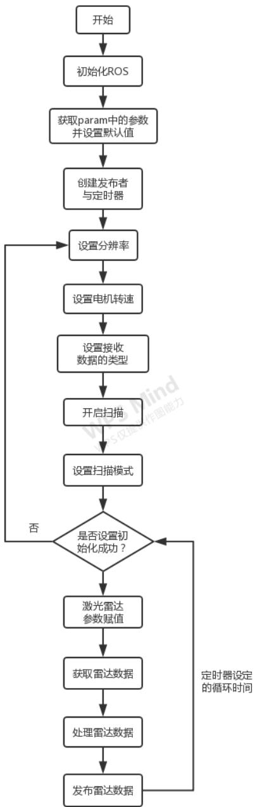
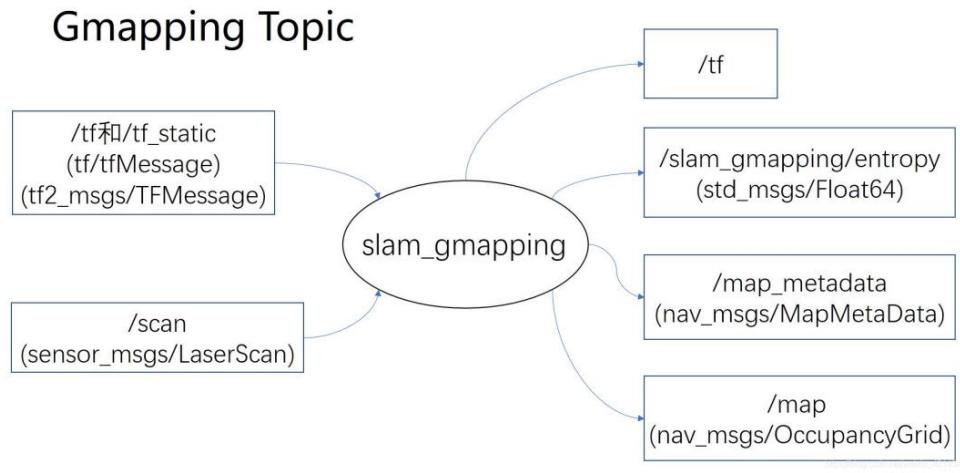
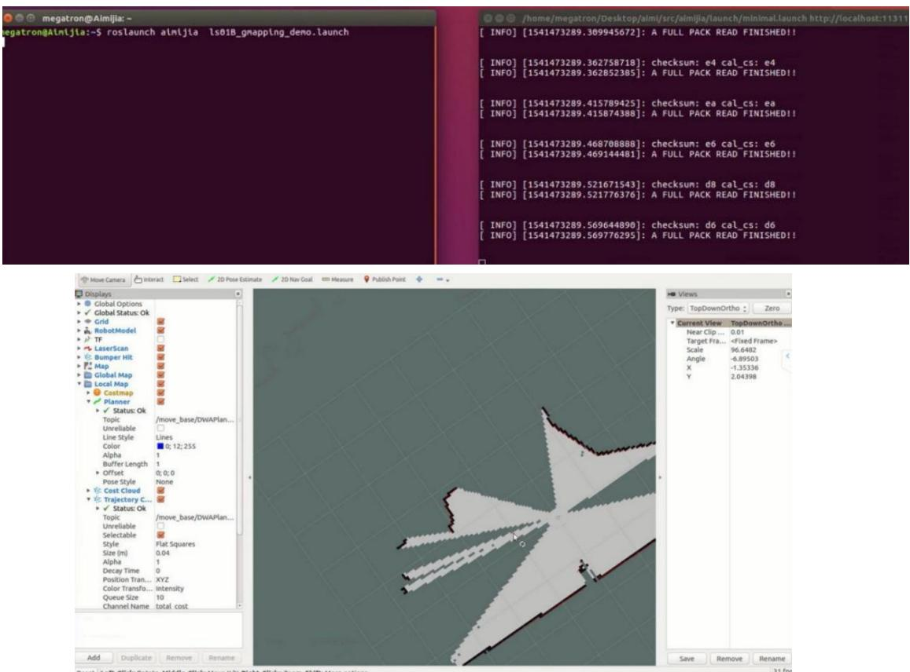
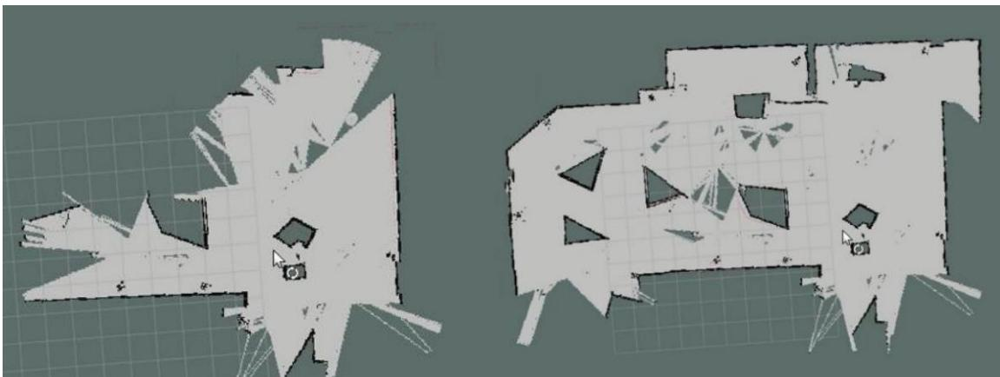
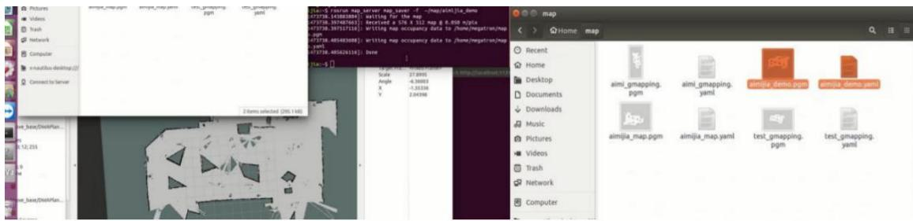

# 实验八 ROS教育机器人激光雷达建图

实验类型：演示/实践/仿真

实验学时：2 小时

实验要求：必修

## 一、实验目的

1、掌握Aimibot 教育机器人激光雷达建图工作原理

2、熟练编写机器人激光雷达建图程序，实现机器人激光雷达建图

## 二、实验内容

1、通过示例代码控制智能移动机器人进行激光雷达建图；

2、通过修改示例代码控制智能移动机器人进行避障时的安全距离。

## 三、实验器材

1、硬件：Aimibot 教育机器人主体、键盘鼠标、激光雷达。

2、软件：Ubuntu16.04 + ROS

## 四、实验原理

1、激光雷达原理

2、建图（gmapping）原理

3、激光雷达建图思路

激光雷达主要获取机器人前方物体的距离数据，程序流程图如下图所示：



gmapping 的作用是根据激光雷达和里程计的信息，对环境地图进行构建，并且对自身状态进行估计。因此它得输入应当包括激光雷达和里程计的数据，而输出应当有自身位置和地图。gmapping 算法的实际运行中的结构如下图所



示：

gmapping 的输出：

（1）/tf：主要是输出 map\_frame 和 odom\_frame 之间的变换。

（2）/slam\_gmapping/entropy：反映了机器人位姿估计的分散程度。

（3）/map：slam\_gmapping：建立的地图。

（4）/map\_metadata：地图的相关信息。

## gmapping 的输入：

输入包括 tf坐标变换与激光雷达数据，其中一定得提供的有两个 tf变换，一个是 base\_frame 与 laser\_frame 之间的 tf 变换，即机器人底盘和激光雷达之间的坐标变换；另一个是 base\_frame 与 odom\_frame 之间的 tf 变换，即底盘和里程计原点之间的坐标变换。tf坐标变换维护了整个 ROS三维世界里的转换关系，而 slam\_gmapping 要从中读取的数据是 base\_frame 与 laser\_frame 之间的 tf变换,只有这样才能够把周围障碍物变换到机器人坐标系下，更重要的是base\_frame 与 odom\_frame 之间的 tf 变换，这个 tf 变换反映了里程计（电机的光电码盘、视觉里程计、IMU）的监测数据，也就是机器人里程计测得走了多少距离，它会把这段变换发布到 odom\_frame 和 laser\_frame 之间。

gmapping 利用激光雷达的数据通过基于 RBpf 粒子滤波的算法，构建出机器人所在环境中的地图。

## 3、程序代码

打开 Amos\_WS/aimibotV2 文件夹与 Amos\_WS/ls01b\_v2 文件夹，可以看到lunch、src、include 等多个文件夹，其中 ls01B\_gmapping\_demo.launch 文件位于aimibotV2/lunch 文件夹中，ls01b.h 文件与 ls01b\_node.h 位于 ls01b\_v2/include 文件夹中，ls01b.cpp 文件与 ls01b\_node.cpp 文件位于 ls01b\_v2/src 文件夹中，依次打开五个文件，查看代码。

## （1）ls01B\_gmapping\_demo.launch 文件

打开 Amos\_WS/aimibotV2/lunch/ls01B\_gmapping\_demo.launch 文件，该 lunch文件运行了 ls01b 可执行文件、gmaping 可执行文件以及打开 rviz，其中对 ls01b可执行文件与 gmaping 可执行文件中的参数进行赋值。

打开 ls01B\_gmapping\_demo.launch 文件，代码如下：

```xml
<launch>
    <arg name="laser_type" default="ls01B" />
    <node name="ls01b_v2" pkg="ls01b_v2" type="ls01b_v2" output="screen">
    <param name="scan_topic" value="scan"/> //设置激光数据 topic 名称
    <param name="frame_id" value="laser_link"/> //激光坐标
    <param name="serial_port" value="/dev/ttyUSB1"/> //雷达连接的串口
    <param name="baud_rate" value="460800"/> //雷达连接的串口波特率
    <param name="angle_resolution" value="0.25"/> //雷达角度分辨率
    <param name="zero_as_max" value="false"/> //设置为 true 探测不到区域会变成最大值
    <param name="min_as_zero" value="false"/> // true: 探测不到区域为 0, false: 探测不到区域为 inf
    <param name="angle_disable_min_0" value="90"/> //角度制，从 angle_disable_min 到 angle_disable_max 之前的值为 0
    <param name="angle_disable_max_0" value="270"/> 
    <param name="angle_disable_min_1" value="-1"/> //角度制，从 angle_disable_min 到 angle_disable_max 之前的值为 0
    <param name="angle_disable_max_1" value="-1"/> 
    <param name="angle_disable_min_2" value="-1"/> //角度制，从 angle_disable_min 到 angle_disable_max 之前的值为 0
    <param name="angle_disable_max_2" value="-1"/> 
    <param name="angle_disable_min_3" value="-1"/> //角度制，从
```

```html
angle_disable_min 到 angle_disable_max 之前的值为 0
<param name="angle_disable_max_3" value="-1"/>
<param name="angle_disable_min_4" value="-1"/> //角度制，从 angle_disable_min 到 angle_disable_max 之前的值为 0
<param name="angle_disable_max_4" value="-1"/>
<param name="robot_radius" value="0.15"/> //机器人半径
<param name="center_x" value="-0.255"/> //雷达坐标系下机器人中心位置
<param name="center_y" value="0"/>
</node>

<arg name="scan_topic" default="scan"/>
<arg name="base_frame" default="base_footprint"/>
<arg name="odom_frame" default="odom"/>

<node pkg="gmapping" type="slam_gmapping" name="slam_gmapping" output="screen">
<param name="base_frame" value="${arg base_frame}">
<param name="odom_frame" value="${arg odom_frame}">
<param name="map_update_interval" value="0.5"/> //地图更新间隔
<param name="maxUrange" value="15"/> //激光最大可用范围
<param name="maxRange" value="20"/> //传感器最大范围
<param name="sigma" value="0.05"/> //贪婪端点匹配使用的 sigma
<param name="kernelSize" value="3"/> //寻找通信的内核
<param name="lstep" value="0.05"/> //翻译中的优化步骤
<param name="astep" value="0.05"/> //旋转优化步骤
<param name="iterations" value="5"/> //扫描器迭代的次数
<param name="lsigma" value="0.075"/> //用于似然计算的波束的 σ
<param name="ogain" value="3.0"/> //评估可能性时要使用的增
```

```html
益，用于平滑重采样效果

<param name="lskip" value="0"/> //每次扫描中要跳过的光束数。计算匹配时，仅每隔(n+1)条激光光线采集一次(0=采集所有光线)

<param name="minimumScore" value="30"/> //考虑扫描匹配结果良好的最低分数

<param name="srr" value="0.01"/> //作为翻译函数的翻译中的里程计误差

<param name="srt" value="0.02"/> //作为旋转函数的平移里程计误差

<param name="str" value="0.01"/> //作为平移函数的旋转里程计误差

<param name="stt" value="0.02"/> //旋转中的里程计误差作为旋转的函数

<param name="linearUpdate" value="0.05"/> //每次机器人平移到这么远的地方都会处理一次扫描

<param name="angularUpdate" value="0.0436"/> //每次机器人旋转这么远，都会处理一次扫描

<param name="temporalUpdate" value="-1.0"/> //如果上次处理的扫描早于更新时间(以秒为单位)，则处理扫描。小于零的值将关闭基于时间的更新

<param name="resampleThreshold" value="0.5"/> //基于 NEFF 的重采样阈值

<param name="particles" value="30"/> //过滤器中的粒子数

<param name="xmin" value="-1.0"/> //初始地图大小

<param name="ymin" value="-1.0"/> //初始地图大小

<param name="xmax" value="1.0"/> //初始地图大小

<param name="ymax" value="1.0"/> //初始地图大小

<param name="delta" value="0.05"/> //地图分辨率

<param name="llsamplerange" value="0.01"/> //似然率的平移抽样范围

<param name="llsamplestep" value="0.01"/> //似然率的平移抽样步长

<param name="lasamplerange" value="0.005"/> //似然率的角度采样步长

<param name="lasamplestep" value="0.005"/> //似然率的角度采样步长
```

```xml
<remap from="scan" to="${arg scan_topic}"/> //重映射
</node>
<node name="rviz" pkg="rviz" type="rviz" args="-d $(find aimibot)/rviz/navigation.rviz"/> //打开 rviz
</launch>
```

## （2）ls01b.h 文件

打开 Amos\_WS/ls01b\_v2/include/ls01b.h 文件，该头文件声明了一个 LS01B类，对ls01b.cpp文件中的参数进行了定义，函数代码如下：

```cpp
class LS01B    //声明 LS01B 类
{
public://公共权限
    ~LS01B(); //析构函数
    * 实例化雷达
    * port: 串口号,
    * baud_rate: 波特率 460800
    * resolution: 雷达角度分辨率 1.0 度 0.5 度 0.25 度
    static LS01B* instance(std::string port, int baud_rate, double resolution);
    bool isHealth();    //判断雷达是否有效
    bool resetHealth();    //恢复雷达状态
    int getScan(std::vector<ScanPoint> &points, ros::Time &scan_time, float &scan_duration);    //获取雷达数据
    int getVersion(std::string &version);    //获取软件版本号
    int getRate();
    int startScan();    //开始扫描
    int stopScan();    //停止扫描
    int setScanMode(bool is_continuous);    //设置连续扫描或者单次扫描
    int stopRecvData();    //停止接收数据
    int switchData(bool use_angle);    //选择接收数据的类型
```

```txt
class LS01B_Node    ///声明 LS01B_Node 类
```

```c
int setMotorSpeed(int rpm);    //设置电机转速
int setResolution(double resolution);    //设置雷达数据分辨率
double getRPM();
private://私有权限
LS01B(std::string port, int baud_rate, double resolution = 0.25); //构造函数
void recvThread();
uint16_t checkSum(const uint8_t *p_byte);
std::vector<ScanPoint> scan_points_;    //定义数据类型
std::vector<ScanPoint> scan_points_bak_;
LSIOSR * serial_;
boost::thread *recv_thread_;
boost::mutex mutex_;
bool is_shutdown_;    // shutdown recvthread
bool is_start_;    // begin to read data from lidar
bool use_angle_;
int scan_health_; // 0 OK
double resolution_;
int data_len_;
int points_size_;
int rpm_;
double real_rpm_;
ros::Time pre_time_;
ros::Time time_;
};
```

打开 Amos\_WS/ls01b\_v2/include/ls01b\_node.h 文件，该头文件声明了一个LS01B\_Node 类，对 ls01b\_node.cpp 文件中的参数进行了定义，并创建了发布者的实例，函数代码如下：

```cpp
{
public://公共权限
    LS01B_Node();    //构造函数
    ~LS01B_Node();    //析构函数
    void run();    //雷达初始化
private://私有权限
    void initParam();    //初始化参数
    void publishScan(const ros::TimerEvent&);    //发布雷达数据
    ros::NodeHandle n_;    //创建节点句柄 n_
    ros::Publisher pub_;    //通过 ros::Publisher 这样一个类来创建一 pub_这样一个对象，速度发布者 pub_
    ros::Timer timer_;
    LS01B *ls01b_;
    //定义参数
    std::string serial_port_;
    int baud_rate_;
    double angle_resolution_;
    std::string scan_topic_;
    std::string frame_id_;
    DisableAngle dis_angle_[5];
    double robot_radius_;
    double center_x_;
    double center_y_;
    double angle_disable_min_0;
    double angle_disable_max_0;
    double angle_disable_min_1;
    double angle_disable_max_1;
    double angle_disable_min_2;
    double angle_disable_max_2;
```

```txt
double angle_disable_min_3;
double angle_disable_max_3;
double angle_disable_min_4;
double angle_disable_max_4;
bool is_shutdown_;
};
```

## （4）ls01b.cpp 文件

打开 Amos\_WS/ls01b\_v2/src/ls01b.cpp 文件,该程序的的功能包括判断激光雷达是否初始化成功、重置初始化标志位、雷达扫描数据赋值、获取版本号、开始扫描、停止扫描、设置扫描模式、停止接收数据、选择接收数据的类型、设置电机转速、设置分辨率、获取雷达数据等；其中只有获取雷达数据的函数是读取雷达通过串口传输来的数据，其他函数均是通过串口向雷达写入数据指令，程序实现方法类似，只需向串口写入不同的数据即可。获取雷达数据的函数如下：

```cpp
void LS01B::recvThread()
{
    uint8_t start_count = 0;
    char header[6];
    uint8_t temp_char;
    char * packet_bytes = new char[data_len_];
    if (packet_bytes == NULL)
    {
    packet_bytes = NULL;
    }
    boost::posix_time::ptime t1,t2;
    t1 = boost::posix_time::microsec_clock::universal_time();
    while(!is_shutdown_)
    {
    while(!is_start_)
    {
    usleep(300000);
    }
}
```

```cpp
int count = serial_->read(&header[start_count], 1);
if (count<=0)
{
    start_count = 0;
    scan_health_ = -3;
    continue;
}
if(0 == start_count){
    if (0xA5 == (header[start_count]&0xff)){
    start_count = 1;
    }
    else{
    start_count = 0;
    }
}
else if (1 == start_count) {
    if (0x6A == (header[start_count]&0xff) || 0x5A == (header[start_count]&0xff))
    {
    if (0x6A == (header[start_count]&0xff))
    {
    t2 = boost::posix_time::microsec_clock::universal_time();

    boost::posix_time::millisec_posix_time_system_config::time_duration_type t_ elapse;
    t_ elapse = t2 - t1;
    real_rpm_ = 1000000.0 / t_ elapse.ticks();
    t1 = t2;
```

```cpp
boost::unique_lock<boost::mutex> lock(mutex_);
scan_points_bak_.resize(scan_points_.size());
scan_points_bak_.assign(scan_points_.begin(), scan_points_.end());
pre_time_ = time_;
lock.unlock();
time_ = ros::Time::now();
}
start_count = 2;
int count = serial_->read(&header[start_count], 4);
if (count != 4)
{
    start_count = 0;
    scan_health_ = -3;
    continue;
}
rpm_ = ((header[2]&0x7f) << 8) + (header[3]&0xff);
int flag = ((header[2] & 0x80) == 0) ? 0 : 1;
int angular_resolution = (header[4]&0xff) >> 1;
int start_angle = ((header[4] & 0x01) << 8) + (header[5]&0xff);
count = serial_->read(packet_bytes, data_len_);
if (count != data_len_)
{
    start_count = 0;
    scan_health_ = -3;
    continue;
}
for (int i = 0; i < data_len_; i = i+3)
{
    int idx = start_angle / resolution_ + i/3;
```

```cpp
double distance = ((packet_bytes[i+1] & 0xFF) << 8) |
(packet_bytes[i+2] & 0xFF);

    double degree = start_angle + idx * resolution_;
    boost::unique_lock<boost::mutex> lock(mutex_);
    scan_points_[idx].degree = degree;
    scan_points_[idx].range = distance/1000.0;
    if(use_angle_) 
    {
    scan_points_[idx].intensity = 0;
    }
    else 
    {
    scan_points_[idx].intensity = packet_bytes[i] & 0xFF;
    }
    lock.unlock(   );
    }
    start_count = 0;
    }
    else 
    start_count = 0;
    }
    }
}
if (packet_bytes)
{
    packet_bytes = NULL;
    delete packet_bytes;
}
```

## （4）ls01b\_node.cpp 文件

打开 Amos\_WS/ls01b\_v2/src/ls01b\_node.cpp 文件,该程序的的功能主要是初始化激光雷达以及发布激光雷达的数据，该程序利用定时器每隔 0.1s 发布一次雷达数据的话题，主要函数代码如下：

```cpp
void LS01B_Node::run()    //初始化激光雷达
{
    ls01b_->setResolution(angle_resolution_);    //设置分辨率
    ls01b_->setMotorSpeed(600);    //设置电机转速
    ls01b_->switchData(false);    //选择接收数据类型
    ls01b_->startScan();    //开始扫描
    ls01b_->setScanMode(true);    //设置连续扫描
}

void LS01B_Node::publishScan(const ros::TimerEvent &)
{
    bool is_health = ls01b_->isHealth();
    if (!is_health)    //是否初始化成功
    {
    ls01b_->resetHealth();    //重置初始化标志位
    ls01b_ = LS01B::instance(serial_port_, baud_rate_, angle_resolution_);
    run();    //重新初始化
    return;
    }
    std::vector<ScanPoint> points;    //定义一个名为 points 的容器
    ros::Time start_time;
    float scan_time;
    ls01b_->getScan(points, start_time, scan_time);    //获取雷达数据
    int count = points.size();
    if (count <= 0)
```

```txt
return;
sensor_msgs::LaserScan msg;    //定义一个名为 msg 的雷达数据类型
//雷达数据赋值
msg.header.frame_id = frame_id_;
msg.header.stamp = start_time;
msg.angle_min = 0.0;
msg.angle_max = 2*M_PI;
msg.angle_increment = (msg.angle_max - msg.angle_min) / count;
msg.range_min = 0.01;
msg.range_max = 25;
msg_ranges.resize(count);
msg.intensities.resize(count);
msg.scan_time = scan_time;
msg.time_increment = scan_time / (double)(count - 1);
//雷达数据转换
for (int i = count - 1; i >= 0; i--)
{
    if (
    ((i >= (angle_disable_min_0 * count/360)) && (i < (angle_disable_max_0 * count/360)))
    || ((i >= (angle_disable_min_1 * count/360)) && (i < (angle_disable_max_1 * count/360)))
    || ((i >= (angle_disable_min_2 * count/360)) && (i < (angle_disable_max_2 * count/360)))
    || ((i >= (angle_disable_min_3 * count/360)) && (i < (angle_disable_max_3 * count/360)))
    || ((i >= (angle_disable_min_4 * count/360)) && (i < (angle_disable_max_4 * count/360)))
    )
```

```cpp
{
    msg_ranges[i] = std::numeric_limits<float>::infinity();
    msg.intensities[i] = 0;
}
else if (points[count - i - 1].range == 0.0)
{
    msg_ranges[i] = std::numeric_limits<float>::infinity();
    msg.intensities[i] = 0;
}
else
{
    msg_ranges[i] = points[count - i - 1].range;
    msg.intensities[i] = points[count - i - 1].intensity;
}
double point_dist = msg_ranges[i];
if(point_dist < 1.0 && point_dist > 0.06)
{
    double x = point_dist*cos(i*angle_resolution_*M_PI/180);
    double y = point_dist*sin(i*angle_resolution_*M_PI/180);
    double dist2center = sqrt((y-center_y_)*(y-center_y_) + (x-center_x_)*(x-center_x_));
    if(dist2center < robot_radius_)
    msg_ranges[i] = std::numeric_limits<float>::infinity();
}
pub_.publish(msg); //发布雷达数据
}
```

## 五、实验步骤

1、获取串口操作权限（已映射），详见说明书第 X章。

  
4、打开一终端启动键盘键盘操作 Aimibot，执行：

2、打开终端，启动底盘，执行： roslaunch aimibot minmal.launch

3、新开终端启动 gmapping,用于构建地图，执行：

roslaunch aimibot ls01B\_gmapping\_demo.launch

此命令将打开 rviz 显示环境，我们将观察到实时建图信息，如图所示：

roslaunch aimibot keyboard\_teleop.launch

通过键盘或者罗技手柄控制底盘开始建图，控制机器人在区域中运行，并在rviz 的界面中实时显示，获得该区域的完整地图后，如图所示：



## 5、保存地图

将得到的地图信息保存在电脑中，新开一终端，执行新建文件夹命令：

mkdir -p \~/map

6、使用 ros 中的 map\_server 工具保存使用激光获得的地图rosrun map\_server map\_saver -f \~/map/aimijia\_demo

在文件夹中可看到，地图文件，如图所示：



## 六、实验注意事项

1．建图过程控制机器人速度不宜过快，最好实时观察建图窗口观察建图的实时过程。

2．控制机器人运动时，注意机器人前端时候有障碍物，保障机器人正常运动。

3．建图过程中，不能有人为遮挡激光，会对实验结果造成误差。

## 七、预习与思考题

## 八、进阶实验