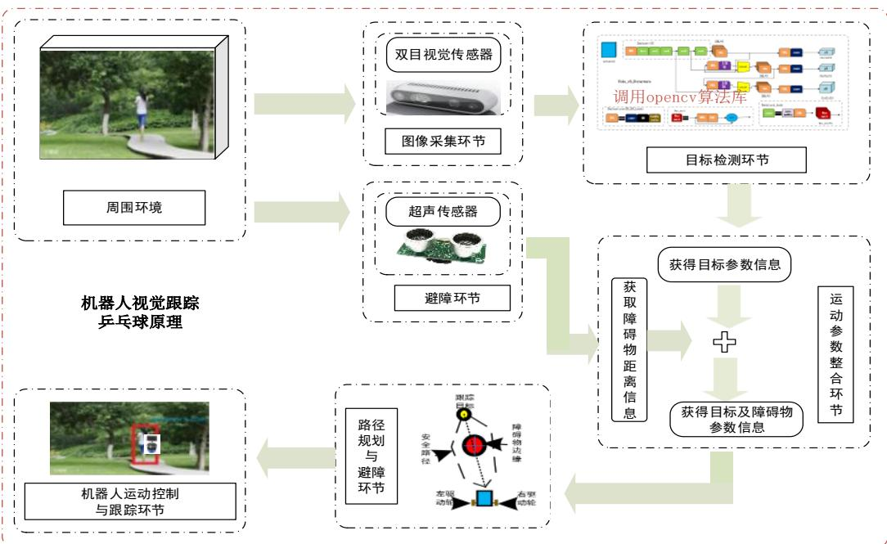
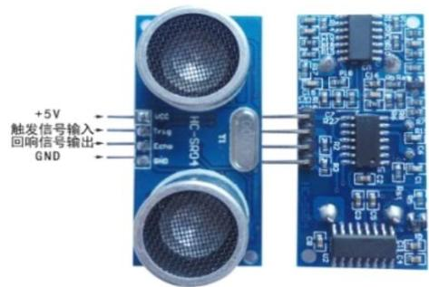
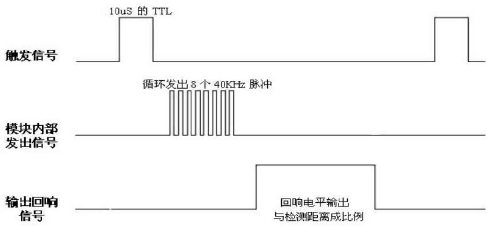
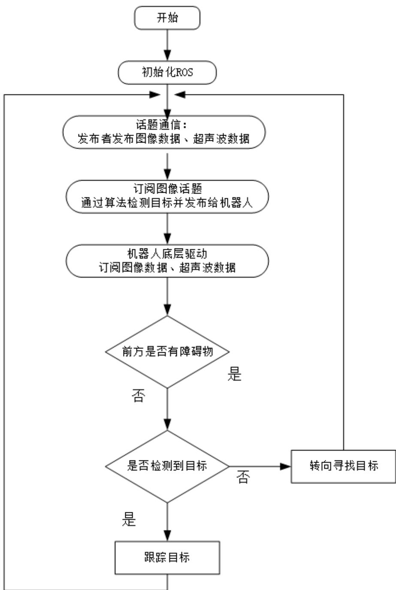
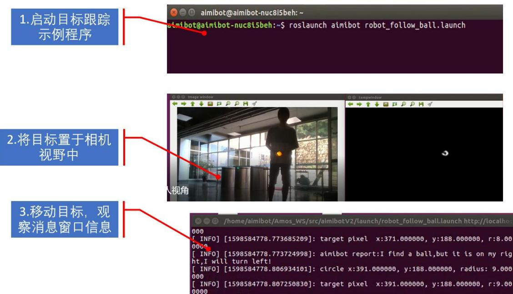

# 实验指导书

## 目录

实验一：用上位机软件简单控制机器人运动和查看数据

实验二：ROS 机器人模式下查看机器人数据结构 （ros 里程计数据反馈）

实验三：罗技蓝牙手柄控制机器人运动 （线速度和角速度并发控制）

实验四：罗技蓝牙键盘控制机器人运动 （rviz 可视化仿真实验）

实验五：ROS 教育机器人圆形轨迹运动（可拓展为 8 字形，三角形，正方形）

实验六：ROS 教育机器人基于超声波避障实验 （将调整避障的距离参数化显示；避障方式-例如无序方向避障，固定方向选择避障）（超声波跟踪实验）

实验七：ROS 教育机器人防跌落实验

实验八：ROS 教育机器人激光雷达建图

实验九：ROS 教育机器人激光雷达避障与导航（可拓展为定点巡航，多点导航）

实验十：ROS 教育机器人视觉建图

实验十一：ROS 教育机器人视觉与激光雷达融合导航与避障

实验十：ROS 教育机器人视觉追踪乒乓球实验（可拓展为二维码跟踪，人体跟踪，固定形状；固定颜色图像识别跟踪）

实验十二：rviz 可视化仿真实验

# 实验十 ROS教育机器人视觉追踪乒乓球实验

实验类型：演示/实践 实验学时：2 小时 实验要求：必修

## 一、实验目的

1、掌握 Aimibot 教育机器人视觉跟踪原理

2、熟练编写机器人视觉跟踪程序，实现机器人视觉跟踪特定目标

## 二、实验内容

1、通过示例代码控制智能移动机器人实现视觉追踪乒乓球实验；

2、通过修改示例代码控制智能移动机器人跟踪特定颜色的乒乓球。

## 三、实验器材

1、硬件：Aimibot 教育机器人主体、键盘鼠标、双目相机。

2、软件：Ubuntu16.04 + ROS+视觉跟踪功能包

## 四、实验原理

## 1、机器人视觉跟踪原理

本实验基于图像识别模块与超声避障模块设计, 其中图像识别是通过相机进行图像获取, 经过图像处理以及目标检测算法来提取目标, 以此来调整机器人的跟踪姿态; 超声避障模块用来规避障碍。



## 2、超声避障原理

本 Aimibot 教育机器人前端安装有五个超声波传感器, 每个超声波的有效监测范围为 3m，检测幅度为 $15^{\circ}$ ，为避免碰撞、特征识别、定位和导航提供目标检测和距离信息。模块包括超声波发射器、接收器与控制电路。实物图如下：



图 x.x 超声波传感器实物图

VCC 供 5V 电源，GND 为地线，TRIG 触发控制信号输入，ECHO 回响信号输出等四个接口端。基本工作原理如下：

（1）采用 IO 口 TRIG 触发测距，给最少 10us 的高电平信号；

（2）模块自动发送8个40khz的方波，自动检测是否有信号返回；

（3）有信号返回，通过 IO 口 ECHO 输出一个高电平，高电平持续的时间就是超声波从发射到返回的时间；

（4）测试距离= $($ 高电平时间\*声速 $(340\mathrm{m/s}) ) / 2$ 。

  
图 x.x 超声波时序图

以上时序图表明只需要提供一个 10uS 以上脉冲触发信号，该模块内部将发出 8 个 40kHz 周期电平并检测回波。一旦检测到有回波信号则输出回响信号。

回响信号的脉冲宽度与所测的距离成正比。由此通过发射信号到收到的回响信号时间间隔可以计算得到距离。公式：uS/58=厘米或者 uS/148=英寸：或是：距离=高电平时间\*声速（340m/s）/2；建议测量周期为 60ms 以上，以防止发射信号对回响信号的影响。

## 3、机器人视觉跟踪机器人程序思路

机器人启动后首先检测视野中是否存在目标（黄色乒乓球），如果正方不存在目标，机器人将根据情况进行转向去寻找目标，如果检测到目标，将根据检测到的图像信息调整机器人运转姿态，使其朝着目标进行跟踪动作，具体流程图如下图所示：



## 4、程序代码

打开 Amos\_WS/aimibotV2 文件夹，可以看到 lunch、src、include 等多个文件夹，其中 robot\_follow\_ball.launch 文件位于 launch 文件夹中，RobotFollowBall.h 文件位于 include 文件夹中，robot\_follow\_ball.cpp 和 ball\_tracking.cpp 文件位于 src 文件夹中，依次打开三个文件，查看代码。

## (1) robot\_follow\_ball.launch 文件

打开 Amos\_WS/aimibotV2/lunch/robot\_follow\_ball.launch 文件，该 lunch 文件运行了 aimibot 可执行文件、robot\_follow\_ball 和 ball\_tracking 可执行文件，其中对 aimibot 可执行文件中的参数进行赋值，并对话题名称进行重映射。

打开 robot\_follow\_ball.launch 文件，代码如下：

```yaml
<launch>
    <include file="${find realsense2_camera}/launch/rs_camera.launch" />
    <node pkg="ball_tracking" name="ball_tracker" type="ball_tracker" output="screen"/>
    <arg name="server" default="192.168.1.104" />
    <node pkg="vrpn_client_ros" type="vrpn_client_node" name="vrpn_client_node" output="screen">
    <rosparam subst_value="true">
    server: $(arg server)
    port: 3883
    update_frequency: 50.0
    frame_id: world
    # Use the VRPN server's time, or the client's ROS time.
    use_server_time: false
    broadcast_tf: true
    # Must either specify refresh frequency > 0.0, or a list of trackers to create refresh_tracker_frequency: 1.0
    #trackers:
```

```xml
#- FirstTracker
#- SecondTracker
</rosparam>
</node>
<arg name="serialport" default="/dev/aimibot" />
<node pkg="aimibot" type="aimibot" name="aimibot" output="screen">
<param name="serial_port" value="${(arg serialport)"/>
<param name="odom_frame" value="odom"/>
<param name="base_frame" value="base_footprint"/>
<param name="use_imu_heading" value="true" />
<param name="publish_tf" value="true" />
<remap from="/mobile_base/commands/velocity"
to="/aimibot/commands/velocity"/>
</node>
<node pkg="aimibot" type="robot_follow_ball" name="robot_follow_ball"
output="screen">
<remap from="/mobile_base/commands/velocity"
to="/aimibot/commands/velocity"/>
</node>
</launch>
```

(2) RobotFollowBall.h 文件

打开 Amos\_WS/aimibotV2/include/ RobotFollowBall.h 文件，该头文件声明了一个 runningtest 类，对 robot\_follow\_ball.cpp 文件中的参数进行了定义，并创

建了发布者与订阅者的实例，函数如下：

```cpp
class runningtest    //声明 runningtest 类
{
public://公共权限

    runningtest();    //定义构造函数，函数名与类名相同（在这里是对构造函数进行声明）

    int state;    //机器人运动方向标志位

protected:    //保护权限

    void runningtestultrasonic_data_callback(const aimibot::Ultrasonic::ConstPtr &sonic_pubdata);

    void imageCallback(const geometry_msgs::Point::ConstPtr& msg);

private:    //私有权限

    unsigned short ObstacDis;    //避障安全距离

    double vel_line;    //线速度

    double vel_angle;    //角速度

    ros::NodeHandle handle;    //创建节点句柄 handle_

    ros::Publisher vel_pub;    //通过 ros::Publisher 这样一个类来创建一 vel_pub_这样一个对象，速度发布者 vel_pub_

    ros::Subscriber sub_sonic;    //通过 ros::Subscriber 这样一个类来创建一个 sub_sonic_这样一个对象，超声波传感器信息订阅者 sub_sonic_

    ros::Subscriber sub_image; //通过 ros::Subscriber 这样一个类来创建一个 sub_image_这样一个对象,用来订阅图像处理后目标的位置

    bool init();    //对应 robot_follow_ball.cpp 中的 bool runningtest::init()，利
```

```javascript
用构造函数赋初值 bool velocityControl(); //速度控制};
```

(3) robot\_follow\_ball.cpp 文件

打开 Amos\_WS/aimibotV2/src/robot\_follow\_ball.cpp 文件，该程序实现了机器人是视觉跟踪乒乓球的功能，主要函数为 runningtestultrasonic\_data\_callback() 函数、velocityControl 函数和 runningtest::imageCallback() 函数，其中 runningtest::runningtestultrasonic\_data\_callback(const aimibot:: UltrasonicConstPtr&sonic\_pubdata)，这是在 ROS 里面一个固定格式的一个调用。msg 是 sonic\_pubdata，aimibot::Ultrasonic 是消息的结构，后面调用它是一个长指针 ConstPtr&sonic\_pubdata。&sonic\_pubdata 进来之后，就会以一个长指针的形式指向 “/aimibot/Ultrasonic” 所有数据内容。函数如下：

```cpp
void runningtest::imageCallback(const geometry_msgs::Point::ConstPtr& msg)
{
    curr_dis_.dis10=msg->x;

    if((curr_dis_.dis10>=280)&&(curr_dis_.dis10<=360))
    {
    ROS_INFO("target pixel x:%f, y:%f, r:%f", msg->x, msg->y,msg->z);

    ROS_INFO("aimibot report:I find a ball, it is great, I will go straight!");
    state_=0;//前进
```

```txt
}
else if((curr_dis_.disl0>10)&&(curr_dis_.disl0<280))
{
ROS_INFO("target pixel x:%f, y:%f, r:%f", msg->x, msg->y,msg->z);
ROS_INFO("aimibot report:I find a ball,but it is on my left,I will turn right!");
state_=1;//right
}
else if(curr_dis_.disl0>360)
{
ROS_INFO("target pixel x:%f, y:%f, r:%f", msg->x, msg->y,msg->z);
ROS_INFO("aimibot report:I find a ball,but it is on my right,I will turn left!");
state_=2;//left
}
else
{
state_=1;//right
```

```cpp
ROS_INFO("aimibot report:I don't find a ball,so I will go round and round looking for it!");
}

velocityControl();
}

void runningtest::runningtestultrasonic_data_callback(const aimibot::UltrasonicConstPtr& sonic_pubdata)
{
    //ROS_INFO("sonic d1:%d, d2:%d",
    sonic_pubdata->disl1,sonic_pubdata->disl2);
    curr_dis_.disl1=sonic_pubdata->disl1;
    curr_dis_.disl2=sonic_pubdata->disl2;
    curr_dis_.disl3=sonic_pubdata->disl3;
    curr_dis_.disl4=sonic_pubdata->disl4;
    curr_dis_.disl5=sonic_pubdata->disl5;

if(((curr_dis_.disl3<=ObstacDis)&&(curr_dis_.disl3>30))&&(curr_dis_.disl3<=cur r_dis_.disl4)&&(curr_dis_.disl3<=curr_dis_.disl2))
    {
    //ROS_INFO("Collision warning!");
}
```

```c
//state_=0;
}
else
if(((curr_dis_.disl4<=ObstacDis)&&(curr_dis_.disl4>30))||(curr_dis_.disl5<=ObstacDis)&&(curr_dis_.disl5>30)))
{
    ROS_INFO("Collision warning! turn right");
    state_=2;//left
}
else
if(((curr_dis_.disl1<=ObstacDis)&&(curr_dis_.disl1>30))||(curr_dis_.disl2<=ObstacDis)&&(curr_dis_.disl2>30)))
{
    ROS_INFO("Collision warning! turn left");
    state_=1;//right
}
else
if((curr_dis_.disl3<=30)||(curr_dis_.disl2<=30)||(curr_dis_.disl1<=30)||(curr_dis_.disl4<=30)||(curr_dis_.disl5<=30))
{
```

```cpp
ROS_INFO("Collision warning! stop");
state_=3; //stop
}

velocityControl();
}

void runningtest::velocityControl()    //速度控制
{
geometry_msgs::Twist controlVel_;
switch (state_)
{
case 0://前进
controlVel_.angular.z = 0;
controlVel_.linear.x = vel_line_;//线速度
controlVel_.linear.y = 0;
controlVel_.linear.z = 0;
break;
case 1://右转
controlVel_.angular.z = vel_angle_;//角速度
controlVel_.linear.x = 0;
controlVel_.linear.y = 0;
```

```txt
controlVel_.linear.z = 0;
break;
case 2://左转
    controlVel_.angular.z = -vel_angle_;
    controlVel_.linear.x = 0;
    controlVel_.linear.y = 0;
    controlVel_.linear.z = 0;
    break;
default://无障碍物直行
    controlVel_.angular.z = 0.0;
    controlVel_.linear.x = vel_line_;
    controlVel_.linear.y = 0;
    controlVel_.linear.z = 0;
    break;
}
vel_pub_.publish(controlVel_); //发布运动话题
}
```

## 五、实验步骤

1、获取串口操作权限（已映射），详见说明书第X章。

2、打开终端，启动 robot\_follow\_ball.launch 文件，执行：

```txt
roslaunch aimibot robot_follow_ball.launch
```

如图所示:



启动成功后，机器人会检测跟踪目标（黄色的乒乓球），如目标不存在会原地转圈寻找目标，找到目标后会对目标进行跟随，跟随过程中碰到障碍物时会根据障碍物方位主动停止或者调整方位进行避障动作。

## 六、实验注意事项

实验场地范围至少为 $5m \times 5m$ 的正方形区域，内有几个障碍物，每个障碍物之间的距离及长度不小于 20cm。避障时，障碍物有以下要求：

1、被测物体面积不宜少于 0.5 平方米且尽量要求平整，否则会影响超声波传感器距离测量结果。

2、前方有平滑物体(如图书封面，镜面，墙体)与传感器夹角大于45度(非垂直反射)时误差明显，且在 $5 - 40\mathrm{cm}$ 范围内超声波传感器测距结果读数不稳定。其中可能会出现的误差有三角误差、镜面反射、多次反射等。

3、前方有毛衣，毛毯等吸音材料时，超声波传感器测距结果读数不稳定。

## 七、预习与思考题

请思考：如何在自主轨迹运动中加入超声波传感器，使得机器人在轨迹运动中遇到障碍物能自主暂停，保护移动机器人？

## 八、进阶实验

通过修改示例代码，实现机器人对红色体进行跟踪。