# 第2章 线性规划的图解法

线性规划是运筹学的一个重要分支.它是现代科学管理的重要手段之一,是帮助管理者做出决策的一个有效的方法.一些典型的线性规划在管理上的应用举例如下:

（1）合理利用线材问题.现有一批长度一定的钢管,由于生产的需要,要求截出不同规格的钢管若干.试问应如何下料,既可以满足生产的需要,又使得使用的钢管的数量最少?

（2）配料问题.由若干种不同价格不同成分含量的原料,用不同的配比混合调配出一些不同价格不同规格的产品,在原料供应量的限制和保证产品成分含量的前提下,如何获取最大的利润?

（3）投资问题. 如何从不同的投资项目中选出一个投资方案, 使得投资的回报最大?

（4）产品生产计划.如何合理充分地利用现有的人力、物力、财力,做出最优的产品生产计划,使得工厂获利最大?

（5）劳动力安排，尤其是服务性行业的劳动力安排。某单位由于工作需要，在不同时间段需要不同数量的劳动力，在每个劳动力每个工作日只能连续工作八小时的规则下，如何安排劳动力，才能用最少的劳动力来满足工作的需要？

（6）运输问题. 一个公司有若干个生产单位与销售单位, 根据各生产单位的产量及销售单位的销量, 如何制定调运方案, 将产品运到各销售单位而总的运费最小?

以上这些问题,利用线性规划方法都能成功地加以解决.当然线性规划在管理上的应用远不止这些,但通过这些例子我们可以看到线性规划问题的一些共同的特点.首先,在以上的每个例子中都有要求达到某些数量上的最大化或最小化的目标.例如,合理利用线材问题是要求使用原材料最少;配料问题是要求利润最大;投资问题是要求投资回报最大;等等.在所有线性规划的问题中某些数量上的最大化或最小化就是线性规划问题的目标.其次,所有线性规划问题都是在一定的约束条件下来追求其目标的.例如,合理利用线材问题是在满足生产需要的一定数量不同规格的钢管的约束下来追求原材料钢管的最小使用量.而在配料问题中是在原料供应量的限制和保证产品成分含量的约束下来追求最大利润的.

## 2.1 问题的提出

例 1 某工厂在计划期内要安排 I, II 两种产品的生产. 生产单位产品所需的设备台时及 A, B 两种原材料的消耗以及资源的限制如表 2-1 所示.

表2-1

<table><tr><td></td><td>产品I</td><td>产品II</td><td>资源限制</td></tr><tr><td>设备</td><td>1</td><td>1</td><td>300台时</td></tr><tr><td>原料A</td><td>2</td><td>1</td><td>400kg</td></tr><tr><td>原料B</td><td>0</td><td>1</td><td>250kg</td></tr></table>

工厂每生产1单位产品Ⅰ可获利50元,每生产1单位产品Ⅱ可获利100元,问工厂应分别生产多少单位产品Ⅰ和产品Ⅱ才能获利最多?

解 这个问题可以用下面的数学模型来加以描述.工厂目前要决策的问题是生产多少单位产品Ⅰ和生产多少单位产品Ⅱ,把这个要决策的问题用变量 $x_{1},x_{2}$ 来表示,则称 $x_{1}$ 和 $x_{2}$ 为决策变量,决策变量 $x_{1}$ 为生产产品Ⅰ的数量,决策变量 $x_{2}$ 为生产产品Ⅱ的数量.可以用 $x_{1}$ 和 $x_{2}$ 的线性函数形式来表示工厂所要求的最大利润的目标:

$$
\max z = 5 0 x _ {1} + 1 0 0 x _ {2},
$$

其中 max 为最大化的符号(最小化符号为 min);50 和 100 分别为单位产品 I 和单位产品 II 的利润,z 称为目标函数。同样也可以用 $x_{1}$ 和 $x_{2}$ 的线性不等式来表示问题的约束条件.台时数方面的限制可以表示为

$$
x _ {1} + x _ {2} \leqslant 3 0 0.
$$

同样,原材料的限量可以表示为

$$
\begin{array}{l}2 x _ {1} + x _ {2} \leqslant 4 0 0,\\x _ {2} \leqslant 2 5 0.\end{array}
$$

除了上述约束条件外,显然还应该有 $x_{1} \geqslant 0, x_{2} \geqslant 0$ , 因为产品 I 和产品 II 的产量是不能取负值的. 综上所述, 就得到了例 1 的数学模型:

$$
\begin{array}{r l} & \max z = 5 0 x _ {1} + 1 0 0 x _ {2};\\满足约束条件： & x _ {1} + x _ {2} \leqslant 3 0 0,\\ & 2 x _ {1} + x _ {2} \leqslant 4 0 0,\\ & x _ {2} \leqslant 2 5 0,\\ & x _ {1} \geqslant 0, x _ {2} \geqslant 0.\end{array}
$$

由于上述数学模型的目标函数为变量的线性函数,约束条件也为变量的线性等式或不等式,故此模型称之为线性规划.如果目标函数是变量的非线性函数,或约束条件中含有变量的非线性等式或不等式,这样的数学模型则称之为非线性规划.

把满足所有约束条件的解称为该线性规划的可行解. 把使得目标函数值最大(即利润最大)的可行解称为该线性规划的最优解, 此目标函数值称为最优目标函数值, 简称最优值.

从例 1 中可以看出一般线性规划问题的建模过程：

（1）理解要解决的问题．明确在什么条件下，要追求什么目标.

（2）定义决策定量．每一个问题都用一组决策变量 $(x_{1},x_{2},\cdots,x_{n})$ 表示某一方案，当这组决策变量取具体值时就代表一个具体方案，一般这些变量取值是非负的.

（3）用决策变量的线性函数形式写出所要追求的目标，即目标函数，按问题的不同，要求目标函数实现最大化或最小化.

（4）用一组决策变量的线性等式或不等式来表示在解决问题过程中所必须遵循的约束条件.

满足(2)(3)(4)三个条件的数学模型称之为线性规划的数学模型,其一般形式为

$$
\max (\min) z = c _ {1} x _ {1} + c _ {2} x _ {2} + \dots + c _ {n} x _ {n};
$$

$$
\begin{array}{r l}满足约束条件： & a _ {1 1} x _ {1} + a _ {1 2} x _ {2} + \dots + a _ {1 n} x _ {n} \leqslant (= , \geqslant) b _ {1},\\ & a _ {2 1} x _ {1} + a _ {2 2} x _ {2} + \dots + a _ {2 n} x _ {n} \leqslant (= , \geqslant) b _ {2},\\ & {a _ {m 1} x _ {1} + a _ {m 2} x _ {2} + \dots + a _ {m n} x _ {n} \leqslant (= , \geqslant) b _ {m},}\\ & {x _ {1}, x _ {2}, \dots , x _ {n} \geqslant 0.}\end{array}
$$

## 2.2 图解法

对于只包含两个决策变量的线性规划问题,可以用图解法来求解.图解法简单直观,有助于了解线性规划问题求解的基本原理.在以 $x_{1},x_{2}$ 为坐标轴的直角坐标系里,图上任意一点的坐标就代表了决策变量 $x_{1},x_{2}$ 的一组值,也就代表了一个具体的决策方案.

下面以例1为例介绍图解法的解题过程.例1的每个约束条件都代表一个半平面，如约束条件 $x_{1} + x_{2}\leqslant 300$ 代表以直线 $x_{1} + x_{2} = 300$ 为边界的左下方的半平面，也即这个半平面上的任一点都满足约束条件 $x_{1} + x_{2}\leqslant 300$ ，而其余的点都不满足这个约束条件.同时满足约束条件 $x_{1}\geqslant 0,x_{2}\geqslant 0$ $x_{1} + x_{2}\leqslant 300,2x_{1} + x_{2}\leqslant 400,x_{2}\leqslant 250$ 的点，必然落在这五个半平面的公共部分（包括五条边界线），这五个半平面及其公共部分如图2-1所示.公共部分的每一点（包括边界线上的点）都是这个线性规划的可行解，而此公共部分是例1的线性规划问题的可行解的集合，称为可行域

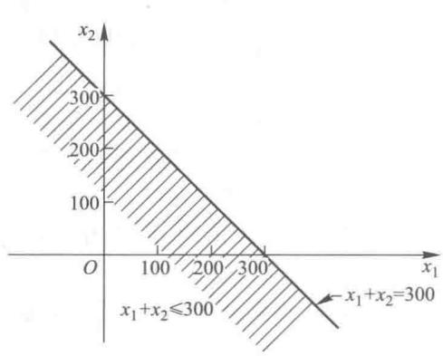
(a)

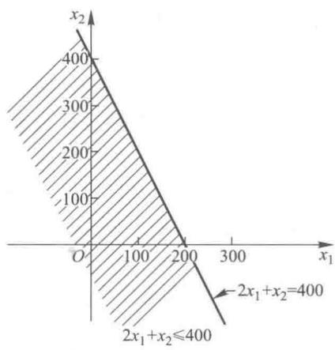
(b)

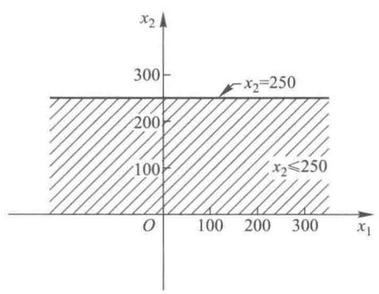
(c)

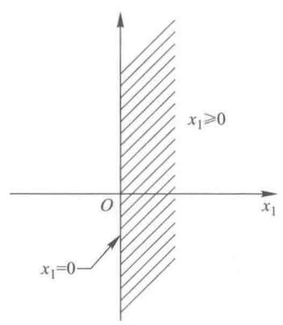
(d)

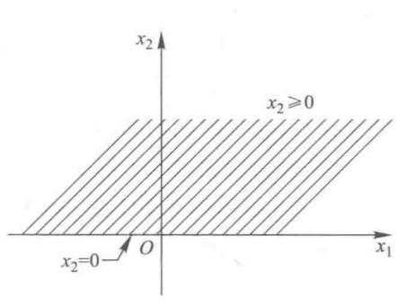
(e)

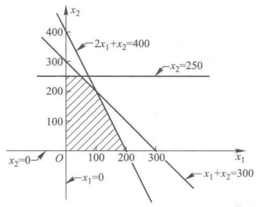
(f)

图2-1

可行域的几何形状由于问题不同可以千变万化,但是可行域的几何结构都是凸集.所谓凸集,要求集合中的任何两点的连线段落在这个集合中.例如,平面上的矩形与圆,空间中的平行六面体与椭球体,以及例1中的公共部分都是凸集.

目标函数 $z = 50x_{1} + 100x_{2}$ ，当 $z$ 取某一数值时，也可以用直线在图上表示。 $z$ 取不同的值就可以得到不同的直线，但不管 $z$ 怎样取值，所得直线的斜率是不变的，故对应于不同 $z$ 值所得的不同的直线都是互相平行的。由于对于 $z$ 的某一取值所得的直线上的每一点都具有相同的目标函数值，故称它为“等值线”。如图2-2所示，当 $z$ 的取值逐渐增大时，直线 $z = 50x_{1} + 100x_{2}$ 沿其法线方向向右上方移动，同时由于要满足全部约束条件，因此决策变量一定要处在其公共部分。当直线 $z = 50x_{1} + 100x_{2}$ 移动到 $B$ 点时， $z$ 值在可行域的边界上实现了最大化。这样就得到了例1的最优解为 $B$ 点， $B$ 点的坐标为(50,250)，因此最佳决策为 $x_{1} = 50, x_{2} = 250$ ，此时 $z = 27500$ 。这说明该厂的最优生产计划方案是生产产品I50单位，生产产品II250单位，可得最大利润27500元。

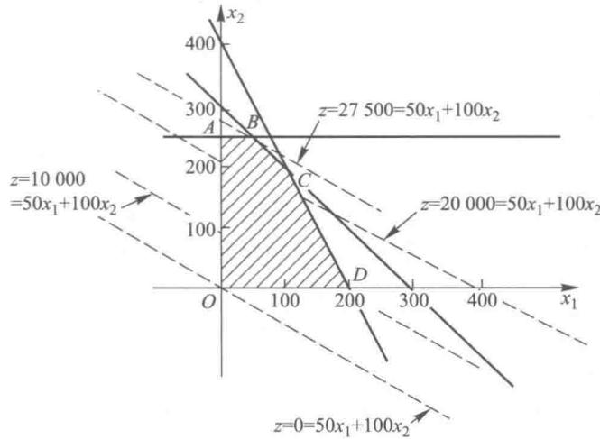

图2-2

下面来看一下在最优生产方案下资源消耗的情况: 把 $x_{1}=50, x_{2}=250$ 代入约束条件得设备台时: $1\times50+1\times250=300$ ;

原料 A: $2 \times 50 + 1 \times 250 = 350$ (kg);

原料 B: $0 \times 50 + 1 \times 250 = 250$ (kg).

这表明,生产50单位产品Ⅰ和250单位产品Ⅱ将消耗完所有可使用的设备台时数和原料B,但对原料A来说只消耗了350 kg,还有400-350=50 kg没有使用.在线性规划中,一个“≤”约束条件中没使用的资源或能力称之为松弛量.例如,在生产50单位产品Ⅰ和250单位产品Ⅱ的最优方案中,对设备台时资源来说其松弛量为0,对原料B来说其松弛量也为0,而对原料A来说其松弛量为50 kg.

为了把一个线性规划标准化,需要有代表没使用的资源或能力的变量,称之为松弛变量,记为 $s_{i}$ .显然这些松弛变量对目标函数不会产生影响,可以在目标函数中把这些松弛变量的系数看成零,加了松弛变量后我们得到如下的数学模型:

$$
\begin{array}{l}max z & = 5 0 x _ {1} + 1 0 0 x _ {2} + 0 s _ {1} + 0 s _ {2} + 0 s _ {3};\end{array}
$$

$$
\begin{array}{rl}约束条件:& x _ {1} + x _ {2} + s _ {1} = 3 0 0,\\& 2 x _ {1} + x _ {2} + s _ {2} = 4 0 0,\\& x _ {2} + s _ {3} = 2 5 0,\\& x _ {1}, x _ {2}, s _ {1}, s _ {2}, s _ {3} \geqslant 0.\end{array}
$$

像这样把所有的约束条件都写成等式,称为线性规划模型的标准化,所得结果称为线性规划的标准形式.在标准形式中 $b_{j}$ (右边常量)都要大于等于零,若某个 $b_{j}$ 小于零,只要在方程两边都乘以 -1 即可.

对例 1 的最优解 $x_{1}=50, x_{2}=250$ 来说，松弛变量的值如表 2-2 所示.

表2-2

<table><tr><td>约束条件</td><td>松弛变量的值</td></tr><tr><td>设备台时数</td><td> \(s_{1}=0\) </td></tr><tr><td>原料A</td><td> \(s_{2}=50\) </td></tr><tr><td>原料B</td><td> \(s_{3}=0\) </td></tr></table>

关于松弛变量值的一些信息我们也可以从图解法中获得.从图2-2中我们知道例1的最优解位于直线 $x_{2}=250$ 与直线 $x_{1}+x_{2}=300$ 的交点B，故可知原料B和设备台时数的松弛变量即 $s_{3}$ 和 $s_{1}$ 都为零，而B点不在直线 $2x_{1}+x_{2}=400$ 上，故可知 $s_{2}>0$ .

在图2-2中， $A,B,C,D,O$ 是可行域的顶点，对有限个约束条件其可行域的顶点也是有限的.从例1的求解过程中我们还观察到如下事实：

（1）如果某一个线性规划问题有最优解，则一定有一个可行域的顶点对应最优解.

（2）线性规划存在有无穷多个最优解的情况.若将例1中的目标函数变为 $z = 50x_{1} + 50x_{2}$ ，则可见代表目标函数的直线平移到最优位置后将和直线 $x_{1} + x_{2} = 300$ 重合.此时不仅顶点 $B,C$ 都是最优解，而且线段 $BC$ 上的所有点都是最优解，这样最优解就有无穷多个了.当然这些最优解都对应着相同的最优值 $50x_{1} + 50x_{2} = 15000.$

（3）线性规划存在无界解，即无最优解的情况.对下述线性规划问题：

$$
\begin{array}{r l} & \max z = x _ {1} + x _ {2};\\约束条件： & x _ {1} - x _ {2} \leqslant 1,\\ & - 3 x _ {1} + 2 x _ {2} \leqslant 6,\\ & x _ {1} \geqslant 0, x _ {2} \geqslant 0.\end{array}
$$

用图解法求解结果,如图2-3所示.从图中可以看到,该问题可行域无界,目标函数值可以增大到无穷大,成为无界解,即无最优解.出现这种情况,一般说明线性规划模型有错误,该模型中忽略了一些实际存在的必要的约束条件.

（4）线性规划存在无可行解的情况.若在例1的数学模型中再增加一个约束条件

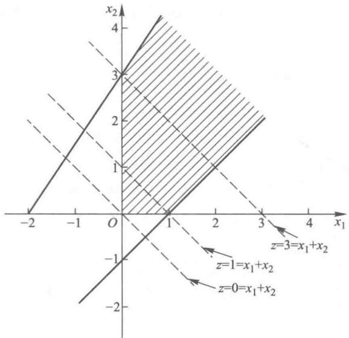

图2-3

$$
4 x _ {1} + 3 x _ {2} \geqslant 1 2 0 0,
$$

显然新的线性规划的可行域为空域,即不存在满足所有约束条件的 $x_{1}$ 和 $x_{2}$ ,当然更不存在最优解了.出现这种情况是由于约束条件自相矛盾导致的建模错误.

下面给出一个求目标函数最小化的线性规划问题.

例 2 某公司生产某产品,共需要 A,B 两种原料至少 350 t(A,B 两种原料有一定替代性),其中原料 A 至少购进 125 t.但由于 A,B 两种原料的规格不同,各自所需的加工时间也是不同的,加工每吨原料 A 需要 2 h,加工每吨原料 B 需要 1 h,而公司总共有 600 个加工时数.又知道每吨原料 A 的价格为 2 万元,每吨原料 B 的价格为 3 万元,试问在满足生产需要的前提下,在公司加工能力的范围内,如何购买 A,B 两种原料,使得购进成本最低?

解 设 $x_{1}$ 为购进原料 A 的数量, $x_{2}$ 为购进原料 B 的数量. 此线性规划的数学模型如下:

$$
\begin{array}{r l} & \min f = 2 x _ {1} + 3 x _ {2};\\约束条件： & x _ {1} + x _ {2} \geqslant 3 5 0,\\ & x _ {1} \geqslant 1 2 5,\\ & 2 x _ {1} + x _ {2} \leqslant 6 0 0,\\ & x _ {1} \geqslant 0, x _ {2} \geqslant 0.\end{array}
$$

用图解法来解此题,首先得到此线性问题的可行域为图2-4中的阴影部分.

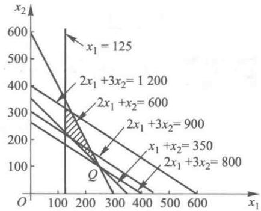

图2-4

再来看目标函数 $f=2x_{1}+3x_{2}$ ，它在坐标平面上可表示为以 $f$ 为参数，以 $-\frac{2}{3}$ 为斜率的一族平行线，如图2-4所示.这族平行线随着 $f$ 值的减小向左下方平移.当移动到 Q 点(即直线 $x_{1}+x_{2}=350$ 与 $2x_{1}+x_{2}=600$ 的交点)时,目标函数在可行域内取最小值.Q 点的坐标可以从线性方程组
为以 $f$ 为参数，以 $-\frac{2}{3}$ 为斜率的一族平行线，如图2-4所示.这族平行线随着 $f$ 值的减小向左下方平移.当移动到 Q 点(即直线 $x_{1}+x_{2}=350$ 与 $2x_{1}+x_{2}=600$ 的交点)时,目标函数在可行域内取最小值.Q 点的坐标可以从线性方程组

$$
\left\{ \begin{array}{l} x _ {1} + x _ {2} = 3 5 0 \\ 2 x _ {1} + x _ {2} = 6 0 0 \end{array} \right.
$$

中求出, 得 Q 点坐标为 $x_{1}=250, x_{2}=100$ , 即此线性规划问题的最优解为购买原料 A 250 t, 购买原料 B 100 t, 可使成本最小, 即 $2x_{1}+3x_{2}=2\times250+3\times100=800$ (万元).

对此线性规划问题的最优解进行分析, 可知购买的原料 A 与原料 B 的总量为 $1 \times 250 + 1 \times 100 = 350(t)$ , 正好达到约束条件的最低限, 所需的加工时间为 $2 \times 250 + 1 \times 100 = 600(h)$ , 正好达到加工时间的最高限. 而原料 A 的购进量则比原料 A 购进量的最低限多购进了 $250 - 125 = 125(t)$ , 这个超过量在线性规划中称为剩余量.

对于“≥”约束条件,可以增加一些代表最低限约束的超过量,称之为剩余变量,从而把“≥”约束条件变为等式约束条件.加了松弛变量与剩余变量后例2的数学模型为

$$
\begin{array}{r l}\min f  = 2 x _ {1} + 3 x _ {2} + 0 s _ {1} + 0 s _ {2} + 0 s _ {3};\end{array}
$$

$$
\begin{array}{r l}约束条件：& \quad x _ {1} + x _ {2} - s _ {1} = 3 5 0,\\& \quad x _ {1} - s _ {2} = 1 2 5,\\& \quad 2 x _ {1} + x _ {2} + s _ {3} = 6 0 0,\\& \quad x _ {1}, x _ {2}, s _ {1}, s _ {2}, s _ {3} \geqslant 0.\end{array}
$$

从约束条件中可以知道 $s_1, s_2$ 为剩余变量， $s_3$ 为松弛变量（ $s$ 是 slack 和 surplus 的第 1 个字母）。上式中所有的约束条件也都为等式，故这也是线性规划问题的标准形式，此问题的最优解为 $x_1 = 250, x_2 = 100$ ，其松弛变量及剩余变量的值如表 2-3 所示。

表2-3

<table><tr><td>约束条件</td><td>松弛变量及剩余变量的值</td></tr><tr><td>原料A与原料B的总量</td><td> \(s_{1}=0\) </td></tr><tr><td>原料A的数量</td><td> \(s_{2}=125\) </td></tr><tr><td>加工时间</td><td> \(s_{3}=0\) </td></tr></table>

## 2.3 图解法的灵敏度分析

由 §2.2 可知, 线性规划的标准形式可写为

$$
\max z = c _ {1} x _ {1} + c _ {2} x _ {2} + \dots + c _ {n} x _ {n}
$$

$$
\begin{array}{r l}& {(\text {或} \min f = c _ {1} x _ {1} + c _ {2} x _ {2} + \dots + c _ {n} x _ {n});}\\约束条件：& {\qquad a _ {1 1} x _ {1} + a _ {1 2} x _ {2} + \dots + a _ {1 n} x _ {n} = b _ {1},}\\& {\qquad a _ {2 1} x _ {1} + a _ {2 2} x _ {2} + \dots + a _ {2 n} x _ {n} = b _ {2},}\\& {\qquad \dots \dots}\\& {\qquad a _ {m 1} x _ {1} + a _ {m 2} x _ {2} + \dots + a _ {m n} x _ {n} = b _ {m},}\\& {\qquad x _ {1}, x _ {2}, \dots , x _ {n} \geqslant 0.}\end{array}
$$

教学视频: 图解法的灵敏度分析

其中 $c_{i}$ 为第 $i$ 个决策变量 $x_{i}$ 在目标函数中的系数； $a_{ij}$ 为第 $i$ 个约束条件中第 $j$ 个决策变量 $x_{j}$ 的系数； $b_{j}$ 为第 $j$ 个约束条件中的常数项，要求 $b_{j} \geqslant 0$ ，当 $b_{j} < 0$ 时，可在方程两边都乘以-1而使 $b_{j} \geqslant 0$ . §2.2 所提到的松弛变量和剩余变量都可以看成决策变量，也可以用 $x_{i}$ 表示而不用 $s_{i}$ 表示.

所谓灵敏度分析就是在建立数学模型和求得最优解之后，研究线性规划的一些系数 $c_{i}, a_{ij}, b_{j}$ 的变化对最优解产生什么影响？灵敏度分析是非常重要的，首先是因为 $c_{i}, a_{ij}, b_{j}$ 这些系数都是估计值和预测值，不一定非常精确；再则即使这些系数值在某一时刻是精确值，它们也会随着市场条件的变化而变化，不会一成不变的。例如，原材料价格、商品售价、加工能力、劳动力价格等的变化都会影响这些系数，有了灵敏度分析就不必为了应付这些变化而不停地建立新的模型和求新的最优解，也不会由于系数估计和预测的精确性而对所求得的最优解存有不必要的怀疑。下面用图解法的灵敏度分析对目标函数中的系数 $c_{i}$ 以及约束条件中的常数项 $b_{j}$ 进行灵敏度分析。

### 一、目标函数中的系数 $c_{i}$ 的灵敏度分析

让我们以例1为例来看一下 $c_{i}$ 的变化是如何影响其最优解的.从例1中知道生产一个单位的产品I可以获利50元 $(c_{1} = 50)$ ，生产一个单位的产品Ⅱ可以获利100元 $(c_{2} = 100)$ .在目前的生产条件下求得生产产品I50单位，生产产品Ⅱ250单位可以获得最大利润.当产品I，Ⅱ中的某一产品的单位利润增加或减少时，生产者往往都能意识到为了获取最大利润就应该增加或减少这一产品的产量,也就是改变最优解,但是往往不能精确地定出这一产品利润变化的上限与下限,使得利润在这个范围内变化时其最优解不变,即仍然生产50单位的产品Ⅰ和250单位的产品Ⅱ而使获利最大.下面就用图解法定出其上限与下限.
少这一产品的产量,也就是改变最优解,但是往往不能精确地定出这一产品利润变化的上限与下限,使得利润在这个范围内变化时其最优解不变,即仍然生产50单位的产品Ⅰ和250单位的产品Ⅱ而使获利最大.下面就用图解法定出其上限与下限.

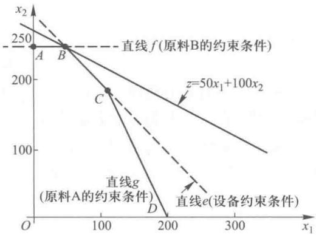

图2-5

从图 2-5 中可以看出只要目标函数的斜率在直线 e（设备约束条件）的斜率与直线 f（原料 B 的约束条件）的斜率之间变化时，坐标为 $x_{1}=50, x_{2}=250$ 的顶点 B 就仍然是最优解。如果目标函数的直线按逆时针方向旋转，当目标函数的斜率等于直线 f 的斜率时，可知直线 AB 上的任一点都是其最优解。如果继续按逆时针方向旋转, 可知 A 点为其最优解. 如果目标函数直线按顺时针方向旋转, 当目标函数的斜率等于直线 e 的斜率时, 可知直线 BC 上的任一点都是其最优解. 如果继续按顺时针方向旋转,当目标函数的斜率在直线 e 的斜率与直线 g 的斜率之间时，顶点 C 为其最优解。当目标函数的斜率等于直线 g 的斜率时，直线 CD 上的任一点都是其最优解。如果再继续按顺时针方向旋转，可知顶点 D 为其最优解。直线 e 的方程为
按逆时针方向旋转, 可知 A 点为其最优解. 如果目标函数直线按顺时针方向旋转, 当目标函数的斜率等于直线 e 的斜率时, 可知直线 BC 上的任一点都是其最优解. 如果继续按顺时针方向旋转,当目标函数的斜率在直线 e 的斜率与直线 g 的斜率之间时，顶点 C 为其最优解。当目标函数的斜率等于直线 g 的斜率时，直线 CD 上的任一点都是其最优解。如果再继续按顺时针方向旋转，可知顶点 D 为其最优解。直线 e 的方程为

$$
x _ {1} + x _ {2} = 3 0 0.
$$

用斜截式可以表示为

$$
x _ {2} = - x _ {1} + 3 0 0.
$$

可知直线 e 的斜率为 -1，同样直线 f，直线 g 也可以用斜截式分别表示为

$$
\begin{array}{l}x _ {2} = 0 x _ {1} + 2 5 0,\\x _ {2} = - 2 x _ {1} + 4 0 0.\end{array}
$$

可知直线 f 的斜率为 0, 直线 g 的斜率为 -2, 而且目标函数

$$
z = c _ {1} x _ {1} + c _ {2} x _ {2}
$$

用斜截式也可以表示为

$$
x _ {2} = - \frac {c _ {1}}{c _ {2}} x _ {1} + \frac {z}{c _ {2}}.
$$

可知目标函数的斜率为 $-\frac{c_{1}}{c_{2}}$ .这样当

$$
- 1 \leqslant - \frac {c _ {1}}{c _ {2}} \leqslant 0\tag{2.1}
$$

时，顶点 $B$ 仍然是其最优解.为了计算出 $c_{1}$ 在什么范围内变化时顶点 $B$ 仍然是其最优解，我们假设单位产品Ⅱ的利润为100元不变，即 $c_{2} = 100$ ，则有

$$
- 1 \leqslant - \frac {c _ {1}}{1 0 0} \leqslant 0.
$$

解得

$$
0 \leqslant c _ {1} \leqslant 1 0 0.
$$

也即当单位产品Ⅱ的利润为100元, 只要单位产品Ⅰ的利润在0到100元之间变化, 坐标 $x_{1}=50, x_{2}=250$ 的顶点B仍然是其最优解.

同样为了计算出 $c_{2}$ 在什么范围内变化时顶点 B 仍然是其最优解, 假设单位产品 I 的利润为 50 元不变, 即 $c_{1}=50$ , 代入 (2.1) 式得

$$
- 1 \leqslant - \frac {5 0}{c _ {2}} \leqslant 0.\tag{2.2}
$$

从左边不等式可得

从右边的不等式可得

$$
\begin{array}{r l} - c _ {2} & \leqslant - 5 0, \\ c _ {2} & \geqslant 5 0. \end{array}\tag{2.3}
$$

$$
0 <   c _ {2} \leqslant + \infty .\tag{2.4}
$$

综合(2.3)式和(2.4)式得到(2.2)式的等价不等式

$$
5 0 \leqslant c _ {2} \leqslant + \infty .
$$

即当单位产品Ⅰ的利润为50元,而单位产品Ⅱ的利润只要大于等于50元时,顶点B仍为其最优解.

同样在 $c_{1}$ 和 $c_{2}$ 中一个值确定不变时, 可求出另一个值的变化范围, 使其最优解在 C 点 (或在 D 点, 或在 A 点).

如果当 $c_{1}$ 和 $c_{2}$ 都变化时，则可以通过(2.1)式判断 $B$ 点是否仍为其最优解。例如，当 $c_{1} = 60$ ， $c_{2} = 55$ 时，因为 $-\frac{c_1}{c_2} = -\frac{60}{55}$ ，不满足(2.1)式，可知 $B$ 点已不是其最优解了，但-2（直线 $g$ 的斜率） $\leqslant \frac{-60}{55} \leqslant -1$ （直线 $e$ 的斜率），所以此时 $C$ 点（坐标为 $x_{1} = 100, x_{2} = 200$ ）为其最优解。

### 二、约束条件中常数项 $b_{j}$ 的灵敏度分析

当约束条件中常数项 $b_{j}$ 变化时,其线性规划的可行域也将发生变化,这样就可能引起最优解的变化.为了说明这方面的灵敏度分析,不妨假设例1中的设备台时数增加了10个台时,共有310个台时,这样例1中的设备台时数的约束条件就变为

$$
x _ {1} + x _ {2} \leqslant 3 1 0.
$$

由于增加了 10 个台时, 它的可行域就扩大了, 如图 2-6 所示.

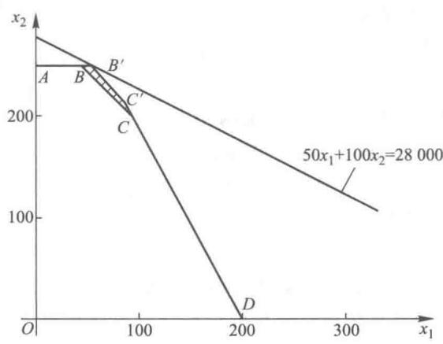

图2-6

新的可行域为 $OAB'C'D$ . 由于目标函数及各约束条件的直线的斜率都不变, 所以可知最优解由 $B$ 点 (直线 $x_{2} = 250$ 与直线 $x_{1} + x_{2} = 300$ 的交点) 变为 $B'$ 点 (直线 $x_{2} = 250$ 与直线 $x_{1} + x_{2} = 310$ 的交点). $B'$ 点的坐标即为方程组

$$
\left\{ \begin{array}{l} x _ {2} = 2 5 0 \\ x _ {1} + x _ {2} = 3 1 0 \end{array} \right.
$$

的解, 解得 $B'$ 点的坐标为 $x_{1}=60, x_{2}=250$ , 这样获得的最大利润为 $50\times60+100\times250=28\ 000$ (元), 比原来获得的最大利润 27 500 元增加了 28 000-27 500=500 (元), 这是由于增加了 10 个台时的设备而获得的. 这样每增加一个台时的设备就可以多获得 $\frac{500}{10}=50$ (元) 的利润.

像这样在约束条件常数项中增加一个单位而使最优目标函数值得到改进的数量称之为这个约束条件的对偶价格.从上面的讨论可知,设备对偶价格为50元/台时.也就是说如果增加或减少若干个台时,那么总利润将增加或减少若干个50元.

下面来看如果例 1 中的原料 A 增加 10 kg, 将会对最优解和最优值产生什么影响.

从图 2-7 可以看到由于原料 A 增加了 10 kg, 使例 1 中的原料 A 的约束条件变为

$$
2 x _ {1} + x _ {2} \leqslant 4 1 0,
$$

也使得此线性规划的可行域扩大了,增加了图 2-7 中的阴影部分,但是并不影响它的最优解和最优值.它的最优解仍是 $B$ 点，它的最优值仍然是27500，没有任何的改进.这样原料A的对偶价格就为零.其实这个问题不需要通过计算就很容易理解.由于生产50单位产品I，250单位产品Ⅱ时（即 $x_{1} = 50, x_{2} = 250$ ），原料A还有 $50\mathrm{kg}$ 没有使用（即松弛变量 $s_2 = 50$ ），如果我们再增加 $10\mathrm{kg}$ 原料A，也只不过增加库存而已，不会再增加利润，故原料A的对偶价格为零.所以当某约束条件中的松弛变量（或剩余变量）不为零时，这个约束条件的对偶价格就为零.
最优值.它的最优解仍是 $B$ 点，它的最优值仍然是27500，没有任何的改进.这样原料A的对偶价格就为零.其实这个问题不需要通过计算就很容易理解.由于生产50单位产品I，250单位产品Ⅱ时（即 $x_{1} = 50, x_{2} = 250$ ），原料A还有 $50\mathrm{kg}$ 没有使用（即松弛变量 $s_2 = 50$ ），如果我们再增加 $10\mathrm{kg}$ 原料A，也只不过增加库存而已，不会再增加利润，故原料A的对偶价格为零.所以当某约束条件中的松弛变量（或剩余变量）不为零时，这个约束条件的对偶价格就为零.

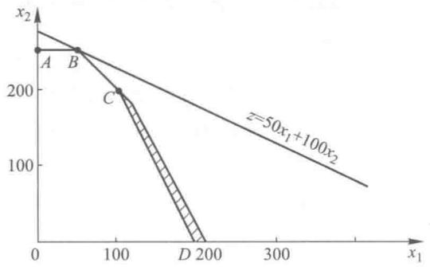

图2-7

某一约束条件的对偶价格仅仅在某一范围内是有效的.当这种约束条件的资源不断地获得，使得其 $b_{i}$ 值不断增大时，由于其他约束条件的限制，使得这种约束条件的资源用不完，即其松弛变量不为零，导致其对偶价格为零.对偶价格有效范围的确定，将放在以后几章讨论.

在求目标函数最大值的情况下,除了对偶价格大于零、等于零的情况外,还存在着对偶价格小于零的情况.当某约束条件对偶价格小于零时,约束条件常数项增加一个单位,就使得其最优目标函数值减少一个对偶价格.在求目标函数值最小值的情况下,当对偶价格大于零时,约束条件常数项增加一个单位,就使其最优目标函数值减少一个对偶价格;当对偶价格等于零时,约束条件常数项增加一个单位,并不影响其最优目标函数值;当对偶价格小于零时,约束条件常数项增加一个单位,就使得其最优目标函数值增加一个对偶价格.综上所述,当约束条件常数项增加一个单位时,有

（1）如果对偶价格大于零，则其最优目标函数值得到改进，即求最大值时，最优目标函数值变得更大；求最小值时，最优目标函数值变得更小.

（2）如果对偶价格小于零，则其最优目标函数值变坏，即求最大值时，最优目标函数值变小了；求最小值时，最优目标函数值变大了.

（3）如果对偶价格等于零，则其最优目标函数值不变.

## 习题

1. 考虑下面的线性规划问题：

$$
\begin{array}{r l} & \max z = 2 x _ {1} + 3 x _ {2};\\约束条件： & x _ {1} + 2 x _ {2} \leqslant 6,\\ & 5 x _ {1} + 3 x _ {2} \leqslant 1 5,\\ & x _ {1}, x _ {2} \geqslant 0.\end{array}
$$

(1) 画出其可行域.

(2) 当 z=6 时, 画出等值线 $2x_{1}+3x_{2}=6$ .

(3) 用图解法求出其最优解以及最优目标函数值.

2. 用图解法求解下列线性规划问题,并指出属于哪一类解(唯一最优解、无穷多最优解、无界解、无可行解).

(1)

$$
\begin{array}{r l} & \min f = 6 x _ {1} + 4 x _ {2};\\约束条件： & 2 x _ {1} + x _ {2} \geqslant 1,\\ & 3 x _ {1} + 4 x _ {2} \geqslant 3,\\ & x _ {1}, x _ {2} \geqslant 0.\end{array}
$$

(2)

$$
\begin{array}{r l} & \max z = 4 x _ {1} + 8 x _ {2};\\约束条件： & 2 x _ {1} + 2 x _ {2} \leqslant 1 0,\\ & - x _ {1} + x _ {2} \geqslant 8,\\ & x _ {1}, x _ {2} \geqslant 0.\end{array}
$$

(3)

$$
\begin{array}{r l} & \max z = x _ {1} + x _ {2};\\约束条件： & 8 x _ {1} + 6 x _ {2} \geqslant 2 4,\\ & 4 x _ {1} + 6 x _ {2} \geqslant - 1 2,\\ & 2 x _ {2} \geqslant 4,\\ & x _ {1}, x _ {2} \geqslant 0.\end{array}
$$

(4)

$$
\begin{array}{l}
\max z = 3 x _ {1} - 2 x _ {2};\
x _ {1} + x _ {2} \leqslant 1,\
2 x _ {1} + 2 x _ {2} \geqslant 4,\
x _ {1}, x _ {2} \geqslant 0.
\end{array}
$$

(5)

$$
\begin{array}{r l} & \max z = 3 x _ {1} + 9 x _ {2};\\约束条件： & x _ {1} + 3 x _ {2} \leqslant 2 2,\\ & - x _ {1} + x _ {2} \leqslant 4,\\ & x _ {2} \leqslant 6,\\ & 2 x _ {1} - 5 x _ {2} \leqslant 0,\\ & x _ {1}, x _ {2} \geqslant 0.\end{array}
$$

(6)

$$
\begin{array}{r l} & \max z = 3 x _ {1} + 4 x _ {2};\\约束条件： & - x _ {1} + 2 x _ {2} \leqslant 8,\\ & x _ {1} + 2 x _ {2} \leqslant 1 2,\\ & 2 x _ {1} + x _ {2} \leqslant 1 6,\\ & 2 x _ {1} - 5 x _ {2} \leqslant 0,\\ & x _ {1}, x _ {2} \geqslant 0.\end{array}
$$

3. 将下述线性规划问题化成标准形式：

(1)

$$
\begin{array}{r l} & \max f = 3 x _ {1} + 2 x _ {2};\\约束条件： & 9 x _ {1} + 2 x _ {2} \leqslant 3 0,\\ & 3 x _ {1} + 2 x _ {2} \leqslant 1 3,\\ & 2 x _ {1} + 2 x _ {2} \leqslant 9,\\ & x _ {1}, x _ {2} \geqslant 0.\end{array}
$$

(2)

$$
\begin{array}{r l} & \min f = 4 x _ {1} + 6 x _ {2};\\约束条件： & 3 x _ {1} - x _ {2} \geqslant 6,\\ & x _ {1} + 2 x _ {2} \leqslant 1 0,\\ & 7 x _ {1} - 6 x _ {2} = 4,\\ & x _ {1}, x _ {2} \geqslant 0.\end{array}
$$

(3)

$$
\begin{array}{r l} & \min f = - x _ {1} - 2 x _ {2};\\约束条件： & 3 x _ {1} + 5 x _ {2} \leqslant 7 0,\\ & - 2 x _ {1} - 5 x _ {2} = 5 0,\\ & - 3 x _ {1} + 2 x _ {2} \geqslant 3 0,\\ & x _ {1} \leqslant 0, - \infty \leqslant x _ {2} \leqslant + \infty .\end{array}
$$

（提示：可以令 $x_1' = -x_1$ ，这样可得 $x_1' \geqslant 0.$ 同样可以令 $x_2' - x_2'' = x_2$ ，其中 $x_2', x_2'' \geqslant 0.$ 可见当 $x_2' \geqslant x_2''$ 时， $x_2 \geqslant 0$ ；当 $x_2' \leqslant x_2''$ 时， $x_2 \leqslant 0$ ，即 $-\infty \leqslant x_2 \leqslant +\infty.$ 这样原线性规划问题可以化为含有决策变量 $x_1', x_2', x_2''$ 的线性规划问题，这里决策变量 $x_1', x_2', x_2'' \geqslant 0.$ ）

4. 考虑下面的线性规划问题：

$$
\begin{array}{r l} & \max z = 1 0 x _ {1} + 5 x _ {2};\\约束条件： & 3 x _ {1} + 4 x _ {2} \leqslant 9,\\ & 5 x _ {1} + 2 x _ {2} \leqslant 8,\\ & x _ {1}, x _ {2} \geqslant 0.\end{array}
$$

(1) 用图解法求解.

(2) 写出此线性规划问题的标准形式.

(3) 求出此线性规划问题的两个松弛变量的值.

5. 考虑下面的线性规划问题：

$$
\min f = 1 1 x _ {1} + 8 x _ {2};
$$

$$
\begin{array}{r l}约束条件： & 1 0 x _ {1} + 2 x _ {2} \geqslant 2 0,\\ & 3 x _ {1} + 3 x _ {2} \geqslant 1 8,\\ & 4 x _ {1} + 9 x _ {2} \geqslant 3 6,\\ & x _ {1}, x _ {2} \geqslant 0.\end{array}
$$

(1) 用图解法求解.

(2) 写出此线性规划问题的标准形式.

(3) 求出此线性规划问题的三个剩余变量的值.

6. 考虑下面的线性规划问题：

$$
\begin{array}{r l} & \max f = 2 x _ {1} + 3 x _ {2};\\约束条件： & x _ {1} + x _ {2} \leqslant 1 0,\\ & 2 x _ {1} + x _ {2} \geqslant 4,\\ & x _ {1} + 3 x _ {2} \leqslant 2 4,\\ & 2 x _ {1} + x _ {2} \leqslant 1 6,\\ & x _ {1}, x _ {2} \geqslant 0.\end{array}
$$

(1) 用图解法求解.

(2) 假定 $c_{2}$ 值不变, 求出使其最优解不变的 $c_{1}$ 值的变化范围.

(3) 假定 $c_{1}$ 值不变, 求出使其最优解不变的 $c_{2}$ 值的变化范围.

(4) 当 $c_{1}$ 值从 2 变为 4, $c_{2}$ 值不变时, 求出新的最优解.

(5) 当 $c_{1}$ 值不变, $c_{2}$ 值从 3 变为 1 时, 求出新的最优解.

(6) 当 $c_{1}$ 值从 2 变为 2.5, $c_{2}$ 值从 3 变为 2.5 时, 其最优解是否变化? 为什么?

7. 某家具公司生产甲、乙两种型号的组合柜，每种柜需要两种工艺（制白坯和油漆）。甲型号组合柜需要制白坯6工时，油漆8工时；乙型号组合柜需要制白坯12工时，油漆4工时。已知制白坯工艺的生产能力为120工时/天，油漆工艺的生产能力为64工时/天，甲型号组合柜单位利润为200元，乙型号组合柜单位利润为240元。

问该公司如何安排这两种产品的生产,才能获得最大的利润?最大利润是多少?

8. 要将两种大小不同的钢板裁成 A, B, C 三种规格, 每张钢板可同时裁得三种规格成品的块数如表 2-4 所示.

表2-4

<table><tr><td>钢板类型\规格类型</td><td>A规格</td><td>B规格</td><td>C规格</td></tr><tr><td>第一种钢板</td><td>1</td><td>2</td><td>1</td></tr><tr><td>第二种钢板</td><td>1</td><td>1</td><td>3</td></tr></table>

已知第一种钢板每张1000元，第二种钢板每张2000元，现需要A，B，C三种规格的成品各13,15,27块，问如何裁剪，使所用钢板费用最小？

9. 某人承揽一项业务,需做文字标牌 2 个,绘画标牌 4 个,现有两种规格的原料,甲种规格每张 300 元,可做文字标牌 1 个,绘画标牌 2 个,乙种规格每张 200 元,可做文字标牌 2 个,绘画标牌 1 个,求两种规格的原料各用多少张,才能既完成业务又使总的费用最小?

10. 某蔬菜收购点租用车辆，将 100 吨新鲜黄瓜运往某市销售，可供租用的大卡车和农用车分别为 10 辆和 20 辆，若每辆卡车载重 8 吨，运费 960 元，每辆农用车载重 2.5 吨，运费 360 元，问大卡车和农用车这两种车各租多少辆时，可全部运完黄瓜，且运费最低？最低费用为多少？

11. 某木器厂生产圆桌和衣柜两种产品, 现有两种木料, 第一种有 $72 \, m^{3}$ , 第二种有 $56 \, m^{3}$ , 假设生产每种产品都需要两种木料. 生产一张圆桌需用第一种木料 $0.18 \, m^{3}$ , 第二种木料 $0.08 \, m^{3}$ , 可获利润 60 元, 生产一个衣柜需用第一种木料 $0.09 \, m^{3}$ , 第二种 $0.28 \, m^{3}$ , 可获利润 100 元, 木器厂在现有木料情况下, 圆桌和衣柜应各生产多少, 才能使所获利润最多?

12. 某公司正在制造两种产品（产品Ⅰ和产品Ⅱ），每天的产量分别为30个和120个，利润分别为500元/个和400元/个。公司负责制造的副总经理希望了解是否可以通过改变这两种产品的数量而提高公司的利润。公司各个车间的加工能力和制造单位产品所需的加工工时如表2-5所示。

表2-5

<table><tr><td>车间</td><td>产品I</td><td>产品II</td><td>车间的加工能力(每天加工工时数)</td></tr><tr><td>1</td><td>2</td><td>0</td><td>300</td></tr><tr><td>2</td><td>0</td><td>3</td><td>540</td></tr><tr><td>3</td><td>2</td><td>2</td><td>440</td></tr><tr><td>4</td><td>1.2</td><td>1.5</td><td>300</td></tr></table>

（1）假设生产的全部产品都能销售出去，用图解法确定最优产品组合，即确定使得总利润最大的产品Ⅰ和产品Ⅱ的每天的产量.

（2）在（1）所求得的最优产品组合中，在四个车间中哪些车间的能力还有剩余？剩余多少？这在线性规划中称为剩余变量还是松弛变量？

（3）四个车间加工能力的对偶价格各为多少？即四个车间的加工能力分别增加一个加工时数时能给公司带来多少额外的利润？

（4）当产品Ⅰ的利润不变时，产品Ⅱ的利润在什么范围内变化，此最优解不变？当产品Ⅱ的利润不变时，产品Ⅰ的利润在什么范围内变化，此最优解不变？

（5）当产品Ⅰ的利润从500元/个降为450元/个，而产品Ⅱ的利润从400元/个增加为430元/个时，原来的最优产品组合是否还是最优产品组合？如有变化，新的最优产品组合是什么？

13. 某公司受委托, 准备把 120 万元投资基金 A 和 B, 其中基金 A 的单位投资额为 50 元, 年回报率为 10%, 基金 B 的单位投资额为 100 元, 年回报率为 4%. 委托人要求每年的年回报金额至少达到 6 万元. 据测定单位基金 A 的投资风险指数为 8, 单位基金 B 的投资风险指数为 3, 风险指数越大表明投资风险越大. 委托人要求在基金 B 中的投资额不少于 30 万元.

（1）为了使总的投资风险指数最小，该公司应该在基金A和B中各投资多少？这时每年的回报金额是多少？

（2）如果不考虑风险,为了使总的投资回报金额最大,应该如何投资?

---
