# 第3章 线性规划问题的计算机求解

在本章中将介绍如何使用计算机软件包求解线性规划问题.计算机软件包将帮助管理人员免去大量繁琐的计算,使得原先只有专家学者才能掌握的运筹学成为广大管理工作者解决工商管理中的问题的一个有效的、方便的、常用的工具.

本章介绍的是与本书配套的“管理运筹学”3.5版软件包，此软件包可以解决大量的管理运筹学问题。本章的重点放在如何读懂计算机输出的关于线性规划问题的求解和灵敏度分析的信息，以解决工商管理中的实际问题。

解决线性规划问题的软件包分两种:一种是大规模的软件包.它可以用来解决复杂的包含数千个决策变量和数千个约束条件的大型的线性规划问题.这些用手工的方式几年甚至几十年都解决不了的问题,用这种软件包只需要几分钟就可以解决了.另一种是用于PC机的软件包.它们有很好的界面,使用方便,是由科研机构和软件公司为解决包含数百个决策变量的线性规划问题而开发的.“管理运筹学”3.5就属于这种软件,在PC机里使用它可以解决包含100个决策变量50个约束条件的线性规划问题.它可以解决工商管理中大量的线性规划问题.

## 3.1 “管理运筹学”软件的操作方法

“管理运筹学”3.5版是“管理运筹学”3.0版的升级版。它包括线性规划、运输问题、整数规划（0-1整数规划、纯整数规划、混合整数规划和指派问题）、目标规划、对策论、最短路径、最小生成树、最大流量、最小费用最大流、关键路径、存储论、排队论、决策分析、预测问题和层次分析法，共15个子模块。

“管理运筹学”3.5版包含了3.0版的所有计算功能.修正了3.0版存在的一些问题.该版本计算更精确、更迅速,其可视化界面让人机交互更加方便,操作简便易学.同时,为了解决笔记本计算机无光驱无法安装软件的问题,我们提供了“管理运筹学”3.5版的线上下载资源,读者可通过教材提供的链接下载后安装使用。

“管理运筹学”软件可以解决本书中的绝大多数问题.下面来演示如何用“管理运筹学”软件解决第二章例1的线性规划问题.

首先在主菜单中选择线性规划模型,在屏幕上就会出现线性规划页面,如图3-1所示.

在点击“新建”按钮以后，按软件的要求输入目标函数个数和约束条件个数，输入目标函数及约束条件的各变量的系数和 $b$ 值，并选择好“ $\geqslant$ ”“ $\leqslant$ ”或“=”号，如图3-2所示.

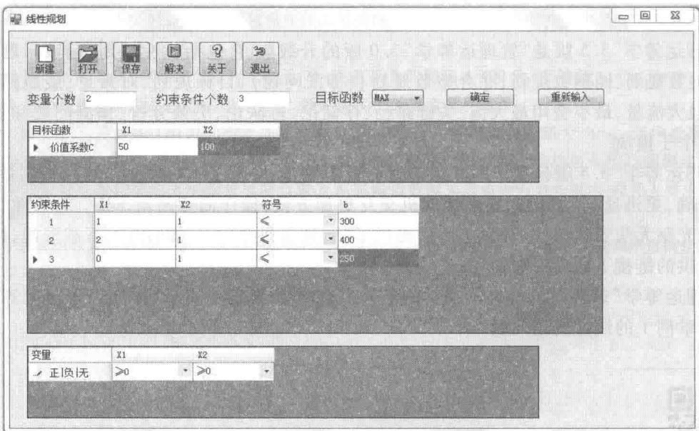

在输入中要注意以下几点：

(1)输入的系数可以是整数、小数，但不能是分数，要把分数先化为小数再输入.

(2) 输入前先要合并同类项.

当约束条件输入完毕后,请点击“解决”按钮,屏幕上将显现线性规划问题标准形式,及计算步骤界面,如图3-3a所示,把这个界面关闭,就得到结果,如图3-3b所示.

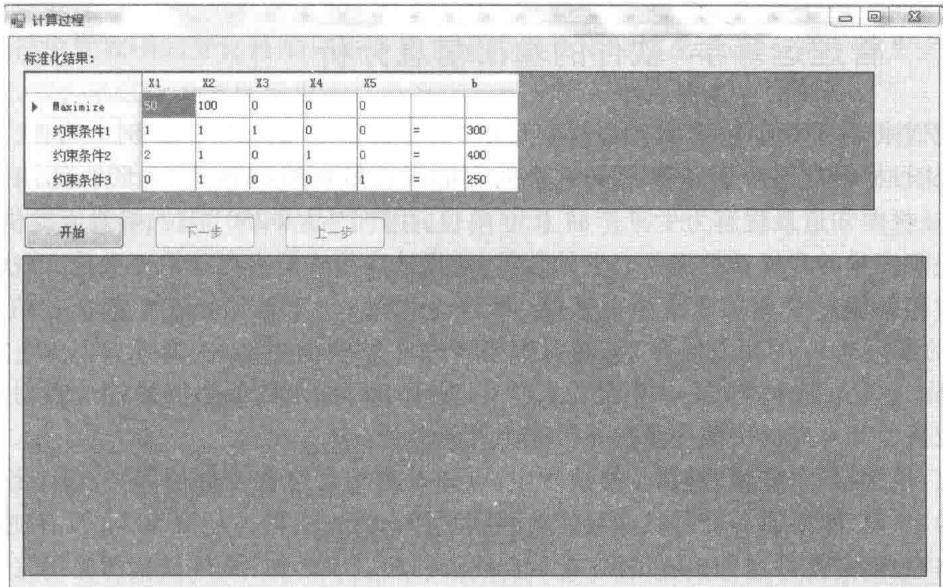

<table><tr><td>变量</td><td>最优解</td><td>相差值</td><td></td></tr><tr><td>X1</td><td>50.00</td><td>0.00</td><td></td></tr><tr><td>X2</td><td>250.00</td><td>0.00</td><td></td></tr><tr><td>约束</td><td>松弛/剩余变量</td><td>对偶价格</td><td></td></tr><tr><td>1</td><td>0.00</td><td>50.00</td><td></td></tr><tr><td>2</td><td>50.00</td><td>0.00</td><td></td></tr><tr><td>3</td><td>0.00</td><td>50.00</td><td></td></tr></table>

图3-3b

如果不关闭图 3-3a 所显示的界面, 点击“开始”按钮, 并持续按动界面中的“下一步”按钮, 界面将呈现求解的每个步骤。直至得到结果, 使读者更易掌握线性规划计算的全过程; 为方便软件计算, 本线性规划使用了大 M 法以及数值分析方法, 在线性规划问题逐步运算过程会有所体现。由于篇幅限制, 本软件只显示最多 10 个变量、10 个约束条件的线性规划问题计算的全过程, 对于更多的变量和约束条件的线性规划问题, 本书只显示计算的最终结果。

## 3.2 “管理运筹学”软件的输出信息分析

下面我们来学习如何读懂“管理运筹学”软件输出的信息.仍以第二章例1为例,如图3-3b所示,首先从目标函数值为27500可知这个问题的最优解可得到利润27500元.从变量、最优解、相差值一栏中知道最优解为生产产品I50单位,生产产品II250单位.相差值提供的数值表示相应的决策变量的目标系数需要改进的数量,使得该决策变量有可能取正数值,当决策变量已取正数值时相差值为零.对第二章例1来说,由于 $x_{1}=50,x_{2}=250$ ,所以它们的相差值都为零.不妨假设 $x_{1}$ 的值为0, $x_{1}$ 的相差值为20,则只有当产品I的利润再提高20元,即达到 $50+20=70$ (元)时,产品I才可能生产,即 $x_{1}$ 才可能大于零.对于求目标函数最小值的线性规划问题,所谓的改进就应该使其对应的决策变量的系数减少其相差值.

在约束、松弛/剩余变量、对偶价格这栏中，可知设备的台时数全部使用完，每个设备台时的对偶价格为50元，即增加一个台时就可使总利润增加50元；原料A还有 $50\mathrm{kg}$ 没有使用，原料A的对偶价格当然为零，即增加 $1\mathrm{kg}$ 原料A不会使总利润有所增加；原料B全部使用完，原料B的对偶价格为50元，即增加 $1\mathrm{kg}$ 原料B就可使总利润增加50元.

在目标函数系数范围一栏中,所谓的当前值是指在目标函数中决策变量的当前系数值.例如, $x_{1}$ 的当前值为50, $x_{2}$ 的当前值为100.所谓的上限与下限是指目标函数中决策变量的系数在此范围内变化时,其线性规划的最优解不变.例如,当 $c_{1}=80$ 时,因为 $0\leqslant80\leqslant100$ ,在 $x_{1}$ 的系数变化范围内,所以其最优解不变,即当 $x_{1}=50,x_{2}=250$ 时有最大利润.当然由于产品I的单位利润由50元变为80元了,其最大利润也增加了,变为 $80\times50+100\times250=29\ 000$ (元).但是如果 $c_{1}=110$ ,由于110>100,所以原来的最优解就不再是最优解了.同样从图3-3b可知,当 $c_{2}$ 在50与 $+\infty$ 之间变化时,原来的最优解依然是其最优解.

在常数项范围一栏中，所谓当前值是指约束条件中常数项的现在值，由图3-3b可知 $b_{1}=300,b_{2}=400,b_{3}=250$ .所谓上限与下限是指当约束条件中的常数项在此范围内变化时，与其对应的约束条件的对偶价格不变.具体地说，当设备台时数在250到325的范围内时，其对偶价格都为 50 元；当原料 A 的数量在 350 到 +∞ 范围内时，其对偶价格都为零；当原料 B 的数量在 200 到 300 的范围内时，其对偶价格都为 50 元。例如，在第二章例 1 中若设备台时数和原料 A 的数量不变，即 $b_{1}=300, b_{2}=400$ 时，原料 B 变为 280 kg，由于 $200 \leqslant 280 \leqslant 300$ ，所以原料 B 的对偶价格仍为 50 元，则新的最大利润值应为 $27500 + 30 \times 50 = 27500 + 1500 = 29000$ （元）。

以上讨论的计算机输出的关于目标函数系数及约束条件中常数项的灵敏度分析都是基于这样一个重要假设:当一个系数发生变化时,其他系数保持不变.以上讨论的所有的目标函数系数及约束条件中常数项的变化范围只适合于单个系数变化的情况.那么当两个或更多的系数都发生变化时,怎么来进行灵敏度分析呢?下面向大家介绍一个百分之一百法则.

我们先以第二章例1为例看一看如何用百分之一百法则对两个目标函数系数同时变化进行灵敏度分析.第二章例1中原来每件产品I和产品II的利润分别为50元和100元，现在由于市场情况的变化，每件产品I和产品II的利润分别变为74元和78元，那么这个线性规划问题的最优解发生变化吗？为了解决这个问题，我们首先来定义“允许增加量”和“允许减少量”这两个术语.对一个目标函数的决策变量系数，所谓允许增加量是指该系数在上限范围内的最大增加量，所谓的允许减少量是指该系数在下限范围内的最大减少量.

从图 3-3b 中可知目标函数中 $x_{1}$ 的系数的上限为 100，故 $c_{1}$ 的允许增加量为

$$
\text { 上   限 } - \text { 现   在   值 } = 1 0 0 - 5 0 = 5 0;
$$

而 $x_{2}$ 的下限为50，故 $c_{2}$ 的允许减少量为

$$
\text {   现在值   } - \text {   下限   } = 1 0 0 - 5 0 = 5 0.
$$

我们定义 $c_{i}$ 的允许增加(减少)百分比为 $c_{i}$ 的增加量(减少量)除以 $c_{i}$ 的允许增加量(允许减少量)所得到的值.这样我们可以计算出 $c_{1}$ 的允许增加百分比为 $(74-50)/50=48\%$ , $c_{2}$ 的允许减少百分比为 $(100-78)/50=44\%$ , $c_{1}$ 的允许增加百分比与 $c_{2}$ 的允许减少百分比之和为 $48\%+44\%=92\%$ .

目标函数决策变量系数的百分之一百法则:对于所有变化的目标函数决策变量系数,当其所有允许增加百分比和允许减少百分比之和不超过百分之一百时,最优解不变.

因为 $c_{1}$ 的允许增加百分比与 $c_{2}$ 的允许减少百分比之和为 92%，不超过 100%，所以当每件产品Ⅰ利润增加为 74 元，每件产品Ⅱ利润减少为 78 元时，此线性规划最优解仍然为产品Ⅰ生产 50 件，产品Ⅱ生产 250 件（即 $x_{1}=50, x_{2}=250$ ），此时最大利润为 $74 \times 50 + 78 \times 250 = 3\ 700 + 19\ 500 = 23\ 200$ （元）.

同样有约束条件中常数项的百分之一百法则:对于所有变化的约束条件中的常数项,当其所有允许增加百分比和允许减少百分比之和不超过百分之一百时,其对偶价格不变.其中 $b_{j}$ 的允许增加(减少)百分比的定义同 $c_{i}$ 的允许增加(减少)百分比一样,为 $b_{j}$ 的增加量(减少量)除以 $b_{j}$ 的允许增加量(减少量)所得到的值.

仍以第二章例1为例来说明如何用约束条件中常数项的百分之一百法则进行灵敏度分析.不妨设设备台时数从300台时增加为315台时，而原料A从 $400\mathrm{kg}$ 减少到 $390\mathrm{kg}$ ，原料B从 $250\mathrm{kg}$ 减少到 $240\mathrm{kg}$ ，这样我们可以得到它们的允许增加（减少）百分比分别为 $\frac{15}{25} = 60\%$ ， $\frac{10}{50} = 20\%$ ， $\frac{10}{50} = 20\%$ 所以它们的允许增加百分比与允许减少百分比之和为 $60\% +20\% +20\% = 100\%$ ，从以上约束条件中常数项的百分之一百法则可知此线性规划的对偶价格不变.又从对偶价格可知 $50\times15-0\times10-50\times10=250$ （元），则最大利润增加了250元，为27750元.

在使用百分之一百法则进行灵敏度分析时,要注意以下三点:

（1）当允许增加量（减少量）为无穷大时,则对于任一个增加量（减少量）,其允许增加（减少）百分比都看成零.

（2）百分之一百法则是判断最优解或对偶价格是否发生变化的充分条件，但不是必要条件。也就是说，当其允许增加百分比和允许减少百分比之和不超过 $100\%$ 时，其最优解或对偶价格不变；但是当其允许增加百分比和允许减少百分比之和超过 $100\%$ 时，我们并不知道其最优解或对偶价格是否发生变化。

（3）百分之一百法则不能应用于目标函数决策变量系数和约束条件中常数项同时变化的情况，在这种情况下，只有重新求解.

下面用“管理运筹学”软件来分析第二章例2,其数学模型如下:

$$
\begin{array}{r l r} & \min f = 2 x _ {1} + 3 x _ {2};\\约束条件： & x _ {1} + x _ {2} \geqslant 3 5 0, & (1)\\& x _ {1} \geqslant 1 2 5, & (2)\\& 2 x _ {1} + x _ {2} \leqslant 6 0 0, & (3)\\& x _ {1} \geqslant 0, x _ {2} \geqslant 0.\end{array}
$$

用“管理运筹学”软件可以得到输出信息,如图 3-4 所示.

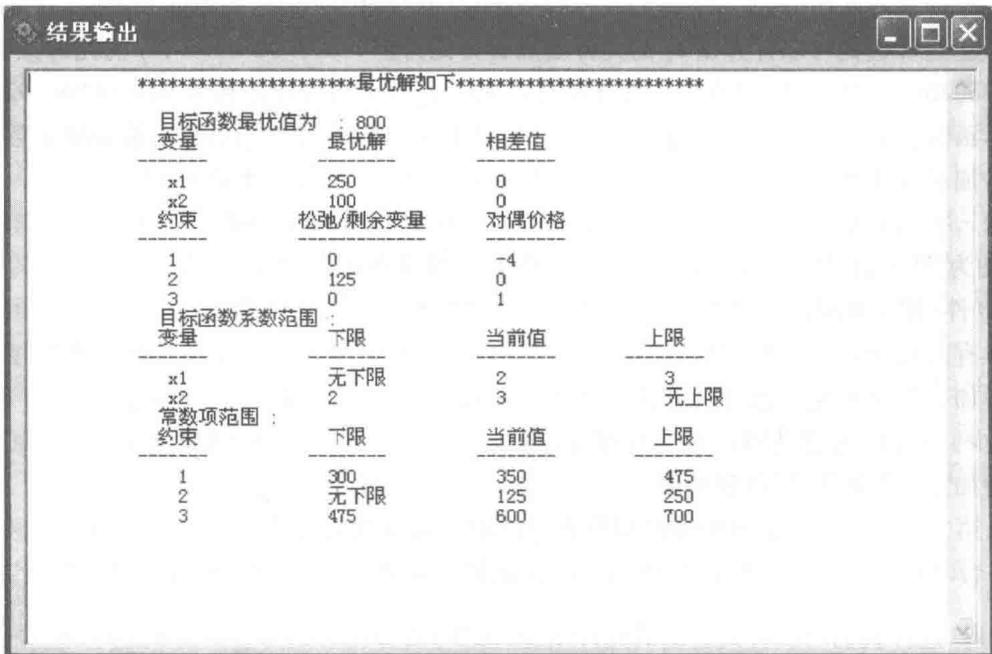

从图3-4可知，当购进原料A $250\mathrm{t}(x_{1} = 250)$ ，原料B $100\mathrm{t}(x_{2} = 100)$ 时，购进成本最低，为800万元.在松弛/剩余变量栏中，约束条件(2)的值为125，它表示对原料A的最低需求，由于此约束为大于等于，这样可知原料A的剩余变量值为125.同样可知约束条件(1)(对所有原料的总需要量)的剩余变量值为零，约束条件(3)(加工时数的限制)的松弛变量值为零.

在对偶价格一栏中, 可知约束条件(3)(加工时数)的对偶价格为1万元, 也就是说如果把加工时数从600 h增加到601 h, 则总成本将得到改进(因为对偶价格为正值), 由800万元减少为800-1=799(万元). 也可知约束条件(1)(原料A和B的总量的下限)的对偶条件为-4万元, 也就是说如果把购进原料A和B的总量的下限从350 t增加到351 t, 那么总成本将加大(因为对偶价格为负值), 由800万元增加到800+4=804(万元). 当然如果减少对原料A和B的总量的下限, 如把原料A和B的总量的下限从350 t减少到349 t, 那么总成本将得到改进, 由800万元减少到800-4=796(万元).

在目标函数系数范围这一栏中,知道当 $c_{2}$ (目标函数中 $x_{2}$ 的系数) 不变,而 $c_{1}$ (目标函数中 $x_{1}$ 的系数) 在 $-\infty$ 到 3 范围内变化时,最优解不变;当 $c_{1}$ 不变, $c_{2}$ 在 2 到 $+\infty$ 范围内变化时,最优解不变.

在常数项范围一栏中,知道当约束条件(1)的常数项(原料A和原料B的总量的下限)在300到475范围内变化,而其他约束条件的常数项不变时,约束条件(1)的对偶价格不变,仍为-4.当约束条件(2)的常数项(原料A的需求量的下限)在 $-\infty$ 到250范围内变化,而其他约束条件的常数项不变时,约束条件(2)的对偶价格不变,仍为0.当约束条件(3)的常数项(加工时数的上限)在475到700范围内变化,而其他约束条件的常数项不变时,约束条件(3)的对偶价格不变,仍为1.

在本章快结束时,还有两点需要提醒大家注意:

（1）在部分文献中常常使用“影子价格”这个术语.当约束条件中的常数项增加一个单位时，最优目标函数值增加的数量称为影子价格.对照对偶价格的定义：当约束条件中的常数项增加一个单位时最优目标函数值改进的数量，可知当求目标函数的最大值时，增加的数量就是改进的数量，所以影子价格就等于对偶价格；而当求目标函数的最小值时，改进的数量应该是减少的数量，所以影子价格即为负的对偶价格.

（2）“管理运筹学”软件可以解决含有100个决策变量50个约束方程的线性规划问题，可以解决工商管理中大量的问题。如果想要解决更大的线性规划问题，可以使用由芝加哥大学的L.E.Schrage开发的LINDO计算机软件包的PC机版本LINDO/PC.

## 习题

1. 见第二章习题7, 设 $x, y$ 分别为甲、乙两种柜的日产量. 目标函数:

$$
\begin{array}{r l} & \max z = 2 0 0 x + 2 4 0 y;\\约束条件： & 6 x + 1 2 y \leqslant 1 2 0, \quad x + 2 y \leqslant 2 0,\\& 8 x + 4 y \leqslant 6 4,\\& x \geqslant 0,\\& 2 x + y \leqslant 1 6,\\即 & x \geqslant 0,\\& y \geqslant 0.\end{array}
$$

使用“管理运筹学”软件,求得计算机解如图3-5所示.

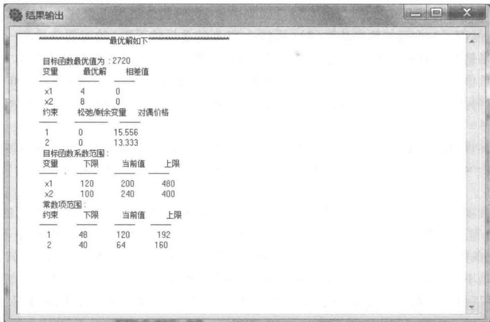

根据图3-5回答下面的问题：

(1)甲、乙两种柜的日产量是多少？这时最大利润是多少？

(2) 图 3-5 中的对偶价格 13.333 的含义是什么?

(3)对图 3-5 中的常数项范围的上、下限的含义给予具体说明，并阐述如何使用这些信息.

(4) 若甲组合柜的利润变为 300, 最优解变不变? 为什么?

2. 见第二章习题8, 设需裁第一种钢板 $x$ 张, 第二种钢板 $y$ 张, 所用钢板费用 $z$ (千元). 目标函数:

$$
\begin{array}{r l} & \min z = x + 2 y;\\约束条件： & x + y \geqslant 1 3,\\& 2 x + y \geqslant 1 5,\\& x + 3 y \geqslant 2 7,\\& x \geqslant 0,\\& y \geqslant 0.\end{array}
$$

使用“管理运筹学”软件,求得计算机解如图 3-6 所示.

根据图3-6回答下面的问题：

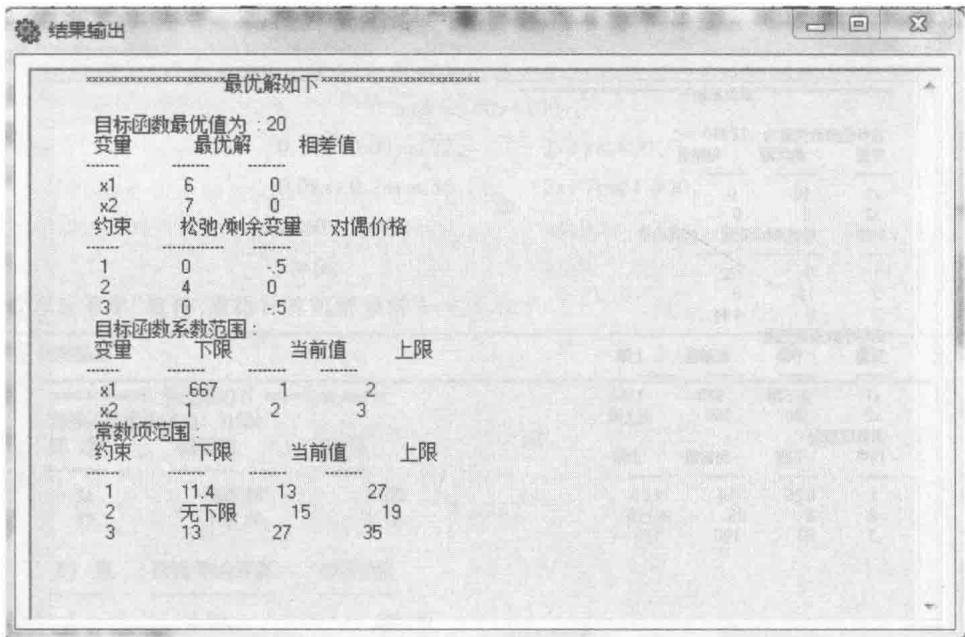

(1)在最优的决策下，需要裁第一种和第二种钢板各多少张？

(2) 在什么情况下第一个约束即需要 A 种规格的成品个数的对偶价格不变?

(3) 松弛变量中的 4 表示什么含义?

3. 见第二章习题 10, 设租用大卡车 x 辆, 农用车 y 辆, 最低运费为 z 元. 目标函数:

$$
\begin{array}{r l} & {\min z = 9 6 0 x + 3 6 0 y;}\\约束条件： & {0 \leqslant x \leqslant 1 0,}\\& {0 \leqslant y \leqslant 2 0,}\\& {8 x + 2. 5 y \geqslant 1 0 0.}\end{array}
$$

使用“管理运筹学”软件,求得计算机解如图 3-7 所示.

根据图3-7回答下面的问题：

(1) 松弛变量中的 12 是什么含义?

(2) 当 $c_{1}$ 不变时, $c_{2}$ 在什么范围内变化, 最优解不变?

(3)每增加一辆大卡车对总目标值有什么影响？

4. 见第二章习题9, 设用甲种规格原料 $x$ 张, 乙种规格原料 $y$ 张, 所用原料的总费用是 $z$ (百元). 目标函数:
   $$
   \begin{array}{r l}\\\min z & = 3 x + 2 y;\end{array}
   $$

$$
\begin{array}{r l} 约束条件：x + 2 y & \geqslant 2,\\2 x + y & \geqslant 4,\\x & \geqslant 0,\\y & \geqslant 0.\end{array}
$$

使用“管理运筹学”软件,求得计算机解如图 3-8 所示.

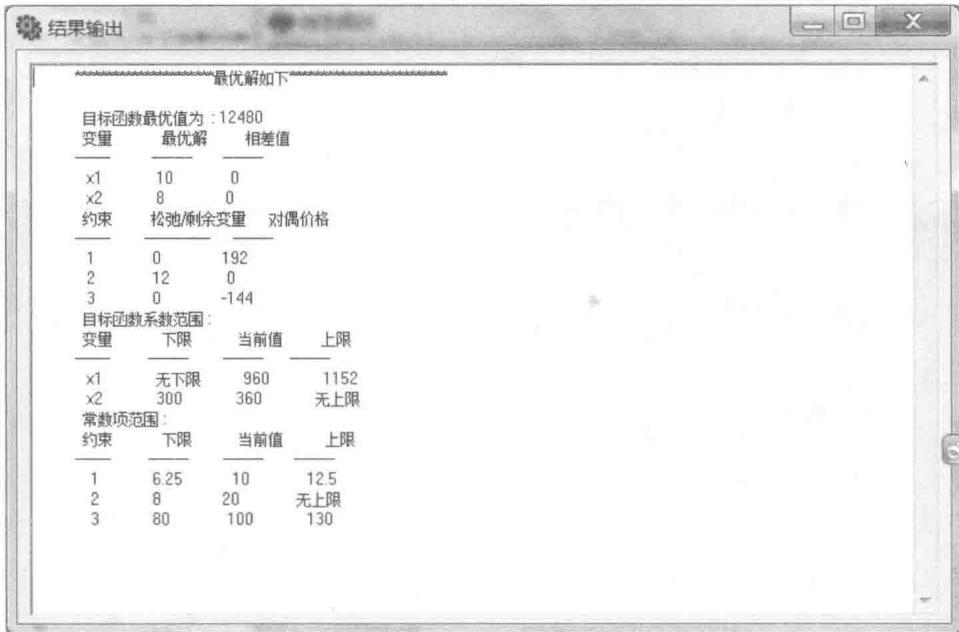

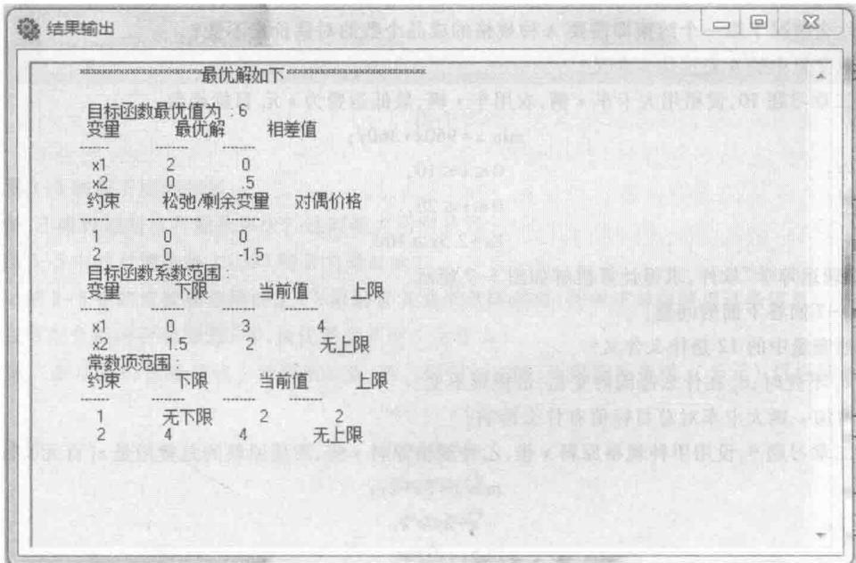
(1) 甲、乙规格的原料各用多少张, 总费用最少? 最少费用是多少?

(2) 约束 1 的常数项范围中的上下限是什么含义?

5. 见第二章习题 11, 设圆桌和衣柜的生产件数分别为 x、y, 所获利润为 z. 目标函数:

$$
\begin{array}{r l} & \max z = 6 0 x + 1 0 0 y;\\约束条件： & 0. 1 8 x + 0. 0 9 y \leqslant 7 2,\\& x \geqslant 0,\\& 2 x + y \leqslant 8 0 0,\\& y \geqslant 0.\\即 & x \geqslant 0,\\& y \geqslant 0.\end{array}
$$

使用“管理运筹学”软件,求得计算机解如图 3-9 所示.

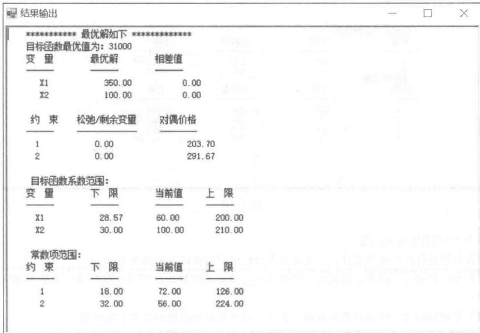

根据图3-9回答下面的问题：

(1)圆桌和衣柜的生产件数分别是多少？这时最大利润是多少？

(2) 相差值中 0 代表什么意思?

(3)如果生产圆桌的利润变为75元，衣柜利润变为90元，最优解变不变？如果变最优解是多少？

6. 见第二章第12题，设 $x_{1}$ 为产品I每天的产量， $x_{2}$ 为产品II每天的产量，可以建立下面的线性规划模型：

$$
\begin{array}{r l} & \max z = 5 0 0 x _ {1} + 4 0 0 x _ {2};\\约束条件： & 2 x _ {1} \leqslant 3 0 0,\\& 3 x _ {2} \leqslant 5 4 0,\\& 2 x _ {1} + 2 x _ {2} \leqslant 4 4 0,\\& 1. 2 x _ {1} + 1. 5 x _ {2} \leqslant 3 0 0,\\& x _ {1}, x _ {2} \geqslant 0.\end{array}
$$

使用“管理运筹学”软件,得到的计算机解如图 3-10 所示.

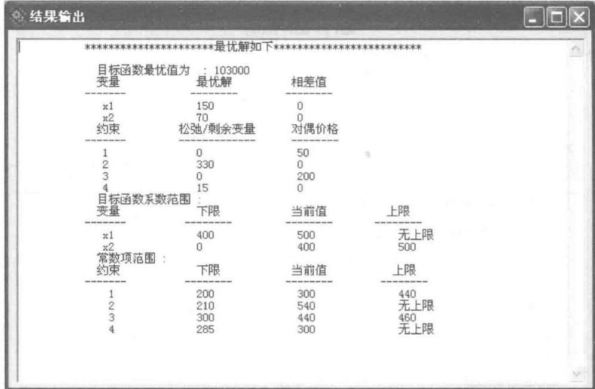

根据图3-10回答下面的问题：

(1)最优解即最优产品组合是什么？此时最大目标函数值即最大利润为多少？

(2)哪些车间的加工工时数已使用完？哪些车间的加工工时数还没用完？其松弛变量即没用完的加工工时数为多少？

(3)四个车间的加工工时的对偶价格各为多少？请对此对偶价格的含义予以说明.

(4)如果请你在这四个车间中选择一个车间进行加班生产，你会选择哪个车间？为什么？

(5)目标函数中 $x_{1}$ 的系数 $c_{1}$ ，即每单位产品I的利润值，在什么范围内变化时，最优产品的组合不变？

(6)目标函数中 $x_{2}$ 的系数 $c_{2}$ ，即每单位产品Ⅱ的利润值，从400元提高为490元时，最优产品组合变化了没有？为什么？

(7) 请解释约束条件中的常数项的上限与下限.

(8)第1车间的加工工时数从300增加到400时，总利润能增加多少？这时最优产品的组合变化了没有？

(9)第3车间的加工工时数从440增加到480时，从图3-10中我们能否求得总利润增加的数量？为什么？

(10)当每单位产品Ⅰ的利润从500元降至475元，而每单位产品Ⅱ的利润从400元升至450元时，其最优产品组合（即最优解）是否发生变化？请用百分之一百法则进行判断.

(11)当第1车间的加工工时数从300增加到350，而第3车间的加工工时数从440降到380时，用百分之一百法则能否判断原来的对偶价格是否发生变化？如不发生变化，请求出其最大利润.

7. 见第二章第 13 题(1)，设 $x_{A}$ 为购买基金 A 的数量， $x_{B}$ 为购买基金 B 的数量，可以建立下面的线性规划模型：

$$
\begin{array}{r l} & \min f = 8 x _ {\mathrm{A}} + 3 x _ {\mathrm{B}};\\约束条件： & 5 0 x _ {\mathrm{A}} + 1 0 0 x _ {\mathrm{B}} \leqslant 1 2 0 0 0 0 0,\\& 5 x _ {\mathrm{A}} + 4 x _ {\mathrm{B}} \geqslant 6 0 0 0 0,\\& 1 0 0 x _ {\mathrm{B}} \geqslant 3 0 0 0 0 0,\\& x _ {\mathrm{A}}, x _ {\mathrm{B}} \geqslant 0.\end{array}
$$

使用“管理运筹学”软件，求得计算机解如图3-11所示.

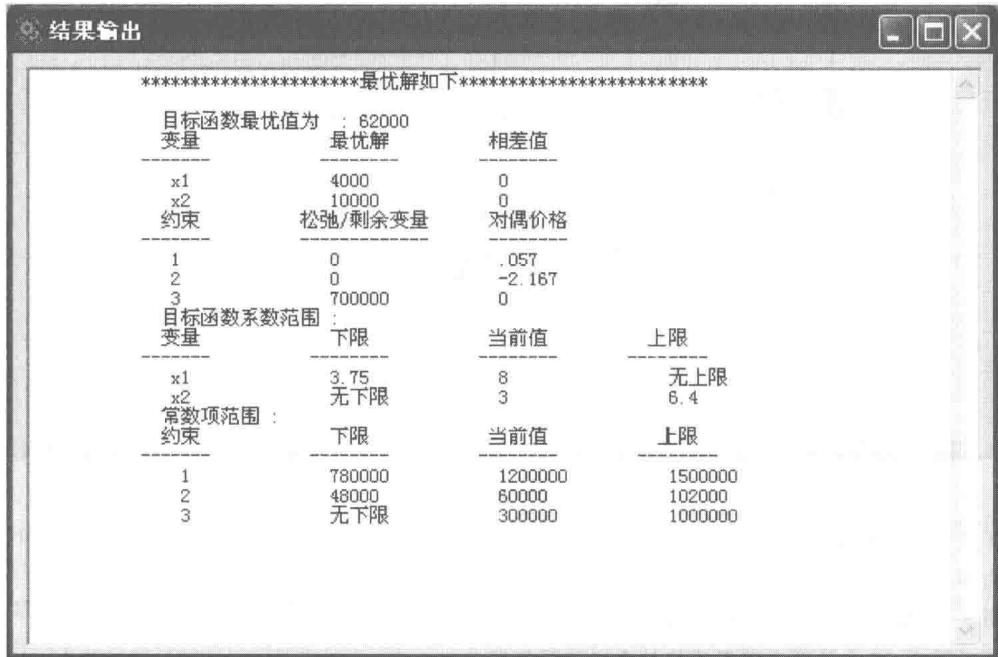

根据图 3-11, 回答下列问题:

(1)购买基金A和基金B的数量各为多少？这时总的投资风险指数为多少？

(2) 请对图 3-11 中的三个对偶价格的含义给予解释.

(3)图3-11中的松弛/剩余变量的含义是什么？

(4)请对图3-11中的目标函数系数范围上、下限给予具体的解释说明，并阐述如何使用这些信息.

(5)请对图3-11中的常数项范围的上、下限给予具体解释，并阐述应如何使用这些信息.

(6)当每单位基金 A 的风险指数从 8 降为 6，而每单位基金 B 的风险指数从 3 上升为 5 时，用百分之一百法则能否断定其最优解是否发生变化？为什么？

8. 见第二章第 13 题(2)，仍设 $x_{A}$ 为购买基金 A 的数量， $x_{B}$ 为购买基金 B 的数量，建立的线性规划模型如下：

$$
\begin{array}{r l} & \max z = 5 x _ {\mathrm{A}} + 4 x _ {\mathrm{B}};\\约束条件： & 5 0 x _ {\mathrm{A}} + 1 0 0 x _ {\mathrm{B}} \leqslant 1 2 0 0 0 0 0,\\& 1 0 0 x _ {\mathrm{B}} \geqslant 3 0 0 0 0 0,\\& x _ {\mathrm{A}}, x _ {\mathrm{B}} \geqslant 0.\end{array}
$$

使用“管理运筹学”软件,求得计算机解如图 3-12 所示.

根据图 3-12, 回答下列问题:

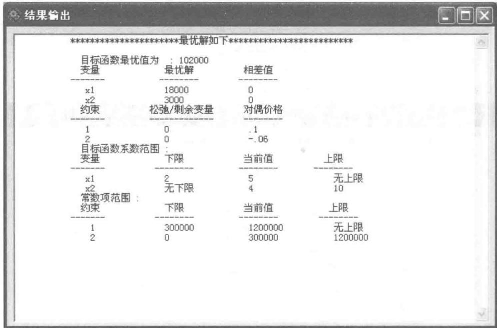

(1)在这个最优解中，购买基金 A 和基金 B 的数量各为多少？这时获得的最大利润是多少？这时总的投资风险指数为多少？

(2) 图 3-12 中的松弛/剩余变量的含义是什么?

(3)请对图 3-12 中的两个对偶价格的含义给予解释.

(4)请对图3-12中的目标函数范围中的上、下限的含义给予具体说明，并阐述如何使用这些信息.

(5)请对图3-12中的常数项范围的上、下限的含义给予具体说明，并阐述如何使用这些信息.

(6)当投资总金额从1200000元下降到600000元，而在基金B上至少投资的金额从300000元增加到600000元时，其对偶价格是否发生变化？为什么？

9. 考虑下面的线性规划问题：

$$
\begin{array}{r l} & \max z = 2 x _ {1} + x _ {2} - x _ {3} + x _ {4};\\约束条件： & x _ {1} - x _ {2} + 2 x _ {3} + x _ {4} \geqslant 2,\\& x _ {1} - 3 x _ {2} + x _ {3} - x _ {4} \leqslant 4,\\& 2 x _ {2} + x _ {3} + 2 x _ {4} \leqslant 3,\\& x _ {1}, x _ {2}, x _ {3}, x _ {4} \geqslant 0.\end{array}
$$

其计算机求解的结果如图 3-13 所示.

根据图 3-13 回答下列问题：

(1)请指出其最优解及其最优目标函数值.

(2) 哪些约束条件起到了约束的作用？它们的对偶价格各为多少？请给予说明.

(3)如果请你选择一个约束条件，将它的常数项增加一个单位，你将选择哪一个约束条件？这时最优目标函数值将是多少？

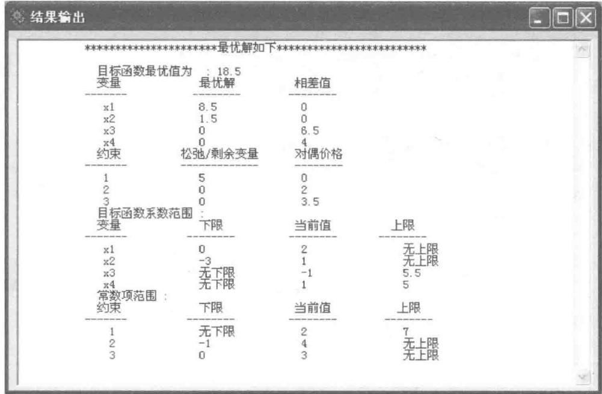

(4)请问在目标函数中 $x_{3}$ 的系数在什么范围内变化时，其最优解不变？这时其最优目标函数值是否发生变化？为什么？

(5)请问在目标函数中 $x_{1}$ 的系数在什么范围内变化时，其最优解不变？这时其最优目标函数值是否发生变化？为什么？

10. 考虑下面的线性规划问题：

$$
\begin{array}{r l} & \min z = 1 6 x _ {1} + 1 6 x _ {2} + 1 7 x _ {3};\\约束条件： & x _ {1} + x _ {3} \leqslant 3 0,\\& 0. 5 x _ {1} - x _ {2} + 6 x _ {3} \geqslant 1 5,\\& 3 x _ {1} + 4 x _ {2} - x _ {3} \geqslant 2 0,\\& x _ {1}, x _ {2}, x _ {3} \geqslant 0.\end{array}
$$

其计算机求解结果如图 3-14 所示.

根据图 3-14, 回答下列问题:

(1)第二个约束方程的对偶价格是一个负数（为-3.622），它的含义是什么？

(2) $x_{2}$ 的相差值为0.703,它的含义是什么?

(3)当目标函数中 $x_{1}$ 的系数从16降为15，而 $x_{2}$ 的系数从16升为18时，最优解是否发生变化？

(4)当第一个约束条件的常数项从30减少到15，而第二个约束条件的常数项从15增加到80时，你能断定其对偶价格是否发生变化吗？为什么？

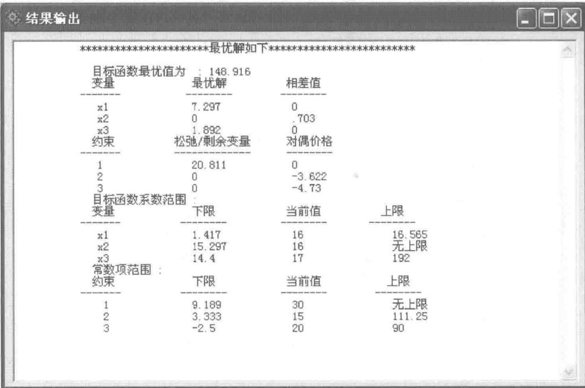

---
