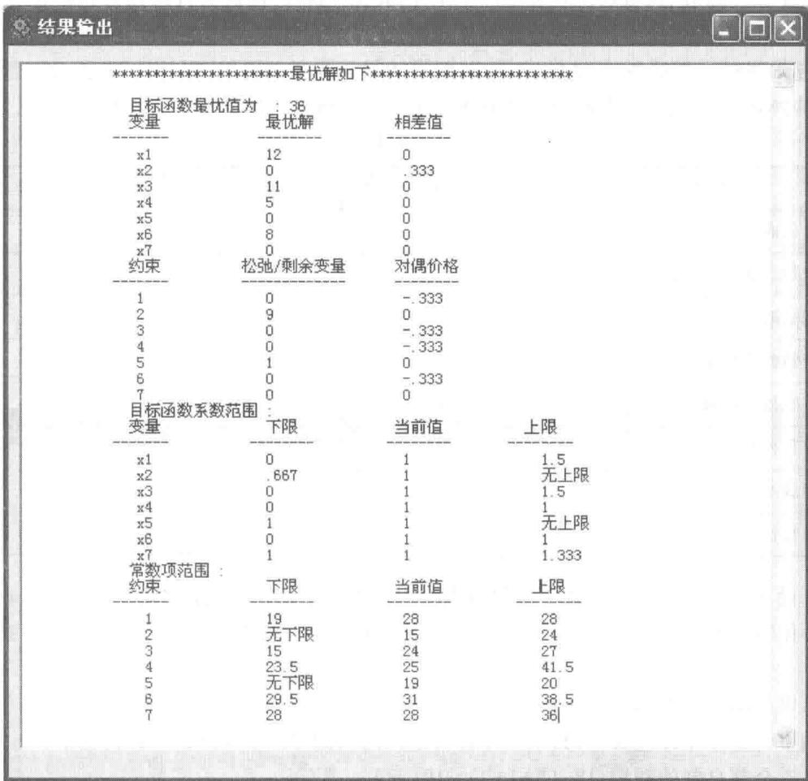
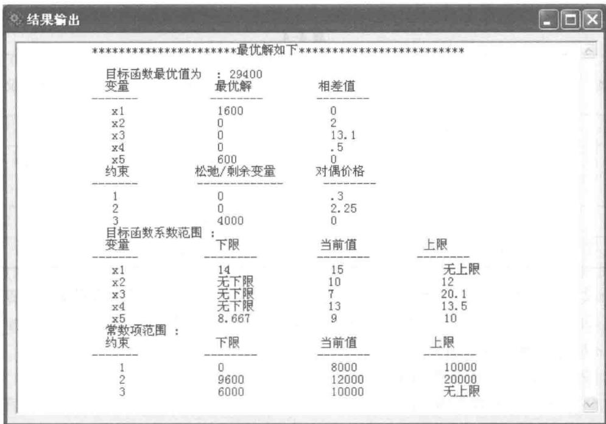
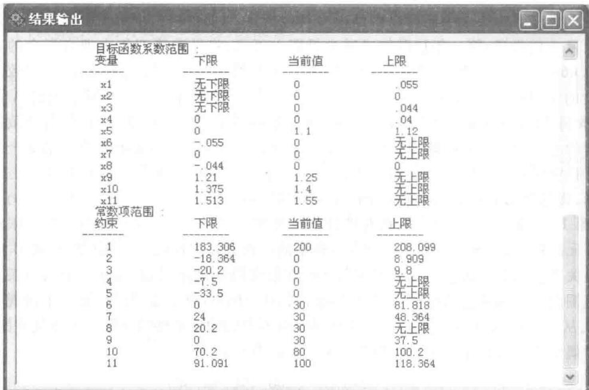

# 第4章 线性规划在工商管理中的应用

通过线性规划的图解法,我们对线性规划的求解及灵敏度分析的基本概念、基本原理已有所了解;又通过线性规划问题的计算机求解,掌握了用计算机软件这一有效工具去求解线性规划问题及其灵敏度分析.现在我们来研究线性规划在工商管理中的应用,解决工商管理中的实际问题.

## 4.1 人力资源分配的问题

例 1 某昼夜服务的公交线路每天各时间段内所需司机和乘务人员人数如表 4-1 所示.

表4-1

<table><tr><td>班次</td><td>时间</td><td>所需人数</td><td>班次</td><td>时间</td><td>所需人数</td></tr><tr><td>1</td><td>6:00—10:00</td><td>60</td><td>4</td><td>18:00—22:00</td><td>50</td></tr><tr><td>2</td><td>10:00—14:00</td><td>70</td><td>5</td><td>22:00—2:00</td><td>20</td></tr><tr><td>3</td><td>14:00—18:00</td><td>60</td><td>6</td><td>2:00—6:00</td><td>30</td></tr></table>

设司机和乘务人员分别在各时间段开始时上班，并连续工作8 h，问该公交线路应怎样安排司机和乘务人员，既能满足工作需要，又使配备司机和乘务人员的人数最少？

解 设 $x_{i}$ 表示第 $i$ 班次时开始上班的司机和乘务人员人数，这样可以知道在第 $i$ 班次工作的人数应包括第 $i - 1$ 班次时开始上班的人数和第 $i$ 班次时开始上班的人数，如有 $x_{1} + x_{2} \geqslant 70$ . 又要求这六个班次时开始上班的所有人员最少，即要求 $x_{1} + x_{2} + x_{3} + x_{4} + x_{5} + x_{6}$ 最小，这样建立如下的数学模型：

$$
\begin{array}{r l} & \min x _ {1} + x _ {2} + x _ {3} + x _ {4} + x _ {5} + x _ {6};\\约束条件： & x _ {1} + x _ {6} \geqslant 6 0,\\& x _ {1} + x _ {2} \geqslant 7 0,\\& x _ {2} + x _ {3} \geqslant 6 0,\\& { x _ {3} + x _ {4} \geqslant 5 0  ,}\\& { x _ {4} + x _ {5} \geqslant 2 0  ,}\\& { x _ {5} + x _ {6} \geqslant 3 0  ,}\\& { x _ {1}, x _ {2}, x _ {3}, x _ {4}, x _ {5}, x _ {6} \geqslant 0.}\end{array}
$$

用“管理运筹学”软件可以求得此问题的最优解： $x_{1}=50,x_{2}=20,x_{3}=50,x_{4}=0,x_{5}=20,x_{6}=10$ ，一共需要司机和乘务人员150人.

例 2 一家中型的百货商场对售货员的需求经过统计分析如表 4-2 所示.

表4-2

<table><tr><td>时间</td><td>所需售货员人数</td><td>时间</td><td>所需售货员人数</td></tr><tr><td>星期一</td><td>15</td><td>星期五</td><td>31</td></tr><tr><td>星期二</td><td>24</td><td>星期六</td><td>28</td></tr><tr><td>星期三</td><td>25</td><td>星期日</td><td>28</td></tr><tr><td>星期四</td><td>19</td><td></td><td></td></tr></table>

为了保证售货员充分休息,要求售货员每周工作五天,休息两天,并要求休息的两天是连续的,问应该如何安排售货员的休息日期,既满足工作需要,又使配备的售货员的人数最少?

解 设 $x_{1}$ 为星期一开始休息的人数, $x_{2}$ 为星期二开始休息的人数…… $x_{6}$ 为星期六开始休息的人数, $x_{7}$ 为星期日开始休息的人数. 我们的目标是要求售货员的总数最少. 因为每个售货员都工作五天, 休息两天, 所以只要计算出连续休息两天的售货员人数, 也就计算出了售货员的总数. 把连续休息两天的售货员按照开始休息的时间分成 7 类, 各类的人数分别为 $x_{1}, x_{2}, \cdots, x_{7}$ , 则目标函数为

$$
x _ {1} + x _ {2} + x _ {3} + x _ {4} + x _ {5} + x _ {6} + x _ {7}.
$$

再按照每天所需售货员的人数写出约束条件.例如，星期日需要28人，而商场中的全体售货员中除了星期六开始休息和星期日开始休息的人外都应该上班，即有 $x_{1} + x_{2} + x_{3} + x_{4} + x_{5}\geqslant 28$ ，这样就建立了如下的数学模型：

$$
\begin{array}{r l} & \min x _ {1} + x _ {2} + x _ {3} + x _ {4} + x _ {5} + x _ {6} + x _ {7};\\约束条件： & x _ {1} + x _ {2} + x _ {3} + x _ {4} + x _ {5} \geqslant 2 8,\\& x _ {2} + x _ {3} + x _ {4} + x _ {5} + x _ {6} \geqslant 1 5,\\& x _ {3} + x _ {4} + x _ {5} + x _ {6} + x _ {7} \geqslant 2 4,\\& x _ {4} + x _ {5} + x _ {6} + x _ {7} + x _ {1} \geqslant 2 5,\\& x _ {5} + x _ {6} + x _ {7} + x _ {1} + x _ {2} \geqslant 1 9,\\& x _ {6} + x _ {7} + x _ {1} + x _ {2} + x _ {3} \geqslant 3 1,\\& x _ {7} + x _ {1} + x _ {2} + x _ {3} + x _ {4} \geqslant 2 8,\\& x _ {1}, x _ {2}, x _ {3}, x _ {4}, x _ {5}, x _ {6}, x _ {7} \geqslant 0.\end{array}
$$

用“管理运筹学”软件很容易求得此问题的最优解： $x_{1}=12,x_{2}=0,x_{3}=11,x_{4}=5,x_{5}=0,x_{6}=8$ ， $x_{7}=0$ ，目标函数的最小值为36.也就是说我们配备36个售货员，并安排12人在星期一和星期二休息；安排11人在星期三和星期四休息；安排5人在星期四和星期五休息；安排8人在星期六和星期日休息。这样的安排既能满足工作需要，又使配备的售货员最少。

“管理运筹学”软件对此问题的解如图 4-1 所示.

图4-1

往往一些服务行业的企业对人力资源的需求一周内像例2所描述的那样变化,而每天的各时间段的需求又像例1所描述的那样变化,在保证工作人员每天工作8 h,每周连续休息两天的情况下,如何安排能使人员的编制最小呢?

我们只要用例 1 的方法, 分别求出周一, 周二……周六, 周日每天的人员的需求, 再用例 2 的方法,即可求出该公司的最小编制.

## 4.2 生产计划的问题

例 3 某公司面临一个是外包协作还是自行生产的问题.该公司有甲、乙、丙三种产品,这三种产品都要经过铸造、机械加工和装配三道工序.甲、乙两种产品的铸件可以外包协作,亦可以自行生产,但产品丙必须由本厂铸造才能保证质量.有关情况如表 4-3 所示,公司中可利用的总工时为:铸造 8 000 h,机械加工 12 000 h 和装配 10 000 h.为了获得最大利润,甲、乙、丙三种产品各应生产多少件?甲、乙两种产品的铸件有多少由本公司铸造?有多少为外包协作?

表4-3

<table><tr><td>工时与成本</td><td>甲</td><td>乙</td><td>丙</td></tr><tr><td>每件铸造工时/小时</td><td>5</td><td>10</td><td>7</td></tr><tr><td>每件机械加工工时/小时</td><td>6</td><td>4</td><td>8</td></tr><tr><td>每件装配工时/小时</td><td>3</td><td>2</td><td>2</td></tr><tr><td>自行生产铸件每件成本/元</td><td>3</td><td>5</td><td>4</td></tr><tr><td>外包协作铸件每件成本/元</td><td>5</td><td>6</td><td>—</td></tr><tr><td>机械加工每件成本/元</td><td>2</td><td>1</td><td>3</td></tr><tr><td>装配每件成本/元</td><td>3</td><td>2</td><td>2</td></tr><tr><td>每件产品售价/元</td><td>23</td><td>18</td><td>16</td></tr></table>

解 设 $x_{1}, x_{2}, x_{3}$ 分别为三道工序都由本公司加工的甲、乙、丙三种产品的件数， $x_{4}, x_{5}$ 分别为由外包协作铸造再由本公司进行机械加工和装配的甲、乙两种产品的件数。每件产品的利润如下：

产品甲全部自制的利润: $23-(3+2+3)=15$ (元);

产品甲铸造工序外包协作,其余工序自行生产的利润: $23-(5+2+3)=13$ (元);

产品乙全部自制的利润: $18-(5+1+2)=10$ (元);

产品乙铸造工序外包协作,其余工序自行生产的利润: $18-(6+1+2)=9$ (元);

产品丙的利润: $16-(4+3+2)=7$ (元).

建立数学模型如下：

$$
\begin{array}{r l} & {\max 1 5 x _ {1} + 1 0 x _ {2} + 7 x _ {3} + 1 3 x _ {4} + 9 x _ {5};}\\约束条件： & {5 x _ {1} + 1 0 x _ {2} + 7 x _ {3} \leqslant 8   0 0 0 (\text {铸造})  ,}\\& {6 x _ {1} + 4 x _ {2} + 8 x _ {3} + 6 x _ {4} + 4 x _ {5} \leqslant 1 2   0 0 0 (\text {机械加工})  ,}\\& {3 x _ {1} + 2 x _ {2} + 2 x _ {3} + 3 x _ {4} + 2 x _ {5} \leqslant 1 0   0 0 0 (\text {装配})  ,}\\& {x _ {1}, x _ {2}, x _ {3}, x _ {4}, x _ {5} \geqslant 0.}\end{array}
$$

用“管理运筹学”软件进行计算,计算结果如图4-2所示.从这个结果我们知道最大利润为29400元,其最优的生产计划为全部由自己生产的产品甲1600件,铸造工序外包协作而其余工序自行生产的产品乙600件.从相差值一栏中可知,如果全部由自己生产的产品乙的单位利润再增加2元,达到每件12元,那么全部自制的产品乙才有可能生产.同样产品丙的利润要再增加13.1元,达到每件利润20.1元,产品丙才有可能生产;铸造工序外包协作而其余工序自行生产的产品甲利润再增加0.5元,达到13.5元,才有可能生产.从对偶价格栏可知铸造每工时的对偶价格为0.3元,机械加工每工时的对偶价格为2.25元,装配每工时的对偶价格为0.这样如果有人以低于铸造和机械加工的对偶价格来提供铸造及机械加工的工时则可以购入来获取差价.同样如果有人要购买该公司的铸造与机械加工的工时,则出价扣除成本外,还必须高于其对偶价格, 否则就不宜出售. 至于装配每工时的对偶价格为 0, 这是由于在此生产计划下还有 4000 个装配工时没有用完. 从常数项范围栏可知, 当铸造工时在 0 到 10000 小时之间变化时其对偶价格都为 0.3 元; 当机械加工工时在 9600 到 20000 小时内变化时, 其对偶价格都为 2.25 元; 当装配工时在 6000 到 +∞ 内变化时, 其对偶价格都为 0. 从目标函数系数范围一栏中, 我们知道, 当全部自己生产的每件产品甲的利润在 14 元到 +∞ 内变化时, 其最优解不变; 全部自己生产的每件产品乙的利润只要不超过 12 元, 其最优解不变; 当每件产品丙的利润不超过 20.1 元时, 其最优解不变; 当铸造工序外包协作而其余工序自行生产的每件产品甲的利润不超过 13.5 元时, 其最优解不变; 当铸造工序外包协作而其余工序自行生产的每件产品乙的利润在 8.667 元到 10 元内变化时, 其最优解不变. 在这里, 当某产品利润变化时都假设其余产品的利润是不变的.

图4-2

例 4 永久机械厂生产 I, II, III 三种产品. 每种产品均要经过 A, B 两道加工工序. 设该厂有两种规格的设备能完成工序 A, 它们以 $A_{1}, A_{2}$ 表示; 有三种规格的设备能完成工序 B, 它们以 $B_{1}, B_{2}, B_{3}$ 表示. 产品 I 可在工序 A 和 B 的任何规格的设备上加工. 产品 II 可在工序 A 的任何一种规格的设备上加工, 但完成工序 B 时, 只能在设备 $B_{1}$ 上加工. 产品 III 只能在设备 $A_{2}$ 与 $B_{2}$ 上加工. 已知在各种设备上加工的单件工时、各种设备的有效台时以及满负荷操作时的设备费用如表 4-4 所示. 另外已知产品 I, II, III 的原料单价分别为 0.25 元/件, 0.35 元/件和 0.50 元/件, 销售单价分别为 1.25 元/件, 2.00 元/件和 2.80 元/件. 要求制定最优的产品加工方案, 使该厂利润最大.

表4-4

<table><tr><td rowspan="2">设备</td><td colspan="3">产品单件工时</td><td rowspan="2">设备的有效台时</td><td rowspan="2">满负荷时的设备费用</td></tr><tr><td>I</td><td>II</td><td>III</td></tr><tr><td> \(A_{1}\) </td><td>5</td><td>10</td><td></td><td>6 000</td><td>300</td></tr><tr><td> \(A_{2}\) </td><td>7</td><td>9</td><td>12</td><td>10 000</td><td>321</td></tr><tr><td> \(B_{1}\) </td><td>6</td><td>8</td><td></td><td>4 000</td><td>250</td></tr><tr><td> \(B_{2}\) </td><td>4</td><td></td><td>11</td><td>7 000</td><td>783</td></tr><tr><td> \(B_{3}\) </td><td>7</td><td></td><td></td><td>4 000</td><td>200</td></tr></table>

解 设 $x_{ijk}$ 表示产品 i 在工序 j (工序 A 用 1 表示, 工序 B 用 2 表示) 的设备 k 上加工的数量. 例如, $x_{123}$ 表示产品 I 在工序 B 上用设备 $B_{3}$ 加工的数量. 这样我们有约束条件:

$5x_{111}+10x_{211}\leqslant6\ 000$ （设备 $A_{1}$ ），

$7x_{112}+9x_{212}+12x_{312}\leqslant10\ 000$ （设备 $A_{2}$ ），

$6x_{121}+8x_{221}\leqslant4\ 000$ （设备 $B_{1}$ ），

$4x_{122}+11x_{322}\leqslant7\ 000$ （设备 $B_{2}$ ），

$7x_{123}\leqslant4\ 000$ （设备 $B_{3}$ ），

$x_{111} + x_{112} - x_{121} - x_{122} - x_{123} = 0$ （产品I在工序A，B上加工的数量相等），

$x_{211}+x_{212}-x_{221}=0$ （产品Ⅱ在工序A，B上加工的数量相等），

$x_{312}-x_{322}=0$ （产品Ⅲ在工序 A, B 上加工的数量相等），

$$
x _ {i j k} \geqslant 0 (i = 1, 2, 3; j = 1, 2; k = 1, 2, 3).
$$

本题的目标是要使利润最大化,利润的计算公式如下:

利润 $= \sum_{i = 1}^{3}\left[(\text{销售单价} - \text{原料单价}) \times \text{该产品件数}\right] -$ $\sum_{j = 1}^{5}$ （每台时的设备费用 $\times$ 该设备实际使用的总台时）.

这样我们得到

$$
\begin{array}{l} \max (1. 2 5 - 0. 2 5) (x _ {1 1 1} + x _ {1 1 2}) + (2 - 0. 3 5) (x _ {2 1 1} + x _ {2 1 2}) + (2. 8 0 - 0. 5) x _ {3 1 2} - \\ \frac {3 0 0}{6 0 0 0} (5 x _ {1 1 1} + 1 0 x _ {2 1 1}) - \frac {3 2 1}{1 0 0 0 0} (7 x _ {1 1 2} + 9 x _ {2 1 2} + 1 2 x _ {3 1 2}) - \\ \frac {2 5 0}{4 0 0 0} (6 x _ {1 2 1} + 8 x _ {2 2 1}) - \frac {7 8 3}{7 0 0 0} (4 x _ {1 2 2} + 1 1 x _ {3 2 2}) - \\ \frac {2 0 0}{4 0 0 0} (7 x _ {1 2 3}). \end{array}
$$

经过整理得到

$$
\begin{array}{l} \max 0. 7 5 x _ {1 1 1} + 0. 7 7 5 3 x _ {1 1 2} + 1. 1 5 x _ {2 1 1} + 1. 3 6 1 1 x _ {2 1 2} + 1. 9 1 4 8 x _ {3 1 2} -\\0. 3 7 5 x _ {1 2 1} - 0. 5 x _ {2 2 1} - 0. 4 4 7 4 x _ {1 2 2} - 1. 2 3 0 4 x _ {3 2 2} - 0. 3 5 x _ {1 2 3}.\end{array}
$$

使用“管理运筹学”软件可得到此问题的最优解：

$$
x _ {1 1 1} = 1 2 0 0, x _ {1 1 2} = 2 3 0. 0 4 9 2, x _ {2 1 1} = 0, x _ {2 1 2} = 5 0 0, x _ {3 1 2} = 3 2 4. 1 3 8,
$$

$$
x _ {1 2 1} = 0, x _ {2 2 1} = 5 0 0, x _ {1 2 2} = 8 5 8. 6 2 0 6, x _ {3 2 2} = 3 2 4. 1 3 8, x _ {1 2 3} = 5 7 1. 4 2 8 6.
$$

最优值为 1 146.600 5.

由于本题要求的决策变量的单位是件,所以答案应该是整数.本题与例1,例2,例3实质上都是整数规划问题,但是这类问题可以作为线性规划问题来解,有些(如例1,例2,例3)答案是整数,而有些(如本题)答案是非整数,可以将答案舍入成整数,从而得到满意的结果.例如,如果我们用“管理运筹学”软件的整数规划的部分来解本题,得到的答案为 $x_{111}=1\ 200,x_{112}=230,x_{211}=0,x_{212}=500,x_{312}=324,x_{121}=0,x_{221}=500,x_{122}=859,x_{322}=324,x_{123}=571$ ,最优值为1 146.362 2.其最优解正好与四舍五入上述线性规划结果一样.两种方法的最优值也相差无几,只差不到0.3元.本书第八章将整数规划作为一章来讲解.在该章中,将告诉我们哪些整数问题可以用线性规划模型求解,哪些问题必须用整数规划模型解决.

本问题的最优方案为生产产品Ⅰ1430件，产品Ⅰ第A道工序由设备 $A_{1}$ 加工1200件，由设备 $A_{2}$ 加工 230 件. 产品 I 的第 B 道工序由设备 $B_{2}$ 加工 859 件, 由设备 $B_{3}$ 加工 571 件. 生产产品 II 500 件, 它的第 A 道工序全部由设备 $A_{2}$ 加工, 它的第 B 道工序全部由设备 $B_{1}$ 加工. 生产产品 III 324 件, 其第 A 道工序全部由设备 $A_{2}$ 加工, 其第 B 道工序全部由设备 $B_{2}$ 加工, 这样能使工厂获得最大利润 1146.3622 元.

## 4.3 套裁下料问题

例 5 某工厂要做 100 套钢架, 每套钢架需要长度分别为 2.9 m, 2.1 m 和 1.5 m 的圆钢各一根. 已知原料每根长 7.4 m, 问应如何下料, 可使所用原料最省?

解 最简单的做法是在每根原材料上截取 2.9 m, 2.1 m 和 1.5 m 的圆钢各一根组成一套, 每根原材料省下料头 0.9 m. 为了做 100 套钢架, 需要原材料 100 根, 共有 90 m 的料头. 若改用套裁则可以节约不少原材料. 为了找到一个省料的套裁方案, 我们可以列出所有可能的下料方案如表 4-5 所示, 以供套裁用.

表4-5

<table><tr><td>下料数/根\方案长度/m</td><td>I</td><td>II</td><td>III</td><td>IV</td><td>V</td><td>VI</td><td>VII</td><td>VIII</td></tr><tr><td>2.9</td><td>1</td><td>2</td><td>0</td><td>1</td><td>0</td><td>1</td><td>0</td><td>0</td></tr><tr><td>2.1</td><td>0</td><td>0</td><td>2</td><td>2</td><td>1</td><td>1</td><td>3</td><td>0</td></tr><tr><td>1.5</td><td>3</td><td>1</td><td>2</td><td>0</td><td>3</td><td>1</td><td>0</td><td>4</td></tr><tr><td>合计/m</td><td>7.4</td><td>7.3</td><td>7.2</td><td>7.1</td><td>6.6</td><td>6.5</td><td>6.3</td><td>6.0</td></tr><tr><td>料头/m</td><td>0</td><td>0.1</td><td>0.2</td><td>0.3</td><td>0.8</td><td>0.9</td><td>1.1</td><td>1.4</td></tr></table>

为了用最少的原材料得到100套钢架，需要混合使用表4-5中的几种下料方案，设按方案I，II，III，IV，V，VI，VII，VIII下料的原材料根数分别为 $x_{1}, x_{2}, x_{3}, x_{4}, x_{5}, x_{6}, x_{7}, x_{8}$ 可列出下面的数学模型：

$$
\begin{array}{r l} & \min x _ {1} + x _ {2} + x _ {3} + x _ {4} + x _ {5} + x _ {6} + x _ {7} + x _ {8};\\约束条件： & x _ {1} + 2 x _ {2} + x _ {4} + x _ {6} \geqslant 1 0 0,\\& 2 x _ {3} + 2 x _ {4} + x _ {5} + x _ {6} + 3 x _ {7} \geqslant 1 0 0,\\& 3 x _ {1} + x _ {2} + 2 x _ {3} + 3 x _ {5} + x _ {6} + 4 x _ {8} \geqslant 1 0 0,\\& x _ {1}, x _ {2}, x _ {3}, x _ {4}, x _ {5}, x _ {6}, x _ {7}, x _ {8} \geqslant 0.\end{array}
$$

用“管理运筹学”软件，我们很容易得到最优下料方案，按方案Ⅰ下料30根，按方案Ⅱ下料10根，按方案Ⅳ下料50根（即 $x_{1}=30,x_{2}=10,x_{3}=0,x_{4}=50,x_{5}=0,x_{6}=x_{7}=x_{8}=0$ ），只需90根原材料（即目标函数最小值为90）即可制造100套钢架.

如果所有可能的下料方案太多,我们可以先设计出较好的几个下料方案.所谓较好,首先要求每个方案下料后的料头较短;其次要求这些方案的总体能裁下所有各种规格的圆钢,并且不同方案有着不同的各种所需圆钢的比.这样套裁即使不是最优解,也是次优解,也能满足对各种不同规格圆钢的需要并达到省料的目的.例如我们选取前5种下料方案供套裁用,进行建模求解,也可以得到上述的最优解.

注意,在建立此数学模型时,约束条件用大于等于号比用等于号要好.因为有时在套用一些下料方案时可能会多出一根或几根某种规格的圆钢,但它可能是最优方案.如果用等于号,这个下料方案就不是可行解了.约束条件用大于等于号时,本来目标函数求所用原材料最少和求料头最少是一样的,但由于在第一个下料方案中料头为零,无论按第一下料方案下多少根料,料头都为零,所以目标函数就一定要求所用原材料最少.

像例 5 那样在一个定长度的原料上裁出不同长度的产品, 是一个线裁问题, 如果在一个一定形状的面积上, 裁出不同形状的产品, 这是一个面裁问题. 当然, 类似地还有体裁问题.

例 5 告诉了我们用套裁下料的方法解决线裁优化问题,是否可以推广到面裁、体裁呢? 答案是肯定的,我们只要像例 5 那样,设计出一些较好的下料方案,然后用类似的线性规划模型,即可解决这些问题.

如果把例 5 中只有一种规格(长度)的原材料拓展为有多种规格(长度)的原材料,那应该如何解决问题?请读者自己思考。

## 4.4 配料问题

例 6 某工厂要用三种原料 1,2,3 混合调配出三种不同规格的产品甲、乙、丙，产品的规格要求、产品的单价、每天能供应的原材料数量及原材料单价如表 4-6 和表 4-7 所示。该厂应如何安排生产，才能使利润最大？

表4-6

<table><tr><td>产品名称</td><td>规格要求</td><td>单价/(元·kg-1)</td></tr><tr><td rowspan="2">甲</td><td>原材料1不少于50%</td><td rowspan="2">50</td></tr><tr><td>原材料2不超过25%</td></tr><tr><td rowspan="2">乙</td><td>原材料1不少于25%</td><td rowspan="2">35</td></tr><tr><td>原材料2不超过50%</td></tr><tr><td>丙</td><td>不限</td><td>25</td></tr></table>

表4-7

<table><tr><td>原材料名称</td><td>每天最多供应量/kg</td><td>单价/(元·kg-1)</td></tr><tr><td>1</td><td>100</td><td>65</td></tr><tr><td>2</td><td>100</td><td>25</td></tr><tr><td>3</td><td>60</td><td>35</td></tr></table>

解 设 $x_{ij}$ 表示第 $i$ （我们分别用1,2,3表示产品甲、乙、丙）种产品中原材料 $j$ 的含量.例如， $x_{23}$ 就表示产品乙中第3种原材料的含量，我们的目标是要使利润最大，利润的计算公式如下：

利润 = $\sum_{i=1}^{3}$ （销售单价 × 该产品的数量） - $\sum_{j=1}^{3}$ （每种原料单价 × 使用原料数量）.

故得

$$
\begin{array}{r l} & \max 5 0 (x _ {1 1} + x _ {1 2} + x _ {1 3}) + 3 5 (x _ {2 1} + x _ {2 2} + x _ {2 3}) + 2 5 (x _ {3 1} + x _ {3 2} + x _ {3 3}) - \\ & \quad 6 5 (x _ {1 1} + x _ {2 1} + x _ {3 1}) - 2 5 (x _ {1 2} + x _ {2 2} + x _ {3 2}) - 3 5 (x _ {1 3} + x _ {2 3} + x _ {3 3}) \\ & \quad = - 1 5 x _ {1 1} + 2 5 x _ {1 2} + 1 5 x _ {1 3} - 3 0 x _ {2 1} + 1 0 x _ {2 2} - 4 0 x _ {3 1} - 1 0 x _ {3 3}. \end{array}
$$

从表4-6可知

$$
\begin{array}{l} x _ {1 1} \geqslant 0. 5 (x _ {1 1} + x _ {1 2} + x _ {1 3}), \\ x _ {1 2} \leqslant 0. 2 5 (x _ {1 1} + x _ {1 2} + x _ {1 3}), \\ x _ {2 1} \geqslant 0. 2 5 (x _ {2 1} + x _ {2 2} + x _ {2 3}), \\ x _ {2 2} \leqslant 0. 5 (x _ {2 1} + x _ {2 2} + x _ {2 3}). \end{array}
$$

从表 4-7 中可知加入产品甲、乙、丙的原材料不能超过原材料的供应数量的限额,所以有

$$
\begin{array}{l} x _ {1 1} + x _ {2 1} + x _ {3 1} \leqslant 1 0 0, \\ x _ {1 2} + x _ {2 2} + x _ {3 2} \leqslant 1 0 0, \\ x _ {1 3} + x _ {2 3} + x _ {3 3} \leqslant 6 0. \end{array}
$$

通过整理得到此问题的约束条件：

$$
\begin{array}{l} 0. 5 x _ {1 1} - 0. 5 x _ {1 2} - 0. 5 x _ {1 3} \geqslant 0,\\- 0. 2 5 x _ {1 1} + 0. 7 5 x _ {1 2} - 0. 2 5 x _ {1 3} \leqslant 0,\\0. 7 5 x _ {2 1} - 0. 2 5 x _ {2 2} - 0. 2 5 x _ {2 3} \geqslant 0,\\- 0. 5 x _ {2 1} + 0. 5 x _ {2 2} - 0. 5 x _ {2 3} \leqslant 0,\\x _ {1 1} + x _ {2 1} + x _ {3 1} \leqslant 1 0 0,\\x _ {1 2} + x _ {2 2} + x _ {3 2} \leqslant 1 0 0,\\x _ {1 3} + x _ {2 3} + x _ {3 3} \leqslant 6 0,\\x _ {i j} \geqslant 0 (i = 1, 2, 3; j = 1, 2, 3).\end{array}
$$

此问题的数学模型如下：

$$
\begin{array}{r l} & \max z = - 1 5 x _ {1 1} + 2 5 x _ {1 2} + 1 5 x _ {1 3} - 3 0 x _ {2 1} + 1 0 x _ {2 2} - 4 0 x _ {3 1} - 1 0 x _ {3 3}.\\约束条件： & 0. 5 x _ {1 1} - 0. 5 x _ {1 2} - 0. 5 x _ {1 3} \geqslant 0,\\& - 0. 2 5 x _ {1 1} + 0. 7 5 x _ {1 2} - 0. 2 5 x _ {1 3} \leqslant 0,\\& 0. 7 5 x _ {2 1} - 0. 2 5 x _ {2 2} - 0. 2 5 x _ {2 3} \geqslant 0,\\& - 0. 5 x _ {2 1} + 0. 5 x _ {2 2} - 0. 5 x _ {2 3} \leqslant 0,\\& x _ {1 1} + x _ {2 1} + x _ {3 1} \leqslant 1 0 0,\\& x _ {1 2} + x _ {2 2} + x _ {3 2} \leqslant 1 0 0,\\& x _ {1 3} + x _ {2 3} + x _ {3 3} \leqslant 6 0,\\& x _ {i j} \geqslant 0 (i = 1, 2, 3; j = 1, 2, 3).\end{array}
$$

此线性规划的计算机解为 $x_{11}=100, x_{12}=50, x_{13}=50$ ，其余的 $x_{ij}=0$ ，也就是说每天只生产产品甲200 kg，分别需要用第1种原料100 kg，第2种原料50 kg，第3种原料50 kg，可使工厂获利最大。

例 7 汽油混合问题.一种汽油的特性可用两种指标描述,用“辛烷数”来定量描述其点火性,用“蒸气压力”来定量描述其挥发性.某炼油厂有标号为1,2,3,4的4种标准汽油,其特性和库存量如表4-8所示.将这4种标准汽油混合,可得到标号为1,2的两种航空汽油,这两种航空汽油的性能指标及产量需求如表4-9所示.

表4-8

<table><tr><td>标准汽油</td><td>辛烷数</td><td>蒸气压力/ \((g \cdot cm^{-2})\) </td><td>库存量/L</td></tr><tr><td>1</td><td>107.5</td><td> \(7.11 \times 10^{-2}\) </td><td>380 000</td></tr><tr><td>2</td><td>93.0</td><td> \(11.38 \times 10^{-2}\) </td><td>265 200</td></tr><tr><td>3</td><td>87.0</td><td> \(5.69 \times 10^{-2}\) </td><td>408 100</td></tr><tr><td>4</td><td>108.0</td><td> \(28.45 \times 10^{-2}\) </td><td>130 100</td></tr></table>

表4-9

<table><tr><td>航空汽油</td><td>辛烷数</td><td>蒸气压力/ \((g \cdot cm^{-2})\) </td><td>产量需求/L</td></tr><tr><td>1</td><td>不小于91</td><td>不大于 \(9.96 \times 10^{-2}\) </td><td>越多越好</td></tr><tr><td>2</td><td>不小于100</td><td>不大于 \(9.96 \times 10^{-2}\) </td><td>不少于250 000</td></tr></table>

应如何根据库存情况适量混合各种标准汽油，既满足航空汽油的性能指标，又使2号航空汽油满足需求,并使得1号航空汽油产量最高?

解 设 $x_{ij}$ 为标号为 i 的航空汽油中所用标号为 j 的标准汽油的数量（单位：L），这样可知 $x_{11} + x_{12} + x_{13} + x_{14}$ 为 1 号航空汽油的总产量，其总产量要求越多越好，所以有

$$
\max x _ {1 1} + x _ {1 2} + x _ {1 3} + x _ {1 4}.
$$

至于约束条件,根据有关库存量和产量指标有

$$
\begin{array}{l} x _ {2 1} + x _ {2 2} + x _ {2 3} + x _ {2 4} \geqslant 2 5 0 0 0 0, \\ x _ {1 1} + x _ {2 1} \leqslant 3 8 0 0 0 0, \\ x _ {1 2} + x _ {2 2} \leqslant 2 6 5 2 0 0, \\ x _ {1 3} + x _ {2 3} \leqslant 4 0 8 1 0 0, \\ x _ {1 4} + x _ {2 4} \leqslant 1 3 0 1 0 0, \\ x _ {i j} \geqslant 0 (i = 1, 2; j = 1, 2, 3, 4). \end{array}
$$

我们再来列出有关辛烷数和蒸气压力的约束条件.

物理学中的“分压定律”可叙述如下：“设有一种混合气体由 n 种气体组成。设混合气体的压强为 p，所占总容积为 V，各组成成分的压强及其所占容积分别为 $p_{1}, p_{2}, \cdots, p_{n}$ 及 $v_{1}, v_{2}, \cdots, v_{n}$ ，则 $pV = \sum_{j=1}^{n} p_{j} v_{j}$ ”。用此分压定律可写出有关蒸气压强的约束条件。

1号航空汽油的蒸气压强不能大于 $9.96\times10^{-2}\ g/cm^{2}$ ，即有

$$
\frac {7 . 1 1 \times 1 0 ^ {- 2} x _ {1 1} + 1 1 . 3 8 \times 1 0 ^ {- 2} x _ {1 2} + 5 . 6 9 \times 1 0 ^ {- 2} x _ {1 3} + 2 8 . 4 5 \times 1 0 ^ {- 2} x _ {1 4}}{x _ {1 1} + x _ {1 2} + x _ {1 3} + x _ {1 4}} \leqslant 9. 9 6 \times 1 0 ^ {- 2}.
$$

经过整理得

$$
2. 8 5 x _ {1 1} - 1. 4 2 x _ {1 2} + 4. 2 7 x _ {1 3} - 1 8. 4 9 x _ {1 4} \geqslant 0.
$$

同样,可以得到有关2号航空汽油的蒸气压强的约束条件为

$$
2. 8 5 x _ {2 1} - 1. 4 2 x _ {2 2} + 4. 2 7 x _ {2 3} - 1 8. 4 9 x _ {2 4} \geqslant 0.
$$

同样可以写出有关辛烷数的约束条件,对于1号航空汽油有

$$
\frac {1 0 7 . 5 x _ {1 1} + 9 3 x _ {1 2} + 8 7 x _ {1 3} + 1 0 8 x _ {1 4}}{x _ {1 1} + x _ {1 2} + x _ {1 3} + x _ {1 4}} \geqslant 9 1.
$$

经整理得

$$
1 6. 5 x _ {1 1} + 2 x _ {1 2} - 4 x _ {1 3} + 1 7 x _ {1 4} \geqslant 0.
$$

对于 2 号航空汽油有

$$
7. 5 x _ {2 1} - 7 x _ {2 2} - 1 3 x _ {2 3} + 8 x _ {2 4} \geqslant 0.
$$

综上所述得到此问题的数学模型：

$$
\begin{array}{r l} & \max x _ {1 1} + x _ {1 2} + x _ {1 3} + x _ {1 4};\\约束条件： & x _ {2 1} + x _ {2 2} + x _ {2 3} + x _ {2 4} \geqslant 2 5 0 0 0 0,\\& x _ {1 1} + x _ {2 1} \leqslant 3 8 0 0 0 0,\\& x _ {1 2} + x _ {2 2} \leqslant 2 6 5 2 0 0,\\& x _ {1 3} + x _ {2 3} \leqslant 4 0 8 1 0 0,\\& x _ {1 4} + x _ {2 4} \leqslant 1 3 0 1 0 0,\\& 2. 8 5 x _ {1 1} - 1. 4 2 x _ {1 2} + 4. 2 7 x _ {1 3} - 1 8. 4 9 x _ {1 4} \geqslant 0,\\& 2. 8 5 x _ {2 1} - 1. 4 2 x _ {2 2} + 4. 2 7 x _ {2 3} - 1 8. 4 9 x _ {2 4} \geqslant 0,\\& 1 6. 5 x _ {1 1} + 2 x _ {1 2} - 4 x _ {1 3} + 1 7 x _ {1 4} \geqslant 0,\\& 7. 5 x _ {2 1} - 7 x _ {2 2} - 1 3 x _ {2 3} + 8 x _ {2 4} \geqslant 0,\\& x _ {i j} \geqslant 0 (i = 1, 2; j = 1, 2, 3, 4).\end{array}
$$

用“管理运筹学”软件可求得此问题的最优解为 $x_{11} = 261966.078, x_{12} = 265200, x_{13} = 315672.219, x_{14} = 90561.688, x_{21} = 118033.906, x_{22} = 0, x_{23} = 92427.758, x_{24} = 39538.309$ ，且有 $\max (x_{11} + x_{12} + x_{13} + x_{14}) = 933399.938$ . 也就是说，用1号标准汽油 $261966.078\mathrm{L}, 2$ 号标准汽油 $265200\mathrm{L}, 3$ 号标准汽油 $315672.219\mathrm{L}, 4$ 号标准汽油 $90561.688\mathrm{L}$ ，混合成 $933399.938\mathrm{L}1$ 号航空汽油；用1号标准汽油 $118033.906\mathrm{L}, 2$ 号标准汽油 $0\mathrm{L}, 3$ 号标准汽油 $92427.758\mathrm{L}, 4$ 号标准汽油 $39538.309\mathrm{L}$ 混合成 $250000\mathrm{L}2$ 号航空汽油，这是既满足2号航空汽油的产量需求，又使1号航空汽油的产量为最高的最优方案。

## 4.5 投资问题

例 8 某部门现有资金 200 万元,今后五年内考虑给以下的项目投资:

项目 A: 从第一年到第五年每年年初都可投资, 当年末能收回本利 110%.

项目 B: 从第一年到第四年每年年初都可以投资, 次年末收回本利 125%, 但规定每年最大投资额不能超过 30 万元.

项目 C: 第三年初需要投资, 到第五年末能收回本利 140%, 但规定最大投资额不能超过 80 万元.

项目 D: 第二年初需要投资, 到第五年末能收回本利 155%, 但规定最大投资额不能超过 100 万元.

据测定每次投资 1 万元的风险指数如表 4-10 所示.

表4-10

<table><tr><td>项目</td><td>风险指数(每次投资1万元)</td><td>项目</td><td>风险指数(每次投资1万元)</td></tr><tr><td>A</td><td>1</td><td>C</td><td>4</td></tr><tr><td>B</td><td>3</td><td>D</td><td>5.5</td></tr></table>

教学视频: 投资问题

（1）应如何确定这些项目每年的投资额，从而使得第五年末拥有资金的本利金额最大？

（2）应如何确定这些项目每年的投资额，从而使得第五年末拥有资金的本利在330万的基础上总的风险系数最小？

解（1）这是一个连续投资的问题.

① 确定变量.

设 $x_{ij}$ 为第 i 年初投资于项目 j 的金额（单位：万元），根据给定条件，将变量列于表 4-11 中.

表4-11

<table><tr><td>项目\年份</td><td>1</td><td>2</td><td>3</td><td>4</td><td>5</td></tr><tr><td>A</td><td> \(x_{1A}\) </td><td> \(x_{2A}\) </td><td> \(x_{3A}\) </td><td> \(x_{4A}\) </td><td> \(x_{5A}\) </td></tr><tr><td>B</td><td> \(x_{1B}\) </td><td> \(x_{2B}\) </td><td> \(x_{3B}\) </td><td> \(x_{4B}\) </td><td></td></tr><tr><td>C</td><td></td><td></td><td> \(x_{3C}\) </td><td></td><td></td></tr><tr><td>D</td><td></td><td> \(x_{2D}\) </td><td></td><td></td><td></td></tr></table>

② 约束条件.

因为项目 A 每年都可以投资,并且当年末都能收回本息,所以该部门每年都应把资金投出去,手中不应当有剩余的呆滞资金,因此

第一年:该部门年初有资金200万元,故有

$$
x _ {\mathrm{1A}} + x _ {\mathrm{1B}} = 2 0 0.
$$

第二年:因第一年给项目 B 的投资要到第二年末才能收回,所以该部门在第二年初拥有资金仅为项目 A 在第一年投资额所收回的本息 $110\% x_{1A}$ , 故有

$$
x _ {2 \mathrm{A}} + x _ {2 \mathrm{B}} + x _ {2 \mathrm{D}} = 1. 1 x _ {1 \mathrm{A}}.
$$

第三年:第三年初的资金额是从项目 A 第二年投资和项目 B 第一年投资所回收的本息总和 $1.1x_{2A} + 1.25x_{1B}$ ，故有

$$
x _ {3 \mathrm{A}} + x _ {3 \mathrm{B}} + x _ {3 \mathrm{C}} = 1. 1 x _ {2 \mathrm{A}} + 1. 2 5 x _ {1 \mathrm{B}}.
$$

第四年: 同以上分析, 可得

$$
x _ {4 \mathrm{A}} + x _ {4 \mathrm{B}} = 1. 1 x _ {3 \mathrm{A}} + 1. 2 5 x _ {2 \mathrm{B}}.
$$

第五年：

$$
x _ {5 \mathrm{A}} = 1. 1 x _ {4 \mathrm{A}} + 1. 2 5 x _ {3 \mathrm{B}}.
$$

另外,对项目 B,C,D 的投资额的限制有

$$
\begin{array}{l l} {x _ {i \mathrm{B}} \leqslant 3 0} & {(i = 1, 2, 3, 4)  ,} \\ {x _ {3 \mathrm{C}} \leqslant 8 0  ,} \\ {x _ {2 \mathrm{D}} \leqslant 1 0 0.} \end{array}
$$

③ 目标函数.

此问题要求在第五年末该部门所拥有的资金额达到最大,即目标函数最大化,则可以表示为

$$
\max z = 1. 1 x _ {5 \mathrm{A}} + 1. 2 5 x _ {4 \mathrm{B}} + 1. 4 0 x _ {3 \mathrm{C}} + 1. 5 5 x _ {2 \mathrm{D}},
$$

这样可以得到如下数学模型：

$$
\begin{array}{r l} & \max z = 1. 1 x _ {5 \mathrm{A}} + 1. 2 5 x _ {4 \mathrm{B}} + 1. 4 0 x _ {3 \mathrm{C}} + 1. 5 5 x _ {2 \mathrm{D}};\\约束条件： & x _ {1 \mathrm{A}} + x _ {1 \mathrm{B}} = 2 0 0,\\& x _ {2 \mathrm{A}} + x _ {2 \mathrm{B}} + x _ {2 \mathrm{D}} = 1. 1 x _ {1 \mathrm{A}},\\& x _ {3 \mathrm{A}} + x _ {3 \mathrm{B}} + x _ {3 \mathrm{C}} = 1. 1 x _ {2 \mathrm{A}} + 1. 2 5 x _ {1 \mathrm{B}},\\& x _ {4 \mathrm{A}} + x _ {4 \mathrm{B}} = 1. 1 x _ {3 \mathrm{A}} + 1. 2 5 x _ {2 \mathrm{B}},\\& x _ {5 \mathrm{A}} = 1. 1 x _ {4 \mathrm{A}} + 1. 2 5 x _ {3 \mathrm{B}},\\& x _ {i \mathrm{B}} \leqslant 3 0 (i = 1, 2, 3, 4),\\& x _ {3 \mathrm{C}} \leqslant 8 0,\\& x _ {2 \mathrm{D}} \leqslant 1 0 0,\\& x _ {i j} \geqslant 0.\end{array}
$$

用“管理运筹学”软件很容易求得此问题的解：

$$
\begin{array}{l l l l} {x _ {5 \mathrm{A}} = 3 3. 5,} & {x _ {4 \mathrm{B}} = 3 0,} & {x _ {3 \mathrm{C}} = 8 0,} & {x _ {2 \mathrm{D}} = 1 0 0,} \\ {x _ {1 \mathrm{A}} = 1 7 0,} & {x _ {1 \mathrm{B}} = 3 0,} & {x _ {2 \mathrm{A}} = 5 7,} & {x _ {2 \mathrm{B}} = 3 0,} \\ {x _ {3 \mathrm{A}} = 0,} & {x _ {3 \mathrm{B}} = 2 0. 2,} & {x _ {4 \mathrm{A}} = 7. 5.} \end{array}
$$

这时第五年末拥有的资金的本利(即目标函数的最大值)为341.35万元,用“管理运筹学”软件所求得的结果如图4-3所示.

从计算机求得的结果中还可以得到很多其他信息.对偶价格栏中第1个至第5个约束方程表示对项目A的投资:第一年初增加或减少投资1万元,将导致第五年末拥有资金的本利增加或减少1.664万元,第一年投资额为200万;第二年初增加或减少投资1万元,将导致第五年末拥有资金的本利增加或减少1.513万元,第二年的投资额来自第一年投资于项目A而收回的110%的本利;同样可知第三年初、第四年初、第五年初增加或减少投资1万元,将导致第五年末拥有资金的本利分别增加或减少1.375万元、1.210万元、1.1万元;从第6个至第9个约束方程对偶价格栏中可知:如果第一年、第二年、第三年、第四年项目B的投资额的限制放松或收缩1万元指标,将导致第五年末拥有的资金的本利分别增加或减少0.055万元、0万元、0万元、0.040万元;从第10个和第11个约束方程对偶价格栏可知:项目C和项目D的投资额的限制放松或收缩1万元的指标,将导致第五年末拥有的资金的本利分别增加或减少0.025万元、0.037万元.第四栏是关于保持对偶价格不变的约束条件中常数项的变化范围的,当某一个约束条件的常数项在此范围内变化而其他约束条件的常数项不变时,对偶价格不变.例如,第一年初现有资金为190万元,从图中可知,190万元处于保持对偶价格不变的约束条件的常数项的变化范围内,故可以从其对偶价格计算出第五年末所拥有的资金的本利总数为

$$
\begin{array}{r l} & 3 4 1. 3 5 - (2 0 0 - 1 9 0) \times 1. 6 6 4 \\ & = 3 4 1. 3 5 - 1 0 \times 1. 6 6 4 \\ & = 3 4 1. 3 5 - 1 6. 6 4 \\ & = 3 2 4. 7 1 (\text {万元}). \end{array}
$$

<table><tr><td colspan="3">目标函数最优值为 341.35</td></tr><tr><td>变量</td><td>最优解</td><td>相差值</td></tr><tr><td>x1</td><td>170</td><td>0</td></tr><tr><td>x2</td><td>57</td><td>0</td></tr><tr><td>x3</td><td>0</td><td>.044</td></tr><tr><td>x4</td><td>7.5</td><td>0</td></tr><tr><td>x5</td><td>33.5</td><td>0</td></tr><tr><td>x6</td><td>30</td><td>0</td></tr><tr><td>x7</td><td>30</td><td>0</td></tr><tr><td>x8</td><td>20.2</td><td>0</td></tr><tr><td>x9</td><td>30</td><td>0</td></tr><tr><td>x10</td><td>80</td><td>0</td></tr><tr><td>x11</td><td>100</td><td>0</td></tr><tr><td>约束</td><td>松弛/剩余变量</td><td>对偶价格</td></tr><tr><td>1</td><td>0</td><td>1.664</td></tr><tr><td>2</td><td>0</td><td>1.513</td></tr><tr><td>3</td><td>0</td><td>1.375</td></tr><tr><td>4</td><td>0</td><td>1.21</td></tr><tr><td>5</td><td>0</td><td>1.1</td></tr><tr><td>6</td><td>0</td><td>.055</td></tr><tr><td>7</td><td>0</td><td>0</td></tr><tr><td>8</td><td>9.8</td><td>0</td></tr><tr><td>9</td><td>0</td><td>.04</td></tr><tr><td>10</td><td>0</td><td>.025</td></tr><tr><td>11</td><td>0</td><td>.037</td></tr></table>

(a)

(b)

图4-3

注：这里 $x_{1} = x_{1A}, x_{2} = x_{2A}, x_{3} = x_{3A}, x_{4} = x_{4A}, x_{5} = x_{5A}, x_{6} = x_{1B}, x_{7} = x_{2B}, x_{8} = x_{3B}, x_{9} = x_{4B}, x_{10} = x_{3C}, x_{11} = x_{2D}$ .

但若第一年初现有资金低于变化下限时,则需要重新建模求解.当几个约束条件的常数项同时变化时则可用百分之一百法则判断原来的对偶价格是否保持不变.

在第三栏中列出了目标函数中变量系数的变化范围，当 $x_{5\mathrm{A}}, x_{4\mathrm{B}}, x_{3\mathrm{C}}$ 和 $x_{2\mathrm{D}}$ 中的一个变量在此范围内变化时，即项目A的第五年、项目B的第四年、项目C的第三年、项目D的第二年投资在第五年末的收回本利的百分比中的一个在此范围变化时，最优解保持不变。超出这个范围，就要重新建模求解。当几个系数同时变化时要用百分之一百法则判断。在这里要说明的是在目标函数中变量 $x_{1\mathrm{A}}, x_{1\mathrm{B}}, x_{2\mathrm{A}}, x_{2\mathrm{B}}, x_{3\mathrm{A}}, x_{3\mathrm{B}}, x_{4\mathrm{A}}$ 的系数都为零，这主要是我们把这些变量的投资收回本利的百分比对第五年的贡献都体现在约束条件里，而没体现在目标函数中，所以我们没法用其目标函数的系数对其进行收回本利百分比的灵敏度分析。

（2）所设变量与（1）相同, 其目标为风险最小, 即

$$
\min f = x _ {1 \mathrm{A}} + x _ {2 \mathrm{A}} + x _ {3 \mathrm{A}} + x _ {4 \mathrm{A}} + x _ {5 \mathrm{A}} + 3 (x _ {1 \mathrm{B}} + x _ {2 \mathrm{B}} + x _ {3 \mathrm{B}} + x _ {4 \mathrm{B}}) + 4 x _ {3 \mathrm{C}} + 5. 5 x _ {2 \mathrm{D}}.
$$

在问题(1)的约束条件中加上要求第五年末拥有资金本利在330万元之上的条件就得到问题(2)的约束条件：

$$
\begin{array}{r l} & x _ {1 \mathrm{A}} + x _ {1 \mathrm{B}} = 2 0 0, \\ & x _ {2 \mathrm{A}} + x _ {2 \mathrm{B}} + x _ {2 \mathrm{D}} - 1. 1 x _ {1 \mathrm{A}} = 0, \\ & x _ {3 \mathrm{A}} + x _ {3 \mathrm{B}} + x _ {3 \mathrm{C}} - 1. 1 x _ {2 \mathrm{A}} - 1. 2 5 x _ {1 \mathrm{B}} = 0, \\ & x _ {4 \mathrm{A}} + x _ {4 \mathrm{B}} - 1. 1 x _ {3 \mathrm{A}} - 1. 2 5 x _ {2 \mathrm{B}} = 0, \\ & x _ {5 \mathrm{A}} - 1. 1 x _ {4 \mathrm{A}} - 1. 2 5 x _ {3 \mathrm{B}} = 0, \\ & x _ {i \mathrm{B}} \leqslant 3 0 (i = 1, 2, 3, 4), \\ & x _ {3 \mathrm{C}} \leqslant 8 0, \\ & x _ {2 \mathrm{D}} \leqslant 1 0 0, \\ & 1. 1 x _ {5 \mathrm{A}} + 1. 2 5 x _ {4 \mathrm{B}} + 1. 4 0 x _ {3 \mathrm{C}} + 1. 5 5 x _ {2 \mathrm{D}} \geqslant 3 3 0, \\ & x _ {i j} \geqslant 0. \end{array}
$$

用“管理运筹学”软件求得的结果如图 4-4 所示.

从图4-4可知此问题的最优解为

$$
\begin{array}{l l l} {x _ {1 \mathrm{A}} = 2 0 0,} & {x _ {2 \mathrm{A}} = 1 2 8. 0 5 6,} & {x _ {3 \mathrm{A}} = 1 4 0. 8 6 1,} \\ {x _ {4 \mathrm{A}} = 1 5 4. 9 4 8,} & {x _ {5 \mathrm{A}} = 1 7 0. 4 4 2,} & {x _ {3 \mathrm{C}} = 0,} \\ {x _ {2 \mathrm{D}} = 9 1. 9 4 4,} & {x _ {1 \mathrm{B}} = x _ {2 \mathrm{B}} = x _ {3 \mathrm{B}} = x _ {4 \mathrm{B}} = 0.} \end{array}
$$

此时其投资的风险系数最小,为1299.999.

从图4-4中的相差值中可知，如果 $x_{i\mathrm{B}}(i = 1,2,3,4)$ 的风险系数至少减少0.5，即降为2.5或2.5以下，则可以考虑对项目B的第 $i$ 年的投资，否则就不对其投资。在第二栏的第12个约束方程的剩余变量栏中的数值为零，而其对偶价格为-10，说明了用此方案第五年末的本利的回收正好为330万元，如果要提高（或减少）1万元回收，则要增加（或减少）10个风险系数值.而1,2,3,4,5的约束方程中的对偶价格都为10,表明在第一,二,三,四,五年对A项目都增加（或减少）投资1万元,就会减少（或增加）10个风险系数值.目标函数系数范围栏指出了当某个项目的风险系数在此范围内变化,而其他风险系数不变时,最优解不变.第四栏指出了当某个约束条件中常数项在此范围内变化,而其他约束条件中常数项不变时,所有对偶价格值都不变.请读者自己阐述它的含义.

<table><tr><td colspan="3">目标函数最优值为:1299.999</td></tr><tr><td>变量</td><td>最优解</td><td>相差值</td></tr><tr><td>x1</td><td>200</td><td>0</td></tr><tr><td>x2</td><td>128.056</td><td>0</td></tr><tr><td>x3</td><td>140.861</td><td>0</td></tr><tr><td>x4</td><td>154.948</td><td>0</td></tr><tr><td>x5</td><td>170.442</td><td>0</td></tr><tr><td>x6</td><td>0</td><td>.5</td></tr><tr><td>x7</td><td>0</td><td>.5</td></tr><tr><td>x8</td><td>0</td><td>.5</td></tr><tr><td>x9</td><td>0</td><td>.5</td></tr><tr><td>x10</td><td>0</td><td>0</td></tr><tr><td>x11</td><td>91.944</td><td>0</td></tr><tr><td>约束</td><td>松弛/剩余变量</td><td>对偶价格</td></tr><tr><td>1</td><td>0</td><td>10</td></tr><tr><td>2</td><td>0</td><td>10</td></tr><tr><td>3</td><td>0</td><td>10</td></tr><tr><td>4</td><td>0</td><td>10</td></tr><tr><td>5</td><td>0</td><td>10</td></tr><tr><td>6</td><td>30</td><td>0</td></tr><tr><td>7</td><td>30</td><td>0</td></tr><tr><td>8</td><td>30</td><td>0</td></tr><tr><td>9</td><td>30</td><td>0</td></tr><tr><td>10</td><td>80</td><td>0</td></tr><tr><td>11</td><td>8.056</td><td>0</td></tr><tr><td>12</td><td>0</td><td>-10</td></tr></table>

(a)

<table><tr><td colspan="4">目标函数系数范围:</td></tr><tr><td>变量</td><td>下限</td><td>当前值</td><td>上限</td></tr><tr><td>x1</td><td>无下限</td><td>1</td><td>1.5</td></tr><tr><td>x2</td><td>1</td><td>1</td><td>1.859</td></tr><tr><td>x3</td><td>307</td><td>1</td><td>1</td></tr><tr><td>x4</td><td>37</td><td>1</td><td>1</td></tr><tr><td>x5</td><td>427</td><td>1</td><td>1</td></tr><tr><td>x6</td><td>2.5</td><td>3</td><td>无上限</td></tr><tr><td>x7</td><td>2.5</td><td>3</td><td>无上限</td></tr><tr><td>x8</td><td>2.5</td><td>3</td><td>无上限</td></tr><tr><td>x9</td><td>2.5</td><td>3</td><td>无上限</td></tr><tr><td>x10</td><td>4</td><td>4</td><td>无上限</td></tr><tr><td>x11</td><td>4.641</td><td>5.5</td><td>5.5</td></tr><tr><td colspan="4">常数项范围:</td></tr><tr><td>约束</td><td>下限</td><td>当前值</td><td>上限</td></tr><tr><td>1</td><td>199.57</td><td>200</td><td>204.904</td></tr><tr><td>2</td><td>-.473</td><td>0</td><td>5.394</td></tr><tr><td>3</td><td>-.52</td><td>0</td><td>5.934</td></tr><tr><td>4</td><td>-.572</td><td>0</td><td>6.527</td></tr><tr><td>5</td><td>-.629</td><td>0</td><td>7.18</td></tr><tr><td>6</td><td>0</td><td>30</td><td>无上限</td></tr><tr><td>7</td><td>0</td><td>30</td><td>无上限</td></tr><tr><td>8</td><td>0</td><td>30</td><td>无上限</td></tr><tr><td>9</td><td>0</td><td>30</td><td>无上限</td></tr><tr><td>10</td><td>0</td><td>80</td><td>无上限</td></tr><tr><td>11</td><td>91.944</td><td>100</td><td>无上限</td></tr><tr><td>12</td><td>322.102</td><td>330</td><td>330.692</td></tr></table>

(b)

图4-4

## 习题

1. 某锅炉制造厂,要制造一种新型锅炉 10 台,需要原材料直径为 63.5mm 的锅炉钢管,每台锅炉需要不同长度的锅炉钢管数量如表 4-12 所示.

表4-12

<table><tr><td>规格/mm</td><td>需要数量/根</td><td>规格/mm</td><td>需要数量/根</td></tr><tr><td>2 640</td><td>80</td><td>1 770</td><td>420</td></tr><tr><td>1 651</td><td>350</td><td>1 440</td><td>10</td></tr></table>

库存的原材料的长度只有 5 500 mm 一种规格,问如何下料,才能使总的用料根数最少?需要多少根原材料?

2. 现有两种大小不同厚度一样的木板若干, 木匠需将它们裁成 A、B、C 三种规格, 每张木板可同时裁得三种规格的小木板的块数如表 4-13 所示.

表4-13

<table><tr><td>种类\块数\规格</td><td>A</td><td>B</td><td>C</td></tr><tr><td>第一种木板</td><td>1</td><td>2</td><td>1</td></tr><tr><td>第二种木板</td><td>1</td><td>1</td><td>3</td></tr></table>

第一种木板的面积为 $1 \, m^{2}$ ，第二种木板的面积为 $2 \, m^{2}$ ，现在需要 A、B、C 三种规格的成品各 12、15、27 块，问各裁这两种木板多少张，可得所需的三种规格成品，且使所用木板面积最小？

3. 某快餐店坐落在一个旅游景点中. 这个旅游景点远离市区, 平时游客不多, 而在每个星期六游客猛增. 快餐店主要为旅客提供低价位的快餐服务. 该快餐店雇用了两名正式职工, 正式职工每天工作 $8 \mathrm{~h}$ . 其余工作由临时工来担任, 临时工每班工作 $4 \mathrm{~h}$ . 在星期六, 该快餐店从上午 11 时开始营业到晚上 10 时关门. 根据游客就餐情况, 在星期六每个营业小时所需职工数 (包括正式工和临时工) 如表 4-14 所示.

已知一名正式职工11点开始上班，工作4 h后，休息1 h，而后再工作4 h；另一名正式职工13点开始上班，工作4 h后，休息1 h，而后再工作4 h。又知临时工每小时的工资为4元。

表4-14

<table><tr><td>时间</td><td>所需职工数</td><td>时间</td><td>所需职工数</td></tr><tr><td>11:00—12:00</td><td>9</td><td>17:00—18:00</td><td>6</td></tr><tr><td>12:00—13:00</td><td>9</td><td>18:00—19:00</td><td>12</td></tr><tr><td>13:00—14:00</td><td>9</td><td>19:00—20:00</td><td>12</td></tr><tr><td>14:00—15:00</td><td>3</td><td>20:00—21:00</td><td>7</td></tr><tr><td>15:00—16:00</td><td>3</td><td>21:00—22:00</td><td>7</td></tr><tr><td>16:00—17:00</td><td>3</td><td></td><td></td></tr></table>

（1）在满足对职工需求的条件下，如何安排临时工的班次，使得使用临时工的成本最小？

（2）这时付给临时工的工资总额为多少？一共需要安排多少临时工的班次？请用剩余变量来说明应该安排一些临时工的3 h工作时间的班次，可使得总成本更小.

（3）如果临时工每班工作时间可以是 3 h，也可以是 4 h，那么应如何安排临时工的班次，使得使用临时工的总成本最小？这样比（1）能节省多少费用？这时要安排多少临时工班次？

4. 某学校网络中心从 8:00—24:00 需要有人值班，且一天中不同时段所需值班人数如表 4-15 所示.

表4-15

<table><tr><td>序号</td><td>时段</td><td>所需人数</td></tr><tr><td>1</td><td>8:00—12:00</td><td>10人</td></tr><tr><td>2</td><td>12:00—16:00</td><td>18人</td></tr><tr><td>3</td><td>16:00—20:00</td><td>15人</td></tr><tr><td>4</td><td>20:00—24:00</td><td>12人</td></tr></table>

网络中心的员工由全职和兼职两类人员组成.全职人员每小时工资20元,兼职人员每小时工资16元.全职人员在以下任意一轮班次中连续工作8 h:8:00—16:00、12:00—20:00、16:00—24:00;兼职人员在表中任一时段的班次连续工作4 h.

（1）请制定一个方案，在满足不同时段值班人数需求的前提下使网络中心成本最小；

（2）如果任何时候全职人员的数量必须超过兼职人员数量的2倍，方案如何改变？

5. 某工厂生产五种产品 $(i=1,2,\cdots,5)$ ，上半年各月对每种产品的最大市场需求量为 $d_{ij}(i=1,2,\cdots,5;j=1,2,\cdots,6)$ 。已知每件产品的单件售价为 $S_{i}$ 元，生产每件产品所需要工时为 $a_{i}$ ，单件成本为 $C_{i}$ 元，该工厂上半年各月正常生产工时为 $r_{j}(j=1,2,\cdots,6)$ ，各月内允许的最大加班工时为 $r_{j}^{\prime}, C_{i}^{\prime}$ 为加班单件成本。又每月生产的各种产品如当月销售不完，可以库存，库存费用为 $H_{i}$ （元/件·月）。假设1月初所有产品的库存为零，要求6月底各产品库存量分别为 $k_{i}$ 件。现要求为该厂制订一个生产计划，在尽可能利用生产能力的条件下，获取最大利润，试写出此模型。

6. 前进电器厂生产 A, B, C 三种产品, 有关资料如表 4-16 所示.

表4-16

<table><tr><td>产品</td><td>材料消耗(kg/件)</td><td>台时消耗(台时/件)</td><td>产品利润(元/件)</td><td>市场容量/件</td></tr><tr><td>A</td><td>1.0</td><td>2</td><td>10</td><td>200</td></tr><tr><td>B</td><td>1.5</td><td>1.2</td><td>12</td><td>250</td></tr><tr><td>C</td><td>4.0</td><td>1</td><td>14</td><td>100</td></tr><tr><td>资源限制</td><td>2 000 kg</td><td>1 000 台时</td><td></td><td></td></tr></table>

（1）在资源限量及市场容量允许的条件下，如何安排生产使获利最多？

（2）说明 A, B, C 三种产品的市场容量的对偶价格以及材料、台时的对偶价格的含义，并对其进行灵敏度分析。如要开拓市场应当首先开拓哪种产品的市场？如要增加资源，则应在什么价位上增加机器台时数和材料数量？

7. 某咨询公司受厂商的委托对新上市的一种产品进行消费者反应的调查. 该公司采用了挨户调查的方法，委托他们调查的厂商以及该公司的市场研究专家对该调查提出下列几点要求：

(a) 必须调查 2000 户家庭.

(b) 在晚上调查的户数和白天调查的户数相等.

(c) 至少应调查 700 户有孩子的家庭.

(d) 至少应调查 450 户无孩子的家庭.

调查一户家庭所需费用如表 4-17 所示.

表 4-17

<table><tr><td>家庭</td><td>白天调查</td><td>晚上调查</td></tr><tr><td>有孩子</td><td>25元</td><td>30元</td></tr><tr><td>无孩子</td><td>20元</td><td>24元</td></tr></table>

（1）请用线性规划方法，确定白天和晚上调查这两种家庭的户数，使得总调查费最少.

（2）对白天和晚上调查两种家庭的费用进行灵敏度分析.

（3）对调查的总户数，有孩子家庭和无孩子家庭的最少调查数进行灵敏度分析.

8. 某著名儿童学习机公司想在全国投放广告,开展促销活动.该公司雇用 A 广告公司来帮助设计此次促销活动.A 广告公司确定该学习机最有效的三种广告媒体分别为:周末儿童节目的电视广告;儿童教育导向的网络新媒体上的广告;家庭教育导向的杂志上的广告.这三种广告每次投放的预期广告受众数量分别为 100 万人、60 万人和 50 万人.假设以下费用均按照广告投放次数收费,三种广告每次投放的设计和管理费用、媒体的广告费用如表 4-18 所示.

表4-18

<table><tr><td rowspan="2">成本分类</td><td colspan="3">成本(万元/次)</td></tr><tr><td>儿童节目电视广告</td><td>网络新媒体广告</td><td>杂志广告</td></tr><tr><td>设计和管理费用</td><td>10</td><td>3</td><td>5</td></tr><tr><td>媒体的广告费用</td><td>30</td><td>15</td><td>10</td></tr></table>

该儿童学习机公司计划用于支付给 A 广告公司的设计和管理费用不超过 100 万元,并预留了另外的 400 万元作为各媒体的广告投放费用.另外,该产品的主要目标客户群为儿童和儿童家长,这三种广告每次投放能到达目标客户的数量以及本次促销活动最低要求到达目标客户的数量如表 4-19 所示.

表4-19

<table><tr><td rowspan="2">目标客户</td><td colspan="3">广告到达目标客户的数量/(万人·次 \(^{-1}\) )</td><td rowspan="2">最低要求数量/万人</td></tr><tr><td>儿童节目电视广告</td><td>网络新媒体广告</td><td>杂志广告</td></tr><tr><td>儿童</td><td>50</td><td>10</td><td>0</td><td>300</td></tr><tr><td>儿童家长</td><td>10</td><td>20</td><td>20</td><td>500</td></tr></table>

儿童电视节目广告最多可投放 5 次,其他广告数量无限制,该公司为了使学习机广告的预期受众数量最大,应如何选择广告媒体?

9. 某公司计划在今年内同时出售变频空调机和智能洗衣机，由于这两种产品的市场需求量非常大，有多少就能销售多少，因此该公司要根据实际情况（如资金、劳动力）确定产品的月供应量，以使得总利润达到最大，已知对这两种产品有直接限制的因素是资金和劳动力，通过调查，得到关于这两种产品的有关数据如表4-20所示，单位为百元。

表4-20

<table><tr><td rowspan="2">资金</td><td colspan="2">单位产品所需资金</td><td rowspan="2">月资金供应量</td></tr><tr><td>空调机</td><td>洗衣机</td></tr><tr><td>成本</td><td>30</td><td>20</td><td>300</td></tr><tr><td>劳动力工资</td><td>5</td><td>10</td><td>110</td></tr><tr><td>单位利润</td><td>6</td><td>8</td><td></td></tr></table>

试问:怎样确定两种货物的月供应量,才能使总利润达到最大,最大的利润值是多少?

10. 某企业停止了生产一些已经不再获利的产品, 这样就产生了一部分剩余生产力. 管理层考虑将这些剩余生产力用于新产品 I, II, III 的生产. 可用的机器设备是限制新产品产量的主要因素, 具体数据如表 4-21 所示.

表4-21

<table><tr><td>机器设备类型</td><td>每周可用机器台时数</td></tr><tr><td>铣床</td><td>500</td></tr><tr><td>车床</td><td>350</td></tr><tr><td>磨床</td><td>150</td></tr></table>

每生产一件各种新产品需要的机器台时数如表 4-22 所示.

表4-22

<table><tr><td>机器设备类型</td><td>新产品I</td><td>新产品II</td><td>新产品III</td></tr><tr><td>铣床</td><td>8</td><td>4</td><td>6</td></tr><tr><td>车床</td><td>4</td><td>3</td><td>0</td></tr><tr><td>磨床</td><td>3</td><td>0</td><td>1</td></tr></table>

三种新产品的单位利润分别为 0.5 元, 0.2 元, 0.25 元. 目标是要确定每种新产品的产量, 使得公司的利润最大化.

（1）描述该问题要作出决策的目标、决策的限制条件.

（2）建立该问题的线性规划模型.

（3）若销售部门表示，新产品Ⅰ，Ⅱ生产多少就能销售多少，而产品Ⅲ最少销售18件，试建立此时的线性规划模型并求解.

11. 某公司在今后四个月内需租用仓库堆放物资.每个月所需的仓库面积如表4-23所示.

表4-23

<table><tr><td>月份</td><td>1</td><td>2</td><td>3</td><td>4</td></tr><tr><td>所需仓库面积/ \((100\ m^{2})\) </td><td>15</td><td>10</td><td>20</td><td>12</td></tr></table>

当租借合同期限越长时，仓库的租借费用享受的折扣优惠也越大，具体数字如表4-24所示.

表4-24

<table><tr><td>合同租借期限</td><td>1个月</td><td>2个月</td><td>3个月</td><td>4个月</td></tr><tr><td>合同期内 \(100\ m^{2}\) 仓库面积的租借费用/元</td><td>2800</td><td>4500</td><td>6000</td><td>7300</td></tr></table>

租借仓库的合同每月初都可办理,每份合同具体规定租用面积数和期限.因此该厂可根据需要在任何一个月初办理租借合同,且每次办理,可签一份,也可同时签若干份租用面积和租借期不同的合同.请用线性规划求出一个所付租借费为最小的租借方案.

12. 某企业专门经营某种种子的批发业务,企业现有库容量 5000 担的仓库,7 月 1 日,企业拥有库存 1000 担种子,并有资金 20000 元,估计第三季度种子价格如表 4-25 所示.

表4-25

<table><tr><td>月份</td><td>进货价(元/担)</td><td>出货价(元/担)</td></tr><tr><td>7月</td><td>2.85</td><td>3.1</td></tr><tr><td>8月</td><td>3.05</td><td>3.25</td></tr><tr><td>9月</td><td>2.9</td><td>2.95</td></tr></table>

如买进的种子当月到货,但需到下月才能卖出,且规定“货到付款”.并假设同月的买卖,先卖出再买进.企业希望本季末库存为2000担,问应当采用什么样的买进和卖出策略使3个月总的获利最大?

13. 某饲料公司生产雏鸡饲料、蛋鸡饲料、肉鸡饲料三种饲料。这三种饲料是由 A, B, C 三种原料混合而成。产品的规格要求、产品单价、日销售量、原料单价如表 4-26 和表 4-27 所示。

表4-26

<table><tr><td>产品名称</td><td>规格要求</td><td>销售量/t</td><td>售价/百元</td></tr><tr><td>雏鸡饲料</td><td>原料A不少于50%原料B不超过20%</td><td>5</td><td>9</td></tr><tr><td>蛋鸡饲料</td><td>原料A不少于30%原料C不超过30%</td><td>18</td><td>7</td></tr><tr><td>肉鸡饲料</td><td>原料C不少于50%</td><td>10</td><td>8</td></tr></table>

表4-27

<table><tr><td>原料名称</td><td>原料价格/(百元· \(t^{-1}\) )</td></tr><tr><td>A</td><td>5.5</td></tr><tr><td>B</td><td>4</td></tr><tr><td>C</td><td>5</td></tr></table>

受资金和生产能力的限制,该公司每天只能生产30 t饲料,问如何安排生产计划才能使获利最大?

14. 某化工厂生产 A、B、C 三种产品，每单位产品消耗的工时分别为 1.2、1.8、2.4 小时，生产线每月正常工作时间为 240 小时，生产每单位产品所需原料和每单位产品利润如表 4-28 所示.

表4-28

<table><tr><td>产品\原料</td><td>甲/kg</td><td>乙/kg</td><td>利润/元</td></tr><tr><td>A</td><td>18</td><td>9</td><td>400</td></tr><tr><td>B</td><td>14</td><td>8</td><td>550</td></tr><tr><td>C</td><td>10</td><td>14</td><td>700</td></tr><tr><td>总量</td><td>1 200</td><td>1 000</td><td></td></tr></table>

试分别讨论以下两种情况：

（1）由于每单位 C 产品的生产会产生 5kg 副产品 D，这些副产品 D 一部分可以销售，利润为 250 元/kg，剩下的会造成污染，每千克需要排污费 150 元。副产品 D 的需求量为每月不超过 150kg。应如何确定生产计划，可使总利润最大？

（2）工厂考虑到产品 C 有污染，决定不生产 C 而准备在另外的三种产品 M、N、O 中选择 1 种或 2 种来进行生产，它们所消耗工时，所需原料甲、乙及利润如表 4-29 所示.

表4-29

<table><tr><td>产品</td><td>消耗工时/小时</td><td>所需原料甲/kg</td><td>所需原料乙/kg</td><td>利润/元</td></tr><tr><td>M</td><td>2</td><td>20</td><td>15</td><td>360</td></tr><tr><td>N</td><td>1.4</td><td>13</td><td>18</td><td>600</td></tr><tr><td>O</td><td>1.5</td><td>12</td><td>19</td><td>390</td></tr></table>

应如何确定生产计划,可使总利润最大?

15. 某公司生产Ⅰ，Ⅱ两种产品，市场对Ⅰ，Ⅱ两种产品的需求量为：产品Ⅰ在1—4月每月需10 000件，5—9月每月30 000件，10—12月每月100 000件；产品Ⅱ在3—9月每月15 000件，其他月每月50 000件。该公司生产这两种产品的成本为：产品Ⅰ在1—5月内生产每件5元，6—12月内生产每件4.5元；产品Ⅱ在1—5月内生产每件8元，6—12月内生产每件7元。该公司每月生产这两种产品的总和不超过120 000件。产品Ⅰ体积为每件0.2 m³，产品Ⅱ体积为每件0.4 m³，该公司仓库容量为15 000 m³，占用公司仓库每月每立方米库容需1元。如该公司仓库不足时，可从外面租借，租用外面仓库每月每立方米库容需1.5元。试问在满足市场需求的情况下，该厂应如何安排生产，使总的生产加库存费用为最少？

16. 某工厂生产甲、乙两种产品，每种产品在下一年四个季度的需求量如表4-30所示。产品甲、乙的生产成本分别为150元/件和200元/件。两种产品在第一季度初均无库存，且要求在第四季度末每种产品的库存为150件。已知该厂每季度设备生产能力为15000小时，生产产品甲、乙每件分别需要4、3小时。因更换工艺装备，产品甲在第二季度无法生产。产品允许延期交货，规定产品甲延期交货赔偿费用为每件20元/季，产品乙赔偿费用为每件15元/季；而生产出来的产品不在本季度交货的，每件每季度的库存费为5元。该工厂应如何安排生产，在满足需求和库存要求的前提下，使下一年总费用（生产、库存、缺货）最小？

表4-30

<table><tr><td rowspan="2">产品</td><td colspan="4">季度</td></tr><tr><td>1</td><td>2</td><td>3</td><td>4</td></tr><tr><td>甲</td><td>1500</td><td>1500</td><td>1200</td><td>1500</td></tr><tr><td>乙</td><td>1500</td><td>2000</td><td>1500</td><td>2500</td></tr></table>

17. 某石油公司生产和销售两种等级的汽油, 分别为标准型和经济型, 都通过混合两种原油 X100 和 X220 制成, 两种原油每桶成本不同, 成分也不同, 表 4-31 列出了两种型号的每桶原油的成分及成本.

表4-31

<table><tr><td>原油类型</td><td>A成分(%)</td><td>B成分(%)</td><td>每桶的成本(美元)</td></tr><tr><td>X100</td><td>35.0</td><td>55.0</td><td>90.5</td></tr><tr><td>X220</td><td>60.0</td><td>25.0</td><td>115.4</td></tr></table>

现了解到对该公司的标准汽油的每周需求量至少是25000桶，对经济型汽油的每周需求量至少为32000桶，每桶标准型汽油的成分A的含量不低于 $45\%$ ，每桶经济型汽油的成分B的含量不高于 $50\%$ ，试建立此问题的线性规划模型.

18. 某电子公司制造四种不同型号的电子计算器: $C_{1}, C_{2}, C_{3}, C_{4}$ . 这四种计算器可以分别由五个不同的生产车间 $(D_{1}, D_{2}, D_{3}, D_{4}, D_{5})$ 单独制造, 但这五个车间单独制造一个计算器所需时间是不同的, 如表 4-32 所示.

表4-32

<table><tr><td rowspan="2">型号</td><td colspan="5">所需时间/min</td></tr><tr><td> \(D_1\) </td><td> \(D_2\) </td><td> \(D_3\) </td><td> \(D_4\) </td><td> \(D_5\) </td></tr><tr><td> \(C_1\) </td><td>5</td><td>6</td><td>4</td><td>3</td><td>2</td></tr><tr><td> \(C_2\) </td><td>7</td><td>—</td><td>3</td><td>2</td><td>4</td></tr><tr><td> \(C_3\) </td><td>6</td><td>3</td><td>—</td><td>4</td><td>5</td></tr><tr><td> \(C_4\) </td><td>5</td><td>3</td><td>—</td><td>2</td><td>—</td></tr></table>

该公司销售人员已经规定：

(a) 型号 $C_{1}$ 的生产数不能多于 1400 个；

(b) 型号 $C_{2}$ 的生产数至少为 300 个, 但不能超过 800 个;

(c) 型号 $C_{3}$ 的生产数不能超过 8000 个；

（d）型号 $C_{4}$ 的生产数至少为 700 个，而且 $C_{4}$ 在市场上很畅销，根据该公司的生产能力，无论生产多少都能卖出去.

该公司财会人员报告称：

(a) 型号 $C_{1}$ 每个可得利润 25 元；

(b) 型号 $C_{2}$ 每个可得利润 20 元；

(c) 型号 $C_{3}$ 每个可得利润 17 元；

(d) 型号 $C_{4}$ 每个可得利润 11 元.

这五个车间可用于生产的总时间如表4-33所示.

表 4-33

<table><tr><td>部门</td><td> \(D_{1}\) </td><td> \(D_{2}\) </td><td> \(D_{3}\) </td><td> \(D_{4}\) </td><td> \(D_{5}\) </td></tr><tr><td>时间/min</td><td>18 000</td><td>15 000</td><td>14 000</td><td>12 000</td><td>10 000</td></tr></table>

（1）请制定一个生产方案，使得该公司总利润为最大.

（2）对 $C_{1}, C_{2}, C_{3}, C_{4}$ 四种产品利润和 $D_{1}, D_{2}, D_{3}, D_{4}, D_{5}$ 五个车间的可用生产时间做灵敏度分析.

19. 一个合资食品企业面临某种食品 1 至 4 月的生产计划问题. 4 个月的需求分别为: 4500 t, 3000 t, 5500 t, 4000 t. 目前 (1 月初) 该企业有 100 个熟练工人, 正常工作时每人每月可以完成 40 t, 成本为 200 元/t. 由于市场需求浮动较大, 该企业可通过下列方法调节生产:

（a）利用加班增加生产，但加班生产产品每人每月不能超过10 t，加班时成本为300元/t.

（b） 利用库存来调节生产, 库存费用为 60 元/(t·月), 最大库存能力为 1000 t.

请为该企业构造一个线性规划模型,在满足需求的前提下使四个月的总费用最小.假定该企业在1月初的库存为零,要求4月底的库存为500 t.

## 案例 1: 北方技术大学餐厅削减成本案例

北方技术大学的餐厅每天都会为本校学生提供免费的蔬菜沙拉以均衡学生营养.蔬菜沙拉主要由土豆泥、青豆、洋葱等组成.由于餐厅每天提供蔬菜沙拉成本较大,为削减餐厅成本,餐厅经理决定在保持蔬菜沙拉营养和味道的同时,降低土豆和青豆两种主要材料的成本,以最大限度地降低蔬菜沙拉的制作成本.

餐厅从批发商购买土豆和青豆的价格分别是8元/千克和20元/千克.学校对蔬菜沙拉的营养标准是:所有学生每顿必须含有1800克蛋白质,800毫克铁和10500毫克维生素C.简单起见,经理假设只有土豆和青豆提供蔬菜的营养成分,土豆和青豆的营养成分及含量如表4-34所示.

表 4-34 营养成分说明表

<table><tr><td>营养成分</td><td>土豆/100克</td><td>青豆/100克</td></tr><tr><td>蛋白质</td><td>1.5克</td><td>2克</td></tr><tr><td>铁</td><td>0.3毫克</td><td>1.2毫克</td></tr><tr><td>维生素C</td><td>12毫克</td><td>10毫克</td></tr></table>

根据餐厅厨师建议,为保持蔬菜沙拉味道,每份蔬菜沙拉中土豆的重量至少是青豆的1.2倍.鉴于在餐厅吃饭的学生人数较多,餐厅必须购买足够量的土豆和青豆来准备至少100千克的蔬菜沙拉.简单起见,假设只有土豆和青豆决定蔬菜沙拉的量,而且购买的土豆和青豆的数量没有上限,因为剩余的土豆和青豆可以后使用,也可以用来准备其他菜肴.

（1）在满足蔬菜沙拉营养、味道和需求基础上，确定学校餐厅每周购买土豆和青豆的数量，使得蔬菜沙拉制作成本最低.

（2）如果学校餐厅降低对蔬菜沙拉味道的要求而改为土豆的重量至少是青豆的0.5倍.基于新配方，试确定餐厅每周购买土豆和青豆的数量，使得蔬菜沙拉制作成本最低.

（3）考虑到蔬菜沙拉的其他成分如洋葱也提供铁，餐厅经理决定将铁的需求量降至650毫克.基于新的营养标准，试确定餐厅每周购买土豆和青豆的数量，使得蔬菜沙拉制作成本最低.

## 案例 2: 优格公司早餐麦片推广案例

优格公司新生产一款儿童早餐麦片.为将此麦片成功地打入市场,优格公司聘请了著名的广告公司奥美为其制定了一系列的宣传活动以实现最大的曝光度.作为报酬,优格公司将支付奥美公司不超过100万元的策划费以及额外400万元的广告宣传费.奥美公司因此制定了三种宣传方案.

方案 1: 在一档儿童节目做电视广告；

方案 2: 在一家亲子网站做广告；

方案 3: 在微信平台做广告.

为确定最有效的广告组合,优格公司决定使用总曝光次数作为衡量广告整体效果的标准,观众每观看一次广告计为一次曝光.奥美公司为此制定了三种方案的初步广告计划,并且预测了每种方案每个广告的预期曝光次数.每种方案的广告成本和曝光数据如表4-35所示.

表 4-35 每种方案的广告成本和曝光次数统计表

<table><tr><td colspan="4">成本/万元</td></tr><tr><td>成本分类</td><td>每个电视广告</td><td>每个网站广告</td><td>每个微信广告</td></tr><tr><td>广告成本</td><td>30</td><td>15</td><td>10</td></tr><tr><td>案划成本</td><td>9</td><td>3</td><td>2</td></tr><tr><td>预期的曝光数/万次</td><td>70</td><td>100</td><td>90</td></tr></table>

每种方案的广告数量不仅受广告成本的预算限制(限额400万元)，还受到策划成本的预算限制(限额100万元).

限制 1: 广告成本 400 万元;

限制 2: 策划成本 100 万元;

由于促销的是儿童早餐麦片,优格公司认为广告应该针对两类观众——儿童和儿童家长.为此,公司对宣传活动提出两个要求.

要求 1: 一种或另一种形式的广告应该至少被 500 万个儿童看到；

要求 2: 一种或另一种形式的广告应该至少被 500 万个儿童家长看到.

奥美公司估计了每种方案中每个广告贡献的目标观众数量,具体如表 4-36 所示.

表 4-36 每种方案贡献每类观众数目说明表

<table><tr><td colspan="5">目标观众数量/百万人</td></tr><tr><td>观众分类</td><td>每个电视广告</td><td>每个网站广告</td><td>每个微信广告</td><td>最低水平</td></tr><tr><td>儿童</td><td>1.2</td><td>0.1</td><td>0.2</td><td>5</td></tr><tr><td>儿童家长</td><td>0.2</td><td>0.7</td><td>0.8</td><td>5</td></tr></table>

为更好地促销产品,优格公司打算从年度广告预算中拨出1 490 000元用于回馈消费者.即消费者在购买商品后将商品的优惠信息转发给他人,并在他们点击观看后即可获得一定奖励金额.方案2和方案3提供此项宣传活动,方案1不提供.每种方案每个广告的奖励金额如表4-37所示.

表 4-37 每种方案奖励金额说明表

<table><tr><td colspan="5">奖励金额/万元</td></tr><tr><td></td><td>每个电视广告</td><td>每个网站广告</td><td>每个微信广告</td><td>总金额</td></tr><tr><td>奖励金额</td><td>0</td><td>10</td><td>10</td><td>149</td></tr></table>

（1）在满足所有约束条件的同时，试确定每个方案的广告数量以获得最大的曝光度.

（2）如果方案1的广告成本由原来每个30万元降为每个25万元，试确定每个方案的广告数量以获得最大的曝光度：

（3）如果优格公司将策划成本的预算限制提高到200万元，试确定每个方案的广告数量以获得最大的曝光度.

## 案例 3: 东升车厂的特种车改装案例

东升车厂主要经营特种车的改装服务，其下个月计划改装两款特种车——警车和运钞车。每改装一辆警车和运钞车分别会为公司带来3600元和6000元盈利。工厂生产经理正在制定下个月的生产计划，即要改装多少辆警车和运钞车才能为工厂带来最大的利润。该工厂每月有48000个工时的改装能力，改装一辆警车需要6个工时而改装一辆运钞车需要9个工时。改装这两种车的零件均需要供应商提供。受供应商设备改造的影响，下个月东升车厂仅能获得20000个门（10000个左侧门和10000个右侧门）的供应。警车与运钞车都使用相同的门部件。此外，特种车的需求预测表明，运钞车的产量应限制在3500辆，而警车在工厂的改装能力范围内没有限制。

（1）确定警车和运钞车的改装数量以使工厂的利润最大.

（2）市场部门提议可以通过促销使下个月运钞车的需求量提高 20%，但需要 50 万的促销费，市场部的提议是否可行？

（3）如果通过加班的方式将车厂的汽车改装能力提高 25%，基于新的改装能力，确定警车和运钞车的改装数量.

## 案例 4: 浙江民富银行网上银行 app 用户需求调查案例

浙江民富银行是一家2014年审批成立的民营银行，现已成长为主要面向长三角地区，拥有多家分支机构的中型银行。目前，民富银行正迎来了储蓄业务增长和贷款业务增加的机遇。面对个人消费贷款和中小企业贷款需求，民富银行拟推广网上银行业务，以增加用户的使用便利，方便用户在线交易或贷款申请，迎合当下移动互联网应用的普及，为储户简化申请的环节和手续。

在开展相应移动银行项目前,对于网络银行服务需求进行规范化的分析尤为重要.例如,银行应只允许客户访问账户余额和历史交易记录,还是应制定操作,允许客户通过网络进行存款和取款?银行是否应该提示股票基金价格并允许客户通过移动银行以最低手续费进行在线交易?消费贷款应该由用户提交哪些申请材料?申请的审批环节包括哪些?为此,民富银行决定将需求调查工作进行外包,并且提供了调查要求列表以确保获取项目所需信息.

民富银行将用户划分为四个年龄层:①18—25岁客户,收入有限,交易量最小.②26—40岁客户,有稳定收入来源,交易频繁,需要为房产和车辆提供大量贷款并投资各种证券.③41—50岁客户,具有一定的收入水平和交易量,并且多为企业法人代表,但是对于网上银行需求不强,没有适应互联网环境.④51岁及以上年龄客户,看重信息和财产安全,对于退休和养老基金的资讯保持很高的关注度.

调查工作拟采访2000名客户，第一年龄层至少占 $20\%$ ，第二年龄层至少占 $27.5\%$ ，第三年龄层至少占 $15\%$ ，第四年龄层至少占 $15\%$ 。同时，为了反映调查对象对互联网的一般性使用习惯，调查对象至少 15% 来自长三角省会, 这些客户的互联网使用率很高, 至少 35% 来自地级市, 这些客户的使用率是中度的, 至少有 20% 的客户来自互联网使用率低的县城.

调查公司进行初步分析后,确定了不同人群的调查成本.所需费用如表 4-38 所示.

表 4-38 单位用户调查费用
单位：元

<table><tr><td rowspan="2">地区</td><td colspan="4">年龄组</td></tr><tr><td>18—25</td><td>26—40</td><td>41—50</td><td>51及以上</td></tr><tr><td>长三角省会</td><td>38</td><td>52</td><td>52</td><td>40</td></tr><tr><td>地级市</td><td>42</td><td>46</td><td>50</td><td>50</td></tr><tr><td>县城</td><td>52</td><td>60</td><td>60</td><td>58</td></tr></table>

（1）构建满足民富银行调查要求并使成本最小的线性规划模型.

（2）如果调查公司的利润率是成本的 $15\%$ ，他们会提交什么样的出价？

（3）如果民富银行希望每个地区的每个年龄组中至少有50人.调查公司新的出价是多少？

（4）民富银行认为调查公司对18—25岁的人口和长三角省会的人口进行了过度抽样，并提出了一个新的约束条件，即18—25岁的人群不超过600人，并且从长三角省会中的调查不超过650人。那么新的报价是多少？

（5）调查公司在完成初步调查后，发现了对于18—25年龄段成本确定的偏差，现更新为如表4-39所示.

表 4-39 18—25 年龄段人均调查成本

<table><tr><td>地区</td><td>18—25年龄段人均调查成本/元</td></tr><tr><td>长三角省会</td><td>52</td></tr><tr><td>地级市</td><td>54</td></tr><tr><td>县城</td><td>56</td></tr></table>

此时成本发生变动,新的出价为多少?

（6）为了得到理想的个体抽样，民富银行提出了更严格的要求，确定了每个人群调查的确切百分比，要求如表4-40所示.

表 4-40 更新的用户及所在地比例

<table><tr><td colspan="2">分组</td><td>人群调查比例</td></tr><tr><td rowspan="4">年龄段</td><td>18—25</td><td>25%</td></tr><tr><td>26—40</td><td>35%</td></tr><tr><td>41—50</td><td>20%</td></tr><tr><td>51及以上</td><td>20%</td></tr><tr><td rowspan="3">地区</td><td>长三角省会</td><td>20%</td></tr><tr><td>地级市</td><td>50%</td></tr><tr><td>县城</td><td>30%</td></tr></table>

这些新要求会增加多少调查成本？基于 $15\%$ 的利润率，调查公司会给出怎样的新报价？

## 案例 5: 北方食品公司投资方案规划

### 一、背景

北方食品公司为北京市大型现代化肉类食品加工企业，其主营业务为屠宰、加工、批发鲜冻猪肉。公司位于北京南郊。目前公司主要向市区106个零售商店批发猪肉，并负责送货。公司经营中存在的主要问题是客户反映公司送货不及时，有时商店营业后货仍未送到，影响客户经营。问题产生的主要原因是冷藏车数量不足，配置不合理，该公司拥有的均为4t冷藏车，每辆车送货6\~8个零售点，送货时间较长，特别是早上7点以后，交通难以保障，致使送货延迟。但准时送货是客户十分看重的服务问题，几次送货不及时就能丢失1个客户。公司在2013年经营中因此问题曾丢失10多个客户。因此，如何保障准时送货成为制约企业发展的瓶颈。为此，公司准备增加冷藏车品种和数量。现就该公司如何在保障送货的前提下最优配置冷藏车问题做一简要探讨。

### 二、问题简述

北方公司 106 个零售点中,有 50 个点在距工厂半径 5 km 内,送货车 20 min 可以到达其中任一个点;36 个在 10 km 内,送货车 40 min 可以到达其中任一个点;20 个在 10 km 以上,送货车 60 min 可以到达其中任一个点.冷藏车种类有 2 t,4 t 两种.该问题实际是如何用最少的投资(冷藏车)在指定时间内以最少的成本(费用)完成运输任务.该问题包括运输问题、最短路线问题,且各点间距离不等,销量不等.为便于计算,对该问题各类条件做如下简化:

（1）106个零售点日销量在0.3\~0.6t,但大多数在0.4\~0.5t.为简化计算,设定每个点日销量0.5t.

（2）将 5 km 内点设为 A 类点，10 km 内点设为 B 类点，10 km 以上设为 C 类点。从工厂到 A 类点的时间为 20 min，到 B 类点的时间为 40 min，到 C 类点的时间为 60 min。A 类点间运输时间为 5 min，B 类点间运输时间为 10 min，C 类点间运输时间为 20 min。A 类点与 B 类点之间的运输时间为 25 min，B 类点与 C 类点之间的运输时间为 25 min，A 类点与 C 类点之间的运输时间为 45 min。2 t 和 4 t 的车每点卸货、验收时间均为 15 min。

（3）工厂从凌晨4点开始发货（过早无人接货），车辆发车先后时间忽略不计。因7点后交通没有保障，故要求冷藏车必须在7点前到达零售点。

（4）可将该问题看作线性规划中的裁剪问题, 将冷藏车可能运输方案作为裁剪方案处理.

已知 4 t 车每台 18 万元, 2 t 车每台 12 万元. 求出投资最少的配车方案.

## 案例 6: 数控车床厂年度产品生产计划的优化研究

### 一、问题的提出

某市数控车床厂是一家大型数控车床生产国家重点骨干企业，产品主要为数控大车，其中主要明星产品为 CKD61125D, CKD61140D, CKD61125L, CKD61140L, CKD61160L, CKD61180L，产品技术水平高，国内市场占有率大，被广泛用于工程机械、船舶等精尖产业制造，在同类企业中出类拔萃。另一方面，随着经济体制改革的不断深入，企业虽然在生产和管理上不断地调整，但是也面临着遗留的计划经济体制经营习惯和高速发展的全球化市场经济的矛盾。为改变这种局面走全球化道路，厂领导决定进一步提高企业编制产品生产计划的科学性，以提高生产效率应对更大的市场挑战。

### 二、生产现状及资料分析

数控车床由数控装置、床身、主轴箱、刀架进给系统、尾座、液压系统、冷却系统、润滑系统、排屑器等部分组成。该厂将毛坯生产工艺，即主机制备、配件加工、组装过程渐渐向外扩散，形成专业化生产，以达到规模效益，生产过程主要可以分三大类：主机加工、配件制造、总装。每种产品的单位产值如表4-41所示。

表4-41

<table><tr><td>序号</td><td>产品型号及产品名称</td><td>单位产值/元</td></tr><tr><td>1</td><td>CKD61125D</td><td>20 000</td></tr><tr><td>2</td><td>CKD61140D</td><td>25 000</td></tr><tr><td>3</td><td>CKD61125L</td><td>35 000</td></tr><tr><td>4</td><td>CKD61140L</td><td>50 000</td></tr><tr><td>5</td><td>CKD61160L</td><td>43 000</td></tr><tr><td>6</td><td>CKD61180L</td><td>68 000</td></tr></table>

另外，生产每件产品所需的主机加工、配件制造、总装工时以及全厂全年能提供的三种总工时如表4-42所示.

表4-42
单位：工时

<table><tr><td>序号</td><td>产品型号及产品名称</td><td>主机加工</td><td>配件制造</td><td>总装</td></tr><tr><td>1</td><td>CKD61125D</td><td>9.5</td><td>12.5</td><td>21</td></tr><tr><td>2</td><td>CKD61140D</td><td>7.8</td><td>18.2</td><td>20</td></tr><tr><td>3</td><td>CKD61125L</td><td>12.5</td><td>23.1</td><td>27</td></tr><tr><td>4</td><td>CKD61140L</td><td>12.0</td><td>27.7</td><td>33</td></tr><tr><td>5</td><td>CKD61160L</td><td>13.7</td><td>25.5</td><td>45</td></tr><tr><td>6</td><td>CKD61180L</td><td>14.2</td><td>30.2</td><td>45</td></tr><tr><td colspan="2">全年提供总工时</td><td>120 000</td><td>95 000</td><td>15 000</td></tr></table>

产品原材料主要是钛合金、碳钢、不锈钢、塑胶四大类资源，供应科根据历年的统计资料及当年的原材料市场情况，给出了各种原材料的最大供应量，如表4-43所示.

表4-43

<table><tr><td>原材料名称</td><td>钛合金/吨</td><td>碳钢/吨</td><td>不锈钢/吨</td><td>塑胶/吨</td></tr><tr><td>最大供应量</td><td>30</td><td>580</td><td>750</td><td>450</td></tr></table>

单位产品原材料消耗情况如表 4-44 所示.

表4-44

<table><tr><td>序号</td><td>产品型号及名称</td><td>钛合金/吨</td><td>碳钢/吨</td><td>不锈钢/吨</td><td>塑胶/吨</td></tr><tr><td>1</td><td>CKD61125D</td><td>0.21</td><td>0.32</td><td>0.60</td><td>0.04</td></tr><tr><td>2</td><td>CKD61140D</td><td>0.20</td><td>0.28</td><td>0.70</td><td>0.05</td></tr><tr><td>3</td><td>CKD61125L</td><td>0.35</td><td>0.40</td><td>1.02</td><td>0.08</td></tr><tr><td>4</td><td>CKD61140L</td><td>0.35</td><td>0.45</td><td>1.06</td><td>0.09</td></tr><tr><td>5</td><td>CKD61160L</td><td>0.55</td><td>0.40</td><td>0.98</td><td>0.12</td></tr><tr><td>6</td><td>CKD61180L</td><td>0.60</td><td>0.46</td><td>1.12</td><td>0.14</td></tr></table>

根据历年销售情况、权威部门的市场预测及企业近期进行的市场调查结果,预测各种型号的数控机床今年的市场需求量如表 4-45 所示.

表4-45

<table><tr><td>序号</td><td>产品型号及名称</td><td>生产能力/台</td><td>市场最大需求量/台</td></tr><tr><td>1</td><td>CKD61125D</td><td>150</td><td>150</td></tr><tr><td>2</td><td>CKD61140D</td><td>100</td><td>80</td></tr><tr><td>3</td><td>CKD61125L</td><td>80</td><td>80</td></tr><tr><td>4</td><td>CKD61140L</td><td>60</td><td>50</td></tr><tr><td>5</td><td>CKD61160L</td><td>30</td><td>30</td></tr><tr><td>6</td><td>CKD61180L</td><td>30</td><td>20</td></tr></table>

根据以上情况,该企业应如何制定使当年销售收入最高的生产计划方案?

如果四大类原材料钛合金、碳钢、不锈钢、塑胶可以适当增加，那该如何根据影子价格进行生产方案的调整？

---
