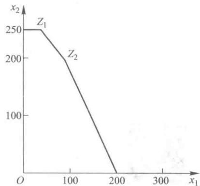

# 第5章 单纯形法

在第二章里我们用图解法解决了只含有两个决策变量的线性规划的问题,然而由于我们画图的平面只是二维的,对多于两个决策变量的线性规划问题,图解法就显得无能为力了.我们在这一章里介绍由美国数学家 G. B. Dantgig 提出并得到最广泛应用的线性规划的代数算法——单纯形法,这是运筹学发展史上最辉煌的一笔.我们在第三章所介绍的线性规划问题的计算机解法就是基于单纯形法编程来解决可以含有上千个决策变量及上千个约束条件的复杂的线性规划问题.

## 5.1 单纯形法的基本思路和原理

单纯形法的基本思路:从可行域中某一个顶点开始,判断此顶点是否是最优解,如不是,则再找另一个使得其目标函数值更优的顶点,称之为迭代,再判断此点是否是最优解,直到找到一个顶点为其最优解,就是使得其目标函数值最优的解,或者能判断出此线性规划问题无最优解为止.

在这里,可行域的顶点已不再像图解法中那样直接可见了.在单纯形法中的可行域的顶点叫做基本可行解,找到的第一个可行域的顶点叫做初始基本可行解.

下面我们通过第二章例 1 的求解来介绍单纯形法是怎样一步一步进行的,以及为什么这样做.

### 一、找出一个初始基本可行解

在第二章例 1 中我们得到以下数学模型：

$$
\max 50x _ {1} +100x _ {2};
$$

约束条件：

$$
\begin{array}{l}x _ {1} + x _ {2} \leqslant 300,\\2 x _ {1} + x _ {2} \leqslant 400,\\x _ {2} \leqslant 250,\\x _ {j} \geqslant 0 (j = 1, 2).\\\end{array}
$$

在加上松弛变量之后我们可得到此线性规划的标准形式：

$$
\max 50x _ {1} +100x _ {2};
$$

约束条件：

$$
\begin{array}{l}x _ {1} + x _ {2} + s _ {1} =300,\\2 x _ {1} + x _ {2} + s _ {2} =400,\\x _ {2} + s _ {3} =250,\\x _ {1}, x _ {2}, x _ {3}, s _ {1}, s _ {2}, s _ {3} \geqslant 0.\\\end{array}
$$

以上约束条件中有三个约束方程如下：

$$
x _ {1} + x _ {2} + s _ {1} =300,
$$

$$
2 x _ {1} + x _ {2} + s _ {2} =400,
$$

$$
x _ {2} + s _ {3} =250.
$$

这是由三个五元线性方程组成的方程组,它的系数矩阵为

$$
\boldsymbol {A} = (\boldsymbol {p} _ {1}, \boldsymbol {p} _ {2}, \boldsymbol {p} _ {3}, \boldsymbol {p} _ {4}, \boldsymbol {p} _ {5}) = \left( \begin{array}{c c c c c} 1 & 1 & 1 & 0 & 0 \\ 2 & 1 & 0 & 1 & 0 \\ 0 & 1 & 0 & 0 & 1 \end{array} \right),
$$

其中 $p_{j}$ 为系数矩阵 A 中第 j 列向量.由于在 A 中存在一个不为零的三阶子式

$$
\left( \begin{array}{c c c} 1 & 0 & 0 \\ 0 & 1 & 0 \\ 0 & 0 & 1 \end{array} \right),
$$

可知 A 的秩为 3. 因为 A 的秩 m 小于此方程组的变量的个数 n，从线性代数的知识可知，此方程组有无数多组解. 为了找到一个初始基本可行解，先介绍以下几个线性规划的基本概念.

(1) 基

已知 A 是约束条件的 $m \times n$ 阶系数矩阵, 其秩为 m. 若 B 是 A 的一个 $m \times m$ 阶非奇异子矩阵 (即 B 为可逆矩阵, $|B| \neq 0$ ), 则称 B 是线性规划问题中的一个基. B 是由 A 中 m 个线性无关的列向量组成的. 在此例中

$$
\left( \begin{array}{c c c} {1} & {1} & {1} \\ {2} & {1} & {0} \\ {0} & {1} & {0} \end{array} \right) \text {与} \left( \begin{array}{c c c} {1} & {0} & {0} \\ {0} & {1} & {0} \\ {0} & {0} & {1} \end{array} \right)
$$

都是该线性规划的一个基.它们都是由3个线性无关的系数列向量组成的.

(2) 基向量

基 B 中的一列即称为一个基向量. 基 B 中共有 m 个基向量, 在此例中对基

$$
\boldsymbol {B} = \left( \begin{array}{c c c} 1 & 1 & 1 \\ 2 & 1 & 0 \\ 0 & 1 & 0 \end{array} \right)
$$

来说，

$$
\left( \begin{array}{c} 1 \\ 2 \\ 0 \end{array} \right), \left( \begin{array}{c} 1 \\ 1 \\ 1 \end{array} \right), \left( \begin{array}{c} 1 \\ 0 \\ 0 \end{array} \right)
$$

都是 B 的基向量, B 中只有这三个基向量.

(3) 非基向量

在 A 中除了基 B 之外的任一列称为基 B 的非基向量. 在此例中对

$$
\pmb {B} _ {1} = \left( \begin{array}{c c c} 1 & 1 & 1 \\ 2 & 1 & 0 \\ 0 & 1 & 0 \end{array} \right) \text {和} \pmb {B} _ {2} = \left( \begin{array}{c c c} 1 & 0 & 0 \\ 0 & 1 & 0 \\ 0 & 0 & 1 \end{array} \right)
$$

来说，向量 $(1,2,0)^{\mathrm{T}}$ 是基 $B_{1}$ 的基向量，也是基 $B_{2}$ 的非基向量

(4) 基变量

与基向量 $p_{i}$ 相应的变量 $x_{i}$ 叫基变量，基变量有 m 个，在此例中 $x_{1}, x_{2}, s_{1}$ 都是 $B_{1}$ 的基变量，而 $s_{1}, s_{2}, s_{3}$ 是 $B_{2}$ 的基变量.

(5) 非基变量

与非基向量 $p_{j}$ 相应的变量 $x_{j}$ 叫非基变量，非基变量有 n-m 个，在此例中， $s_{2}, s_{3}$ 是 $B_{1}$ 的非基变量，而 $x_{1}, x_{2}$ 是 $B_{2}$ 的非基变量.

由线性代数的知识知道,如果我们在约束方程组系数矩阵中找到一个基,令这个基的非基变量为零,再求解这个 m 元线性方程组就可得到唯一的解,这个解称为线性规划的基本解,在此例中我们不妨找到

$$
\boldsymbol {B} _ {3} = \left( \begin{array}{c c c} 1 & 1 & 0 \\ 1 & 0 & 0 \\ 1 & 0 & 1 \end{array} \right)
$$

为 A 的一个基, 令这个基的非基变量 $x_{1}, s_{2}$ 为零. 这时约束方程就变为基变量的约束方程:

$$
\begin{array}{l} x _ {2} + s _ {1} =300, \\ x _ {2} =400, \\ x _ {2} + s _ {3} =250.\end{array}
$$

求解得到基变量的唯一一组解: $x_{2}=400,s_{1}=-100,s_{3}=-150$ ，再加上非基变量: $x_{1}=0,s_{2}=0$ ，就得到了此线性规划的一个基本解：

$$
\begin{array}{l} {x _ {1} = 0,} \\ {x _ {2} =400,} \\ {s _ {1} = -100,} \\ {s _ {2} = 0,} \\ {s _ {3} = -150.} \end{array}
$$

由于在这个基本解中 $s_1 = -100, s_3 = -150$ ，不满足该线性规划 $s_1 \geqslant 0, s_3 \geqslant 0$ 的约束条件，显然此解不是此线性规划的可行解。一个基本解可以是可行解，也可以是非可行解，它们之间的主要区别在于其所有变量的解是否满足非负的条件.我们把满足非负条件的一个基本解叫做基本可行解,并把这样的基叫做可行基.例如,在本例中我们选基为

$$
\boldsymbol {B} _ {1} = \left( \begin{array}{c c c} 1 & 1 & 0 \\ 2 & 0 & 0 \\ 0 & 0 & 1 \end{array} \right),
$$

令其非基变量 $x_{2}, s_{2}$ 为零，这样约束方程就变为基变量的约束方程：

$$
\begin{array}{l} x _ {1} + s _ {1} =300, \\ 2 x _ {1} =400, \\ s _ {3} =250.\end{array}
$$

求解得到基变量的唯一解： $s_{3}=250,x_{1}=200,s_{1}=100$ ，加上非基变量： $x_{2}=0,s_{2}=0$ ，得到一个基本解：

$$
\begin{array}{l} x _ {1} =200, \\ x _ {2} = 0, \\ s _ {1} =100, \\ s _ {2} = 0, \\ s _ {3} =250.\end{array}
$$

由于所有变量的解都大于等于零, 可知此基本解也是基本可行解, $B_{1}$ 是可行基. 一般来说, 判断一个基是否可行基, 只有在求出其基本解以后, 当其基本解所有变量的解都大于等于零时, 才能断定这个解是基本可行解, 这个基是可行基. 那么我们能否在求解之前就找到一个可行基呢? 也就是说我们能否找到一个基保证在求解之后得到的解一定是基本可行解呢? 由于在线性规划的标准形式中要求 $b_{j}$ 都大于等于零, 如果我们能找到一个基, 这个基是单位矩阵, 或者说一个基是由单位矩阵的各列向量所组成的 (各列向量的前后顺序无关紧要), 如

$$
\left( \begin{array}{c c c} 0 & 0 & 1 \\ 1 & 0 & 0 \\ 0 & 1 & 0 \end{array} \right),
$$

那么显然所求得的基本解一定是基本可行解,这个单位矩阵或由单位矩阵各列向量组成的基一定是可行基.实际上这个基本可行解中的各个变量或等于某个 $b_{j}$ 或等于零.在本例中我们就找到了一个基

$$
\boldsymbol {B} _ {2} = \left( \begin{array}{c c c} 1 & 0 & 0 \\ 0 & 1 & 0 \\ 0 & 0 & 1 \end{array} \right),
$$

它是单位矩阵.令 $B_{2}$ 的非基变量 $x_{1},x_{2}$ 都为零,约束方程组就变为

$$
\begin{array}{l} s _ {1} =300, \\ s _ {2} =400, \\ s _ {3} =250.\end{array}
$$

加上非基变量 $x_{1} = 0, x_{2} = 0$ ，我们就得到了该线性规划的一个基本可行解：

$$
\begin{array}{l} {x _ {1} = 0,} \\ {x _ {2} = 0,} \\ {s _ {1} =300,} \\ {s _ {2} =400,} \\ {s _ {3} =250.} \end{array}
$$

像这样在第一次找可行基时,所找到的基或为单位矩阵或由单位矩阵的各列向量所组成,称之为初始可行基,其相应的基本可行解叫初始基本可行解.如果找不到单位矩阵或由单位矩阵的各列向量组成的基作为初始可行基,我们将构造初始可行基,具体做法在以后详细讲述.

### 二、最优性检验

所谓最优性检验就是判断已求得的基本可行解是否是最优解.

1. 最优性检验的依据——检验数 $\sigma_{j}$

一般来说,目标函数中既包括基变量,又包括非基变量.现在我们要求只用非基变量来表示目标函数,只要在约束等式中通过移项等处理就可以用非基变量来表示基变量,然后用非基变量的表示式代替目标函数中的基变量,这样目标函数中就只含有非基变量了,或者说目标函数中基变量的系数都为零了.此时目标函数中所有变量的系数即为各变量的检验数,把变量 $x_{i}$ 的检验数记为 $\sigma_{i}$ .显然所有基变量的检验数必为零.在本例中目标函数为 $50x_{1}+100x_{2}$ .由于初始可行解中 $x_{1},x_{2}$ 为非基变量,所以此目标函数已经用非基变量表示了,不需要再代换出基变量了.这样我们可知 $\sigma_{1}=50,\sigma_{2}=100,\sigma_{3}=0,\sigma_{4}=0,\sigma_{5}=0$ .

2. 最优解判别定理

在求最大目标函数的问题中,对于某个基本可行解,如果所有检验数 $\sigma_{j} \leqslant 0$ , 则这个基本可行解是最优解, 这就是最优解判别定理. 下面我们用通俗的说法来解释最优解判别定理. 设用非基变量表示的目标函数为如下形式:

$$
z = z _ {0} + \sum_ {j \in J} \sigma_ {j} x _ {j},
$$

其中， $z_0$ 为常数项， $J$ 是所有非基变量的下标集.由于所有的 $x_{j}$ 的取值范围为大于等于零，当所有的 $\sigma_{j}$ 都小于等于零时，可知 $\sum_{j\in J}\sigma_jx_j$ 是一个小于等于零的数，要使

$$
z = z _ {0} + \sum_ {j \in J} \sigma_ {j} x _ {j}
$$

的值最大,显然只有 $\sum_{j\in J}\sigma_{j}x_{j}$ 为零.我们把这些 $x_{j}$ 取为非基变量（即令这些 $x_{j}$ 的值为零）,所求得的基本可行解就使目标函数值最大，为 $z_0$ 。在本例中由于 $\sigma_1 =50, \sigma_2 =100$ ，都大于零，显然这个基本可行解不是最优解，实际上让 $x_1, x_2$ 为非基变量（即令其值为0）是最失策的， $x_1, x_2$ 的取值在大于等于零的范围内， $x_1, x_2$ 取除零以外的任意值都比取零值要好，都能使得目标函数 $z$ 的值比零更大。所以我们要寻找更好的基本可行解。

对于求目标函数最小值的情况,只需把上述定理中的 $\sigma_{j} \leqslant 0$ 改为 $\sigma_{j} \geqslant 0$ 即可.

判断无最优解的方法我们将在后面用具体实例予以阐述.

### 三、基变换

通过检验,我们知道这个初始基本可行解不是最优解.下面介绍如何进行基变换找到一个新的可行基,具体的做法是更换可行基中的一个列向量,得到一个新的可行基,并且求解得到的新的基本可行解使得其目标函数值更优.为了换基就要确定入基变量与出基变量.

1. 入基变量的确定

从最优解判别定理知道，当某个 $\sigma_{j} > 0$ 时，非基变量 $x_{j}$ 变为基变量，不取零值可以使目标函数值增大，故我们要选检验数大于0的非基变量换到基变量中去（称之为入基变量）.若有两个以上的 $\sigma_{j} > 0$ ，则为了使目标函数更大些，一般选其中的 $\sigma_{j}$ 较大者的非基变量为入基变量，在本例中 $\sigma_{2} =100$ 是检验数中最大的正数，故选 $x_{2}$ 为入基变量.

2. 出基变量的确定

在确定了 $x_{2}$ 为入基变量之后，我们要在原来的3个基变量 $s_1, s_2, s_3$ 中确定一个出基变量，也就是确定哪一个基变量变成非基变量。如果我们确定 $s_1$ 为出基变量，则新的基变量为 $x_{2}, s_{2}, s_{3}$ ，因为非基变量 $x_{1} = s_{1} = 0$ ，则从方程组

求得基本解

$$
\begin{array}{l} x _ {2} =300, \\ x _ {2} + s _ {2} =400, \\ x _ {2} + s _ {3} =250, \\ x _ {1} = 0, \\ x _ {2} =300, \\ s _ {1} = 0, \\ s _ {2} =100, \\ s _ {3} = -50.\end{array}
$$

显然这不是基本可行解,所以 $s_{1}$ 不能作为出基变量.

如果把 $s_{3}$ 作为出基变量, 则新的基变量为 $x_{2}, s_{1}, s_{2}$ , 因为非基变量 $x_{1} = s_{3} = 0$ , 我们也可以从方程组

求出基本解

$$
\begin{array}{l} x _ {2} + s _ {1} =300, \\ x _ {2} + s _ {2} =400, \\ x _ {2} =250, \\ x _ {1} = 0, \\ x _ {2} =250, \\ s _ {1} =50, \\ s _ {2} =150, \\ s _ {3} = 0. \end{array}
$$

因为此解满足非负条件,是基本可行解,故 $s_{3}$ 可以确定为出基变量.

能否在求出基本解以前来确定出基变量呢？

下面就来看在找到初始基本可行解和确定入基变量之后,什么样的基变量可以确定为出基变量,或者说出基变量要具备什么条件.

我们把确定出基变量的方法概括如下: 把已确定的入基变量在各约束方程中的正的系数除其所在约束方程中的常数项的值, 把其中最小比值所在的约束方程中的原基变量确定为出基变量. 这样在下一步迭代的矩阵变换中可以确保新得到的 $b_{j}$ 值都大于等于零.

下面的楷体文字就是对这种方法的一个理论上的证明,读者也可完全跳过这段文字,这并不影响读者进一步的学习.

设线性规划有初始基本可行解

$$
\boldsymbol {x} = \left(b _ {1}, b _ {2}, \dots , b _ {m}, 0, 0, \dots , 0\right),
$$

其中， $x_{1},x_{2},\cdots,x_{m}$ 为基变量， $x_{m+1},\cdots,x_{n}$ 为非基变量，已确定 $x_{m+k}(1\leqslant k\leqslant n-m)$ 为入基变量，可以证明，如果线性规划有最优解，那么在约束方程中 $x_{m+k}$ 的系数中，必存在一个大于零的数，不妨设 $a_{i,m+k}$ 大于零。这样此线性规划的约束方程为

$$
\begin{array}{r l} & x _ {1} + a _ {1, m + 1} x _ {m + 1} + a _ {1, m + 2} x _ {m + 2} + \dots + a _ {1, n} x _ {n} = b _ {1}, \\ & x _ {2} + a _ {2, m + 1} x _ {m + 1} + a _ {2, m + 2} x _ {m + 2} + \dots + a _ {2, n} x _ {n} = b _ {2}, \\ & \dots \dots \\ & x _ {m} + a _ {m, m + 1} x _ {m + 1} + a _ {m, m + 2} x _ {m + 2} + \dots + a _ {m, n} x _ {n} = b _ {m}. \end{array}
$$

此约束方程组可以用增广矩阵表示如下：

$$
\left( \begin{array}{c c c c c c c c c c c c c} 1 & 0 & \dots & 0 & \dots & 0 & a _ {1, m + 1} & a _ {1, m + 2} & \dots & a _ {1, m + k} & \dots & a _ {1, n} & b _ {1} \\ 0 & 1 & \dots & 0 & \dots & 0 & a _ {2, m + 1} & a _ {2, m + 2} & \dots & a _ {2, m + k} & \dots & a _ {2, n} & b _ {2} \\ \vdots & \vdots & & \vdots & & \vdots & \vdots & \vdots & & \vdots & & \vdots & \vdots \\ 0 & 0 & \dots & 1 & \dots & 0 & a _ {i, m + 1} & a _ {i, m + 2} & \dots & a _ {i, m + k} & \dots & a _ {i, n} & b _ {i} \\ \vdots & \vdots & & \vdots & & \vdots & \vdots & \vdots & & \vdots & & \vdots & \vdots \\ 0 & 0 & \dots & 0 & \dots & 1 & a _ {m, m + 1} & a _ {m, m + 2} & \dots & a _ {m, m + k} & \dots & a _ {m, n} & b _ {m} \end{array} \right)
$$

$$
\left\{ \begin{array}{l l l l l l l l l l l} \frac {1}{| a _ {1 , m + k} |} & 0 & \dots & 0 & \dots & 0 & \frac {a _ {1 , m + 1}}{| a _ {1 , m + k} |} & \frac {a _ {1 , m + 2}}{| a _ {1 , m + k} |} & \dots & \frac {a _ {1 , m + k}}{| a _ {1 , m + k} |} & \dots & \frac {a _ {1 , n}}{| a _ {1 , m + k} |} & \frac {b _ {1}}{| a _ {1 , m + k} |} \\ 0 & \frac {1}{| a _ {2 , m + k} |} & \dots & 0 & \dots & 0 & \frac {a _ {2 , m + 1}}{| a _ {2 , m + k} |} & \frac {a _ {2 , m + 2}}{| a _ {2 , m + k} |} & \dots & \frac {a _ {2 , m + k}}{| a _ {2 , m + k} |} & \dots & \frac {a _ {2 , n}}{| a _ {2 , m + k} |} & \frac {b _ {2}}{| a _ {2 , m + k} |} \\ \vdots & \vdots & & \vdots & & \vdots & \vdots & \vdots & & \vdots & & \vdots & \vdots \\ 0 & 0 & \dots & \frac {1}{| a _ {i , m + k} |} & \dots & 0 & \frac {a _ {i , m + 1}}{| a _ {i , m + k} |} & \frac {a _ {i , m + 2}}{| a _ {i , m + k} |} & \dots & \frac {a _ {i , m + k}}{| a _ {i , m + k} |} & \dots & \frac {a _ {i , n}}{| a _ {i , m + k} |} & \frac {b _ {i}}{| a _ {i , m + k} |} \\ \vdots & \vdots & & \vdots & & \vdots & \vdots & \vdots & & \vdots & & \vdots & \vdots \\ 0 & 0 & \dots & 0 & \dots & \frac {1}{| a _ {m , m + k} |} & \frac {a _ {m , m + 1}}{| a _ {m , m + k} |} & \frac {a _ {m , m + 2}}{| a _ {m , m + k} |} & \dots & \frac {a _ {m , m + k}}{| a _ {m , m + k} |} & \dots & \frac {a _ {m , n}}{| a _ {m , m + k} |} & \frac {b _ {m}}{| a _ {m , m + k} |} \end{array} \right.
$$

不妨设 $x_{i}(1 \leqslant i \leqslant m)$ 是我们所要确定的出基变量，这样就可以对增广矩阵进行初等行变换，求出新的基本可行解，然后求出 $x_{i}$ 成为出基变量的条件.

下面要对增广矩阵进行初等行变换,使得第 $m+k$ 列变换成单位向量 $e_{i}=(0,0,\cdots,0,1,0,\cdots,0)^{\mathrm{T}}$ . 如果第 $m+k$ 列第 s 行元素 $a_{s,m+k}$ 已经为零了,那么就不需要对该行进行初等变换了,可以暂时把该行从增广矩阵中撤下来,等变换完了以后再放回去.这样不妨假设第 $m+k$ 列的所有元素都是不等于零的.

把增广矩阵的每一行都除以这一行的第 $m+k$ 列的元素的绝对值, 得到新的增广矩阵, 可知新的增广矩阵的第 $m+k$ 列的元素不是 +1 就是 -1. 当 $a_{t,m+k}>0$ 时, $\frac{a_{t,m+k}}{|a_{t,m+k}|}=1$ ; 当 $a_{t,m+k}<0$ 时, $\frac{a_{t,m+k}}{|a_{t,m+k}|}=-1$ . 通过检验可知增广矩阵的最后一列 (常数项列) 的每一个元素仍然大于等于零, 由于 $x_{i}$ 为出基变量, $x_{m+k}$ 为入基变量, 我们知道新的基变量为 $x_{1}, x_{2}, \cdots, x_{i-1}, x_{i+1}, \cdots, x_{m}, x_{m+k}$ , 非基变量为 $x_{i}, x_{m+1}, x_{m+2}, \cdots, x_{m+k-1}, x_{m+k+1}, \cdots, x_{n}$ , 令非基变量为零, 从增广矩阵的第 i 行可知

$$
\frac {a _ {i , m + k}}{| a _ {i , m + k} |} x _ {m + k} = \frac {b _ {i}}{| a _ {i , m + k} |}.
$$

$x_{m + k}$ 要满足非负的限制，必有 $a_{i,m + k} > 0$ ，此时有

$$
x _ {m + k} = \frac {b _ {i}}{\left| a _ {i , m + k} \right|}.
$$

为了把增广矩阵的第 $m+k$ 列变换成 $\boldsymbol{e}_{i}=(0,0,\cdots,0,1,0,\cdots,0)^{\mathrm{T}}$ ，当第 t 行第 $m+k$ 列元素为 1 时，也就是 $a_{t,m+k}>0$ 时，我们把增广矩阵的第 t 行减去第 i 行的对应元素，使第 t 行第 $m+k$ 列的元素变为零，这时第 t 行的常数项就变为 $\frac{b_{t}}{|a_{t,m+k}|}-\frac{b_{i}}{|a_{i,m+k}|}$ ；当第 s 行第 $m+k$ 列的元素为 -1 时，也就是 $a_{s,m+k}<0$ 时，只要在第 s 行上加上第 i 行的对应元素，就使第 s 行第 $m+k$ 列的元素变为零，这时第 s 行的常数项就变成为 $\frac{b_{s}}{|a_{s,m+k}|}+\frac{b_{i}}{|a_{i,m+k}|}$ 。然后再用 $|a_{j,m+k}|$ 乘以增广矩阵的第 j 行 $(j=1,2,3,\cdots,i-1,i+1,\cdots,m)$ ，这样就得到了新的基本可行解。

当 $j=1,2,\cdots,i-1,i+1,\cdots,n$ 时，有

$$
x _ {j} = \left\{ \begin{array}{l l} \left(\frac {b _ {j}}{| a _ {j , m + k} |} - \frac {b _ {i}}{| a _ {i , m + k} |}\right) \cdot | a _ {j, m + k} | & (\text {当} a _ {j, m + k} > 0), \\ \left(\frac {b _ {j}}{| a _ {j , m + k} |} + \frac {b _ {i}}{| a _ {i , m + k} |}\right) \cdot | a _ {j, m + k} | & (\text {当} a _ {j, m + k} <   0), \end{array} \right.
$$

以及

$$
\begin{array}{l} x _ {m + k} = \frac {b _ {i}}{| a _ {i , m + k} |}, \\ x _ {j} = 0 (j = i, m + 1, m + 2, \dots , m + k - 1, m + k + 1, \dots , n). \end{array}
$$

作为基本可行解,必满足非负的限制,所以当 $j=1,2,\cdots,i-1,i+1,\cdots,n$ 时,如果 $a_{j,m+k}>0$ ,则必有

$$
\left(\frac {b _ {j}}{| a _ {j , m + k} |} - \frac {b _ {i}}{| a _ {i , m + k} |}\right) \cdot | a _ {j, m + k} | \geqslant 0.
$$

因为 $|a_{j,m+k}|>0$ ，就有

$$
\frac {b _ {j}}{| a _ {j , m + k} |} - \frac {b _ {i}}{| a _ {i , m + k} |} \geqslant 0,
$$

因为 $a_{j,m + k} > 0, a_{i,m + k} > 0$ ，上式即为

$$
\frac {b _ {j}}{a _ {j , m + k}} - \frac {b _ {i}}{a _ {i , m + k}} \geqslant 0 (j = 1, 2, \dots , i - 1, i + 1, \dots , n).
$$

从上式可以知道,当确定了 $x_{m+k}$ 为入基变量时,若约束方程中 $x_{m+k}$ 的某个系数 $a_{i,m+k}>0$ , 并且对于约束方程中的所有的 $x_{m+k}$ 的正系数 $a_{j,m+k}$ 都有 $\frac{b_{j}}{a_{j,m+k}}\geqslant\frac{b_{i}}{a_{i,m+k}}$ , 则可确定其出基变量为 $x_{i}, x_{i}$ 是指原来的系数向量为 $e_{i}$ 的那个基变量, 或者说 $x_{i}$ 是在第 i 个约束方程中的那个基变量.

在本例中约束方程为

$$
\begin{array}{l} x _ {1} + x _ {2} + s _ {1} =300, \\ 2 x _ {1} + x _ {2} + s _ {2} =400, \\ x _ {2} + s _ {3} =250.\end{array}
$$

在第二步中已经知道 $x_{2}$ 为入基变量, 我们把各约束方程中 $x_{2}$ 的正的系数除对应的常数项值, 得

$$
\begin{array}{r l} & \frac {b _ {1}}{a _ {12}} = \frac {300}{1} =300, \\ & \frac {b _ {2}}{a _ {22}} = \frac {400}{1} =400, \\ & \frac {b _ {3}}{a _ {32}} = \frac {250}{1} =250.\end{array}
$$

$\frac{b_3}{a_{32}}$ 的值最小，所以可以知道在原基变量中系数向量为 $e_3 = (0,0,1)^{\mathrm{T}}$ 的基变量 $s_3$ 为出基变量，这样可知 $x_{2}, s_{1}, s_{2}$ 为基变量， $x_{1}, s_{3}$ 为非基变量。令非基变量为零，得

$$
\begin{array}{l} x _ {2} + s _ {1} =300, \\ x _ {2} + s _ {2} =400, \\ x _ {2} =250.\end{array}
$$

求解得到新的基本可行解为

$$
x _ {1} = 0,
$$

$$
x _ {2} =250,
$$

$$
s _ {1} =50,
$$

$$
s _ {2} =150.
$$

这时目标函数值为 $50x_{1} +100x_{2} =50\times 0 +100\times 250=25000$ ，显然比初始基本可行解 $x_{1} = 0$ ， $x_{2} = 0, s_{1} =300, s_{2} =400, s_{3} =250$ 的目标函数值 $50\times 0 +100\times 0 = 0$ 要好得多。然后我们再检验其最优性，不是最优解还要继续进行基变换，直至找到最优解，或者能够判断出此线性规划无最优解为止。

## 5.2 单纯形法的表格形式

为了使单纯形法更加简洁明了,我们常常借助于单纯形法的表格形式.

在讲单纯形法的表格形式之前,先从一般数学模型里推导出检验数 $\sigma_{j}$ 的表达式.

可行基为 m 阶单位矩阵的线性规划模型如下(假设其系数矩阵的前 m 列是单位矩阵):

$$
\max z = c _ {1} x _ {1} + c _ {2} x _ {2} + \dots + c _ {n} x _ {n};
$$

约束条件：

$$
\begin{array}{l}x _ {1} + a _ {1, m + 1} x _ {m + 1} + \dots + a _ {1, n} x _ {n} = b _ {1},\\x _ {2} + a _ {2, m + 1} x _ {m + 1} + \dots + a _ {2, n} x _ {n} = b _ {2},\\\dots \dots\\x _ {m} + a _ {m, m + 1} x _ {m + 1} + \dots + a _ {m, n} x _ {n} = b _ {m},\\x _ {j} \geqslant 0 \quad (j = 1, 2, \dots , n).\\\end{array}
$$

以下用 $x_{i}(i=1,2,\cdots,m)$ 表示基变量，用 $x_{j}(j=m+1,m+2,\cdots,n)$ 表示非基变量。把第 i 个约束方程移项，就可以用非基变量来表示基变量 $x_{i}$ ，

$$
\begin{array}{r l} x _ {i} & = b _ {i} - a _ {i, m + 1} x _ {m + 1} - a _ {i, m + 2} x _ {m + 2} - \dots - a _ {i, n} x _ {n} \\ & = b _ {i} - \sum_ {j = m + 1} ^ {n} a _ {i j} x _ {j} (i = 1, 2, \dots , m). \end{array}
$$

教学视频:单纯形法的表格形式1

教学视频:单纯形法的表格形式2

教学视频:单纯形法的表格形式3

把以上的表达式代入目标函数,就有

$$
\begin{array}{l} z = c _ {1} x _ {1} + c _ {2} x _ {2} + \dots + c _ {n} x _ {n} = \sum_ {i = 1} ^ {m} c _ {i} x _ {i} + \sum_ {j = m + 1} ^ {n} c _ {j} x _ {j} \\ = \sum_ {i = 1} ^ {m} c _ {i} \left(b _ {i} - \sum_ {j = m + 1} ^ {n} a _ {i j} x _ {j}\right) + \sum_ {j = m + 1} ^ {n} c _ {j} x _ {j} \\ = \sum_ {i = 1} ^ {m} c _ {i} b _ {i} - \sum_ {i = 1} ^ {m} c _ {i} \sum_ {j = m + 1} ^ {n} a _ {i j} x _ {j} + \sum_ {j = m + 1} ^ {n} c _ {j} x _ {j} \\ = \sum_ {i = 1} ^ {m} c _ {i} b _ {i} - \sum_ {j = m + 1} ^ {n} \sum_ {i = 1} ^ {m} c _ {i} a _ {i j} x _ {j} + \sum_ {j = m + 1} ^ {n} c _ {j} x _ {j} \\ = \sum_ {i = 1} ^ {m} c _ {i} b _ {i} + \sum_ {j = m + 1} ^ {n} \left(c _ {j} - \sum_ {i = 1} ^ {m} c _ {i} a _ {i j}\right) x _ {j} \\ = z _ {0} + \sum_ {j = m + 1} ^ {n} (c _ {j} - z _ {j}) x _ {j} = z _ {0} + \sum_ {j = m + 1} ^ {n} \sigma_ {j} x _ {j}, \end{array}
$$

其中，

$$
\begin{array}{r l} z _ {j} & = \sum_ {i = 1} ^ {m} c _ {i} a _ {i j} = c _ {1} a _ {1 j} + c _ {2} a _ {2 j} + \dots + c _ {m} a _ {m j} \\ & = (c _ {1}, c _ {2}, \dots , c _ {m}) \left( \begin{array}{c} a _ {1 j} \\ a _ {2 j} \\ \vdots \\ a _ {m j} \end{array} \right) \\ & = (c _ {1}, c _ {2}, \dots , c _ {m}) p _ {j}. \end{array}
$$

上面假设 $x_{1}, x_{2}, \cdots, x_{m}$ 是基变量，即第 i 行约束方程的基变量正好是 $x_{i}$ ，而经过若干次迭代后，基发生了若干次变化，一般不会是上述假设情况了，因此上述计算 $z_{j}$ 的式子也应改变。如果迭代后的第 i 行约束方程中的基变量为 $x_{Bi}$ （不一定是 $x_{i}$ ），与 $x_{Bi}$ 相应的目标函数系数为 $c_{Bi}$ ，而迭代后的系数列向量为 $p_{j}^{\prime}(j = 1, 2, \cdots, n)$ ，则

$$
z _ {j} = \left(c _ {B 1}, \dots , c _ {B m}\right) \boldsymbol {p} _ {j} ^ {\prime} = \left(\boldsymbol {c} _ {B}\right) \boldsymbol {p} _ {j} ^ {\prime},
$$

其中， $(c_{B})$ 是相应的基变量目标函数系数依次组成的有序行向量.

单纯形法的表格形式是把用单纯形法求出基本可行解,检验其最优性,迭代等步骤都用表格的方式来计算求出,其表格的形式有些像增广矩阵,而其计算的方法也大体上使用矩阵的行初等变换.

以下用单纯形表格来求解第二章例 1.

$$
\max 50x _ {1} +100x _ {2} + 0 \cdot s _ {1} + 0 \cdot s _ {2} + 0 \cdot s _ {3};
$$

约束条件：

$$
\begin{array}{l}x _ {1} + x _ {2} + s _ {1} =300,\\2 x _ {1} + x _ {2} + s _ {2} =400,\\x _ {2} + s _ {3} =250,\\x _ {1}, x _ {2}, s _ {1}, s _ {2}, s _ {3} \geqslant 0.\\\end{array}
$$

把上面的数据填入表 5-1 所示的单纯形表格.

表5-1

<table><tr><td rowspan="2">迭代次数</td><td rowspan="2">基变量</td><td rowspan="2"> \(c_B\) </td><td> \(x_1\) </td><td> \(x_2\) </td><td> \(s_1\) </td><td> \(s_2\) </td><td> \(s_3\) </td><td rowspan="2">b</td><td rowspan="2">比值 \(\frac{b_i}{a_{ij}}\) </td></tr><tr><td>50</td><td>100</td><td>0</td><td>0</td><td>0</td></tr><tr><td rowspan="5">0</td><td> \(s_1\) </td><td>0</td><td>1</td><td>1</td><td>1</td><td>0</td><td>0</td><td>300</td><td> \(\frac{300}{1}\) </td></tr><tr><td> \(s_2\) </td><td>0</td><td>2</td><td>1</td><td>0</td><td>1</td><td>0</td><td>400</td><td> \(\frac{400}{1}\) </td></tr><tr><td> \(s_3\) </td><td>0</td><td>0</td><td>1</td><td>0</td><td>0</td><td>1</td><td>250</td><td> \(\frac{250}{1}\) </td></tr><tr><td rowspan="2" colspan="2"> \(z_j\)  \(\sigma_j = c_j - z_j\) </td><td>0</td><td>0</td><td>0</td><td>0</td><td>0</td><td rowspan="2">z=0</td><td rowspan="2"></td></tr><tr><td>50</td><td>100</td><td>0</td><td>0</td><td>0</td></tr></table>

表5-1的第一列是迭代次数栏，由于这是求初始基本可行解，还没有进行迭代，所以此栏填0，此表的第一行依次填上此标准形的所有变量，第二行填上这些变量在目标函数中的系数，在下一栏中填上约束方程的系数矩阵，在 $b$ 栏中填上对应的约束方程的常数项，上述两栏合并在一起就是约束方程的增广矩阵。在基变量这一栏中填入每个约束方程中的基变量，如在本例的约束方程的系数矩阵中包含了一个 $3 \times 3$ 单位矩阵，我们即确定了此单位阵为基，相应的变量 $s_1, s_2, s_3$ 为基变量，由于第一个约束方程中只含有基变量 $s_1$ ，第二个约束方程中只含有基变量 $s_2$ ，第三个约束方程中只含有基变量 $s_3$ ，所以在此栏中相应填上 $s_1, s_2, s_3$ ，在 $s_1, s_2, s_3$ 右边的 $c_B$ 列中填入这些基变量的目标函数中相应的系数。在 $z_j$ 行中填入各列的 $\sum_{i=1}^{m} c_i a_{ij}$ 的值，也就是把系数矩阵的第 $j$ 列与 $c_B$ 列中对应元素相乘相加所得的值，如 $z_2 = 0 \times 1 + 0 \times 1 + 0 \times 1 = 0$ ，所在 $z_j$ 行中的第2位数填入0，在 $\sigma_j = c_j - z_j$ 行中把变量 $x_j$ 在目标函数中系数 $c_j$ 减去所求出的 $z_j$ 所得的值，而 $x_j$ 在目标函数中的系数 $c_j$ 正好写在系数矩阵中的第 $j$ 个向量 $p_j$ 的上端，这样很容易求得 $\sigma_1 =50- 0 =50, \sigma_2 =100- 0 =100, \sigma_3 = 0 - 0 = 0, \sigma_4 = 0 - 0 = 0, \sigma_5 = 0 - 0 = 0$ 。再在 $b$ 栏之下填上 $z$ 的值， $z$ 表示把初始基本可行解代入目标函数所得的目标函数值。 $z$ 的值就等于约束方程的常数项 $b_i$ 乘以此约束方程的基变量在目标函数中的系数之和，在这里 $z =300\times 0 +400\times 0 +250\times 0 = 0$ ，故填上 $z = 0$ 。填完表5-1我们从基变量这一栏和 $b$ 栏可直接读得初始基本可行解， $s_1 =300, s_2 =400, s_3 =250, x_1 = 0, x_2 = 0$ （因 $x_1, x_2$ 是非基变量，非基变量取零值），其目标函数值 $z = 0$ ，同时在 $\sigma_j = c_j - z_j$ 一栏中可知 $\sigma_1 =50, \sigma_2 =100, \sigma_3 = \sigma_4 = \sigma_5 = 0$ 。可知这个基本可行解不是最优解，又因为 $\sigma_2 > \sigma_1 > 0$ ，故知道在下一步迭代时，应选 $x_2$ 为入基变量。在确定了 $x_2$ 为入基变量之后，把 $b$ 列元素比上对应的 $x_2$ 的正系数作为比值填上，在比值列填上 $\frac{300}{1}, \frac{400}{1}, \frac{250}{1}$ 。由于 $\frac{250}{1} =250$ 最小，故确定 $s_3$ 为出基变量。我们把入基变量所在列和出基变量所在行的交点处的元素称为主元，在表5-1中可知 $a_{32} = 1$ 是主元，我们在主元上画个圈作为标志.

以下进行第一次迭代,基变量为 $x_{2}, s_{1}, s_{2}$ , 通过矩阵的行初等变换,求出一个新的基本可行解,具体的做法用行初等变换将 $x_{2}$ 的系数向量 $p_{2}$ 变换成单位向量,由于主元在 $p_{2}$ 的第 3 分量上,所以这个单位向量是 $e_{3} = (0, 0, 1)^{\mathrm{T}}$ ,也就是主元要变成 1.这样我们又得到第 1 次迭代的单纯形表,如表 5-2 所示.

表 5-2

<table><tr><td rowspan="2">迭代次数</td><td rowspan="2">基变量</td><td rowspan="2"> \(c_B\) </td><td> \(x_1\) </td><td> \(x_2\) </td><td> \(s_1\) </td><td> \(s_2\) </td><td> \(s_3\) </td><td rowspan="2">b</td><td rowspan="2">比值 \(\frac{b_i}{a_{ij}}\) </td></tr><tr><td>50</td><td>100</td><td>0</td><td>0</td><td>0</td></tr><tr><td rowspan="5">1</td><td> \(s_1\) </td><td>0</td><td>1</td><td>0</td><td>1</td><td>0</td><td>-1</td><td>50</td><td> \(\frac{50}{1} = 50\) </td></tr><tr><td> \(s_2\) </td><td>0</td><td>2</td><td>0</td><td>0</td><td>1</td><td>-1</td><td>150</td><td> \(\frac{150}{2} = 75\) </td></tr><tr><td> \(x_2\) </td><td>100</td><td>0</td><td>1</td><td>0</td><td>0</td><td>1</td><td>250</td><td>—</td></tr><tr><td rowspan="2" colspan="2"> \(z_j\)  \(\sigma_j = c_j - z_j\) </td><td>0</td><td>100</td><td>0</td><td>0</td><td>100</td><td rowspan="2">25000</td><td rowspan="2"></td></tr><tr><td>50</td><td>0</td><td>0</td><td>0</td><td>-100</td></tr></table>

在表5-2中第3个基变量 $s_3$ 已被 $x_{2}$ 替代，故基变量列中的第3个基变量应变为 $x_{2}$ ，注意 $x_{2}$ 在目标函数中的系数 $c_{2} =100$ ，不要填错。由于第0次迭代表中的主元 $a_{32}$ 已经等于1了，所以增广矩阵的第3行就不变，为了使第1行的 $a_{12}$ 变为0，只需把第3行乘以-1加到第1行即可，同样可求得第2行。像在第0次迭代中那样可求得 $z_{j}, z, \sigma_{j}$ ，填入表内，从表上看到第1次迭代得到的基本可行解为 $s_{1} =50, s_{2} =150, x_{2} =250, x_{1} = 0, s_{3} = 0$ ，这时 $z =25000$ ，又从 $\sigma_{1} =50> 0$ 可知这个基本可行解也不是最优解。从 $\sigma_{j}$ 我们知道 $\sigma_{1}$ 为最大的正数，可知 $x_{1}$ 为入基变量，从此值可知 $\frac{b_{1}}{a_{11}} =50$ 为 $\frac{b_{i}}{a_{i1}}$ 中最小的正数，可知 $s_{1}$ 为出基变量， $a_{11}$ 为主元，这样我们可以进行第2次迭代，如表5-3所示。

表5-3

<table><tr><td rowspan="2">迭代次数</td><td rowspan="2">基变量</td><td rowspan="2"> \(c_B\) </td><td> \(x_1\) </td><td> \(x_2\) </td><td> \(s_1\) </td><td> \(s_2\) </td><td> \(s_3\) </td><td rowspan="2">b</td><td rowspan="2">比值</td></tr><tr><td>50</td><td>100</td><td>0</td><td>0</td><td>0</td></tr><tr><td rowspan="5">2</td><td> \(x_1\) </td><td>50</td><td>1</td><td>0</td><td>1</td><td>0</td><td>-1</td><td>50</td><td></td></tr><tr><td> \(s_2\) </td><td>0</td><td>0</td><td>0</td><td>-2</td><td>1</td><td>1</td><td>50</td><td></td></tr><tr><td> \(x_2\) </td><td>100</td><td>0</td><td>1</td><td>0</td><td>0</td><td>1</td><td>250</td><td></td></tr><tr><td rowspan="2" colspan="2"> \(z_j\)  \(\sigma_j = c_j - z_j\) </td><td>50</td><td>100</td><td>50</td><td>0</td><td>50</td><td rowspan="2">27500</td><td rowspan="2"></td></tr><tr><td>0</td><td>0</td><td>-50</td><td>0</td><td>-50</td></tr></table>

从表 5-3 中可知第 2 次迭代得到的基本可行解为 $x_{1}=50, x_{2}=250, s_{1}=0, s_{2}=50, s_{3}=0$ ，这时 z=27500。由于检验 $\sigma_{j}$ 都小于等于零，此基本可行解为最优解，z=27500为最优目标函数值。这样我们就用单纯形表的方法把这个线性规划问题解决了，实际上，我们可以连续地使用单纯形表，而不必每次迭代都重画一个表头。

## 5.3 求目标函数值最小的线性规划问题的单纯形表解法

### 一、大 $M$ 法

下面我们以第二章例2为例阐述如何用单纯形表的方法求解要求目标函数值最小的线性规划问题.我们已知第二章例2的数学模型如下：

$$
\min f = 2 x _ {1} + 3 x _ {2};
$$

约束条件：

$$
\begin{array}{l}x _ {1} + x _ {2} \geqslant 350,\\x _ {1} \geqslant 125,\\2 x _ {1} + x _ {2} \leqslant 600,\\x _ {1}, x _ {2} \geqslant 0.\\\end{array}
$$

教学视频: 大 M 法

为了化为标准形式,在约束条件中添加松弛变量和剩余变量得到新的约束条件如下:

$$
\begin{array}{l} {x _ {1} + x _ {2} - s _ {1} =350,} \\ {x _ {1} - s _ {2} =125,} \\ {2 x _ {1} + x _ {2} + s _ {3} =600,} \\ {x _ {1}, x _ {2}, s _ {1}, s _ {2}, s _ {3} \geqslant 0.} \end{array}
$$

在标准型中并不一定要求求目标函数的最大值或最小值,但是为了使单纯形表解法有一个统一的解法,我们把所有求目标函数最小值的问题化成求目标函数最大值的问题(有些书把所有求目标函数最大值的问题化成求目标函数最小值的问题).只要把目标函数乘以-1,就把原来求目标函数最小值的问题化成了求目标函数最大值的问题.本例就可化为

$$
\max (- f) = - 2 x _ {1} - 3 x _ {2}.
$$

为了统一符号,不妨设 z=-f, 这样就写成

$$
\max z = - 2 x _ {1} - 3 x _ {2}.
$$

用单纯形法求解线性规划问题的第一步就是要找到一个初始基本可行解，在标准形式的约束方程的系数矩阵里，我们找不到3阶单位矩阵或3个不同的3阶单位向量 $e_{1},e_{2},e_{3}$ .注意负的单位向量与单位向量是不同的，用负的单位向量作基向量求得的基本解一般不满足非负条件，不是可行解.在系数矩阵里只有 $s_{3}$ 的系数是单位向量 $e_{3}$ .而缺乏 $e_{1},e_{2}$ 也就是说在第1和第2个约束方程中没有初始基变量，这样我们就分别在第1和第2个约束方程中加上人工变量 $a_{1},a_{2}$ ，这样的约束条件就变成了如下的形式：

$$
\begin{array}{l} {x _ {1} + x _ {2} - s _ {1} + a _ {1} =350,} \\ {x _ {1} - s _ {2} + a _ {2} =125,} \\ {2 x _ {1} + x _ {2} + s _ {3} =600,} \\ {x _ {1}, x _ {2}, s _ {1}, s _ {2}, s _ {3}, a _ {1}, a _ {2} \geqslant 0.} \end{array}
$$

这样我们在约束方程的系数矩阵中就可以找到单位向量 $e_3, e_1, e_2$ 了. 这时可知基变量为 $s_3$ , $a_1, a_2$ , 初始基本可行解为 $x_1 = 0, x_2 = 0, s_1 = 0, s_2 = 0, s_3 =600, a_1 =350, a_2 =125$ .

要注意到人工变量是与松弛变量和剩余变量不同的.松弛变量和剩余变量可以取零值,也可以取正值,而人工变量只能取零值.一旦人工变量取正值,那么有人工变量的约束方程和原始的约束方程就不等价了,这样所求得的解就不是原线性规划的解了.为了竭尽全力地要求人工变量为零,我们规定人工变量在目标函数中的系数为-M,这里M为任意大的数.这样只要人工变量大于0,所求的目标函数最大值就是一个任意小的数.为了使目标函数实现最大就必须把人工变量从基变量中换出.如果一直到最后,人工变量仍不能从基变量中换出,也就是说人工变量仍不为零,则该问题无可行解.这样此例的目标函数就写为

$$
z = - 2 x _ {1} - 3 x _ {2} - M a _ {1} - M a _ {2}.
$$

此例的数学模型如下所示：

$$
\max z = - 2 x _ {1} - 3 x _ {2} - M a _ {1} - M a _ {2};
$$

约束条件：

$$
\begin{array}{l}x _ {1} + x _ {2} - s _ {1} + a _ {1} =350,\\x _ {1} - s _ {2} + a _ {2} =125,\\2 x _ {1} + x _ {2} + s _ {3} =600,\\x _ {1}, x _ {2}, s _ {1}, s _ {2}, s _ {3}, a _ {1}, a _ {2} \geqslant 0.\\\end{array}
$$

像这样,为了构造初始可行基得到初始可行解,把人工变量“强行”地加到原来的约束方程中去,又为了尽力地把人工变量从基变量中替换出来,就令人工变量在求最大值的目标函数里的系数为-M的方法叫做大M法,M叫做罚因子.下面我们就用大M法来求解此题,如表5-4所示.

表5-4

<table><tr><td rowspan="2">迭代次数</td><td rowspan="2">基变量</td><td rowspan="2"> \(c_B\) </td><td> \(x_1\) </td><td> \(x_2\) </td><td> \(s_1\) </td><td> \(s_2\) </td><td> \(s_3\) </td><td> \(a_1\) </td><td> \(a_2\) </td><td rowspan="2">b</td><td rowspan="2">比值</td></tr><tr><td>-2</td><td>-3</td><td>0</td><td>0</td><td>0</td><td>-M</td><td>-M</td></tr><tr><td rowspan="5">0</td><td> \(a_1\) </td><td>-M</td><td>1</td><td>1</td><td>-1</td><td>0</td><td>0</td><td>1</td><td>0</td><td>350</td><td> \(\frac{350}{1}\) </td></tr><tr><td> \(a_2\) </td><td>-M</td><td>1</td><td>0</td><td>0</td><td>-1</td><td>0</td><td>0</td><td>1</td><td>125</td><td> \(\frac{125}{1}\) </td></tr><tr><td> \(s_3\) </td><td>0</td><td>2</td><td>1</td><td>0</td><td>0</td><td>1</td><td>0</td><td>0</td><td>600</td><td> \(\frac{600}{2}\) </td></tr><tr><td colspan="2" rowspan="2"> \(z_j\)  \(\sigma_j=c_j-z_j\) </td><td>-2M</td><td>-M</td><td>M</td><td>M</td><td>0</td><td>-M</td><td>-M</td><td rowspan="2">-475M</td><td rowspan="2"></td></tr><tr><td>-2+2M</td><td>-3+M</td><td>-M</td><td>-M</td><td>0</td><td>0</td><td>0</td></tr><tr><td rowspan="5">1</td><td> \(a_1\) </td><td>-M</td><td>0</td><td>1</td><td>-1</td><td>1</td><td>0</td><td>1</td><td>-1</td><td>225</td><td>225</td></tr><tr><td> \(x_1\) </td><td>-2</td><td>1</td><td>0</td><td>0</td><td>-1</td><td>0</td><td>0</td><td>1</td><td>125</td><td>—</td></tr><tr><td> \(s_3\) </td><td>0</td><td>0</td><td>1</td><td>0</td><td>2</td><td>1</td><td>0</td><td>-2</td><td>350</td><td> \(\frac{350}{2}\) </td></tr><tr><td colspan="2" rowspan="2"> \(z_j\)  \(c_j-z_j\) </td><td>-2</td><td>-M</td><td>M</td><td>-M+2</td><td>0</td><td>-M</td><td>M-2</td><td rowspan="2">-225M-250</td><td rowspan="2"></td></tr><tr><td>0</td><td>-3+M</td><td>-M</td><td>M-2</td><td>0</td><td>0</td><td>2-2M</td></tr><tr><td rowspan="5">2</td><td> \(a_1\) </td><td>-M</td><td>0</td><td> \(\frac{1}{2}\) </td><td>-1</td><td>0</td><td>- \(\frac{1}{2}\) </td><td>1</td><td>0</td><td>50</td><td> \(\frac{50}{1/2}\) </td></tr><tr><td> \(x_1\) </td><td>-2</td><td>1</td><td> \(\frac{1}{2}\) </td><td>0</td><td>0</td><td> \(\frac{1}{2}\) </td><td>0</td><td>0</td><td>300</td><td> \(\frac{300}{1/2}\) </td></tr><tr><td> \(s_2\) </td><td>0</td><td>0</td><td> \(\frac{1}{2}\) </td><td>0</td><td>1</td><td> \(\frac{1}{2}\) </td><td>0</td><td>-1</td><td>175</td><td> \(\frac{175}{1/2}\) </td></tr><tr><td colspan="2" rowspan="2"> \(z_j\)  \(c_j-z_j\) </td><td>-2</td><td>- \(\frac{1}{2}\) M-1</td><td>M</td><td>0</td><td> \(\frac{1}{2}\) M-1</td><td>-M</td><td>0</td><td colspan="2" rowspan="2">-50M-600</td></tr><tr><td>0</td><td> \(\frac{1}{2}\) M-2</td><td>-M</td><td>0</td><td>- \(\frac{1}{2}\) M+1</td><td>0</td><td>-M</td></tr><tr><td rowspan="5">3</td><td> \(x_2\) </td><td>-3</td><td>0</td><td>1</td><td>-2</td><td>0</td><td>-1</td><td>2</td><td>0</td><td>100</td><td></td></tr><tr><td> \(x_1\) </td><td>-2</td><td>1</td><td>0</td><td>1</td><td>0</td><td>1</td><td>-1</td><td>0</td><td>250</td><td></td></tr><tr><td> \(s_2\) </td><td>0</td><td>0</td><td>0</td><td>1</td><td>1</td><td>1</td><td>-1</td><td>-1</td><td>125</td><td></td></tr><tr><td colspan="2"> \(z_j\) </td><td>-2</td><td>-3</td><td>4</td><td>0</td><td>1</td><td>-4</td><td>0</td><td colspan="2" rowspan="2">-800</td></tr><tr><td colspan="2"> \(c_j - z_j\) </td><td>0</td><td>0</td><td>-4</td><td>0</td><td>-1</td><td>-M+4</td><td>-M</td></tr></table>

从表 5-4 中可知其基本可行解 $x_{1}=250, x_{2}=100, s_{1}=0, s_{2}=125, s_{3}=0, a_{1}=0, a_{2}=0$ 是本例的最优解，其最优值为 $f=-z=-(800)=800$ ，因为第 3 次迭代的所有的检验数都小于等于零.

### 二、两阶段法

两阶段法是处理人工变量的另一种方法,这种方法是将加入人工变量后的线性规划问题分两阶段求解,仍以上面的例题为例,阐述两阶段法的求解过程.

第一阶段:要判断原线性规划问题是否有基本可行解,方法是先求解下列线性规划问题:

$$
\max z = - a _ {1} - a _ {2};
$$

约束条件：

$$
\begin{array}{l}x _ {1} + x _ {2} - s _ {1} + a _ {1} =350,\\x _ {1} - s _ {2} + a _ {2} =125,\\2 x _ {1} + x _ {2} + s _ {3} =600,\\x _ {1}, x _ {2}, s _ {1}, s _ {2}, s _ {3}, a _ {1}, a _ {2} \geqslant 0.\\\end{array}
$$

注意,此线性规划问题的约束条件与原线性规划问题一样,而目标是求人工变量的相反数之和的最大值(即求人工变量之和的最小值).如果此值小于零,即说明不存在使所有人工变量都为零的可行解,即原问题无可行解,应停止计算.如果此值为零,即说明存在一个可行解,使得所有的人工变量都为零.

第二阶段: 将第一阶段的最终单纯形表中的人工变量(都是非基变量)取消, 将目标函数换成

原问题的目标函数,把此可行解作为初始解进行计算.具体计算过程如表5-5和表5-6所示.

表5-5

<table><tr><td rowspan="17">第一阶段</td><td rowspan="2">迭代次数</td><td rowspan="2">基变量</td><td rowspan="2"> \(c_B\) </td><td> \(x_1\) </td><td> \(x_2\) </td><td> \(s_1\) </td><td> \(s_2\) </td><td> \(s_3\) </td><td> \(a_1\) </td><td> \(a_2\) </td><td rowspan="2">b</td><td rowspan="2">比值</td></tr><tr><td>0</td><td>0</td><td>0</td><td>0</td><td>0</td><td>-1</td><td>-1</td></tr><tr><td rowspan="3">0</td><td> \(a_1\) </td><td>-1</td><td colspan="7">1 1 -1 0 0 1 0</td><td>350</td><td> \(\frac{350}{1}\) </td></tr><tr><td> \(a_2\) </td><td>-1</td><td colspan="7">1 0 0 -1 0 0 1</td><td>125</td><td> \(\frac{125}{1}\) </td></tr><tr><td> \(s_3\) </td><td>0</td><td colspan="7">2 1 0 0 1 0 0</td><td>600</td><td> \(\frac{600}{2}\) </td></tr><tr><td rowspan="2"></td><td colspan="2"> \(z_j\) </td><td>-2</td><td>-1</td><td>1</td><td>1</td><td>0</td><td>-1</td><td>-1</td><td>-475</td><td></td></tr><tr><td colspan="2"> \(\sigma_j=c_j-z_j\) </td><td>2</td><td>1</td><td>-1</td><td>-1</td><td>0</td><td>0</td><td>0</td><td></td><td></td></tr><tr><td rowspan="3">1</td><td> \(a_1\) </td><td>-1</td><td colspan="7">0 1 -1 1 0 1 -1</td><td>225</td><td> \(\frac{225}{1}\) </td></tr><tr><td> \(x_1\) </td><td>0</td><td colspan="7">1 0 0 -1 0 0 1</td><td>125</td><td>-</td></tr><tr><td> \(s_3\) </td><td>0</td><td colspan="7">0 1 0 2 1 0 -2</td><td>350</td><td> \(\frac{350}{1}\) </td></tr><tr><td rowspan="2"></td><td colspan="2"> \(z_j\) </td><td>0</td><td>-1</td><td>1</td><td>-1</td><td>0</td><td>-1</td><td>1</td><td>-225</td><td></td></tr><tr><td colspan="2"> \(\sigma_j=c_j-z_j\) </td><td>0</td><td>1</td><td>-1</td><td>1</td><td>0</td><td>0</td><td>-2</td><td></td><td></td></tr><tr><td rowspan="3">2</td><td> \(x_2\) </td><td>0</td><td colspan="7">0 1 -1 1 0 1 -1</td><td>225</td><td></td></tr><tr><td> \(x_1\) </td><td>0</td><td colspan="7">1 0 0 -1 0 0 1</td><td>125</td><td></td></tr><tr><td> \(s_3\) </td><td>0</td><td colspan="7">0 0 1 1 1 -1 -1</td><td>125</td><td></td></tr><tr><td rowspan="2"></td><td colspan="2"> \(z_j\) </td><td>0</td><td>0</td><td>0</td><td>0</td><td>0</td><td>0</td><td>0</td><td>0</td><td></td></tr><tr><td colspan="2"> \(\sigma_j=c_j-z_j\) </td><td>0</td><td>0</td><td>0</td><td>0</td><td>0</td><td>-1</td><td>-1</td><td></td><td></td></tr></table>

从表 5-6 中可知其基本可行解 $x_{1}=250, x_{2}=100, s_{1}=0, s_{2}=125, s_{3}=0$ 是本例的最优解，其最优值为 $z=-(800)=800$ ，因为最后一次迭代的所有检验数都小于等于零。

表5-6

<table><tr><td rowspan="12">第二阶段</td><td rowspan="2">迭代次数</td><td rowspan="2">基变量</td><td rowspan="2"> \(c_B\) </td><td> \(x_1\) </td><td> \(x_2\) </td><td> \(s_1\) </td><td> \(s_2\) </td><td> \(s_3\) </td><td rowspan="2">b</td><td rowspan="2">比值</td></tr><tr><td>-2</td><td>-3</td><td>0</td><td>0</td><td>0</td></tr><tr><td rowspan="3">0</td><td> \(x_2\) </td><td>-3</td><td>0</td><td>1</td><td>-1</td><td>1</td><td>0</td><td>225</td><td> \(\frac{225}{1}\) </td></tr><tr><td> \(x_1\) </td><td>-2</td><td>1</td><td>0</td><td>0</td><td>-1</td><td>0</td><td>125</td><td>—</td></tr><tr><td> \(s_3\) </td><td>0</td><td>0</td><td>0</td><td>1</td><td>1</td><td>1</td><td>125</td><td> \(\frac{125}{1}\) </td></tr><tr><td rowspan="2"></td><td colspan="2"> \(z_j\) </td><td>-2</td><td>-3</td><td>3</td><td>-1</td><td>0</td><td>-925</td><td></td></tr><tr><td colspan="2"> \(σ_j=c_j-z_j\) </td><td>0</td><td>0</td><td>-3</td><td>1</td><td>0</td><td></td><td></td></tr><tr><td rowspan="3">1</td><td> \(x_2\) </td><td>-3</td><td>0</td><td>1</td><td>-2</td><td>0</td><td>-1</td><td>100</td><td></td></tr><tr><td> \(x_1\) </td><td>-2</td><td>1</td><td>0</td><td>1</td><td>0</td><td>1</td><td>250</td><td></td></tr><tr><td> \(s_2\) </td><td>0</td><td>0</td><td>0</td><td>1</td><td>1</td><td>1</td><td>125</td><td></td></tr><tr><td rowspan="2"></td><td colspan="2"> \(z_j\) </td><td>-2</td><td>-3</td><td>4</td><td>0</td><td>1</td><td>-800</td><td></td></tr><tr><td colspan="2"> \(σ_j=c_j-z_j\) </td><td>0</td><td>0</td><td>-4</td><td>0</td><td>-1</td><td></td><td></td></tr></table>

## 5.4 几种特殊情况

### 一、无可行解

例 1 用单纯形表求解下列线性规划问题：

$$
\max z =20x _ {1} +30x _ {2};
$$

约束条件：

$$
\begin{array}{l}3 x _ {1} +10x _ {2} \leqslant 150,\\x _ {1} \leqslant 30,\\x _ {1} + x _ {2} \geqslant 40,\\x _ {1}, x _ {2} \geqslant 0.\\\end{array}
$$

解 在上述问题的约束条件中加入松弛变量、剩余变量和人工变量得到

$$
\max z =20x _ {1} +30x _ {2} - M a _ {1};
$$

约束条件：

$$
\begin{array}{l}3 x _ {1} +10x _ {2} + s _ {1} =150,\\x _ {1} + s _ {2} =30,\\x _ {1} + x _ {2} - s _ {3} + a _ {1} =40,\\x _ {1}, x _ {2}, s _ {1}, s _ {2}, s _ {3}, a _ {1} \geqslant 0.\\\end{array}
$$

填入单纯形表计算,如表 5-7 所示.

表5-7

<table><tr><td rowspan="2">迭代次数</td><td rowspan="2">基变量</td><td rowspan="2"> \(c_B\) </td><td> \(x_1\) </td><td> \(x_2\) </td><td> \(s_1\) </td><td> \(s_2\) </td><td> \(s_3\) </td><td> \(a_1\) </td><td rowspan="2">b</td><td rowspan="2">比值</td></tr><tr><td>20</td><td>30</td><td>0</td><td>0</td><td>0</td><td>-M</td></tr><tr><td rowspan="5">0</td><td> \(s_1\) </td><td>0</td><td>3</td><td>10</td><td>1</td><td>0</td><td>0</td><td>0</td><td>150</td><td> \(\frac{150}{10}\) </td></tr><tr><td> \(s_2\) </td><td>0</td><td>1</td><td>0</td><td>0</td><td>1</td><td>0</td><td>0</td><td>30</td><td>-</td></tr><tr><td> \(a_1\) </td><td>-M</td><td>1</td><td>1</td><td>0</td><td>0</td><td>-1</td><td>1</td><td>40</td><td> \(\frac{40}{1}\) </td></tr><tr><td rowspan="2" colspan="2"> \(z_j\)  \(c_j-z_j\) </td><td>-M</td><td>-M</td><td>0</td><td>0</td><td>M</td><td>-M</td><td rowspan="2">-40M</td><td rowspan="2"></td></tr><tr><td>20+M</td><td>30+M</td><td>0</td><td>0</td><td>-M</td><td>0</td></tr><tr><td rowspan="5">1</td><td> \(x_2\) </td><td>30</td><td>3/10</td><td>1</td><td>1/10</td><td>0</td><td>0</td><td>0</td><td>15</td><td> \(\frac{15}{3/10}\) </td></tr><tr><td> \(s_2\) </td><td>0</td><td>1</td><td>0</td><td>0</td><td>1</td><td>0</td><td>0</td><td>30</td><td> \(\frac{30}{1}\) </td></tr><tr><td> \(a_1\) </td><td>-M</td><td>7/10</td><td>0</td><td>-1/10</td><td>0</td><td>-1</td><td>1</td><td>25</td><td> \(\frac{25}{7/10}\) </td></tr><tr><td rowspan="2" colspan="2"> \(z_j\)  \(c_j-z_j\) </td><td>9- \(\frac{7}{10}\) M</td><td>30</td><td>3+ \(\frac{M}{10}\) </td><td>0</td><td>M</td><td>-M</td><td rowspan="2" colspan="2">450-25M</td></tr><tr><td>11+ \(\frac{7}{10}\) M</td><td>0</td><td>-3- \(\frac{M}{10}\) </td><td>0</td><td>-M</td><td>0</td></tr><tr><td rowspan="5">2</td><td> \(x_2\) </td><td>30</td><td>0</td><td>1</td><td>1/10</td><td>-3/10</td><td>0</td><td>0</td><td>6</td><td rowspan="3"></td></tr><tr><td> \(x_1\) </td><td>20</td><td>1</td><td>0</td><td>0</td><td>1</td><td>0</td><td>0</td><td>30</td></tr><tr><td> \(a_1\) </td><td>-M</td><td>0</td><td>0</td><td>-1/10</td><td>-7/10</td><td>-1</td><td>1</td><td>4</td></tr><tr><td rowspan="2" colspan="2"> \(z_j\)  \(c_j-z_j\) </td><td>20</td><td>30</td><td>3+ \(\frac{M}{10}\) </td><td>11+ \(\frac{7M}{10}\) </td><td>M</td><td>-M</td><td rowspan="2" colspan="2">780-4M</td></tr><tr><td>0</td><td>0</td><td>-3- \(\frac{M}{10}\) </td><td>-11- \(\frac{7M}{10}\) </td><td>-M</td><td>0</td></tr></table>

从第2次迭代的检验数来看 $\sigma_{j}$ 都小于等于零，可知第2次迭代所得的基本可行解已经是最优解了.其最优解为 $x_{1} =30, x_{2} = 6, s_{1} = 0, s_{2} = 0, s_{3} = 0, a_{1} = 4 \neq 0$ ，其最大的目标函数为 $780- 4M.$ 我们把最优解 $s_3 = 0, a_1 = 4$ 代入第3个约束方程得 $x_{1} + x_{2} - 0 + 4 =40$ ，即有

$$
x _ {1} + x _ {2} =36\leqslant 40.
$$

并不满足原来的约束条件3, 可知原线性规划问题无可行解, 或者说其可行域为空集, 当然更不可能有最优解了.

像这样只要求出的线性规划问题的最优解里有人工变量大于零,则此线性规划问题无可行解.

### 二、无界解

在求目标函数最大值的问题中,所谓无界解是指在约束条件下目标函数值可以取任意大.下面我们用单纯形表来求解第二章中的例子.

例2 用单纯形表求解下面线性规划问题：

$$
\max z = x _ {1} + x _ {2};
$$

约束条件：

$$
\begin{array}{l}x _ {1} - x _ {2} \leqslant 1,\\- 3 x _ {1} + 2 x _ {2} \leqslant 6,\\x _ {1} \geqslant 0, x _ {2} \geqslant 0.\\\end{array}
$$

解 在上述问题的约束条件中加入松弛变量,得标准形式:

$$
\max z = x _ {1} + x _ {2};
$$

约束条件：

$$
\begin{array}{l}x _ {1} - x _ {2} + s _ {1} = 1,\\- 3 x _ {1} + 2 x _ {2} + s _ {2} = 6,\\x _ {1}, x _ {2} \geqslant 0.\\\end{array}
$$

填入单纯形表计算,如表 5-8 所示.

表5-8

<table><tr><td rowspan="2">迭代次数</td><td rowspan="2">基变量</td><td rowspan="2"> \(c_B\) </td><td> \(x_1\) </td><td> \(x_2\) </td><td> \(s_1\) </td><td> \(s_2\) </td><td rowspan="2">b</td><td rowspan="2">比值</td></tr><tr><td>1</td><td>1</td><td>0</td><td>0</td></tr><tr><td rowspan="4">0</td><td> \(s_1\) </td><td>0</td><td>1</td><td>-1</td><td>1</td><td>0</td><td>1</td><td>1</td></tr><tr><td> \(s_2\) </td><td>0</td><td>-3</td><td>2</td><td>0</td><td>1</td><td>6</td><td>—</td></tr><tr><td colspan="2" rowspan="2"> \(z_j\)  \(c_j - z_j\) </td><td>0</td><td>0</td><td>0</td><td>0</td><td rowspan="2">0</td><td rowspan="2"></td></tr><tr><td>1</td><td>1</td><td>0</td><td>0</td></tr><tr><td rowspan="4">1</td><td> \(x_1\) </td><td>1</td><td>1</td><td>-1</td><td>1</td><td>0</td><td>1</td><td></td></tr><tr><td> \(s_2\) </td><td>0</td><td>0</td><td>-1</td><td>3</td><td>1</td><td>9</td><td></td></tr><tr><td colspan="2"> \(z_j\) </td><td>1</td><td>-1</td><td>1</td><td>0</td><td>1</td><td></td></tr><tr><td colspan="2"> \(c_j - z_j\) </td><td>0</td><td>2</td><td>-1</td><td>0</td><td></td><td></td></tr></table>

从第1次迭代的检验数 $\sigma_{2} = 2$ 可知所得的基本可行解 $x_{1} = 1, x_{2} = 0, s_{1} = 0, s_{2} = 9$ 不是最优解. 同时我们也知道如果进行第2次迭代, 那么就选 $x_{2}$ 为入基变量, 但是在选择出基变量时遇到了问题: $\bar{a}_{12} = -1, \bar{a}_{22} = -1$ , 找不到大于零的 $\bar{a}_{i2}$ 来确定出基变量. 事实上如果我们碰到这种情况就可以断定这个线性规划问题是无界的, 也就是说在此线性规划的约束条件下, 此目标函数值可以取到无限大. 从1次迭代的单纯形表中, 得到约束方程 (这是原约束方程经过1次选择行变换得到的)

$$
\begin{array}{l} x _ {1} - x _ {2} + s _ {1} = 1, \\ - x _ {2} + 3 s _ {1} + s _ {2} = 9. \end{array}
$$

移项可得

$$
\begin{array}{l} x _ {1} = 1 + x _ {2} - s _ {1}, \\ s _ {2} = x _ {2} - 3 s _ {1} + 9. \end{array}
$$

不妨设 $x_{2}=M, s_{1}=0$ ，可得一组解

$$
\begin{array}{l} {x _ {1} = M + 1  ,} \\ {x _ {2} = M  ,} \\ {s _ {1} = 0  ,} \\ {s _ {2} = M + 9.} \end{array}
$$

显然这是此线性规划的可行解,此时目标函数

$$
z = x _ {1} + x _ {2} = M + 1 + M = 2 M + 1.
$$

由于 M 可以是任意大的正数, 可知此目标函数值无界.

上述例子告诉我们在单纯形表中识别线性规划问题是否无界的方法:在某次迭代的单纯形表中,如果存在着一个大于零的检验数 $\sigma_{j}$ ,并且该列的系数向量的每个元素 $a_{ij}(i=1,2,\cdots,m)$ 都小于或等于零,则此线性规划问题是无界的,一般来说此类问题的出现是由于建模错误所引起的.

### 三、无穷多最优解

例 3 用单纯形表求解下面的线性规划问题：

$$
\max z =50x _ {1} +50x _ {2};
$$

约束条件：

$$
\begin{array}{l}x _ {1} + x _ {2} \leqslant 300,\\2 x _ {1} + x _ {2} \leqslant 400,\\x _ {2} \leqslant 250,\\x _ {1} \geqslant 0, x _ {2} \geqslant 0.\\\end{array}
$$

解 此题我们已用图解法求出了最优解,现在用单纯形表来求解.加入松弛变量 $s_{1}, s_{2}, s_{3}$ , 我们得到了标准形式:

$$
\max z =50x _ {1} +50x _ {2};
$$

约束条件：

$$
\begin{array}{l}x _ {1} + x _ {2} + s _ {1} =300,\\2 x _ {1} + x _ {2} + s _ {2} =400,\\x _ {2} + s _ {3} =250,\\x _ {1}, x _ {2}, s _ {1}, s _ {2}, s _ {3} \geqslant 0.\\\end{array}
$$

填入单纯形表计算,如表 5-9 所示.

表5-9

<table><tr><td rowspan="2">迭代次数</td><td rowspan="2">基变量</td><td rowspan="2"> \(c_B\) </td><td> \(x_1\) </td><td> \(x_2\) </td><td> \(s_1\) </td><td> \(s_2\) </td><td> \(s_3\) </td><td rowspan="2">b</td><td rowspan="2">比值</td></tr><tr><td>50</td><td>50</td><td>0</td><td>0</td><td>0</td></tr><tr><td rowspan="5">0</td><td> \(s_1\) </td><td>0</td><td>1</td><td>1</td><td>1</td><td>0</td><td>0</td><td>300</td><td> \(\frac{300}{1}\) </td></tr><tr><td> \(s_2\) </td><td>0</td><td>2</td><td>1</td><td>0</td><td>1</td><td>0</td><td>400</td><td> \(\frac{400}{1}\) </td></tr><tr><td> \(s_3\) </td><td>0</td><td>0</td><td>1</td><td>0</td><td>0</td><td>1</td><td>250</td><td> \(\frac{250}{1}\) </td></tr><tr><td colspan="2" rowspan="2"> \(z_j\)  \(c_j-z_j\) </td><td>0</td><td>0</td><td>0</td><td>0</td><td>0</td><td rowspan="2">0</td><td rowspan="2"></td></tr><tr><td>50</td><td>50</td><td>0</td><td>0</td><td>0</td></tr><tr><td rowspan="5">1</td><td> \(s_1\) </td><td>0</td><td>1</td><td>0</td><td>1</td><td>0</td><td>-1</td><td>50</td><td> \(\frac{50}{1}\) </td></tr><tr><td> \(s_2\) </td><td>0</td><td>2</td><td>0</td><td>0</td><td>1</td><td>-1</td><td>150</td><td> \(\frac{150}{2}\) </td></tr><tr><td> \(x_2\) </td><td>50</td><td>0</td><td>1</td><td>0</td><td>0</td><td>1</td><td>250</td><td>—</td></tr><tr><td colspan="2" rowspan="2"> \(z_j\)  \(c_j-z_j\) </td><td>0</td><td>50</td><td>0</td><td>0</td><td>50</td><td rowspan="2">12500</td><td rowspan="2"></td></tr><tr><td>50</td><td>0</td><td>0</td><td>0</td><td>-50</td></tr><tr><td rowspan="5">2</td><td> \(x_1\) </td><td>50</td><td>1</td><td>0</td><td>1</td><td>0</td><td>-1</td><td>50</td><td>—</td></tr><tr><td> \(s_2\) </td><td>0</td><td>0</td><td>0</td><td>-2</td><td>1</td><td>1</td><td>50</td><td> \(\frac{50}{1}\) </td></tr><tr><td> \(x_2\) </td><td>50</td><td>0</td><td>1</td><td>0</td><td>0</td><td>1</td><td>250</td><td> \(\frac{250}{1}\) </td></tr><tr><td colspan="2" rowspan="2"> \(z_j\)  \(c_j - z_j\) </td><td>50</td><td>50</td><td>50</td><td>0</td><td>0</td><td>15000</td><td></td></tr><tr><td>0</td><td>0</td><td>-50</td><td>0</td><td>0</td><td></td><td></td></tr></table>

这样我们求得最优解为 $x_{1} =50, x_{2} =250, s_{1} = 0, s_{2} =50, s_{3} = 0$ ，此线性规划问题的最优值为15000。这个最优解是否是唯一的呢？由于在第2次迭代的检验数中除了基变量的检验数 $\sigma_{1}, \sigma_{2}, \sigma_{4}$ 等于零外，非基变量 $s_{3}$ 的检验数也等于零，这样我们可以断定此线性规划问题有无穷多最优解。不妨把检验数也为零的非基变量选为入基变量进行第3次迭代。可求得另一个基本可行解，如表5-10所示。

表5-10

<table><tr><td rowspan="2">迭代次数</td><td rowspan="2">基变量</td><td rowspan="2"> \(c_B\) </td><td> \(x_1\) </td><td> \(x_2\) </td><td> \(s_1\) </td><td> \(s_2\) </td><td> \(s_3\) </td><td rowspan="2">b</td></tr><tr><td>50</td><td>50</td><td>0</td><td>0</td><td>0</td></tr><tr><td rowspan="5">3</td><td> \(x_1\) </td><td>50</td><td>1</td><td>0</td><td>-1</td><td>1</td><td>0</td><td>100</td></tr><tr><td> \(s_3\) </td><td>0</td><td>0</td><td>0</td><td>-2</td><td>1</td><td>1</td><td>50</td></tr><tr><td> \(x_2\) </td><td>50</td><td>0</td><td>1</td><td>2</td><td>-1</td><td>0</td><td>200</td></tr><tr><td colspan="2"> \(z_j\) </td><td>50</td><td>50</td><td>50</td><td>0</td><td>0</td><td>15000</td></tr><tr><td colspan="2"> \(c_j - z_j\) </td><td>0</td><td>0</td><td>-50</td><td>0</td><td>0</td><td></td></tr></table>

从检验数可知此基本可行解 $x_{1} =100, x_{2} =200, s_{1} = 0, s_{2} = 0, s_{3} =50$ 也是最优解，从图解法可知连

接这两点的线段上的任一点都是此线性规划的最优解，不妨用向量 $Z_{1},Z_{2}$ 表示上述两个最优解，即 $Z_{1}=(50,250,0,50,0)$ ， $Z_{2}=(100,200,0,0,50)$ ，则线段上的任一点可表示为 $\alpha Z_{1}+(1-\alpha)Z_{2}$ ，其中 $0\leqslant\alpha\leqslant1$ ，如图5-1所示.

在一个已得到最优解的单纯形表中,如果存在一个非基变量的检验数 $\sigma_{s}$ 为零,当我们把这个非基变量 $x_{s}$ 作为入基变量进行迭代时,为什么得到的新的基本解仍为最优解呢?

不妨设出基变量为 $x_{k}$ ，则原最优单纯形表可表示为

图5-1

$$
\begin{array}{c c c c c c} & & & x _ {k} & \dots & x _ {s} \\ & & & c _ {k} & \dots & c _ {s} \\ x _ {1} & c _ {1} & \dots & 0 & \dots & a _ {1 s} \\ \vdots & \vdots & & \vdots & & \vdots \\ x _ {k - 1} & c _ {k - 1} & \dots & 0 & \dots & a _ {k - 1, s} \\ x _ {k} & c _ {k} & \dots & 1 & \dots & a _ {k s} \\ x _ {k + 1} & c _ {k + 1} & \dots & 0 & \dots & a _ {k + 1, s} \\ \vdots & \vdots & & \vdots & & \vdots \\ x _ {m} & c _ {m} & \dots & 0 & \dots & a _ {m s} \\ \sigma_ {j} = c _ {j} - z _ {j} & & & 0 & & 0 \end{array}
$$

由此可知 $\sigma_{s}=0$ , 即有 $c_{1}a_{1s}+c_{2}a_{2s}+\cdots+c_{m}a_{ms}-c_{s}=0$ , 也就是 $c_{s}=\sum_{i=1}^{m}c_{i}a_{is}$

通过迭代,我们得到了新的单纯形表,其中 $x_{s}$ 为基变量,而 $x_{k}$ 为非基变量.我们可得到

$$
\begin{array}{c c c c c} & & x _ {k} & \dots & x _ {s} \\ & & c _ {k} & \dots & c _ {s} \\ x _ {1} & c _ {1} & \frac {- a _ {1 s}}{a _ {k s}} & \dots & 0 \\ \vdots & \vdots & \vdots & & \vdots \\ x _ {k - 1} & c _ {k - 1} & \frac {- a _ {(k - 1) s}}{a _ {k s}} & \dots & 0 \\ x _ {s} & c _ {s} & 1 / a _ {k s} & \dots & 1 \\ x _ {k + 1} & c _ {k + 1} & \frac {- a _ {(k + 1) s}}{a _ {k s}} & \dots & 0 \\ \vdots & \vdots & \vdots & & \vdots \\ x _ {m} & c _ {m} & \frac {- a _ {m s}}{a _ {k s}} & \dots & 0 \\ & z _ {j} & z _ {k} & \dots & c _ {s} \\ & c _ {j} - z _ {j} & c _ {k} - z _ {k} & \dots & 0 \end{array}
$$

其中，

$$
\begin{array}{r l} z _ {k} & = \frac {1}{a _ {k s}} \left(\sum_ {i = 1} ^ {k - 1} - c _ {i} a _ {i s} + \sum_ {i = k + 1} ^ {m} - c _ {i} a _ {i s}\right) + \frac {1}{a _ {k s}} c _ {s} \\ & = \frac {1}{a _ {k s}} \left[ \left(- \sum_ {i = 1} ^ {m} c _ {i} a _ {i s}\right) + c _ {k} a _ {k s} \right] + \frac {1}{a _ {k s}} c _ {s}. \end{array}
$$

把 $c_{s} = \sum_{i = 1}^{m}c_{i}a_{is}$ 代入上式得

即可得到

$$
\begin{array}{r} z _ {k} = \frac {1}{a _ {k s}} (- c _ {s} + c _ {k} a _ {k s}) + \frac {1}{a _ {k s}} c _ {s} = c _ {k}. \\ c _ {k} - z _ {k} = c _ {k} - c _ {k} = 0. \end{array}
$$

显然,在新的单纯形表中,基变量的检验数为零,用同样方法可证明其他非基变量的检验数不变,仍然小于等于零,这样就证明了新得到的基本可行解仍然是最优解.

这样我们得到了判断线性规划有无穷多最优解的方法:对于某个最优的基本可行解,如果存在某个非基变量的检验数为零,则此线性规划问题有无穷多最优解.

### 四、退化问题

在单纯形法计算过程中,基变量有时存在两个以上相同的最小比值,这样在下一次迭代中就有一个或几个基变量等于零,这称为退化.

例 4 用单纯形表,求解下列线性规划问题:

$$
\max z = 2 x _ {1} + \frac {3}{2} x _ {3};
$$

约束条件：

$$
\begin{array}{l}x _ {1} - x _ {2} \leqslant 2,\\2 x _ {1} + x _ {3} \leqslant 4,\\x _ {1} + x _ {2} + x _ {3} \leqslant 3,\\x _ {1}, x _ {2}, x _ {3} \geqslant 0.\\\end{array}
$$

解 加上松弛变量 $s_{1}, s_{2}, s_{3}$ 化为标准形式后，填入单纯形表计算，如表 5-11所示.

表5-11

<table><tr><td rowspan="2">迭代次数</td><td rowspan="2">基变量</td><td rowspan="2"> \(c_B\) </td><td> \(x_1\) </td><td> \(x_2\) </td><td> \(x_3\) </td><td> \(s_1\) </td><td> \(s_2\) </td><td> \(s_3\) </td><td rowspan="2">b</td><td rowspan="2">比值</td></tr><tr><td>2</td><td>0</td><td> \(\frac{3}{2}\) </td><td>0</td><td>0</td><td>0</td></tr><tr><td rowspan="5">0</td><td> \(s_1\) </td><td>0</td><td>1</td><td>-1</td><td>0</td><td>1</td><td>0</td><td>0</td><td>2</td><td> \(\frac{2}{1}\) </td></tr><tr><td> \(s_2\) </td><td>0</td><td>2</td><td>0</td><td>1</td><td>0</td><td>1</td><td>0</td><td>4</td><td> \(\frac{4}{2}\) </td></tr><tr><td> \(s_3\) </td><td>0</td><td>1</td><td>1</td><td>1</td><td>0</td><td>0</td><td>1</td><td>3</td><td> \(\frac{3}{1}\) </td></tr><tr><td colspan="2"> \(z_j\) </td><td>0</td><td>0</td><td>0</td><td>0</td><td>0</td><td>0</td><td>0</td><td></td></tr><tr><td colspan="2"> \(c_j - z_j\) </td><td>2</td><td>0</td><td> \(\frac{3}{2}\) </td><td>0</td><td>0</td><td>0</td><td></td><td></td></tr></table>

教学视频:退化解

续表

<table><tr><td rowspan="2">迭代次数</td><td rowspan="2">基变量</td><td rowspan="2"> \(c_B\) </td><td> \(x_1\) </td><td> \(x_2\) </td><td> \(x_3\) </td><td> \(s_1\) </td><td> \(s_2\) </td><td> \(s_3\) </td><td rowspan="2">b</td><td rowspan="2">比值</td></tr><tr><td>2</td><td>0</td><td> \(\frac{3}{2}\) </td><td>0</td><td>0</td><td>0</td></tr><tr><td rowspan="5">1</td><td> \(x_1\) </td><td>2</td><td>1</td><td>-1</td><td>0</td><td>1</td><td>0</td><td>0</td><td>2</td><td>—</td></tr><tr><td> \(s_2\) </td><td>0</td><td>0</td><td>2</td><td>1</td><td>-2</td><td>1</td><td>0</td><td>0</td><td> \(\frac{0}{2}\) </td></tr><tr><td> \(s_3\) </td><td>0</td><td>0</td><td>2</td><td>1</td><td>-1</td><td>0</td><td>1</td><td>1</td><td> \(\frac{1}{2}\) </td></tr><tr><td colspan="2"> \(z_j\) </td><td>2</td><td>-2</td><td>0</td><td>2</td><td>0</td><td>0</td><td>4</td><td></td></tr><tr><td colspan="2"> \(c_j - z_j\) </td><td>0</td><td>2</td><td> \(\frac{3}{2}\) </td><td>-2</td><td>0</td><td>0</td><td></td><td></td></tr><tr><td rowspan="5">2</td><td> \(x_1\) </td><td>2</td><td>1</td><td>0</td><td> \(\frac{1}{2}\) </td><td>0</td><td> \(\frac{1}{2}\) </td><td>0</td><td>2</td><td> \(\frac{2}{1/2}\) </td></tr><tr><td> \(x_2\) </td><td>0</td><td>0</td><td>1</td><td> \(\boxed{\frac{1}{2}}\) </td><td>-1</td><td> \(\frac{1}{2}\) </td><td>0</td><td>0</td><td> \(\frac{0}{1/2}\) </td></tr><tr><td> \(s_3\) </td><td>0</td><td>0</td><td>0</td><td>0</td><td>1</td><td>-1</td><td>1</td><td>1</td><td>—</td></tr><tr><td colspan="2"> \(z_j\) </td><td>2</td><td>0</td><td>1</td><td>0</td><td>1</td><td>0</td><td>4</td><td></td></tr><tr><td colspan="2"> \(c_j - z_j\) </td><td>0</td><td>0</td><td> \(\frac{1}{2}\) </td><td>0</td><td>-1</td><td>0</td><td></td><td></td></tr></table>

从表中可以看到在0次迭代栏中，由于比值 $\frac{b_1}{a_{11}} = \frac{b_2}{a_{21}} = 2$ 为最小比值，导致在第1次迭代中出现了退化，基变量 $s_2 = 0.$ 又由于第1次迭代出现了退化，基变量 $s_2 = 0$ ，导致第2次迭代所取得的目标函数值并没有得到改善，仍然与第1次迭代的一样，都等于4.像这样继续迭代而得不到目标函数的改善，就降低了单纯形算法的效率，但一般来说还是可以得到最优解的.本题继续计算，如表5-12所示

表5-12

<table><tr><td rowspan="2">迭代次数</td><td rowspan="2">基变量</td><td rowspan="2"> \(c_B\) </td><td> \(x_1\) </td><td> \(x_2\) </td><td> \(x_3\) </td><td> \(s_1\) </td><td> \(s_2\) </td><td> \(s_3\) </td><td rowspan="2">b</td><td rowspan="2">比值</td></tr><tr><td>2</td><td>0</td><td> \(\frac{3}{2}\) </td><td>0</td><td>0</td><td>0</td></tr><tr><td rowspan="5">3</td><td> \(x_1\) </td><td>2</td><td>1</td><td>-1</td><td>0</td><td>1</td><td>0</td><td>0</td><td>2</td><td> \(\frac{2}{1}\) </td></tr><tr><td> \(x_3\) </td><td> \(\frac{3}{2}\) </td><td>0</td><td>2</td><td>1</td><td>-2</td><td>1</td><td>0</td><td>0</td><td>—</td></tr><tr><td> \(s_3\) </td><td>0</td><td>0</td><td>0</td><td>0</td><td>1</td><td>-1</td><td>1</td><td>1</td><td> \(\frac{1}{1}\) </td></tr><tr><td colspan="2"> \(z_j\) </td><td>2</td><td>1</td><td> \(\frac{3}{2}\) </td><td>-1</td><td> \(\frac{3}{2}\) </td><td>0</td><td>4</td><td></td></tr><tr><td colspan="2"> \(c_j - z_j\) </td><td>0</td><td>-1</td><td>0</td><td>1</td><td> \(-\frac{3}{2}\) </td><td>0</td><td></td><td></td></tr><tr><td rowspan="5">4</td><td> \(x_1\) </td><td>2</td><td>1</td><td>-1</td><td>0</td><td>0</td><td>1</td><td>-1</td><td>1</td><td></td></tr><tr><td> \(x_3\) </td><td> \(\frac{3}{2}\) </td><td>0</td><td>2</td><td>1</td><td>0</td><td>-1</td><td>2</td><td>2</td><td></td></tr><tr><td> \(s_1\) </td><td>0</td><td>0</td><td>0</td><td>0</td><td>1</td><td>-1</td><td>1</td><td>1</td><td></td></tr><tr><td colspan="2"> \(z_j\) </td><td>2</td><td>1</td><td> \(\frac{3}{2}\) </td><td>0</td><td> \(\frac{1}{2}\) </td><td>1</td><td>5</td><td></td></tr><tr><td colspan="2"> \(c_j - z_j\) </td><td>0</td><td>-1</td><td>0</td><td>0</td><td> \(-\frac{1}{2}\) </td><td>-1</td><td></td><td></td></tr></table>

这样我们得到了最优解 $x_{1} = 1, x_{2} = 0, x_{3} = 2, s_{1} = 1, s_{2} = 0, s_{3} = 0$ ，其最优值为5.但有时出现退化时，即使存在最优解，迭代过程却总是重复某一部分迭代过程，出现了计算过程的循环，目标函数值总是不变，永远达不到最优解.

下面一个是由E.Beale给出的循环的例子.

例5

$$
\min f = - \frac {3}{4} x _ {4} +20x _ {5} - \frac {1}{2} x _ {6} + 6 x _ {7};
$$

约束条件：

$$
\begin{array}{l}x _ {1} + \frac {1}{4} x _ {4} - 8 x _ {5} - x _ {6} + 9 x _ {7} = 0,\\x _ {2} + \frac {1}{2} x _ {4} -12x _ {5} - \frac {1}{2} x _ {6} + 3 x _ {7} = 0,\\x _ {3} + x _ {6} = 1,\\x _ {1}, x _ {2}, x _ {3}, x _ {4}, x _ {5}, x _ {6}, x _ {7} \geqslant 0.\\\end{array}
$$

这个例子的确存在最优解,但用一般单纯形表法,经过6次迭代后得到的单纯形表与第0次单纯形表一样,而目标函数都是零,没有任何变化,这样迭代下去,永远达不到最优解.为了避免这种现象,我们介绍勃兰特法则.

首先把松弛变量(剩余变量)、人工变量都用 $x_{j}$ 表示,一般松弛变量(剩余变量)的下标号列在决策变量之后,人工变量的下标号列在松弛变量(剩余变量)之后,在计算中,遵守以下两个规则:

（1）在所有检验数大于零的非基变量中，选一个下标最小的作为入基变量.

(2) 当存在两个和两个以上最小比值时, 选一个下标最小的基变量为出基变量.

这样就一定能避免出现循环.

## 习题

1. 请判断下列说法是否正确：

（1）使用人工变量法求解标准线性规划问题时，当所有的检验数 $\sigma_{j} \leqslant 0$ ，在基变量中仍含有非零的人工变量，表明该线性规划问题无可行解.

（2） 用单纯形法求解标准线性规划问题时,与 $\sigma_{j}<0$ 对应的变量都可以被选作入基变量.

（3）单纯形法计算中，如不按最小比值原则选取换出变量，则在下一个解中至少有一个基变量的值为负.

（4）单纯形法计算中，选取最大正检验数 $\sigma_{k}$ 对应的变量 $x_{k}$ 作为入基变量，将使目标函数值得到最快的增长.

2. 已知线性规划问题：

$$
\max z = x _ {1} + 3 x _ {2};
$$

约束条件：

$$
\begin{array}{r l r}x _ {1} + x _ {3} = 5\\(1)\\x _ {1} + x _ {2} + x _ {4} \leqslant 10\\(2)\\x _ {2} + x _ {5} = 4\\(3)\\x _ {1}, x _ {2}, x _ {3}, x _ {4}, x _ {5} \geqslant 0\\(4)\\\end{array}
$$

表 5-13所列的解均满足约束条件(1)(2)(3)，试指出表中哪些是可行解，哪些是基本解，哪些是基本可行解.

表5-13

<table><tr><td>序号\决策变量</td><td> \(x_{1}\) </td><td> \(x_{2}\) </td><td> \(x_{3}\) </td><td> \(x_{4}\) </td><td> \(x_{5}\) </td></tr><tr><td>a</td><td>2</td><td>4</td><td>3</td><td>0</td><td>0</td></tr><tr><td>b</td><td>10</td><td>0</td><td>-5</td><td>0</td><td>4</td></tr><tr><td>c</td><td>3</td><td>0</td><td>2</td><td>7</td><td>4</td></tr><tr><td>d</td><td>1</td><td>4.5</td><td>4</td><td>0</td><td>-0.5</td></tr><tr><td>e</td><td>0</td><td>2</td><td>5</td><td>6</td><td>2</td></tr><tr><td>f</td><td>0</td><td>4</td><td>5</td><td>2</td><td>0</td></tr></table>

3. 设有线性规划问题：

$$
\max z =10x _ {1} +24x _ {2} +14x _ {3}
$$

约束条件：

$$
\begin{array}{l}3 x _ {1} + 4 x _ {2} - x _ {3} \leqslant 20\\x _ {1} +1.2x _ {2} \leqslant 45\\3 x _ {1} + x _ {2} - 4 x _ {3} \leqslant 22\\x _ {1}, x _ {2}, x _ {3} \geqslant 0\\\end{array}
$$

(1) 上面线性规划问题的可行域在哪一个方向是无界的？

(2) 不用计算, 对这个问题的最优解能得出什么结论?

4. 考虑下面线性规划问题：

$$
\max 5 x _ {1} + 9 x _ {2};
$$

约束条件：

$$
\begin{array}{l}\frac {1}{2} x _ {1} + x _ {2} \leqslant 8,\\x _ {1} + x _ {2} \geqslant 10,\\\frac {1}{4} x _ {1} + \frac {1}{2} x _ {2} \geqslant 6,\\x _ {1}, x _ {2} \geqslant 0.\\\end{array}
$$

(1) 写出该线性规划的标准型.

(2) 在这个问题的基本解中, 将有多少个变量的值取为零? 为什么?

(3) 找出 $s_{1}$ 和 $s_{2}$ 的值取零的基本解.

(4) 找出 $x_{1}$ 和 $s_{2}$ 的值取零的基本解.

(5) (3) 和 (4) 的解是基本可行解吗？为什么？

(6) 用图解法验证(3)和(4)的结果中是否有最优解.

5. 将下列线性规划变成标准型：

$$
\min z = - 4 x _ {1} + 3 x _ {2} - 2 x _ {3} - 7 x _ {4};
$$

约束条件：

$$
\begin{array}{l}4 x _ {1} + x _ {2} + 3 x _ {3} - x _ {4} = - 1,\\- x _ {1} + 3 x _ {2} - x _ {3} + 6 x _ {4} \leqslant 18,\\3 x _ {1} - 2 x _ {2} - 4 x _ {3} \geqslant 2,\\x _ {1}, x _ {2}, x _ {4} \geqslant 0, x _ {3} \text {无约束}.\\\end{array}
$$

其中，对于无约束变量通常用 $x_{j} = x_{j}^{\prime} - x_{j}^{\prime \prime}$ 来替换，思考原因以及对 $x_{j}^{\prime}$ 和 $x_{j}^{\prime \prime}$ 的正负约束；试说明对于一般的线性规划问题 $x_{j}^{\prime}, x_{j}^{\prime \prime}$ 能否在基变量中同时出现，为什么？

6. 请考虑表 5-14所给出的不完全初始单纯形表.

表5-14

<table><tr><td rowspan="2">迭代次数</td><td rowspan="2">基变量</td><td rowspan="2"> \(c_B\) </td><td> \(x_1\) </td><td> \(x_2\) </td><td> \(x_3\) </td><td> \(s_1\) </td><td> \(s_2\) </td><td> \(s_3\) </td><td rowspan="2">b</td></tr><tr><td>6</td><td>30</td><td>25</td><td>0</td><td>0</td><td>0</td></tr><tr><td rowspan="3">0</td><td rowspan="3"></td><td rowspan="3"></td><td>3</td><td>1</td><td>0</td><td>1</td><td>0</td><td>0</td><td>40</td></tr><tr><td>0</td><td>2</td><td>1</td><td>0</td><td>1</td><td>0</td><td>50</td></tr><tr><td>2</td><td>1</td><td>-1</td><td>0</td><td>0</td><td>1</td><td>20</td></tr><tr><td></td><td> \(z_j\)  \(c_j - z_j\) </td><td></td><td colspan="6"></td><td></td></tr></table>

（1） 把上面的表格填写完整.

（2） 按照上面的完整表格, 写出此线性规划模型.

（3）这个初始解的基是什么？写出这个初始解和其对应的目标函数值.

（4）在进行第1次迭代时，请确定其入基变量和出基变量，说明理由，并在表格上标出主元.

7. 某线性规划问题用单纯形法迭代时, 得到的其中某两步的单纯形表如表 5-15所示. 请将表中空白处的数字填上.

表5-15

<table><tr><td rowspan="2">迭代次数</td><td rowspan="2">基变量</td><td rowspan="2"> \(c_B\) </td><td> \(x_1\) </td><td> \(x_2\) </td><td> \(x_3\) </td><td> \(x_4\) </td><td> \(x_5\) </td><td> \(x_6\) </td><td> \(x_7\) </td><td rowspan="2">b</td></tr><tr><td>0</td><td>6</td><td>6</td><td>0</td><td>0</td><td>0</td><td>0</td></tr><tr><td rowspan="4">n</td><td> \(x_4\) </td><td>0</td><td>8</td><td>2</td><td>10</td><td>1</td><td>0</td><td>0</td><td>0</td><td>10</td></tr><tr><td> \(x_5\) </td><td>0</td><td>3</td><td>5</td><td>9</td><td>0</td><td>1</td><td>0</td><td>0</td><td>4</td></tr><tr><td> \(x_7\) </td><td>0</td><td>7</td><td>6</td><td>6</td><td>0</td><td>0</td><td>-1</td><td>1</td><td>2</td></tr><tr><td colspan="2"> \(c_j - z_j\) </td><td>0</td><td>6</td><td>6</td><td>0</td><td>0</td><td>0</td><td>0</td><td>—</td></tr><tr><td colspan="2">⋮</td><td>⋮</td><td>⋮</td><td>⋮</td><td>⋮</td><td>⋮</td><td>⋮</td><td>⋮</td><td>⋮</td><td>⋮</td></tr><tr><td rowspan="4"> \(n+i\) </td><td> \(x_4\) </td><td>0</td><td colspan="3"></td><td>1</td><td>0</td><td> \(\frac{1}{3}\) </td><td> \(-\frac{1}{3}\) </td><td></td></tr><tr><td> \(x_5\) </td><td>0</td><td colspan="3"></td><td>0</td><td>1</td><td> \(\frac{5}{6}\) </td><td> \(-\frac{5}{6}\) </td><td></td></tr><tr><td> \(x_2\) </td><td>6</td><td colspan="3"></td><td>0</td><td>0</td><td> \(-\frac{1}{6}\) </td><td> \(\frac{1}{6}\) </td><td></td></tr><tr><td colspan="2"> \(c_j - z_j\) </td><td colspan="7"></td><td>—</td></tr><tr><td>⋮</td><td colspan="2">⋮</td><td>⋮</td><td>⋮</td><td>⋮</td><td>⋮</td><td>⋮</td><td>⋮</td><td>⋮</td><td>⋮</td></tr></table>

8. 考虑下面线性规划问题：

$$
\max z = c _ {1} x _ {1} + c _ {2} x _ {2} + c _ {3} x _ {3}
$$

约束条件：

$$
\begin{array}{l}x _ {1} + 2 x _ {2} + x _ {3} \leqslant b _ {1}\\3 x _ {1} + 2 x _ {3} \leqslant 2 b _ {2}\\x _ {1} + 4 x _ {2} \leqslant 3 b _ {3}\\x _ {1}, x _ {2}, x _ {3} \geqslant 0\\\end{array}
$$

用单纯形法求解得最终单纯形表如表5-16所示，表中 $s_1, s_2, s_3$ 为松弛变量.

表5-16

<table><tr><td rowspan="2">基变量</td><td rowspan="2"> \(C_B\) </td><td> \(x_1\) </td><td> \(x_2\) </td><td> \(x_3\) </td><td> \(s_1\) </td><td> \(s_2\) </td><td> \(s_3\) </td><td rowspan="2">b</td></tr><tr><td> \(c_1\) </td><td> \(c_2\) </td><td> \(c_3\) </td><td>0</td><td>0</td><td>0</td></tr><tr><td> \(x_2\) </td><td> \(c_2\) </td><td>-0.25</td><td>1</td><td>0</td><td>0.5</td><td>-0.25</td><td>0</td><td>5</td></tr><tr><td> \(x_3\) </td><td> \(c_3\) </td><td>1.5</td><td>0</td><td>1</td><td>0</td><td>0.5</td><td>0</td><td>30</td></tr><tr><td> \(s_3\) </td><td>0</td><td>2</td><td>0</td><td>0</td><td>-2</td><td>1</td><td>1</td><td>10</td></tr><tr><td colspan="2"> \(c_j - z_j\) </td><td>-4</td><td>0</td><td>0</td><td>-1</td><td>-2</td><td>0</td><td></td></tr></table>

(1) 写出最优解.

(2) 试确定 $c_{1}, c_{2}, c_{3}$ 和 $b_{1}, b_{2}, b_{3}$ 的值.

9. 某一求目标函数极大值的线性规划问题,用单纯形法求解得到某一步的单纯形表如表 5-17所示,表中 $x_{j}$ 均为非人工变量.

表 5-17

<table><tr><td rowspan="2">迭代次数</td><td rowspan="2">基变量</td><td rowspan="2"> \(c_B\) </td><td> \(x_1\) </td><td> \(x_2\) </td><td> \(x_3\) </td><td> \(x_4\) </td><td> \(x_5\) </td><td> \(x_6\) </td><td> \(x_7\) </td><td rowspan="2">b</td></tr><tr><td>2</td><td>4</td><td>-3</td><td>4</td><td>1</td><td>0</td><td>0</td></tr><tr><td rowspan="4">n</td><td> \(x_3\) </td><td>-3</td><td> \(k_2\) </td><td>0</td><td>1</td><td>0</td><td>0</td><td>4</td><td>3</td><td> \(k_1\) </td></tr><tr><td> \(x_2\) </td><td>4</td><td>1</td><td>1</td><td>0</td><td>-2</td><td>0</td><td> \(k_6\) </td><td>1</td><td>5</td></tr><tr><td> \(x_5\) </td><td>1</td><td>4</td><td>0</td><td>0</td><td> \(k_4\) </td><td>1</td><td>-2</td><td>-1</td><td>7</td></tr><tr><td colspan="2"> \(c_j - z_j\) </td><td> \(k_3\) </td><td>0</td><td>0</td><td> \(k_5\) </td><td>0</td><td>-3</td><td>-4</td><td></td></tr></table>

为了使下列说法分别成立，试确定参数 $k_{1}, k_{2}, k_{3}, k_{4}, k_{5}$ 的范围.

(1) 现行解为唯一最优解；

(2) 现行解为最优解,但有多重最优解;

(3) 该线性规划问题有可行解,但是目标函数无界;

(4) 该线性规划问题无可行解.

10.某线性规划问题用单纯形法迭代时, 得到其中一步的单纯形表如表 5-18所示. 已知该线性规划的目标函数为 $\max z =10x_{1} + 4x_{2}$ , 约束条件形式为 $\leqslant$ , 其中单纯形表中 $x_{3}, x_{4}$ 为松弛变量, 表中解代入目标函数之后得 z =28.

表5-18

<table><tr><td rowspan="2">迭代次数</td><td rowspan="2">基变量</td><td rowspan="2"> \(c_B\) </td><td> \(x_1\) </td><td> \(x_2\) </td><td> \(x_3\) </td><td> \(x_4\) </td><td rowspan="2">b</td></tr><tr><td>10</td><td>4</td><td>0</td><td>0</td></tr><tr><td></td><td>⋮</td><td>⋮</td><td>⋮</td><td>⋮</td><td>⋮</td><td>⋮</td><td>⋮</td></tr><tr><td rowspan="3">n</td><td> \(x_3\) </td><td>0</td><td>8</td><td>b</td><td>1</td><td>1</td><td>12</td></tr><tr><td> \(x_2\) </td><td>4</td><td>a</td><td>c</td><td>e</td><td>g</td><td>h</td></tr><tr><td colspan="2"> \(c_j - z_j\) </td><td>-18</td><td>d</td><td>f</td><td>-4</td><td></td></tr></table>

(1) 求 a, b, c, d, e, f, g, h 的值；

(2) 表中给出的解是否为最优解?

11.分别用单纯形法和图解法解下列线性规划问题,并将两者求解过程进行比较.

$$
\max z = 4 x _ {1} + x _ {2};
$$

约束条件：

$$
\begin{array}{l}x _ {1} + 3 x _ {2} \leqslant 7,\\4 x _ {1} + 2 x _ {2} \leqslant 9,\\x _ {1}, x _ {2} \geqslant 0.\\\end{array}
$$

12.用单纯形法解下列线性规划问题：

$$
\max z = 6 x _ {1} + 5 x _ {2}
$$

约束条件：

$$
\begin{array}{l}3 x _ {2} \leqslant 18\\x _ {1} \leqslant 15\\3 x _ {1} + 2 x _ {2} \leqslant 18\\x _ {1}, x _ {2} \geqslant 0\\\end{array}
$$

另外,请思考:在用单纯形法求解一般线性规划问题时,迭代过程中任何从基变量中替换出来的变量,在紧接着的下一次迭代中,会不会再进入基变量中?为什么?

13.用单纯形法解下列线性规划问题：

(1)

$$
\max z =12x _ {1} + 8 x _ {2} + 5 x _ {3};
$$

约束条件：

$$
\begin{array}{l}3 x _ {1} + 2 x _ {2} + x _ {3} \leqslant 20,\\x _ {1} + x _ {2} + x _ {3} \leqslant 11,\\12x _ {1} + 4 x _ {2} + x _ {3} \leqslant 48,\\x _ {1}, x _ {2}, x _ {3}, \geqslant 0.\\\end{array}
$$

(2)

$$
\min f = x _ {1} + 2 x _ {2} - x _ {3};
$$

约束条件：

$$
\begin{array}{l}2 x _ {1} + 2 x _ {2} - x _ {3} \leqslant 4,\\x _ {1} - 2 x _ {2} + 2 x _ {3} \leqslant 8,\\x _ {1} + x _ {2} + x _ {3} \leqslant 5,\\x _ {1}, x _ {2}, x _ {3} \geqslant 0.\\\end{array}
$$

14.用大 $M$ 法求解下列线性规划问题：

$$
\max z = 5 x _ {1} + x _ {2} + 3 x _ {3};
$$

约束条件：

$$
\begin{array}{l}x _ {1} + 4 x _ {2} + 2 x _ {3} \geqslant 10,\\x _ {1} - 2 x _ {2} + x _ {3} \leqslant 16,\\x _ {1}, x _ {2}, x _ {3} \geqslant 0.\\\end{array}
$$

15.用单纯形法或大 M 法解下列线性规划问题, 并指出问题的解属于哪一类.

(1)

$$
\max z = 3 x _ {1} +12x _ {2};
$$

约束条件：

$$
\begin{array}{l}2 x _ {1} + 2 x _ {2} \leqslant 11,\\- x _ {1} + x _ {2} \geqslant 8,\\x _ {1}, x _ {2} \geqslant 0.\\\end{array}
$$

(2)

$$
\min 4 x _ {1} + 3 x _ {2};
$$

约束条件：

$$
\begin{array}{l}2 x _ {1} + \frac {1}{2} x _ {2} \geqslant 10,\\2 x _ {1} \geqslant 4,\\4 x _ {1} + 4 x _ {2} \geqslant 32,\\x _ {1}, x _ {2} \geqslant 0.\\\end{array}
$$

(3)

$$
\max 2 x _ {1} + 3 x _ {2};
$$

约束条件：

$$
\begin{array}{l}8 x _ {1} + 6 x _ {2} \geqslant 24,\\3 x _ {1} + 6 x _ {2} \geqslant 12,\\x _ {2} \geqslant 5,\\x _ {1}, x _ {2} \geqslant 0.\\\end{array}
$$

(4)

$$
\max z = 2 x _ {1} + x _ {2} + x _ {3};
$$

约束条件：

$$
\begin{array}{l}4 x _ {1} + 2 x _ {2} + 2 x _ {3} \geqslant 4,\\2 x _ {1} + 4 x _ {2} \leqslant 20,\\4 x _ {1} + 8 x _ {2} + 2 x _ {3} \leqslant 16,\\x _ {1}, x _ {2}, x _ {3} \geqslant 0.\\\end{array}
$$

16.用两阶段法求解下列线性规划问题：

$$
\min z = - 2 x _ {1} - x _ {2} + 2 x _ {3};
$$

约束条件：

$$
\begin{array}{l}x _ {1} + x _ {2} + x _ {3} = 4,\\- x _ {1} - x _ {2} + x _ {3} \geqslant - 6,\\x _ {1}, x _ {2} \geqslant 0, x _ {3} \text {无约束}.\\\end{array}
$$

17.试用两阶段法第一阶段的求解, 找出下述方程组的一个可行解, 并利用计算得到的最终单纯形表说明该方程组有多余方程.

$$
\begin{array}{l} {x _ {1} + 3 x _ {2} - x _ {3} = 2} \\ {3 x _ {1} - x _ {2} = 3} \\ {4 x _ {1} + 2 x _ {2} - x _ {3} = 5} \\ {x _ {1}, x _ {2}, x _ {3} \geqslant 0} \end{array}
$$

---
