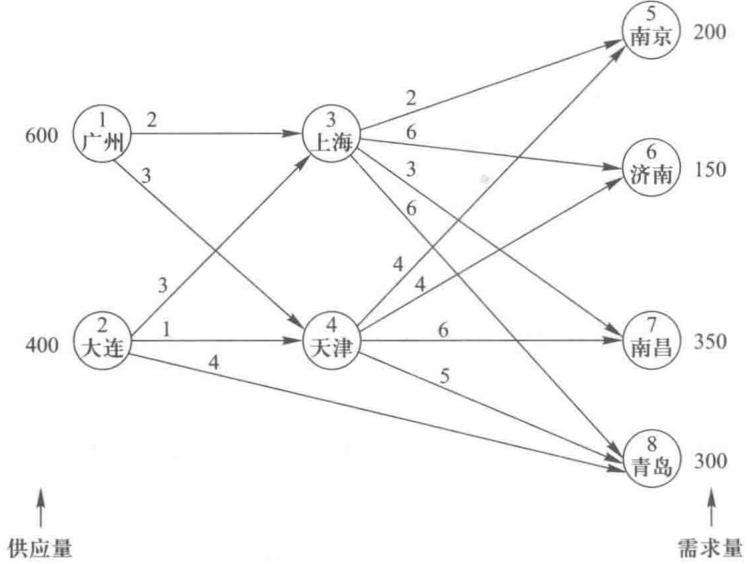
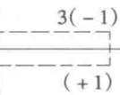
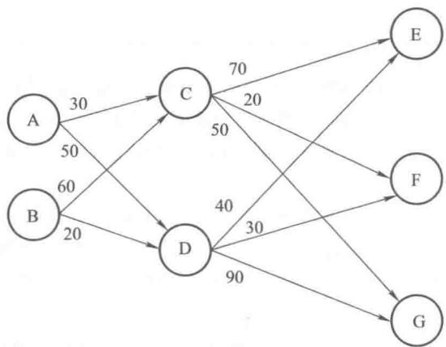
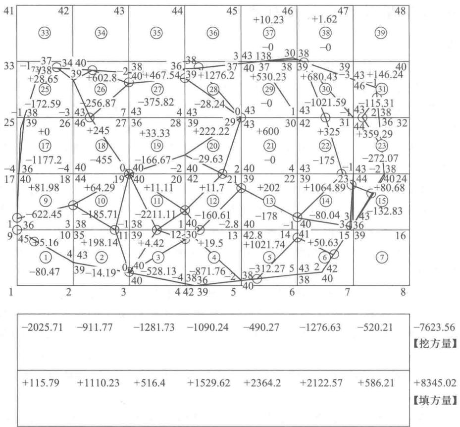

# 第7章 运输问题

本章将讨论一类重要的特殊线性规划问题——运输问题。由于这类线性规划问题在结构上有特殊性，我们可以用比单纯形法更为简便的解法——表上作业法来求解。与其对应，我们在“管理运筹学”软件里编制了运输问题的程序专门处理这类问题。运输问题在工商管理中有着广泛的应用，这也是我们把运输问题单列为一章的原因。

在这一章里,我们将讨论运输问题的模型、运输问题的计算机解法、运输问题的应用,以及运输问题的表上作业法.

## 7.1 运输模型

一般的运输问题就是要解决以下问题:把某种产品从若干个产地调运到若干个销地,在每个产地的供应量与每个销地的需求量已知,并知道各地之间的运输单价的前提下,如何确定一个使得总的运输费用最小的方案.

例 1 某公司从两个产地 $A_{1}, A_{2}$ 将物品运往三个销地 $B_{1}, B_{2}, B_{3}$ ，各产地的产量、各销地的销量和各产地运往各销地的每件物品的运费如表 7-1 所示.

表7-1

<table><tr><td>产地\运费单价/元\销地</td><td> \(B_{1}\) </td><td> \(B_{2}\) </td><td> \(B_{3}\) </td><td>产量/件</td></tr><tr><td> \(A_{1}\) </td><td>16</td><td>4</td><td>16</td><td>200</td></tr><tr><td> \(A_{2}\) </td><td>26</td><td>15</td><td>5</td><td>300</td></tr><tr><td>销量/件</td><td>150</td><td>150</td><td>200</td><td></td></tr></table>

应如何调运,使得总运输费最小?

解 我们知道 $\mathrm{A}_1, \mathrm{A}_2$ 两个产地的总产量为 $200 + 300 = 500$ （件）； $\mathrm{B}_1, \mathrm{B}_2, \mathrm{B}_3$ 三个销地的总销量为 $150 + 150 + 200 = 500$ （件），总产量等于总销量，这是一个产销平衡的运输问题。把 $\mathrm{A}_1, \mathrm{A}_2$ 的产量全部分配给 $\mathrm{B}_1, \mathrm{B}_2, \mathrm{B}_3$ ，正好满足这三个销地的需要。

设 $x_{ij}$ 表示从产地 $A_{i}$ 调运到 $B_{j}$ 的运输量 (i=1,2; j=1,2,3)，例如， $x_{12}$ 表示由 $A_{1}$ 调运到 $B_{2}$ 的物品数量，现将安排的运输量列入表 7-2.

表7-2

<table><tr><td>产地\运输量\销地</td><td> \(B_{1}\) </td><td> \(B_{2}\) </td><td> \(B_{3}\) </td><td>产量/件</td></tr><tr><td> \(A_{1}\) </td><td> \(x_{11}\) </td><td> \(x_{12}\) </td><td> \(x_{13}\) </td><td>200</td></tr><tr><td> \(A_{2}\) </td><td> \(x_{21}\) </td><td> \(x_{22}\) </td><td> \(x_{23}\) </td><td>300</td></tr><tr><td>销量/件</td><td>150</td><td>150</td><td>200</td><td>500</td></tr></table>

从表 7-2 可写出此问题的数学模型.

满足产地产量的约束条件为

$$
\begin{array}{l} x _ {11} + x _ {12} + x _ {13} = 200, \\ x _ {21} + x _ {22} + x _ {23} = 300. \end{array}
$$

满足销地销量的约束条件为

$$
\begin{array}{l} x _ {11} + x _ {21} = 150, \\ x _ {12} + x _ {22} = 150, \\ x _ {13} + x _ {23} = 200. \end{array}
$$

使运输费最小,即

$$
\min f = 16 x _ {11} + 4 x _ {12} + 16 x _ {13} + 26 x _ {21} + 15 x _ {22} + 5 x _ {23}.
$$

所以此运输问题的线性规划的模型如下：

$$
\min f = 16 x _ {11} + 4 x _ {12} + 16 x _ {13} + 26 x _ {21} + 15 x _ {22} + 5 x _ {23};
$$

约束条件：

$$
\begin{array}{l} x _ {11} + x _ {12} + x _ {13} = 200, \\ x _ {21} + x _ {22} + x _ {23} = 300, \\ x _ {11} + x _ {21} = 150, \\ x _ {12} + x _ {22} = 150, \\ x _ {13} + x _ {23} = 200, \\ x _ {i j} \geqslant 0 (i = 1, 2; j = 1, 2, 3). \end{array}
$$

为了给出一般运输问题的线性规划模型,我们将使用以下的一些符号: $A_{1},A_{2},\cdots,A_{m}$ 表示某种物资的m个产地;

$B_{1},B_{2},\cdots,B_{n}$ 表示某种物资的 n 个销地；

$s_{i}$ 表示产地 $A_{i}$ 的产量；

$d_{j}$ 表示销地 $B_{j}$ 的销量；

$c_{ij}$ 表示把物资从产地 $A_{i}$ 运到销地 $B_{j}$ 的单位运价.

同样设 $x_{ij}$ 表示从产地 $\mathrm{A}_i$ 运到销地 $\mathbf{B}_j$ 的运输量，则产销平衡的运输问题的线性规划模型如下所示：

$$
\min f = \sum_ {i = 1} ^ {m} \sum_ {j = 1} ^ {n} c _ {i j} x _ {i j};
$$

约束条件：

$$
\begin{array}{l} \sum_ {j = 1} ^ {n} x _ {i j} = s _ {i}, i = 1, 2, \dots , m, \\ \sum_ {i = 1} ^ {m} x _ {i j} = d _ {j}, j = 1, 2, \dots , n. \end{array}
$$

$x_{ij} \geqslant 0$ ，对所有的 $i$ 和 $j$ .

有时上述运输问题的一般模型会发生如下一些变化：

（1）求目标函数的最大值而不是最小值.有些运输问题中,它的目标是要找出利润最大或营业额最大的调运方案,这时就要求目标函数的最大值了.

（2）当某些运输线路的运输能力有一定限制时，要在线性规划模型的约束条件上加上运输能力限制的约束条件。例如，从 $\mathrm{A}_3$ 运到 $\mathbf{B}_4$ 的物品的数量受到运输能力的限制，最多运送1000单位，这时只要在原来的模型上加上约束条件 $x_{34} \leqslant 1000$ 即可。

（3）当生产总量不等于销售总量，即产销不平衡时，这时将通过增加一个假想仓库或假想产地来化成产销平衡的问题，具体做法将在后面阐述.

## 7.2 运输问题的计算机求解

在建立了运输问题的线性规划模型之后,我们可以用“管理运筹学”软件中的线性规划程序来求出其最优解.用线性规划程序来求解运输问题有以下优缺点:优点为计算机输出的信息多,可以进行灵敏度分析,可知运费单价在什么范围内变化对最优解不变,产量、销量的对偶价格是多少,在什么范围内变化时其对偶价格不变;缺点为输入较麻烦,又因为计算机求解线性规划问题的程序相对复杂,故能解决的运输问题的规模相对小一些.为了克服这两个缺点,在“管理运筹学”软件里编制了求解运输问题的程序,用这个程序我们只要输入产地数,各产地的产量,销点数,各销地的销量,以及各产地到各销地的运输单价,立即可得到运输问题的最优解.把例1的数据输入运输问题程序,立即得到了例 1 的最优解:

$$
\begin{array}{r l} x _ {11} & = 50, x _ {12} = 150, x _ {13} = 0, x _ {21} = 100, x _ {22} = 0, x _ {23} = 200, \\ & \min f = 5000. \end{array}
$$

在上一节中我们讨论的是产销平衡的运输问题,对于产销不平衡的运输问题,我们可以先化为产销平衡的运输问题然后再求解.

例 2 某公司从两个产地 $A_{1}, A_{2}$ 将物品运往三个销地 $B_{1}, B_{2}, B_{3}$ ，各产地产量和各销地销量以及各产地运往各销地的每件物品的运输费如表 7-3 所示.

表7-3

<table><tr><td>产地\运输单价/元\销地</td><td> \(B_{1}\) </td><td> \(B_{2}\) </td><td> \(B_{3}\) </td><td>产量/件</td></tr><tr><td> \(A_{1}\) </td><td>16</td><td>4</td><td>16</td><td>300</td></tr><tr><td> \(A_{2}\) </td><td>26</td><td>15</td><td>5</td><td>300</td></tr><tr><td>销量/件</td><td>150</td><td>150</td><td>200</td><td>600</td></tr></table>

应如何组织运输,使总运输费用为最小?

解 例2与例1比较,只是 $A_{1}$ 的产量提高到300件.这样一来总产量为 $300+300=600$ （件），而总销量仍然是 $150+150+200=500$ （件），这是一个产大于销的运输问题，为此我们再建立一个假想的销地 $B_{4},B_{4}$ 为产地 $A_{1},A_{2}$ 各自的仓库， $B_{4}$ 的销量为100，因为 $A_{1}$ 把物品放在自己的仓库， $A_{2}$ 把物品放在自己的仓库都不需要运费，所以可令 $c_{14}=0,c_{24}=0$ .这样就得到了表7-4所示的产销平衡与运价表，把产大于销的运输问题化成了产销平衡的运输问题.

表7-4

<table><tr><td>产地\运输单价/元\销地</td><td> \(B_1\) </td><td> \(B_2\) </td><td> \(B_3\) </td><td> \(B_4\) </td><td>产量/件</td></tr><tr><td> \(A_1\) </td><td>16</td><td>4</td><td>16</td><td>0</td><td>300</td></tr><tr><td> \(A_2\) </td><td>26</td><td>15</td><td>5</td><td>0</td><td>300</td></tr><tr><td>销量/件</td><td>150</td><td>150</td><td>200</td><td>100</td><td>600600</td></tr></table>

把数据输入“管理运筹学”软件的运输问题程序里,就得到例2的最优解:

$$
x _ {11} = 150, x _ {12} = 150, x _ {13} = 0, x _ {14} = 0,
$$

$$
\begin{array}{r l} x _ {21} & = 0, x _ {22} = 0, x _ {23} = 200, x _ {24} = 100, \\ & \min f = 4000, \end{array}
$$

其中， $x_{14}$ 是 $A_{1}$ 放在自己仓库里的物品数量， $x_{24}$ 是 $A_{2}$ 放在自己仓库里的物品数量.

例 3 某公司从两个产地 $A_{1}, A_{2}$ 将物品运往三个销地 $B_{1}, B_{2}, B_{3}$ ，各销地的销量以及从产地到销地的每件物品的运输单价如表 7-5 所示.

表7-5

<table><tr><td>产地\运输单价/元\销地</td><td> \(B_{1}\) </td><td> \(B_{2}\) </td><td> \(B_{3}\) </td><td>产量/件</td></tr><tr><td> \(A_{1}\) </td><td>16</td><td>4</td><td>16</td><td>200</td></tr><tr><td> \(A_{2}\) </td><td>26</td><td>15</td><td>5</td><td>300</td></tr><tr><td>销量/件</td><td>250</td><td>200</td><td>200</td><td>650</td></tr></table>

例 3 与例 1 相比, 只是 $B_{1}, B_{2}$ 的销量提高了, 这样一来总产量还是 500 件, 但总销量却变成了 650 件, 这是一个销大于产的问题. 为此我们就建立一个假想的产地 $A_{3}, A_{3}$ 的产量为 150 件, 不过 $A_{3}$ 生产的物品仅仅是个“空头支票”, 所以从 $A_{3}$ 到 $B_{1}, B_{2}, B_{3}$ 的运费当然是零, 故 $c_{31}, c_{32}, c_{33}$ 都为零. 在一个运输方案中对于 $A_{3}$ 调运到 $B_{1}, B_{2}, B_{3}$ 的物品数量 $x_{31}, x_{32}, x_{33}$ 只是表明 $B_{1}, B_{2}, B_{3}$ 的销量中所欠缺的数量, 这样我们得到了表 7-6 所示的产销平衡与运价表, 把销大于产的运输问题转化成了产销平衡的运输问题.

表7-6

<table><tr><td>产地\运输单价/元\销地</td><td> \(B_{1}\) </td><td> \(B_{2}\) </td><td> \(B_{3}\) </td><td>产量/件</td></tr><tr><td> \(A_{1}\) </td><td>16</td><td>4</td><td>16</td><td>200</td></tr><tr><td> \(A_{2}\) </td><td>26</td><td>15</td><td>5</td><td>300</td></tr><tr><td> \(A_{3}\) </td><td>0</td><td>0</td><td>0</td><td>150</td></tr><tr><td>销量/件</td><td>250</td><td>200</td><td>200</td><td>650</td></tr></table>

把以上数据输入“管理运筹学”软件,就得到了此运输问题的计算机解:

$$
x _ {11} = 0, x _ {12} = 200, x _ {13} = 0,
$$

$$
x _ {21} = 100, x _ {22} = 0, x _ {23} = 200,
$$

$$
\begin{array}{r l} x _ {31} & = 150, x _ {32} = 0, x _ {33} = 0, \\ & \min f = 4400, \end{array}
$$

其中 $x_{31}, x_{32}, x_{33}$ 分别为销地 $\mathrm{B}_1, \mathrm{B}_2, \mathrm{B}_3$ 欠缺的物品的数量.

如果我们要写出产销不平衡运输问题的线性规划模型,我们只要先按上面的做法把产销不平衡的运输问题化成产销平衡的运输问题,再按上节所给的一般产销平衡的运输问题的线性规划模型,即可写出产销不平衡运输问题的线性规划模型.

实际上为了更方便地求出运输问题的解，“管理运筹学”软件中的运输问题的部分，在程序上已做了这样的设计，使程序能自动处理产销不平衡的运输问题，而不必在输入数据前先化成产销平衡的问题。在这一节中安排了化产销不平衡为产销平衡的内容是为产销不平衡问题的线性规划模型的建立和以后的表上作业法做准备的。

## 7.3 运输问题的应用

### 一、产销不平衡的运输问题

例 4 石家庄北方研究院有三个区, 即一区、二区、三区, 每年分别需要生活用煤和取暖用煤 3 000 t, 1 000 t, 2 000 t, 由河北临城、山西盂县两处煤矿负责供应. 这两处煤矿的价格相同, 煤的质量也基本相同. 两处煤矿能供应北方研究院的煤的数量, 山西盂县为 4 000 t, 河北临城为 1 500 t, 由煤矿至北方研究院的单位运价 (元/t) 如表 7-7 所示.

表7-7
单位：元/t

<table><tr><td>产地\运输单价\销地</td><td>一区</td><td>二区</td><td>三区</td></tr><tr><td>山西盂县</td><td>280</td><td>170</td><td>100</td></tr><tr><td>河北临城</td><td>160</td><td>100</td><td>275</td></tr></table>

由于需大于供,经院研究平衡决定一区供应量可减少0\~300 t,二区需要量应全部满足,三区供应量不少于1 650 t.试求总运费为最低的调运方案.

解 根据题意,作出产销平衡与运价表,如表 7-8 所示.

在表中为了化成产销平衡的运输问题,我们增加了假想生产点这一行,产量为500 t.为了区别必须满足的调运量与可以不满足的调运量,我们把一区分成二列,一列为一区 $_{1}$ ,它的销量是必须要满足的2700 t,另一列为一区 $_{2}$ ,它的销量是可以不满足的300 t.为了必须满足2700 t,我们把假想生产点到一区 $_{1}$ 的运价定为大M(是一个足够大的正数).如果假想生产点调运到一区 $_{1}$ 的煤炭量为 $x_{31}>0$ ,则为此付出的运费将为 $M\cdot x_{31}$ ,是个很大的正数,这显然不符合总运费最小的目标,这样就保证了 $x_{31}=0$ .但对于 $c_{32}$ 我们就可以定为零,因为假想生产点并没有煤炭运出,运价当然为零,又因为 $x_{32}$ 可以为正数,所以300 t煤炭可以不满足.另外 $c_{12}=c_{11}=280,c_{22}=c_{21}=160$ .对三区也进行了同样的处理.由于二区的煤炭必须都满足,所以不需要分两列,并令 $c_{33}=M$ .(注:表中的M,可以输入一个足够大的基数如1000即可)把数据输入软件,我们就得到了如下最优调运方案: $x_{11}=1200,x_{13}=1000,x_{14}=1650,x_{15}=150,x_{21}=1500,x_{32}=300,x_{35}=200$ ,其余变量都为零,总运费为926 000元.也就是说,山西盂县运1200 t给一区,运1000 t给二区,运1800 t给三区,河北临城运1500 t给一区.这样最小运费为926 000元.

表7-8

<table><tr><td rowspan="2">产地\单位运价/元\销地</td><td colspan="5">石家庄北方研究院</td><td rowspan="2">供应量/t</td></tr><tr><td>一区 \(_1\) </td><td>一区 \(_2\) </td><td>二区</td><td>三区 \(_1\) </td><td>三区 \(_2\) </td></tr><tr><td>山西盂县</td><td>280</td><td>280</td><td>170</td><td>100</td><td>100</td><td>4 000</td></tr><tr><td>河北临城</td><td>160</td><td>160</td><td>100</td><td>275</td><td>275</td><td>1 500</td></tr><tr><td>假想生产点</td><td>M</td><td>0</td><td>M</td><td>M</td><td>0</td><td>500</td></tr><tr><td>需求量/t</td><td>2 700</td><td>300</td><td>1 000</td><td>1 650</td><td>350</td><td>6 000</td></tr></table>

例 5 设有三个化肥厂供应四个地区的农用化肥. 假定等量的化肥在这些地区使用效果相同. 各化肥厂年产量、各地区年需求量及从各化肥厂到各地区运送单位化肥的运价如表 7-9 所示, 试求出总的运费最节省的化肥调拨方案.

解 这是一个产销不平衡的运输问题,总产量为 160 万吨,四个地区的最低需求为 110 万吨.最高需求为无限.根据现有产量,在满足 I, II, IV 三个地区的最低需求量的前提下,第IV地区的最高需求改为 60 万吨,总的最高需求为 210 万吨.为了求得平衡,在产销平衡表上增加一个假想的化肥厂 D,其年产量为 50 万吨.由于各地区的需要量包含两个部分,如地区 I,其中 30 万吨是最低需求,必须满足,不能由假想的化肥厂 D 供给,令其运价为 M;而另一部分 20 万吨可以不满足,故可以由假想化肥厂 D 供给,令其运价为零.对需求分两种情况的地区,实际上可按两个地区看待,这样得到表 7-10 所示的产销平衡与运价表.

表7-9

<table><tr><td>产地\运输单价(元/吨)销地</td><td>I</td><td>II</td><td>III</td><td>IV</td><td>产量/万吨</td></tr><tr><td>A</td><td>16</td><td>13</td><td>22</td><td>17</td><td>50</td></tr><tr><td>B</td><td>14</td><td>13</td><td>19</td><td>15</td><td>60</td></tr><tr><td>C</td><td>19</td><td>20</td><td>23</td><td>—</td><td>50</td></tr><tr><td>最低需求/万吨</td><td>30</td><td>70</td><td>0</td><td>10</td><td></td></tr><tr><td>最高需求/万吨</td><td>50</td><td>70</td><td>30</td><td>不限</td><td></td></tr></table>

表7-10

<table><tr><td>产地\运输单价(元/吨)销地</td><td>I&#x27;</td><td>I&quot;</td><td>II</td><td>III</td><td>IV&#x27;</td><td>IV&quot;</td><td>产量/万吨</td></tr><tr><td>A</td><td>16</td><td>16</td><td>13</td><td>22</td><td>17</td><td>17</td><td>50</td></tr><tr><td>B</td><td>14</td><td>14</td><td>13</td><td>19</td><td>15</td><td>15</td><td>60</td></tr><tr><td>C</td><td>19</td><td>19</td><td>20</td><td>23</td><td>M</td><td>M</td><td>50</td></tr><tr><td>D</td><td>M</td><td>0</td><td>M</td><td>0</td><td>M</td><td>0</td><td>50</td></tr><tr><td>销量/万吨</td><td>30</td><td>20</td><td>70</td><td>30</td><td>10</td><td>50</td><td>210</td></tr></table>

输入“管理运筹学”软件即可得到最优调运方案,如表7-11所示(注:表中的M只要输入一个足够大的正数如10 000即可).

表7-11
单位/万吨

<table><tr><td>产地\运输量\销地</td><td>I&#x27;</td><td>I&quot;</td><td>II</td><td>III</td><td>IV&#x27;</td><td>IV&quot;</td><td>产量</td></tr><tr><td>A</td><td></td><td></td><td>50</td><td></td><td></td><td></td><td>50</td></tr><tr><td>B</td><td></td><td></td><td>20</td><td></td><td>10</td><td>30</td><td>60</td></tr><tr><td>C</td><td>30</td><td>20</td><td>0</td><td></td><td></td><td></td><td>50</td></tr><tr><td>D</td><td></td><td></td><td></td><td>30</td><td></td><td>20</td><td>50</td></tr><tr><td>销量</td><td>30</td><td>20</td><td>70</td><td>30</td><td>10</td><td>50</td><td>210/210</td></tr></table>

最小总运费为 2460 万元.

如果例 5 中不是求大于供,而是供大于求,三个化肥厂由于仓库库存量限制等原因,每个厂的产量中有一部分必须运往销地,而另一部分可运出也可库存,那该怎么解决呢? (提示:我们可把每个化肥厂的产量分解为必须运往销地的产量和可运出也可库存的产量,在产销平衡与运价表中把 A、B、C 三个产地分成 A、A', B、B', C、C' 六个产地,销地也增加一个假想的销地(即各自的仓库) $B_{4}$ ,根据是否必须运往销地在 $B_{4}$ 列中填上 M 或零).

例 6 有如下的运输问题: 某个产地的货物将发生储存费用, 其中 1,2,3 产地的单位存储费分别为 3,2,1 元. 假定产地 2 的物资必须至少运出 28 个单位, 产地 3 至少运出 17 个单位, 试求解使得此运输问题费用最小的运输方案, 具体运输费用如表 7-12 所示.

表7-12
单位：元

<table><tr><td>产地\运输单价\销地</td><td>1</td><td>2</td><td>3</td><td>产量</td></tr><tr><td>1</td><td>4</td><td>5</td><td>3</td><td>20</td></tr><tr><td>2</td><td>5</td><td>3</td><td>4</td><td>30</td></tr><tr><td>3</td><td>3</td><td>5</td><td>2</td><td>20</td></tr><tr><td>销量</td><td>20</td><td>30</td><td>10</td><td>70</td></tr></table>

这是一个产大于销的运输问题.根据题意做出产销平衡与运价表,如表7-13所示.

表 7-13

<table><tr><td>产地\运输单价\销地</td><td>1</td><td>2</td><td>3</td><td>4(库存)</td><td>产量</td></tr><tr><td>1</td><td>4</td><td>5</td><td>3</td><td>3</td><td>20</td></tr><tr><td>2</td><td>5</td><td>3</td><td>4</td><td>M</td><td>28</td></tr><tr><td> \(2&#x27;\) </td><td>5</td><td>3</td><td>4</td><td>2</td><td>2</td></tr><tr><td>3</td><td>3</td><td>5</td><td>2</td><td>M</td><td>17</td></tr><tr><td> \(3&#x27;\) </td><td>3</td><td>5</td><td>2</td><td>1</td><td>3</td></tr><tr><td>销量</td><td>20</td><td>30</td><td>10</td><td>10</td><td>70</td></tr></table>

在表中,为了化成产销平衡的运输问题,增加了库存这一列。销量为10,用以区别必须运走的量和可以库存的量.我们把产地2和产地3都分成了2行,即2、2'和3、3',2行的产量28单位与3行的产量17单位必须运走,不能库存,所以其单位运价定为M,而2'行与3'行产量分别为2单位和3单位,其单位运价分别为其单位存储费2元和1元.把表7-13的数据输入软件,即得到如下最优方案:

$x_{11}=13,x_{14}=7,x_{22}=28,x_{32}=2,x_{41}=7,x_{43}=10,x_{54}=3$ ，其余变量均为0，总运费为207元.也就是说，产地1运13单位给销地1，其余7单位库存；产地2运30单位给销地2；产地3运7单位给销地1，运10单位给销地3，其余3单位库存.

### 二、生产与储存问题

例 7 某厂按合同规定须于当年每个季度末分别提供 10,15,25,20 台同一规格的柴油机. 已知该厂各季度的生产能力及生产每台柴油机的成本如表 7-14 所示. 又如果生产出来的柴油机当季不交货, 每台每积压一个季度需储存、维护等费用 0.15 万元. 要求在完成合同的情况下, 做出使该厂全年生产(包括储存、维护)费用最小的决策.

表7-14

<table><tr><td>季度</td><td>生产能力/台</td><td>单位成本/万元</td></tr><tr><td>I</td><td>25</td><td>10.8</td></tr><tr><td>II</td><td>35</td><td>11.1</td></tr><tr><td>III</td><td>30</td><td>11.0</td></tr><tr><td>IV</td><td>10</td><td>11.3</td></tr></table>

解 由于每个季度生产出来的柴油机不一定当月交货,故设 $x_{ij}$ 为第 i 季度生产的第 j 季度交货的柴油机的数目.

由合同规定,各季度交货数必须满足

$$
\left\{ \begin{array}{l} x _ {11} = 10, \\ x _ {12} + x _ {22} = 15, \\ x _ {13} + x _ {23} + x _ {33} = 25, \\ x _ {14} + x _ {24} + x _ {34} + x _ {44} = 20. \end{array} \right.
$$

各季度生产的柴油机数目都不能超过各季度的生产能力,故又有

$$
\left\{ \begin{array}{l} x _ {11} + x _ {12} + x _ {13} + x _ {14} \leqslant 25, \\ x _ {22} + x _ {23} + x _ {24} \leqslant 35, \\ x _ {33} + x _ {34} \leqslant 30, \\ x _ {44} \leqslant 10. \end{array} \right.
$$

设 $c_{ij}$ 是第 i 季度生产的第 j 季度交货的每台柴油机的实际成本， $c_{ij}$ 应该是该季度单位成本加上储存、维护等费用， $c_{ij}$ 值如表 7-15 所示.

表7-15
单位:万元

<table><tr><td>i\j</td><td>I</td><td>II</td><td>III</td><td>IV</td></tr><tr><td>I</td><td>10.8</td><td>10.95</td><td>11.10</td><td>11.25</td></tr><tr><td>II</td><td></td><td>11.10</td><td>11.25</td><td>11.40</td></tr><tr><td>III</td><td></td><td></td><td>11.00</td><td>11.15</td></tr><tr><td>IV</td><td></td><td></td><td></td><td>11.30</td></tr></table>

这样此问题的目标函数可写成

$$
f = 10. 8 x _ {11} + 10. 95 x _ {12} + 11. 10 x _ {13} + 11. 25 x _ {14} + 11. 10 x _ {22} + 11. 25 x _ {23} + 11. 40 x _ {24} + 11. 00 x _ {33} + 11. 15 x _ {34} + 11. 30 x _ {44}.
$$

我们把目标函数和以上的约束条件以及 $x_{ij}$ 非负限制放在一起，就建立起此问题的线性规划模型.把它输入“管理运筹学”软件，我们就可以得到结果.

如果我们写出此问题的产销平衡与运价表并输入运输问题的软件,我们也可以立即得到结果.这时由于产大于销,我们可以加上一个假想的需求D(实际上,不加这个假想需求D,此软件也能自动平衡产销,求解),并注意到当i>j时, $x_{ij}=0$ ,所以应令对应的 $c_{ij}=M$ .产销平衡与运价表如表7-16所示.

表7-16

<table><tr><td>产地\运输单价/万元\销地</td><td>I</td><td>II</td><td>III</td><td>IV</td><td>D</td><td>产量/台</td></tr><tr><td>I</td><td>10.8</td><td>10.95</td><td>11.10</td><td>11.25</td><td>0</td><td>25</td></tr><tr><td>II</td><td>M</td><td>11.10</td><td>11.25</td><td>11.40</td><td>0</td><td>35</td></tr><tr><td>III</td><td>M</td><td>M</td><td>11.00</td><td>11.15</td><td>0</td><td>30</td></tr><tr><td>IV</td><td>M</td><td>M</td><td>M</td><td>11.30</td><td>0</td><td>10</td></tr><tr><td>销量/台</td><td>10</td><td>15</td><td>25</td><td>20</td><td>30</td><td>100</td></tr></table>

在输入数据时,关于 M 我们可以选择相对表中的价格足够大的正数如 1000 即可,从计算机输出的信息我们得到最优解,如表 7-17 所示,其最优值为 773 万元.

表 7-17
单位：台

<table><tr><td>产地\运输量\销地</td><td>I</td><td>II</td><td>III</td><td>IV</td><td>D</td><td>产量</td></tr><tr><td>I</td><td>10</td><td>15</td><td>0</td><td></td><td></td><td>25</td></tr><tr><td>II</td><td></td><td></td><td>0</td><td>5</td><td>30</td><td>35</td></tr><tr><td>III</td><td></td><td></td><td>25</td><td>5</td><td></td><td>30</td></tr><tr><td>IV</td><td></td><td></td><td></td><td>10</td><td></td><td>10</td></tr><tr><td>销量</td><td>10</td><td>15</td><td>25</td><td>20</td><td>30</td><td></td></tr></table>

例 8 光明仪器厂生产电脑绣花机是以销定产的.1—6月份各月的生产能力、合同销量和单台电脑绣花机平均生产费用如表7-18所示.又已知上年末库存103台绣花机.如果当月生产出来的机器当月不交货,则需要运到分厂库房,每台增加运输成本0.1万元,每台机器每月的平均仓储费、维护费为0.2万元.在7—8月份销售淡季,全厂停产1个月,因此在6月份完成销售合同后还要留出库存80台.加班生产机器每台增加成本1万元.问应如何安排1—6月份的生产使总的生产(包括运输、仓储、维护)费用最少?

表7-18

<table><tr><td>月份</td><td>正常生产能力/台</td><td>加班生产能力/台</td><td>销量/台</td><td>单台费用/万元</td></tr><tr><td>1</td><td>60</td><td>10</td><td>104</td><td>15</td></tr><tr><td>2</td><td>50</td><td>10</td><td>75</td><td>14</td></tr><tr><td>3</td><td>90</td><td>20</td><td>115</td><td>13.5</td></tr><tr><td>4</td><td>100</td><td>40</td><td>160</td><td>13</td></tr><tr><td>5</td><td>100</td><td>40</td><td>103</td><td>13</td></tr><tr><td>6</td><td>80</td><td>40</td><td>70</td><td>13.5</td></tr></table>

解 这是一个生产储存问题,可以化为运输问题来做.根据已知条件可列出产销平衡与运价表,如表7-19所示.制定此表主要考虑如下条件:

(1) 1—6月份合计生产能力（包括上年末储存量）为743台，销量为707台，产大于销36台，所以在销地栏中设一个假想销地（仓库），其销量实为不安排生产的剩余生产能力.

(2) 上年末库存 103 台, 只有仓储费和运输费, 我们把它列在序号 0 行里.

表7-19

<table><tr><td rowspan="2">生产月\单价/万元\销售月</td><td rowspan="2">1月</td><td rowspan="2">2月</td><td rowspan="2">3月</td><td rowspan="2">4月</td><td rowspan="2">5月</td><td rowspan="2">6月</td><td rowspan="2">假想销地</td><td colspan="2">产量/台</td></tr><tr><td>正常</td><td>加班</td></tr><tr><td>0</td><td>0.3</td><td>0.5</td><td>0.7</td><td>0.9</td><td>1.1</td><td>1.3</td><td>0</td><td>103</td><td></td></tr><tr><td>1</td><td>15</td><td>15.3</td><td>15.5</td><td>15.7</td><td>15.9</td><td>16.1</td><td>0</td><td>60</td><td></td></tr><tr><td> \(1&#x27;\) </td><td>16</td><td>16.3</td><td>16.5</td><td>16.7</td><td>16.9</td><td>17.1</td><td>0</td><td></td><td>10</td></tr><tr><td>2</td><td>M</td><td>14</td><td>14.3</td><td>14.5</td><td>14.7</td><td>14.9</td><td>0</td><td>50</td><td></td></tr><tr><td> \(2&#x27;\) </td><td>M</td><td>15</td><td>15.3</td><td>15.5</td><td>15.7</td><td>15.9</td><td>0</td><td></td><td>10</td></tr><tr><td>3</td><td>M</td><td>M</td><td>13.5</td><td>13.8</td><td>14.0</td><td>14.2</td><td>0</td><td>90</td><td></td></tr><tr><td> \(3&#x27;\) </td><td>M</td><td>M</td><td>14.5</td><td>14.8</td><td>15.0</td><td>15.2</td><td>0</td><td></td><td>20</td></tr><tr><td>4</td><td>M</td><td>M</td><td>M</td><td>13</td><td>13.3</td><td>13.5</td><td>0</td><td>100</td><td></td></tr><tr><td> \(4&#x27;\) </td><td>M</td><td>M</td><td>M</td><td>14</td><td>14.3</td><td>14.5</td><td>0</td><td></td><td>40</td></tr><tr><td>5</td><td>M</td><td>M</td><td>M</td><td>M</td><td>13</td><td>13.3</td><td>0</td><td>100</td><td></td></tr><tr><td> \(5&#x27;\) </td><td>M</td><td>M</td><td>M</td><td>M</td><td>14</td><td>14.3</td><td>0</td><td></td><td>40</td></tr><tr><td>6</td><td>M</td><td>M</td><td>M</td><td>M</td><td>M</td><td>13.5</td><td>0</td><td>80</td><td></td></tr><tr><td> \(6&#x27;\) </td><td>M</td><td>M</td><td>M</td><td>M</td><td>M</td><td>14.5</td><td>0</td><td></td><td>40</td></tr><tr><td>销量/台</td><td>104</td><td>75</td><td>115</td><td>160</td><td>103</td><td>150</td><td>36</td><td colspan="2">743</td></tr></table>

(3) 6月份的需求除了70台销量外还要80台库存,其需求应为 $80+70=150$ (台).
(4) 产销平衡与运价表中，生产时间中的序号1—6表示1—6月份正常生产情况，序号1'—6'表示1—6月份加班生产情况.
用“管理运筹学”软件解得结果是1—6月份最低总生产（包括运输、仓储、维护）费用为8307.5万元，每月的生产销售安排如表7-20所示.

表7-20
单位：台

<table><tr><td>生产月\量\运输量\销售月</td><td>1月</td><td>2月</td><td>3月</td><td>4月</td><td>5月</td><td>6月</td><td>假想销量</td></tr><tr><td>0</td><td>63</td><td>15</td><td>5</td><td>20</td><td></td><td></td><td></td></tr><tr><td>1</td><td>41</td><td></td><td></td><td></td><td></td><td></td><td>19</td></tr><tr><td> \(1&#x27;\) </td><td></td><td></td><td></td><td></td><td></td><td></td><td>10</td></tr><tr><td>2</td><td></td><td>50</td><td></td><td></td><td></td><td></td><td></td></tr><tr><td> \(2&#x27;\) </td><td></td><td>10</td><td></td><td></td><td></td><td></td><td></td></tr><tr><td>3</td><td></td><td></td><td>90</td><td></td><td></td><td></td><td></td></tr><tr><td> \(3&#x27;\) </td><td></td><td></td><td>20</td><td></td><td></td><td></td><td></td></tr><tr><td>4</td><td></td><td></td><td></td><td>100</td><td></td><td></td><td></td></tr><tr><td> \(4&#x27;\) </td><td></td><td></td><td></td><td>40</td><td></td><td></td><td></td></tr><tr><td>5</td><td></td><td></td><td></td><td></td><td>63</td><td>37</td><td></td></tr><tr><td> \(5&#x27;\) </td><td></td><td></td><td></td><td></td><td>40</td><td></td><td></td></tr><tr><td>6</td><td></td><td></td><td></td><td></td><td></td><td>80</td><td></td></tr><tr><td> \(6&#x27;\) </td><td></td><td></td><td></td><td></td><td></td><td>33</td><td>7</td></tr></table>

### 三、转运问题

所谓的转运问题是运输问题的一个扩充,在原来的运输问题中的产地(也称发点)、销地(也称收点)之外还增加了中转点.在运输问题中我们只允许物品从发点运往收点,而在转运问题中,我们允许把物品从一个发点运往另一个发点或中转点或收点,也允许把物品从一个中转点运往另一个中转点或发点或收点,还允许把物品从一个收点运往另一个收点或中转点或发点.

在每一个发点的供应量一定,每一个收点的需求量一定,每两个点之间的运输单价已知的条件下,如何进行调运使得总的运输费用最小.

例 9 某仪器采购网欲向腾飞电子仪器公司采购电子仪器,以交付其位于南京、济南、南昌以及青岛的网购订单。采购合同规定运输费由腾飞电子仪器公司承担.该公司在大连和广州有两个分厂,大连分厂每月生产400台某种仪器,广州分厂每月生产600台某种仪器.该公司在上

海与天津有两个销售公司负责对南京、济南、南昌与青岛四个城市的仪器供应。又因为大连与青岛相距较近，公司同意大连分厂也可以向青岛直接供货，这些城市间的每台仪器的运输费用我们标在图7-1两个城市间的箭头上，单位为百元，问应该如何调运仪器，使得总的运输费最低？

图7-1

解 如图 7-1 所示, 我们用 1 代表广州; 2 代表大连; 3 代表上海; 4 代表天津; 5 代表南京; 6 代表济南; 7 代表南昌; 8 代表青岛.

设 $x_{ij}$ 表示从 i 到 j 的调运量, 如 $x_{36}$ 表示从上海运到济南的仪器台数.

从网络图上我们可以写出其目标函数：

$$
\begin{array}{r l} & f = 2 x _ {13} + 3 x _ {14} + 3 x _ {23} + x _ {24} + 2 x _ {35} + 6 x _ {36} + 4 x _ {45} + 3 x _ {37} + \\ & \quad 6 x _ {38} + 4 x _ {46} + 6 x _ {47} + 5 x _ {48} + 4 x _ {28}. \end{array}
$$

对发点 1(广州)我们可以写其供应量的约束条件：

$$
x _ {13} + x _ {14} \leqslant 600.
$$

同样对发点 2, 其也受供应量之约束:

$$
x _ {23} + x _ {24} + x _ {28} \leqslant 400.
$$

站点 3 是个中转点, 它把所收到的仪器又都分送下去, 它收到的仪器数等于它送出的仪器数, 即

$$
- x _ {13} - x _ {23} + x _ {35} + x _ {36} + x _ {37} + x _ {38} = 0.
$$

同样，对中转点4有

$$
- x _ {14} - x _ {24} + x _ {45} + x _ {46} + x _ {47} + x _ {48} = 0.
$$

对收点 5 来说, 它收到的仪器数应正好等于它的需求量 200, 故有

$$
x _ {35} + x _ {45} = 200.
$$

同样有

$$
\begin{array}{r l} & x _ {36} + x _ {46} = 150. \\ & x _ {37} + x _ {47} = 350. \\ & x _ {28} + x _ {38} + x _ {48} = 300. \end{array}
$$

这样可得到该问题的线性规划模型如下：

$$
\min\ f = 2 x _ {13} + 3 x _ {14} + 3 x _ {23} + x _ {24} + 2 x _ {35} + 6 x _ {36} + 3 x _ {37} + 6 x _ {38} + 4 x _ {45} + 4 x _ {46} + 6 x _ {47} + 5 x _ {48} + 4 x _ {28};
$$

约束条件：

$$
\begin{array}{l} x _ {13} + x _ {14} \leqslant 600,\\ x _ {23} + x _ {24} + x _ {28} \leqslant 400,\\ - x _ {13} - x _ {23} + x _ {35} + x _ {36} + x _ {37} + x _ {38} = 0,\\ - x _ {14} - x _ {24} + x _ {45} + x _ {46} + x _ {47} + x _ {48} = 0,\\ x _ {35} + x _ {45} = 200,\\ x _ {36} + x _ {46} = 150,\\ x _ {37} + x _ {47} = 350,\\ x _ {28} + x _ {38} + x _ {48} = 300,\\ x _ {i j} \geqslant 0, \text{对所有的} i, j.\end{array}
$$

用“管理运筹学”软件求解得到结果如下：

$$
\begin{array}{l} x _ {13} = 550, x _ {14} = 50, x _ {23} = 0, x _ {24} = 100, \\ x _ {35} = 200, x _ {36} = 0, x _ {37} = 350, x _ {38} = 0, \\ x _ {45} = 0, x _ {46} = 150, x _ {47} = 0, x _ {48} = 0, \\ x _ {28} = 300. \end{array}
$$

最小的运输费用为 4600 百元.

对于转运问题的一般线性规划的模型如下：

$$
\min \sum_ {\mathrm{对所有的弧}} c _ {i j} x _ {i j};
$$

约束条件：

对发点 $i$ 有

$$
\sum_ {\mathrm{所有流出量}} x _ {i j} - \sum_ {\mathrm{所有流入量}} x _ {i j} = s _ {i},
$$

对于中转点有

$$
\sum_ {\mathrm{所有流出量}} x _ {i j} - \sum_ {\mathrm{所有流入量}} x _ {i j} = 0,
$$

对于收点 $j$ 有

$$
\sum_ {\mathrm{所有流入量}} x _ {i j} - \sum_ {\mathrm{所有流出量}} x _ {i j} = d _ {j},
$$

$x_{ij} \geqslant 0$ ，对所有的 $i$ 和 $j$ .

其中， $c_{ij}$ 为从 i 点运到 j 点的单位运价， $s_{i}$ 为发点 i 的供应量， $d_{j}$ 为收点 j 的需求量.

我们也可以用产销平衡与运价表使用“管理运筹学”软件的运输问题来解决转运问题.

例 10 某公司有三个分厂生产某种物资, 分别运往四个地区的销售公司去销售. 有关分厂的

产量、各销售公司的销量及运价如表7-21所示，求使总的运费最少的调运方案.

这是一个普通的产销平衡问题,但是如果假定:

（1）每个分厂的物资不一定直接发运到销地，可以从其中几个产地集中一起运.

（2）运往各销地的物资可以先运给其中几个销地, 再转运给其他销地.

（3）除产销之外，还有几个中转站，在产地之间、销地之间或产地与销地之间转运.

表7-21

<table><tr><td>产地\运输单价/百元\销地</td><td> \(B_{1}\) </td><td> \(B_{2}\) </td><td> \(B_{3}\) </td><td> \(B_{4}\) </td><td>产量/t</td></tr><tr><td> \(A_{1}\) </td><td>3</td><td>11</td><td>3</td><td>10</td><td>7</td></tr><tr><td> \(A_{2}\) </td><td>1</td><td>9</td><td>2</td><td>8</td><td>4</td></tr><tr><td> \(A_{3}\) </td><td>7</td><td>4</td><td>10</td><td>5</td><td>9</td></tr><tr><td>销量/t</td><td>3</td><td>6</td><td>5</td><td>6</td><td>20</td></tr></table>

各产地、销地、中转站及相互之间每吨物资的运价如表 7-22 所示,问在考虑产销之间直接运输和非直接运输的各种可能方案的情况下,如何将三个分厂生产的物资运往销售公司,才使总的运费最少?

表 7-22

<table><tr><td rowspan="2" colspan="2"></td><td colspan="3">产地</td><td colspan="4">中转站</td><td colspan="4">销地</td></tr><tr><td> \(A_1\) </td><td> \(A_2\) </td><td> \(A_3\) </td><td> \(T_1\) </td><td> \(T_2\) </td><td> \(T_3\) </td><td> \(T_4\) </td><td> \(B_1\) </td><td> \(B_2\) </td><td> \(B_3\) </td><td> \(B_4\) </td></tr><tr><td rowspan="3">产地</td><td> \(A_1\) </td><td></td><td>1</td><td>3</td><td>2</td><td>1</td><td>4</td><td>3</td><td>3</td><td>11</td><td>3</td><td>10</td></tr><tr><td> \(A_2\) </td><td>1</td><td></td><td>—</td><td>3</td><td>5</td><td>—</td><td>2</td><td>1</td><td>9</td><td>2</td><td>8</td></tr><tr><td> \(A_3\) </td><td>3</td><td>—</td><td></td><td>1</td><td>—</td><td>2</td><td>3</td><td>7</td><td>4</td><td>10</td><td>5</td></tr><tr><td rowspan="4">中转站</td><td> \(T_1\) </td><td>2</td><td>3</td><td>1</td><td></td><td>1</td><td>3</td><td>2</td><td>2</td><td>8</td><td>4</td><td>6</td></tr><tr><td> \(T_2\) </td><td>1</td><td>5</td><td>—</td><td>1</td><td></td><td>1</td><td>1</td><td>4</td><td>5</td><td>2</td><td>7</td></tr><tr><td> \(T_3\) </td><td>4</td><td>—</td><td>2</td><td>3</td><td>1</td><td></td><td>2</td><td>1</td><td>8</td><td>2</td><td>4</td></tr><tr><td> \(T_4\) </td><td>3</td><td>2</td><td>3</td><td>2</td><td>1</td><td>2</td><td></td><td>1</td><td>—</td><td>2</td><td>6</td></tr><tr><td rowspan="4">销地</td><td> \(B_1\) </td><td>3</td><td>1</td><td>7</td><td>2</td><td>4</td><td>1</td><td>1</td><td></td><td>1</td><td>4</td><td>2</td></tr><tr><td> \(B_2\) </td><td>11</td><td>9</td><td>4</td><td>8</td><td>5</td><td>8</td><td>—</td><td>1</td><td></td><td>2</td><td>1</td></tr><tr><td> \(B_3\) </td><td>3</td><td>2</td><td>10</td><td>4</td><td>2</td><td>2</td><td>2</td><td>4</td><td>2</td><td></td><td>3</td></tr><tr><td> \(B_4\) </td><td>10</td><td>8</td><td>5</td><td>6</td><td>7</td><td>4</td><td>6</td><td>2</td><td>1</td><td>3</td><td></td></tr></table>

解 从表7-22可以看出，从 $\mathrm{A}_1$ 到 $\mathrm{B}_2$ 直接运费单价为11（百元），但从 $\mathrm{A}_1$ 经 $\mathrm{A}_3$ 到 $\mathrm{B}_2$ ，运价仅为 $3 + 4 = 7$ （百元）.从 $\mathrm{A}_{1}$ 经 $\mathrm{T}_{2}$ 到 $\mathbf{B}_2$ 只需 $1 + 5 = 6$ （百元）；而从 $\mathrm{A}_{1}$ 到 $\mathrm{B}_2$ 的最佳途径为 $\mathrm{A}_1\rightarrow \mathrm{A}_2\rightarrow$ $\mathrm{B}_1\to \mathrm{B}_2$ ，运价只是 $1 + 1 + 1 = 3$ （百元），可见转运问题比一般运输问题复杂.现在我们把此转运问题化成一般运输问题，要做如下处理：

（1）由于问题中的所有产地、中转站、销地都可以看成产地，也可以看成销地，因此整个问题可以看成一个有11个产地11个销地的扩大的运输问题.

（2）对扩大的运输问题建立运价表, 将表中不可能的运输方案用任意大的正数 M 代替.

（3）所有中转站的产量等于销量也即流入量等于流出量.由于运费最少时不可能出现一批物资来回倒运的现象,所以每个中转站的转运量不会超过20 t,可以规定 $T_{1},T_{2},T_{3},T_{4}$ 的产量和销量均为20 t.由于实际的转运量

$$
\sum_ {j = 1} ^ {n} x _ {i j} \leqslant s _ {i}, \sum_ {i = 1} ^ {m} x _ {i j} \leqslant d _ {j},
$$

这里 $s_{i}$ 表示 i 点的流出量, $d_{j}$ 表示 j 点的流入量. 对中转点来说, 按上面规定 $s_{i}=d_{j}=20$ .

这样可以在每个约束条件中增加一个松弛变量 $x_{ii}, x_{ii}$ 相当于一个虚构的中转站，其意义就是自己运给自己. $20 - x_{ii}$ 就是每个中转站的实际转运量， $x_{ii}$ 的对应运价 $c_{ii} = 0$ .

（4）扩大了的运输问题中，原来的产地与销地由于也具有转运作用，所以同样在原来的产量与销量的数字上加上20 t，即三个分厂的产量改为27 t, 24 t, 29 t，销量均为20 t，四个销地每天的销量改为23 t, 26 t, 25 t, 26 t，产量均为20 t，同时引进 $x_{ii}$ 为松弛变量。表7-23为扩大了的运输问题产销平衡与运价表。

表7-23

<table><tr><td>产地\销地产地</td><td> \(A_1\) </td><td> \(A_2\) </td><td> \(A_3\) </td><td> \(T_1\) </td><td> \(T_2\) </td><td> \(T_3\) </td><td> \(T_4\) </td><td> \(B_1\) </td><td> \(B_2\) </td><td> \(B_3\) </td><td> \(B_4\) </td><td>产量/t</td></tr><tr><td> \(A_1\) </td><td>0</td><td>1</td><td>3</td><td>2</td><td>1</td><td>4</td><td>3</td><td>3</td><td>11</td><td>3</td><td>10</td><td>27</td></tr><tr><td> \(A_2\) </td><td>1</td><td>0</td><td>M</td><td>3</td><td>5</td><td>M</td><td>2</td><td>1</td><td>9</td><td>2</td><td>8</td><td>24</td></tr><tr><td> \(A_3\) </td><td>3</td><td>M</td><td>0</td><td>1</td><td>M</td><td>2</td><td>3</td><td>7</td><td>4</td><td>10</td><td>5</td><td>29</td></tr><tr><td> \(T_1\) </td><td>2</td><td>3</td><td>1</td><td>0</td><td>1</td><td>3</td><td>2</td><td>2</td><td>8</td><td>4</td><td>6</td><td>20</td></tr><tr><td> \(T_2\) </td><td>1</td><td>5</td><td>M</td><td>1</td><td>0</td><td>1</td><td>1</td><td>4</td><td>5</td><td>2</td><td>7</td><td>20</td></tr><tr><td> \(T_3\) </td><td>4</td><td>M</td><td>2</td><td>3</td><td>1</td><td>0</td><td>2</td><td>1</td><td>8</td><td>2</td><td>4</td><td>20</td></tr><tr><td> \(T_4\) </td><td>3</td><td>2</td><td>3</td><td>2</td><td>1</td><td>2</td><td>0</td><td>1</td><td>M</td><td>2</td><td>6</td><td>20</td></tr><tr><td> \(B_1\) </td><td>3</td><td>1</td><td>7</td><td>2</td><td>4</td><td>1</td><td>1</td><td>0</td><td>1</td><td>4</td><td>2</td><td>20</td></tr><tr><td> \(B_2\) </td><td>11</td><td>9</td><td>4</td><td>8</td><td>5</td><td>8</td><td>M</td><td>1</td><td>0</td><td>2</td><td>1</td><td>20</td></tr><tr><td> \(B_3\) </td><td>3</td><td>2</td><td>10</td><td>4</td><td>2</td><td>5</td><td>2</td><td>4</td><td>2</td><td>0</td><td>3</td><td>20</td></tr><tr><td> \(B_4\) </td><td>10</td><td>8</td><td>5</td><td>6</td><td>7</td><td>4</td><td>6</td><td>2</td><td>1</td><td>3</td><td>0</td><td>20</td></tr><tr><td>销量/t</td><td>20</td><td>20</td><td>20</td><td>20</td><td>20</td><td>20</td><td>20</td><td>23</td><td>26</td><td>25</td><td>26</td><td>240/240</td></tr></table>

用“管理运筹学”软件进行计算,得到其最优解如表7-24所示,其最小运输费为6800元.

<table><tr><td>产地\量\调运销地</td><td> \(A_1\) </td><td> \(A_2\) </td><td> \(A_3\) </td><td> \(T_1\) </td><td> \(T_2\) </td><td> \(T_3\) </td><td> \(T_4\) </td><td> \(B_1\) </td><td> \(B_2\) </td><td> \(B_3\) </td><td> \(B_4\) </td><td>产量</td></tr><tr><td> \(A_1\) </td><td>20</td><td>7</td><td></td><td></td><td></td><td></td><td></td><td></td><td></td><td></td><td></td><td>27</td></tr><tr><td> \(A_2\) </td><td></td><td>13</td><td></td><td></td><td></td><td></td><td></td><td>6</td><td></td><td>5</td><td></td><td>24</td></tr><tr><td> \(A_3\) </td><td></td><td></td><td>20</td><td>3</td><td></td><td></td><td></td><td></td><td>6</td><td></td><td></td><td>29</td></tr><tr><td> \(T_1\) </td><td></td><td></td><td></td><td>17</td><td></td><td></td><td></td><td>3</td><td></td><td></td><td></td><td>20</td></tr><tr><td> \(T_2\) </td><td></td><td></td><td></td><td></td><td>20</td><td></td><td></td><td></td><td></td><td></td><td></td><td>20</td></tr><tr><td> \(T_3\) </td><td></td><td></td><td></td><td></td><td></td><td>20</td><td></td><td></td><td></td><td></td><td></td><td>20</td></tr><tr><td> \(T_4\) </td><td></td><td></td><td></td><td></td><td></td><td></td><td>20</td><td></td><td></td><td></td><td></td><td>20</td></tr><tr><td> \(B_1\) </td><td></td><td></td><td></td><td></td><td></td><td></td><td></td><td>14</td><td></td><td></td><td>6</td><td>20</td></tr><tr><td> \(B_2\) </td><td></td><td></td><td></td><td></td><td></td><td></td><td></td><td></td><td>20</td><td></td><td></td><td>20</td></tr><tr><td> \(B_3\) </td><td></td><td></td><td></td><td></td><td></td><td></td><td></td><td></td><td></td><td>20</td><td></td><td>20</td></tr><tr><td> \(B_4\) </td><td></td><td></td><td></td><td></td><td></td><td></td><td></td><td></td><td></td><td></td><td>20</td><td>20</td></tr><tr><td>销量</td><td>20</td><td>20</td><td>20</td><td>20</td><td>20</td><td>20</td><td>20</td><td>23</td><td>26</td><td>25</td><td>26</td><td>240/240</td></tr></table>

从表 7-24 可知, $A_{1}$ 把 7 t 产量先运到 $A_{2}$ , 此时它加上 $A_{2}$ 的 4 t 产量一共有 11 t, 其中 6 t 运给 $B_{1}, 5$ t 运给 $B_{3}; A_{3}$ 把 3 t 通过中转站 $T_{1}$ 运给了 $B_{1}, 6$ t 直接运给了 $B_{2}$ , 这样 $B_{1}$ 一共收到了 9 t, 其多余的 6 t 转运给 $B_{4}$ , 这是最佳运输方案, 总运费只有 6800 元.

## 7.4 运输问题的表上作业法

表上作业法是一种求解运输问题的特殊方法,其实质是单纯形法.它是针对运输问题变量多(如有20个产地30个销地的运输问题就有 $20\times30=600$ 个变量),结构独特的情况,大大简化了计算过程的求解方法,它的计算过程如下:

这里假设所有的运输问题都是产销平衡的,至于产销不平衡的运输问题可以先化为产销平衡的问题再求解.

(1) 找出初始基本可行解.

对于有 $m$ 个产地 $n$ 个销地的产销平衡的问题，从其线性规划的模型上可知，在它的约束条件中有 $m$ 个关于产量的约束方程和 $n$ 个关于销量的约束方程，共有 $m + n$ 个约束方程，但由于产销平衡，前 $m$ 个约束方程之和等于后 $n$ 个约束方程之和，所以其模型最多只有 $m + n - 1$ 个独立的约束方程。实际上其正好是 $m + n - 1$ 个独立的约束方程，也就是说其系数矩阵的秩为 $m + n - 1$ 即运输问题有 $m + n - 1$ 个基变量，找出初始基本可行解，就是在 $m \times n$ 产销平衡表上给出 $m + n - 1$ 个数字格，其相应的调运量就是基变量，格子中所填写的值即为基变量的值。

(2) 求各非基变量的检验数, 即在表上计算除了上述的 $m + n - 1$ 个数字格以外的空格的检验数, 来判别问题是否达到最优解, 如已是最优解, 则停止计算, 否则转到下一步. 在运输问题中都存在最优解.

(3)确定入基变量与出基变量，找出新的基本可行解.在表上用闭回路法调整.

(4) 重复(2)和(3)直至得到最优解.

以上运算都可以在表上完成,下面通过例子来说明表上作业法计算步骤.

例 11 喜庆食品公司有三个生产面包的分厂 $A_{1}, A_{2}, A_{3}$ ，有四个销售公司 $B_{1}, B_{2}, B_{3}, B_{4}$ ，其各分厂每日的产量、各销售公司每日的销量以及各分厂到各销售公司的单位运价如表 7-25 所示，在表中产量与销量的单位为 t，运价的单位为百元/t。问该公司在满足各销点的需求量的前提下应如何调运产品，使总运费最少？

表7-25

<table><tr><td>产地\运价\百元/t销地</td><td> \(B_1\) </td><td> \(B_2\) </td><td> \(B_3\) </td><td> \(B_4\) </td><td>产量/t</td></tr><tr><td> \(A_1\) </td><td>3</td><td>11</td><td>3</td><td>10</td><td>7</td></tr><tr><td> \(A_2\) </td><td>1</td><td>9</td><td>2</td><td>8</td><td>4</td></tr><tr><td> \(A_3\) </td><td>7</td><td>4</td><td>10</td><td>5</td><td>9</td></tr><tr><td>销量/t</td><td>3</td><td>6</td><td>5</td><td>6</td><td>20/20</td></tr></table>

我们用表上作业法来解此题,这是一个产销平衡的运输问题,表7-25已经是产销平衡和运价表了,不需要再设假想产地和销地了.

### 一、确定初始基本可行解

我们在产销平衡与运价表上找出初始基本可行解,为了把初始基本可行解与运价区分开,我们把运价放在每一栏的右上角,在每一栏的中间写上初始基本可行解(调运量),如表7-26所示.

#### 1. 西北角法

先从表的左上角(即西北角)的变量 $x_{11}$ 开始分配运输量,并使 $x_{11}$ 取尽可能大的值,这里发点

表7-26

<table><tr><td>产地\销地</td><td colspan="3"> \(B_1\) </td><td colspan="3"> \(B_2\) </td><td colspan="3"> \(B_3\) </td><td colspan="2"> \(B_4\) </td><td>产量</td></tr><tr><td rowspan="2"> \(A_1\) </td><td></td><td></td><td>3</td><td></td><td></td><td>11</td><td></td><td></td><td>3</td><td></td><td>10</td><td rowspan="2">7 4 0</td></tr><tr><td></td><td></td><td></td><td></td><td>4</td><td></td><td></td><td></td><td></td><td></td><td></td></tr><tr><td rowspan="2"> \(A_2\) </td><td></td><td></td><td>1</td><td></td><td></td><td>9</td><td></td><td></td><td>2</td><td></td><td>8</td><td rowspan="2">4 2 0</td></tr><tr><td></td><td></td><td></td><td></td><td>2</td><td></td><td></td><td>2</td><td></td><td></td><td></td></tr><tr><td rowspan="2"> \(A_3\) </td><td></td><td></td><td>7</td><td></td><td></td><td>4</td><td></td><td></td><td>10</td><td></td><td>5</td><td rowspan="2">9 6 0</td></tr><tr><td></td><td></td><td></td><td></td><td></td><td></td><td></td><td>3</td><td></td><td></td><td>6</td></tr><tr><td>销量</td><td>30</td><td></td><td></td><td>620</td><td></td><td></td><td>530</td><td></td><td></td><td>60</td><td></td><td></td></tr></table>

$A_{1}$ 的产量为 7, $B_{1}$ 的销量为 3, $x_{11}$ 只能取 3, 即

$$
x _ {11} = \min (7, 3) = 3.
$$

由于 $x_{11}$ 为3，所以 $x_{21}$ 与 $x_{31}$ 必为零.令 $x_{21}$ 与 $x_{31}$ 为非基变量，这样我们在 $x_{11}$ 格里填上3，并把 $\mathrm{B}_1$ 的销量与 $\mathrm{A}_1$ 的产量都减去3填入销量、产量处，把原来的销量、产量划去.新填上的销量、产量表示在 $x_{11} = 3$ （即 $\mathrm{A}_1$ 运给 $\mathrm{B}_1$ 3 \mathrm{t}） 情况下， $\mathbf{B}_1$ 还需要的销量与 $\mathrm{A}_1$ 还能供应的产量，这时 $\mathrm{A}_1$ 还能供应4t，而 $\mathrm{B}_1$ 销量为0，已不需要从 $\mathrm{A}_2,\mathrm{A}_3$ 再运入了，这样我们就可把 $\mathrm{B}_1$ 列划去了.于是产销平衡与运价表上（简称运输表）只剩下 $3\times 3$ 矩阵了，这时 $x_{12}$ 为西北角了，同样我们取 $x_{12}$ 为尽可能大的值，知 $x_{12} = \min (4,6) = 4.$

取 $x_{12} = 4$ 填入，把 $\mathrm{A}_1$ 的产量改为 $4 - 4 = 0$ ，把 $\mathrm{B}_2$ 的销量改为 $6 - 4 = 2$ 填上，并划去 $\mathrm{A}_1$ 这一行；同样找到西北角 $x_{22}$ ，取 $x_{22} = \min (4,2) = 2$ ，改写 $\mathrm{A}_2$ 产量为 $2,\mathrm{B}_2$ 销量为0，并划去 $\mathrm{B}_2$ 列；继续下去，取 $x_{23} = \min (2,5) = 2$ ，改写 $\mathrm{A}_2$ 产量为0， $\mathrm{B}_3$ 销量为3，划去 $\mathrm{A}_2$ 行；再取 $x_{33} = \min (3,9) = 3$ ，改写 $\mathrm{A}_3$ 产量为6， $\mathrm{B}_3$ 销量为0，并划去 $\mathrm{B}_3$ 列；最后取 $x_{34} = \min (6,6) = 6$ 填上， $\mathrm{A}_3$ 的产量， $\mathrm{B}_4$ 的销量都改写为0，并划去 $\mathrm{A}_3$ 行.这样就得到了一个初始基本可行解，有 $m + n - 1 = 3 + 4 - 1 = 6$ 个基变量，其中 $x_{11} = 3,x_{12} = 4,x_{22} = 2,x_{23} = 2,x_{33} = 3,x_{34} = 6$ ，此时，其总运输费用为 $3\times 3 + 11\times 4 + 9\times 2 + 2\times 2 + 10\times 3+$ $5\times 6 = 135$ （百元）.

#### 2. 最小元素法

我们再来介绍确定初始基本可行解的另一个方法.

西北角法是对西北角的变量分配运输量,而最小元素法的做法是就近供应,即对单位运价最小的变量分配运输量.我们仍以本题为例确定初始基本可行解,如表7-27所示.

表 7-27

<table><tr><td>产地\销地</td><td colspan="3"> \(B_1\) </td><td colspan="3"> \(B_2\) </td><td colspan="3"> \(B_3\) </td><td colspan="3"> \(B_4\) </td><td>产量</td></tr><tr><td rowspan="2"> \(A_1\) </td><td></td><td></td><td>3</td><td></td><td></td><td>11</td><td></td><td></td><td>3</td><td></td><td>10</td><td></td><td rowspan="2">7 3 0</td></tr><tr><td></td><td></td><td></td><td></td><td></td><td></td><td></td><td></td><td></td><td>3</td><td></td><td></td></tr><tr><td rowspan="2"> \(A_2\) </td><td></td><td></td><td>1</td><td></td><td></td><td>9</td><td></td><td></td><td>2</td><td></td><td>8</td><td></td><td rowspan="2">4 1 0</td></tr><tr><td></td><td></td><td></td><td></td><td></td><td></td><td></td><td></td><td></td><td></td><td></td><td></td></tr><tr><td rowspan="2"> \(A_3\) </td><td></td><td></td><td>7</td><td></td><td></td><td>4</td><td></td><td></td><td>10</td><td></td><td>5</td><td></td><td rowspan="2">9 3 0</td></tr><tr><td></td><td></td><td></td><td></td><td></td><td></td><td></td><td></td><td></td><td>3</td><td></td><td></td></tr><tr><td>销量</td><td>30</td><td></td><td></td><td>60</td><td></td><td></td><td>540</td><td></td><td></td><td>630</td><td></td><td></td><td></td></tr></table>

在表7-27上找到单位运价最小的 $x_{21}$ 开始分配运输量，并使 $x_{21}$ 取尽可能大的值。这里发点 $\mathbf{A}_2$ 产量为4，收点 $\mathbf{B}_1$ 销量为3，取 $x_{21} = \min (4,3) = 3$ ，把 $x_{21}$ 所在空格上填上3，以后把 $x_{ij}$ 所在空格记为 $x_{ij}$ ，把 $\mathbf{A}_2$ 的产量改写为 $4 - 3 = 1$ ，把 $\mathrm{B}_{1}$ 的销量改写为 $3 - 3 = 0$ ，并把 $\mathbf{B}_1$ 列划去.在所剩下的 $3\times 3$ 矩阵里找到运价最小的变量 $x_{23}$ ，取 $x_{23} = \min (1,5) = 1,\mathrm{A}_2$ 产量改为1-1 $= 0,\mathrm{B}_3$ 的销量改为 $5 - 1 = 4$ ，并把 $\mathbf{A}_2$ 行划去.在剩下的矩阵里找到运价最小的变量 $x_{13}$ ，取 $x_{13} = \min (7,4) = 4,\mathrm{A}_1$ 产量改为3， $\mathrm{B}_3$ 销量改为0，并划去 $\mathbf{B}_3$ 列.在剩下的矩阵里找到运价最小的变量 $x_{32}$ ，取 $x_{32} = \min (9,6) = 6,\mathrm{A}_3$ 产量改为 $9 - 6 = 3,\mathrm{B}_2$ 的销量改为 $6 - 6 = 0$ ，并把 $\mathbf{B}_2$ 列划去.在剩下的表中找到运价最小的变量 $x_{34}$ ，取 $x_{34} = \min (3,6) = 3,\mathrm{A}_3$ 产量改为 $3 - 3 = 0,$ $\mathrm{B_4}$ 的销量改为 $6 - 3 = 3$ ，并划去 $\mathbf{A}_3$ 行.在剩下的表中找到运价最小的变量 $x_{14}$ ，取 $x_{14} =$ $\min (3,3) = 3,\mathrm{A}_1$ 产量改为0， $\mathrm{B}_4$ 的销量改为0，并划去 $\mathbf{A}_1$ 行.这就得到了一个初始基本可行解，有6个基变量，其中 $x_{13} = 4,x_{14} = 3,x_{21} = 3,x_{23} = 1,x_{32} = 6,x_{34} = 3$ ，其总运费为 $3\times 4 + 10\times$ $3 + 1\times 3 + 2\times 1 + 4\times 6 + 5\times 3 = 86.$ 一般用最小元素法求得的初始基本可行解比用西北角法求得的初始基本可行解总运费要少一些.这样从用最小元素法求得的初始基本可行解出发求最优解迭代次数可能少一些.

另外在求初始基本可行解时要注意两个问题：

（1）当我们取定 $x_{ij}$ 的值之后，会出现 $\mathrm{A}_i$ 的产量与 $\mathbf{B}_j$ 的销量都改为零的情况，这时只能划去

$A_{i}$ 行或 $B_{j}$ 列,但不能同时划去 $A_{i}$ 行与 $B_{j}$ 列.

（2）用最小元素法时，可能会出现只剩一行或一列的所有格均未填数或未被划掉的情况，此时在这一行或这一列中除去已填上的数外填上一个零，不能按空格划掉。这样可以保证填过数或零的格为 $m + n - 1$ 个，即保证基变量的个数为 $m + n - 1$ 个。

### 二、最优解的判别

这里介绍两种检验已得的运输方案是否是最优解的方法:一个是闭回路法,另一个是位势法.

#### 1. 闭回路法

所谓闭回路是在已给出的调运方案的运输表上从一个代表非基变量的空格出发，沿水平或垂直方向前进，只有碰到代表基变量的填入数字的格才能向左或右转 $90^{\circ}$ （当然也可以不改变方向）继续前进，这样继续下去，直至回到出发的那个空格，由此形成的封闭的折线叫做闭回路。一个空格存在唯一的闭回路。

所谓的闭回路法,就是对于代表非基变量的空格(其调运量为零),把它的调运量调整为1,由于产销平衡的要求,我们必须对这个空格的闭回路的顶点的调运量加上或减去1.最后我们计算出由于这些变化给整个运输方案的总运费带来的变化.其增加值或减少值作为该空格的检验数填入该空格,如果所有代表非基变量的空格的检验数,也即非基变量的检验数都大于等于零,也就是任一个非基变量变成基变量都会使得总运费增加(对于求目标函数最大值的线性规划问题是要求所有检验数都小于等于零),那么原基本可行解就是最优解了,否则要进一步迭代以找出最优解.

我们不妨对本例用最小元素法求出的初始基本解中的非基变量 $x_{11}$ 来加以说明, 如表 7-28 所示.

我们先从空格（即非基变量） $x_{11}$ 出发，找到一个闭回路如表7-28所示，这个闭回路有4个顶点，除 $x_{11}$ 为非基变量外，其余的 $x_{13},x_{23},x_{21}$ 都是基变量。现在把 $x_{11}$ 的调运量从零增加为1t，运费增加了3百元，为了 $A_{1}$ 产量平衡， $x_{13}$ 就减少1t，运费减少了3百元。为了 $B_{3}$ 的销量平衡， $x_{23}$ 就增加了1t，运费增加2百元。为了 $A_{2}$ 的产量与 $B_{1}$ 的销量平衡， $x_{21}$ 就减少1t，运费减少1百元。这样调整之后，运费增加了 $3-3+2-1=1$ （百元）。这就说明了 $x_{11}$ 为非基变量，其值为零是对的选择。如果让 $x_{11}$ 变为基变量，则运费要增加，这时我们把运费增加值1填入此空格作为 $x_{11}$ 的检验数，为了与调整量加以区别我们在1上加圈为①。

表7-28

<table><tr><td>产地\销地</td><td colspan="2"> \(B_1\) </td><td> \(B_2\) </td><td colspan="2"> \(B_3\) </td><td> \(B_4\) </td><td>产量</td></tr><tr><td> \(A_1\) </td><td>1</td><td>3</td><td></td><td>4</td><td>3</td><td></td><td>7</td></tr><tr><td> \(A_2\) </td><td>3</td><td>1</td><td></td><td>1</td><td>2</td><td></td><td>4</td></tr><tr><td> \(A_3\) </td><td></td><td></td><td></td><td></td><td></td><td></td><td>9</td></tr><tr><td>销量</td><td colspan="2">3</td><td>6</td><td colspan="2">5</td><td>6</td><td></td></tr></table>

同样我们可以用闭回路法求出 $x_{22}$ 的检验数，我们从空格 $x_{22}$ 出发，找到一个闭回路如表7-29所示，这个闭回路有6个顶点，除 $x_{22}$ 外都是基变量。我们把这个闭回路的6个顶点，依次编号， $x_{22}$ 为第一个顶点， $x_{23}$ 为第二顶点， $x_{13}$ 为第三顶点， $x_{14}$ 为第四顶点， $x_{34}$ 为第五顶点， $x_{32}$ 为第六顶点。我们把奇数顶点运价之和减去偶数顶点运价之和，所得值即为如果 $x_{22}$ 增加1t运输所引起的总运输费用的增加值，此值即为 $x_{22}$ 的检验数。 $x_{22}$ 的检验数即为 $9 + 3 + 5 - (2 + 10 + 4) = 1$ ，我们在表上的 $x_{22}$ 处（即 $x_{22}$ 的所在格）写上检验数①.

表7-29

<table><tr><td>产地\销地</td><td> \(B_1\) </td><td> \(B_2\) </td><td colspan="2"> \(B_3\) </td><td colspan="2"> \(B_4\) </td><td>产量</td></tr><tr><td rowspan="2"> \(A_1\) </td><td rowspan="2"></td><td rowspan="2"></td><td></td><td>3</td><td></td><td>10</td><td rowspan="2">7</td></tr><tr><td>4</td><td></td><td>3</td><td></td></tr><tr><td rowspan="2"> \(A_2\) </td><td rowspan="2"></td><td rowspan="2">1</td><td>9</td><td>2</td><td rowspan="2"></td><td rowspan="2"></td><td rowspan="2">4</td></tr><tr><td>1</td><td></td></tr><tr><td> \(A_3\) </td><td></td><td>6</td><td>4</td><td></td><td>3</td><td>5</td><td>9</td></tr><tr><td>销量</td><td>3</td><td>6</td><td colspan="2">5</td><td colspan="2">6</td><td></td></tr></table>

这样我们可找出所有非基变量的检验数,如表 7-30 所示.

表7-30

<table><tr><td>空格</td><td>闭回路</td><td>检验数</td></tr><tr><td> \(x_{11}\) </td><td> \(x_{11}\) —— \(x_{13}\) —— \(x_{23}\) —— \(x_{21}\) —— \(x_{11}\) </td><td>1</td></tr><tr><td> \(x_{12}\) </td><td> \(x_{12}\) —— \(x_{14}\) —— \(x_{34}\) —— \(x_{32}\) —— \(x_{12}\) </td><td>2</td></tr><tr><td> \(x_{22}\) </td><td> \(x_{22}\) —— \(x_{23}\) —— \(x_{13}\) —— \(x_{14}\) —— \(x_{34}\) —— \(x_{32}\) —— \(x_{22}\) </td><td>1</td></tr><tr><td> \(x_{24}\) </td><td> \(x_{24}\) —— \(x_{23}\) —— \(x_{13}\) —— \(x_{14}\) —— \(x_{24}\) </td><td>-1</td></tr><tr><td> \(x_{31}\) </td><td> \(x_{31}\) —— \(x_{34}\) —— \(x_{14}\) —— \(x_{13}\) —— \(x_{23}\) —— \(x_{21}\) —— \(x_{31}\) </td><td>10</td></tr><tr><td> \(x_{33}\) </td><td> \(x_{33}\) —— \(x_{34}\) —— \(x_{14}\) —— \(x_{13}\) —— \(x_{33}\) </td><td>12</td></tr></table>

用闭回路法求检验数,需要给每一个空格找一条闭回路,当产销点很多时这种计算很繁琐.下面介绍一种较为简便的方法——位势法.

#### 2. 位势法

所谓位势法,是指对运输表上的每一行赋予一个数值 $u_{i}$ , 对每一列赋予一个数值 $v_{j}$ , 它们的数值是由基变量 $x_{ij}$ 的检验数 $\lambda_{ij}=c_{ij}-u_{i}-v_{j}=0$ 所决定的, 则非基变量 $x_{ij}$ 的检验数 $\lambda_{ij}$ 就可用公式 $\lambda_{ij}=c_{ij}-u_{i}-v_{j}$ 求出.

下面我们用位势法对本例用最小元素法求出的初始基本可行解求检验数.对给出的初始基本可行解作一个表,如表7-31所示,把原来表中的最后一列的产量改成 $u_{i}$ 值,最后一行的产量改为 $v_{j}$ 值,表中每一栏的右上角仍表示运价,栏中表示调运量,栏中无数值的表示此栏为非基变量,调运量为零.

表7-31

<table><tr><td>产地\销地</td><td colspan="2"> \(B_1\) </td><td colspan="2"> \(B_2\) </td><td colspan="2"> \(B_3\) </td><td colspan="2"> \(B_4\) </td><td> \(u_i\) </td></tr><tr><td> \(A_1\) </td><td>1</td><td>3</td><td>2</td><td>11</td><td>4</td><td>3</td><td>3</td><td>10</td><td>0</td></tr><tr><td> \(A_2\) </td><td>3</td><td>1</td><td>1</td><td>9</td><td>1</td><td>2</td><td>1</td><td>8</td><td>-1</td></tr><tr><td> \(A_3\) </td><td>10</td><td>7</td><td>6</td><td>4</td><td>12</td><td>10</td><td>3</td><td>5</td><td>-5</td></tr><tr><td> \(v_j\) </td><td colspan="2">2</td><td colspan="2">9</td><td colspan="2">3</td><td colspan="2">10</td><td></td></tr></table>

我们先给 $u_{1}$ 赋一个任意数值, 不妨令 $u_{1}=0$ , 则从基变量 $x_{13}$ 的检验数 $\lambda_{13}=c_{13}-u_{1}-v_{3}=0$ , 求得 $v_{3}=c_{13}-u_{1}=3-0=3$ .

同样

从 $\lambda_{14} = c_{14} - u_1 - v_4 = 0$ ，求得 $v_{4} = c_{14} - u_{1} = 10 - 0 = 10$

从 $\lambda_{23} = c_{23} - u_2 - v_3 = 0$ ，求得 $u_{2} = c_{23} - v_{3} = 2 - 3 = -1$

从 $\lambda_{34} = c_{34} - u_3 - v_4 = 0$ ，求得 $u_{3} = c_{34} - v_{4} = 5 - 10 = -5$

从 $\lambda_{21}=c_{21}-u_{2}-v_{1}=0$ , 求得 $v_{1}=c_{21}-u_{2}=1-(-1)=2$ ;

从 $\lambda_{32} = c_{32} - u_3 - v_2 = 0$ ，求得 $v_{2} = c_{32} - u_{3} = 4 - (-5) = 9.$

把所得的 $u_{1}, u_{2}, u_{3}, v_{1}, v_{2}, v_{3}, v_{4}$ 值填入表7-31，利用所求得的 $u_{i}$ 与 $v_{j}$ 值来计算非基变量的检验数：

$$
\lambda_ {11} = c _ {11} - u _ {1} - v _ {1} = 3 - 0 - 2 = 1;
$$

$$
\lambda_ {12} = c _ {12} - u _ {1} - v _ {2} = 11 - 0 - 9 = 2;
$$

$$
\lambda_ {22} = c _ {22} - u _ {2} - v _ {2} = 9 - (- 1) - 9 = 1;
$$

$$
\lambda_ {24} = c _ {24} - u _ {2} - v _ {4} = 8 - (- 1) - 10 = - 1;
$$

$$
\lambda_ {31} = c _ {31} - u _ {3} - v _ {1} = 7 - (- 5) - 2 = 10;
$$

$$
\lambda_ {33} = c _ {33} - u _ {3} - v _ {3} = 10 - 3 - (- 5) = 12.
$$

把检验数填入上表,显然用位势法求得的检验数与用闭回路法求得的检验数是一样的.位势法的理论依据在这里省略不讲.

### 三、改进运输方案的办法——闭回路调整法

我们已知当表中某个非基变量（即非基变量所在的空格）的检验数为负值时，表明未得最优解，要进行调整。我们在所有为负值的检验数中，选其中最小的负检验数，以它对应的非基变量为入基变量，如在本例中因为 $\lambda_{24} = -1$ ，选非基变量 $x_{24}$ 为入基变量，并以 $x_{24}$ 所在格为出发点作一个闭回路，如表 7-32 所示。

表7-32

<table><tr><td>产地\销地</td><td> \(B_1\) </td><td> \(B_2\) </td><td> \(B_3\) </td><td> \(B_4\) </td><td>产量</td></tr><tr><td> \(A_1\) </td><td></td><td></td><td>4(+1)</td><td rowspan="2"></td><td>7</td></tr><tr><td> \(A_2\) </td><td>3</td><td></td><td>1(-1)</td><td>4</td></tr><tr><td> \(A_3\) </td><td></td><td>6</td><td></td><td>3</td><td>9</td></tr><tr><td>销量</td><td>3</td><td>6</td><td>5</td><td>6</td><td></td></tr></table>

由于 $\lambda_{24}=-1$ ，表明增加 1 个单位的 $x_{24}$ 的运输量，就可以使总运输减少 1。我们应尽量多增加$x_{24}$ 的运输量，但为了保证运输方案的可行性（即所有调运量必须大于等于零），所以在以出发点 $x_{24}$ 所在空格为1的闭回路顶点的序号中，找出所有偶数的顶点的调运量： $x_{14} = 3, x_{23} = 1$ ，取其中的最小值为 $x_{24}$ 的值，即 $x_{24} = \min(3,1) = 1.$ 为了使产销平衡，把闭回路上所有的偶数顶点的运输量都减少这个值，而闭回路上其他的奇数顶点的运输量都增加这个值，即得到了调整后的运输方案，如表7-33所示.

表7-33

<table><tr><td>产地\运输量\销地</td><td> \(B_{1}\) </td><td> \(B_{2}\) </td><td> \(B_{3}\) </td><td> \(B_{4}\) </td><td>产量</td></tr><tr><td> \(A_{1}\) </td><td></td><td></td><td>5</td><td>2</td><td>7</td></tr><tr><td> \(A_{2}\) </td><td>3</td><td></td><td></td><td>1</td><td>4</td></tr><tr><td> \(A_{3}\) </td><td></td><td>6</td><td></td><td>3</td><td>9</td></tr><tr><td>销量</td><td>3</td><td>6</td><td>5</td><td>6</td><td></td></tr></table>

对此表给出的运输方案,我们用位势法进行检验,如表 7-34 所示.

表7-34

<table><tr><td>产地\销地</td><td colspan="2"> \(B_{1}\) </td><td colspan="2"> \(B_{2}\) </td><td colspan="2"> \(B_{3}\) </td><td colspan="2"> \(B_{4}\) </td><td> \(u_{i}\) </td></tr><tr><td> \(A_{1}\) </td><td>1</td><td>3</td><td>2</td><td>11</td><td>5</td><td>3</td><td>2</td><td>10</td><td>0</td></tr><tr><td> \(A_{2}\) </td><td>3</td><td>1</td><td>2</td><td>9</td><td>1</td><td>2</td><td>1</td><td>8</td><td>-2</td></tr><tr><td> \(A_{3}\) </td><td>9</td><td>7</td><td>6</td><td>4</td><td>12</td><td>10</td><td>3</td><td>5</td><td>-5</td></tr><tr><td> \(v_{j}\) </td><td colspan="2">3</td><td colspan="2">9</td><td colspan="2">3</td><td colspan="2">10</td><td></td></tr></table>

表中带圈的数字是非基变量的检验数, 可知所有检验数都大于等于零(基变量的检验数都等于零), 此解是最优解, 这时最小总运输费为 85 百元, 具体的运输方案如下: $A_{1}$ 分厂运 5 t 到销售公司 $B_{3}$ , 运 2 t 给销售公司 $B_{4}$ ; $A_{2}$ 分厂运 3 t 给销售公司 $B_{1}$ , 运 1 t 给销售公司 $B_{4}$ ; $A_{3}$ 分厂运 6 t 给销售公司 $B_{2}$ , 运 3 t 给销售公司 $B_{4}$ .

### 四、如何找多个最优方案

与单纯形表法一样,表上作业法求解运输问题也会存在多个最优方案的情况,这对决策者来

说是很重要的,他可以考虑与模型无关的其他因素,而确定最后的方案.

识别有无多个最优解的方法与单纯形表法一样，只需看最优方案中是否存在非基变量的检验数为零。如在本例表中给出的最优运输方案中 $x_{11}$ 的检验数 $\lambda_{11} = 0$ ，可知此运输问题有多个最优解，为求得另一个最优解，只要把 $x_{11}$ 作为入基变量，调整运输方案，就可得到另一个最优方案，如表7-35所示。

表7-35

<table><tr><td>产地\销地</td><td> \(B_1\) </td><td> \(B_2\) </td><td> \(B_3\) </td><td> \(B_4\) </td><td></td></tr><tr><td> \(A_1\) </td><td>(+2)</td><td></td><td>-5</td><td>2(-2)</td><td></td></tr><tr><td> \(A_2\) </td><td>3(-2)</td><td></td><td></td><td>1(+2)</td><td></td></tr><tr><td> \(A_3\) </td><td></td><td>6</td><td></td><td>3</td><td></td></tr></table>

新的最优方案如表 7-36 所示.

表7-36

<table><tr><td>产地\销地</td><td> \(B_{1}\) </td><td> \(B_{2}\) </td><td> \(B_{3}\) </td><td> \(B_{4}\) </td><td></td></tr><tr><td> \(A_{1}\) </td><td>2</td><td></td><td>5</td><td></td><td></td></tr><tr><td> \(A_{2}\) </td><td>1</td><td></td><td></td><td>3</td><td></td></tr><tr><td> \(A_{3}\) </td><td></td><td>6</td><td></td><td>3</td><td></td></tr></table>

$$
\begin{array}{r l} & 3 \times 2 + 1 \times 1 + 4 \times 6 + 3 \times 5 + 8 \times 3 + 5 \times 3 \\ & = 6 + 1 + 24 + 15 + 24 + 15 \\ & = 85 (\text {百元}). \end{array}
$$

## 习题

1. 请判断下列说法是否正确,如果错误请写出正确说法.

（1）在运输问题中，如果单位运价表的某一行或某一列元素分别加上一个常数，最优调运方案不会发生变化.

（2）产地数和销地数相等的运输问题是产销平衡运输问题.

（3）在运输问题中出现退化现象，是指代表基变量的数字格的数目等于 $m+n$ .

（4）运用表上作业法求解运输问题最后一定能找到一个最优解.

2. 某同学求解煤炭运输问题时，分别给出如表 7-37、表 7-38、表 7-39 所示运输方案，请问这三种方案能否

作为表上作业法求解的初始解？为什么？

表7-37

<table><tr><td>产地\销地</td><td>1</td><td>2</td><td>3</td><td>4</td><td>产量</td></tr><tr><td>1</td><td>10</td><td></td><td></td><td></td><td>10</td></tr><tr><td>2</td><td></td><td>12</td><td></td><td>3</td><td>15</td></tr><tr><td>3</td><td>3</td><td></td><td>10</td><td>7</td><td>20</td></tr><tr><td>销量</td><td>13</td><td>12</td><td>10</td><td>10</td><td></td></tr></table>

表7-38

<table><tr><td>产地\销地</td><td>1</td><td>2</td><td>3</td><td>4</td><td>产量</td></tr><tr><td>1</td><td></td><td></td><td>10</td><td></td><td>10</td></tr><tr><td>2</td><td></td><td>12</td><td></td><td>3</td><td>15</td></tr><tr><td>3</td><td>13</td><td></td><td></td><td>7</td><td>20</td></tr><tr><td>销量</td><td>13</td><td>12</td><td>10</td><td>10</td><td></td></tr></table>

表 7-39

<table><tr><td>产地\销地</td><td>1</td><td>2</td><td>3</td><td>4</td><td>产量</td></tr><tr><td>1</td><td></td><td>5</td><td>5</td><td></td><td>10</td></tr><tr><td>2</td><td></td><td></td><td></td><td>15</td><td>15</td></tr><tr><td>3</td><td>13</td><td>2</td><td>5</td><td></td><td>20</td></tr><tr><td>销量</td><td>13</td><td>7</td><td>10</td><td>15</td><td></td></tr></table>

3. 某集团在全市拥有四个分公司，员工数分别为 300 人、300 人、200 人、200 人。本着人性化管理的理念，考虑为员工定制牛奶，现准备通过三家牛奶供应商为各分公司配送牛奶，三家公司可提供的配送量分别为 500 个、200 个、400 个。由于距离原因，相应的单位运价如表 7-40 所示。请问如何定制牛奶使总费用最小。

表 7-40 牛奶配送单位运价表
单位：元

<table><tr><td>供应商\分公司</td><td>分公司1</td><td>分公司2</td><td>分公司3</td><td>分公司4</td></tr><tr><td>供应商1</td><td>0.3</td><td>0.7</td><td>0.6</td><td>0.4</td></tr><tr><td>供应商2</td><td>0.2</td><td>0.4</td><td>0.3</td><td>0.2</td></tr><tr><td>供应商3</td><td>0.4</td><td>0.3</td><td>0.8</td><td>0.5</td></tr></table>

4. 山东省 3 个主要苹果产地将苹果销往 3 个地区, 其产销平衡表和单位运价表如表 7-41 所示, 试用最小元素法求得初始解, 使得总运费最少. 并判断该初始解是否为最优解, 并求出最优解.

表 7-41 产销平衡表及单位运价表

<table><tr><td>产地\销地</td><td>1</td><td>2</td><td>3</td><td>产量</td></tr><tr><td>1</td><td>5</td><td>2</td><td>8</td><td>110</td></tr><tr><td>2</td><td>3</td><td>4</td><td>2</td><td>140</td></tr><tr><td>3</td><td>3</td><td>5</td><td>7</td><td>50</td></tr><tr><td>销量</td><td>90</td><td>100</td><td>110</td><td></td></tr></table>

5. 某公司在三个地方有三个分厂, 生产同一种产品, 其产量分别为 300 箱、400 箱、500 箱. 需要供应四个地方的销售, 这四地的产品需求分别为 400 箱、250 箱、350 箱、200 箱. 三个分厂到四个销地的单位运价如表 7-42 所示.

表7-42

<table><tr><td>产地\销地</td><td>甲</td><td>乙</td><td>丙</td><td>丁</td></tr><tr><td>1分厂</td><td>21</td><td>17</td><td>23</td><td>25</td></tr><tr><td>2分厂</td><td>10</td><td>15</td><td>30</td><td>19</td></tr><tr><td>3分厂</td><td>23</td><td>21</td><td>20</td><td>22</td></tr></table>

（1）应如何安排运输方案，使得总运费为最小？

（2）如果 2 分厂的产量从 400 箱提高到了 600 箱，那么应如何安排运输方案，使得总运费为最小？

（3）如果销地甲的需求从400箱提高到550箱，而其他情况都同（1），那该如何安排运输方案，使得运费为最小？

6. 某大型医用设备制造商，在不同地方开设了3个工厂 $A_{1}, A_{2}, A_{3}$ ，现需从这3个工厂将医用设备运至设在全国各地的4个仓库 $B_{1}, B_{2}, B_{3}, B_{4}$ ，并希望总运费最小。表7-43列出了3个工厂的供应量和4个仓库的需求量，以及各工厂至仓库的单位运价（单位：元/件）。

表7-43

<table><tr><td>工厂\单位运价\仓库</td><td> \(B_{1}\) </td><td> \(B_{2}\) </td><td> \(B_{3}\) </td><td> \(B_{4}\) </td><td>产量(件)</td></tr><tr><td> \(A_{1}\) </td><td>50</td><td>120</td><td>70</td><td>150</td><td>90</td></tr><tr><td> \(A_{2}\) </td><td>30</td><td>80</td><td>40</td><td>120</td><td>50</td></tr><tr><td> \(A_{3}\) </td><td>90</td><td>50</td><td>130</td><td>60</td><td>100</td></tr><tr><td>销量(件)</td><td>40</td><td>70</td><td>60</td><td>70</td><td>240</td></tr></table>

(1) 给出最优调运方案.

（2）若产地 $A_{2}$ 在原来的基础上增加供应量 35 件，且产地 $A_{2}$ 因仓库容量限制，85 件设备必须全部运出去；产地 $A_{1}, A_{3}$ 因为保管设备需要增加单位保管费分别为 90 和 60（单位：元/件）。给出此时的最优调运方案。

7. 已知运输问题的产销平衡表、单位运价表及最优调运方案如表 7-44、表 7-45 所示.

表 7-44 产销平衡表及最优调运方案

<table><tr><td></td><td>销地1</td><td>销地2</td><td>销地3</td><td>销地4</td><td>产量</td></tr><tr><td>产地1</td><td>5</td><td></td><td>10</td><td></td><td>15</td></tr><tr><td>产地2</td><td>10</td><td></td><td></td><td>15</td><td>25</td></tr><tr><td>产地3</td><td></td><td>5</td><td></td><td>5</td><td>10</td></tr><tr><td>销量</td><td>15</td><td>5</td><td>10</td><td>20</td><td></td></tr></table>

表 7-45 单位运价表

<table><tr><td></td><td> \(B_1\) </td><td> \(B_2\) </td><td> \(B_3\) </td><td> \(B_4\) </td></tr><tr><td> \(A_1\) </td><td>3</td><td>11</td><td>3</td><td>12</td></tr><tr><td> \(A_2\) </td><td>1</td><td>9</td><td>2</td><td>8</td></tr><tr><td> \(A_3\) </td><td>7</td><td>4</td><td>10</td><td>5</td></tr></table>

（1）从 $A_{2} \rightarrow B_{1}$ 的单位运价 $c_{21}$ 在什么范围内变化时，上述最优调运方案不变？

(2) 当 $A_{2} \rightarrow B_{3}$ 的单位运价 $c_{23}$ 变为何值时, 有无穷多最优调运方案.

8. 某建材加工企业 2013 年年底接到 170 万单位的订单, 期限一年. 该企业在本市拥有四个加工点、三个仓库, 建材在加工点完成后放入仓库进行存储. 2014 年年初仓库库存为零, 正常生产时各加工点每年产量分别为 50 万、20 万、40 万、60 万; 若加工生产, 仓库的容量分别为 50 万、90 万、40 万. 单位运价表如表 7-46 所示, 找出总运费最小的方案.

表 7-46 单位运价表
单位：元

<table><tr><td>仓库\加工点</td><td>加工点1</td><td>加工点2</td><td>加工点3</td><td>加工点4</td></tr><tr><td>仓库1</td><td>9</td><td>6</td><td>7</td><td>11</td></tr><tr><td>仓库2</td><td>15</td><td>9</td><td>6</td><td>8</td></tr><tr><td>仓库3</td><td>5</td><td>4</td><td>11</td><td>11</td></tr></table>

9. 某公司需去不同的工厂采购 A, B, C, D 四种规格的台灯，其中 A, B, C, D 四种规格台灯的采购量分别为 300 件，450 件，200 件，350 件。有三个工厂甲，乙，丙可供应上述规格的台灯，供应数量分别为 500 件，550 件，250 件。由于这些工厂台灯质量、运价以及销售情况不一，预计售出后的利润（元/件）也不同，详情见表 7-47。请帮助该公司确定一个预期盈利最大的采购方案。

表 7-47

<table><tr><td>工厂\规格\利润/件</td><td>A</td><td>B</td><td>C</td><td>D</td><td>产量</td></tr><tr><td>甲</td><td>11</td><td>9</td><td>7</td><td>4</td><td>500</td></tr><tr><td>乙</td><td>6</td><td>3</td><td>8</td><td>9</td><td>550</td></tr><tr><td>丙</td><td>8</td><td>5</td><td>4</td><td>3</td><td>250</td></tr><tr><td>销量</td><td>300</td><td>450</td><td>200</td><td>350</td><td></td></tr></table>

10. 某县政府现有一批物资，存放在 A, B 两个仓库内，对 4 个镇进行分配。A 仓库存放物资 40 万吨，B 仓库存放物资 50 万吨；甲镇需求量为 32 万吨，乙镇需求量为 30 万吨，丙镇需求量为 35 万吨。由于需大于求，考虑各镇的发展情况，决定甲镇的供应量至少为 29 万吨，乙镇需全部满足，丙镇供应量至多减少 8 万吨。单位运价表如表 7-48 所示，试求物资全部分配完的情况下总运费最小的调运方案。

表 7-48 单位运价表
单位:万元/万吨

<table><tr><td>产地\销地</td><td>甲</td><td>乙</td><td>丙</td></tr><tr><td>A</td><td>16</td><td>17</td><td>23</td></tr><tr><td>B</td><td>20</td><td>24</td><td>17</td></tr></table>

11. 某公司有甲、乙、丙、丁四个分厂生产同一种产品，产量为 300 t, 500 t, 400 t, 100 t，供应 I，II，III，IV，V，VI六个地区的需要，各地区的需要量分别为 300 t, 250 t, 350 t, 200 t, 250 t, 150 t。由于原料、工艺、技术的差别，各厂每吨产品的成本分别为 1.3 万元，1.4 万元，1.35 万元，1.5 万元。又由于行情不同，各地区销售价分别为每吨 2.0 万元，2.2 万元，1.9 万元，2.1 万元，1.8 万元，2.3 万元。已知从各分厂运往各销售地区每吨运价如表 7-49 所示。

<table><tr><td>产地\销地</td><td>I</td><td>II</td><td>III</td><td>IV</td><td>V</td><td>VI</td></tr><tr><td>甲</td><td>0.4</td><td>0.5</td><td>0.3</td><td>0.4</td><td>0.4</td><td>0.1</td></tr><tr><td>乙</td><td>0.3</td><td>0.7</td><td>0.9</td><td>0.5</td><td>0.6</td><td>0.3</td></tr><tr><td>丙</td><td>0.6</td><td>0.8</td><td>0.4</td><td>0.7</td><td>0.5</td><td>0.4</td></tr><tr><td>丁</td><td>0.7</td><td>0.4</td><td>0.3</td><td>0.7</td><td>0.4</td><td>0.7</td></tr></table>

从上面可知销大于产.如果要求第Ⅰ和第Ⅱ个销地至少供应150 t;第Ⅴ个销地的需要必须全部满足;第Ⅲ,第Ⅳ和第Ⅵ个销地只要求供应量不超过需求量.请确定一个运输方案使该公司获利最多.

说明:通过计算及假设生产点戊,并把求最大值改为求最小值,可得下面产销平衡表(表7-50).

表7-50

<table><tr><td>产地\利润\销地</td><td>I</td><td>I&#x27;</td><td>II</td><td>II&#x27;</td><td>III</td><td>IV</td><td>V</td><td>VI</td><td>产量</td></tr><tr><td>甲</td><td>-0.3</td><td>-0.3</td><td>-0.4</td><td>-0.4</td><td>-0.3</td><td>-0.4</td><td>+0.1</td><td>-0.9</td><td>300</td></tr><tr><td>乙</td><td>-0.3</td><td>-0.3</td><td>-0.1</td><td>-0.1</td><td>+0.4</td><td>-0.2</td><td>+0.2</td><td>-0.6</td><td>500</td></tr><tr><td>丙</td><td>-0.05</td><td>-0.05</td><td>-0.05</td><td>-0.05</td><td>-0.15</td><td>-0.05</td><td>+0.05</td><td>-0.55</td><td>400</td></tr><tr><td>丁</td><td>+0.2</td><td>+0.2</td><td>-0.3</td><td>-0.3</td><td>-0.1</td><td>+0.1</td><td>+0.1</td><td>-0.1</td><td>100</td></tr><tr><td>戊</td><td>M</td><td>O</td><td>M</td><td>O</td><td>O</td><td>O</td><td>M</td><td>O</td><td>200</td></tr><tr><td>销量</td><td>150</td><td>150</td><td>150</td><td>100</td><td>350</td><td>200</td><td>250</td><td>150</td><td>1 500</td></tr></table>

由于计算软件不接受负值的输入,因此我们在每个单位利润上加上1,把利润变为正值,得到的最优解与原问题同解,但最优值要减去1乘以总运输量,再取相反数,即为最大利润.

输入数据如表 7-51.

表 7-51

<table><tr><td>产地\利润\销地</td><td>I</td><td>I&#x27;</td><td>II</td><td>II&#x27;</td><td>III</td><td>IV</td><td>V</td><td>VI</td><td>产量</td></tr><tr><td>甲</td><td>0.7</td><td>0.7</td><td>0.6</td><td>0.6</td><td>0.7</td><td>0.6</td><td>1.1</td><td>0.1</td><td>300</td></tr><tr><td>乙</td><td>0.7</td><td>0.7</td><td>0.9</td><td>0.9</td><td>1.4</td><td>0.8</td><td>1.2</td><td>0.4</td><td>500</td></tr><tr><td>丙</td><td>0.95</td><td>0.95</td><td>0.95</td><td>0.95</td><td>0.85</td><td>0.95</td><td>1.05</td><td>0.45</td><td>400</td></tr><tr><td>丁</td><td>1.2</td><td>1.2</td><td>0.7</td><td>0.7</td><td>0.9</td><td>1.1</td><td>1.1</td><td>0.9</td><td>100</td></tr><tr><td>戊</td><td>M</td><td>O</td><td>M</td><td>O</td><td>O</td><td>O</td><td>M</td><td>O</td><td>200</td></tr><tr><td>销量</td><td>150</td><td>150</td><td>150</td><td>100</td><td>350</td><td>200</td><td>250</td><td>150</td><td>1 500</td></tr></table>

计算结果见表7-52.

表7-52

<table><tr><td></td><td>1</td><td>2</td><td>3</td><td>4</td><td>5</td><td>6</td><td>7</td><td>8</td></tr><tr><td>1</td><td>0</td><td>0</td><td>150</td><td>0</td><td>0</td><td>0</td><td>0</td><td>150</td></tr><tr><td>2</td><td>150</td><td>150</td><td>0</td><td>0</td><td>0</td><td>200</td><td>0</td><td>0</td></tr><tr><td>3</td><td>0</td><td>0</td><td>0</td><td>0</td><td>150</td><td>0</td><td>250</td><td>0</td></tr><tr><td>4</td><td>0</td><td>0</td><td>0</td><td>100</td><td>0</td><td>0</td><td>0</td><td>0</td></tr><tr><td>5</td><td>0</td><td>0</td><td>0</td><td>0</td><td>200</td><td>0</td><td>0</td><td>0</td></tr></table>

最小值为935.

$$
935 - 1 \times 1300 = - 365
$$

所以最大利润为 365.

12. 某造船厂根据合同从当年起连续三年末各提供五条规格型号相同的大型客货轮. 该厂这三年内生产大型客货轮的能力及每艘客货轮的成本如表 7-53 所示.

表7-53

<table><tr><td>年度</td><td>正常生产时间内可完成的客货轮数</td><td>加班生产时间内可完成的客货轮数</td><td>正常生产时每艘成本/万元</td></tr><tr><td>1</td><td>3</td><td>3</td><td>600</td></tr><tr><td>2</td><td>4</td><td>2</td><td>700</td></tr><tr><td>3</td><td>2</td><td>3</td><td>650</td></tr></table>

已知加班生产时,每艘客货轮成本比正常高出10%,又知造出来的客货轮如当年不交货,每艘每积压一年所造成的积压损失为60万元.在签合同时,该厂已积压了两艘未交货的客货轮,而该厂希望在第三年末完成合同后还能储存一艘备用.问该厂应如何安排每年客货轮的生产量,使在满足上述各项要求的情况下,总的生产费用为最少?

13. 甲、乙两个煤矿分别生产煤炭500万吨、600万吨，供应A，B，C，D四个发电厂的需要，各电厂的用煤量分别为300,200,500,100(万吨).已知煤矿之间、煤矿与电厂之间以及各电厂之间的相互运输单价如表7-54，表7-55和表7-56所示.煤炭可以直接运达，也可经转运抵达，试确定从煤矿到各电厂间煤炭的最优调运方案.

表7-54

<table><tr><td>从\运输单价/万元\到</td><td>甲</td><td>乙</td></tr><tr><td>甲</td><td>0</td><td>100</td></tr><tr><td>乙</td><td>80</td><td>0</td></tr></table>

表 7-55

<table><tr><td>运输单价/万元\到</td><td>A</td><td>B</td><td>C</td><td>D</td></tr><tr><td>甲</td><td>150</td><td>200</td><td>180</td><td>240</td></tr><tr><td>乙</td><td>80</td><td>210</td><td>60</td><td>170</td></tr></table>

表7-56

<table><tr><td>从\运输单价/万元\到</td><td>A</td><td>B</td><td>C</td><td>D</td></tr><tr><td>A</td><td>0</td><td>60</td><td>110</td><td>80</td></tr><tr><td>B</td><td>70</td><td>0</td><td>140</td><td>50</td></tr><tr><td>C</td><td>110</td><td>130</td><td>0</td><td>90</td></tr><tr><td>D</td><td>90</td><td>50</td><td>85</td><td>0</td></tr></table>

14. 某电脑制造商从 A, B 两个城市购买零部件, 分别运到三个不同的工厂 E, F, G 进行加工, 中途经过两个中转站 C 和 D, 其中中转站 C 的容量限制为 1200. 已知: A 城市和 B 城市可提供的零部件数量分别为 1600 和 2400, 工厂 E, F, G 的需求量分别为 1000, 1500, 1500, 具体的运价如图 7-2 所示.

图7-2

(1) 建立使总运输成本之和最小的调运数学模型.

(2) 试将问题转化为可用表上作业法计算的产销平衡表.

15. 某自行车制造公司设有两个装配厂，且在四地有四个销售公司，公司想要定出各家销售公司需要的自行车应由哪个厂装配，以保证公司获取最大利润，已知表7-57，表7-58和表7-59所列的数据。

表 7-57

<table><tr><td>装配厂</td><td>A</td><td>B</td></tr><tr><td>产量(供应量)</td><td>1 100</td><td>1 000</td></tr><tr><td>每辆装配费</td><td>45</td><td>55</td></tr></table>

表 7-58

<table><tr><td>销售公司</td><td>1</td><td>2</td><td>3</td><td>4</td></tr><tr><td>需要(需求量)</td><td>500</td><td>300</td><td>550</td><td>650</td></tr></table>

表7-59

<table><tr><td>装配厂\运输单价\销售公司</td><td>1</td><td>2</td><td>3</td><td>4</td></tr><tr><td>A</td><td>9</td><td>4</td><td>7</td><td>19</td></tr><tr><td>B</td><td>2</td><td>18</td><td>14</td><td>6</td></tr></table>

请建立一个运输模型,以决定自行车装配和分配的最优方案.

16. 已知某运输问题的产量、销量及运输单价如表 7-60 所示.

表7-60

<table><tr><td>产地\运输单价\销地</td><td>1</td><td>2</td><td>3</td><td>产量</td></tr><tr><td>甲</td><td>8</td><td>7</td><td>4</td><td>15</td></tr><tr><td>乙</td><td>3</td><td>5</td><td>9</td><td>25</td></tr><tr><td>销量</td><td>20</td><td>10</td><td>20</td><td></td></tr></table>

（1）用最小元素法求出此运输问题的初始解.
（2）用表上作业法求出此运输问题的最优解.

（3）此运输方案只有一个最优解，还是具有无穷多最优解？为什么？

（4）如果销地1的销量从20增加为30，其他数据都不变，请用表上作业法求出其最优运输方案.

## 案例 7: 报刊征订、推广费用的节省问题

### 一、问题的来源、提出

中国图书进出口总公司的主营业务之一是中文书刊对国外出口业务，由中文书刊出口部及两个分公司负责。就中文报刊而言，每年10—12月为下一年度报刊订阅的征订期。在此期间，为巩固老订户，发展新订户，要向国外个人、大学图书馆、科研机构等无偿寄发小礼品和征订宣传推广材料。

中国图书进出口总公司在深圳、上海设有分公司，总公司从形成内部竞争机制，提高服务质量的角度考虑，允许这两家分公司也部分经营中文报刊的出口业务。但为维护公司整体利益，避免内部恶性竞争，公司对征订期间三个部门寄发征订材料的工作作了整体安排（详见表7-61）。日本、韩国以及中国香港地区集中了该公司的绝大部分中文报刊订户，根据订户数分布数量的不同，寄发征订材料的数量也不同，对此公司也作了安排（详见表7-62）。

一般情况下,这些材料无论由三家中哪个部门寄出,征收订户的效果大致相同;同时,无论读者向哪个部门订阅,为总公司创造的利益均是大致一样的.但由于各部门邮途距离不同,邮寄方式及人工费用不同,导致从各部门寄往各地的费用也不同(详见表7-63).

表7-61

<table><tr><td>部门</td><td>份数/册</td></tr><tr><td>中文书刊出口部</td><td>15 000</td></tr><tr><td>深圳分公司</td><td>7 500</td></tr><tr><td>上海分公司</td><td>7 500</td></tr><tr><td>总计</td><td>30 000</td></tr></table>

表7-62

<table><tr><td>国家和地区</td><td>份数/册</td></tr><tr><td>日本</td><td>15 000</td></tr><tr><td>中国香港</td><td>10 000</td></tr><tr><td>韩国</td><td>5 000</td></tr><tr><td>总计</td><td>30 000</td></tr></table>

表7-63

<table><tr><td></td><td>日本</td><td>中国香港</td><td>韩国</td></tr><tr><td>中文书刊出口部</td><td>10.20</td><td>7</td><td>9</td></tr><tr><td>深圳分公司</td><td>12.50</td><td>4</td><td>14</td></tr><tr><td>上海分公司</td><td>6</td><td>8</td><td>7.50</td></tr></table>

由于寄发量大且每份材料的寄发费用较高，导致在每年征订期，发往日本、韩国以及中国香港特别行政区三地读者的征订材料费用很高昂，大大加重了经营成本。为此，如何在服从公司总体安排的前提下合理规划各部门的寄发数量，从而使总费用最省就成为一项有意义、值得研究的课题，根据所学运筹学知识，尝试对以上问题进行探讨。

### 二、数据的获得

从 2013 年征订期, 获得如表 7-61, 表 7-62 和表 7-63 所示的数据.

要求做出一个公司整体的中文书刊征订材料的邮运方案,使得公司总的邮运费最小.

## 案例 8: 益腾医药研发工作分配问题

益腾是一家拥有20年制药历史的国际生物医药公司，旗下拥有一款颇受市场好评的治疗高血压的创新药，在过去多年里为公司带来了巨大的销售利润。由于手握这款药物的专利，因此益腾并未继续在此方面进行创新研发的资金投入。但这款药物的专利将在5年后到期，一旦专利到期，仿制药公司推出的仿制药品将会以低价迅速挤占品牌药销量的 $75\%$ 。因此，未雨绸缪，益腾认为如果此时开始进行相关的研发工作，那么找到一款治疗高血压的类似成功药物的可能性将会很高。

益腾的研发主管在研究了市场需求后,分析现有药物的缺陷,并采访了相关医学研究领域的专家后,决定同步开展五个独立的研发项目,具体如下:

项目 1: 一种不会引发严重情绪波动的抗抑郁药；

项目 2: 一种治疗躁郁症的药物；

项目 3: 一种副作用低的女性避孕药；

项目 4: 一种作用于免疫系统的预防艾滋病疫苗；

项目 5: 一种更有效的降血压药.

为了保证项目的成功,公司决定招募5个科学研发机构进行研发.每个机构的团队按照研发周期提供每个项目的单位研发周期报价(单位:百万元)并公布团队可提供的研发时长.益腾结合科学的医药研发经验,为避免过度投入,给每个项目设定了研发时长限制.如表7-64所示.

表7-64
单位：百万元

<table><tr><td></td><td>A 机构</td><td>B 机构</td><td>C 机构</td><td>D 机构</td><td>E 机构</td><td>研发时长限制/天</td></tr><tr><td>项目1</td><td>2.2</td><td>1.7</td><td>1.8</td><td>1.5</td><td>1.1</td><td>400</td></tr><tr><td>项目2</td><td>1.5</td><td>1.3</td><td>1.2</td><td>1.6</td><td>1.8</td><td>350</td></tr><tr><td>项目3</td><td>2.3</td><td>2.1</td><td>3.0</td><td>2.2</td><td>3.1</td><td>300</td></tr><tr><td>项目4</td><td>1.7</td><td>1.0</td><td>2.1</td><td>2.0</td><td>2.7</td><td>280</td></tr><tr><td>项目5</td><td>1.3</td><td>2.4</td><td>2.0</td><td>2.0</td><td>1.9</td><td>400</td></tr><tr><td>可提供研发时长/天</td><td>300</td><td>400</td><td>450</td><td>270</td><td>360</td><td></td></tr></table>

公司开始思考在以下情形中如何进行决策：

（1）根据提供的报价，益腾该如何安排机构参与研发才能使总体成本最低？（假设此时允许一个项目由多个团队参与进行合作研发）

（2）C 机构目前正在考虑接受其他医药研发项目, 如果 C 机构从此项目招标中退出, 公司将考虑放弃掉研发成本最高的项目, 那么哪个项目将被排除在外?

（3）此时公司考虑将暂停合作研发，转向由公司研发机构单独研发。C 机构得知此消息后决定改变他们的报价，新的报价如表 7-65 所示。

表 7-65

单位:百万元

<table><tr><td>项目1</td><td>1.5</td></tr><tr><td>项目2</td><td>1.3</td></tr><tr><td>项目3</td><td>2.6</td></tr><tr><td>项目4</td><td>3.0</td></tr><tr><td>项目5</td><td>2.5</td></tr><tr><td>可提供研发时长/天</td><td>300</td></tr></table>

此时,公司应该如何安排研发工作? (提示:结合 0-1 规划的指派问题)

（4）益腾深入分析了五个机构负责人的背景，公司决定保证一些机构的研究时长并且限制一些机构不能参与到某些项目工作中。

D 机构没有研究免疫方面的经验,所以无法参与项目 4,并且主要负责人由于其家族有躁郁症病史,因此也不适合作为项目 2. A 机构也不具备免疫系统和心血管系统研究经验,因此也不适合参与项目 4 和 5. 最后,E 机构由于负责人的家族抑郁病史也导致其不适合从事项目 1. B 机构和 C 机构之前和益腾签署了合约,益腾决定至少保证他们各自有 300 周期参与到项目中. 由于上述机构参与项目发生变化,因此他们的报价也发生改变.

同时,为了弥补科研时间的不足,益腾重新招募了两个国外科研团队 F 和 G 参与研发工作,出于某些原因,他们不愿意参与项目 3 的研发工作.表 7-66 列出了 7 个团队及其报价.

表7-66
单位:百万元

<table><tr><td></td><td>A</td><td>B</td><td>C</td><td>D</td><td>E</td><td>F</td><td>G</td><td>研发时长/天</td></tr><tr><td>项目1</td><td>2.5</td><td>1.7</td><td>1.8</td><td>1.7</td><td>无法参与</td><td>1.2</td><td>1.8</td><td>400</td></tr><tr><td>项目2</td><td>2.0</td><td>1.3</td><td>1.2</td><td>无法参与</td><td>2.0</td><td>1.5</td><td>1.1</td><td>350</td></tr><tr><td>项目3</td><td>2.5</td><td>2.1</td><td>3.0</td><td>2.5</td><td>3.5</td><td>无法参与</td><td>无法参与</td><td>300</td></tr><tr><td>项目4</td><td>无法参与</td><td>1.0</td><td>2.1</td><td>无法参与</td><td>3.0</td><td>1.5</td><td>1.9</td><td>280</td></tr><tr><td>项目5</td><td>无法参与</td><td>2.4</td><td>2.0</td><td>2.5</td><td>2.3</td><td>2.4</td><td>2.3</td><td>400</td></tr><tr><td>可提供研发时长/天</td><td>200</td><td>400</td><td>450</td><td>190</td><td>330</td><td>280</td><td>200</td><td></td></tr></table>

那么此时如何分配可以使成本最低？

## 案例 9: 运输模型在竖向设计中的应用

### 一、引言

在拉动我国经济下一轮增长的因素中,基础设施的建设举足轻重.尤其是住房改革后,安居工程和房地产开发的热潮更是紧锣密鼓,此起彼伏.针对这一蓬勃市场的大好形势和良好的发展前景,山西省实景有限公司结合自身建筑设计和计算机技术的双重优势,果断组织技术人员,着手立项“竖向设计软件”的设计和开发,经过两个多月的艰苦努力,已经取得了阶段性的可喜成果——在实际的工程设计中,以前一个人大约需要一个月来计算土方的工作量,现在用该软件只需三个小时,即约半天的工夫.这充分显示了计算机技术代替手工劳动辅助设计的优越性和威力.但是,土方的计算和平衡还仅仅是“竖向设计”的一部分工作,还没有包括该挖的土应该送到哪里去,也还没有说明该填的土应该从哪里来.也就是说,目前的“竖向设计”软件还没有解决应该解决的“挖方和填方”的最小运输的求解问题.当然,据了解,这一问题就是在实际工程中也还没有很好地解决,大多是施工人员“拍脑袋”说了算,至今尚未运用“运筹学”这种科学的方法.

### 二、问题描述

常言道：“百年大计，设计为本”，强调了设计的先决性和重要性。毫无疑问，对任何一个开发商来说，在保证安全的前提下，任何一个设计的好坏、优劣就完全取决于该设计的经济与否。而经济效果又常常以土方挖、填及运输是否节省来衡量。因此，土方的计算、平衡和运输是关系竖向设计是否经济合理的决定性尺度，也是建设工程总造价概算、预算中的重要组成部分。也就是说，能否在软件中实现“挖方量”、“填方量”的最优（少）造价将直接决定“竖向设计软件”今后能否有广阔的市场前景。

土方计算的方法很多,但常用的是“方格法”,即把规划范围地面划分成若干正方格.方格每边长5 m,10 m或20 m,依照要求的计算结果的精细程度决定.格的角点为十字交叉的点,称十字点.十字点的右下方写现状标高,右上方写设计标高,左上方写现状与设计高差,差数标以“+”、“-”号,“+”代表填土深度,“-”代表挖土深度.然后按照一定的计算公式计算出每一块地块i的挖方量 $x_{i}$ 和填方量 $y_{i}$ .每一块地块的填挖量计算完毕,在填挖数字前用“+”代表填方,“-”代表挖方,然后列表计算（见图7-3）.一般说来，竖向设计经济与否，总土方量 $(\mathrm{ABS}(x_i) + \mathrm{ABS}(y_i))$ 是一个重要指标，越小越经济，而且最好有 $x_{i} + y_{i} = 0$ 成立，或把填挖方之差控制在 $5\% \sim 10\%$ 以内.这些填挖的土方量都是按实方计算的，当下一步计算土方的运输量时，还必须乘以一个涨方系数 $k$ ，因为运输时为松散状态，其体积较密实状态（实方）有所膨胀.表7-67是常用涨方（土方松土）系数表.

表7-67

<table><tr><td>土壤</td><td>涨方系数/%</td></tr><tr><td>非黏性土壤</td><td>1.5~2.5</td></tr><tr><td>黏性土壤</td><td>1.03~1.05</td></tr><tr><td>岩石类土壤</td><td>1.10~1.15</td></tr></table>

图7-3

### 三、数学模型

我们已经知道，土方工程有三个重要指标，一是土方总量最小，二是挖方填方量基本相抵，三是求

解最小的土方运输量.前两个问题已经基本解决,下面的模型就将解决第三个问题.

把挖方的地块设想成生产基地，把填方的地块设想成销售基地，并且把运价简化为两地块之间的距离，第三个问题就转化为如何制定调运方案，将挖方地块挖出的土运到需填方的地块，使总运费最小的运输问题。我们用数学语言描述如下：

已知有 m 个生产地点 $A_{i}$ （挖方地块 $^{*}$ ）， $i=1,2,\cdots,m$ 。可供应某种物资（土壤），其供应量（挖方量） $A_{i}$ ，有 n 个销地 $B_{j}$ （填方地块），其需要量（填方量）分别为 $B_{j}, j=1,2,\cdots,n$ 。从 $A_{i}$ 到 $B_{j}$ 运输单位物资的运价为 $c_{ij}, k$ 表示涨方系数。这些数据可汇总于表 7-68 中。

表7-68

<table><tr><td>产地\销地</td><td>1</td><td>2</td><td> \(\cdots\) </td><td>n</td><td>产量</td></tr><tr><td>1</td><td> \(c_{11}\) </td><td> \(c_{12}\) </td><td> \(\cdots\) </td><td> \(c_{1n}\) </td><td> \(a_1\) </td></tr><tr><td>2</td><td> \(c_{21}\) </td><td> \(c_{22}\) </td><td> \(\cdots\) </td><td> \(c_{2n}\) </td><td> \(a_2\) </td></tr><tr><td> \(\vdots\) </td><td></td><td> \(\vdots\) </td><td></td><td></td><td> \(\vdots\) </td></tr><tr><td>m</td><td> \(c_{m1}\) </td><td> \(c_{m2}\) </td><td> \(\cdots\) </td><td> \(c_{mn}\) </td><td> \(a_m\) </td></tr><tr><td>销量</td><td> \(b_1\) </td><td> \(b_2\) </td><td> \(\cdots\) </td><td> \(b_n\) </td><td></td></tr></table>

若用 $x_{ij}$ 表示从 $A_{i}$ 到 $B_{j}$ 的运量，那么，在产销（填挖）平衡的条件下，要求得总运费最小的调运方案，即求解以下数学模型：

$$
\min f = \sum c _ {i j} x _ {i j}.
$$

约束条件：

$$
\begin{array}{l} \sum x _ {i j} = k \cdot b _ {j}, j = 1, 2, \dots , n, \\ \sum x _ {i j} = k \cdot a _ {i}, i = 1, 2, \dots , m, \\ x _ {i j} \geqslant 0. \end{array}
$$

## 案例 10: 电商物流配送中心方案设计

互联网和新的通信模式的飞速发展使得人们的消费模式也发生了翻天覆地的变化.2017年中国网络零售市场交易规模达71751亿元，相比2016年的51556亿元，同比增长 $39.17\%$ .突起的网络购物大军滋养了电商平台的茁壮成长，阿里巴巴、京东、苏宁等购物平台家喻户晓.随着网络购物模式的日益完善，消费者从刚开始的价格需求不断向产品品质需求转型，消费者从质量和时效上逐渐追求更深层的购物体验.物流作为购物体验的重要来源，也不断在进化发展.随着电商平台自建或整合物流的崛起，从传统网络型配送模式（收件 $\rightarrow$ 转运 $\rightarrow$ 转运 $\rightarrow$ 派件）向仓配模式（前置仓 $\rightarrow$ 派件）的转型已成大势所趋.电商自建物流以仓配模式进行配送，提前备货将异地件转化成同城件，省去干线环节提升时效，仓储高自动化分拣保证快速出库的同时也保证了分拣破损率较低.无论从配送质量还是时效性来看，电商平台自建或整合物流的仓配模式更能充分满足消费者对物流服务的新需求.在这样的背景下，以自建物流为代表的京东等一批电商平台迅速崛起。

考虑到货仓的建造或租赁、人力、交通的成本越来越高，电商平台的自建物流选址成为保证用户体验的重要决策问题。选址离网络消费者密集地点越近显然越能够快速将货物运送到消费者手中，但是网络消费者的分散度也越来越高，不能无休止地建立仓储物流中心，如何在保证日常供货量的情况下，还能够尽量提高配送效率成为电商平台需要考虑的问题。

现有大型电商平台需要满足由3个大型城市7个中小型城市构成的重要城市群的日常购物需求，在城市群的腹地和周边已经相继构建了5个仓储物流中心。通过网络购物人群跟踪调查，现在给出10个城市的网络购物消费者的数量以及较为固定的购物需求，如表7-69所示。

表7-69

<table><tr><td>城市</td><td>城市类型</td><td>网络购物消费者/万人</td><td>每人次消费品快递件数/(件·人-1)</td></tr><tr><td>1</td><td>大型</td><td>908</td><td>0.98</td></tr><tr><td>2</td><td>大型</td><td>872</td><td>1.12</td></tr><tr><td>3</td><td>大型</td><td>850</td><td>1.31</td></tr><tr><td>4</td><td>中小型</td><td>361</td><td>0.97</td></tr><tr><td>5</td><td>中小型</td><td>293</td><td>1.02</td></tr><tr><td>6</td><td>中小型</td><td>201</td><td>1.23</td></tr><tr><td>7</td><td>中小型</td><td>198</td><td>0.89</td></tr><tr><td>8</td><td>中小型</td><td>160</td><td>1.15</td></tr><tr><td>9</td><td>中小型</td><td>110</td><td>0.95</td></tr><tr><td>10</td><td>中小型</td><td>92</td><td>1.13</td></tr></table>

电商平台的仓储物流中心在尽量满足每个城市消费者的日常购物需求的同时，要求保持较高的总体物流体验。以距离为标尺，创储物流中心与目的城市距离越远则可以认为相同的货物送货越慢，相应的每一位消费者的用户体验越差，不予配送被认定为最差体验。表7-70给出了5个仓储物流中心与各个城市之间的距离以及各仓储物流中心的货物存储限度。

表7-70

<table><tr><td></td><td>储量</td><td>1</td><td>2</td><td>3</td><td>4</td><td>5</td><td>6</td><td>7</td><td>8</td><td>9</td><td>10</td></tr><tr><td>A</td><td>888</td><td>32</td><td>46</td><td>70</td><td>42</td><td>27</td><td>38</td><td>40</td><td>60</td><td>16</td><td>56</td></tr><tr><td>B</td><td>900</td><td>47</td><td>53</td><td>45</td><td>25</td><td>56</td><td>31</td><td>63</td><td>45</td><td>52</td><td>13</td></tr><tr><td>C</td><td>760</td><td>22</td><td>54</td><td>68</td><td>46</td><td>67</td><td>23</td><td>52</td><td>56</td><td>24</td><td>34</td></tr><tr><td>D</td><td>1 520</td><td>45</td><td>75</td><td>25</td><td>56</td><td>22</td><td>45</td><td>57</td><td>35</td><td>23</td><td>56</td></tr><tr><td>E</td><td>1 000</td><td>32</td><td>55</td><td>62</td><td>53</td><td>21</td><td>11</td><td>23</td><td>34</td><td>44</td><td>21</td></tr></table>

根据以上信息分析,5个仓储物流中心该如何配送其总成本最小?如果仓储中心C要进行改造,要求将其货物全部送出,该如何调整配送方案?

---
