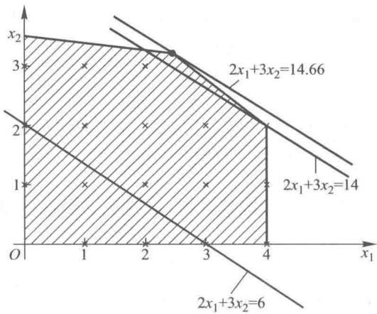
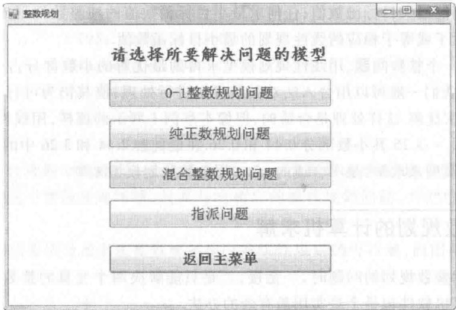
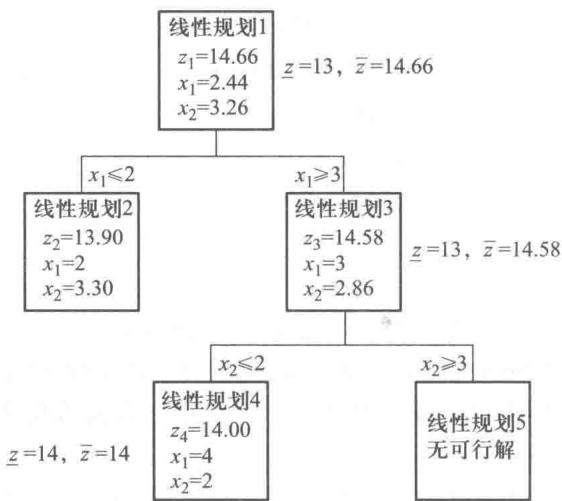

# 第8章 整数规划

在前面讨论的线性规划问题中,最优解可能是整数,也可能不是整数,但对于某些实际问题,要求答案必须是整数.例如,所求的解是安排上班的人数,按某个方案裁剪钢材的根数,生产机器的台数等.对于求整数解的线性规划问题,不是用四舍五入法或去尾法对线性规划的非整数解加以处理都能解决的,而要用整数规划的方法加以解决.

在整数规划中,如果所有的变量都为非负整数,则称之为纯整数规划问题,如果只有一部分变量为非负整数,则称之为混合整数规划问题.在整数规划中,如果变量的取值只限于0和1,这样的变量我们称之为0-1变量.在纯整数规划和混合整数规划问题中,常常会有一些变量是0,1变量,如果所有变量都是0,1变量,则称之为0-1规划.

本章我们把整数规划限定在整数线性规划里.

## 8.1 整数规划的图解法

例 1 某公司拟用集装箱托运甲、乙两种货物,这两种货物每件的体积、重量、可获利润以及托运所受限制如表 8-1 所示.

表8-1

<table><tr><td>货物</td><td>每件体积/立方英尺*</td><td>每件重量/百千克</td><td>每件利润/百元</td></tr><tr><td>甲</td><td>195</td><td>4</td><td>2</td></tr><tr><td>乙</td><td>273</td><td>40</td><td>3</td></tr><tr><td>托运限制</td><td>1 365</td><td>140</td><td></td></tr></table>

甲种货物至多托运4件,问两种货物各托运多少件,可使获得利润最大.

解 设 $x_{1}, x_{2}$ 分别为甲、乙两种货物托运的件数，显然 $x_{1}, x_{2}$ 是非负的整数，这是一个（纯）整数规划的问题，其数学模型如下所示：

$$
\max z = 2 x _ {1} + 3 x _ {2};
$$

约束条件：

$$
\begin{array}{l}195x _ {1} +273x _ {2} \leqslant 1365,\\4 x _ {1} +40x _ {2} \leqslant 140,\\x _ {1} \leqslant 4,\\x _ {1}, x _ {2} \geqslant 0,\\x _ {1}, x _ {2} \text {为整数}.\\\end{array}
$$

如果将上述线性规划中的最后一个约束条件: $x_{1},x_{2}$ 为整数去掉,它是一个线性规划的问题,我们用图解法来解这个整数规划问题,及其与它相应的线性规划问题,并把它们的最优解加以比较.

在图 8-1 中的阴影部分是上述整数规划相应的线性规划的可行域,而图中画“×”号的点是整数规划的可行点.

图8-1

平移目标函数的等值线, 得相应的线性规划的最优解为 $x_{1}=2.44, x_{2}=3.26$ , 目标函数的最优值为 14.66, 这个解显然不是整数规划的可行解. 同样把目标函数的等值线尽量向右上方平移以便取得最大值, 同时又必须过整数规划可行点, 可得整数规划的最优解 $x_{1}=4, x_{2}=2$ , 这时其最优目标函数值为 14, 这个整数规划的最优解并不可以对相应的线性规划的不为整数的最优解运用四舍五入法或去尾法或进一法而得到. 当我们对相应的线性规划的最优解进行四舍五入或去尾法得 $x_{1}=2, x_{2}=3$ , 这时目标函数值为 13, 并不是此整数规划的最优解. 当我们对相应的线性规划的最优解进行进一法时取 $x_{1}=3, x_{2}=3$ , 或取 $x_{1}=2, x_{2}=4$ 或取 $x_{1}=3, x_{2}=4$ 都不是此整数规划的可行解.

从此例题我们可以看到:由于相应的线性规划的可行域包含了其整数规划的可行点,可得到如下的性质.

性质 1 任何求最大目标函数值的纯整数规划或混合整数规划的最大目标函数值小于或等于相应的线性规划的最大目标函数值；任何求最小目标函数值的纯整数规划或混合整数规划的最小目标函数值大于或等于相应的线性规划的最小目标函数值.

一般来说,当一个整数问题,用线性规划模型求得的最优解的小数部分占的比例很小时(如第四章例4那样)我们一般可以用舍入法对其最优解进行处理,使其仍为可行解,这个结果即使不是最优解,也是次优解.这样处理是合适的,但像本章例1所示的那样,用线性规划模型求得的最优解 $x_{1}=2.44;x_{2}=3.26$ .其小数部分0.44和0.26.在最优解2.44和3.26中的比例较大,这种情况下,用线性规划模型来求解,是不合适的,必须用整数规划模型来解.

## 8.2 整数规划的计算机求解

用图解法求解整数规划的问题时,一是慢,二是只能解决两个变量的整数规划.要解决整数规划问题使用计算机软件包是个最实用最有效的办法.

对于变量数少,约束条件数也少的整数规划问题,我们仍可以用“管理运筹学”软件来解决.对于变量数和约束条件数过大的整数规划问题,我们也可购买相应的微机软件包来解决它们.

下面来演示如何使用“管理运筹学”软件来解决整数规划的问题.

例2 求解下面的整数规划问题：

$$
\max z = 3 x _ {1} + x _ {2} + 3 x _ {3};
$$

约束条件：

$$
\begin{array}{l}- x _ {1} + 2 x _ {2} + x _ {3} \leqslant 4,\\4 x _ {2} - 3 x _ {3} \leqslant 2,\\x _ {1} - 3 x _ {2} + 2 x _ {3} \leqslant 3,\\x _ {1}, x _ {2}, x _ {3} \geqslant 0,\\x _ {1}, x _ {2}, x _ {3} \text {为整数}.\\\end{array}
$$

解 用“管理运筹学”软件解此题,首先在主菜单上选择整数规划,屏幕上会出现问题类型选择页面,如图8-2所示.

当你作出选择后,屏幕出现的页面与线性规划页面基本相同,只是请注意每个变量的类型,尤其对于混合整数规划的问题.

对于例 2, 我们在问题类型选择菜单中应选择纯整数规划问题, 然后输入模型数据, 点击“解决”按钮, 便得到表 8-2 所示的计算机解.

最优目标函数值:23.

表8-2

<table><tr><td>变量</td><td>值</td></tr><tr><td> \(x_{1}\) </td><td>5</td></tr><tr><td> \(x_{2}\) </td><td>2</td></tr><tr><td> \(x_{3}\) </td><td>2</td></tr></table>

图8-2

例3 求解下面的混合整数规划问题：

$$
\max z = 3 x _ {1} + x _ {2} + 3 x _ {3};
$$

约束条件：

$$
\begin{array}{l}- x _ {1} + 2 x _ {2} + x _ {3} \leqslant 4,\\4 x _ {2} - 3 x _ {3} \leqslant 2,\\x _ {1} - 3 x _ {2} + 2 x _ {3} \leqslant 3,\\x _ {3} \leqslant 1,\\x _ {1}, x _ {2}, x _ {3} \geqslant 0, x _ {1}, x _ {3}   \text {为整数}.\\\end{array}
$$

解 此题约束条件中的 $x_{3} \leqslant 1, x_{3} \geqslant 0$ 且 $x_{3}$ 是0-1变量，此混合整数规划问题也可以写成

$$
\max z = 3 x _ {1} + x _ {2} + 3 x _ {3};
$$

约束条件：

$$
\begin{array}{l}- x _ {1} + 2 x _ {2} + x _ {3} \leqslant 4,\\4 x _ {2} - 3 x _ {3} \leqslant 2,\\x _ {1} - 3 x _ {2} + 2 x _ {3} \leqslant 3,\\x _ {1}, x _ {2}, x _ {3} \geqslant 0,\\\end{array}
$$

并且 $x_{1}$ 为整数, $x_{3}$ 为 0-1 变量.

在问题类型选择页面上应选择混合整数规划问题,输入数据时,要注意输入变量的类型是整数变量、0-1变量还是实数变量.点击“解决”按钮,便得到计算机解如下: $x_{1}=4,x_{2}=1.25,x_{3}=1$ ;第一个约束条件的松弛变量为4.5,第二个约束条件的松弛变量为0,第三个约束条件的松弛变量为0.75;最优目标函数为16.25.

## 8.3 整数规划的应用

## 一、投资场所的选择

例 4 京成畜产品公司计划在市区的东、西、南、北四区建立销售门市部，拟议中有 10个位置 $A_{i}(i=1,2,3,\cdots,10)$ 可供选择，考虑到各地区居民的消费水平及居民居住密集度，规定：

在东区由 $A_{1}, A_{2}, A_{3}$ 三个点至多选择两个；

在西区由 $A_{4}, A_{5}$ 两个点中至少选一个；

在南区由 $A_{6}, A_{7}$ 两个点中至少选一个；

在北区由 $A_{8}, A_{9}, A_{10}$ 三个点中至少选两个.

$A_{i}$ 各点的设备投资及每年可获利润由于地点不同都是不一样的,预测情况如表8-3所示.

表8-3
单位:万元

<table><tr><td></td><td> \(A_{1}\) </td><td> \(A_{2}\) </td><td> \(A_{3}\) </td><td> \(A_{4}\) </td><td> \(A_{5}\) </td><td> \(A_{6}\) </td><td> \(A_{7}\) </td><td> \(A_{8}\) </td><td> \(A_{9}\) </td><td> \(A_{10}\) </td></tr><tr><td>投资额</td><td>100</td><td>120</td><td>150</td><td>80</td><td>70</td><td>90</td><td>80</td><td>140</td><td>160</td><td>180</td></tr><tr><td>利润</td><td>36</td><td>40</td><td>50</td><td>22</td><td>20</td><td>30</td><td>25</td><td>48</td><td>58</td><td>61</td></tr></table>

投资总额不能超过720万元,问应选择哪几个销售点,可使年利润为最大?

解 设0-1变量 $x_{i}=\left\{\begin{aligned}&1, 当 A_{i} 点被选用;\\ &0, 当 A_{i} 点没被选用.\end{aligned}\right.$

这样我们可建立如下的数学模型：

$$
\max z =36x _ {1} +40x _ {2} +50x _ {3} +22x _ {4} +20x _ {5} +30x _ {6} +
$$

约束条件：

$$
\begin{array}{l}\qquad \qquad \qquad \qquad \qquad \qquad \qquad \qquad \qquad \qquad \qquad \qquad \qquad \qquad \qquad \qquad \qquad \qquad \qquad \qquad \qquad \qquad \qquad \qquad \qquad \qquad \qquad \qquad \qquad \qquad \qquad \qquad \qquad\\\qquad \qquad \qquad \qquad \qquad \qquad \qquad \qquad \qquad \qquad \qquad \qquad \qquad \qquad \qquad \qquad \qquad \qquad \qquad \qquad \qquad \qquad \qquad \qquad \qquad \qquad \qquad \qquad \text {;}\\100x _ {1} +120x _ {2} +150x _ {3} +80x _ {4} +70x _ {5} +90x _ {6} +\\80x _ {7} +140x _ {8} +160x _ {9} +180x _ {10} \leqslant 720,\\x _ {1} + x _ {2} + x _ {3} \leqslant 2,\\x _ {4} + x _ {5} \geqslant 1,\\x _ {6} + x _ {7} \geqslant 1,\\x _ {8} + x _ {9} + x _ {10} \geqslant 2,\\$x_{i}\geqslant0$ 且 $x_{i}$ 为 0-1 变量, $i=1,2,3,\cdots,10.$\\\end{array}
$$

把上述模型输入“管理运筹学”软件,即得到此问题的最优解如下:

最优目标函数值为 245.

最优解为 $x_{1} = 1, x_{2} = 1, x_{3} = 0, x_{4} = 0, x_{5} = 1,$

$$
x _ {6} = 1, x _ {7} = 0, x _ {8} = 0, x _ {9} = 1, x _ {10} = 1.
$$

此结果告诉我们要在 $A_{1}, A_{2}, A_{5}, A_{6}, A_{9}, A_{10}$ 6个地点建立销售门市部，既满足规定，又在投资不超过720万元情况（实际投资额为 $100+120+70+90+160+180=720$ （万元））下，获得了最大利润245万元.

## 二、固定成本问题

例 5 高压容器公司制造小、中、大三种尺寸的金属容器,所用资源为金属板、劳动力和机器设备,制造一个容器所需的各种资源的数量如表 8-4 所示.

表8-4

<table><tr><td>资源</td><td>小号容器</td><td>中号容器</td><td>大号容器</td></tr><tr><td>金属板/t</td><td>2</td><td>4</td><td>8</td></tr><tr><td>劳动力/(人·月 \(^{-1}\) )</td><td>2</td><td>3</td><td>4</td></tr><tr><td>机器设备/(台·月 \(^{-1}\) )</td><td>1</td><td>2</td><td>3</td></tr></table>

不考虑固定费用,每种容器售出一只所得的利润分别为4万元,5万元,6万元,可使用的金属板有500 t,劳动力有300人/月,机器有100台/月,此外,不管每种容器制造的数量是多少,都要支付一笔固定的费用:小号为100万元,中号为150万元,大号为200万元.现在要制定一个生产计划,使获得的利润为最大.

解 这是一个整数规划的问题.

设 $x_{1}, x_{2}, x_{3}$ 分别为小号容器、中号容器和大号容器的生产数量.

各种容器的固定费用只有在生产该种容器时才投入,为了说明固定费用的这种性质,设

$$
y _ {i} = \left\{ \begin{array}{l l} 1, \text {当生产第} i \text {种容器即} x _ {i} > 0 \text {时}; \\ 0, \text {当不生产第} i \text {种容器即} x _ {i} = 0 \text {时}. \end{array} \right.
$$

这样求扣除了固定费用的最大利润的目标函数可以写为

$$
\max z = 4 x _ {1} + 5 x _ {2} + 6 x _ {3} -100y _ {1} -150y _ {2} -200y _ {3}.
$$

约束条件首先可以写出受金属板、劳动力以及机器设备等资源限制的三个不等式：

$$
\begin{array}{r l} & 2 x _ {1} + 4 x _ {2} + 8 x _ {3} \leqslant 500, \\ & 2 x _ {1} + 3 x _ {2} + 4 x _ {3} \leqslant 300, \\ & x _ {1} + 2 x _ {2} + 3 x _ {3} \leqslant 100.\end{array}
$$

然后,为了避免出现某种容器不投入固定费用就生产这样一种不合理的情况,因而必须加上以下的约束条件:

$$
\begin{array}{l} {x _ {1} \leqslant y _ {1} M,} \\ {x _ {2} \leqslant y _ {2} M,} \\ {x _ {3} \leqslant y _ {3} M.} \end{array}
$$

这里 $M$ 是充分大的数. 从一个容器至少要2个劳动力约束条件可知, 各种容器的制造数量不会超过200台, 我们可以取大 $M$ 为200, 即得

$$
\begin{array}{l} x _ {1} \leqslant 200y _ {1}, \\ x _ {2} \leqslant 200y _ {2}, \\ x _ {3} \leqslant 200y _ {3}. \end{array}
$$

当 $y_{i}$ 等于零，即对第 $i$ 种容器不投入固定费用时，从 $x_{i} \leqslant 200y_{i}$ ，即得 $x_{i} \leqslant 0$ ，则第 $i$ 种容器必不能生产；当 $y_{i}$ 等于1即对第 $i$ 种容器投入固定费用时，从 $x_{i} \leqslant 200y_{i}$ ，即得 $x_{i} \leqslant 200$ ，则第 $i$ 种容器生产的数量要小于等于200.这是合理的.

综上所述,得到此问题的数学模型如下:

$$
\max z = 4 x _ {1} + 5 x _ {2} + 6 x _ {3} -100y _ {1} -150y _ {2} -200y _ {3};
$$

约束条件：

$$
\begin{array}{l}2 x _ {1} + 4 x _ {2} + 8 x _ {3} \leqslant 500,\\2 x _ {1} + 3 x _ {2} + 4 x _ {3} \leqslant 300,\\x _ {1} + 2 x _ {2} + 3 x _ {3} \leqslant 100,\\x _ {1} - M y _ {1} \leqslant 0,\\x _ {2} - M y _ {2} \leqslant 0,\\x _ {3} - M y _ {3} \leqslant 0,\\x _ {1}, x _ {2}, x _ {3} \geqslant 0, \quad y _ {1}, y _ {2}, y _ {3} \text {为} 0 - 1 \text {变量}.\\\end{array}
$$

把上述模型输入“管理运筹学”软件，即得到如下结果：最大目标函数值为300，最优解为 $x_{1}=100,x_{2}=0,x_{3}=0$ ，也就是说生产100台小容器可得最大利润300万元，并从计算机输出得到如下信息：第1约束条件的松弛变量为300，即有300 t金属板没用；第2约束的松弛变量为100，即劳动力富余100人/月；第3约束条件松弛变量为零，即机器设备全用完。

## 三、指派问题

我们常常会遇到这样的问题:有 n 项不同的任务,恰好 n 个人可分别承担这些任务,但由于每人特长不同,完成各项任务的效率等情况也不同.现假设必须指派每个人去完成一项任务,怎样把 n 项任务指派给 n 个人,使得完成 n 项任务的总的效率最高,这就是指派问题.

例 6 有四个工人,要分别指派他们完成四项不同的工作,每人做各项工作所消耗的时间如表 8-5 所示,问应如何指派工作,才能使总的消耗时间为最少?

表8-5

<table><tr><td>所需时间/小时\工作工人</td><td>A</td><td>B</td><td>C</td><td>D</td></tr><tr><td>甲</td><td>15</td><td>18</td><td>21</td><td>24</td></tr><tr><td>乙</td><td>19</td><td>23</td><td>22</td><td>18</td></tr><tr><td>丙</td><td>26</td><td>17</td><td>16</td><td>19</td></tr><tr><td>丁</td><td>19</td><td>21</td><td>23</td><td>17</td></tr></table>

解 引入0-1变量 $x_{ij}$ ，并令

$x_{ij}=\left\{\begin{aligned}&1, 当指派第 i 人去完成第 j 项工作时;\\ &0, 当不指派第 i 人去完成第 j 项工作时.\end{aligned}\right.$

为使总消耗时间为最少可以写为

$$
\begin{array}{r l} \min z & =15x _ {11} +18x _ {12} +21x _ {13} +24x _ {14} +19x _ {21} +23x _ {22} + \\ &22x _ {23} +18x _ {24} +26x _ {31} +17x _ {32} +16x _ {33} + \\ &19x _ {34} +19x _ {41} +21x _ {42} +23x _ {43} +17x _ {44}. \end{array}
$$

每人只能干一项工作的约束条件可以写为

$$
x _ {11} + x _ {12} + x _ {13} + x _ {14} = 1 (\text {   甲只能干一项工作   }),
$$

$$
x _ {21} + x _ {22} + x _ {23} + x _ {24} = 1 (\text {乙只能干一项工作}),
$$

$$
x _ {31} + x _ {32} + x _ {33} + x _ {34} = 1 (\text {丙只能干一项工作}),
$$

$$
x _ {41} + x _ {42} + x _ {43} + x _ {44} = 1 (\text {   丁只能干一项工作   }).
$$

每项工作只能由一个人干的约束条件可以写为

$$
x _ {11} + x _ {21} + x _ {31} + x _ {41} = 1 (\mathrm{A工作只能一个人干}),
$$

$x_{12} + x_{22} + x_{32} + x_{42} = 1$ (B 工作只能一个人干),

$x_{13} + x_{23} + x_{33} + x_{43} = 1$ (C 工作只能一个人干),

$$
x _ {14} + x _ {24} + x _ {34} + x _ {44} = 1 (\mathrm{D} \text {工作只能一个人干}).
$$

再加上约束条件: $x_{ij}$ 为0-1变量,对i=1,2,3,4,j=1,2,3,4.以上就组成了此整数规划问题的数学模型.

我们将以上的数学模型输入“管理运筹学”软件的整数规划，就可得到如下结果： $x_{21}=1$ ， $x_{12}=1$ ， $x_{33}=1$ ， $x_{44}=1$ ，其最小目标函数值为70，也就是说安排乙干A工作，甲干B工作，丙干C工作，丁干D工作，这时总消耗时间为最少，即70小时.

对于有 m 个人 n 项任务的一般的指派问题, 设

$x_{ij}=\left\{\begin{aligned}&1, 当第 i 人去完成 j 项工作时;\\ &0, 当第 i 人不去完成 j 项工作时.\end{aligned}\right.$

并设 $c_{ij}$ 为第 i 人去完成 j 项任务的成本（如所需时间，费用等），则一般的指派问题的模型可以写为

$$
\min z = \sum_ {i = 1} ^ {m} \sum_ {j = 1} ^ {n} c _ {i j} \cdot x _ {i j};
$$

约束条件：

$$
\begin{array}{l}\sum_ {j = 1} ^ {n} x _ {i j} \leqslant 1, i = 1, 2, \dots , m,\\\sum_ {i = 1} ^ {m} x _ {i j} = 1, j = 1, 2, \dots , n,\\\end{array}
$$

$x_{ij}$ 为 0 - 1 变量, 对所有的 i 和 j.

因为 m 不一定等于 n，当 m > n，即人数多于任务数时，就有人没有任务，所以前面 m 个约束条件都是“小于等于 1”，这是说每个人至多承担一项任务，而后面 n 个约束条件说明每项工作正好有一人承担，所以都是“等于 1”。当 n > m 时，这时需要设假想的 n - m 个人便获得可行解。

实际上,不管 m=n, 还是 m>n 或者 n>m, 我们都可以用“管理运筹学”中的“指派问题”的程序加以解决, 只要输入: 1. 人数; 2. 任务数; 3. 每个人完成各项任务的成本, 就可立即得到最优解与最优值.

还有一种指派问题叫多重指派问题,它与一般的指派问题的区别在于:一般的指派问题中每个人至多承担一项任务,而多重指派问题中一个人可以根据自己能力的大小承担一项、二项或更多项的任务,这时约束条件中的前 m 个条件不是 $\sum_{j=1}^{n}x_{ij}\leqslant1,i=1,2,\cdots,m$ ,而改为 $\sum_{j=1}^{n}x_{ij}\leqslant a_{i},i=1,2,\cdots,m$ ,其中 $a_{i}$ 是第 i 个人至多承担的任务的项目数,对于不同的 i, $a_{i}$ 可以是不一样的.

## 四、分布系统设计

例 7 某企业在 $A_{1}$ 地已有一个工厂, 其产品的生产能力为 30千箱, 为了扩大生产, 打算在 $A_{2}, A_{3}, A_{4}, A_{5}$ 地中再选择几个地方建厂. 已知在 $A_{2}$ 地建厂的固定成本为 175千元, 在 $A_{3}$ 地建厂的固定成本为 300千元, 在 $A_{4}$ 地建厂的固定成本为 375千元, 在 $A_{5}$ 地建厂的固定成本为 500千元, 另外, $A_{1}$ 的产量, $A_{2}, A_{3}, A_{4}, A_{5}$ 建成厂的产量, 那时销地的销量以及产地到销地的单位运价 (每千箱运费) 如表 8-6 所示. (1) 问应该在哪几个地方建厂, 在满足销量的前提下, 使得其总的固定成本和总的运输费用之和最小; (2) 如果由于政策要求必须在 $A_{2}, A_{3}$ 地建一个厂, 应在哪几个地方建厂?

解（1）设 $x_{ij}$ 为从 $\mathrm{A}_i$ 运往 $\mathbf{B}_j$ 的运输量（单位：千箱），

$$
y _ {i} = \left\{ \begin{array}{l l} 1, \text {当} A _ {i} \text {厂址被选中时}; \\ 0, \text {当} A _ {i} \text {厂址没被选中时}. \end{array} \right.
$$

则此问题的固定成本及总运输费最小的目标可写为

$$
\begin{array}{r l} \min z & =175y _ {2} +300y _ {3} +375y _ {4} +500y _ {5} + 8 x _ {11} + 4 x _ {12} + \\ & \quad 3 x _ {13} + 5 x _ {21} + 2 x _ {22} + 3 x _ {23} + 4 x _ {31} + \\ & \quad 3 x _ {32} + 4 x _ {33} + 9 x _ {41} + 7 x _ {42} + \\ & \quad 5 x _ {43} +10x _ {51} + 4 x _ {52} + 2 x _ {53}, \end{array}
$$

其中前 4 项为固定投资额, 后面的项为运输费用.

对 $A_{1}$ 厂来说其产量限制的约束条件可写成

$$
x _ {11} + x _ {12} + x _ {13} \leqslant 30.
$$

表8-6

<table><tr><td>产地\运输单价/千元\销地</td><td> \(B_1\) </td><td> \(B_2\) </td><td> \(B_3\) </td><td>产量/千箱</td></tr><tr><td> \(A_1\) </td><td>8</td><td>4</td><td>3</td><td>30</td></tr><tr><td> \(A_2\) </td><td>5</td><td>2</td><td>3</td><td>10</td></tr><tr><td> \(A_3\) </td><td>4</td><td>3</td><td>4</td><td>20</td></tr><tr><td> \(A_4\) </td><td>9</td><td>7</td><td>5</td><td>30</td></tr><tr><td> \(A_5\) </td><td>10</td><td>4</td><td>2</td><td>40</td></tr><tr><td>销量/千箱</td><td>30</td><td>20</td><td>20</td><td></td></tr></table>

但是对 $A_{2}, A_{3}, A_{4}, A_{5}$ 准备选址建设的新厂来说, 只有当选为厂址建设, 才会有生产量, 所以它们的产量限制的约束条件写成

$$
\begin{array}{l} x _ {21} + x _ {22} + x _ {23} \leqslant 10y _ {2}, \\ x _ {31} + x _ {32} + x _ {33} \leqslant 20y _ {3}, \\ x _ {41} + x _ {42} + x _ {43} \leqslant 30y _ {4}, \\ x _ {51} + x _ {52} + x _ {53} \leqslant 40y _ {5}. \end{array}
$$

至于满足销量的约束条件可写为

$$
\begin{array}{l} x _ {11} + x _ {21} + x _ {31} + x _ {41} + x _ {51} =30, \\ x _ {12} + x _ {22} + x _ {32} + x _ {42} + x _ {52} =20, \\ x _ {13} + x _ {23} + x _ {33} + x _ {43} + x _ {53} =20.\end{array}
$$

再加上 $x_{ij} \geqslant 0$ 及 $y_{i}$ 为 0-1 变量的约束就得到了此问题的数学模型.

用计算机我们可以求得如下最优解：

$y_{5}=1,x_{52}=20,x_{53}=20,x_{11}=30$ ,其余变量均为零,最优值为860(千元).

（2）我们只要在以上模型上加上一个约束条件： $y_{2}+y_{3}=1$ ，就得到了问题（2）的数学模型，用计算机可求得最优解如下： $y_{2}=1, y_{4}=1, x_{22}=10, x_{41}=30, x_{12}=10, x_{13}=20$ ，其余变量均为零，最优

值为 940(千元).

## 五、投资问题

例 8 某公司在今后五年内考虑给下列项目投资,已知:

项目 A: 从第一年到第四年每年年初需要投资, 并于次年回收本利 115%, 但要求第一年投资最低金额为 4 万元, 第二、三、四年不限.

项目 B: 第三年初需要投资, 到第五年末能回收本利 128%, 但规定最低投资金额为 3 万元, 最高金额为 5 万元.

项目 C: 第二年初需要投资, 到第五年末能回收本利 140%, 但规定其投资额或为 2 万元或为 4 万元, 或为 6 万元或为 8 万元.

项目 D:五年内每年初可购买公债,于当年归还,并加利息 6%,此项投资金额不限.

该部门现有资金 10万元,问它应如何确定给这些项目的每年投资额,使到第五年末拥有的资金本利总额为最大?

解 （1） $x_{iA}, x_{iB}, x_{iC}, x_{iD} (i=1,2,3,4,5)$ 分别表示第 i 年年初给项目 A, B, C, D 的投资额，设 $y_{iA}, y_{iB}$ ，是 0-1 变量，并规定

$$
y _ {i j} = \left\{ \begin{array}{l l} 1, \text {当第} i \text {年给} j \text {项目投资时}, \\ 0, \text {当第} i \text {年不给} j \text {项目投资时}, \end{array} \right. \quad i = 1, 3; j = A, B.
$$

设 $y_{2c}$ 是个非负整数变量,并规定

4, 当第 2 年投资 C 项目 8 万元时，

3, 当第 2 年投资 C 项目 6 万元时，

1, 当第 2 年投资 C 项目 2 万元时，

0, 当第 2 年不投资 C 项目时.

根据给定条件,将投资额列于表 8-7 中.

(2) 下面来写约束条件.

由于项目 D 每年都可以投资,且投资金额不限,当年末可收回本息,所以该公司每年应把所有资金全部投出去,即投资额应等于手中拥有的资金,因此

第一年:该公司第一年初拥有 100000元,所以有

$$
x _ {1 \mathrm{A}} + x _ {1 \mathrm{D}} =100000.
$$

第二年:因第一年给项目 A 的投资要到第二年年末才能回收,所以该公司在第二年年初只

有项目 D 在第一年回收的本息 $x_{\mathrm{ID}}(1+6\%)$ ，于是第二年的投资分配是

$$
x _ {2 \mathrm{A}} + x _ {2 \mathrm{C}} + x _ {2 \mathrm{D}} =1.06x _ {1 \mathrm{D}}.
$$

第三年:第三年年初的资金是从项目 A 第一年投资及项目 D 第二年投资所回收的本利总和 $1.15x_{1A} +1.06x_{2D}$ ，于是第三年资金分配为

$$
x _ {3 \mathrm{A}} + x _ {3 \mathrm{B}} + x _ {3 \mathrm{D}} =1.15x _ {1 \mathrm{A}} +1.06x _ {2 \mathrm{D}}.
$$

第四年: 同上分析, 可得

第五年：

$$
x _ {4 \mathrm{A}} + x _ {4 \mathrm{D}} =1.15x _ {2 \mathrm{A}} +1.06x _ {3 \mathrm{D}}.
$$

$$
x _ {5 \mathrm{D}} =1.15x _ {3 \mathrm{A}} +1.06x _ {4 \mathrm{D}}.
$$

表8-7

<table><tr><td>项目\投资额\年份</td><td>1</td><td>2</td><td>3</td><td>4</td><td>5</td></tr><tr><td>A</td><td> \(x_{1A}\) </td><td> \(x_{2A}\) </td><td> \(x_{3A}\) </td><td> \(x_{4A}\) </td><td></td></tr><tr><td>B</td><td></td><td></td><td> \(x_{3B}\) </td><td></td><td></td></tr><tr><td>C</td><td></td><td> \(x_{2C}=20\ 000y_{2C}\) </td><td></td><td></td><td></td></tr><tr><td>D</td><td> \(x_{1D}\) </td><td> \(x_{2D}\) </td><td> \(x_{3D}\) </td><td> \(x_{4D}\) </td><td> \(x_{5D}\) </td></tr></table>

此外对项目 A 的投资额的规定知道

$$
\begin{array}{r l} & x _ {1 \mathrm{A}} \geqslant 40000y _ {1 \mathrm{A}}, \\ & x _ {1 \mathrm{A}} \leqslant 200000y _ {1 \mathrm{A}}, \end{array}
$$

从上面的约束条件知道, 当 $y_{1A}=0$ , 即第 1 年不给 A 项目投资时, 有

$$
\begin{array}{l} {x _ {_ 1 \mathrm{A}} \geqslant 0,} \\ {x _ {_ 1 \mathrm{A}} \leqslant 0,} \end{array}
$$

即 $x_{1\mathrm{A}}$ 必取零，当 $y_{1\mathrm{A}} = 1$ ，即第1年给A项目投资时，有

$$
\begin{array}{r l} & x _ {\mathrm{IA}} \geqslant 40000, \\ & x _ {\mathrm{IA}} \leqslant 200000, \end{array}
$$

这里的 200000是一个足够大的正数,使第 1 年给 A 项目的投资额不会超过它.

另外对项目 B 的投资额的规定同样有

$$
\begin{array}{r l} & x _ {3 \mathrm{B}} \leqslant 50000y _ {3 \mathrm{B}}, \\ & x _ {3 \mathrm{B}} \geqslant 30000y _ {3 \mathrm{B}}, \end{array}
$$

从此约束条件也可以知道：当 $y_{3B} = 0$ 时，有 $x_{3B} = 0$ ，而当 $y_{3B} = 1$ 时，有 $50000\geqslant x_{3B} \geqslant 30000$ .

对项目 C 的投资额的规定也可知

$$
x _ {2 \mathrm{C}} =20000y _ {2 \mathrm{C}},
$$

$y_{2C} \leqslant 4$ 且 $y_{2C}$ 为非负整数.

(3) 目标就是要求第五年末手中拥有的资金为最大, 可写为

$$
\max z =1.15x _ {4 \mathrm{A}} +1.40x _ {2 \mathrm{C}} +1.28x _ {3 \mathrm{B}} +1.06x _ {5 \mathrm{D}}.
$$

（4）此问题的数学模型如下：

$$
\max z =1.15x _ {4 \mathrm{A}} +1.40x _ {2 \mathrm{C}} +1.28x _ {3 \mathrm{B}} +1.06x _ {5 \mathrm{D}};
$$

约束条件：

$$
\begin{array}{l}x _ {1 \mathrm{A}} + x _ {1 \mathrm{D}} =100000,\\-1.06x _ {1 \mathrm{D}} + x _ {2 \mathrm{A}} + x _ {2 \mathrm{C}} + x _ {2 \mathrm{D}} = 0,\\-1.15x _ {1 \mathrm{A}} -1.06x _ {2 \mathrm{D}} + x _ {3 \mathrm{A}} + x _ {3 \mathrm{B}} + x _ {3 \mathrm{D}} = 0,\\-1.15x _ {2 \mathrm{A}} -1.06x _ {3 \mathrm{D}} + x _ {4 \mathrm{A}} + x _ {4 \mathrm{D}} = 0,\\-1.15x _ {3 \mathrm{A}} -1.06x _ {4 \mathrm{D}} + x _ {5 \mathrm{D}} = 0,\\x _ {1 \mathrm{A}} -40000y _ {1 \mathrm{A}} \geqslant 0,\\200000y _ {1 \mathrm{A}} - x _ {1 \mathrm{A}} \geqslant 0,\\x _ {3 \mathrm{B}} -30000y _ {3 \mathrm{B}} \geqslant 0,\\50000y _ {3 \mathrm{B}} - x _ {3 \mathrm{B}} \geqslant 0,\\x _ {2 \mathrm{C}} -20000y _ {2 \mathrm{C}} = 0,\\y _ {2 \mathrm{C}} \leqslant 4,\\x _ {i \mathrm{A}}, x _ {i \mathrm{B}}, x _ {i \mathrm{C}}, x _ {i \mathrm{D}} \geqslant 0, i = 1, 2, 3, 4, 5,\\y _ {2 \mathrm{C}} \text {为非负整数},\\y _ {1 \mathrm{A}}, y _ {3 \mathrm{B}} \text {为}   0 - 1   \text {变量}.\\\end{array}
$$

把模型输入“管理运筹学”软件即得最优值：

$$
\begin{array}{l}147879.234.\\ x _ {2 \mathrm{C}} =60000, \\ x _ {3 \mathrm{B}} =49905.641, \\ x _ {1 \mathrm{A}} =43396.23, \\ x _ {1 \mathrm{D}} =56603.777, \\ y _ {3 \mathrm{B}} = 1, \\ y _ {2 \mathrm{C}} = 3, \\ y _ {1 \mathrm{A}} = 1. \end{array}
$$

## 六、0-1整数变量在构建模型中的一些特殊作用

正如上面的例子所示,由于引入了整数变量,尤其是0-1变量,可以把实际管理中无法归结为线性规划模型的问题,建立其整数规划的模型.

1. 解决固定成本问题

正如例 5 所示, $x_{j}, c_{j}$ 分别表示产品 j 的生产数量和单个产品的变动成本; $k_{j}$ 为与产量无关的固定成本. 其求生产成本最小的整数规划模型为

$$
\min z = \sum_ {j = 1} ^ {n} \left(c _ {j} x _ {j} + k _ {j} y _ {j}\right);
$$

约束条件：

其他原始限制条件，

$$
\begin{array}{r l} & {x _ {j} \leqslant M y _ {j}} \\ & {x _ {j} \geqslant 0, y _ {j} = 0 \text {或} 1.} \end{array}
$$

这里 $y_{j}$ 为 0-1 变量, M 为一个充分大的数, 不等式 $x_{j} \leqslant My_{j}$ 是为了避免出现不投入固定成本就生产的这样一种不合理情况.

2. 解决选择取值问题

正如例 7 所示, 约束条件的右端项可能是 n 个值 $(b_{1}, b_{2}, \cdots, b_{n})$ 中的某一个 (例 7 中 $A_{2}$ 的产量 $b_{2}$ 可能为 10千箱, 也可能为 0 千箱), 即

$$
f (x _ {1}, x _ {2}, \dots , x _ {n}) = \sum_ {j = 1} ^ {n} a _ {j} x _ {j} \leqslant b _ {1}, \text {或} b _ {2}, \text {或} b _ {3}, \dots , \text {或} b _ {n}
$$

则这样的约束条件可表示为

$$
\begin{array}{c} {f (x _ {1}, x _ {2}, \dots , x _ {n}) \leqslant  \sum_ {i = 1} ^ {n} b _ {i} y _ {i},} \\ {y _ {1} + y _ {2} + \dots + y _ {n} = 1.} \end{array}
$$

这里 $y_{i}$ 为0-1变量

$$
y _ {i} = \left\{ \begin{array}{l l} 1 & \text { 当约束右端项为 } b _ {i} \\ 0 & \text { 否则 } \end{array} \right.
$$

3. 解决 $n$ 个变量中选取 $k$ 个变量的问题

正如例 4、例 6 所示：

a) $n$ 个取1个

$$
\sum_ {j = 1} ^ {n} x _ {j} = 1, x _ {j} = 0 \text {或} 1
$$

b) $n$ 个中取 $k$ 个

$$
\sum_ {j = 1} ^ {n} x _ {j} = k, x _ {j} = 0 \text {或} 1
$$

若 $n$ 个至少取 $k$ 个，则改为

$$
\sum_ {j = 1} ^ {n} x _ {j} \geqslant k, x _ {j} = 0   \text {或}   1
$$

若 $n$ 个至多取 $k$ 个，则改为

$$
\sum_ {j = 1} ^ {n} x _ {j} \leqslant k, x _ {j} = 0   \text {或}   1
$$

4. 解决变量离散数值的问题

正如例8所示， $x_{2c} =20000y_{2c}$

这里 $y_{2c} \leqslant 4$ 且 $y_{2c}$ 为非负整数，而更一般的情况如下：

$$
\left\{ \begin{array}{l l} {x =  \sum_ {j = 1} ^ {m} c _ {j} y _ {j}} & {\quad y _ {j} = 0   \text {或}   1} \\ { \sum_ {j = 1} ^ {m} y _ {j} = 1} \end{array} \right.
$$

5. 解决部分约束的问题

在这种情况下， $m$ 个约束条件只有 $k$ 个起作用.不妨设 $m$ 个约束条件可表示为

$$
\sum_ {j = 1} ^ {n} a _ {i j} x _ {j} (i = 1, 2, \dots , m)
$$

设

$$
y _ {i} = \left\{ \begin{array}{l l} 1 & \text {假定第} i \text {个约束条件不起作用} \\ 0 & \text {假定第} i \text {个约束条件起作用} \\ (i = 1, 2, \dots , m) \end{array} \right.
$$

则

$$
\left\{ \begin{array}{l} \sum_ {j = 1} ^ {n} a _ {i j} x _ {j} \leqslant b _ {i} + M y _ {i} (i = 1, 2, \dots , m) \\ y _ {1} + y _ {2} + \dots + y _ {m} = m - k \end{array} \right.
$$

式中 $M$ 为任意大的正数

该式就表明 m 个约束条件中有 m-k 个的右端项为 $b_{i}+M$ ，不起约束作用，故只有 k 个约束条件真正起作用。

作为特例,当这 m 个约束条件为互斥条件时,这里的 k=1.

6. 解决逻辑关系约束的问题

比较典型的逻辑关系是 if-then 的关系: 若第一个约束成立, 则第二个约束也必须成立; 若第一个约束不成立, 则第二个约束也可以不成立. 这种关系可以描述如下:

若 $f(x) < 0$ 成立，则 $g(x) \leqslant 0$ 必须成立；若 $f(x) < 0$ 不成立，则 $g(x)$ 无限制.

引入一个0-1变量来解决这一逻辑关系

$$
f (x) \geqslant - M (1 - y)\tag{8.1}
$$

$$
g (x) \leqslant M y\tag{8.2}
$$

式中 y 为 0-1 变量, M 为一个充分大的数

显然，若 $f(x) < 0, y$ 必不能为1，否则与(8.1)矛盾，因此 $y = 0$ ，同时有 $g(x) \leqslant 0$ . 若 $f(x) \geqslant 0, y$ 的取值已无关紧要. 因为 $y$ 取任何值，约束(8.2)都可满足，所以 $y$ 的取值可由(8.2)控制， $g(x)$ 的取值不受任何限制.

## 七、关于灵敏度分析的讨论

相对一般的线性规划问题来说,灵敏度分析对于整数规划显得尤为重要.在整数规划中,某个参数很小的变化可能会使最优值产生相对较大的变化.为了便于理解,我们来看一个简单的投资产出最大化问题的线性规划模型.其中含有4个投资方案和一个预算资金的约束.

$$
\max 50x _ {1} +80x _ {2} +100x _ {3} +150x _ {4};
$$

约束条件：

$$
\begin{array}{l}31x _ {1} +50x _ {2} +70x _ {3} +90x _ {4} \leqslant 120,\\x _ {i} \text {为} 0 - 1 \text {变量},\\i = 1, 2, 3, 4.\\\end{array}
$$

我们可以很容易地求得本题的最优解，即 $x_{1} = 0, x_{2} = 1, x_{3} = 1, x_{4} = 0.$ 这时最优值 $z^{*} =180$ ，但当预算资金增加1万元（即从120万元变为121万元）时，其最优解为 $x_{1} = 1, x_{2} = 0, x_{3} = 0, x_{4} = 1$ 最优值 $z^{*} =200.$ 即预算中增加1万元会导致产出增加20万元，可见，最优值对条件参数有极高的灵敏度.

但是,很多运筹学软件(包括“管理运筹学”软件)的灵敏度分析都是为线性规划问题设计的,不能用在整数规划问题中.要解决整数规划问题的灵敏度分析,通常需要高速计算机的帮助.在这种条件的限制下,通常建议在实施最优解前对参数稍加修改,多解几次.

## 8.4 整数规划的分枝定界法

分枝定界法是求解整数规划的一种常用的有效的方法,它既能解决纯整数规划的问题,又能解决混合整数规划的问题.大多数求解整数规划的商用软件就是基于分枝定界法而编制成的.

分枝定界法是先求解整数规划相应的线性规划问题.如果其最优解不符合整数条件,则求出整数规划的上下界用增加约束条件的方法,并把相应的线性规划的可行域分成子区域(称为分枝),再求解这些子区域上的线性规划问题,不断缩小整数规划的上下界的距离,最后取得整数规划的最优解.

现用下例来加以说明.

例9 用分枝定界法求解整数规划

$$
\max 2 x _ {1} + 3 x _ {2};
$$

约束条件：

$$
\begin{array}{l}195x _ {1} +273x _ {2} \leqslant 1365,\\4 x _ {1} +40x _ {2} \leqslant 140,\\x _ {1} \leqslant 4,\\x _ {1}, x _ {2} \geqslant 0,\\\end{array}
$$

并且 $x_{1}, x_{2}$ 为整数.

解 （1）先求出其相应的线性规划的解, 即求解线性规划 1:

$$
\max 2 x _ {1} + 3 x _ {2};
$$

约束条件：

$$
\begin{array}{l}195x _ {1} +273x _ {2} \leqslant 1365,\\4 x _ {1} +40x _ {2} \leqslant 140,\\x _ {1} \leqslant 4,\\x _ {1}, x _ {2} \geqslant 0.\\\end{array}
$$

求得其最优目标函数值 $z_{1} =14.66$ ，最优解为 $x_{1} =2.44, x_{2} =3.26$ 。显然这不是整数规划的可行解。

(2) 确定整数规划的最优目标函数值 $z^{*}$ 初始上界 $\bar{z}$ 和下界 $\underline{z}$ .

从性质1可知线性规划的最优目标函数值14.66是该整数规划的最优目标函数值 $z^{*}$ 的上界 $\bar{z}$ ，即 $\bar{z} =14.66$

再用观察法求出该整数规划的一个可行解，并求得其目标函数值，作为该整数规划的最优目标函数值的下界 $z$ ，因为该整数规划的约束方程的变量系数大于等于零，且约束不等式都为小于等于号，显然相应线性规划1的最优解用去尾法处理后所得的解一定是整数规划的可行解，即 $x_{1}=2,x_{2}=3$ 是该整数规划的可行解，则得到其目标函数值 $2\times2+3\times3=13$ 为其最优目标函数值的下界，即z=13.

(3) 将一个线性规划问题分为两枝, 并求解.

在线性规划1的最优解的两个非整数变量 $x_{1} =2.44, x_{2} =3.26$ 中挑选一个最远离整数的那个变量 $x_{1} =2.44$ ，我们知道，如果 $x_{1}$ 取整数值，那么 $x_{1}$ 可以由 $x_{1} \leqslant 2$ 或 $x_{1} \geqslant 3$ 中取值。这样在线性规划1中分别增加上面的两个约束，可将线性规划1分解为两枝：线性规划2和线性规划3，其中

线性规划2：

$$
\max 2 x _ {1} + 3 x _ {2};
$$

约束条件：

$$
\begin{array}{l}195x _ {1} +273x _ {2} \leqslant 1365,\\4 x _ {1} +40x _ {2} \leqslant 140,\\x _ {1} \leqslant 4,\\x _ {1} \leqslant 2,\\x _ {1}, x _ {2} \geqslant 0.\\\end{array}
$$

我们可得其最优目标函数值 $z_{2}=13.90$ ，其最优解为 $x_{1}=2, x_{2}=3.30$ 。线性规划 3：

$$
\max 2 x _ {1} + 3 x _ {2};
$$

约束条件：

$$
\begin{array}{l}195x _ {1} +273x _ {2} \leqslant 1365,\\4 x _ {1} +40x _ {2} \leqslant 140,\\x _ {1} \leqslant 4,\\x _ {1} \geqslant 3,\\x _ {1}, x _ {2} \geqslant 0.\\\end{array}
$$

求得其最优目标函数值 $z_{3}=14.58$ ，其最优解为 $x_{1}=3, x_{2}=2.86$ .

（4）修改整数规划的最优目标函数的上、下界.

从(3)可知当 $x_{1}\leqslant2$ 整数规划的最优目标函数值不会超过13.90.而当 $x_{1}\geqslant3$ 时整数规划的最优目标函数值不会超过14.58.综上所述，不论 $x_{1}$ 取什么值，即撤销对 $x_{1}$ 的额外的限制，该整数规划的最优目标函数值不会超过14.58，这样我们可以将其上界 $\bar{z}=14.66$ 修改为 $\bar{z}=14.58$ ，取线性规划2,3的最优目标函数值的最大值.

在线性规划2中可知存在整数规划可行解 $x_{1} = 2, x_{2} = 3$ ，其目标函数值为 $2 \times 2 + 3 \times 3 =13$ ，在线性规划3中可知存在可行解 $x_{1} = 3, x_{2} = 2$ ，其目标函数值为 $2 \times 3 + 3 \times 2 =12$ ，同样我们撤销对 $x_{1}$ 是大于等于3或是小于等于2的额外的限制，我们知道在该整数规划中存在可行解 $x_{1} = 2, x_{2} = 3$ ，其目标函数值为13，即有 $\underline{z} =13$ ，取线性规划2,3中的整数可行解的目标函数值的最大值。

注意在分枝定界求解过程中,为了求出最优整数解,我们要不断缩小其最优目标函数值上界与下界的距离,故通过分枝要使得其上界越来越小,而其下界则越来越大.

通过对上、下界的修改，上下界的距离有所缩小，但 $\bar{z}\neq\bar{z}$ ，所以还要继续分枝.

（5）在线性规划2与线性规划3中选择一个上界最大的线性规划，即线性规划3进行分枝.线性规划3的最优解为 $x_{1} = 3, x_{2} =2.86$ ，显然 $x_{2} =2.86$ 与整数距离最远，我们把 $x_{2}$ 分成 $x_{2} \leqslant 2$ 和 $x_{2} \geqslant 3$ 这两种情况，这样线性规划3分解成线性规划4与线性规划5如下：

线性规划 4:

$$
\max 2 x _ {1} + 3 x _ {2};
$$

约束条件：

$$
\begin{array}{l}195x _ {1} +273x _ {2} \leqslant 1365,\\4 x _ {1} +40x _ {2} \leqslant 140,\\x _ {1} \leqslant 4,\\x _ {1} \geqslant 3,\\x _ {2} \leqslant 2,\\x _ {1}, x _ {2} \geqslant 0.\\\end{array}
$$

求得此线性规划的最优解为 $x_{1}=4, x_{2}=2$ ，其最优目标函数值为 $z_{4}=14$ 。线性规划 5：

$$
\max 2 x _ {1} + 3 x _ {2};
$$

约束条件：

$$
\begin{array}{l}195x _ {1} +273x _ {2} \leqslant 1365,\\4 x _ {1} +40x _ {2} \leqslant 140,\\x _ {1} \leqslant 4,\\x _ {1} \geqslant 3,\\x _ {2} \geqslant 3,\\x _ {1}, x _ {2} \geqslant 0.\\\end{array}
$$

线性规划 5 无可行解.

(6) 进一步修改整数规划最优目标函数值 $z^{*}$ 的上、下界.

由于线性规划1分枝为线性规划2与3，而线性规划3又分枝为线性规划4,5.也就是线性规划1分枝为线性规划2,4,5.我们从线性规划2,4,5来进一步修改整数规划最优目标函数值 $z^{*}$ 的上、下界.

因为线性规划2的最优目标函数值为13.90，线性规划4的最优目标函数值为14.而线性规划5无可行解，可知整数规划的最优目标值 $z^{*}$ 的上界可修改为14.即 $\overline{z} =14$ ，取线性规划2,4,5的最优目标函数值的最大值.

又因为在线性规划2中存在整数可行解 $x_{1} = 2, x_{2} = 3$ ，其目标函数值为13，在线性规划4中存在整数可行解 $x_{1} = 4, x_{2} = 2$ ，其目标函数值为14，而线性规划5无可行解。可知整数规划的最优目标函数值 $z^{*}$ 的下界可修改为14，即 $\underline{z} =14$ 。取线性规划2,4,5中的整数可行解的目标函数值的最大值。

我们有如下的性质 2.

性质2 当整数规划的最优目标函数值 $z^{*}$ 的上界 $\bar{z}$ 等于其下界 $\underline{z}$ 时，该整数规划的最优解已被求出，这个整数规划的最优解即为其目标函数值取此下界的对应线性规划的整数可行解.

在此例题中由于 $\bar{z}=\underline{z}=14$ ，可知此整数规划的最优目标函数值 $z^{*}=14$ ，其最优解为 $x_{1}=4$ ， $x_{2}=2$ 。

用图 8-3 表示例 9 的求解过程与求解结果.

从以上解题过程可得用分枝定界法求解目标函数值最大的整数规划的步骤.

我们将求解的整数规划问题称为问题 A, 将与其相应的线性规划问题称为问题 B.

第一步:求解问题 B, 可得以下情况之一:

① B 没有可行解, 则 A 也没有可行解, 求解过程停止.

② B 有最优解,且符合问题 A 的整数条件,则 B 的最优解即为 A 的最优解,求解过程停止.

③ B 有最优解,但不符合 A 的整数条件,记其目标函数值为 $z_{1}$ .

第二步,确定 A 的最优目标函数值 $z^{*}$ 的上下界,其上界即为 $z_{1},\bar{z}=z_{1}$ ,再用观察法找到 A 的一个整数可行解,求其目标函数值作为 $z^{*}$ 的下界,记为 z.

第三步,判断 $\bar{z}$ 是否等于 $\underline{z}$ .如果 $\bar{z}=\underline{z}$ ,则整数规划的最优解即为其目标函数值等于 $\underline{z}$ 的A的那个整数可行解.如果 $\bar{z}\neq\underline{z}$ ,则进行第四步工作.

第四步，在 $B$ 的最优解中选一个最远离整数要求的变量，不妨设此变量为 $x_{j} = b_{j}$ ，以 $[b_j]$ 表示

图8-3

小于 $b_{j}$ 的最大整数，构造两个约束条件：

$$
x _ {j} \leqslant [ b _ {j} ]
$$

和

$$
x _ {j} \geqslant [ b _ {j} ] + 1.
$$

将此两个约束条件分别加入问题 B, 得到 B 的两个分枝 $B_{1}$ 和 $B_{2}$ .

第五步,求解分枝 $B_{1},B_{2}$ .

修改 A 问题的最优目标函数值 $z^{*}$ 的上下界 $\bar{z}$ 和 $\bar{z}$ .

取 $B_{1}, B_{2}$ 的最优目标函数值的最大值为新的上界 $\bar{z}$ 的值.

用观察法取 $B_{1}, B_{2}$ 问题中的各一个整数可行解并选择其中一个较大的目标函数值作为新的下界 $z$ 的值.

第六步, 比较与剪枝. 各分枝的最优目标函数中若有小于 $\underline{z}$ 者, 则剪掉这枝 (用打×表示), 即以后不再考虑了. 若大于 $\bar{z}$ , 则不符合整数条件, 则重复第三步至第六步, 直至 $\bar{z} = \underline{z}$ , 求出最优解为止.

对于求目标函数值最小的整数规划的求解步骤也与上述基本相似,只是:

① 把线性规划 B 的最优解作为整数规划最优目标函数值 $z^{*}$ 的下界 z. 把 B 问题中的一个整数可行解的目标函数值作为 $z^{*}$ 的上界 $\bar{z}$ .

② 在第五步中，应取 $B_{1}, B_{2}$ 的最优目标函数值的最小值作为新的下界 $\underline{z}$ 的值。同时取 $B_{1}, B_{2}$ 问题中的各一个整数可行解，并选择其中一个较大的目标函数值作为新的上界 $\bar{z}$ 的值。

如用分枝定界法求解混合整数问题,则分枝过程只针对有整数要求的变量进行,而不管没有整数要求的变量怎样取值,其求解过程基本上与纯整数规划的求解过程相同.

## 8.5 0-1 规划的解法

由于0-1规划的每一个变量的取值只限于0和1，因此求解0-1规划问题，我们最容易想到的方法就是穷举法，即检查每个变量取值为0或1的所有组合，找出满足全部约束条件的所有组合，并比较目标函数的值，以求得最优解。对于变量个数为 $n$ ，约束条件为 $m$ 个的0-1规划，变量的取值有 $2^{n}$ 个组合。我们要进行 $2^{n} \times m$ 次计算以检查是否满足约束条件。同时还要进行 $2^{n}$ 次目标函数的计算，并比较。当 $n$ 比较大时，这种方法几乎是不可能的。例如，当 $n =10, m = 5$ 时，我们就要进行 $2^{10} =1024$ 次目标函数值的计算，和 $1024\times 5 =5120$ 次约束条件的检查。因此，产生了隐枚举法，即只要检查全部变量组合中的一部分，就能求得问题的最优解。分枝定界法也是一种隐枚举法。

下面,我们以一个求目标函数最大值、一个求目标函数最小值的两个问题为例,来说明0-1规划的一种隐枚举法的思路和解法.

### 例10 有以下0-1规划

$$
\max z = 4 x _ {1} + x _ {2} + 5 x _ {3};
$$

约束条件：

$$
2 x _ {1} + 3 x _ {2} - x _ {3} \leqslant 3,\tag{1}
$$

$$
x _ {1} + 3 x _ {2} + 2 x _ {3} \geqslant 2,\tag{2}
$$

$$
x _ {1} + 2 x _ {2} \leqslant 2,\tag{3}
$$

$$
3 x _ {1} + 2 x _ {2} + x _ {3} \geqslant 2,\tag{4}
$$

$$
x _ {i} = 1 \text {或} 0; i = 1, 2, 3.
$$

解 求解时,先试探着找出一个可行解,容易看到 $X_{1}=(0,1,1)$ , 算得 $z_{1}=6$ .

这是一个求最大值的问题,当然希望目标值越大越好,则增加一个约束条件:

$$
4 x _ {1} + x _ {2} + 5 x _ {3} \geqslant 6,\tag{0}
$$

后加的条件称为过滤条件,原问题的约束条件就变成了5个.这样好像增加了检查可行性的工作量.其实,由于目标函数本来就要计算,计算量并没有增加.该题用穷举法,3个变量共有 $2^{3}=8$ 个解.原来有4个约束条件,因此需要做 $8\times4=32$ 次运算,加上目标函数的计算,总共40次.增加过滤条件(0),按以下方法即可减少运算次数.将5个约束条件按(0)\~(4)的顺序排好,如表8-8所示,将8个解依次代入约束条件的左侧,求出其目标函数值,看其是否符合过滤条件.如不符合就不必再检查其他约束条件.同样,在依次检查其他约束条件时,前面的条件不合适,就不必再检查后面的条件.由此减少了运算次数.计算过程如表8-8所示,实际运算次数为13次.

表8-8

<table><tr><td rowspan="2">解 \((x_1, x_2, x_3)\) </td><td colspan="5">约束条件左边值</td><td colspan="2">是否满足条件</td><td rowspan="2">z值</td></tr><tr><td>(0)</td><td>(1)</td><td>(2)</td><td>(3)</td><td>(4)</td><td>是(√)</td><td>否(x)</td></tr><tr><td>(1,1,1)</td><td>10</td><td>4</td><td></td><td></td><td></td><td colspan="2">×</td><td rowspan="8">9</td></tr><tr><td>(1,1,0)</td><td>5</td><td></td><td></td><td></td><td></td><td colspan="2">×</td></tr><tr><td>(1,0,1)</td><td>9</td><td>1</td><td>3</td><td>1</td><td>4</td><td colspan="2">√</td></tr><tr><td>(1,0,0)</td><td>4</td><td></td><td></td><td></td><td></td><td colspan="2">×</td></tr><tr><td>(0,1,1)</td><td>6</td><td></td><td></td><td></td><td></td><td colspan="2">×</td></tr><tr><td>(0,1,0)</td><td>1</td><td></td><td></td><td></td><td></td><td colspan="2">×</td></tr><tr><td>(0,0,1)</td><td>5</td><td></td><td></td><td></td><td></td><td colspan="2">×</td></tr><tr><td>(0,0,0)</td><td>0</td><td></td><td></td><td></td><td></td><td colspan="2">×</td></tr></table>

在运算过程中,若遇到某一可行解的 z 值超过条件(0)的右边值,应改变条件(0),使右边值为迄今为止的最大值.如表 8-8 所示,当检查到点 $(1,0,1)$ 时,z=9,所以将条件(0)换成

$$
4 x _ {1} + x _ {2} + 5 x _ {3} \geqslant 9
$$

这样，点 $(0,1,1)$ 虽然满足 $4x_{1}+x_{2}+5x_{3}\geqslant6$ ，但由于过滤条件的改变，它就不是可行解了，不用对其进一步检查。对过滤条件的改进，减少了计算量。

在求最大值问题的计算过程中,可以按目标函数系数的大小依次递减顺序排列.在此例中,目标函数可重新改写为 $z=5x_{3}+4x_{1}+x_{2}$ .由于该问题的最大值上限不会超过 z=10(即 $x_{3}=1, x_{1}=1, x_{2}=1$ 时),又因为 $x_{3}=1, x_{1}=1, x_{2}=1$ 不是可行解,故最大值上限也就不会超过 z=9(即 $x_{3}=1, x_{1}=1, x_{2}=0$ 时).可验证 $x_{3}=1, x_{1}=1, x_{2}=0$ 为可行解,故它也是该问题的最优解.

在此例中，

$$
\max z = 5 x _ {3} + 4 x _ {1} + x _ {2};
$$

约束条件：

$$
5 x _ {3} + 4 x _ {1} + x _ {2} \geqslant 6,\tag{0}
$$

$$
- x _ {3} + 2 x _ {1} + 3 x _ {2} \leqslant 3,\tag{1}
$$

$$
2 x _ {3} + x _ {1} + 3 x _ {2} \geqslant 2,\tag{2}
$$

$$
x _ {1} + 2 x _ {2} \leqslant 2,\tag{3}
$$

$$
x _ {3} + 3 x _ {1} + 2 x _ {2} \geqslant 2.\tag{4}
$$

解题过程见表 8-9.

表8-9

<table><tr><td rowspan="2">解 \((x_3, x_1, x_2)\) </td><td colspan="5">约束条件左边值</td><td colspan="2">是否满足条件</td><td rowspan="2">z值</td></tr><tr><td>(0)</td><td>(1)</td><td>(2)</td><td>(3)</td><td>(4)</td><td>是(√)</td><td>否(x)</td></tr><tr><td>(1,1,1)</td><td>10</td><td>4</td><td></td><td></td><td></td><td colspan="2">×</td><td></td></tr><tr><td>(1,1,0)</td><td>9</td><td>1</td><td>3</td><td>1</td><td>4</td><td colspan="2">√</td><td>9</td></tr></table>

可见这样的计算就更加简化了,只运算了7次.

例11 有以下0-1规划

$$
\min z = 5 x _ {1} + 3 x _ {2} + x _ {3};
$$

约束条件：

$$
3 x _ {1} - 2 x _ {2} + 5 x _ {3} \leqslant 6,
$$

$$
4 x _ {1} + 4 x _ {2} + 3 x _ {3} \geqslant 3,\tag{1}
$$

$$
2 x _ {1} + x _ {2} + x _ {3} \geqslant 2,\tag{2}
$$

$$
x _ {i} = 1 \text {或} 0; i = 1, 2, 3.\tag{3}
$$

解 此问题是求目标函数的最小值.

目标函数仍按 $x_{i}$ 系数的递减顺序排列. 此题已这样排列, 无须改变. 由上式可知, 目标函数值的下限为 z=0 (即 $X=(0,0,0)$ 时). 其余 z 值由低到高依次为 z=1 (即 $X=(0,0,1)$ 时)、z=3 (即 $X=(0,1,0)$ 时)……为找出可行解, 逐渐增加过滤条件 (即目标函数) 的右边值. 只要一找到可行解, 该解即为最优解.

计算过程如表 8-10所示.

表8-10

<table><tr><td rowspan="2">解 \((x_1, x_2, x_3)\) </td><td colspan="4">约束条件左边值</td><td colspan="2">是否满足条件</td><td rowspan="2">z值</td></tr><tr><td>(0)</td><td>(1)</td><td>(2)</td><td>(3)</td><td>是(√)</td><td>否(×)</td></tr><tr><td>(0,0,0)</td><td>0</td><td>0</td><td>0</td><td></td><td colspan="2">×</td><td></td></tr><tr><td>(0,0,1)</td><td>1</td><td>5</td><td>3</td><td>1</td><td colspan="2">×</td><td></td></tr><tr><td>(0,1,0)</td><td>3</td><td>-2</td><td>4</td><td>1</td><td colspan="2">×</td><td></td></tr><tr><td>(0,1,1)</td><td>4</td><td>3</td><td>7</td><td>2</td><td colspan="2">√</td><td>4</td></tr></table>

这样,我们求得了最优解 $X=(0,1,1)$ .这时,z=4.

### 习题

1. 请判断下列说法是否正确：

（1）整数规划的最优解是先求相应的线性规划的最优解然后取整得到.

（2） 部分变量要求是整数的规划问题称为纯整数规划.

（3）求最大值问题的目标函数值是各分枝函数值的上界.

（4） 变量取 0 或 1 的规划是整数规划.

（5） 整数规划的可行解集合是离散型集合.

2. 求解下列整数规划问题：

(1)

$$
\max z = 5 x _ {1} + 8 x _ {2};
$$

约束条件：

$$
\begin{array}{l}x _ {1} + x _ {2} \leqslant 6,\\5 x _ {1} + 9 x _ {2} \leqslant 45,\\$x_{1}, x_{2} \geqslant 0$ ，且为整数.\\\end{array}
$$

(2)

$$
\max z = 3 x _ {1} + 2 x _ {2};
$$

约束条件：

$$
\begin{array}{l}2 x _ {1} + 3 x _ {2} \leqslant 14,\\2 x _ {1} + x _ {2} \leqslant 9,\\$x_{1}, x_{2} \geqslant 0$ ，且 $x_{1}$ 为整数.\\\end{array}
$$

(3)

$$
\max z = 7 x _ {1} + 9 x _ {2} + 3 x _ {3};
$$

约束条件：

$$
\begin{array}{l}- x _ {1} + 3 x _ {2} + x _ {3} \leqslant 7,\\7 x _ {1} + x _ {2} + 3 x _ {3} \leqslant 38,\\$x_{1},x_{2},x_{3}\geqslant0$ ,并且 $x_{1}$ 为整数, $x_{3}$ 为0-1变量.\\\end{array}
$$

3. 现要将一些不同类型的货物装到一条货船上. 这些货物的单位重量、单位体积、冷藏要求、可燃性指数都不相同, 它们由表 8-11给出.

表8-11

<table><tr><td>货号</td><td>单位重量</td><td>单位体积</td><td>冷藏要求</td><td>可燃性指数</td><td>价值</td></tr><tr><td>1</td><td>20</td><td>1</td><td>需要</td><td>0.1</td><td>5</td></tr><tr><td>2</td><td>5</td><td>2</td><td>不要</td><td>0.2</td><td>10</td></tr><tr><td>3</td><td>10</td><td>3</td><td>不要</td><td>0.4</td><td>15</td></tr><tr><td>4</td><td>12</td><td>4</td><td>需要</td><td>0.1</td><td>18</td></tr><tr><td>5</td><td>25</td><td>5</td><td>不要</td><td>0.2</td><td>25</td></tr></table>

该船可以装载的总重量为 400000kg, 总体积为 50000m³, 可以冷藏的总体积为 10000m³, 容许的可燃性指数的总和不能超过 750.目标是希望装载的货物取得最大的价值 (注: 装到船上的各种货物的件数只能是整数).

4. 某银行准备用不超过 900万的投资, 完成在东海市 C 区、D 区、E 区、F 区、G 区 5 个城区的网点扩展. 共有 14个位置 $A_{i} (i=1,2,3,\cdots,14)$ 可以选择, 考虑到各地区的居民消费水平和居住密度, 规定:

在 C 区 $A_{1}, A_{2}, A_{3}, A_{4}$ 四个点中最多选择三个；

在 D 区 $A_{5}$ ， $A_{6}$ ， $A_{7}$ 三个点中最少选择两个；

在 E 区 $A_{8}$ ， $A_{9}$ 两个点中至少选择一个；

在 F 区 $A_{10}$ ， $A_{11}$ 两个点中至少选择一个；

在 G 区 $A_{12}$ ， $A_{13}$ ， $A_{14}$ 三个点中最少选择两个.

各个位置的投资额和利润也有所不同,具体情况如表 8-12所示.

表8-12

<table><tr><td>位置</td><td> \(A_{1}\) </td><td> \(A_{2}\) </td><td> \(A_{3}\) </td><td> \(A_{4}\) </td><td> \(A_{5}\) </td><td> \(A_{6}\) </td><td> \(A_{7}\) </td><td> \(A_{8}\) </td><td> \(A_{9}\) </td><td> \(A_{10}\) </td><td> \(A_{11}\) </td><td> \(A_{12}\) </td><td> \(A_{13}\) </td><td> \(A_{14}\) </td></tr><tr><td>投资额</td><td>100</td><td>80</td><td>110</td><td>120</td><td>70</td><td>90</td><td>80</td><td>140</td><td>160</td><td>150</td><td>130</td><td>60</td><td>80</td><td>70</td></tr><tr><td>利润</td><td>34</td><td>52</td><td>24</td><td>30</td><td>35</td><td>23</td><td>46</td><td>59</td><td>60</td><td>40</td><td>28</td><td>25</td><td>35</td><td>40</td></tr></table>

应选择哪几个位置,可使总的年利润最大?

5. 三年内有五项工程可以考虑施工. 每项工程的期望收入和年度费用(单位: 万元)如表8-13所示.

已知每一项工程一旦被选定都需要三年时间完成,请选出使三年末总收入最大的那些工程.

表8-13

<table><tr><td rowspan="2">工程</td><td colspan="3">费用</td><td rowspan="2">收入</td></tr><tr><td>第一年</td><td>第二年</td><td>第三年</td></tr><tr><td>1</td><td>5</td><td>1</td><td>8</td><td>20</td></tr><tr><td>2</td><td>4</td><td>7</td><td>10</td><td>40</td></tr><tr><td>3</td><td>3</td><td>9</td><td>2</td><td>20</td></tr><tr><td>4</td><td>7</td><td>4</td><td>1</td><td>15</td></tr><tr><td>5</td><td>8</td><td>6</td><td>10</td><td>30</td></tr><tr><td>可用基金</td><td>25</td><td>25</td><td>25</td><td></td></tr></table>

6. 奥运会上最令人激动的水上比赛项目应该是 200米混合泳接力项目, 现某个代表队有 5 名队员, 他们各泳姿的比赛成绩如表 8-14所示 (单位: s).

表8-14

<table><tr><td>泳姿</td><td> \(A_1\) </td><td> \(A_2\) </td><td> \(A_3\) </td><td> \(A_4\) </td><td> \(A_5\) </td></tr><tr><td>仰泳</td><td>36.3</td><td>33.1</td><td>33.8</td><td>37.0</td><td>35.4</td></tr><tr><td>蛙泳</td><td>42.4</td><td>34.2</td><td>32.2</td><td>34.7</td><td>31.8</td></tr><tr><td>蝶泳</td><td>33.3</td><td>28.5</td><td>38.9</td><td>30.4</td><td>33.6</td></tr><tr><td>自由泳</td><td>29.2</td><td>26.4</td><td>29.6</td><td>28.5</td><td>31.1</td></tr></table>

如何选拔队员才能使比赛成绩最好？

7. 某公司需要制造 2000件某种产品, 这种产品可利用 A, B, C 设备的任意一个设备加工, 已知每种设备的生产准备费用, 生产该产品的单件耗电量、成本, 以及每种设备的最大加工数量如表 8-15所示.

表8-15

<table><tr><td>设备</td><td>生产准备费/元</td><td>耗电量(度/件)</td><td>生产成本(元/件)</td><td>生产能力/件</td></tr><tr><td>A</td><td>100</td><td>0.5</td><td>7</td><td>800</td></tr><tr><td>B</td><td>300</td><td>1.8</td><td>2</td><td>1 200</td></tr><tr><td>C</td><td>200</td><td>1.0</td><td>5</td><td>1 400</td></tr></table>

（1）如果总用电量限制在2000度时，请制定一个成本最低的生产方案.

（2）如果总用电量限制在 2500度时, 请制定一个成本最低的生产方案.

（3）如果总用电量限制在2800度时，请制定一个成本最低的生产方案.

（4）如果总用电量没有限制,请制定一个成本最低的生产方案.

8. 一个公司考虑到北京、上海、广州和武汉四个城市设立库房，这些库房负责向华北、华中、华南三个地区供货，每个库房每月可处理货物1000件。在北京设库房每月成本为4.5万元，上海为5万元，广州为7万元，武汉为4万元。每个地区的月平均需求量为：华北每月500件，华中每月800件，华南每月700件。发运货物的费用(单位：元)如表8-16所示.

表8-16

<table><tr><td></td><td>华北</td><td>华中</td><td>华南</td></tr><tr><td>北京</td><td>200</td><td>400</td><td>500</td></tr><tr><td>上海</td><td>300</td><td>250</td><td>400</td></tr><tr><td>广州</td><td>600</td><td>350</td><td>300</td></tr><tr><td>武汉</td><td>350</td><td>150</td><td>350</td></tr></table>

公司希望在满足地区需求的条件下使平均月成本为最小,且还要满足以下条件:

（1） 如果在上海设库房, 则必须也在武汉设库房.

（2） 最多设两个库房.

（3） 武汉和广州不能同时设库房.

请写出一个满足上述要求的整数规划的模型,并求出最优解.

9. 某牛奶生产厂商有两个制造厂 1 和 2, 同时拥有三个销售点 1, 2 和 3. 由于市场需求的扩大, 该厂商决定在两个备选制造厂 3 和 4 中选择一个来兴建新厂, 新厂建成后, 每月需要的固定维护成本分别为 10万元和 12万元. 各制造厂的产量以及运往销售点每箱牛奶所需的费用如表 8-17所示.

表8-17

<table><tr><td rowspan="2">制造厂</td><td rowspan="2">产量(万箱/月)</td><td colspan="3">运费(元/箱)</td></tr><tr><td>销售点1</td><td>销售点2</td><td>销售点3</td></tr><tr><td>1</td><td>50</td><td>4</td><td>3</td><td>3</td></tr><tr><td>2</td><td>60</td><td>7</td><td>5</td><td>8</td></tr><tr><td>3</td><td>20</td><td>2</td><td>3</td><td>10</td></tr><tr><td>4</td><td>20</td><td>4</td><td>5</td><td>3</td></tr></table>

各销售网点需求量如表 8-18所示.

表8-18

<table><tr><td>销售点</td><td>需求量(万箱/月)</td></tr><tr><td>1</td><td>40</td></tr><tr><td>2</td><td>60</td></tr><tr><td>3</td><td>30</td></tr></table>

建立使总成本最低的整数规划模型,并求解.

10.安排 4 个人去做 4 项不同的工作. 每个工人完成各项工作所消耗的时间(单位: 分钟)如表 8-19所示.

表8-19

<table><tr><td>消耗时间/工人\工作</td><td>A</td><td>B</td><td>C</td><td>D</td></tr><tr><td>甲</td><td>20</td><td>19</td><td>20</td><td>28</td></tr><tr><td>乙</td><td>18</td><td>24</td><td>27</td><td>20</td></tr><tr><td>丙</td><td>26</td><td>16</td><td>15</td><td>18</td></tr><tr><td>丁</td><td>17</td><td>20</td><td>24</td><td>19</td></tr></table>

(1)应指派哪个工人去完成哪项工作，可使总的消耗时间为最少？
(2) 如果把(1)中的消耗时间数据看成创造效益的数据.那么应如何指派,可使得总的效益最大?

(3)如果在（1）中再增加一项工作E，甲、乙、丙、丁4人完成工作E的时间分别为17,20,15,16分钟，那么应指派这4人干哪4项工作，使得这4人总的消耗时间为最少？

(4)如果在（1）中再增加一个人戊，他们完成A,B,C,D工作的时间分别为16,17,20,21分钟，这时应指派哪4个人去干这4项工作，使得总的消耗时间最少？

11.某航空公司经营 A, B, C 三个城市之间的航线, 这些航线每天班机起飞与到达时间如表 8-20所示. 设飞机在机场停留损失费用大致与停留时间的平方成正比, 又每架飞机从降落到下班起飞至少需要 2 小时准备时间, 请用指派问题的方法, 求出一个使停留费用损失为最小的飞行方案.

表8-20

<table><tr><td>航班号</td><td>起飞城市</td><td>起飞时间</td><td>到达城市</td><td>到达时间</td></tr><tr><td>101</td><td>A</td><td>9:00</td><td>B</td><td>12:00</td></tr><tr><td>102</td><td>A</td><td>10:00</td><td>B</td><td>13:00</td></tr><tr><td>103</td><td>A</td><td>15:00</td><td>B</td><td>18:00</td></tr><tr><td>104</td><td>A</td><td>20:00</td><td>C</td><td>24:00</td></tr><tr><td>105</td><td>A</td><td>22:00</td><td>C</td><td>2:00(次日)</td></tr><tr><td>106</td><td>B</td><td>4:00</td><td>A</td><td>7:00</td></tr><tr><td>107</td><td>B</td><td>11:00</td><td>A</td><td>14:00</td></tr><tr><td>108</td><td>B</td><td>15:00</td><td>A</td><td>18:00</td></tr><tr><td>109</td><td>C</td><td>7:00</td><td>A</td><td>11:00</td></tr><tr><td>110</td><td>C</td><td>15:00</td><td>A</td><td>19:00</td></tr><tr><td>111</td><td>B</td><td>13:00</td><td>C</td><td>18:00</td></tr><tr><td>112</td><td>B</td><td>18:00</td><td>C</td><td>23:00</td></tr><tr><td>113</td><td>C</td><td>15:00</td><td>B</td><td>20:00</td></tr><tr><td>114</td><td>C</td><td>7:00</td><td>B</td><td>12:00</td></tr></table>

12.某翻译部门现有 4 名员工可随时安排工作, 部门接到任务, 有 5 种不同语言的资料需要翻译. 4 名人员均掌握 5 种语言, 熟悉程度均不相同, 其翻译时间如表 8-21所示. 要求每名员工至少安排一件翻译任务, 求部门如何安排翻译任务, 使全部翻译任务完成的总时间最少?

表8-21

<table><tr><td>时间/小时\任务员工</td><td>英语</td><td>法语</td><td>日语</td><td>德语</td><td>韩语</td></tr><tr><td>甲</td><td>16</td><td>19</td><td>22</td><td>25</td><td>20</td></tr><tr><td>乙</td><td>20</td><td>24</td><td>23</td><td>19</td><td>22</td></tr><tr><td>丙</td><td>27</td><td>18</td><td>17</td><td>20</td><td>18</td></tr><tr><td>丁</td><td>19</td><td>20</td><td>22</td><td>16</td><td>15</td></tr></table>

13.某生产厂商有两个厂区, 这两个厂区每周会产生 500吨和 1300吨的固体废物, 现在 3 家废物处理厂分别用 3 种方式(焚烧、掩埋和肥化)处理废物, 两个厂区到 3 家废物处理厂的运费以及其他成本和限制条件如表 8-22所示.

表8-22

<table><tr><td colspan="2"></td><td>焚烧</td><td>掩埋</td><td>肥化</td><td>应处理量(吨)</td></tr><tr><td>厂区1</td><td rowspan="2">运费(元/吨)</td><td>7</td><td>5</td><td>3</td><td>500</td></tr><tr><td>厂区2</td><td>4</td><td>12</td><td>8</td><td>1 300</td></tr><tr><td colspan="2">固定成本(元/周)</td><td>1 950</td><td>1 150</td><td>3 800</td><td></td></tr><tr><td colspan="2">变动成本(元/吨)</td><td>8</td><td>6</td><td>12</td><td></td></tr><tr><td colspan="2">处理能力(吨/周)</td><td>1 000</td><td>500</td><td>1 300</td><td></td></tr></table>

求厂商处理固体废物总费用最小的方案.

14.某商场举办活动, 活动规则如下:

给定 5 种重量不同的商品, 各商品数量不限, 要求参加者挑选商品的重量不超过 3kg、体积不超过 $2m^{3}$ , 挑选商品的总价值最大者获胜. 问如何获胜? 各个商品的重量、体积单价如表 8-23所示.

表8-23

<table><tr><td>属性\商品</td><td>1</td><td>2</td><td>3</td><td>4</td><td>5</td></tr><tr><td>重量/kg</td><td>0.4</td><td>0.7</td><td>0.9</td><td>1.1</td><td>1.3</td></tr><tr><td>体积/ \(m^{3}\) </td><td>0.4</td><td>0.5</td><td>0.2</td><td>0.5</td><td>0.6</td></tr><tr><td>单价/元</td><td>120</td><td>140</td><td>200</td><td>150</td><td>210</td></tr></table>

15.商家拟在 $S_{1}, S_{2}, S_{3}$ 三个选址上投资建店, 表 8-24中给出了商家的需求, 为使获利最大, 该商家应如何选择?

表8-24

<table><tr><td>项目</td><td> \(S_1\) </td><td> \(S_2\) </td><td> \(S_3\) </td><td>需求</td></tr><tr><td>获利(万元)</td><td>2</td><td>1</td><td>4</td><td></td></tr><tr><td>仓库容量(立方千米)</td><td>2</td><td>3</td><td>2</td><td>4</td></tr><tr><td>交通方便指数</td><td>2</td><td>2</td><td>1</td><td>3</td></tr><tr><td>人流量指数</td><td>1</td><td>2</td><td>2</td><td>3</td></tr><tr><td>物资运输费用(千元)</td><td>0</td><td>4</td><td>1</td><td>4</td></tr></table>

16.公司初步安排 5 位领导对 5 位优秀员工进行家访, 每位领导都要安排访问任务, 各领导到各员工家的距离如表 8-25所示. 如何安排家访, 使得总距离最小?

表8-25

<table><tr><td>距离/千米\领导\员工</td><td>员工1</td><td>员工2</td><td>员工3</td><td>员工4</td><td>员工5</td></tr><tr><td>领导1</td><td>30</td><td>42</td><td>40</td><td>38</td><td>44</td></tr><tr><td>领导2</td><td>46</td><td>56</td><td>48</td><td>38</td><td>32</td></tr><tr><td>领导3</td><td>58</td><td>42</td><td>72</td><td>48</td><td>26</td></tr><tr><td>领导4</td><td>68</td><td>44</td><td>58</td><td>56</td><td>38</td></tr><tr><td>领导5</td><td>64</td><td>40</td><td>70</td><td>58</td><td>34</td></tr></table>

17.某公司假期安排员工出去爬山，有甲、乙、丙、丁四家旅行社可供选择，正值黄金周各家旅行社都只剩一部车可用，其车辆使用费分别为 1000元/车、2000元/车、2500元/车和 1500元/车，各车分别可坐 60人、80人、100人、55人。各旅行社拥有不同程度的优惠门票，分别为每人 22元、19元、17元和 21元。公司现有 190人，问如何安排可使公司花费最少。

18.某科研小组有四个正在进行的项目,按照目前的人力、资金分配情况来看,这四个项目分别可以在 16,22,18和 24周内完成.现在管理部门希望可以提前完工,因此决定追加 35000元的资金分给这四个项目,并且规定追加的资金只能以 5000元为单位进行分配,每个项目在追加后的完成日期变化具体如表 8-26所示.

表8-26

<table><tr><td rowspan="2">追加资金(元)</td><td colspan="4">项目完成日期(周)</td></tr><tr><td>项目一</td><td>项目二</td><td>项目三</td><td>项目四</td></tr><tr><td>0</td><td>16</td><td>22</td><td>18</td><td>24</td></tr><tr><td>5 000</td><td>13</td><td>16</td><td>14</td><td>20</td></tr><tr><td>10000</td><td>10</td><td>13</td><td>12</td><td>18</td></tr><tr><td>15000</td><td>9</td><td>11</td><td>10</td><td>16</td></tr><tr><td>20000</td><td>8</td><td>9</td><td>9</td><td>14</td></tr><tr><td>25000</td><td>7</td><td>8</td><td>8</td><td>12</td></tr><tr><td>30000</td><td>6</td><td>7</td><td>7</td><td>11</td></tr><tr><td>35000</td><td>5</td><td>7</td><td>6</td><td>10</td></tr></table>

如何确定资金分配方案才能使所需的完成日期最短？试建立整数规划模型.

19.用分枝定界法求解下列问题

$$
\max z =10x _ {1} + 7 x _ {2};
$$

约束条件：

$$
\begin{array}{l}3 x _ {1} + 5 x _ {2} \leqslant 24;\\9 x _ {1} + 4 x _ {2} \leqslant 40;\\$x_{1}, x_{2} \geqslant 0$ ，且 $x_{1}, x_{2}$ 为整数.\\\end{array}
$$

## 案例 11: 内部沟通不畅带来公司网络的重新整合

光辉公司是一家专业的家电制造商，一直为国内各经销商供货。由于内部沟通的混乱，一年内损失了25%的家电市场占有量。公司的统计数据指出，过去12个月间，生产线的生产率稳步增长。同时期，错过或延迟的订单也显著增加。不能按时交货使光辉失去了大量客户。

调查发现,市场和销售部门不与制造部门沟通,因此制造主管不知道生产什么种类什么型号的家电来完成订单.制造部门总监希望保持工厂运转,因此生产线持续生产家电,而不管该种类、型号是否已被订购.成品被送到仓库,但市场和销售主管不知道仓库中家电的数量、种类和型号.他们试图与仓库管理人员沟通,以确定库存中的成品家电是否可以完成订单,但很少收到答复.

为了解决这一问题,公司决定将公司范围内的计算机网络进行重新设计并整合,以确保所有部门都能访问关键文档,并且能够轻松地相互通信.由于内部网的重新整合将导致当前通信基础设施的巨大变化,预计系统中会出现一些漏洞,员工也会遇到一些阻力,因此希望逐步安装内部网.时间表和需求表分别如表8-27、表8-28所示.

表8-27

<table><tr><td>第一个月</td><td>第二个月</td><td>第三个月</td><td>第四个月</td><td>第五个月</td></tr><tr><td>宣传</td><td></td><td></td><td></td><td></td></tr><tr><td></td><td>销售部并网</td><td></td><td></td><td></td></tr><tr><td></td><td></td><td>制造部并网</td><td></td><td></td></tr><tr><td></td><td></td><td></td><td>仓库并网</td><td></td></tr><tr><td></td><td></td><td></td><td></td><td>市场部并网</td></tr></table>

表8-28

<table><tr><td>部门</td><td>人员数量</td></tr><tr><td>销售部</td><td>80</td></tr><tr><td>制造部</td><td>250</td></tr><tr><td>仓库</td><td>40</td></tr><tr><td>市场部</td><td>80</td></tr></table>

公司要求: 在第一个月, 不让任何部门整合进企业内部网. 只传播有关该部门的信息, 并从员工那里获得认可. 在第二个月, 把销售部门整合进内部网, 因为销售部门从客户那里收集到了所有重要的信息. 在第三个月, 把制造部门整合到内部网上. 在第四个月, 将仓库整合进内部网. 在第五个月, 再把市场部整合进内部网. 表 8-28列出了每个部门需要访问内部网的员工数量.

基于以上需求,公司需要为内部网络购买服务器.员工将连接到公司服务器,并将信息下载到自己的台式计算机上.表8-29详细说明了可用服务器的类型、每个服务器支持的员工数量以及每个服务器的成本.

表8-29

<table><tr><td>序号</td><td>服务器类型</td><td>服务器支持同时接入的人员数</td><td>服务器单价</td></tr><tr><td>1</td><td>联想 ThinkStation P410</td><td>30人</td><td>1.06万元</td></tr><tr><td>2</td><td>联想 ThinkStation P520</td><td>60人</td><td>1.64万元</td></tr><tr><td>3</td><td>HPML350 Gen10</td><td>200人</td><td>3.30万元</td></tr><tr><td>4</td><td>IBM K1 Power S914</td><td>2000人</td><td>7万元</td></tr></table>

公司要求信息主管决定购买什么服务器以及何时购买它们，以最大限度地降低成本，并确保公司有足够的服务器容量来遵循内部网的实施时间表。例如，可以在第一个月购买一台大型服务器来支持所有员工，或者在第一个月购买几台小型服务器来支持所有员工，或者每月购买一台小型服务器来支持每个新员工组访问内部网。

同时，有两个服务器供应商愿意为光辉公司提供折扣。HP（惠普公司）愿意为购买的每台服务器提供 $10\%$ 的折扣，但前提是在第一个月购买服务器。IBM愿意在前两个月内为购买的所有服务器提供 $25\%$ 的折扣。在第一个月内可以花的钱有限，只有3.20万元可用于购买服务器。最后，第一个月宣

传部门至少需要一台服务器.

(1)首先评估每月购买的服务器数量和类型. 针对每个月, 制定一个整数规划模型, 以确定应在该月购买哪些服务器, 以最大限度地降低该月的成本, 并保证用户接入量. 每个月应该购买多少、哪些类型的服务器? 总成本是多少?

(2)信息主管指出，如果在最初的几个月里购买了一台更大的服务器来支持最后几个月的用户，可能会节省开支。因此，公司决定评估整个计划期间要购买的服务器数量和类型。制定一个整数规划模型，以确定应在哪个月内购买哪些服务器，以最大限度地降低总成本并支持所有新用户。每个月应该购买多少、哪些类型的服务器？总成本是多少？

(3)为什么使用第一种方法的答案与使用第二种方法的答案不同？

## 案例 12: 关于北京福达食品有限公司直销系统的设计

北京福达食品公司是合资企业，以前的经营战略重点是“肉鸡主产品出口为导向”，产品主要销往日本、阿拉伯国家，但近几年国际市场竞争激烈，各国越来越依赖于竞争价格来维持或扩大市场占有率，各国间的竞争变成了成本的较量。美国、巴西等国依据距离优势，产品以低价大量销往欧洲、非洲各国，并有向亚洲发展的趋势。在这些方面上我们国内没有明显优势，这些原因导致我国出口势头大为减弱。而在国内，随着我国人民生活水平的不断提高，居民的生活质量有了很大变化，肉类消费结构从改革开放前基本单一的猪肉消费结构转变为现在的猪、牛、羊、禽并存的消费结构，近年以来鸡肉人均消费量逐年递增，增长速度达8.28%。不过，与其他国家比较，我国鸡肉人均消费水平依然很低，远远落后于发达国家，同世界平均水平相比也相差较远，说明我国鸡肉市场潜力较大。而北京作为中国的首都，更是在人口、环境、人均收入等方面有极大的市场潜力。因此，新形势下，公司确立了“肉鸡主产品北京市内销和出口并重”的经营战略，并以北京为中心，渗透周边地区，大力开拓外埠市场。

在北京市场,近几年居民生活收入水平不断提高,对方便食品、冷冻食品的需求大增,人们越来越重视生活质量.人们对自身健康的重视,促使含胆固醇较低的鸡肉产品等高蛋白低脂肪的肉制品日益取代了含胆固醇较高的猪肉产品.为适应市场的变化,公司率先在北京市场推出鲜鸡系列产品.通过几年的努力,这种新的消费观念,以其更方便、更富有营养的优势,已被广大消费者接受和喜爱,迅速占领了市场,与此同时,各鸡肉生产厂家之间的竞争日趋激烈.如何保持和巩固已有市场并发展新的客户已变得日益急迫.过去传统的销售方式已不能适应市场发展的要求.为此,公司调整分销渠道,计划建立一种新型的垂直渠道系统,即把自身与中间商需要结合起来,通过某些共同行动共同受益.

建立直销系统就是在这种情况下提出的.在目前公司人员、经费都较困难的情况下,如果能与信誉良好的中间商联手,通过联合建立直销店的形式,以低于零售商价格的直销价格面对消费者销售.那么,一方面,消费者可以买到真正物美价廉的产品,利于在消费者心中提高产品知名度,树立良好的公司形象;另一方面,可以依据互惠互利的原则同中间商建立一种稳定的关系,从而在扶持其发展的同时,稳定了公司的销售渠道,并可以此为出发点,发展公司多系列产品市场.通过市场调研,公司计划在朝阳区、海淀区、东城区、西城区、大兴区、丰台区、通州区等地建立直销店,选取信誉好且居民消费较为集中地区的中间商,本着共同发展的原则,双方协商由公司对其设备、广告、促销等方面进行投资,采用统一样式对其售货柜台进行包装,由其负责销售地点、人员、宣传操作,并负责销售公司鲜鸡产品和其他系列产品，以求树立统一的公司形象，达到提高品牌知名度、扩大市场份额的目的。

通过对成本、收入、利润的研究，发现只有选择日销售量在300 kg以上规模的中间商，才会有较好的效益。这样的中间商经统计：朝阳区有8家，海淀区有5家，东城区有3家，西城区有4家，大兴区有3家，丰台区有5家，通州区有2家，公司计划在此30家中间商中选择，假定在朝阳区至多建5家，至少建3家直销店，在海淀区至多建4家，至少建2家，在东城区至多建1家，在西城区至多建2家，在大兴区至多建1家，在丰台区至多建4家，至少2家，通州区至多建1家。

每家设备投资及每年销售额由于地区不同都是不一样的,预测情况见表8-30.

表8-30

<table><tr><td>中间商所在地区</td><td>海淀</td><td>朝阳</td><td>东城</td><td>西城</td><td>大兴</td><td>丰台</td><td>通州</td></tr><tr><td>每家投资额/万元</td><td>7</td><td>5.5</td><td>6.5</td><td>6</td><td>5.5</td><td>4.5</td><td>4</td></tr><tr><td>每家销售额/万元</td><td>210</td><td>175</td><td>200</td><td>200</td><td>180</td><td>150</td><td>130</td></tr></table>

但总投资额不能超过 100万元, 如何建点, 才能使销售收入最大?

## 案例 13: 北京安居房地产开发有限责任公司投资项目分析

北京安居房地产开发有限责任公司，系北京市梁天房地产开发经营总公司控股的有限责任公司，也是总公司系统内的房地产开发骨干企业，主要从事北京市内的房地产开发建设、出售、出租、工程勘察设计、工程承包、装饰工程等主营业务和批发、零售、代销建筑材料、机械电器设备等兼营业务，注册资金1000万元。安居公司响应总公司提出的“团结、奋进、求实、奉献”的企业精神，先后开发了恩济庄等6个小区，安居公司领导班子及全体职工本着“质量第一”的原则，严把工程质量关，创造出一批市优工程。安居公司这种对社会负责的态度得到了业内人士和客户的高度赞扬。

随着我国社会主义市场经济的深入发展以及房地产业中竞争的日益激烈，安居公司领导号召全体职工在搞好本职工作的基础上，努力学习市场经济的知识，加强风险意识，提高企业管理水平，并对未来的开发项目作出可行性研究，充分发挥决策的作用。因此，财务部门基于公司确立的这个方向，对今后三年可能投资的项目进行了一次优选。资料如表8-31和表8-32所示。

表8-31

<table><tr><td>项目名称</td><td>建筑面积/万 \(m^{2}\) </td><td>2019年年初投资/万元</td><td>2020年年初投资/万元</td><td>2021年年初投资/万元</td></tr><tr><td>A</td><td>25</td><td>106250</td><td>37500</td><td>43750</td></tr><tr><td>B</td><td>20</td><td>95000</td><td>15000</td><td>30000</td></tr><tr><td>C</td><td>40</td><td>64000</td><td>24000</td><td>12000</td></tr><tr><td>D</td><td>20</td><td>50000</td><td>25000</td><td>35000</td></tr><tr><td>E</td><td>65</td><td>56000</td><td>42000</td><td>32000</td></tr><tr><td>合计</td><td></td><td>371250</td><td>143500</td><td>152750</td></tr></table>

表8-32

<table><tr><td>项目名称</td><td>建筑面积/万 \(m^{2}\) </td><td>2019年年末产出/万元</td><td>2020年年末产出/万元</td><td>2021年年末产出/万元</td></tr><tr><td>A</td><td>25</td><td>55000</td><td>75000</td><td>95000</td></tr><tr><td>B</td><td>20</td><td>30000</td><td>100000</td><td>73000</td></tr><tr><td>C</td><td>40</td><td>0</td><td>120000</td><td>40000</td></tr><tr><td>D</td><td>20</td><td>70000</td><td>0</td><td>84000</td></tr><tr><td>E</td><td>65</td><td>32500</td><td>67000</td><td>50000</td></tr><tr><td>合计</td><td></td><td>187500</td><td>362000</td><td>342000</td></tr></table>

安居公司在 2018年年末有资本 280000万元, 并要求:

（1）进行投资的项目总开工面积不得低于120万 $\mathrm{m}^2$ ，并且要求全部在2021年年末竣工验收.

（2） 项目 E 必须上马.

（3） 各年年末项目总产出可以在下一年初继续投入, 以弥补资金的不足.

另外,如果公司有剩余的资金可投资到另一个项目,每年能回收资金的本利110%,如果公司欠缺资金可用贷款方式补足,贷款每年利息为12%,问公司应如何运作,可使2021年时的总产出为最大?

## 案例 14: 现代艺术作品展览展品分配

某文化发展公司想要投资200万美元资助即将在芝加哥艺术馆举办的现代艺术作品展览. 该公司艺术总监与艺术馆馆长一起策划展览. 该展览计划一年后开始开放, 展品将保留两个月. 艺术家名单、作品以及每件作品的价格如表8-33所示.

表8-33

<table><tr><td>艺术家</td><td>序号</td><td>作品名称</td><td>作品描述</td><td>价格</td></tr><tr><td rowspan="3">William</td><td>1</td><td>完美的他</td><td>金属丝网人体雕塑</td><td>\(15万&lt;/td&gt;&lt;/tr&gt;&lt;tr&gt;&lt;td&gt;2&lt;/td&gt;&lt;td&gt;责任&lt;/td&gt;&lt;td&gt;金属丝网驴雕塑&lt;/td&gt;&lt;td&gt;\)12.5万</td></tr><tr><td>3</td><td>调节器</td><td>金属丝网剑与盾雕塑</td><td>\(6.25万&lt;/td&gt;&lt;/tr&gt;&lt;tr&gt;&lt;td rowspan=&quot;4&quot;&gt;Rose&lt;/td&gt;&lt;td&gt;4&lt;/td&gt;&lt;td&gt;混沌&lt;/td&gt;&lt;td&gt;计算机生成的不规则图形&lt;/td&gt;&lt;td&gt;\)20万</td></tr><tr><td>5</td><td>控制</td><td>不规则图形与计算机代码相交错的图形</td><td>\(25万&lt;/td&gt;&lt;/tr&gt;&lt;tr&gt;&lt;td&gt;6&lt;/td&gt;&lt;td&gt;禁锢&lt;/td&gt;&lt;td&gt;笼子的笔墨画&lt;/td&gt;&lt;td&gt;\)20万</td></tr><tr><td>7</td><td>天真</td><td>小孩的笔墨画</td><td>\(27.5万&lt;/td&gt;&lt;/tr&gt;&lt;tr&gt;&lt;td rowspan=&quot;2&quot;&gt;Charles&lt;/td&gt;&lt;td&gt;8&lt;/td&gt;&lt;td&gt;地球&lt;/td&gt;&lt;td&gt;覆盖着垃圾的球体雕塑&lt;/td&gt;&lt;td&gt;\)35万</td></tr><tr><td>9</td><td>废品</td><td>各种包装材料拼贴画</td><td>\(28.75万&lt;/td&gt;&lt;/tr&gt;&lt;tr&gt;&lt;td rowspan=&quot;2&quot;&gt;Tendy&lt;/td&gt;&lt;td&gt;10&lt;/td&gt;&lt;td&gt;静寂&lt;/td&gt;&lt;td&gt;全蓝色水彩画&lt;/td&gt;&lt;td&gt;\)10万</td></tr><tr><td>11</td><td>黎明前的黑暗</td><td>全黑色背景、中心有白色点的水彩画</td><td>\(11.25万&lt;/td&gt;&lt;/tr&gt;&lt;tr&gt;&lt;td rowspan=&quot;2&quot;&gt;Robert&lt;/td&gt;&lt;td&gt;12&lt;/td&gt;&lt;td&gt;空&lt;/td&gt;&lt;td&gt;全黑色油画&lt;/td&gt;&lt;td&gt;\)7.5万</td></tr><tr><td>13</td><td>希望</td><td>全黄色油画</td><td>\(7.5万&lt;/td&gt;&lt;/tr&gt;&lt;tr&gt;&lt;td rowspan=&quot;2&quot;&gt;Harry&lt;/td&gt;&lt;td&gt;14&lt;/td&gt;&lt;td&gt;商店&lt;/td&gt;&lt;td&gt;商店橱窗的照片写实画&lt;/td&gt;&lt;td&gt;\)42.5万</td></tr><tr><td>15</td><td>摩托车</td><td>摩托车的照片写实画</td><td>\(37.5万&lt;/td&gt;&lt;/tr&gt;&lt;tr&gt;&lt;td rowspan=&quot;3&quot;&gt;Martin&lt;/td&gt;&lt;td&gt;16&lt;/td&gt;&lt;td&gt;娱乐&lt;/td&gt;&lt;td&gt;广告宣传页拼贴画&lt;/td&gt;&lt;td&gt;\)20万</td></tr><tr><td>17</td><td>反射</td><td>镜子(被认为是雕塑)</td><td>\(8.75万&lt;/td&gt;&lt;/tr&gt;&lt;tr&gt;&lt;td&gt;18&lt;/td&gt;&lt;td&gt;胜利&lt;/td&gt;&lt;td&gt;马的木雕&lt;/td&gt;&lt;td&gt;\)22.5万</td></tr><tr><td rowspan="3">Rocky</td><td>19</td><td>我</td><td>照片写实自画像(绘画)</td><td>\(25万&lt;/td&gt;&lt;/tr&gt;&lt;tr&gt;&lt;td&gt;20&lt;/td&gt;&lt;td&gt;我2&lt;/td&gt;&lt;td&gt;立体派自画像(绘画)&lt;/td&gt;&lt;td&gt;\)25万</td></tr><tr><td>21</td><td>我3</td><td>表现主义者的自画像(绘画)</td><td>\(25万&lt;/td&gt;&lt;/tr&gt;&lt;tr&gt;&lt;td rowspan=&quot;2&quot;&gt;Mark&lt;/td&gt;&lt;td&gt;22&lt;/td&gt;&lt;td&gt;超越&lt;/td&gt;&lt;td&gt;月球殖民地的科幻油画&lt;/td&gt;&lt;td&gt;\)32.5万</td></tr><tr><td>23</td><td>先驱</td><td>航天飞机上三名宇航员的油画</td><td>\(32.5万&lt;/td&gt;&lt;/tr&gt;&lt;tr&gt;&lt;td rowspan=&quot;3&quot;&gt;Vincent&lt;/td&gt;&lt;td&gt;24&lt;/td&gt;&lt;td&gt;智慧&lt;/td&gt;&lt;td&gt;印第安酋长的笔墨画&lt;/td&gt;&lt;td&gt;\)12.5万</td></tr><tr><td>25</td><td>神奇</td><td>土著舞蹈的笔墨画</td><td>\(17.5万&lt;/td&gt;&lt;/tr&gt;&lt;tr&gt;&lt;td&gt;26&lt;/td&gt;&lt;td&gt;生活&lt;/td&gt;&lt;td&gt;大峡谷油画&lt;/td&gt;&lt;td&gt;\)22.5万</td></tr><tr><td rowspan="2">Peter</td><td>27</td><td>大提琴</td><td>立体主义的大提琴绘画</td><td>\(20万&lt;/td&gt;&lt;/tr&gt;&lt;tr&gt;&lt;td&gt;28&lt;/td&gt;&lt;td&gt;蔬菜&lt;/td&gt;&lt;td&gt;一盘蔬菜的立体派绘画&lt;/td&gt;&lt;td&gt;\)20万</td></tr><tr><td rowspan="2">Lisa</td><td>29</td><td>我的名字</td><td>Lisa的卡通拼贴画</td><td>\(15万&lt;/td&gt;&lt;/tr&gt;&lt;tr&gt;&lt;td&gt;30&lt;/td&gt;&lt;td&gt;自恋&lt;/td&gt;&lt;td&gt;Lisa的照片拼贴画&lt;/td&gt;&lt;td&gt;\)15万</td></tr><tr><td rowspan="4">David</td><td>31</td><td>金玉其外</td><td>金门大桥的水彩画</td><td>\(2.5万&lt;/td&gt;&lt;/tr&gt;&lt;tr&gt;&lt;td&gt;32&lt;/td&gt;&lt;td&gt;岩石&lt;/td&gt;&lt;td&gt;山脉的水彩画&lt;/td&gt;&lt;td&gt;\)2.5万</td></tr><tr><td>33</td><td>蜿蜒</td><td>大街的水彩画</td><td>\(2.5万&lt;/td&gt;&lt;/tr&gt;&lt;tr&gt;&lt;td&gt;34&lt;/td&gt;&lt;td&gt;梦想&lt;/td&gt;&lt;td&gt;芝加哥艺术馆的水彩画&lt;/td&gt;&lt;td&gt;\)2.5万</td></tr></table>

公司对展览有一定的要求,认为大多数人缺乏足够的艺术知识和艺术风格,希望展览能够提升观众的审美水平.希望观众能意识到拼贴画是一种艺术形式,但由于艺术总监认为拼贴画几乎不需要什么天赋,因此,决定展览只包括一个拼贴画.此外,艺术总监希望观众将三维金属丝网雕塑中的细线与二维计算机生成的绘图中的细线进行比较. 因此, 他希望两类艺术品同时出现在展览中. 此外, 公司想让观众接触到所有的绘画风格, 但又限制展示的绘画数量, 以实现绘画和其他艺术形式之间的平衡. 因此, 决定至少包括一幅照片写实绘画、至少一幅立体派绘画、至少一幅表现主义绘画、至少一幅水彩画和至少一幅油画. 同时, 绘画的数量不超过其他艺术形式数量的两倍.

公司对艺术家的选择有一定的偏好. David 作为公司的签约作家, 公司希望该作家的绘画都要包括在展览中. Tendy 的两幅画都要展出. 展览中 Harry 和 Rocky 的作品数量相同, 且每人至少展示一幅. Lisa 的作品只能展出一件.

艺术馆馆长需要代表不同的艺术家群体，吸引广大观众，并创造一个政治上正确的展览。为了推进环保主义，决定将“地球”和“废品”这两个作品中的一个或两个包括在内。为了推进美国本地人的权利，决定将至少一幅 Vincent 的作品包括在内。为了推进科学观念，决定至少包括以下几件作品中的两件：“混沌”、“控制”、“超越”和“先驱”。

考虑到艺术馆的空间有限,艺术馆只能容纳4座雕塑,20幅拼贴画和绘画作品.

基于以上情况,探讨以下问题:

(1)考虑到现有作品以及公司和艺术馆的具体要求，制定一个0-1整数规划模型，在不超出预算的情况下最大限度地增加展览中展示的作品数量。展示了多少件？展示了哪些作品？

(2)为了确保展览吸引公众的注意，艺术馆要求展览至少包括15件展品。制定一个0-1整数规划模型，使展览成本最小化，同时展示至少15件作品，且满足公司和艺术馆的要求。这个展览要多少钱？展示了哪些作品？公司是否需要追加投资？追加多少？

(3)某独立投资人了解到，展览中至少需要15件作品。他提议支付除200万美元之外的最低金额，以确保展品中准确展示15件作品，但要求展示Rose的所有作品。该投资人要付多少钱？展示了哪些作品？

## 案例 15: 安州市某乡作物种植计划的制定

安州市近郊某乡共有可耕地1000亩，其中沙质土地200亩，黏质土地300亩，中性土地500亩，主要种植3类作物：第1类是以小麦为主的粮食类作物，第2类是蔬菜类，第3类是经济作物，以本地特产玫瑰花为代表作物。乡政府希望能制定一个使全乡总收益最大的作物种植计划，据此指导各作业小组和农户安排具体生产计划。

研究所面临的困难是缺乏历史统计资料及定量数据,只能靠实地调研及与有经验的老农交谈而获得.因此建立的模型及计算结果只能作为乡政府做决策的参考,但整个思路和运作过程无疑为科学决策起到了良好的示范作用.

为了简化问题,只考虑小麦、玫瑰花作为粮食作物和经济作物的代表,蔬菜则以当地出产的主要品种为基础测算出每亩的收益及成本的平均值.

每亩土地的费用主要统计和测算外购化肥、劳力工时、灌溉用水及用电等可以计算的部分，每亩的收益也是根据可能收集到的数据如交公购粮、收购玫瑰花以及在农贸市场上出售蔬菜所得销售收入的平均值，均为近似值。通过以上调研和数据处理得到表8-34.

表8-34

<table><tr><td rowspan="2">作物种类</td><td colspan="3">费用(元/亩)</td><td rowspan="2">收益(元/亩)</td></tr><tr><td>沙质土地</td><td>黏质土地</td><td>中性土地</td></tr><tr><td>小麦</td><td>100</td><td>80</td><td>75</td><td>150</td></tr><tr><td>蔬菜</td><td>150</td><td>145</td><td>140</td><td>250</td></tr><tr><td>玫瑰花</td><td>130</td><td>130</td><td>120</td><td>225</td></tr></table>

为防止作物的单一种植倾向，在保证全乡留有足够口粮的基础上，各种作物种植应协调发展。根据前些年的种植情况及取得的效益，乡政府认为小麦、蔬菜、玫瑰花三种作物的播种面积比例以大致2：1：1为宜。按全乡1000亩种植面积计算，可设定三种作物种植面积的最高限额分别为500,250,250亩。目标函数z取总收益，要求最大化。试通过建立优化模型给出当前条件下的最优种植方案，并进行结果分析及进一步讨论。

---
