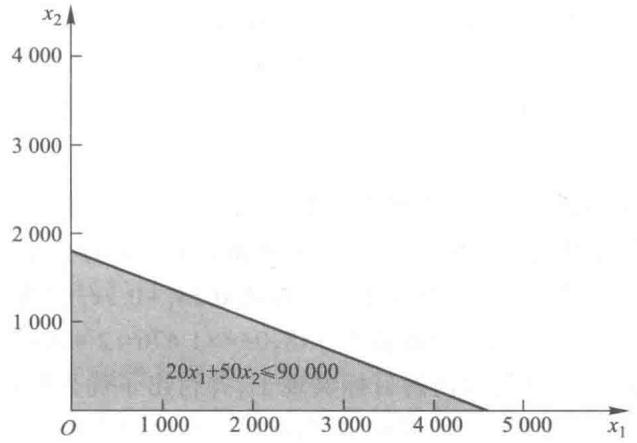
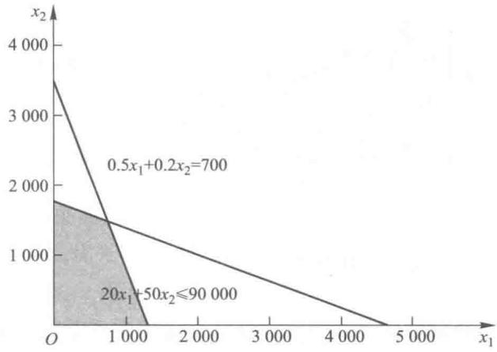
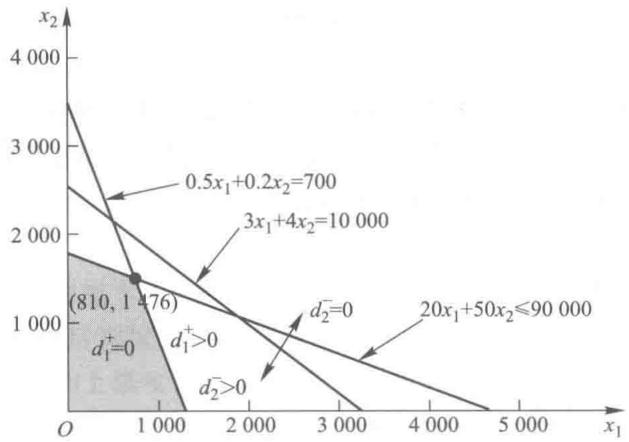

# 第9章 目标规划

在前面的章节中,每一个案例都只有单一的目标,例如,最大利润或最小成本.但在实际管理问题中,会有很多的多目标问题,如工厂选址问题.目标规划是解决存在多个目标的最优化问题的方法,它把多目标决策问题转化为线性规划来求解.本章将介绍目标规划的求解方法.

在实际工程和生活中,会有很多的多目标问题.例如,在设计一个导弹时,既要射程最远,又要燃料最省.再如,当一个公司在为一个新的工厂选址时,如果仅考虑土地成本和建筑成本,那管理者只要选择一个能使总成本最小的地点就可以了,但实际上考虑的因素还会包括该地点能否雇佣到素质高的员工以及运输是否方便等诸多条件.类似这样的问题称为多目标决策问题.

## 9.1 目标规划问题举例

例1 企业生产.

不同企业的生产目标是不同的.多数企业追求最大的经济效益.但随着环境问题的日益突出,可持续发展已经成为全社会所必须考虑的问题.因此,企业生产就不能再像以前那样只考虑企业利润,必须承担起社会责任,要考虑环境污染、社会效益、公众形象等多个方面.兼顾好这几者关系,企业才可能保持长期的发展.

例2 商务活动.

企业在进行盈亏平衡预算时,不能只集中在一种产品上,因为某一种产品的投入和产出仅仅是企业所有投入和产出的一部分.因此,需要用多产品的盈亏分析来解决具有多个盈亏平衡点的决策问题(多产品的盈亏平衡点往往是不一致的).

例3 投资.

企业投资时不仅仅要考虑收益率,还要考虑风险.通常,风险大的投资其收益率更高.因此,企业管理者只有在对收益率和风险承受水平有明确的期望值时,才能得到满意的决策.

例4 裁员.

同样,企业裁员时要考虑很多可能彼此矛盾的因素.裁员的首要目的是压缩人员开支,但在人人自危时员工的忠诚度就很难保证,此外,员工的心理压力、工作压力等都会增加,这可能会产生负面影响.

例5 营销.

营销方案的策划和执行存在多个目标.既希望能达到立竿见影的效果,又希望营销的成本控制在某一个范围内.此外,营销活动的深入程度也决定了营销效果的好坏和持续时间.

## 9.2 有优先权的目标规划的图解法

例 6 一位投资商有一笔资金准备购买股票. 资金总额为 90 000 元, 目前可选的股票有 A 和 B 两种 (可以同时投资于两种股票). 其价格以及年收益率和风险系数如表 9-1 所示.

表9-1

<table><tr><td>股票</td><td>价格/元</td><td>年收益/(元·年-1)</td><td>风险系数</td></tr><tr><td>A</td><td>20</td><td>3</td><td>0.5</td></tr><tr><td>B</td><td>50</td><td>4</td><td>0.2</td></tr></table>

从表 9-1 可知, 股票 A 的收益率为 $(3/20) \times 100\% = 15\%$ , 股票 B 的收益率为 $4/50 \times 100\% = 8\%$ , A 的收益率比 B 大, 但同时 A 的风险也比 B 大. 这符合高风险高收益的规律.

试求一种投资方案,使得一年的总投资风险不高于700,且投资收益不低于10 000元.

分析

如果全部资金用来购买股票 A, 则年收益为 $(90\ 000/20) \times 3 = 13\ 500$ , 风险为 $(90\ 000/20) \times 0.5 = 2\ 250$ . 虽然收益高于 10 000 元, 但同时风险也超过了 700. 如果全部资金用来购买股票 B, 则年收益为 $(90\ 000/50) \times 4 = 7\ 200$ , 风险为 $(90\ 000/50) \times 0.2 = 360$ . 显然, 风险虽然满足要求, 但年收益没有达到预期目标的 10 000 元. 可见, 把全部资金投入到某一种股票的方案是不可行的.

上述问题属于目标规划问题.它有两个目标变量:一是限制风险,一是确保收益.在求解之前,应首先考虑两个目标的优先权.

假设第一个目标(即限制风险)的优先权比第二个目标(确保收益)大,这意味着求解过程中必须首先满足第一个目标,然后在此基础上尽量满足第二个目标.

建立模型：

设 $x_{1}, x_{2}$ 分别表示投资商所购买的股票 A 和股票 B 的数量.

首先考虑资金总额的约束: 总投资额不能高于 90 000 元, 即

$$
20 x _ {1} + 50 x _ {2} \leqslant 90000.
$$

注意 资金总额的约束是刚性约束,是不允许突破的,这和以下的约束条件是有区别的。

### 一、约束条件

再来考虑风险约束: 总风险不能超过 700. 投资的总风险为 $0.5x_{1} + 0.2x_{2}$ . 引入两个变量 $d_{1}^{+}$ 和 $d_{1}^{-}$ , 建立等式如下:

$$
0. 5 x _ {1} + 0. 2 x _ {2} = 700 + d _ {1} ^ {+} - d _ {1} ^ {-}.
$$

其中， $d_{1}^{+}$ 表示总风险高于700的部分， $d_{1}^{-}$ 表示总风险少于700的部分， $d_{1}^{+},d_{1}^{-}\geqslant 0.$

目标规划中把 $d_{1}^{+}, d_{1}^{-}$ 这样的变量称为偏差变量. 偏差变量的作用是允许约束条件不被精确满足.例如，对投资组合 $(x_{1} = 4500,x_{2} = 0)$ ，总风险为2250，则 $d_1^+ = 1550,d_1^- = 0.$ 它反映了总风险比700多了1550.注意，如果 $d_1^+ >0$ ，则 $d_1^- = 0$ ；如果 $d_1^- >0$ ，则 $d_1^+ = 0$

把等式转换,可得到

$$
0. 5 x _ {1} + 0. 2 x _ {2} - d _ {1} ^ {+} + d _ {1} ^ {-} = 700.
$$

再来考虑年收入：

年收入为 $3x_{1}+4x_{2}$ .

引入变量 $d_2^+$ 和 $d_2^-$ ，分别表示年收入超过与低于10000的数量。于是，第2个目标可以表示为

$$
3 x _ {1} + 4 x _ {2} - d _ {2} ^ {+} + d _ {2} ^ {-} = 10000.
$$

### 二、有优先权的目标函数

本问题中第一个目标的优先权比第二个目标大,即最重要的目标是满足风险不超过700.分配给第一个目标较高的优先权 $P_{1}$ ,分配给第二个目标较低的优先权 $P_{2}$ .

目标规划在求解中首先考虑优先权高的目标.本例中,第一步:在只考虑第一个目标的前提下求解;第二步:把在第一步求得的最优函数值作为约束条件,考虑第二个目标的前提下求解.注意:第二步所得的解很可能和第一步所得的解不同,但不能改变第一个目标的最优值.类似地,如果有很多个不同优先权的目标 $P_{1},P_{2},P_{3},\cdots$ ,在对较低优先权的目标求解时不能改变优先权比它高的目标的最优值.

针对每一个优先权,应当建立一个单一目标的线性规划模型.首先建立具有最高优先权的目标的线性规划模型,求解;然后再按照优先权逐渐降低的顺序分别建立单一目标的线性规划模型,方法是在原来模型的基础上修改目标函数,并把原来模型求解所得的目标最优值作为一个新的约束条件加入到当前模型中,并求解.

例 6 中第一个目标是风险不超过 700, 这意味着超过 700 的程度越低越好, 最好是刚刚达到 700. 注意, 并不是求风险最小, 自然当风险为 0 的时候风险最小; 而是仅仅要求风险尽量不超过 700. 从另一个角度讲, 就是希望超出 700 的程度尽量小, 最好为 0. 因此可知第一个线性规划模型的目标函数是 $\min d_{1}^{+}$ .

### 三、图解法

#### 1. 针对优先权最高的目标建立线性规划

建立线性规划模型如下：

$$
\min d _ {1} ^ {+};
$$

约束条件：

$$
\begin{array}{l} 20 x _ {1} + 50 x _ {2} \leqslant 90000 \\ 0. 5 x _ {1} + 0. 2 x _ {2} - d _ {1} ^ {+} + d _ {1} ^ {-} = 700 \\ 3 x _ {1} + 4 x _ {2} - d _ {2} ^ {+} + d _ {2} ^ {-} = 10000 \\ x _ {1}, x _ {2}, d _ {1} ^ {+}, d _ {1} ^ {-} \geqslant 0. \end{array}
$$

首先找到满足约束条件 $20x_{1}+50x_{2}\leqslant90\ 000$ 的可行域,如图 9-1 所示.

图9-1

再考虑约束 $0.5x_{1} + 0.2x_{2} - d_{1}^{+} + d_{1}^{-} = 700.$ 当 $d_1^+ = d_1^- = 0$ 时，约束变成 $0.5x_{1} + 0.2x_{2} = 700.d_{1}^{+}$ 的最小值是0.如图9-2所示，阴影区域内 $d_1^+ = 0$ ，即风险小于或等于700，同时也满足 $20x_{1} + 50x_{2}\leqslant$ 90000.约束 $3x_{1} + 4x_{2} - d_{2}^{+} + d_{2}^{-} = 10000$ 暂时不起作用.

图9-2

#### 2. 针对优先权次高的目标建立线性规划

优先权次高 $(P_{2})$ 的目标是总收益超过10 000.如果总收益未超过10 000,要追求总收益尽量接近于10 000,即 $\min d_{2}^{-}$ .如果总收益超过10 000,则有 $d_{2}^{-}=0$ .在原线性规划基础上添加约束 $d_{1}^{+}=0$ ,目的是保证在求解过程中不改变优先权高的最优目标值.

建立线性规划如下：

$$
\min d _ {2} ^ {-};
$$

约束条件：

$$
\begin{array}{l} 20 x _ {1} + 50 x _ {2} \leqslant 90 000 \\ 0. 5 x _ {1} + 0. 2 x _ {2} - d _ {1} ^ {+} + d _ {1} ^ {-} = 700 \\ 3 x _ {1} + 4 x _ {2} - d _ {2} ^ {+} + d _ {2} ^ {-} = 10 000 \\ d _ {1} ^ {+} = 0 \\ x _ {1}, x _ {2}, d _ {1} ^ {+}, d _ {1} ^ {-}, d _ {2} ^ {+}, d _ {2} ^ {-} \geqslant 0. \end{array}
$$

如图9-3，从图中可知， $3x_{1} + 4x_{2} = 10000$ 这条直线的左下方区域中 $d_2^- > 0$ ，右上方区域中 $d_2^- = 0$ ，右上方区域可以使得 $d_2^-$ 获得最小值为0，但该区域和阴影部分并无重合.因此，可知只能接受 $d_2^- >0$ 的解.从阴影区域可知使 $d_2^-$ 最小的点即两条直线 $0.5x_{1} + 0.2x_{2} = 700$ 和 $20x_{1} + 50x_{2} = 90000$ 的交点(810,1476).总风险为700，而总收益为 $3\times 810 + 4\times 1476 = 2430 + 5904 = 8334 <   10000$ ，故没有达到第二个目标.本例中，优先权高的目标实现了，并付出了优先权低的目标没有实现的代价.如果采用运筹学软件进行求解，可知 $d_1^+ = d_1^- = 0,d_2^+ = 0,d_2^- \approx 1667.$

图9-3

目标规划的这种求解方法可以表述如下：

(1) 确定解的可行区域.

(2) 对优先权最高的目标求解, 如果找不到能满足该目标的解, 则寻找最接近该目标的解.

(3)对优先权次之的目标进行求解.注意：必须保证优先权高的目标不变.

(4) 重复第 3 步, 直至所有优先权的目标求解完.

### 四、目标规划模型的标准化

例 6 中对两个不同优先权的目标单独建立线性规划进行求解.为简便,把它们用一个模型来表达:

$$
\min P _ {1} (d _ {1} ^ {+}) + P _ {2} (d _ {2} ^ {-});
$$

约束条件：

$$
\begin{array}{l} 20 x _ {1} + 50 x _ {2} \leqslant 90000 \\ 0. 5 x _ {1} + 0. 2 x _ {2} - d _ {1} ^ {+} + d _ {1} ^ {-} = 700 \\ 3 x _ {1} + 4 x _ {2} - d _ {2} ^ {+} + d _ {2} ^ {-} = 10000 \\ x _ {1}, x _ {2}, d _ {1} ^ {+}, d _ {1} ^ {-}, d _ {2} ^ {+}, d _ {2} ^ {-} \geqslant 0. \end{array}
$$

注意 目标函数中 $P_{1}$ 和 $P_{2}$ 并不是权重,仅仅是表示两个目标的优先权.对于具有更多优先权的目标在建立模型时可以采用类似的方法.

## 9.3 复杂情况下的有优先权的目标规划

上一节以具有 2 个优先权的目标的例子作了分析.本节探讨存在 2 个以上优先权的更复杂的目标规划问题.

例 7 一工艺品厂商手工生产某两种工艺品A,B,已知生产一件产品A需要耗费人力2工时,生产一件产品B需要耗费人力3工时.A,B产品的单位利润分别为250元和125元.为了最大效率地利用人力资源,确定生产的首要任务是保证人员高负荷生产,要求每周总耗费人力资源不能低于600工时,但也不能超过680工时的极限;次要任务是要求每周的利润超过70000元;在前两个任务的前提下,为了保证库存需要,要求每周产品A和B的产量分别不低于200和120件,因为B产品比A产品更重要,不妨假设B完成最低产量120件的重要性是A完成200件的重要性的2倍.

试求如何安排生产？

解 本问题中有3个不同优先权的目标,不妨用 $P_{1},P_{2},P_{3}$ 表示从高至低的优先权.

对应 $P_{1}$ 有两个目标: 每周总耗费人力资源不能低于 600 工时, 也不能超过 680 工时;

对应 $P_{2}$ 有一个目标: 每周的利润超过 70 000 元;

对应 $P_{3}$ 有两个目标: 每周产品 A 和 B 的产量分别不低于 200 和 120 件.

下面分别讨论.

每周总耗费人力资源不能超过680工时，即要求 $d_1^+$ 最小；不能低于600工时，即要求 $d_2^-$ 最小.假设这两个目标同等重要，优先权 $P_{1}$ 对应的目标是 $\min d_1^+ +d_2^-$ .约束条件为

$$
2 x _ {1} + 3 x _ {2} - d _ {1} ^ {+} + d _ {1} ^ {-} = 680,
2 x _ {1} + 3 x _ {2} - d _ {2} ^ {+} + d _ {2} ^ {-} = 600.
$$

对应 $P_{2}$ 的目标, 得到约束条件 $250x_{1} + 125x_{2} - d_{3}^{+} + d_{3}^{-} = 70\ 000. d_{3}^{-} = 0$ 时, 每周的利润超过 70 000, 当 $d_{3}^{-} > 0$ 时, 每周的利润少于 70 000, 因此优先权 $P_{2}$ 对应的目标是 $\min d_{3}^{-}$ .

同样可对优先权 $P_{3}$ 建立对应的目标函数和约束条件.

因为 B 完成最低产量 120 件的重要性是 A 完成 200 件的重要性的 2 倍, 因此, 优先权 $P_{3}$ 对应的目标是 $\min d_{4}^{-} + 2d_{5}^{-}$ . 这里 2 和 1, 我们叫做罚数权重, 表示偏离各目标的严重程度.

采用简化模式,最终得到目标规划如下:

$$
\min P _ {1} (d _ {1} ^ {+}) + P _ {1} (d _ {2} ^ {-}) + P _ {2} (d _ {3} ^ {-}) + P _ {3} (d _ {4} ^ {-}) + P _ {3} (2 d _ {5} ^ {-});
$$

约束条件：

$$
\begin{array}{r l} 2 x _ {1} + 3 x _ {2} - d _ {1} ^ {+} + d _ {1} ^ {-} = 680 & \text {对应第 1 个目标,} \\ 2 x _ {1} + 3 x _ {2} - d _ {2} ^ {+} + d _ {2} ^ {-} = 600 & \text {对应第 2 个目标,} \\ 250 x _ {1} + 125 x _ {2} - d _ {3} ^ {+} + d _ {3} ^ {-} = 70\ 000 & \text {对应第 3 个目标,} \\ x _ {1} - d _ {4} ^ {+} + d _ {4} ^ {-} = 200 & \text {对应第 4 个目标,} \\ x _ {2} - d _ {5} ^ {+} + d _ {5} ^ {-} = 120 & \text {对应第 5 个目标,} \\ x _ {1}, x _ {2}, d _ {1} ^ {+}, d _ {1} ^ {-}, d _ {2} ^ {+}, d _ {2} ^ {-}, d _ {3} ^ {+}, d _ {3} ^ {-}, d _ {4} ^ {+}, d _ {4} ^ {-}, d _ {5} ^ {+}, d _ {5} ^ {-} \geqslant 0. \end{array}
$$

该目标规划我们可以化解为多步线性规划问题来求解.

首先考虑 $P_{1}$ ，建立线性规划模型如下：

$$
\min d _ {1} ^ {+} + d _ {2} ^ {-};
$$

约束条件：

$$
\begin{array}{l} \qquad 2 x _ {1} + 3 x _ {2} - d _ {1} ^ {+} + d _ {1} ^ {-} = 680 \\ \qquad 2 x _ {1} + 3 x _ {2} - d _ {2} ^ {+} + d _ {2} ^ {-} = 600 \\ 250 x _ {1} + 125 x _ {2} - d _ {3} ^ {+} + d _ {3} ^ {-} = 70000 \\ \qquad x _ {1} - d _ {4} ^ {+} + d _ {4} ^ {-} = 200 \\ \qquad x _ {2} - d _ {5} ^ {+} + d _ {5} ^ {-} = 120 \\ \qquad x _ {1}, x _ {2}, d _ {1} ^ {+}, d _ {1} ^ {-}, d _ {2} ^ {+}, d _ {2} ^ {-}, d _ {3} ^ {+}, d _ {3} ^ {-} \\ \qquad d _ {4} ^ {+}, d _ {4} ^ {-}, d _ {5} ^ {+}, d _ {5} ^ {-} \geqslant 0. \end{array}
$$

求解可得

$x_{1} = 0, x_{2} = 200, d_{1}^{+} = 0, d_{1}^{-} = 80, d_{2}^{+} = 0, d_{2}^{-} = 0, d_{3}^{+} = 0, d_{3}^{-} = 45000, d_{4}^{+} = 0, d_{4}^{-} = 200, d_{5}^{+} = 80, d_{5}^{-} = 0,$ 目标函数 $d_{1}^{+} + d_{2}^{-} = 0.$

再考虑 $P_{2}$ ，把前一个线性规划目标函数得到的最优值作为新增约束条件，建立线性规划模型如下：

$$
\min d _ {3} ^ {-};
$$

约束条件：

$$
\begin{array}{l} 2 x _ {1} + 3 x _ {2} - d _ {1} ^ {+} + d _ {1} ^ {-} = 680 \\ 2 x _ {1} + 3 x _ {2} - d _ {2} ^ {+} + d _ {2} ^ {-} = 600 \\ 250 x _ {1} + 125 x _ {2} - d _ {3} ^ {+} + d _ {3} ^ {-} = 70000 \\ x _ {1} - d _ {4} ^ {+} + d _ {4} ^ {-} = 200 \\ x _ {2} - d _ {5} ^ {+} + d _ {5} ^ {-} = 120 \\ d _ {1} ^ {+} + d _ {2} ^ {-} = 0 \\ x _ {1}, x _ {2}, d _ {1} ^ {+}, d _ {1} ^ {-}, d _ {2} ^ {+}, d _ {2} ^ {-}, d _ {3} ^ {+}, d _ {3} ^ {-} \\ d _ {4} ^ {+}, d _ {4} ^ {-}, d _ {5} ^ {+}, d _ {5} ^ {-} \geqslant 0. \end{array}
$$

求解可得

$x_{1} = 270, x_{2} = 20, d_{1}^{+} = 0, d_{1}^{-} = 80, d_{2}^{+} = 0, d_{2}^{-} = 0, d_{3}^{+} = 0, d_{3}^{-} = 0, d_{4}^{+} = 70, d_{4}^{-} = 0, d_{5}^{+} = 0, d_{5}^{-} = 100$ ，目标函数 $d_{3}^{-} = 0.$

类似地，对 $P_{3}$ 建立对应的线性规划模型（把上一优先权的目标函数最优值作为新增约束条件）, 模型如下:

$$
\min d _ {4} ^ {-} + 2 d _ {5} ^ {-};
$$

约束条件：

$$
\begin{array}{l} 2 x _ {1} + 3 x _ {2} - d _ {1} ^ {+} + d _ {1} ^ {-} = 680 \\ 2 x _ {1} + 3 x _ {2} - d _ {2} ^ {+} + d _ {2} ^ {-} = 600 \\ 250 x _ {1} + 125 x _ {2} - d _ {3} ^ {+} + d _ {3} ^ {-} = 70000 \\ x _ {1} - d _ {4} ^ {+} + d _ {4} ^ {-} = 200 \\ x _ {2} - d _ {5} ^ {+} + d _ {5} ^ {-} = 120 \\ d _ {1} ^ {+} + d _ {2} ^ {-} = 0 \\ d _ {3} ^ {-} = 0 \\ x _ {1}, x _ {2}, d _ {1} ^ {+}, d _ {1} ^ {-}, d _ {2} ^ {+}, d _ {2} ^ {-}, d _ {3} ^ {+}, d _ {3} ^ {-} \\ d _ {4} ^ {+}, d _ {4} ^ {-}, d _ {5} ^ {+}, d _ {5} ^ {-} \geqslant 0. \end{array}
$$

求解可得

$x_{1} = 250, x_{2} = 60, d_{1}^{+} = 0, d_{1}^{-} = 0, d_{2}^{+} = 80, d_{2}^{-} = 0, d_{3}^{+} = 0, d_{3}^{-} = 0, d_{4}^{+} = 50, d_{4}^{-} = 0, d_{5}^{+} = 0, d_{5}^{-} = 60$ ，目标函数 $d_{4}^{-} + 2d_{5}^{-} = 120.$

可见,目标1、目标2、目标3和目标4达到了,但目标5有一些偏差.实际问题中,多目标规划问题很难实现所有目标都能达到的情况.

如果我们用“管理运筹学”软件，我们只要在目标规划的子模型中输入目标规划的数据即可得到上述的结果，并请注意该输入栏中决策变量的个数是不包括偏差变量的决策变量的个数。在例7中应输入2；在输入栏中优先级数是指目标函数中共有多少个优先权等级，在例7中应输入3；在输入栏中目标约束个数是指含偏差变量的约束条件的个数；在输入栏中绝对约束个数是指不含偏差变量的约束条件的个数。并且在目标规划的子程序中所有的偏差变量 $d_{i}^{-}$ 和 $d_{i}^{+}$ 都非负。

## 9.4 加权目标规划

加权目标规划是另一种解决多目标决策问题的方法,其基本方法是通过量化的方法分配给每个目标偏离的严重程度一个罚数权重,然后建立总的目标函数,该目标函数表示的目标是要使每个目标函数与各自目标的加权偏差之和最小,假设所有单个的目标函数及约束条件都符合线性规划的要求,那么,整个问题就可以表述为一个线性规划问题.

如果在例 7 中我们对每周总耗费的人力资源超过 680 工时或低于 600 工时的每工时罚数权重定为 7；每周利润低于 70 000 元时，每元的罚数权重为 5；每周产品 A 产量低于 200 件时每件罚数权重为 2，而每周产品 B 产量低于 120 件时每件罚数权重为 4，则其目标变为

$$
\min 7 d _ {1} ^ {+} + 7 d _ {2} ^ {-} + 5 d _ {3} ^ {-} + 2 d _ {4} ^ {-} + 4 d _ {5} ^ {-}.
$$

这就变成了一个普通的单一目标的线性规划问题：

$$
\min 7 d _ {1} ^ {+} + 7 d _ {2} ^ {-} + 5 d _ {3} ^ {-} + 2 d _ {4} ^ {-} + 4 d _ {5} ^ {-};
$$

约束条件：

$$
\begin{array}{l} 2 x _ {1} + 3 x _ {2} - d _ {1} ^ {+} + d _ {1} ^ {-} = 680 \\ 2 x _ {1} + 3 x _ {2} - d _ {2} ^ {+} + d _ {2} ^ {-} = 600 \\ 250 x _ {1} + 125 x _ {2} - d _ {3} ^ {+} + d _ {3} ^ {-} = 70000 \\ x _ {1} - d _ {4} ^ {+} + d _ {4} ^ {-} = 200 \\ x _ {2} - d _ {5} ^ {+} + d _ {5} ^ {-} = 120 \\ x _ {1}, x _ {2}, d _ {1} ^ {+}, d _ {1} ^ {-}, d _ {2} ^ {+}, d _ {2} ^ {-}, d _ {3} ^ {+}, d _ {3} ^ {-}, d _ {4} ^ {+}, d _ {4} ^ {-}, d _ {5} ^ {+}, d _ {5} ^ {-} \geqslant 0. \end{array}
$$

加权目标规划和优先权目标规划都是解决目标规划问题的方法,加权目标规划的关键是:寻找一个将罚数相对准确地分配给各个目标来表示各目标对总目标的影响的严重程度,以便实现总目标尽可能好的各个目标平衡的解.对某个具体问题来说,如能做到这点,加权目标规划显然比优先权目标规划更精确一些.但这对管理者来说并不容易做到.相对来说,评价各目标对总目标的重要性的顺序显得较为容易了.故优先权目标规划适用范围比加权目标规划更广一些,可行性更强一些.

## 习题

1. 请判断下列说法是否正确：

（1）要求不超过第一目标值、恰好完成第二目标值，目标函数为 $\operatorname{Min} P_1 d_1^+ + P_2 (d_2^- + d_2^+)$ .

（2）目标规划中应同时包括绝对约束和目标约束.

（3）目标规划中任意一个目标约束中的正负偏差变量不可能同时为正数.

（4）目标规划中正偏差取正值，负偏差取负值.

（5）只含目标约束的目标规划模型一定存在满意解.

2. 某工厂试对产品 A, B 进行生产. 市场需求并不是很稳定, 因此对每种产品分别预测了在销售良好和销售较差时的预期利润. 这两种产品都经过甲、乙两台设备加工. 已知产品 A 和 B 分别在甲和乙设备上的单位加工时间, 甲、乙设备的可用加工时间以及预期利润如表 9-2 所示, 要求首先是保证在销售较差时, 预期利润不少于 5 千元, 其次是要求销售良好时, 预期利润尽量达到 1 万元. 试建立目标规划模型并求解.

表9-2

<table><tr><td>设备\单位加工时间/h\产品</td><td>A</td><td>B</td><td>可用时间/h</td></tr><tr><td>甲</td><td>4</td><td>3</td><td>45</td></tr><tr><td>乙</td><td>2</td><td>5</td><td>30</td></tr><tr><td>销售良好时的预期利润(百元/件)</td><td>8</td><td>6</td><td></td></tr><tr><td>销售较差时的预期利润(百元/件)</td><td>5</td><td>5</td><td></td></tr></table>

3. 某公司生产商品混凝土, 其车间生产能力为 25 吨/小时, 每天工作 8 小时, 现有 2 个施工现场分别需要商品混凝土 A 120 吨, 商品混凝土 B 100 吨, 两种混凝土的构成、单位利润及企业所拥有的原料如表 9-3 所示, 现公司三管理部门提出目标及其优先等级如下:

(1) 保持车间满负荷运转；

(2) 每天加班不超过 3 小时；

(3) 产量尽量满足两工地需求；

(4) 力争实现利润 3 万元/天.

表9-3

<table><tr><td>材料\每吨所需材料/吨\混凝土</td><td>A</td><td>B</td><td>现有资源/吨</td></tr><tr><td>水泥</td><td>0.40</td><td>0.50</td><td>155</td></tr><tr><td>沙</td><td>0.60</td><td>0.50</td><td>145</td></tr><tr><td>单位利润(元/天)</td><td>150</td><td>100</td><td></td></tr></table>

试建立目标规划模型并求解.

4. 某机床生产厂商有 4 个产地 $A_{1}, A_{2}, A_{3}, A_{4}$ ，3 个销地 $B_{1}, B_{2}, B_{3}$ ，其供需数量和单位运费如表 9-4 所示（单位：千元）.

表9-4

<table><tr><td></td><td> \(B_1\) </td><td> \(B_2\) </td><td> \(B_3\) </td><td>供给量</td></tr><tr><td> \(A_1\) </td><td>5</td><td>7</td><td>5</td><td>10</td></tr><tr><td> \(A_2\) </td><td>4</td><td>4</td><td>8</td><td>5</td></tr><tr><td> \(A_3\) </td><td>4</td><td>6</td><td>10</td><td>6</td></tr><tr><td> \(A_4\) </td><td>3</td><td>4</td><td>8</td><td>11</td></tr><tr><td>需求量</td><td>12</td><td>16</td><td>18</td><td></td></tr></table>

经营决策中要求所有的产地的产品必须全部运出,希望达到目标及其优先等级如下:

目标 1: 销地 $B_{1}, B_{2}$ 至少得到它需求量的 50%;

目标 2: 必须满足销地 $B_{3}$ 全部需求量；

目标 3: 由于客观原因, 要尽量减少 $A_{4}$ 到 $B_{2}$ 的送货量;

目标 4: 若最高期望运费 130 元, 并尽可能减少运输费用.

该厂商应如何拟定方案以满足以上目标？

5. 某人有一笔资金计划用来买投资基金, 拥有的资金总额为 10 000 元, 目前计划买两种基金, 其价格和收益以及风险系数如表 9-5 所示.

表9-5

<table><tr><td>基金</td><td>价格/元</td><td>收益(元/年)</td><td>风险系数</td></tr><tr><td>A</td><td>25</td><td>4</td><td>0.7</td></tr><tr><td>B</td><td>45</td><td>5</td><td>0.4</td></tr></table>

试求一种投资方案,使得一年的总投资风险不高于350,且投资收益不低于1250元,其中要求前面目标的优先权高于后面目标.

6. 某食品厂商为了推销其生产的营养品，准备在两周内发动一次广告活动，在电视、报纸和广播三种媒介上发布广告。有关这三种媒介的数据如表 9-6 所示。

表9-6

<table><tr><td>媒介类别</td><td>广告影响的人数/万</td><td>广告费(元/次)</td><td>最大的广告次数</td></tr><tr><td>电视</td><td>20</td><td>2500</td><td>10</td></tr><tr><td>报纸</td><td>10</td><td>500</td><td>20</td></tr><tr><td>广播</td><td>5</td><td>300</td><td>15</td></tr></table>

活动的目标有：

第1优先权：

目标:广告影响人数至少达到400万.

第2优先权：

目标:电视广告的次数至少占所有广告次数的 30%.

第3优先权：

目标: 广播的次数不能超过所有广告次数的 20%.

第4优先权：

目标: 广告费用限制在 2 万元以内.

试建立本问题的目标规划并求解.

7. 某化工厂生产两种用于轮船上的黏合剂 A 和 B. 这两种黏合剂的强度不同, 所需的加工时间也不同. 生产 1 升的 A 需要 20 分钟, 生产 1 升的 B 需要 25 分钟. 这两种黏合剂都以一种树脂作为原料, 1 升树脂可以制造 1 升 A, 或者 1 升 B. 树脂的保质期是 2 周, 目前树脂的库存为 300 升. 已知正常工作下每周有 5 个工作日, 每个工作日有 8 个工时. 工厂期望达到有以下不同优先权的目标:

第1优先权：

目标 1: 保持工厂满负荷运转；

目标 2: 加班时间控制在 20 工时以内；

第2优先权：

目标 3: 至少生产 100 升 A;

目标 4: 至少生产 120 升 B;

第3优先权：

目标 5: 使用完所有的树脂.

设第 1,2 优先权所对应的两个目标的重要程度相同.

(1) 试建立本问题的目标规划.

(2) 用图解法求解.

8. 某一工厂计划生产甲、乙两种产品，该两种产品需要在 A, B, C, D 四种设备上进行加工，同时要求 B, C, D 设备严禁超时使用。工艺表如表 9-7 所示。

表9-7

<table><tr><td>设备\每件产品的加工时间/h\产品</td><td>甲</td><td>乙</td><td>加工能力/h</td></tr><tr><td>A</td><td>3</td><td>2</td><td>45</td></tr><tr><td>B</td><td>2</td><td>4</td><td>30</td></tr><tr><td>C</td><td>3</td><td>2</td><td>40</td></tr><tr><td>D</td><td>1</td><td>3</td><td>25</td></tr><tr><td>单位利润/元</td><td>20</td><td>25</td><td></td></tr></table>

该厂要求及其优先等级如下：

(1)力求使利润指标不低于250元；

(2) 甲乙两种产品的生产量尽可能保持在 0.75:1 的比例；

(3) 设备 A 既要求充分使用, 又尽可能不加班.

如何安排工艺使得计划期内的总利润为最大？

9. 某公司的员工工资有四级,根据公司业务的发展情况,准备招收部分新员工,并将部分员工的工资提升一级.提级后编制是计划编制,允许有变化,其中1级员工中有10%要退休.公司目前各级别人员情况如表9-8所示.

表9-8

<table><tr><td>级别</td><td>1</td><td>2</td><td>3</td><td>4</td></tr><tr><td>工资/千元</td><td>9</td><td>6</td><td>4</td><td>3</td></tr><tr><td>现有员工数/人</td><td>10</td><td>20</td><td>40</td><td>30</td></tr><tr><td>编制员工数/人</td><td>10</td><td>22</td><td>52</td><td>30</td></tr></table>

公司领导的目标及其优先等级如下：

目标 1: 提级后在职员工工资总额不能超过 550 千元；

目标 2: 各级员工不要超过定编人数；

目标 3: 各级员工的升级面不少于现在人数的 15%;

目标 4: 总提级面不大于现有员工的 20%, 但尽可能多提.

公司应如何拟定方案以满足以上目标？

10. 某工厂有甲、乙两车间，可以生产录音机和电视机两种产品，甲、乙两车间生产的限制条件以及两种产品的利润和费用如表9-9所示.

表9-9

<table><tr><td></td><td>录音机</td><td>电视机</td><td>每月可用工时</td><td>车间管理费</td></tr><tr><td>甲</td><td>3小时</td><td>2小时</td><td>120小时</td><td>80元/小时</td></tr><tr><td>乙</td><td>1小时</td><td>3小时</td><td>150小时</td><td>20元/小时</td></tr><tr><td>检验销售费</td><td>30元/台</td><td>50元/台</td><td></td><td></td></tr></table>

估计下一季度内每月可以销售录音机 50 台,电视机 80 台,工厂制定的月度目标及其优先等级为:

目标 1: 检验销售费每月不超过 5 000 元；

目标 2: 每月售出录音机不少于 50 台；

目标 3: 甲、乙车间的生产工时得到充分利用(重要性权重按两个车间每小时管理费用的比例确定);

目标 4: 甲车间加班不超过 20 小时；

目标 5: 每月销售电视机不少于 80 台.

利用目标规划模型确定该厂为达到以上目标的月度计划生产数.

11. 某企业生产 A, B, C 三种产品, 装配工作在同一条线上完成. 三种产品的工作消耗分别为 5 小时, 8 小时和 12 小时. 生产线的正常工作时间为每月 1500 小时. 三种产品出售后, 每种可分别获利 500 元, 550 元和 700 元, 每月预计销量为 300 台, 80 台和 100 台, 公司的业务目标及其优先等级如下:

目标 1: 利润指数不低于每月 160 000 元；

目标 2: 充分利用生产能力；

目标 3: 加班时间不超过 100 小时;

目标 4: 产量以预计销量为标准.

为了确定生产计划,建立该问题的目标规划模型.

12. 某汽车装配厂生产两种汽车零配件,需要经过两道主要工序进行加工.已知这两种产品的单价以及耗费工时如表 9-10 所示.

表9-10

<table><tr><td></td><td>产品 A</td><td>产品 B</td></tr><tr><td>利润/元</td><td>4</td><td>3</td></tr><tr><td>第 1 道工序/min</td><td>10</td><td>10</td></tr><tr><td>第 2 道工序/min</td><td>20</td><td>50</td></tr></table>

因两道工序的加工能力存在瓶颈问题，因此要对它们的总加工工时加以控制.

工厂在制定下一个周期的工作计划时,希望达到以下目标:

目标 1: 对于第 1 道工序, 总加工时间不超过 60 小时;

目标 2: 对于第 2 道工序, 总加工时间要不超过 180 小时;

目标 3: 利润不少于 1 300 元.

（1）假设目标1和目标2的优先权为 $P_{1}$ ，且重要程度相等；目标3的优先权为 $P_{2}, P_{1}>P_{2}$ ，建立目标规划模型并求解；

（2）如果不考虑目标1和目标2，仅仅把它们加工时间的最大限度分别为60小时和180小时作为约束条件，而以利润最大化为目标，该如何安排生产？结果与(1)的解是否相同？分析原因.

（3）如果设目标3的优先权为 $P_{1}$ ，目标1和目标2的优先权为 $P_{2}$ ，用图解法求解.分析解是否与(1)所得的解相同.

13. 在环境污染日益得到重视的今天,越来越多的企业开始注重工业废水污水排污.某纸张制造厂生产一般类型纸张的利润为300元/吨,每吨纸产生的工业废水的处理费用为30元;生产某种特种纸张的利润为500元/吨,每吨特种纸产生的工业废水的处理费用为40元.

该纸张制造厂近期目标如下：

目标 1: 纸张利润不少于 15 万;

目标 2: 工业废水的处理费用不超过 1 万元.

（1）设目标1的优先权为 $P_{1}$ ，目标2的优先权为 $P_{2}, P_{1} > P_{2}$ ，建立目标规划模型并用图解法求解.

（2）若目标 2 的优先权为 $P_{1}$ ，目标 1 的优先权为 $P_{2}$ ，建立目标规划模型并求解。所得的解是否与(1)中的解相同？

（3）若目标2的罚数权重为5，目标1的罚数权重为2，建立加权目标规划模型求解.

14. 某厂装配甲、乙两种洗衣机，每装配一台洗衣机需要占用装配线 1.5 小时，装配线每周计划开动 45 个小时。预计市场每周甲种洗衣机的销量是 30 台，每台可获利 80 元；乙种洗衣机的销量是 25 台，每台可获利 95 元。确定该厂的目标是：

第一优先级: 尽可能利用装配线;

第二优先级:加班时间不超过8小时;

第三优先级:为满足市场需求,因为乙种洗衣机获利高,取其加权系数为1.5.

请建立模型,求得利润最大时的装配计划.

15. 某厂计划生产甲、乙两种产品，资料如表 9-11 所示.

表9-11

<table><tr><td>产品\每件产品消耗材料\资源</td><td>甲</td><td>乙</td><td>资源限制</td></tr><tr><td>钢材/吨</td><td>8</td><td>4</td><td>2 800</td></tr><tr><td>煤炭/吨</td><td>5</td><td>3</td><td>1 400</td></tr><tr><td>设备台时/小时</td><td>4</td><td>8</td><td>1 800</td></tr><tr><td>每件利润/元</td><td>100</td><td>120</td><td></td></tr></table>

该厂对生产计划的要求及其优先等级如下：

(1)完成或超额完成利润指标30000元；

(2) 甲产品不超过 200 件, 乙产品不低于 120 件;

(3) 现有钢材全部用完.

请建立模型,制定生产计划,使得获得的利润最大.

16. 某公司生产三种产品, 三种产品的单位利润、所需的劳动力及投入的成本情况如表 9-12 所示.

表9-12

<table><tr><td>产品</td><td>利润(元/件)</td><td>所需工人(人/万件)</td><td>投入成本(元/件)</td></tr><tr><td>A</td><td>16</td><td>7</td><td>6</td></tr><tr><td>B</td><td>12</td><td>4</td><td>8</td></tr><tr><td>C</td><td>12</td><td>5</td><td>10</td></tr></table>

现在要确定三种产品的生产计划，并且公司设定了如下目标及其优先等级：

目标 1: 总利润不低于 130 万元；

目标 2: 现有工人 45 名, 要充分利用现有员工, 但尽可能不要安排加班;

目标 3: 希望总投资不要超过 60 万元.

(1) 根据以上目标确定满意的生产计划.

（2）如果将以上三个目标的权重设置为低于总利润目标为5；低于现有工人利用目标为4；超过现有工人利用目标为2；超过投资目标为3，试确定该厂的生产计划.

## 案例 16: 昌义集团零售商选择

昌义集团有两分公司 $G_{1}$ 和 $G_{2}$ . 该公司的业务是向零售商供应煤炭和乙醇. 为对各个公司进行业务考核, 要求将零售商分给两个分公司, 由分公司给只属于它的零售商供货. 这种划分要求尽可能使 $G_{1}$ 占有 45% 的市场份额, $G_{2}$ 占有 55% 的市场份额. 零售商共有 25 家, 记作 $S_{1}-S_{25}$ . 按地域又将零售商划分为三个区, $S_{1}-S_{8}$ 在一区, $S_{9}-S_{18}$ 在二区, $S_{19}-S_{25}$ 在三区, 并将发展前景好的零售商分为 A 类, 其余的归为 B 类. 各零售商目前估计占有的销售量及各供货点的情况如表 9-13 所示.

表9-13

<table><tr><td>区域</td><td>零售商</td><td>煤炭销量/吨</td><td>供货点数/个</td><td>乙醇销量/吨</td><td>分类</td></tr><tr><td rowspan="8">一区</td><td> \(S_{1}\) </td><td>8</td><td>10</td><td>32</td><td>A</td></tr><tr><td> \(S_{2}\) </td><td>12</td><td>36</td><td>410</td><td>A</td></tr><tr><td> \(S_{3}\) </td><td>13</td><td>42</td><td>80</td><td>B</td></tr><tr><td> \(S_{4}\) </td><td>16</td><td>23</td><td>150</td><td>B</td></tr><tr><td> \(S_{5}\) </td><td>10</td><td>10</td><td>6</td><td>A</td></tr><tr><td> \(S_{6}\) </td><td>19</td><td>24</td><td>180</td><td>B</td></tr><tr><td> \(S_{7}\) </td><td>12</td><td>25</td><td>15</td><td>A</td></tr><tr><td> \(S_{8}\) </td><td>20</td><td>50</td><td>200</td><td>B</td></tr><tr><td rowspan="10">二区</td><td> \(S_{9}\) </td><td>8</td><td>18</td><td>100</td><td>A</td></tr><tr><td> \(S_{10}\) </td><td>10</td><td>52</td><td>20</td><td>B</td></tr><tr><td> \(S_{11}\) </td><td>16</td><td>20</td><td>53</td><td>A</td></tr><tr><td> \(S_{12}\) </td><td>18</td><td>100</td><td>2</td><td>A</td></tr><tr><td> \(S_{13}\) </td><td>17</td><td>8</td><td>8</td><td>A</td></tr><tr><td> \(S_{14}\) </td><td>18</td><td>16</td><td>100</td><td>B</td></tr><tr><td> \(S_{15}\) </td><td>21</td><td>32</td><td>110</td><td>A</td></tr><tr><td> \(S_{16}\) </td><td>23</td><td>98</td><td>112</td><td>A</td></tr><tr><td> \(S_{17}\) </td><td>35</td><td>52</td><td>500</td><td>B</td></tr><tr><td> \(S_{18}\) </td><td>42</td><td>20</td><td>10</td><td>A</td></tr><tr><td rowspan="7">三区</td><td> \(S_{19}\) </td><td>5</td><td>10</td><td>52</td><td>B</td></tr><tr><td> \(S_{20}\) </td><td>15</td><td>20</td><td>30</td><td>A</td></tr><tr><td> \(S_{21}\) </td><td>14</td><td>15</td><td>70</td><td>A</td></tr><tr><td> \(S_{22}\) </td><td>24</td><td>10</td><td>65</td><td>B</td></tr><tr><td> \(S_{23}\) </td><td>38</td><td>20</td><td>28</td><td>A</td></tr><tr><td> \(S_{24}\) </td><td>36</td><td>16</td><td>30</td><td>A</td></tr><tr><td> \(S_{25}\) </td><td>29</td><td>18</td><td>42</td><td>B</td></tr></table>

按照公司的要求,两个分公司在下列7个方面的比例都要近似45/55,其优先等级如下:

P1: 货店总数；

P2: 乙醇市场占有份额；

P3: 一区的煤炭市场占有份额；

P4: 二区的煤炭市场占有份额；

P5: 三区的煤炭市场占有份额；

P6: A 类零售商数；

P7:B 类零售商数；

请根据以上目标确定满意的供应计划.

## 案例 17: 天天公司招聘

天天公司是一家集采购与外贸于一体的大型公司，它在北京和天津都有自己的分支机构。现公司拟在下一年度招聘三个专业的职工170人。具体招聘计划见表9-14.

表9-14

<table><tr><td>专业</td><td colspan="2">采购管理</td><td colspan="2">市场管理</td><td colspan="2">财务管理</td></tr><tr><td>人员</td><td>20</td><td>25</td><td>30</td><td>20</td><td>40</td><td>35</td></tr><tr><td>城市</td><td>北京</td><td>天津</td><td>北京</td><td>天津</td><td>北京</td><td>天津</td></tr></table>

应聘人员经严格审核,初选了180人.按适合从事专业、本人意愿专业和希望工作城市共分为6大类,见表9-15.

表9-15

<table><tr><td>类别</td><td>人数</td><td>适合专业</td><td>意愿专业</td><td>意愿城市</td></tr><tr><td>1</td><td>25</td><td>采购、市场</td><td>采购</td><td>北京</td></tr><tr><td>2</td><td>35</td><td>市场、财务</td><td>市场</td><td>北京</td></tr><tr><td>3</td><td>20</td><td>采购、财务</td><td>采购</td><td>天津</td></tr><tr><td>4</td><td>40</td><td>采购、财务</td><td>财务</td><td>天津</td></tr><tr><td>5</td><td>34</td><td>市场、财务</td><td>财务</td><td>北京</td></tr><tr><td>6</td><td>26</td><td>财务</td><td>财务</td><td>天津</td></tr></table>

公司招聘目标及其优先等级如下：

P1: 集团按计划录用在各城市适合从事该专业的职员；

P2:80%以上人员能够从事意愿专业；

P3:80%以上的人员能去意愿城市.

---
