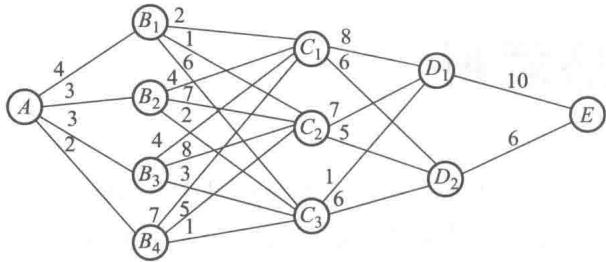
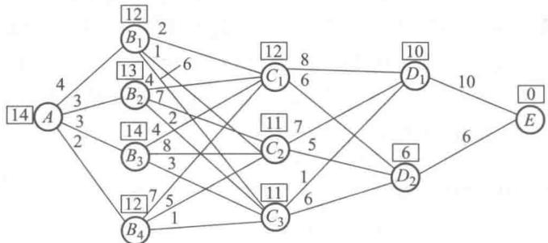
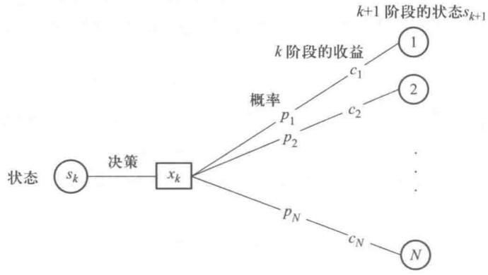
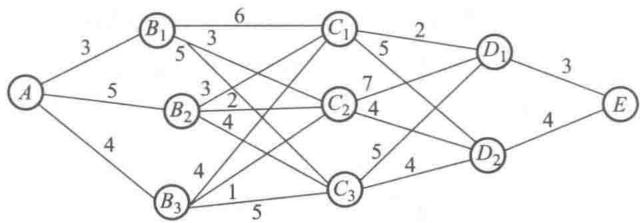
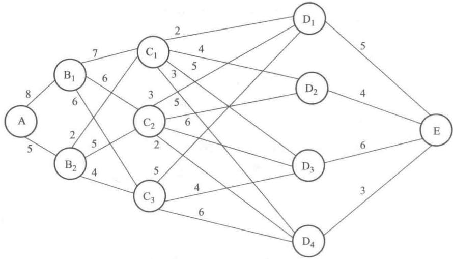

# 第10章 动态规划

动态规划是解决多阶段决策过程最优化问题的一种方法.这种方法把困难的多阶段决策问题变换成一系列互相联系较容易的单阶段问题,解决了这一系列较容易的单阶段问题,也就解决了这个困难的多阶段决策问题.

用动态规划可以解决管理中的最短路问题、装载问题、库存问题、资源分配问题、生产过程最优化问题.

根据时间参量是离散的变量还是连续的变量,可以把动态规划的模型分为离散决策过程和连续决策过程;根据决策过程的演变是确定性的还是随机性的,动态规划又可分为确定性的决策过程和随机性的决策过程,组合起来就有离散确定性、离散随机性、连续确定性、连续随机性四种决策过程.本章主要介绍离散确定性的决策过程,同时,在动态规划应用(2)中也将介绍离散随机性和连续确定性的决策过程.

## 10.1 多阶段决策过程最优化问题举例

最短路径问题：

例 1 如图 10-1 所示, 给定一个运输网络, 两点之间连线上的数字表示两点间的距离, 试求一条从 A 到 E 的运输线路, 使总距离为最短.

为了解决这个问题,首先来定义一下阶段.定义第一阶段是以A点为始点,而以距离A点正好一个弧远的点 $(B_{1},B_{2},B_{3},B_{4})$ 为终点;第二阶段是以与A点距离一弧远的点 $(B_{1},B_{2},B_{3},B_{4})$ 为始点,以与A点距离两个弧远的点 $(C_{1},C_{2},C_{3})$ 为终点;第三阶段以与A距离两个弧远的点 $(C_{1},C_{2},C_{3})$ 为始点,以与A距离三个弧远的点 $(D_{1},D_{2})$ 为终点;第四阶段以与A距离三个弧远的点 $(D_{1},D_{2})$ 为始点,以与A距离四个弧的点(E)为终点.显然这是一个四阶段决策过程的最优化问题.用动态规划来解这个问题,就是要把这个四阶段的决策问题,化成一系列较容易解决的单阶段决策的问题,当然每个单阶段的决策是整个决策过程的一个环节,因为它不仅仅影响该阶段的效果(距离),还要影响到下阶段的初始状态(从哪一点出发).

图10-1

在决策过程中我们将用到最优化原理,这个最优化原理在最短路上的应用可阐述如下:

从最短路上的每一点到终点的部分道路,也一定是从该点到终点的最短路.

下面我们来求解例 1. 我们从最后一个阶段开始, 从终点向始点方向逐阶段逆推, 找出各点到终点的最短路, 当逆推到始点时, 也即找到了从始点到终点的全过程的最短路, 这种从后向前逆推的方法叫逆序解法.

从第四阶段开始，在第四阶段中有两个始点 $D_{1}$ 和 $D_{2}$ ，终点只有一个点为 $E$ 点，这样不管始点是 $D_{1}$ 还是 $D_{2}$ ，最佳终点我们都将选择 $E$ 点，并知道从 $D_{1}$ 到 $E$ 的距离为 10，从 $D_{2}$ 到 $E$ 的距离为 6，这样尽管我们不知道全过程的最短路径是否经过 $D_{1}$ （或 $D_{2}$ ），但如果此最短路经过 $D_{1}$ （或 $D_{2}$ ），那么此最短路的下一步必是从 $D_{1}(D_{2})$ 到 $E$ 。第四阶段的结果我们用下面的表格 10-1 表示。

表10-1

<table><tr><td rowspan="2">本阶段始点(状态)</td><td>本阶段各终点(决策)</td><td rowspan="2">到E的最短距离</td><td rowspan="2">本阶段最优终点(最优决策)</td></tr><tr><td>E</td></tr><tr><td> \(D_1\) </td><td>10</td><td>10</td><td>E</td></tr><tr><td> \(D_2\) </td><td>6</td><td>6</td><td>E</td></tr></table>

第三阶段：

在第三阶段中有三个始点 $C_1, C_2, C_3$ ，终点有 $D_1$ 和 $D_2$ ，我们知道以 $C_1$ 为始点，如果 $C_1$ 经 $D_1$ 到 $E$ ，则从 $C_1$ 到 $E$ 的距离为 $8 + 10 = 18$ ；如果 $C_1$ 经 $D_2$ 到 $E$ ，则从 $C_1$ 到 $E$ 的距离为 $6 + 6 = 12$ 。显然以 $C_1$ 为始点，我们必选择 $D_2$ 为终点。

虽然我们不知道全过程的最短路是否经过 $C_1$ ，但如果经过 $C_1$ 点则此最短路必选 $C_1 - D_2 - E$ 的路线，同样我们可以对 $C_2, C_3$ 进行类似的讨论，结果见表10-2.

表10-2
阶段 3

<table><tr><td rowspan="2">本阶段始点(状态)</td><td colspan="2">本阶段各终点(决策)</td><td rowspan="2">到E的最短距离</td><td rowspan="2">本阶段最优终点(最优决策)</td></tr><tr><td> \(D_1\) </td><td> \(D_2\) </td></tr><tr><td> \(C_1\) </td><td>8+10=18</td><td>6+6=12</td><td>12</td><td> \(D_2\) </td></tr><tr><td> \(C_2\) </td><td>7+10=17</td><td>5+6=11</td><td>11</td><td> \(D_2\) </td></tr><tr><td> \(C_3\) </td><td>1+10=11</td><td>6+6=12</td><td>11</td><td> \(D_1\) </td></tr></table>

从表 10-2 知, 如果全过程的最短路经过 $C_{2}$ 则此最短路必走 $C_{2}-D_{2}-E$ 的路线; 如果全过程的最短路经过 $C_{3}$ , 则此最短路必走 $C_{3}-D_{1}-E$ 的路线.

第二阶段：

在第二阶段中有4个始点 $B_{1}, B_{2}, B_{3}, B_{4}$ , 终点有 $C_{1}, C_{2}, C_{3}$ . 可知以 $B_{1}$ 为始点, 如果 $B_{1}$ 经 $C_{1}$ 到 $E$ , 则从 $B_{1}$ 到 $E$ 的距离为 $2 + 12 = 14$ ; 如果 $B_{1}$ 经 $C_{2}$ 到 $E$ , 则从 $B_{1}$ 到 $E$ 的距离为 $1 + 11 = 12$ ; 如果 $B_{1}$ 经 $C_{3}$ 到 $E$ , 则从 $B_{1}$ 到 $E$ 的距离为 $6 + 11 = 17$ . 显然以 $B_{1}$ 为始点, 必选择 $C_{2}$ 为终点, 虽然我们不知道过程的最短路是否经过 $B_{1}$ , 但如果经过 $B_{1}$ , 则此最短路必走 $B_{1} - C_{2} - D_{2} - E$ . 同样我们可以对 $B_{2}, B_{3}$ 进行类似的讨论, 结果见表10-3.

表10-3
阶段2

<table><tr><td rowspan="2">本阶段始点(状态)</td><td colspan="3">本阶段各终点(决策)</td><td rowspan="2">到E的最短距离</td><td rowspan="2">本阶段最优终点(最优决策)</td></tr><tr><td> \(C_1\) </td><td> \(C_2\) </td><td> \(C_3\) </td></tr><tr><td> \(B_1\) </td><td>2+12=14</td><td>1+11=12</td><td>6+11=17</td><td>12</td><td> \(C_2\) </td></tr><tr><td> \(B_2\) </td><td>4+12=16</td><td>7+11=18</td><td>2+11=13</td><td>13</td><td> \(C_3\) </td></tr><tr><td> \(B_3\) </td><td>4+12=16</td><td>8+11=19</td><td>3+11=14</td><td>14</td><td> \(C_3\) </td></tr><tr><td> \(B_4\) </td><td>7+12=19</td><td>5+11=16</td><td>1+11=12</td><td>12</td><td> \(C_3\) </td></tr></table>

从表 10-3 可知, 如果全过程的最短路经过 $B_{2}$ , 则此最短路必走 $B_{2} - C_{3} - D_{1} - E$ ; 如果全过程的最短路经过 $B_{3}$ , 则此最短路必走 $B_{3} - C_{3} - D_{1} - E$ ; 如果全过程的最短路经过 $B_{4}$ , 则此最短路必走 $B_{4} - C_{3} - D_{1} - E$ .

第一阶段：

在第一阶段中只有一个始点 A，终点有 $B_{1}, B_{2}, B_{3}, B_{4}$ . 可知从 A 为始点，如果 A 经 $B_{1}$ 到 E，则从 A 到 E 的距离为 $4 + 12 = 16$ ; 如果 A 经 $B_{2}$ 到 E，则从 A 到 E 的距离为 $3 + 13 = 16$ ; 如果 A 经 $B_{3}$ 到 E，则从 A 到 E 的距离为 $3 + 14 = 17$ ; 如果 A 经 $B_{4}$ 到 E，则从 A 到 E 的距离为 $2 + 12 = 14$ . 如表 10-4 所示.

阶段 1

表10-4

<table><tr><td rowspan="2">本阶段始点(状态)</td><td colspan="4">本阶段终点(决策)</td><td rowspan="2">到E的最短距离</td><td rowspan="2">本阶段最优终点(最优决策)</td></tr><tr><td> \(B_1\) </td><td> \(B_2\) </td><td> \(B_3\) </td><td> \(B_4\) </td></tr><tr><td>A</td><td>4+12=16</td><td>3+13=16</td><td>3+14=17</td><td>2+12=14</td><td>14</td><td> \(B_4\) </td></tr></table>

这样我们得到了此问题最短路：

$$
A - B _ {4} - C _ {3} - D _ {1} - E
$$

最短路的长度为 14.

利用动态规划的方法,我们不仅求出了全过程的最短路,我们还求出了图上的任一点到 E 的最短路.例如要求 $B_{2}$ 到 E 的最短路,我们就可从表 10-3 可知 $B_{2}$ 到 E 的最短距离为 13,最短路为 $B_{2}-C_{3}-D_{1}-E$ (关于 $C_{3}-D_{1}$ ,查看表 10-2,关于 $D_{1}-E$ ,查看表 10-1).我们把每一点到 E 的最短距离标在每个点上,如图 10-2 所示.

图10-2

最短路的问题,我们也可以用“管理运筹学”软件来求解.

## 10.2 基本概念、基本方程与最优化原理

### 一、基本概念

#### 1. 阶段

用动态规划方法求解问题时,首先将问题的全过程适当地分成若干个互相联系的阶段,以便能按一定的次序去求解.一般是根据时间与空间的自然特征去划分阶段,如例1就是按照与A点的距离来划分四个阶段.

#### 2. 状态

状态是指每个阶段开始时所处的自然状况或客观条件.在例1中某个阶段的状态就是某个阶段的始点.它既是这个阶段的始点又是前一个阶段的终点.通常第 $n$ 阶段有若干个状态，我们用状态变量 $s_n$ 来描述它，在例1中第2阶段有4个状态（始点），即状态变量 $s_2$ 可取4个值 $B_{1}$ ， $B_{2}, B_{3}, B_{4}$ ，记为 $s_2 = \{B_1, B_2, B_3, B_4\}$ .

#### 3. 决策

决策是某一阶段内的抉择,第 n 阶段的决策与第 n 个阶段的状态有关,通常用 $x_{n}(s_{n})$ 表示第 n 阶段处于 $s_{n}$ 状态时的决策变量,而这个决策又决定了第 $n+1$ 阶段的状态.以例 1 为例, $x_{2}(B_{1})=C_{2}$ 表示第 2 阶段处于 $B_{1}$ 为始点的状态下选择了由 $B_{1}$ 到 $C_{2}$ 的决策(即选择 $C_{2}$ 为第 2 阶段的终点).当然在第 n 阶段在某种状态下可以有不同的决策,我们也可以 $x_{2}(B_{1})=C_{1}$ ,也可以 $x_{2}(B_{1})=C_{3}$ .

#### 4. 策略

由所有各阶段的决策组成的决策函数序列称为全过程策略, 简称策略, 记为 $p_{1,n}(s_{1})$ . 能够达到总体最优的策略叫做最优策略. 从第 k 个阶段开始到最后阶段的决策组成的决策函数序列称为 k 子过程策略, 简称 k 子策略, 记为 $p_{k,n}(s_{k})$ .

#### 5. 指标函数

指标函数是衡量全过程策略或 $k$ 子过程策略优劣的数量指标，指标函数的最优值称之为最优指标函数，记作 $f_{1}(s_{1})$ 或 $f_{k}(s_{k})$ ，其中 $f_{1}(s_{1})$ 为全过程上的最优指标函数， $f_{k}(s_{k})$ 为 $k$ 子过程上的最优指标函数。在例1中，指标是指从某点到终点的距离，其最优指标是指从某点到终点的最短距离。从图10-2可知 $f_{1}(s_{1}) = f_{1}(A) = 14, f_{2}(B_{2}) = 13, f_{3}(C_{3}) = 11$ ，即从 $A$ 到终点 $E$ 的最短距离为14；从 $B_{2}$ 到终点 $E$ 的最短距离为13；从 $C_{3}$ 到终点 $E$ 的最短距离为11。我们把第 $j$ 阶段的阶段指标记为 $r_j(s_j, x_j)$ ，它表示在第 $j$ 阶段的 $s_j$ 的状态下作出 $x_j$ 决策的指标值。在例1中 $r_2(B_3, C_2) = 8$ 它表示在第2阶段以 $B_{3}$ 为始点，选择 $C_2$ 为终点，则从 $B_{3}$ 到 $C_2$ 的距离为8。

#### 6. 状态转移方程

我们已知第 $n + 1$ 阶段的状态是由第 $n$ 阶段的状态和第 $n$ 阶段的决策所决定的，用方程的形式表示这种关系为

$$
s _ {n + 1} = T _ {n} (s _ {n}, x _ {n}),
$$

称之为状态转移方程,其中函数关系 $T_{n}$ 因问题的不同而不同.例如,在例1中

$$
s _ {3} = C _ {1} = T _ {2} (B _ {2}, C _ {1})
$$

表示当第2阶段的状态(始点)为 $B_{2}$ ，决策(终点)为 $C_{1}$ 时，则第3阶段的状态(始点)为 $C_{1}$ .

### 二、基本方程

对于 n 阶段的动态规划问题, 在求子过程上的最优指标函数时, k 子过程与 $k+1$ 子过程有如下递推关系：

$$
\left\{ \begin{array}{l} {f _ {k} (s _ {k}) = \min \left\{r _ {k} (s _ {k}, x _ {k}) + f _ {k + 1} (s _ {k + 1}) \right\}, k = n, n - 1, \dots , 2, 1,} \\ {\text {终点条件}: f _ {n + 1} (s _ {n + 1}) = 0.} \end{array} \right.
$$

其中第一式子里的求最小值是指在 $s_k$ 的状态下，在所有作出的各种决策 $x_k$ 中，取一个第 $k$ 阶段的指标值 $r_k(s_k, x_k)$ 与以 $x_k$ 为第 $k + 1$ 状态的 $k + 1$ 子过程的最优指标函数值之和中的最小值，在例1中从图10-1可知

$$
\begin{array}{r l} f _ {2} (B _ {1}) & = \min \left\{r _ {2} (B _ {1}, x _ {2}) + f _ {3} (s _ {3}) \right\} \\ & = \min \left\{ \begin{array}{l} r _ {2} (B _ {1}, C _ {1}) + f _ {3} (C _ {1}) \\ r _ {2} (B _ {1}, C _ {2}) + f _ {3} (C _ {2}) \\ r _ {2} (B _ {1}, C _ {3}) + f _ {3} (C _ {3}) \end{array} \right\} \\ & = \min \left\{ \begin{array}{l} 2 + 12 \\ 1 + 11 \\ 6 + 11 \end{array} \right\} = \min \left\{ \begin{array}{l} 14 \\ 12 \\ 17 \end{array} \right\} \\ & = 12. \end{array}
$$

对于求指标函数最大的动态规划问题的基本方程则把 min 改为 max 就行了.

### 三、最优化原理

作为整个过程的最优策略具有如下的性质:不管在此最优策略上的某个状态以前的状态和决策如何,对该状态来说,以后的所有决策必定构成最优子策略.也就是说最优策略的任一子策略都是最优的.对最短路问题来说,即为从最短路上的任一点到终点的部分道路(最短路上的子路)也一定是从该点到终点的最短路(最短子路).

## 10.3 动态规划应用(1)

当状态变量和决策变量只取离散值,过程的演变方式为确定性时,这种动态规划问题就称为离散确定性动态规划问题.

### 一、资源分配问题

例 2 某公司拟将某种设备5台, 分配给所属的甲、乙、丙三个工厂, 各工厂获得此设备后, 预测可创造的利润如表 10-5 所示,问这 5 台设备应如何分配给这 3 个工厂,使得所创造的总利润为最大?

表10-5

<table><tr><td>设备台数\盈 利 工 厂</td><td>甲厂</td><td>乙厂</td><td>丙厂</td></tr><tr><td>0</td><td>0</td><td>0</td><td>0</td></tr><tr><td>1</td><td>3</td><td>5</td><td>4</td></tr><tr><td>2</td><td>7</td><td>10</td><td>6</td></tr><tr><td>3</td><td>9</td><td>11</td><td>11</td></tr><tr><td>4</td><td>12</td><td>11</td><td>12</td></tr><tr><td>5</td><td>13</td><td>11</td><td>12</td></tr></table>

解 将问题按工厂分为三个阶段,甲、乙、丙三厂分别编号为 1,2,3.设

$s_{k}=$ 分配给第 k 个厂至第 3 个厂的设备台数 (k=1,2,3).

$x_{k}=$ 分配给第 k 个工厂的设备台数.

已知

$$
s _ {1} = 5,
$$

并有

$$
\begin{array}{r l} & s _ {2} = T _ {1} (s _ {1}, x _ {1}) = s _ {1} - x _ {1}, \\ & s _ {3} = T _ {2} (s _ {2}, x _ {2}) = s _ {2} - x _ {2}. \end{array}
$$

从 $s_k$ 与 $x_k$ 的定义，可知

$$
s _ {3} = x _ {3}.
$$

以下我们从第三阶段开始计算.

第三阶段：

显然将 $s_{3}(s_{3}=0,1,2,3,4,5)$ 台设备都分配给第 3 工厂时，也就是 $s_{3}=x_{3}$ 时，第 3 阶段的指标值（即第 3 厂的盈利）为最大，即

$$
\max _ {x _ {3}} r _ {3} (s _ {3}, x _ {3}) = r _ {3} (s _ {3}, s _ {3}).
$$

由于第 3 阶段是最后的阶段, 故有

$$
f _ {3} (s _ {3}) = \max _ {x _ {3}} r _ {3} (s _ {3}, x _ {3}) = r _ {3} (s _ {3}, s _ {3}).
$$

其中 $x_{3}$ 可取值为0,1,2,3,4,5.其数值计算见表10-6.其中 $x_{3}^{*}$ 表示取3子过程上最优指标值 $f_{3}(s_{3})$ 时的 $x_{3}$ 的决策即为最优决策，例如在表10-6中可知当 $s_3 = 4$ 时，有 $r_3(4,4) = 12$ ；有 $f_{3}(4) = 12$ ，此时 $x_{3}^{*} = 4$ ，即当 $s_3 = 4$ 时，此时取 $x_{3} = 4$ （把4台设备分配给第3厂）是最优决策，此时阶段指标值（盈利值）为12，最优3子过程最优指标值也为12.

表10-6

<table><tr><td rowspan="2"> \(s_3\)  \(x_3\) </td><td colspan="6"> \(r_3(s_3, x_3)\) </td><td rowspan="2"> \(f_3(s_3)\) </td><td rowspan="2"> \(x_3^*\) </td></tr><tr><td>0</td><td>1</td><td>2</td><td>3</td><td>4</td><td>5</td></tr><tr><td>0</td><td>0</td><td>—</td><td>—</td><td>—</td><td>—</td><td>—</td><td>0</td><td>0</td></tr><tr><td>1</td><td>—</td><td>4</td><td>—</td><td>—</td><td>—</td><td>—</td><td>4</td><td>1</td></tr><tr><td>2</td><td>—</td><td>—</td><td>6</td><td>—</td><td>—</td><td>—</td><td>6</td><td>2</td></tr><tr><td>3</td><td>—</td><td>—</td><td>—</td><td>11</td><td>—</td><td>—</td><td>11</td><td>3</td></tr><tr><td>4</td><td>—</td><td>—</td><td>—</td><td>—</td><td>12</td><td>—</td><td>12</td><td>4</td></tr><tr><td>5</td><td>—</td><td>—</td><td>—</td><td>—</td><td>—</td><td>12</td><td>12</td><td>5</td></tr></table>

第二阶段：

当把 $s_2(s_2 = 0,1,2,3,4,5)$ 台设备分配给第2工厂和第3工厂时，则对每个 $s_2$ 值，有一种最优分配方案，使最大盈利即最优2子过程最优指标函数值为

$$
f _ {2} (s _ {2}) = \max _ {x _ {2}} \left[ r _ {2} (s _ {2}, x _ {2}) + f _ {3} (s _ {3}) \right].
$$

因为 $s_3 = s_2 - x_2$ ，上式也可写成

$$
f _ {2} (s _ {2}) = \max _ {x _ {2}} \left[ r _ {2} (s _ {2}, x _ {2}) + f _ {3} (s _ {2} - x _ {2}) \right],
$$

其中 $x_{2}$ 可取值 0,1,2,3,4,5, 其数值计算如表 10-7 所示.

表10-7

<table><tr><td rowspan="2"> \(s_2\)  \(x_2\) </td><td colspan="6"> \(r_2(s_2,x_2)+f_3(s_2-x_2)\) </td><td rowspan="2"> \(f_2(s_2)\) </td><td rowspan="2"> \(x_2^*\) </td></tr><tr><td>0</td><td>1</td><td>2</td><td>3</td><td>4</td><td>5</td></tr><tr><td>0</td><td> \(\overline{0+0}\) </td><td>—</td><td>—</td><td>—</td><td>—</td><td>—</td><td>0</td><td>0</td></tr><tr><td>1</td><td>0+4</td><td> \(\overline{5+0}\) </td><td>—</td><td>—</td><td>—</td><td>—</td><td>5</td><td>1</td></tr><tr><td>2</td><td>0+6</td><td>5+4</td><td> \(\overline{10+0}\) </td><td>—</td><td>—</td><td>—</td><td>10</td><td>2</td></tr><tr><td>3</td><td>0+11</td><td>5+6</td><td> \(\overline{10+4}\) </td><td>11+0</td><td>—</td><td>—</td><td>14</td><td>2</td></tr><tr><td>4</td><td>0+12</td><td> \(\overline{5+11}\) </td><td> \(\overline{10+6}\) </td><td>11+4</td><td>11+0</td><td>—</td><td>16</td><td>1,2</td></tr><tr><td>5</td><td>0+12</td><td>5+12</td><td> \(\overline{10+11}\) </td><td>11+6</td><td>11+4</td><td>11+0</td><td>21</td><td>2</td></tr></table>

在 $s_{2}=4$ 的这一行里，当 $x_{2}=1$ 时，

$$
\begin{array}{r l} r _ {2} (s _ {2}, x _ {2}) + f _ {3} (s _ {2} - x _ {2}) & = r _ {2} (4, 1) + f _ {3} (4 - 1) \\ & = r _ {2} (4, 1) + f _ {3} (3) = 5 + 11 = 16, \end{array}
$$

这里 $r_2(4,1)$ 从表10-5中可知，把1台设备交给乙厂所得盈利数即可，知 $r_2(4,1) = 5$ ，这里 $f_{3}(4 - 1) = f_{3}(3)$ ，从表10-6查 $f_{3}(3)$ 即可知 $f_{3}(3) = 11.$ 同样可知：当 $x_{2} = 2$ 时，可知 $r_2(s_2,x_2) + f_3(s_2 - x_2) = r_2(4,2) + f_3(4 - 2) = r_2(4,2) + f_3(2) = 10 + 6 = 16;$ 当 $x_{2} = 0$ 时， $r_2(4,0) + f_3(4 - 0) = 0 + 12 = 12$ ；当$x_{2} = 3$ 时， $r_2(4,3) + f_3(4 - 3) = 11 + 4$ ；当 $x_{2} = 4$ 时， $r_2(4,4) + f_3(4 - 4) = 11 + 0 = 11$ ；由于 $s_2 = 4$ ，不可能分2厂5台设备，故 $x_{2} = 5$ 时， $r_2(4,5) + f_3(4 - 5)$ 栏空着不填.从这些数值中取最大值即得 $f_{2}(4)$ ，即有 $f_{2}(4) = 16.$ 在此行中我们在取最大值的 $r_2(s_2,x_2) + f_3(s_2 - x_2)$ 上面加一横以示区别，也可知这时 $x_{2}$ 的最优决策为1或2.

第一阶段：

把 $s_{1}(s_{1}=5)$ 台设备分配给第 1, 第 2, 第 3 厂时, 最大盈利为

$$
f _ {1} (5) = \max _ {x _ {1}} \left[ r _ {1} (5, x _ {1}) + f _ {2} (5 - x _ {1}) \right],
$$

其中 $x_{1}$ 可取值0,1,2,3,4,5.数值计算见表10-8.

表10-8

<table><tr><td rowspan="2"> \(s_1\)  \(x_1\) </td><td colspan="6"> \(r_1(5,x_1)+f_2(5-x_1)\) </td><td rowspan="2"> \(f_1(x)\) </td><td rowspan="2"> \(x_1^*\) </td></tr><tr><td>0</td><td>1</td><td>2</td><td>3</td><td>4</td><td>5</td></tr><tr><td>5</td><td> \(\overline{0+21}\) </td><td>3+16</td><td> \(\overline{7+14}\) </td><td>9+10</td><td>12+5</td><td>13+0</td><td>21</td><td>0,2</td></tr></table>

然后按计算表格的顺序推算, 可知最优分配方案有两个:

（1）由于 $x_{1}^{*} = 0$ ，根据 $s_2 = s_1 - x_1^* = 5 - 0 = 5$ ，查表10-7，可知 $x_{2}^{*} = 2$ ，再由 $s_3 = s_2 - x_2^* = 5 - 2 = 3$ ，求得 $x_{3}^{*} = s_{3} = 3.$ 即分配给甲厂0台，乙厂2台，丙厂3台.

（2）由于 $x_{1}^{*}=2$ ，根据 $s_{2}=s_{1}-x_{1}^{*}=5-2=3$ ，查表 10-7 可知 $x_{2}^{*}=2$ ，再由 $s_{3}=s_{2}-x_{2}^{*}=3-2=1$ ，求得 $x_{3}^{*}=s_{3}=1$ ，即分配给甲厂 2 台，乙厂 2 台，丙厂 1 台。

这两种分配方案都能得到最高的总盈利21万元.

### 二、背包问题

所谓的背包问题是指对于 N 种具有不同重量和不同价值的物品, 在携带物品总重量限制的情况下, 决定这 N 种物品中每一种物品多少数量装入背包内, 使得装入背包物品的总价值最大.

例 3 某咨询公司有10个工作日可以去处理四种类型的咨询项目,每种类型的咨询项目中待处理的客户数量、处理每个客户所需工作日数以及所获得的利润如表 10-9 所示.显然该公司在10天内不能处理完所有的客户,它可以自己挑选一些客户,其余的请其他咨询公司去做,该咨询公司应如何选择客户使得在这10个工作日中获利最大?

表10-9

<table><tr><td>咨询项目类型</td><td>待处理客户数</td><td>处理每个客户所需工作日数</td><td>处理每个客户所获利润</td></tr><tr><td>1</td><td>4</td><td>1</td><td>2</td></tr><tr><td>2</td><td>3</td><td>3</td><td>8</td></tr><tr><td>3</td><td>2</td><td>4</td><td>11</td></tr><tr><td>4</td><td>2</td><td>7</td><td>20</td></tr></table>

解 用动态规划来求解此题.

我们把此问题分成四个阶段,第一阶段我们决策将处理多少个第一种咨询项目类型中的客户,第二阶段决策将处理多少个第二种咨询项目类型中的客户,第三阶段、第四阶段我们也将作出类似的决策.我们设

$s_{k}=$ 分配给第 k 种咨询项目到第四种咨询项目的所有客户的总工作日（第 k 阶段的状态变量）.

$x_{k}=$ 在第 k 种咨询项目中处理客户的数量(第 k 阶段的决策变量).

已知

并有

$$
s _ {1} = 10,
$$

$$
\begin{array}{r l} & s _ {2} = T _ {1} (s _ {1}, x _ {1}) = s _ {1} - x _ {1}, \\ & s _ {3} = T _ {2} (s _ {2}, x _ {2}) = s _ {2} - 3 x _ {2}, \\ & s _ {4} = T _ {3} (s _ {3}, x _ {3}) = s _ {3} - 4 x _ {3}. \end{array}
$$

并从 $s_{k}$ 与 $x_{k}$ 的定义可知 $s_{4}=7x_{4}$ .

从第四阶段开始计算：

显然将 $s_{4}$ 个工作日 $(s_{4}=0,1,\cdots,10)$ 尽可能分配给第四类咨询项目，即 $x_{4}=\lfloor s_{4}/7\rfloor$ 时，第四阶段的指标值为最大，其中， $\lfloor s_{4}/7\rfloor$ 表示取不大于 $s_{4}/7$ 的最大整数，符号 $\lfloor\rfloor$ 为取整符号，故有

$$
\max _ {x _ {4}} r _ {4} (s _ {4}, x _ {4}) = r _ {4} (s _ {4}, \lfloor s _ {4} / 7 \rfloor).
$$

由于第四阶段是最后的阶段,故有

$$
f _ {4} (s _ {4}) = \max _ {x _ {4}} r _ {4} (s _ {4}, x _ {4}) = r _ {4} (s _ {4}, \lfloor s _ {4} / 7 \rfloor).
$$

因为 $s_{4}$ 至多为 10，所以 $x_{4}$ 的取值可为 0 或 1，其数值计算见表 10-10.

表10-10

<table><tr><td rowspan="2"> \(s_4\)  \(x_4\) </td><td colspan="2"> \(r_4(s_4,x_4)\) </td><td rowspan="2"> \(f_4(s_4)\) </td><td rowspan="2"> \(x_4^*\) </td></tr><tr><td>0</td><td>1</td></tr><tr><td>0</td><td> \(\overline{0}\) </td><td>—</td><td>0</td><td>0</td></tr><tr><td>1</td><td> \(\overline{0}\) </td><td>—</td><td>0</td><td>0</td></tr><tr><td>2</td><td> \(\overline{0}\) </td><td>—</td><td>0</td><td>0</td></tr><tr><td>3</td><td> \(\overline{0}\) </td><td>—</td><td>0</td><td>0</td></tr><tr><td>4</td><td> \(\overline{0}\) </td><td>—</td><td>0</td><td>0</td></tr><tr><td>5</td><td> \(\overline{0}\) </td><td>—</td><td>0</td><td>0</td></tr><tr><td>6</td><td> \(\overline{0}\) </td><td>—</td><td>0</td><td>0</td></tr><tr><td>7</td><td>0</td><td> \(\overline{20}\) </td><td>20</td><td>1</td></tr><tr><td>8</td><td>0</td><td> \(\overline{20}\) </td><td>20</td><td>1</td></tr><tr><td>9</td><td>0</td><td> \(\overline{20}\) </td><td>20</td><td>1</td></tr><tr><td>10</td><td>0</td><td> \(\overline{20}\) </td><td>20</td><td>1</td></tr></table>

第三阶段：

当把 $s_{3}(s_{3}=0,1,2,3,\cdots,10)$ 个工作日分配给第四类和第三类咨询项目时，则对每个 $s_{3}$ 值，都有一种最优分配方案，使其最大盈利即最优 3 子过程最优指标函数值为

$$
f _ {3} (s _ {3}) = \max _ {x _ {3}} \left[ r _ {3} (s _ {3}, x _ {3}) + f _ {4} (s _ {4}) \right].
$$

因为 $s_{4}=s_{3}-4x_{3}$ ,

$$
f _ {3} (s _ {3}) = \max _ {x _ {3}} \left[ r _ {3} (s _ {3}, x _ {3}) + f (s _ {3} - 4 x _ {3}) \right].
$$

因为 $s_{3}$ 至多为 10，所以 $x_{3}$ 的取值只能为 0, 1, 2. 其数值计算见表 10-11.

表10-11

<table><tr><td rowspan="2"> \(s_3\)  \(x_3\) </td><td colspan="3"> \(r_3(s_3,x_3)+f(s_3-4x_3)\) </td><td rowspan="2"> \(f_3(s_3)\) </td><td rowspan="2"> \(x_3^*\) </td></tr><tr><td>0</td><td>1</td><td>2</td></tr><tr><td>0</td><td> \(\overline{0+0}\) </td><td>—</td><td>—</td><td>0</td><td>0</td></tr><tr><td>1</td><td> \(\overline{0+0}\) </td><td>—</td><td>—</td><td>0</td><td>0</td></tr><tr><td>2</td><td> \(\overline{0+0}\) </td><td>—</td><td>—</td><td>0</td><td>0</td></tr><tr><td>3</td><td> \(\overline{0+0}\) </td><td>—</td><td>—</td><td>0</td><td>0</td></tr><tr><td>4</td><td>0+0</td><td> \(\overline{11+0}\) </td><td>—</td><td>11</td><td>1</td></tr><tr><td>5</td><td>0+0</td><td> \(\overline{11+0}\) </td><td>—</td><td>11</td><td>1</td></tr><tr><td>6</td><td>0+0</td><td> \(\overline{11+0}\) </td><td>—</td><td>11</td><td>1</td></tr><tr><td>7</td><td> \(\overline{0+20}\) </td><td>11+0</td><td>—</td><td>20</td><td>0</td></tr><tr><td>8</td><td>0+20</td><td>11+0</td><td> \(\overline{22+0}\) </td><td>22</td><td>2</td></tr><tr><td>9</td><td>0+20</td><td>11+0</td><td> \(\overline{22+0}\) </td><td>22</td><td>2</td></tr><tr><td>10</td><td>0+20</td><td>11+0</td><td> \(\overline{22+0}\) </td><td>22</td><td>2</td></tr></table>

第二阶段：

同样对每个 $s_2$ 值都有一种最优分配方案，使其最大盈利即最优2子过程最优指标函数值为

$$
f _ {2} (s _ {2}) = \max _ {x _ {2}} \left[ r _ {2} (s _ {2}, x _ {2}) + f _ {3} (s _ {3}) \right].
$$

因为 $s_{3}=s_{2}-3x_{2}$ ，故有

$$
f _ {2} (s _ {2}) = \max _ {x _ {2}} \left[ r _ {2} (s _ {2}, x _ {2}) + f _ {3} (s _ {2} - 3 x _ {2}) \right].
$$

因为 $s_{2}$ 至多为 10，故 $x_{2}$ 只能取值为 0, 1, 2, 3，数值计算见表 10-12.

表10-12

<table><tr><td rowspan="2"> \(s_2\)  \(x_2\) </td><td colspan="4"> \(r_2(s_2,x_2)+f_3(s_2-3x_2)\) </td><td rowspan="2"> \(f_2(s_2)\) </td><td rowspan="2"> \(x_2^*\) </td></tr><tr><td>0</td><td>1</td><td>2</td><td>3</td></tr><tr><td>0</td><td> \(\overline{0+0}\) </td><td>—</td><td>—</td><td>—</td><td>0</td><td>0</td></tr><tr><td>1</td><td> \(\overline{0+0}\) </td><td>—</td><td>—</td><td>—</td><td>0</td><td>0</td></tr><tr><td>2</td><td> \(\overline{0+0}\) </td><td>—</td><td>—</td><td>—</td><td>0</td><td>0</td></tr><tr><td>3</td><td>0+0</td><td> \(\overline{8+0}\) </td><td>—</td><td>—</td><td>8</td><td>1</td></tr><tr><td>4</td><td> \(\overline{0+11}\) </td><td>8+0</td><td>—</td><td>—</td><td>11</td><td>0</td></tr><tr><td>5</td><td> \(\overline{0+11}\) </td><td>8+0</td><td>—</td><td>—</td><td>11</td><td>0</td></tr><tr><td>6</td><td>0+11</td><td>8+0</td><td> \(\overline{16+0}\) </td><td>—</td><td>16</td><td>2</td></tr><tr><td>7</td><td> \(\overline{0+20}\) </td><td>8+11</td><td>16+0</td><td>—</td><td>20</td><td>0</td></tr><tr><td>8</td><td> \(\overline{0+22}\) </td><td>8+11</td><td>16+0</td><td>—</td><td>22</td><td>0</td></tr><tr><td>9</td><td>0+22</td><td>8+11</td><td>16+0</td><td> \(\overline{24+0}\) </td><td>24</td><td>3</td></tr><tr><td>10</td><td>0+22</td><td> \(\overline{8+20}\) </td><td>16+11</td><td>24+0</td><td>28</td><td>1</td></tr></table>

第一阶段：

我们已知 $s_{1}=10$ ，又因为 $s_{2}=s_{1}-x_{1}$ ，同样有

$$
f _ {1} (s _ {1}) = \max _ {x _ {1}} \left[ r _ {1} (s _ {1}, x _ {1}) + f _ {2} (s _ {1} - x _ {1}) \right].
$$

$$
f _ {1} (10) = \max _ {x _ {1}} \left[ r _ {1} (10, x _ {1}) + f _ {2} (10 - x _ {1}) \right].
$$

因为 $s_{1}=10$ ，故 $x_{1}$ 可取值为 0,1,2, $\cdots$ ,10；其数值计算见表 10-13.

表10-13

<table><tr><td rowspan="2"> \(s_1\)  \(x_1\) </td><td colspan="5"> \(r_1(10,x_1)+f_2(10-x_1)\) </td><td rowspan="2"> \(f_1(s_1)\) </td><td rowspan="2"> \(x_1^*\) </td></tr><tr><td>0</td><td>1</td><td>2</td><td>3</td><td>4</td></tr><tr><td>10</td><td> \(\overline{0+28}\) </td><td>2+24</td><td>4+22</td><td>6+20</td><td>8+16</td><td>28</td><td>0</td></tr></table>

从表10-13可知 $f_{1}(10) = 28, x_{1}^{*} = 0$ ，从而得 $s_2 = 10 - x_1^* = 10 - 0 = 10$ ，在表10-12的 $s_2 = 10$ 的这一行可知 $x_{2}^{*} = 1$ ，由 $s_3 = s_2 - 3x_2^* = 10 - 3 = 7$ ，再由表10-11的 $s_3 = 7$ 的这一行可知 $x_{3}^{*} = 0$ ，最后由 $s_4 = s_3 - x_3^* = 7 - 0 = 7$ ，查表10-10的 $s_4 = 7$ 的这一行得 $x_{4}^{*} = 1$ ，综上所述得最优解为： $x_{1}^{*} = 0,x_{2}^{*} = 1,x_{3}^{*} = 0,x_{4}^{*} = 1$ ，此时最大盈利为28.

现在我们不妨假设该咨询公司的工作计划有所改变,只有8个工作日而不是10个工作日来处理这四类咨询项目,那么该咨询公司该如何选择客户使得获利最大呢?我们不必从头开始重做这个问题,而只要在第一阶段上把 $s_{1}$ 改成8,重新计算就可得到结果,如表10-14所示,这是动态规划解题的一个好处.

表10-14

<table><tr><td rowspan="2"> \(s_1\)  \(x_1\) </td><td colspan="5"> \(r_1(8,x_1)+f_2(8-x_1)\) </td><td rowspan="2"> \(f_1(s_1)\) </td><td rowspan="2"> \(x_1^*\) </td></tr><tr><td>0</td><td>1</td><td>2</td><td>3</td><td>4</td></tr><tr><td>8</td><td> \(\overline{0+22}\) </td><td> \(\overline{2+20}\) </td><td>4+16</td><td>6+11</td><td>8+11</td><td>22</td><td>0;1</td></tr></table>

同上一样可从表 10-14, 表 10-12, 表 10-11, 表 10-10 得到两组最优解如下:

$$
\mathrm{I}: \left\{ \begin{array}{l} x _ {1} ^ {*} = 0, \\ x _ {2} ^ {*} = 2, \\ x _ {3} ^ {*} = 0, \\ x _ {4} ^ {*} = 0. \end{array} \right. \quad \text {II}: \left\{ \begin{array}{l} x _ {1} ^ {*} = 1, \\ x _ {2} ^ {*} = 0, \\ x _ {3} ^ {*} = 0, \\ x _ {4} ^ {*} = 1. \end{array} \right.
$$

它们的最优值(即最大盈利)都为22.

一旦咨询公司的工作日不是减少而是增加了,那么我们不仅要重新计算第一阶段,而且要在第二、第三、第四阶段的计算表上补上增加的工作日的新的信息,也可得到新的结果.

实际上,背包问题我们也可以用整数规划来求解,如果背包携带物品重量的限制为 W,这 N 种物品中第 i 种物品的重量为 $w_{i}$ ,价值为 $c_{i}$ ,第 i 种物品的总数量为 $n_{i}$ ,我们可以设 $x_{i}$ 表示携带第 i 种物品的数量,则其数学模型为

$$
\max f = \sum_ {i = 1} ^ {N} c _ {i} x _ {i};
$$

约束条件：

$$
\sum_ {i = 1} ^ {N} w _ {i} x _ {i} \leqslant W,
$$

$$
x _ {i} \leqslant n _ {i} (i = 1, 2, \dots , N),
$$

$$
x _ {i} \geqslant 0   \text {且为整数}  .
$$

我们不妨用此模型去求解例 3, 也一定得出同样的结果.

### 三、生产与存储问题

例 4 某公司为主要电力公司生产大型变压器,由于电力公司采取预订方式购买,所以该公司可以预测未来几个月的需求量.为确保需求,该公司为新的一年前四个月制定一项生产计划,这四个月的需求如表 10-15 所示.

生产成本随着生产数量而变化.调试费为4,除了调试费用外,每月生产的头两台各花费为2,后两台各花费为1.最大生产能力每月为4台,生产成本如表10-16所示.

表10-15

<table><tr><td>月份 n</td><td>需求量  \(d_n\) /台</td></tr><tr><td>1</td><td>2</td></tr><tr><td>2</td><td>4</td></tr><tr><td>3</td><td>1</td></tr><tr><td>4</td><td>3</td></tr></table>

表10-16

<table><tr><td>生产件数</td><td>总成本</td></tr><tr><td>0</td><td>0</td></tr><tr><td>1</td><td>6</td></tr><tr><td>2</td><td>8</td></tr><tr><td>3</td><td>9</td></tr><tr><td>4</td><td>10</td></tr></table>

每台变压器在仓库中由这个月存到下个月的储存费为1,仓库的最大储存能力为3台,另外,知道在1月1日时仓库里存有一台变压器,要求在4月30日仓库的库存量为零.试问该公司应如何制定生产计划,使得四个月的生产成本和储存总费用最少?

解 我们按月份来划分阶段,第 i 个月为第 i 阶段 $(i=1,2,3,4)$ .

设 $s_{k}$ 为第 k 阶段期初库存量 $(k=1,2,3,4)$ ;

$x_{k}$ 为第 k 阶段的生产量 $(k=1,2,3,4)$ ;

$d_{k}$ 为第 k 阶段需求量 $(k=1,2,3,4)$ ，这已在表 10-15 中告诉我们.

因为下个月的库存量等于上个月的库存量加上上个月的产量减去上个月的需求量,我们就得到了如下状态转移方程:

$$
s _ {2} = s _ {1} + x _ {1} - d _ {1},
$$

因为 $s_1 = 1$ ，故有

$$
s _ {2} = 1 + x _ {1} - d _ {1},
$$

$$
s _ {3} = s _ {2} + x _ {2} - d _ {2},
$$

$$
s _ {4} = s _ {3} + x _ {3} - d _ {3},
$$

$$
s _ {5} = s _ {4} + x _ {4} - d _ {4}.
$$

因为 $s_5 = 0$ ，故有

$$
0 = s _ {4} + x _ {4} - d _ {4}.
$$

由于必须要满足需求,则有

$$
s _ {k} + x _ {k} \geqslant d _ {k} (k = 1, 2, 3, 4),
$$

通过移项得到

$$
x _ {k} \geqslant d _ {k} - s _ {k}.
$$

另一方面，第 k 阶段的生产量 $x_{k}$ 必不大于同期的生产能力（4 台），也不大于第 k 阶段至第四阶段的需求之和与第 k 阶段期初库存量之差，否则第 k 阶段的生产量就要超过从第 k 阶段至第四阶段的总需求，故有

$$
x _ {k} \leqslant \min \left[ \left(\sum_ {i = k} ^ {4} d _ {i}\right) - s _ {k}, 4 \right].
$$

以下我们从第四阶段开始计算：

从以上的状态转移方程 $0 = s_4 + x_4 - d_4$ ，可知 $x_{4} = d_{4} - s_{4} = 3 - s_{4}$ ，这样就有

$$
f _ {4} (s _ {4}) = \min _ {x _ {4}} r _ {4} (s _ {4}, x _ {4}) = r _ {4} (s _ {4}, 3 - s _ {4}).
$$

这里的阶段指标 $r_n(s_n, x_n)$ 可以分成两部分，即生产成本与储存费，即为

$$
r _ {n} (s _ {n}, x _ {n}) = c _ {n} (x _ {n}) + h _ {n} (s _ {n}, x _ {n}).
$$

由于第四阶段末要求库存为零，即有 $h_4(s_4,x_4) = 1\times 0 = 0$ ，这样可得

$$
f _ {4} \left(s _ {4}\right) = r _ {4} \left(s _ {4}, 3 - s _ {4}\right) = c _ {4} \left(3 - s _ {4}\right) + h _ {4} \left(s _ {4}, 3 - s _ {4}\right) = c _ {4} \left(3 - s _ {4}\right).
$$

对于每个 $s_{4}$ 的可行值, $f_{4}(s_{4})$ 的值列于表 10-17.

表10-17

<table><tr><td rowspan="2"> \(s_4\)  \(x_4\) </td><td colspan="4"> \(r_4(s_4,3-s_4)=c_4(3-s_4)\) </td><td rowspan="2"> \(f_4(s_4)\) </td><td rowspan="2"> \(x_4^*\) </td></tr><tr><td>0</td><td>1</td><td>2</td><td>3</td></tr><tr><td>0</td><td>—</td><td>—</td><td>—</td><td>9</td><td>9</td><td>3</td></tr><tr><td>1</td><td>—</td><td>—</td><td>8</td><td>—</td><td>8</td><td>2</td></tr><tr><td>2</td><td>—</td><td>6</td><td>—</td><td>—</td><td>6</td><td>1</td></tr><tr><td>3</td><td>0</td><td>—</td><td>—</td><td>—</td><td>0</td><td>0</td></tr></table>

表中当 $s_{4}=0$ 时, 可知第四阶段要生产 $x_{4}=3-s_{4}=3$ 台, 从表 10-16 可知总成本为 9, 同样可以算出当 $s_{4}$ 为 1,2,3 时的情况, 结果已列于表 10-17 中.

第三阶段：

此时有： $r_3(s_3,x_3) = c_3(x_3) + h_3(s_3,x_3) = c_3(x_3) + 1\times (s_3 + x_3 - d_3).$

因为 $s_4 = s_3 + x_3 - d_3$ ，以及 $d_{3} = 1$ ，所以有

$$
\begin{array}{r l} f _ {3} (s _ {3}) & = \min _ {1 - s _ {3} \leqslant x _ {3} \leqslant \min (4 - s _ {3}, 4)} [ c _ {3} (x _ {3}) + 1 \times (s _ {3} + x _ {3} - 1) + f _ {4} (s _ {4}) ] \\ & = \min _ {1 - s _ {3} \leqslant x _ {3} \leqslant \min (4 - s _ {3}, 4)} [ c _ {3} (x _ {3}) + 1 \times (s _ {3} + x _ {3} - 1) + f _ {4} (s _ {3} + x _ {3} - 1) ]. \end{array}
$$

例如，当第三阶段初库存量 $s_3 = 1$ 时，生产量 $x_3$ 为2时，则 $s_3 + x_3 - d_3 = 1 + 2 - 1 = 2$ ，所以生产成本为8，第三阶段末库存为2时，储存费为 $1 \times 2 = 2$ ，而 $f_4(s_4) = f_4(s_3 + x_3 - d_3) = f_4(2)$ ，查10-17表可知 $f_4(2) = 6$ ，这样可知 $r_3(1,2) + f_4(2) = 8 + 2 + 6 = 16$ ，填入表10-18中 $s_3 = 1, x_3 = 2$ 的栏内，其他结果如表10-18所示.

表10-18

<table><tr><td rowspan="2"> \(s_3\)   \(x_3\) </td><td colspan="5"> \(r_3(s_3,x_3)+f_4(s_3+x_3-1)\) </td><td rowspan="2"> \(f_3(s_3)\) </td><td rowspan="2"> \(x_3^*\) </td></tr><tr><td>0</td><td>1</td><td>2</td><td>3</td><td>4</td></tr><tr><td>0</td><td>—</td><td>6+0+9</td><td>8+1+8</td><td>9+2+6</td><td> \(\overline{10+3+0}\) </td><td>13</td><td>4</td></tr><tr><td>1</td><td> \(\overline{0+0+9}\) </td><td>6+1+8</td><td>8+2+6</td><td>9+3+0</td><td>—</td><td>9</td><td>0</td></tr><tr><td>2</td><td> \(\overline{0+1+8}\) </td><td>6+2+6</td><td>8+3+0</td><td>—</td><td>—</td><td>9</td><td>0</td></tr><tr><td>3</td><td> \(\overline{0+2+6}\) </td><td>6+3+0</td><td>—</td><td>—</td><td>—</td><td>8</td><td>0</td></tr></table>

第二阶段：

因为 $d_{2} = 4, s_{3} = s_{2} + x_{2} - d_{2}$ , 所以有

$$
\begin{array}{r l} f _ {2} (s _ {2}) & = \min _ {4 - s _ {2} \leqslant x _ {2} \leqslant \min (8 - s _ {2}, 4)} [ r _ {2} (s _ {2}, x _ {2}) + f _ {3} (s _ {3}) ] \\ & = \min _ {4 - s _ {2} \leqslant x _ {2} \leqslant \min (8 - s _ {2}, 4)} [ c _ {2} (x _ {2}) + h _ {2} (s _ {2}, x _ {2}) + f _ {3} (s _ {3}) ] \\ & = \min _ {4 - s _ {2} \leqslant x _ {2} \leqslant \min (8 - s _ {2}, 4)} [ c _ {2} (x _ {2}) + 1 \times (s _ {2} + x _ {2} - d _ {2}) + f _ {3} (s _ {2} + x _ {2} - d _ {2}) ] \\ & = \min _ {4 - s _ {2} \leqslant x _ {2} \leqslant \min (8 - s _ {2}, 4)} [ c _ {2} (x _ {2}) + 1 \times (s _ {2} + x _ {2} - 4) + f _ {3} (s _ {2} + x _ {2} - 4) ]. \end{array}
$$

计算结果如表 10-19 所示.

表10-19

<table><tr><td rowspan="2"> \(s_2\)  \(x_2\) </td><td colspan="5"> \(r_2(s_2,x_2)+f_3(s_2+x_2-4)\) </td><td rowspan="2"> \(f_2(s_2)\) </td><td rowspan="2"> \(x_2^*\) </td></tr><tr><td>0</td><td>1</td><td>2</td><td>3</td><td>4</td></tr><tr><td>0</td><td>—</td><td>—</td><td>—</td><td>—</td><td> \(\overline{10+0+13}\) </td><td>23</td><td>4</td></tr><tr><td>1</td><td>—</td><td>—</td><td>—</td><td>9+0+13</td><td> \(\overline{10+1+9}\) </td><td>20</td><td>4</td></tr><tr><td>2</td><td>—</td><td>—</td><td>8+0+13</td><td> \(\overline{9+1+9}\) </td><td>10+2+9</td><td>19</td><td>3</td></tr><tr><td>3</td><td>—</td><td>6+0+13</td><td> \(\overline{8+1+9}\) </td><td>9+2+9</td><td>10+3+8</td><td>18</td><td>2</td></tr></table>

第一阶段：

因为 $d_{1} = 2, s_{1} = 1, s_{1} + x_{1} - d_{1} = s_{2}$ , 故有

$$
\begin{array}{r l} f _ {1} (s _ {1}) & = f _ {1} (1) = \min _ {1 \leqslant x _ {1} \leqslant 4} [ r _ {1} (s _ {1}, x _ {1}) + f _ {2} (s _ {2}) ] \\ & = \min _ {1 \leqslant x _ {1} \leqslant 4} [ c _ {1} (x _ {1}) + 1 \times (1 + x _ {1} - 2) + f _ {2} (1 + x _ {1} - 2) ]. \end{array}
$$

计算结果见表 10-20.

表10-20

<table><tr><td rowspan="2"> \(s_1\)  \(x_1\) </td><td colspan="5"> \(r_1(s_1,x_1)+f_2(s_1+x_1-2)\) </td><td rowspan="2"> \(f_1(s_1)\) </td><td rowspan="2"> \(x_1^*\) </td></tr><tr><td>0</td><td>1</td><td>2</td><td>3</td><td>4</td></tr><tr><td>1</td><td>—</td><td> \(\overline{6+0+23}\) </td><td> \(\overline{8+1+20}\) </td><td>9+2+19</td><td>10+3+18</td><td>29</td><td>1;2</td></tr></table>

利用递推关系可以从表 10-20, 表 10-19, 表 10-18 和表 10-17 得到两组最优解:

$$
\mathrm{I}: \left\{ \begin{array}{l} x _ {1} = 1, \\ x _ {2} = 4, \\ x _ {3} = 4, \\ x _ {4} = 0. \end{array} \right. \quad \text {II}: \left\{ \begin{array}{l} x _ {1} = 2, \\ x _ {2} = 4, \\ x _ {3} = 0, \\ x _ {4} = 3. \end{array} \right.
$$

这时有最低总成本 29.

### 四、系统可靠性问题

例 5 某科研项目组由三个小组用不同的手段分别研究, 它们失败的概率各为0.40, 0.60,0.80.为了减少三个小组都失败的可能性,现决定给三个小组中增派两名高级科学家,到各小组后,各小组科研项目失败概率如表10-21所示.

表10-21

<table><tr><td rowspan="2">高级科学家</td><td colspan="3">小组</td></tr><tr><td>1</td><td>2</td><td>3</td></tr><tr><td>0</td><td>0.40</td><td>0.60</td><td>0.80</td></tr><tr><td>1</td><td>0.20</td><td>0.40</td><td>0.50</td></tr><tr><td>2</td><td>0.15</td><td>0.20</td><td>0.30</td></tr></table>

问如何分派科学家才能使三个小组都失败的概率(即科研项目最终失败的概率)最小?

解 用逆序算法.设

阶段:每个研究小组为一个阶段,如表 10-22 所示.

表10-22

<table><tr><td>阶段</td><td>1</td><td>2</td><td>3</td></tr><tr><td>小组</td><td>1</td><td>2</td><td>3</td></tr></table>

决策变量 $x_{n}$ : 分配给第 n 小组的高级科学家数目, 相应的失败概率为 $P_{n}(x_{n})$ ;

状态变量 $s_{n}$ : 在阶段 n 时可分配于阶段 $n, n+1, \cdots, 3$ 的高级科学家人数.

递推关系：

$$
f _ {3} ^ {*} (s _ {3}) = \min _ {x _ {3} \leqslant s _ {3}} \left\{P _ {3} (x) \right\},
$$

$$
f _ {n} ^ {*} (s _ {n}) = \min _ {x _ {n} \leqslant s _ {n}} \left\{P _ {n} (x _ {n}) \cdot f _ {n + 1} ^ {*} (s _ {n} - x _ {n}) \right\}, n = 1, 2.
$$

计算：

当 n=3 时, 如表 10-23 所示.

表10-23

<table><tr><td> \(s_3\) </td><td> \(f_3^*(s_3)\) </td><td> \(x_3^*\) </td></tr><tr><td>0</td><td>0.80</td><td>0</td></tr><tr><td>1</td><td>0.50</td><td>1</td></tr><tr><td>2</td><td>0.30</td><td>2</td></tr></table>

当 n=2 时, 如表 10-24 所示.

表10-24

<table><tr><td rowspan="2"> \(s_2\)  \(x_2\) </td><td colspan="3"> \(f_2(s_2)=P_2(x_2)\cdot f_3^*(s_2-x_2)\) </td><td rowspan="2"> \(f_2^*(s_2)\) </td><td rowspan="2"> \(x_2^*\) </td></tr><tr><td>0</td><td>1</td><td>2</td></tr><tr><td>0</td><td>0.48</td><td></td><td></td><td>0.48</td><td>0</td></tr><tr><td>1</td><td>0.30</td><td>0.32</td><td></td><td>0.30</td><td>0</td></tr><tr><td>2</td><td>0.18</td><td>0.20</td><td>0.16</td><td>0.16</td><td>2</td></tr></table>

当 n=1 时, 如表 10-25 所示.

单位：元

表10-25

<table><tr><td rowspan="2"> \(s_1\)  \(x_1\) </td><td colspan="3"> \(f_1(s_1)=P_1(x_1)\cdot f_2^*(s_1-x_1)\) </td><td rowspan="2"> \(f_1^*(s_1)\) </td><td rowspan="2"> \(x_1^*\) </td></tr><tr><td>0</td><td>1</td><td>2</td></tr><tr><td>2</td><td>0.064</td><td>0.060</td><td>0.072</td><td>0.060</td><td>1</td></tr></table>

最优解为 $x_{1}^{*} = 1, x_{2}^{*} = 0, x_{3}^{*} = 1$ ；科研项目最终失败的概率为0.060。

## 10.4 动态规划应用(2)

### 一、连续确定性动态规划

对于状态变量和决策变量只取连续值,过程的演变方式为确定性时,这种动态规划问题就称为连续确定性动态规划问题.

机器负荷分配问题：

例6 一种机器能在高低两种不同的负荷状态下工作.设机器在高负荷下生产时,产量函数为 $P_{1}=8u_{1}$ ,其中 $u_{1}$ 为在高负荷状态下生产的机器数目,年完好率为a=0.7,即到年底有70%的机器保持完好.在低负荷下生产时,产量函数为 $P_{2}=5u_{2}$ ,其中 $u_{2}$ 为在低负荷状态下生产的机器数目,年完好率为b=0.9.设开始生产时共有1000台完好的机器,请问每年应该如何把完好机器分配给高、低两种负荷下生产,才能使得5年内生产的产品总产量最高.

解 建立动态规划模型：

分为 5 个阶段, 每个阶段为 1 年. 设状态变量 $s_{k}$ 表示在第 k 阶段初拥有的完好机器数目; k = 1, 2, 3, 4, 5.

决策变量 $x_{k}$ 表示第 k 阶段中分配给高负荷状态下生产的机器数目；k=1,2,3,4,5. 显然 $s_{k}-x_{k}$ 为分配给低负荷状态下生产的机器数目.

状态转移方程为

$$
s _ {k + 1} = 0. 7 x _ {k} + 0. 9 \left(s _ {k} - x _ {k}\right),
$$

阶段指标

$$
r _ {k} (s _ {k}, x _ {k}) = 8 x _ {k} + 5 (s _ {k} - x _ {k}),
$$

最优指标函数

$$
\begin{array}{c} {f _ {k} (s _ {k}) = \max _ {0 \leqslant x _ {k} \leqslant s _ {k}} \left\{8 x _ {k} + 5 (s _ {k} - x _ {k}) + f _ {k + 1} (s _ {k + 1}) \right\}, \text {其中} k = 1, 2, 3, 4, 5.} \\ {f _ {6} (s _ {6}) = 0.} \end{array}
$$

第5阶段：

$$
\begin{array}{r l} f _ {5} (s _ {5}) & = \max _ {0 \leqslant x _ {5} \leqslant s _ {5}} \left\{8 x _ {5} + 5 (s _ {5} - x _ {5}) + f _ {6} (s _ {6}) \right\} \\ & = \max _ {0 \leqslant x _ {5} \leqslant s _ {5}} \left\{8 x _ {5} + 5 (s _ {5} - x _ {5}) \right\}. \end{array}
$$

因为 $f_{5}(s_{5})$ 是 $x_{5}$ 的线性单调增函数，故有 $x_{5}^{*}=s_{5}$ ，于是有 $f_{5}(s_{5})=8s_{5}$ . 第4阶段：

$$
\begin{array}{r l} f _ {4} (s _ {4}) & = \max _ {0 \leqslant x _ {4} \leqslant s _ {4}} \left\{8 x _ {4} + 5 (s _ {4} - x _ {4}) + f _ {5} (s _ {5}) \right\} \\ & = \max _ {0 \leqslant x _ {4} \leqslant s _ {4}} \left\{8 x _ {4} + 5 (s _ {4} - x _ {4}) + 8 s _ {5} \right\} \\ & = \max _ {0 \leqslant x _ {4} \leqslant s _ {4}} \left\{8 x _ {4} + 5 (s _ {4} - x _ {4}) + 8 [ 0. 7 x _ {4} + 0. 9 (s _ {4} - x _ {4}) ] \right\} \\ & = \max _ {0 \leqslant x _ {4} \leqslant s _ {4}} \left\{13. 6 x _ {4} + 12. 2 (s _ {4} - x _ {4}) \right\}. \end{array}
$$

同样， $f_{4}(s_{4})$ 是 $x_{4}$ 的线性单调增函数，有 $x_{4}^{*}=s_{4}, f_{4}(s_{4})=13.6s_{4}$ .

对前几个阶段以此类推,可得

$$
\begin{array}{r l} & x _ {3} ^ {*} = s _ {3}, f _ {3} (s _ {3}) = 17. 52 s _ {3}, \\ & x _ {2} ^ {*} = 0, f _ {2} (s _ {2}) = 20. 768 s _ {2}, \\ & x _ {1} ^ {*} = 0, f _ {1} (s _ {1}) = 23. 6912 s _ {1}. \end{array}
$$

因为期初共有完好机器 1 000 台, 故 $s_{1}=1\ 000$ . 有 $f_{1}(s_{1})=23.691\ 2s_{1}=23\ 691.2$ , 即 5 年最大的产量为 23 691 台.

把结果整理,得最优解为 $x_{1}^{*}=0, x_{2}^{*}=0, x_{3}^{*}=s_{3}, x_{4}^{*}=s_{4}, x_{5}^{*}=s_{5}$ . 这意味着前两年应把年初完好机器完全投入低负荷生产,后三年应把年初完好机器完全投入高负荷生产.

下一步工作是确定每年初的状态,按照从前向后的顺序依次计算出每年年初完好的机器数目.已知 $s_{1}=1\ 000$ ,根据状态转移方程,有

$$
s _ {2} = 0. 7 x _ {1} ^ {*} + 0. 9 (s _ {1} - x _ {1} ^ {*}) = 0. 9 s _ {1} = 900,
$$

$$
s _ {3} = 0. 7 x _ {2} ^ {*} + 0. 9 (s _ {2} - x _ {2} ^ {*}) = 0. 9 s _ {2} = 810,
$$

$$
s _ {4} = 0. 7 x _ {3} ^ {*} + 0. 9 (s _ {3} - \dot {x} _ {3} ^ {*}) = 0. 7 s _ {3} = 567,
$$

$$
s _ {5} = 0. 7 x _ {4} ^ {*} + 0. 9 \left(s _ {4} - x _ {4} ^ {*}\right) = 0. 7 s _ {4} = 397,
$$

$$
s _ {6} = 0. 7 x _ {5} ^ {*} + 0. 9 (s _ {5} - x _ {5} ^ {*}) = 0. 7 s _ {5} = 278.
$$

上面所讨论的最优策略过程,初始端状态 $s_{1}=1\ 000$ 台是固定的,终点状态 $s_{6}$ 没有要求.这种情况下得到最优决策称为初始端固定终点自由的最优策略.

如果终点附加一定的条件,则问题就称为“终端固定问题”.例如,规定在第5年度结束时仍要保持500台机器完好(而不是278台),应如何安排生产才能使得总产量最大?

下面来分析：

根据终点条件有

$$
s _ {6} = 0. 7 x _ {5} + 0. 9 (s _ {5} - x _ {5}) = 500, \text { 可得 } x _ {5} = 4. 5 s _ {5} - 2500.
$$

显然，由于固定了终点的状态， $x_{5}$ 的取值受到了约束。因此有

$$
f _ {5} (s _ {5}) = \max \left\{8 (4. 5 s _ {5} - 2500) + 5 (s _ {5} - 4. 5 s _ {5} + 2500) \right\} = 18. 5 s _ {5} - 7500.
$$

类似，

$$
\begin{array}{r l} f _ {4} (s _ {4}) & = \max _ {0 \leqslant x _ {4} \leqslant s _ {4}} \left\{8 x _ {4} + 5 (s _ {4} - x _ {4}) + f _ {5} (s _ {5}) \right\} \\ & = \max _ {0 \leqslant x _ {4} \leqslant s _ {4}} \left\{8 x _ {4} + 5 (s _ {4} - x _ {4}) + 18. 5 s _ {5} - 7500 \right\} \\ & = \max _ {0 \leqslant x _ {4} \leqslant s _ {4}} \left\{21. 65 s _ {4} - 0. 7 x _ {4} - 7500 \right\}. \end{array}
$$

容易解得 $x_{4}^{*}=0$ , $f_{4}(s_{4})=21.65s_{4}-7\ 500$ .

以此类推，得

$$
\begin{array}{r l} & x _ {3} ^ {*} = x _ {2} ^ {*} = x _ {1} ^ {*} = 0, \\ & f _ {3} (s _ {3}) = 24. 4855 s _ {3} - 7500, \\ & f _ {2} (s _ {2}) = 27. 03695 s _ {2} - 7500, \\ & f _ {1} (s _ {1}) = 29. 333255 s _ {1} - 7500. \end{array}
$$

再采用顺序方法递推计算各年的状态,有

$$
\begin{array}{r l} & s _ {1} = 1000, \\ & s _ {2} = 0. 7 x _ {1} ^ {*} + 0. 9 (s _ {1} - x _ {1} ^ {*}) = 0. 9 s _ {1} = 900, \\ & s _ {3} = 0. 7 x _ {2} ^ {*} + 0. 9 (s _ {2} - x _ {2} ^ {*}) = 0. 9 s _ {2} = 810, \\ & s _ {4} = 0. 7 x _ {3} ^ {*} + 0. 9 (s _ {3} - x _ {3} ^ {*}) = 0. 9 s _ {3} = 729, \\ & s _ {5} = 0. 7 x _ {4} ^ {*} + 0. 9 (s _ {4} - x _ {4} ^ {*}) = 0. 9 s _ {4} = 656. \end{array}
$$

可见,为了使终点完好的机器数量增加到500台,需要安排前四年中全部完好机器都要投入低负荷生产,且在第5年,有 $x_{5}^{*}=4.5s_{5}-2\ 500=4.5\times656-2\ 500=452$ (台)投入高负荷生产,204台投入低负荷生产.

相应的最优指标为

$$
f _ {1} (s _ {1}) = 29. 333255 s _ {1} - 7500 = 21833. 255.
$$

可以看到,因为增加了附加条件,总产量 $f_{1}(s_{1})$ 要比终点自由情况下的产量要低.

### 二、离散随机性动态规划

随机型的动态规划是指状态的转移律是不确定的,即对给定的状态和决策,下一阶段的到达状态是具有确定概率分布的随机变量,这个概率分布由本阶段的状态和决策完全确定.随机型动态规划的基本结构如图 10-3 所示.

图10-3

图中 N 表示第 $k+1$ 阶段可能的状态数, $p_{1}, p_{2}, \cdots, p_{N}$ 为给定状态 $s_{k}$ 和决策 $x_{k}$ 的前提下, 可能达到下一个状态的概率. $c_{i}$ 为从 k 阶段状态 $s_{k}$ 转移到 $k+1$ 阶段状态为 i 时的指标函数值.

在随机性的动态规划问题中,由于下一阶段到达的状态和阶段的效益值不确定,只能根据各阶段的期望效益值进行优化.

例 7 某公司承担一种新产品研制任务,合同要求三个月内交出一件合格的样品,否则将索赔20百元.根据有经验的技术人员估计,试制品合格的概率为0.4,每次试制一批的装配费为2百元,每件产品的制造成本为1百元.每次试制的周期为1个月.问该如何安排试制,每次生产多少件,才能使得期望费用最小?

解 把三次试制当作三个阶段 $(k=1,2,3)$ ，决策变量 $x_{k}$ 表示第k次生产的产品的件数；状态变量 $s_{k}$ 表示第k次试制前是否已经生产出合格品，如果有合格品，则 $s_{k}=0$ ；如果没有合格品，记 $s_{k}=1$ 。最优函数 $f_{k}(s_{k})$ 表示从状态 $s_{k}$ ，决策 $x_{k}$ 出发的第k阶段以后的最小期望费用，故有 $f_{k}(0)=0$ 。

生产出一件合格品的概率为 0.4, 所以生产 $x_{k}$ 件产品都不合格的概率为 $0.6^{x_{k}}$ , 至少有一件合格品的概率为 $1-0.6^{x_{k}}$ , 故有状态转移方程为

$$
\left\{ \begin{array}{l} p (s _ {k + 1} = 1) = 0. 6 ^ {x _ {k}}, \\ p (s _ {k + 1} = 0) = 1 - 0. 6 ^ {x _ {k}}. \end{array} \right.
$$

用 $C(x_{k})$ 表示第 k 阶段的费用, 第 k 阶段的费用包括制造成本和装配费用, 故有

$$
C (x _ {k}) = \left\{ \begin{array}{l l} 2 + x _ {k}, & x _ {k} > 0, \\ 0, & x _ {k} = 0. \end{array} \right.
$$

根据状态转移方程以及 $C(x_{k})$ ，可得到

$$
\begin{array}{r l} f _ {k} (1) & = \min _ {x _ {k}} \left\{c (x _ {k}) + (1 - 0. 6 ^ {x _ {k}}) f _ {k + 1} (0) + 0. 6 ^ {x _ {k}} f _ {k + 1} (1) \right\} \\ & = \min _ {x _ {k}} \left\{c (x _ {k}) + 0. 6 ^ {x _ {k}} f _ {k + 1} (1) \right\}. \end{array}
$$

如果 3 个月后没有试制出一件合格品, 则要承担 2000 元的罚金, 因此有 $f_{4}(1)=20$ . 当 k=3 时, 计算如表 10-26 所示.

表10-26

<table><tr><td rowspan="2"> \(s_3\)  \(x_3\) </td><td colspan="7"> \(C(x_3)+20\times 0.6^{x_3}\) </td><td rowspan="2"> \(f_3(s_3)\) </td><td rowspan="2"> \(x_3^*\) </td></tr><tr><td>0</td><td>1</td><td>2</td><td>3</td><td>4</td><td>5</td><td>6</td></tr><tr><td>0</td><td>0</td><td>—</td><td>—</td><td>—</td><td>—</td><td>—</td><td>—</td><td>0</td><td>0</td></tr><tr><td>1</td><td>20</td><td>15</td><td>11.2</td><td>9.32</td><td>8.59</td><td>8.56</td><td>8.93</td><td>8.56</td><td>5</td></tr></table>

当 k=2 时, 计算如表 10-27 所示.

表10-27

<table><tr><td rowspan="2"> \(s_2\)  \(x_2\) </td><td colspan="5"> \(C(x_2)+8.56\times 0.6^{x_2}\) </td><td rowspan="2"> \(f_2(s_2)\) </td><td rowspan="2"> \(x_2^*\) </td></tr><tr><td>0</td><td>1</td><td>2</td><td>3</td><td>4</td></tr><tr><td>0</td><td>0</td><td>—</td><td>—</td><td>—</td><td>—</td><td>0</td><td>0</td></tr><tr><td>1</td><td>8.56</td><td>8.14</td><td>7.08</td><td>6.85</td><td>7.11</td><td>6.85</td><td>3</td></tr></table>

当 k=1 时, 计算如表 10-28 所示.

表10-28

<table><tr><td rowspan="2"> \(s_1\)  \(x_1\) </td><td colspan="4"> \(C(x_1)+6.85\times 0.6^{x_1}\) </td><td rowspan="2"> \(f_1(s_1)\) </td><td rowspan="2"> \(x_1^*\) </td></tr><tr><td>0</td><td>1</td><td>2</td><td>3</td></tr><tr><td>1</td><td>6.85</td><td>7.11</td><td>6.46</td><td>6.48</td><td>6.46</td><td>2</td></tr></table>

上面三个表中并没有列出 $x_{k}$ 取更大数值的情况，因为可以证明以后的 $C(x_{k}) + 0.6^{x_{k}}f_{k + 1}(1)$ 的值是对 $x_{k}$ 单调增加的.

因此得到的最优策略是,在第1个阶段试制2件产品;如果都不合格,在第2阶段试制3件产品;如果仍都不合格,则在第3个阶段试制5件产品.该策略得到的最小的期望费用为6.46百元.

随机采购问题：

例 8 某公司打算在 5 周内采购一批原料,未来 5 周内的原料的价格有三种,这些价格的出现概率可以估计,如表 10-29 所示.该部分由于生产需要,必须在 5 周内采购这批原料.如果第一周价格很高,可以等到第 2 周;同样的,第 2 周如果仍对价格不满意,可以等到第 3 周;类似地,未来几周都可能选择购买或者等待,但必须保证第 5 周时采购了该原料.试问该选择哪种采购方案,才能使得采购费用最小?

表10-29

<table><tr><td>价格</td><td>概率</td></tr><tr><td>500</td><td>0.3</td></tr><tr><td>600</td><td>0.3</td></tr><tr><td>700</td><td>0.4</td></tr></table>

解 建立动态规划. 按照采购周期分为 5 个阶段, 将每周的价格看作该阶段的状态. 假设状态变量 $s_k$ 表示第 $k$ 周的实际价格, 决策变量 $x_k$ 表示第 $k$ 周是否采购的 0-1 变量. 如决定采购, 则 $x_k = 1$ ; 如选择等待, 则 $x_k = 0$ . 用 $s_k^E$ 表示第 $k$ 周等待, 而在以后采取最优决策时采购价格的期望值.

根据定义, $s_{k}^{E}=Ef_{k+1}(s_{k+1})=0.3f_{k+1}(500)+0.3f_{k+1}(600)+0.4f_{k+1}(700)$ .

动态规划基本方程如下：

$$
f _ {k} (s _ {k}) = \min \left\{s _ {k}, s _ {k} ^ {E} \right\}.
$$

第五阶段：

因为如果前 4 周都没有买, 那第 5 周必须购买, 因此有 $f_{5}(s_{5}) = s_{5}$ , 即 $f_{5}(500) = 500$ , $f_{5}(600) = 600$ , $f_{5}(700) = 700$ .

第四阶段：

下面考虑第4周的情况.

如第 4 周购买, 则需花费 $s_{4}$ ; 如果不买, 则必须在第 5 周购买. 在第 5 周采购的费用的期望值为

$$
\begin{array}{r l} s _ {4} ^ {E} & = 0. 3 f _ {5} (500) + 0. 3 f _ {5} (600) + 0. 4 f _ {5} (700) \\ & = 0. 3 \times 500 + 0. 3 \times 600 + 0. 4 \times 700 \\ & = 610. \end{array}
$$

于是 $f_{4}(s_{4}) = \min \{s_{4}, s_{4}^{E}\} = \min \{s_{4}, 610\}$ , 有

$$
f _ {4} (s _ {4}) = \left\{ \begin{array}{l l} 500, \text {当} s _ {4} = 500, \\ 600, \text {当} s _ {4} = 600, \\ 610, \text {当} s _ {4} = 700. \end{array} \right.
$$

故第4周的最优决策为

$$
x _ {4} = \left\{ \begin{array}{l l} 1, \text {当} s _ {4} = 500 \text {或} 600, \\ 0, \text {当} s _ {4} = 700. \end{array} \right.
$$

同理,考虑第3周的最优决策.

第三阶段：

如果第3周采购，则需花费 $s_{3}$ ；也要和第3周后再采购的费用的期望值作比较.

$$
\begin{array}{r l} s _ {3} ^ {E} & = 0. 3 f _ {4} (500) + 0. 3 f _ {4} (600) + 0. 4 f _ {4} (700) \\ & = 0. 3 \times 500 + 0. 3 \times 600 + 0. 4 \times 610 \\ & = 574. \end{array}
$$

于是， $f_{3}(s_{3}) = \min \{s_{3},s_{3}^{E}\} = \min \{s_{3},574\}$ ，有

$$
f _ {3} (s _ {3}) = \left\{ \begin{array}{l l} 500, \text {当} s _ {3} = 500, \\ 574, \text {当} s _ {3} = 600 \text {或} 700. \end{array} \right.
$$

故第3周的最优决策为

$$
x _ {3} = \left\{ \begin{array}{l l} 1, \text {当} s _ {3} = 500, \\ 0, \text {当} s _ {3} = 600 \text {或} 700. \end{array} \right.
$$

第二阶段：

同理可得

$$
f _ {2} (s _ {2}) = \left\{ \begin{array}{l l} 500, \text {当} s _ {2} = 500, \\ 551. 8, \text {当} s _ {2} = 600 \text {或} 700. \end{array} \right.
$$

故第2周的最优决策为

$$
x _ {2} = \left\{ \begin{array}{l l} 1, \text {当} s _ {2} = 500, \\ 0, \text {当} s _ {2} = 600 \text {或} 700. \end{array} \right.
$$

第一阶段：

同理可得

$$
f _ {1} (s _ {1}) = \left\{ \begin{array}{l l} 500, \text {当} s _ {1} = 500, \\ 536. 26, \text {当} s _ {1} = 600 \text {或} 700. \end{array} \right.
$$

第1周的最优决策为

$$
x _ {1} = \left\{ \begin{array}{l l} 1, \text {当} s _ {1} = 500, \\ 0, \text {当} s _ {1} = 600 \text {或} 700. \end{array} \right.
$$

由上可知,最优的采购策略为:在第1,2,3周的市场价格为500时,应该立即采购,否则等待;在第4周时,若市场价格为500或600时,应该采购,否则等待.若等到第5周,只能采购.

## 习题

1. 请判断下列说法是否正确：

(1)对于一个动态规划问题，应用顺序和逆序解法可能会得出不同的最优解.

(2) 在用逆序解法求解动态规划问题时, $f_{k}^{*}(s_{k})$ 表示从第 k 个阶段到最后一个阶段的最优解.

(3) 在动态规划中,问题的阶段等于问题中子问题的数目.

2. 石油输送管道铺设最优方案的选择问题: 如图 10-4 所示, 其中 A 为出发点, E 为目的地, B, C, D 分别为三个必须建立油泵加压站的地区, 其中的 $B_{1}, B_{2}, B_{3}; C_{1}, C_{2}, C_{3}; D_{1}, D_{2}$ , 分别为可供选择的各站站点. 图中的线段表示管道可铺设的位置, 线段旁的数字为铺设管线所需要的费用. 问如何铺设管道才使总费用最小?

图10-4

3. 某推销员从 A 城到 E 城推销化妆品，途经 $B_{1}, B_{2}; C_{1}, C_{2}, C_{3}; D_{1}, D_{2}, D_{3}, D_{4}$ ，分别为可供选择的各站站点。图 10-5 中数字为城市间的最短距离，问如何选择路线才能使得距离最短？

图10-5

4. 某仓库占地 $100 ~m^{2}$ ，现将甲、乙、丙三种货物运入仓库内，每件占地面积分别为 $3 ~m^{2}$ ， $4 ~m^{2}$ ， $5 ~m^{2}$ ，现已知售卖三种货物可得到的利润分别为 40 元、50 元、60 元，请问该仓库应如何装入甲、乙、丙三种货物使得获利最大？

5. 某 4 个元件串联的部件,为了提高部件的可靠性,每个元件可以由 1,2 或 3 个并联单件组成.对于元件 k (k=1,2,3,4) 配备有 j 个并联单件 (j=1,2,3), 可靠性 $R_{kj}$ 和成本 $C_{kj}$ 如表 10-30 所示. 假设组件的总成本允许为 15, 那么如何确定每个部件的单件的数量以使系统具有最高的可靠性?

表10-30

<table><tr><td rowspan="2"> \(j\) </td><td colspan="2"> \(k = 1\) </td><td colspan="2"> \(k = 2\) </td><td colspan="2"> \(k = 3\) </td><td colspan="2"> \(k = 4\) </td></tr><tr><td> \(R_{1j}\) </td><td> \(C_{1j}\) </td><td> \(R_{2j}\) </td><td> \(C_{2j}\) </td><td> \(R_{3j}\) </td><td> \(C_{3j}\) </td><td> \(R_{4j}\) </td><td> \(C_{4j}\) </td></tr><tr><td>1</td><td>0.6</td><td>5</td><td>0.6</td><td>2</td><td>0.9</td><td>3</td><td>0.8</td><td>3</td></tr><tr><td>2</td><td>0.7</td><td>6</td><td>0.8</td><td>4</td><td></td><td></td><td>0.82</td><td>5</td></tr><tr><td>3</td><td>0.85</td><td>7</td><td></td><td></td><td></td><td></td><td></td><td></td></tr></table>

6. 某公司有资金 400 万元, 向 A, B, C 三个项目追加投资, 三个项目可以有不同的投资额度, 相应的效益值如表 10-31 所示, 问如何分配资金, 才使总效益值最大?

表10-31
单位：万元

<table><tr><td>项目\效益值\投资额</td><td>0</td><td>100</td><td>200</td><td>300</td><td>400</td></tr><tr><td>A</td><td>47</td><td>51</td><td>59</td><td>71</td><td>76</td></tr><tr><td>B</td><td>49</td><td>52</td><td>61</td><td>71</td><td>78</td></tr><tr><td>C</td><td>46</td><td>70</td><td>76</td><td>88</td><td>88</td></tr></table>

7. 某公司拟将 500 万元的资本投入所属的甲、乙、丙三个工厂进行技术改造，各工厂获得投资后年利润将有相应的增长，增长额如表 10-32 所示。试确定 500 万元资本的分配方案，以使得公司总的年利润增长额最大。

表10-32
单位：万元

<table><tr><td>投资额</td><td>100</td><td>200</td><td>300</td><td>400</td><td>500</td></tr><tr><td>甲</td><td>20</td><td>70</td><td>90</td><td>120</td><td>140</td></tr><tr><td>乙</td><td>60</td><td>110</td><td>120</td><td>130</td><td>130</td></tr><tr><td>丙</td><td>40</td><td>60</td><td>100</td><td>120</td><td>120</td></tr></table>

8. 某公司与用户签订了 4 个月的交货合同如表 10-33 所示.

表10-33

<table><tr><td>月份</td><td>合同数量/百台</td></tr><tr><td>1</td><td>1</td></tr><tr><td>2</td><td>2</td></tr><tr><td>3</td><td>5</td></tr><tr><td>4</td><td>3</td></tr></table>

该公司的最大生产能力为每月4百台，该厂的存货能力为3百台。已知每百台的生产费用为20000元，在进行生产的月份，工厂要支出固定费用8000元，仓库的保管费每百台每月2000元，假定开始时及4月交货后都无存货，问各月应生产多少台产品，才能满足交货任务的前提下，使得总费用最小？

9. 某供应商对客户定制的产品制定了4个季度的生产计划。据统计，未来一年内，客户对产品的订货量如表10-34所示。该供应商生产每批产品固定费用为3000元，不生产则不支出。产品变动成本为每件1000元，最大生产能力为6件，若每个季度末未售出的产品存储费用为每件500元，且第一季度初和最后一个季度末的库存量为0，则该供应商应如何安排每个季度的生产与库存，才能保证客户订货量，且总成本最小？

表10-34

<table><tr><td>季度</td><td>订货量</td></tr><tr><td>1</td><td>2</td></tr><tr><td>2</td><td>3</td></tr><tr><td>3</td><td>2</td></tr><tr><td>4</td><td>4</td></tr></table>

10. 某鞋店销售一种雪地防潮鞋, 根据以往的销售经验, 此种鞋的销售季节是从 11 月 1 日至 3 月 31 日. 下个销售季节各月的需求预测值如表 10-35 所示.

表10-35

<table><tr><td>月份</td><td>11</td><td>12</td><td>1</td><td>2</td><td>3</td></tr><tr><td>需求/双</td><td>30</td><td>30</td><td>40</td><td>20</td><td>20</td></tr></table>

该鞋店的此种鞋完全从外部生产商进货,进货价每双4元.进货批量的基本单位是箱,每箱10双.由于存贮空间的限制,每次进货不超过5箱.对应不同的订货批量,进价享受一定的数量折扣,具体数值如表10-36所示.

表10-36

<table><tr><td>进货批量</td><td>1箱</td><td>2箱</td><td>3箱</td><td>4箱</td><td>5箱</td></tr><tr><td>数量折扣</td><td>0%</td><td>5%</td><td>10%</td><td>20%</td><td>20%</td></tr></table>

假设需求是按一定速度均匀发生的，订货不需时间，但订货只能在月初办理一次，每次订货的采购费（与采购数量无关）为10元.月存贮费按每月月底鞋的存量计，每双0.2元.由于订货不需时间，所以销售季节外的其他月份的存贮量为0.试确定最佳的进货方案，以使得总的费用最小.

11. 某工厂生产三种产品,各种产品的重量与利润如表 10-37 所示.现将三种产品运往市场出售.运输能力总量不超过 10 t,问如何安排运输使得总利润为最大?

表10-37

<table><tr><td>种类</td><td>单件重量/t</td><td>单件利润/元</td></tr><tr><td>1</td><td>2</td><td>100</td></tr><tr><td>2</td><td>3</td><td>140</td></tr><tr><td>3</td><td>4</td><td>180</td></tr></table>

12. 某港口有某种设备 125 台, 根据估计, 这种设备 5 年后将被其他新设备所代替. 如该设备在高负荷下工作, 年损坏率为 50%, 年利润为 10 万元; 如在低负荷下工作, 年损坏率为 20%, 年利润为 6 万元. 问应如何安排这些装卸设备的生产负荷, 才能使得 5 年内获得的利润最大?

13. 某工厂有 1 000 台大型加工机器,用于加工甲、乙两种产品.根据以往的经验,这些设备都用于加工甲产品时,每月损坏率为 30%;用于加工乙产品时,每月损坏率为 10%,且损坏后当年无法恢复.每台机器用于加工甲产品时,每月可以获利 800 元,用于加工乙产品则每月获利 500 元,问如何安排甲乙两种产品的设备台时,才能使得 5 个月的获利最大?

14. 设有 600 万元资金用来扩建四个工厂. 已知每个工厂的利润增长额同投资数额的大小有关, 如表 10-38 所示. 试确定对四个工厂的投资额, 使得总的利润增长额最大.

表10-38
单位：万元

<table><tr><td>利润增长额工厂投资额</td><td>0</td><td>100</td><td>200</td><td>300</td><td>400</td><td>500</td><td>600</td></tr><tr><td>1</td><td>0</td><td>20</td><td>42</td><td>60</td><td>75</td><td>85</td><td>90</td></tr><tr><td>2</td><td>0</td><td>25</td><td>45</td><td>57</td><td>65</td><td>70</td><td>73</td></tr><tr><td>3</td><td>0</td><td>18</td><td>39</td><td>61</td><td>78</td><td>90</td><td>95</td></tr><tr><td>4</td><td>0</td><td>28</td><td>47</td><td>65</td><td>74</td><td>80</td><td>85</td></tr></table>

15. 某快餐店计划在某城市的三个区建立 5 个分店. 由于各个区的地理位置、交通状况以及居民的构成等因素不同, 因此各区的经营状况也有差异. 经营者通过市场调查后, 估计了在不同区建立分店的利润, 如表 10-39 所示. 试问在各区应建立多少分店, 使得总利润最大.

表10-39

<table><tr><td>利润</td><td>一区</td><td>二区</td><td>三区</td></tr><tr><td>分店数0</td><td>0</td><td>0</td><td>0</td></tr><tr><td>分店数1</td><td>3</td><td>5</td><td>4</td></tr><tr><td>分店数2</td><td>7</td><td>10</td><td>7</td></tr><tr><td>分店数3</td><td>12</td><td>14</td><td>9</td></tr><tr><td>分店数4</td><td>14</td><td>16</td><td>10</td></tr><tr><td>分店数5</td><td>15</td><td>16</td><td>11</td></tr></table>

16. 考虑某设备在今后 5 年内的更新问题. 在每年年初要决定是否继续使用原来设备还是更新. 如果继续使用, 要承担维修费用. 维修费用具体金额如表 10-40 所示.

表10-40
单位：万元

<table><tr><td>使用年数</td><td>0~1</td><td>1~2</td><td>2~3</td><td>3~4</td><td>4~5</td></tr><tr><td>年维修费用</td><td>5</td><td>6</td><td>8</td><td>11</td><td>18</td></tr></table>

如果选择更新设备,需要购买新设备,费用如表 10-41 所示.

表10-41
单位：万元

<table><tr><td>年</td><td>1</td><td>2</td><td>3</td><td>4</td><td>5</td></tr><tr><td>成本</td><td>11</td><td>11</td><td>12</td><td>12</td><td>13</td></tr></table>

已知设备已经使用了1年，问在每年年初采取何种策略，使得5年内的维修费用和购买设备的总成本最小.

17. 某企业欲采购一种设备,以保证第6周生产的需要.根据过去的采购经验,预计该原料今后每周的价格如表10-42所示.问如何制定采购策略,才能期望该设备的采购价格最低?

表10-42

<table><tr><td>价格/元</td><td>概率</td></tr><tr><td>500</td><td>0.25</td></tr><tr><td>550</td><td>0.35</td></tr><tr><td>600</td><td>0.4</td></tr></table>

18. 某五金厂拟在今后三周采购某原料,事先估计出来的价格及相关概率如表 10-43 所示.

表10-43

<table><tr><td>价格/万元</td><td>16</td><td>18</td><td>20</td></tr><tr><td>概率</td><td>0.3</td><td>0.3</td><td>0.4</td></tr></table>

由于生产需要,该厂必须在今后三周内采购,如果第一周价格高,可在后面第二、第三周采购,以此类推.但第三周必须采购成功.试用动态规划逆序法求出最优采购策略及最低期望价格.

19. 某公司承担一种新产品试制任务, 合同要求三个月内交出一台合格的样品, 否则将赔偿 1500 元. 根据历史经验, 试制时投产一台合格的概率为 $1/3$ , 投产一批的准备结束费用为 250 元, 每台试制费用为 100 元. 若投产一批后全部不合格, 可再投入一批试制, 但每投一批的周期为 1 个月. 试确定每批投产多少台, 使得总的试制费用的期望值最小.

20. 某项工程有三个设计方案,根据对这三个方案的评估,这些方案不能按期完成的概率分别为 0.6, 0.7 和 0.9. 为使这三个方案中至少有一个完成,决定追加 2 万元. 追加资金后,各方案完不成的概率如表 10-44 所示. 请问如何分配资金,才能使至少完成其中一个方案的概率最大?

表10-44

<table><tr><td rowspan="2">追加资金/万元</td><td colspan="3">各方案的不能按期完成的概率</td></tr><tr><td>1</td><td>2</td><td>3</td></tr><tr><td>0</td><td>0.6</td><td>0.7</td><td>0.9</td></tr><tr><td>1</td><td>0.3</td><td>0.55</td><td>0.7</td></tr><tr><td>2</td><td>0.2</td><td>0.3</td><td>0.4</td></tr></table>

21. 某销售企业代销某种商品. 该企业的仓库容量为 900 件. 该企业每月初订货, 月底到货. 企业决定自己的代销数量. 已知 1—4 月份的单位货物的采购成本以及销售价格如表 10-45 所示. 1 月初库存为 200 件, 试安排每个月的采购量和代销数量, 使得四个月的总利润最大.

表10-45
单位：万元

<table><tr><td>月份</td><td>采购成本</td><td>销售价格</td></tr><tr><td>1</td><td>40</td><td>45</td></tr><tr><td>2</td><td>38</td><td>42</td></tr><tr><td>3</td><td>40</td><td>40</td></tr><tr><td>4</td><td>42</td><td>41</td></tr></table>

22. 某厂为扩大生产能力,拟订购某种成套设备 4\~6 套,以分配给所管辖的三个分厂使用.预计各分厂在分到不同套数的设备以后,每年创造的利润会有所不同,具体数据如表10-46所示.问该厂应订购几套设备并如何分配才能使每年预计利润总额最大?

表10-46

<table><tr><td>分厂\利润/万元\套数</td><td>0</td><td>1</td><td>2</td><td>3</td><td>4</td><td>5</td><td>6</td></tr><tr><td>1</td><td>0</td><td>3</td><td>5</td><td>6</td><td>7</td><td>6</td><td>5</td></tr><tr><td>2</td><td>0</td><td>4</td><td>6</td><td>7</td><td>8</td><td>9</td><td>10</td></tr><tr><td>3</td><td>0</td><td>2</td><td>5</td><td>9</td><td>8</td><td>8</td><td>7</td></tr></table>

23. 用动态规划求解

$$
\max z = x _ {1} \times x _ {2} ^ {2} \times x _ {3}
$$

$$
\left\{ \begin{array}{l} x _ {1} + x _ {2} + x _ {3} = 36 \\ x _ {1}, x _ {2}, x _ {3} \geqslant 0 \end{array} \right.
$$

## 案例 18: 鸡蛋硬度之王争霸赛

计算机的应用就是利用计算机解决人类生产生活中的实际问题,计算机语言是其中重要的工具.对实际问题进行建模之后,用计算机语言与计算机对话进行求解.现阶段国内外各名校为了鼓励学生进行计算机应用的创新建立了各种“程序在线评测系统”,国内比较有名的有 POJ 北京大学程序在线测评、ACM 杭州电子科技大学在线测评等,国内外公司也各有自己的平台,如微软,谷歌,百度等,为计算机对实际问题的解决提供了充足的案例和方法,同时也为筛选和评判计算机个人应用能力水平提供了标准.

下面是在各个系统和互联网公司招聘考试中经常遇到的一个经典的动态规划题目：

××镇举行了一个奇怪的比赛:鸡蛋硬度之王争霸赛.参赛者为镇上所有的农场主,每位农场主手持两枚各自农场产的鸡蛋,比赛的内容是看谁家的鸡蛋最硬.他们采用了一种原始的办法测试鸡蛋硬度:从一定的高度扔鸡蛋,如果鸡蛋从台阶的第a层摔下来没摔破,但是从 $a+1$ 层摔下来时摔破了,那么就说这个鸡蛋的硬度是a.为了增加该问题的逻辑性,假设鸡蛋可以重复投掷,而不会影响其最终硬度.如果有一个100层的台阶,要求每个农场主只有两个鸡蛋参加比赛,并假设每个农场主的两个鸡蛋的硬度是一样的,此外,每个农场主都从第一层开始,逐步向上一次一次扔鸡蛋,最坏的情况是鸡蛋的硬度刚好为100,农场主需要一枚鸡蛋扔100次。请问如何安排扔这两枚鸡蛋,使得在扔的次数最少的情况下,保证能够测试出该农场主自家鸡蛋的硬度?

---
