# 第11章 图与网络模型

借助于图与网络模型及其分析技术可以成功地解决很多管理问题,如运输系统的设计、信息系统的设计以及工程进度安排问题等.在本章中我们将介绍如何用图与网络模型解决最短路、最小生成树、最大流以及最小费用最大流的问题(我们在“管理运筹学”软件中编制了相应的程序,可以解决这些问题).

## 11.1 图与网络的基本概念

在图论中图是由点和边构成的,可以反映一些对象之间的关系.

例如,在一个人群中,相互认识这个关系我们可以用图来表示,图 11-1 就是一个表示这种关系的图.

在图 11-1 中, 我们用七个点分别表示赵、钱、孙、李、周、吴、陈七人, 图论中的点通常记为 $v_{i}$ , 故这七人分别用 $v_{1}, v_{2}, \cdots, v_{7}$ 表示. 用这七个点之间的连线来反映他们之间相互认识的关系, 这连线称为边, 图论中的边通常记为 $e_{i}$ , 故这些边分别用 $e_{1}, e_{2}, \cdots, e_{5}$ 表示, 例如图 11-1 中赵与钱有连线而赵与周没有连线, 说明了赵与钱相互认识, 而赵与周却互相不认识. 从上面的例子可以看到图可以很好地描述和刻画反映对象之间的特定关系, 如果我们用语言文

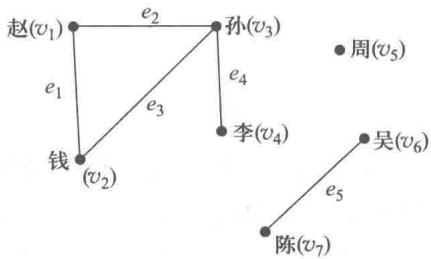

图11-1

字而不是用图来描述反映图11-1中七个人的关系,那么我们可能要费很多的口舌,花很多的笔墨,却不见得能达到图11-1的简单明了的效果.当然图论不仅仅要描述对象之间关系,还要研究特定关系之间的内在规律.在一般情况下图中点的相对位置如何和点与点之间连线的长短曲直,对于反映对象之间的关系并不重要.例如,对赵等七人的相互认识的关系我们也可以用图11-2来表示,可见图论的图与几何图、工程图是不一样的.

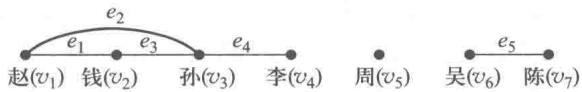

图11-2

如果我们把上面的例子中“相互认识”的关系改成“认识”的关系,那么只用两点的连线就很难刻画他们之间的关系了.例如,周认识赵,而赵却不认识周.这时我们可以引入一个带箭头的连线,称之为弧.图论中的弧,通常记为 $a_{i}$ ,对于周认识赵我们可以用一条箭头对着赵的弧来表示,图11-3就是一个反映另一种七人“认识”关系的图.

在图 11-3 中“相互认识”我们用两条反向的弧来表示.“A 认识 B”，我们用一条连接 A, B，箭头指向 B 的弧来表示.

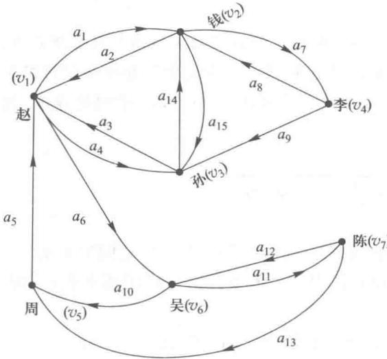

图11-3

我们把像图11-1和图11-2那样由点和边构成的图叫无向图（简称图），无向图记作为 $G = (V,E)$ ，其中 $V$ 是图 $G$ 的点集合， $E$ 是图 $G$ 的边集合；像图11-3那样由点和弧构成的图叫有向图，有向图记为 $D = (V,A)$ ，其中 $V$ 为图 $D$ 的点集合， $A$ 为图 $D$ 的弧集合。无向图是一种特殊的有向图，无向图的边实际就等价于两条反向的弧。

在无向图 G 中, 如果存在一个点、边的交错序列 $(v_{i_{1}}, e_{i_{1}}, v_{i_{2}}, e_{i_{2}}, \cdots, v_{i_{k-1}}, e_{i_{k-1}}, v_{i_{k}})$ , 其中 $v_{i_{t}}(t=1,2,\cdots,k)$ 都是图 G 的点, $e_{i_{t}}(t=1,2,\cdots,k-1)$ 都是图 G 的边, 并且边 $e_{i_{t}}$ 的始点为 $v_{i_{t}}$ , 终点为 $v_{i_{t+1}}$ , 记为 $e_{i_{t}}=(v_{i_{t}}, v_{i_{t+1}})$ , 则称这一点、边的交错序列为连接 $v_{i_{1}}$ 和 $v_{i_{k}}$ 的链, 记为 $(v_{i_{1}}, v_{i_{2}}, \cdots, v_{i_{k}})$ . 若 $v_{i_{1}} = v_{i_{k}}$ , 则称之为圈. 例如, 在图 11-1 中, $(v_{1}, v_{2}, v_{3})$ 就是一条链, 而 $(v_{1}, v_{2}, v_{3}, v_{1})$ 就是一个圈. 对一个无向图 G, 若任何两个不同的点之间, 至少存在一条链, 则称 G 是连通图.

在有向图 D 中, 如果存在一个点、弧的交错序列, $(v_{i_{1}}, a_{i_{1}}, v_{i_{2}}, a_{i_{2}}, \cdots, v_{i_{k-1}}, a_{i_{k-1}}, v_{i_{k}})$ , 其中 $v_{i_{t}}(t=1,2,\cdots,k)$ 都是图 G 的点, $a_{i_{t}}(t=1,2,\cdots,k-1)$ 都是图 G 的弧, 并有弧 $a_{i_{t}}$ 的始点为 $v_{i_{t}}$ , 终点为 $v_{i_{t+1}}$ , 记为 $a_{i_{t}}=(v_{i_{t}}, v_{i_{t+1}})$ , 则称这一点、弧的交错序列为从 $v_{i_{1}}$ 到 $v_{i_{k}}$ 的一条路, 记为 $(v_{i_{1}}, v_{i_{2}}, \cdots, v_{i_{k}})$ . 若路的第一个点和最后一点相同, 则称之为回路. 例如, 在图 11-3 中 $(v_{2}, v_{3}, v_{1}, v_{6}, v_{7}, v_{5})$ 就是从 $v_{2}$ 到 $v_{5}$ 的一条路, 而 $(v_{1}, v_{6}, v_{7}, v_{5}, v_{1})$ 就是一个回路.

对一个无向图 G 的每一条边 $(v_{i}, v_{j})$ ，如果相应的有一个数 $w_{ij}$ ，则称这样的图 G 为赋权图， $w_{ij}$ 称为边 $(v_{i}, v_{j})$ 上的权.

同样地对于有向图 $D$ 的每一条弧，如果相应有一个数 $c_{ij}$ ，也称这样的图 $D$ 为赋权图， $c_{ij}$ 称为弧 $(v_i, v_j)$ 上的权.

我们在赋权的有向图 D 中指定了一点，称为发点（记为 $v_{s}$ ），指定另一点为收点（记为 $v_{t}$ ），其余的点称为中间点，并把 D 中的每一条弧的赋权数 $c_{ij}$ 称为弧 $(v_{i}, v_{j})$ 的容量，这样的赋权有向图 D 就称为网络.

## 11.2 最短路问题

最短路问题是对一个赋权的有向图 D(其赋权根据具体问题的要求可以是路程的长度、成本的花费等)中的指定的两个点 $v_{s}$ 和 $v_{t}$ 找到一条从 $v_{s}$ 到 $v_{t}$ 的路, 使得这条路上所有弧的权数的总和最小, 这条路被称为从 $v_{s}$ 到 $v_{t}$ 的最短路, 这条路上所有弧的权数的总和被称为从 $v_{s}$ 到 $v_{t}$ 的距离.

在第十章我们用动态规划的方法解决了一个赋权无向图的最短路的问题.现在我们用图和网络的方法来解决一般的最短路的问题.

### 一、求解最短路的 Dijkstra 算法

Dijkstra算法适用于每条弧的赋权数 $c_{ij}$ 都大于等于零的情况，Dijkstra算法也称为双标号法.所谓双标号，也就是对图中的点 $v_{j}$ 赋予两个标号 $(l_j,k_j)$ ，第一个标号 $l_{j}$ 表示从起点 $v_{s}$ 到 $v_{j}$ 的最短路的长度，第二个标号 $k_{j}$ 表示在 $v_{s}$ 至 $v_{j}$ 的最短路上 $v_{j}$ 前面一个邻点的下标，从而找到 $v_{s}$ 到 $v_{t}$ 的最短路及 $v_{s}$ 与 $v_{t}$ 的距离.

现在给出此算法的基本步骤.

（1）给起点 $v_{1}$ 以标号 $(0,s)$ ，表示从 $v_{1}$ 到 $v_{1}$ 的距离为 $0, v_{1}$ 为起点.

（2）找出已标号的点的集合 $I$ ，没标号的点的集合 $J$ ，以及弧的集合 $\{(v_i,v_j)\mid v_i\in I,v_j\in J\}$ ，这里这个弧的集合是指所有从已标号的点到未标号的点的弧的集合.

（3）如果上述弧的集合是空集，则计算结束.如果 $v_{t}$ 已标号 $(l_t,k_t)$ ，则 $v_{s}$ 到 $v_{t}$ 的距离即为 $l_{t}$ 而从 $v_{s}$ 到 $v_{t}$ 的最短路径，则可以从 $v_{t}$ 反向追踪到起点 $v_{s}$ 而得到.如果 $v_{t}$ 未标号，则可以断言不存在从 $v_{s}$ 到 $v_{t}$ 的有向路.

如果上述的弧的集合不是空集,转下一步.

(4) 对上述弧的集合中的每一条弧, 计算

$$
s _ {i j} = l _ {i} + c _ {i j}.
$$

在所有的 $s_{ij}$ 中, 找到其值为最小的弧, 不妨设此弧为 $(v_{c}, v_{d})$ , 则给此弧的终点以双标号 $(s_{cd}, c)$ , 返回步骤(2).

若在步骤(4)中,使得 $s_{ij}$ 值为最小的弧有多条,则这些弧的终点既可以任选一个标定,也可以都予以标定,若这些弧中的有些弧的终点为同一点,则此点应有多个双标号,以便最后可找到多条最短途径.

例 1 求图 11-4 中 $v_{1}$ 到 $v_{6}$ 的最短路.

解（1）给起始点 $v_{1}$ 标以 $(0,s)$ ，表示从 $v_{1}$ 到 $v_{1}$ 的距离为 $0, v_{1}$ 为起始点.

（2）这时已标定点集合 $I = \{v_{1}\}$ ，未标定点的集合 $J = \{v_{2}, v_{3}, v_{4}, v_{5}, v_{6}\}$ ，弧集合 $\{(v_{i}, v_{j}) \mid v_{i} \in I, v_{j} \in J\} = \{(v_{1}, v_{2}), (v_{1}, v_{3}), (v_{1}, v_{4})\}$ ，并有

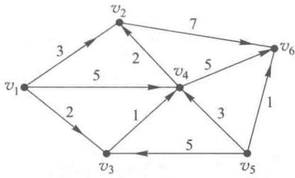

$$
\begin{array}{r l} & s _ {1 2} = l _ {1} + c _ {1 2} = 0 + 3 = 3, \\ & s _ {1 3} = l _ {1} + c _ {1 3} = 0 + 2 = 2, \\ & s _ {1 4} = l _ {1} + c _ {1 4} = 0 + 5 = 5, \\ & \min (s _ {1 2}, s _ {1 3}, s _ {1 4}) = s _ {1 3} = 2. \end{array}
$$

图11-4

这样我们给弧 $(v_{1},v_{3})$ 的终点 $v_{3}$ 标以(2,1)，表示从 $v_{1}$ 到 $v_{3}$ 的距离为2，并且在 $v_{1}$ 到 $v_{3}$ 的最短路径中 $v_{3}$ 的前面一个点是 $v_{1}$ .

（3）这时 $I = \{v_{1}, v_{3}\}, J = \{v_{2}, v_{4}, v_{5}, v_{6}\}$ ，弧集合 $\{(v_{i}, v_{j}) \mid v_{i} \in I, v_{j} \in J\} = \{(v_{1}, v_{2}), (v_{1}, v_{4}), (v_{3}, v_{4})\}$ ，并有

$$
\begin{array}{r l} & s _ {3 4} = l _ {3} + c _ {3 4} = 2 + 1 = 3. \\ & \min (s _ {1 2}, s _ {1 4}, s _ {3 4}) = s _ {1 2} = s _ {3 4} = 3. \end{array}
$$

这样我们给弧 $(v_{1}, v_{2})$ 的终点 $v_{2}$ 标以(3,1)，表示从 $v_{1}$ 到 $v_{2}$ 的距离为3，并且在 $v_{1}$ 到 $v_{2}$ 的最短路径中 $v_{2}$ 的前面的一个点是 $v_{1}$ ；我们给弧 $(v_{3}, v_{4})$ 的终点 $v_{4}$ 标以(3,3)，表示从 $v_{1}$ 到 $v_{4}$ 的距离为3，并且在 $v_{1}$ 到 $v_{4}$ 的最短路径中 $v_{4}$ 的前面的一个点是 $v_{3}$ .

（4）这时 $I = \{v_{1}, v_{2}, v_{3}, v_{4}\}, J = \{v_{5}, v_{6}\}$ ，弧集合 $\{(v_{i}, v_{j}) \mid v_{i} \in I, v_{j} \in J\} = \{(v_{2}, v_{6}), (v_{4}, v_{6})\}$ ，并有

$$
\begin{array}{r l} & s _ {2 6} = l _ {2} + c _ {2 6} = 3 + 7 = 10, \\ & s _ {4 6} = l _ {4} + c _ {4 6} = 3 + 5 = 8, \\ & \min (s _ {2 6}, s _ {4 6}) = s _ {4 6} = 8. \end{array}
$$

这样给点 $v_{6}$ 标以 (8,4)，表示从 $v_{1}$ 到 $v_{6}$ 的距离是 8，并且在 $v_{1}$ 到 $v_{6}$ 的最短路径中 $v_{6}$ 的前面的一个点是 $v_{4}$ .

(5) 这时 $I = \{v_{1}, v_{2}, v_{3}, v_{4}, v_{6}\}$ , $J = \{v_{5}\}$ ，弧集合 $\{(v_{i}, v_{j}) \mid v_{i} \in I, v_{j} \in J\} = \varnothing$ ，计算结束.

此时 $J = \{v_{5}\}$ ，也即 $v_{5}$ 还未标号，说明从 $v_{1}$ 到 $v_{5}$ 没有有向路.

(6) 得到了一族最优结果.

根据终点 $v_{6}$ 的标号(8,4) 可知从 $v_{1}$ 到 $v_{6}$ 的距离是 8，其最短路径中 $v_{6}$ 的前面一点是 $v_{4}$ ，从 $v_{4}$ 的标号(3,3) 可知 $v_{4}$ 的前面一点是 $v_{3}$ ，从 $v_{3}$ 的标号(2,1) 可知 $v_{3}$ 的前面一点为 $v_{1}$ ，即此最短路径为 $v_{1} \rightarrow v_{3} \rightarrow v_{4} \rightarrow v_{6}$ .

同样,我们可以从各点 $v_{i}$ 的标号得到 $v_{1}$ 至 $v_{i}$ 的距离及 $v_{1}$ 至 $v_{i}$ 的最短路径,由于 $v_{5}$ 没能标号,所以不存在从 $v_{1}$ 到 $v_{5}$ 的有向路,例1的各点的标号见图11-5.

### 二、最短路问题的应用

例 2 电信公司准备在甲、乙两地沿路架设一条光缆线,问如何架设使其光缆线路最短?图11-6给出了甲、乙两地间的交通图,图中的点 $v_{1},v_{2},\cdots,v_{7}$ 表示7个地名,其中 $v_{1}$ 表示甲地, $v_{7}$ 表示乙地,点之间的连线(边)表示两地之间的公路,边所赋的权数表示两地间公路的长度(单位为km).

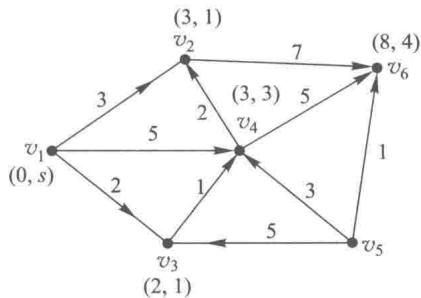

图11-5

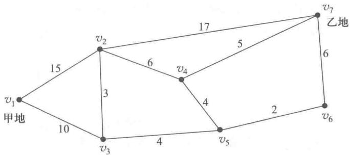

图11-6

解 因为公路的长度与行走的方向无关.例如,不管你是从 $v_{1}$ 走到 $v_{2}$ , 还是从 $v_{2}$ 走到 $v_{1}, v_{1}, v_{2}$ 之间的长度都是 15, 所以这是一个求无向图的最短路的问题. 如果我们把无向图的每一边 $(v_{i}, v_{j})$ 都用方向相反的两条弧 $(v_{i}, v_{j})$ 和 $(v_{j}, v_{i})$ 代替, 就把无向图化成有向图, 即可用 Dijkstra 算法来求解. 其实我们可以直接在无向图上用 Dijkstra 算法来求解. 只要在算法中把从已标号的点到未标号的点的弧的集合改成已标号的点到未标号的点的边的集合即可, 注意弧是有方向的, 而边是无方向的.

(1) 给起始点 $v_{1}$ 标号为 $(0, s)$ .

(2) $I = \{v_1\}, J = \{v_2, v_3, v_4, v_5, v_6, v_7\}$ .

边的集合 $\{[v_i,v_j]\mid v_i,v_j$ 两点中一点属于 $I$ ，而另一点属于 $J\} = \{[v_1,v_2],[v_1,v_3]\}$ ，并有

$$
\begin{array}{r l} & s _ {1 2} = l _ {1} + c _ {1 2} = 0 + 15 = 15, \\ & s _ {1 3} = l _ {1} + c _ {1 3} = 0 + 10 = 10, \\ & \min (s _ {1 2}, s _ {1 3}) = s _ {1 3} = 10. \end{array}
$$

给边 $\left[v_{1},v_{3}\right]$ 中的未标号的点 $v_{3}$ 标以(10,1)表示从 $v_{1}$ 到 $v_{3}$ 的距离为10，并且在 $v_{1}$ 到 $v_{3}$ 的最短路径上 $v_{3}$ 的前面的点为 $v_{1}$ .

(3) 这时 $I = \{v_{1}, v_{3}\}$ , $J = \{v_{2}, v_{4}, v_{5}, v_{6}, v_{7}\}$ .

边集合 $\left\{\left[v_{i},v_{j}\right]\mid v_{i},v_{j}\right.$ 中一点属于 I，另一点属于 $J\}=\left\{\left[v_{1},v_{2}\right],\left[v_{3},v_{2}\right],\left[v_{3},v_{5}\right]\right\}$ ，并有

$$
\begin{array}{r l} & s _ {3 2} = l _ {3} + c _ {3 2} = 10 + 3 = 13, \\ & s _ {3 5} = l _ {3} + c _ {3 5} = 10 + 4 = 14, \\ & \min (s _ {1 2}, s _ {3 2}, s _ {3 5}) = s _ {3 2} = 13. \end{array}
$$

给边 $\left[v_{3},v_{2}\right]$ 中未标号的点 $v_{2}$ 标以(13,3).

(4) 这时 $I = \{v_{1}, v_{3}, v_{2}\}$ , $J = \{v_{4}, v_{5}, v_{6}, v_{7}\}$ .

边集合 $\{[v_i,v_j]\mid v_i,v_j$ 中一点属于 $I$ ，另一点属于 $J\} = \{[v_3,v_5],[v_2,v_4],[v_2,v_7]\}$ ，并有

$$
s _ {2 4} = l _ {2} + c _ {2 4} = 13 + 6 = 19,
$$

$$
s _ {2 7} = l _ {2} + c _ {2 7} = 13 + 17 = 30,
$$

$$
\min (s _ {3 5}, s _ {2 4}, s _ {2 7}) = s _ {3 5} = 14.
$$

给边 $\left[v_{3},v_{5}\right]$ 中未标号的点 $v_{5}$ 标以(14,3).

(5) 这时 $I = \{v_{1}, v_{2}, v_{3}, v_{5}\}$ , $J = \{v_{4}, v_{6}, v_{7}\}$ .

边集合 $\{[v_i,v_j]\mid v_i,v_j$ 中一点属于 $I$ ，另一点属于 $J\} = \{[v_2,v_4],[v_5,v_4],[v_2,v_7][v_5,v_6]\}$ ，并有

$$
\begin{array}{r l} & s _ {5 4} = l _ {5} + c _ {5 4} = 14 + 4 = 18, \\ & s _ {5 6} = l _ {5} + c _ {5 6} = 14 + 2 = 16, \\ & \min (s _ {2 4}, s _ {5 4}, s _ {2 7}, s _ {5 6}) = s _ {5 6} = 16. \end{array}
$$

给边 $\left[v_{5},v_{6}\right]$ 中未标号的点 $v_{6}$ 标以(16,5).

(6) 这时 $I = \{v_{1}, v_{2}, v_{3}, v_{5}, v_{6}\}$ , $J = \{v_{4}, v_{7}\}$ .

边集合 $\{[v_i,v_j]\mid v_i,v_j$ 中一点属于 $I$ ，另一点属于 $J\} = \{[v_2,v_4],[v_2,v_7],[v_5,v_4],[v_6,v_7]\}$ 并有

$$
\begin{array}{r l} & s _ {6 7} = l _ {6} + c _ {6 7} = 16 + 6 = 22, \\ & \min (s _ {2 4}, s _ {2 7}, s _ {5 4}, s _ {6 7}) = s _ {5 4} = 18. \end{array}
$$

给边 $\left[v_{5},v_{4}\right]$ 中未标号的点 $v_{4}$ 标以(18,5).

(7) 这时 $I = \{v_{1}, v_{2}, v_{3}, v_{4}, v_{5}, v_{6}\}$ , $J = \{v_{7}\}$ .

边集合 $\{[v_i,v_j]\mid v_i,v_j$ 中一点属于 $I$ ，另一点属于 $J\} = \{[v_2,v_7],[v_4,v_7],[v_6,v_7]\}$ ，并有

$$
s _ {4 7} = l _ {4} + c _ {4 7} = 18 + 5 = 23,
$$

$$
\min (s _ {2 7}, s _ {4 7}, s _ {6 7}) = s _ {6 7} = 22.
$$

给边 $\left[v_{6},v_{7}\right]$ 中未标号的点 $v_{7}$ 标以(22,6).

(8) 此时 $I = \{v_{1}, v_{2}, v_{3}, v_{4}, v_{5}, v_{6}, v_{7}\}$ , $J = \varnothing$ .

边集合 $\{[v_i, v_j] \mid v_i, v_j$ 中一个属于 $I$ , 另一个属于 $J\} = \emptyset$ , 计算结束.

(9) 得到最短路.

从 $v_{7}$ 的标号(22,6)，可知从 $v_{1}$ 到 $v_{7}$ 的最短距离为 $22\mathrm{km}$ ，其最短路径中 $v_{7}$ 的前一点为 $v_{6}$ ，从 $v_{6}$ 的标号(16,5)可知 $v_{6}$ 的前一点为 $v_{5}$ ，从 $v_{5}$ 的标号(14,3)可知 $v_{5}$ 的前一点为 $v_{3}$ ，从 $v_{3}$ 的标号(10,1)可知 $v_{3}$ 的前一点为 $v_{1}$ ，即其最短路径为 $v_{1} \rightarrow v_{3} \rightarrow v_{5} \rightarrow v_{6} \rightarrow v_{7}$ . 此例题的每点的标号见图11-7.

实际中我们还可以从各点的标号找到 $v_{1}$ 到各点的距离，以及从 $v_{1}$ 到各点最短路径.例如，从 $v_{4}$ 的标号(18,5)可知 $v_{1}$ 到 $v_{4}$ 的距离为18，并可找到 $v_{1}$ 到 $v_{4}$ 的最短路径为 $v_{1}\rightarrow v_{3}\rightarrow v_{5}\rightarrow v_{4}$

例 3 设备更新问题. 某公司使用一台设备, 在每年年初, 公司就要决定是购买新的设备还是继续使用旧设备. 如果购置新设备, 就要支付一定的购置费, 当然新设备的维修费用就低. 如果继续使用旧设备,这样可以省去了购置费,但维修费用就高了.现在需要我们制定一个五年之内的更新设备的计划,使得五年内购置费和维修费总的支付费用最小.这种设备每年年初的价格如表11-1所示.

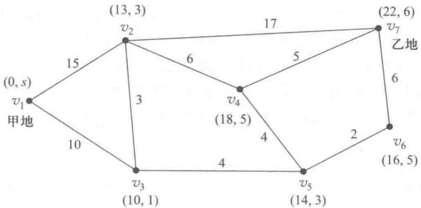

图11-7

表11-1

<table><tr><td>年份</td><td>1</td><td>2</td><td>3</td><td>4</td><td>5</td></tr><tr><td>年初价格</td><td>11</td><td>11</td><td>12</td><td>12</td><td>13</td></tr></table>

还已知使用不同时间(年)的设备所需要的维修费如表11-2所示.

表11-2

<table><tr><td>使用年数</td><td>0~1</td><td>1~2</td><td>2~3</td><td>3~4</td><td>4~5</td></tr><tr><td>每年维修费用</td><td>5</td><td>6</td><td>8</td><td>11</td><td>18</td></tr></table>

解 我们可以把求得总费用最少的设备更新计划问题,化为最短路的问题.用点 $v_{i}$ 表示“第i年年初购进一台新设备”,我们加设了 $v_{6}$ 点可以理解为第5年年底,从 $v_{i}$ 到 $v_{i+1},\cdots,v_{6}$ 各画一条弧,弧 $(v_{i},v_{j})$ 表示在第i年年初购进的设备一直使用到第j年年初,即第j-1年年底.此最短路问题如图11-8所示.

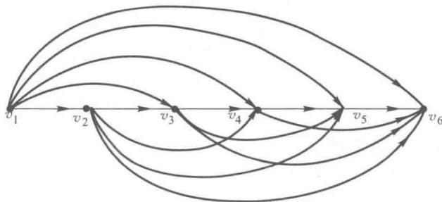

图11-8

下面我们将对图11-8中的每条弧赋予权数.对于弧 $(v_{i},v_{j})$ ，它的权数即为从第 $i$ 年年初购进设备使用到第 $j - 1$ 年年底所花费的购置费及维修费的总和.例如，弧 $(v_{2},v_{3})$ 的权数应为第2年年初购置设备的价格11与从第2年年初到第2年年底一年的维修费用5（因为设备使用年数在 $0\sim 1$ 之间）之和，应为16.而弧 $(v_{1},v_{6})$ 的权数应为第1年年初购置设备的费用11与从第1年初到第5年年底5年的维修费 $5 + 6 + 8 + 11 + 18 = 48$ ，应为59.我们把所有的弧 $(v_{i},v_{j})$ 的权数 $c_{ij}$ 计算出来，如表11-3所示.

表11-3

<table><tr><td> \(i\) \ \(c_{ij}\)  \(j\) </td><td>1</td><td>2</td><td>3</td><td>4</td><td>5</td><td>6</td></tr><tr><td>1</td><td>—</td><td>16</td><td>22</td><td>30</td><td>41</td><td>59</td></tr><tr><td>2</td><td>—</td><td>—</td><td>16</td><td>22</td><td>30</td><td>41</td></tr><tr><td>3</td><td>—</td><td>—</td><td>—</td><td>17</td><td>23</td><td>31</td></tr><tr><td>4</td><td>—</td><td>—</td><td>—</td><td>—</td><td>17</td><td>23</td></tr><tr><td>5</td><td>—</td><td>—</td><td>—</td><td>—</td><td>—</td><td>18</td></tr><tr><td>6</td><td>—</td><td>—</td><td>—</td><td>—</td><td>—</td><td>—</td></tr></table>

我们把权数 $c_{ij}$ 赋到图11-8上，得到图11-9，这样我们只要在图11-9上，求出一条从 $v_{1}$ 到 $v_{6}$ 的最短路，就找到了5年之内总的支付费用最少的设备更新计划.

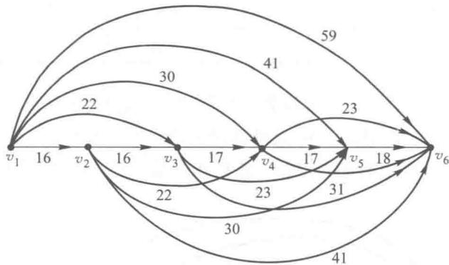

图11-9

我们用 Dijkstra 算法来求最短路.

(1) 给起始点 $v_{1}$ 标以 $(0, s)$ .

(2) 这时 $I = \{v_{1}\}, J = \{v_{2}, v_{3}, v_{4}, v_{5}, v_{6}\}$ .

弧集合 $\{(v_i, v_j) \mid v_i \in I, v_j \in J\} = \{(v_1, v_2), (v_1, v_3), (v_1, v_4), (v_1, v_5), (v_1, v_6)\}$ ，并有

$$
s _ {1 2} = l _ {1} + c _ {1 2} = 0 + 16 = 16,
$$

$$
s _ {1 3} = l _ {1} + c _ {1 3} = 0 + 22 = 22,
$$

$$
s _ {1 4} = l _ {1} + c _ {1 4} = 0 + 30 = 30,
$$

$$
s _ {1 5} = l _ {1} + c _ {1 5} = 0 + 41 = 41,
$$

$$
s _ {1 6} = l _ {1} + c _ {1 6} = 0 + 59 = 59,
$$

$$
\min (s _ {1 2}, s _ {1 3}, s _ {1 4}, s _ {1 5}, s _ {1 6}) = s _ {1 2} = 16.
$$

给弧 $(v_{1},v_{2})$ 的终点 $v_{2}$ 标以(16,1).

(3) 这时 $I = \{v_{1}, v_{2}\}$ , $J = \{v_{3}, v_{4}, v_{5}, v_{6}\}$ .

弧集合 $\{(v_i, v_j) \mid v_i \in I, v_j \in J\} = \{(v_1, v_3), (v_1, v_4), (v_1, v_5), (v_1, v_6), (v_2, v_3), (v_2, v_4), (v_2, v_5), (v_2, v_6)\}$ ，并有

$$
s _ {2 3} = l _ {2} + c _ {2 3} = 16 + 16 = 32,
$$

$$
s _ {2 4} = l _ {2} + c _ {2 4} = 16 + 22 = 38,
$$

$$
s _ {2 5} = l _ {2} + c _ {2 5} = 16 + 30 = 46,
$$

$$
s _ {2 6} = l _ {2} + c _ {2 6} = 16 + 41 = 57,
$$

$$
\min (s _ {1 3}, s _ {1 4}, s _ {1 5}, s _ {1 6}, s _ {2 3}, s _ {2 4}, s _ {2 5}, s _ {2 6}) = s _ {1 3} = 22.
$$

给弧 $(v_{1},v_{3})$ 的终点 $v_{3}$ 标以(22,1).

(4) 这时， $I = \{v_{1}, v_{2}, v_{3}\}$ ， $J = \{v_{4}, v_{5}, v_{6}\}$ .

弧集合 $\{(v_i, v_j) \mid v_i \in I, v_j \in J\} = \{(v_1, v_4), (v_1, v_5), (v_1, v_6), (v_2, v_4), (v_2, v_5), (v_2, v_6), (v_3, v_4), (v_3, v_5), (v_3, v_6)\}$ ，并有

$$
s _ {3 4} = l _ {3} + c _ {3 4} = 22 + 17 = 39,
$$

$$
s _ {3 5} = l _ {3} + c _ {3 5} = 22 + 23 = 45,
$$

$$
s _ {3 6} = l _ {3} + c _ {3 6} = 22 + 31 = 53,
$$

$$
\min \left(s _ {1 4}, s _ {1 5}, s _ {1 6}, s _ {2 4}, s _ {2 5}, s _ {2 6}, s _ {3 4}, s _ {3 5}, s _ {3 6}\right) = s _ {1 4} = 30.
$$

给弧 $(v_{1},v_{4})$ 的终点 $v_{4}$ 标以(30,1).

(5) 这时 $I = \{v_{1}, v_{2}, v_{3}, v_{4}\}$ , $J = \{v_{5}, v_{6}\}$ .

弧集合 $\{(v_i, v_j) \mid v_i \in I, v_j \in J\} = \{(v_1, v_5), (v_1, v_6), (v_2, v_5), (v_2, v_6), (v_3, v_5), (v_3, v_6), (v_4, v_5), (v_4, v_6)\}$ ，并有

$$
s _ {4 5} = l _ {4} + c _ {4 5} = 30 + 17 = 47,
$$

$$
s _ {4 6} = l _ {4} + c _ {4 6} = 30 + 23 = 53,
$$

$$
\min \left(s _ {1 5}, s _ {1 6}, s _ {2 5}, s _ {2 6}, s _ {3 5}, s _ {3 6}, s _ {4 5}, s _ {4 6}\right) = s _ {1 5} = 41.
$$

给弧 $(v_{1},v_{5})$ 的终点 $v_{5}$ 标以(41,1).

(6) 这时 $I = \{v_{1}, v_{2}, v_{3}, v_{4}, v_{5}\}$ , $J = \{v_{6}\}$ .

弧集合 $\{(v_i, v_j) \mid v_i \in I, v_j \in J\} = \{(v_1, v_6), (v_2, v_6), (v_3, v_6), (v_4, v_6), (v_5, v_6)\}$ ，并有

$$
s _ {5 6} = l _ {5} + c _ {5 6} = 41 + 18 = 59,
$$

$$
\min (s _ {1 6}, s _ {2 6}, s _ {3 6}, s _ {4 6}, s _ {5 6}) = s _ {3 6} = s _ {4 6} = 53.
$$

给弧 $(v_{3},v_{6})$ 和 $(v_{4},v_{6})$ 的终点 $v_{6}$ 标以(53,3)和(53,4)，得图11-10.

从图11-10,我们可知从 $v_{1}$ 到 $v_{6}$ 的距离为53,其最短路径有两条,一条为 $v_{1} \rightarrow v_{3} \rightarrow v_{6}$ ,另一条为 $v_{1} \rightarrow v_{4} \rightarrow v_{6}$ ,也就是说一个方案为第1年初的购置新设备使用到第2年年底(第3年年初),第3年年初再购置新设备使用到第5年年底(第6年年初).第二个方案为第1年年初购置新设备使用到第3年年底(第4年年初),第4年年初再购置新设备使用到第5年年底(第6年年初),这两个方案使得总的支付为最小,均为53.

“管理运筹学”软件有专门的子程序可以解决最短路问题.

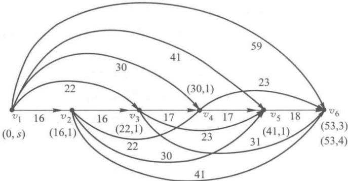

图11-10

## 11.3 最小生成树问题

树是图论中的一个重要概念,所谓树就是一个无圈的连通图,如图11-11中的(a)就是一个树,而(b)因为图中有圈 $(v_{3},v_{4},v_{5},v_{3})$ 所以(b)就不是树,(c)因为不连通所以也不是树.

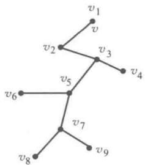
(a)

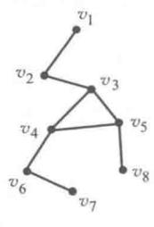
(b)

图11-11

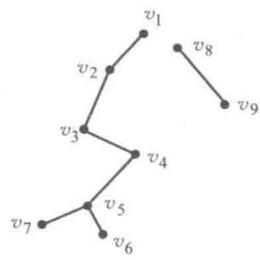
(c)

给了一个无向图 $G = (V, E)$ ，我们保留 $G$ 的所有点，而删掉部分 $G$ 的边或者说保留一部分 $G$ 的边，所获得图 $G$ ，称为 $G$ 的生成子图。在图11-12中（b）和（c）都是（a）的生成子图。

如果图 G 的一个生成子图还是一个树, 则称这个生成子图为生成树, 在图 11-12 中 (c) 就是

(a)的生成树.

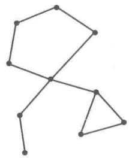
(a)

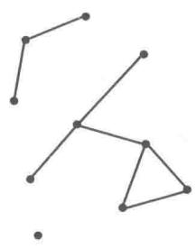
(b)

图11-12

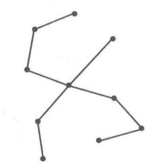
(c)

所谓最小生成树的问题就是在一个赋权的连通的无向图 G 找出一个生成树, 并使得这个生成树的所有边的权数之和为最小.

### 一、求解最小生成树的破圈算法

破圈算法的具体步骤如下：

（1） 在给定的赋权的连通图上任找一个圈.

（2）在所找的圈中去掉一条权数最大的边（如果有两条或两条以上的边都是权数最大的边，则任意去掉其中一条）.

（3）如果所余下的图已不含圈，则计算结束，所余下的图即为最小生成树.否则返回步骤(1).

例 4 用破圈算法在图 11-13(a) 中, 求一个最小生成树.

解（1）在 $G$ 中找到一个圈 $(v_{1}, v_{7}, v_{6}, v_{1})$ ，并知在此圈上边 $[v_{1}, v_{6}]$ 的权数 10 为最大，在 $G$ 中去掉边 $[v_{1}, v_{6}]$ 得图 $G_{1}$ ，如图 11-13(b) 所示.

（2）在 $G_{1}$ 中找到一个圈 $(v_{3}, v_{4}, v_{5}, v_{7}, v_{3})$ ，去掉其中权数最大的边 $[v_{4}, v_{5}]$ ，得图 $G_{2}$ 如图11-13(c)所示.

（3）在 $G_{2}$ 中找到一个圈 $(v_{2}, v_{3}, v_{5}, v_{7}, v_{2})$ ，去掉其中权数最大的边 $[v_{5}, v_{7}]$ ，得图 $G_{3}$ 如图11-13(d)所示.

（4）在 $G_{3}$ 中找到一个圈 $(v_{3}, v_{5}, v_{6}, v_{7}, v_{3})$ ，去掉其中权数最大的边 $[v_{5}, v_{6}]$ （也可以去掉边 $[v_{3}, v_{7}]$ ，这两个边的权数都为最大），得图 $G_{4}$ 如图 11-13(e) 所示.

（5）在 $G_{4}$ 中找到一个圈 $(v_{2}, v_{3}, v_{7}, v_{2})$ ，去掉其中权数最大的边 $[v_{3}, v_{7}]$ ，得到 $G_{5}$ 如图 11-13(f) 所示.

（6）在 $G_{5}$ 中已找不到任何一个圈了, 可知 $G_{5}$ 即为图 G 的最小生成树. 这个最小生成树的所有边的总权数为 $3+3+3+1+2+7=19$ .

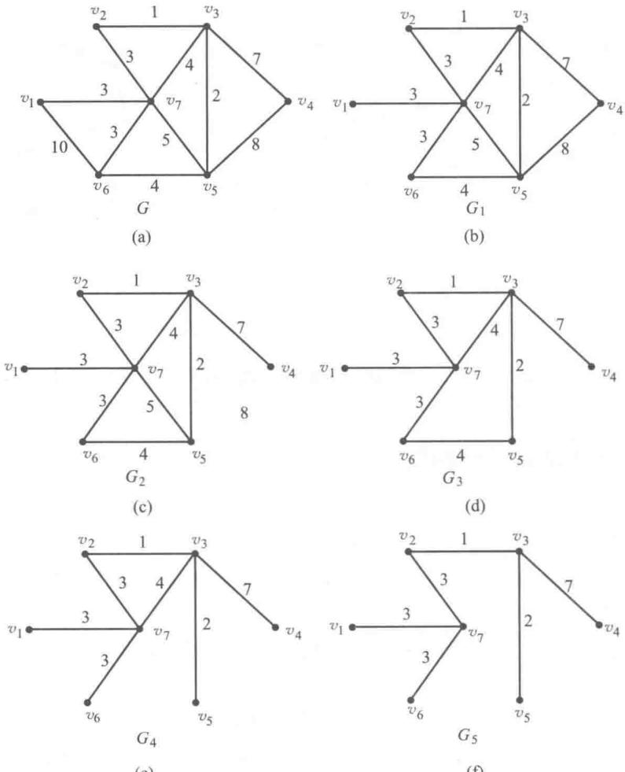
(e)
(f)

图11-13

### 二、应用举例

例 5 某大学准备对其所属的 7 个学院办公室计算机联网, 这个网络的可能联通的途径如图 11-14 所示, 图中 $v_{1}, \cdots, v_{7}$ 表示 7 个学院办公室, 图中的边为可能联网的途径, 边上的所赋的权数为这条路线的长度, 单位为百米. 请设计一个网络能联通 7 个学院办公室, 并使总的线路长度为最短.

解 此问题实际上是求图 11-14 的最小生成树, 这在例 4 中已经求得, 也即按照图 11-13 的 (f) 设计, 可使此网络的总的线路长度为最短, 为 19 百米.

“管理运筹学”软件有专门的子程序可以解决最小生成树的问题.

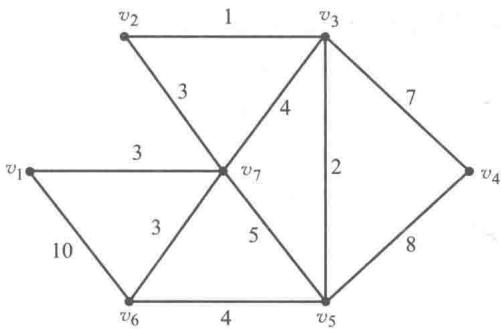

图11-14

## 11.4 最大流问题

许多系统中包含了流量问题,例如,公路系统中有车辆流,控制系统中有信息流,供水系统中有水流,金融系统中有现金流等.对于这样一些包含了流量问题的系统,我们往往要求出其系统的最大流量.例如,某公路系统容许通过的最多车辆数,某供水系统的最大水流量等,以便我们加深对某个系统的认识并加以改造.

所谓的最大流量问题就是:给了一个带收发点的网络,其每条弧的赋权称之为容量,在不超过每条弧的容量的前提下,求出从发点到收点的最大流量.

### 一、最大流的数学模型

例6 某石油公司拥有一个管道网络，使用这个网络可以把石油从采地运送到一些销售点，这个网络的一部分如图11-15所示.由于管道的直径的变化，它的各段管道 $(v_{i}, v_{j})$ 的流量（容量） $c_{ij}$ 也是不一样的，这在图11-15中已标出. $c_{ij}$ 的单位为万加仑/小时.如果使用这个网络系统从采地 $v_{1}$ 向销地 $v_{7}$ 运送石油，问每小时能运送多少加仑石油？

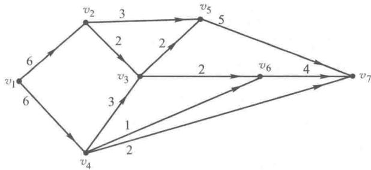

图11-15

解 这就是一个网络上最大流问题.而网络上最大流问题也是一个线性规划的问题,我们可以为此例题建立数学模型.

设弧 $(v_{i}, v_{j})$ 上的流量为 $f_{ij}$ ，网络上的总的流量为 $F$ ，则有

$$
max F = f _ {1 2} + f _ {1 4};
$$

约束条件：

$$
\begin{array}{l} f _ {1 2} = f _ {2 3} + f _ {2 5}, \\ f _ {1 4} = f _ {4 3} + f _ {4 6} + f _ {4 7}, \\ f _ {2 3} + f _ {4 3} = f _ {3 5} + f _ {3 6}, \\ f _ {2 5} + f _ {3 5} = f _ {5 7}, \\ f _ {3 6} + f _ {4 6} = f _ {6 7}, \\ f _ {5 7} + f _ {6 7} + f _ {4 7} = f _ {1 2} + f _ {1 4}, \\ f _ {i j} \leqslant c _ {i j} (i = 1, 2, \dots , 6; j = 2, \dots , 7), \\ f _ {i j} \geqslant 0 (i = 1, 2, \dots , 6; j = 2, \dots , 7). \end{array}
$$

在这个线性规划模型中，其约束条件中的前6个方程表示网络中的流量必须满足守恒条件，发点的总流出量必须等于收点的总流入量；其余的点称为中间点，它的总流入量必须等于总流出量。其后面几个约束条件表示对每一条弧 $(v_{i}, v_{j})$ 的流量 $f_{ij}$ 要满足流量的可行条件，应小于等于弧 $(v_{i}, v_{j})$ 的容量 $c_{ij}$ ，并大于等于零，即 $0 \leqslant f_{ij} \leqslant c_{ij}$ 。我们把满足守恒条件及流量可行条件的一组网络流 $\{f_{ij}\}$ 称为可行流（即线性规划模型的可行解），可行流中一组流量最大（即发点总流出量最大）的称为最大流（即线性规划的最优解）。

我们把例6的数据 $c_{ij}$ 代入以上线性规划模型，用“管理运筹学”软件，马上得到以下的结果： $f_{12} = 5, f_{14} = 5, f_{23} = 2, f_{25} = 3, f_{43} = 2, f_{46} = 1, f_{47} = 2, f_{35} = 2, f_{36} = 2, f_{57} = 5, f_{67} = 3.$ 最优值（最大流）为10.

### 二、最大流问题网络图论的解法

上面我们已经介绍了用线性规划的方法来求解最大流问题,现在我们来介绍网络图论的解法,这种解法更为直观.

1. 我们对网络上弧的容量的表示做一些改进. 对一条弧 $(v_{i}, v_{j})$ 的容量我们用一对数 $c_{ij}$ , 0 标在弧 $(v_{i}, v_{j})$ 上, $c_{ij}$ 靠近 $v_{i}$ 点, 0 靠近 $v_{j}$ 点表示从 $v_{i}$ 到 $v_{j}$ 容许通过的容量为 $c_{ij}$ , 而从 $v_{j}$ 到 $v_{i}$ 容许通过的容量为 0, 这样我们可能省去弧的方向了, 如图 11-16(b) 所示.

图 11-16(b) 与图 11-16(a) 表示的是相同的意思.

图11-16

对于存在两条相反的弧 $(v_{i}, v_{j})$ 和 $(v_{j}, v_{i})$ 我们也可以用一条边和一对数组 $c_{ij}, c_{ji}$ 来表示它们的容量，如图11-17(b)所示. 图11-17(b)与图11-17(a)表示的是相同的意思.

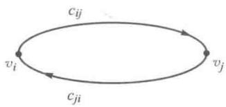
(a)

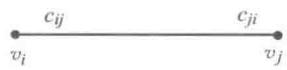
(b)

图11-17

下面我们用网络图论的方法来求解例 6, 按上述的方法对例 6 的图 11-15 的容量标号作改进, 得到图 11-18 所示.

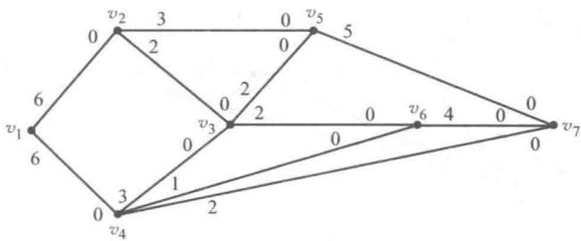

图11-18

2. 求最大流的基本算法.

在对弧的容量的表示作了改进的网络图上：

（1）找出一条从发点到收点的路，在这条路上的每一条弧顺流方向的容量都大于零.如果不存在这样的路，则已求得最大流.

（2） 找出这条路上各条弧的最小的顺流容量 $p_{f}$ ，通过这条路增加网络的流量 $p_{f}$

（3）在这条路上，减少每一条弧的顺流容量 $p_{f}$ ，同时增加这些弧的逆流容量 $p_{f}$ ，返回步骤（1）.

当然由于在步骤(1)中所选择的路不一样,计算过程也不一样,但最终所求得的最大流量应该是一样的,为了使算法更快捷有效,我们一般在步骤(1)中尽量选择包含弧数最少的路.

我们用此方法对例6求解如下：

第一次迭代：

选择路为 $v_{1} \rightarrow v_{4} \rightarrow v_{7}$ . 弧 $(v_{4}, v_{7})$ 的顺流容量为 2, 决定了 $p_{f} = 2$ , 改进的网络流量图如图 11-19 所示.

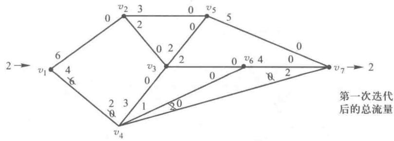

图11-19

第二次迭代：

选择路为 $v_{1} \rightarrow v_{2} \rightarrow v_{5} \rightarrow v_{7}$ ; 弧 $(v_{2}, v_{5})$ 的顺流容量 $c_{25} = 3$ , 决定了 $p_{f} = 3$ , 改进的网络流量图如图 11-20 所示.

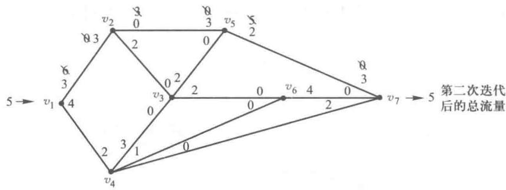

图11-20

第三次迭代：

选择路为 $v_{1} \rightarrow v_{4} \rightarrow v_{6} \rightarrow v_{7}$ ; 弧 $(v_{4}, v_{6})$ 的顺流容量 $c_{46} = 1$ , 决定了 $p_{f} = 1$ , 改进的网络流量图如图 11-21 所示.

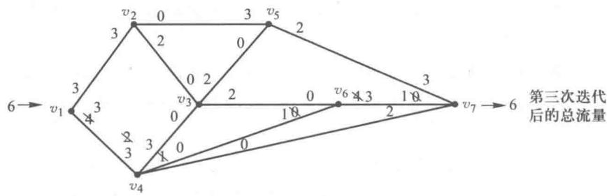

图11-21

第四次迭代：

选择路为 $v_{1} \rightarrow v_{4} \rightarrow v_{3} \rightarrow v_{6} \rightarrow v_{7}$ ; 弧 $(v_{3}, v_{6})$ 的顺流容量 $c_{36} = 2$ , 决定了 $p_{f} = 2$ , 改进的网络流量图如图 11-22 所示.

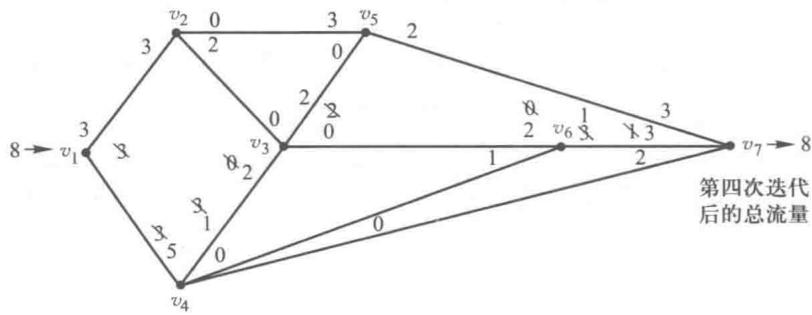

图11-22

第五次迭代：

选择路为 $v_{1} \rightarrow v_{2} \rightarrow v_{3} \rightarrow v_{5} \rightarrow v_{7}$ ; 弧 $(v_{2}, v_{3})$ 的顺流容量 $c_{23} = 2$ , 决定了 $p_{f} = 2$ , 改进的网络流量图如图 11-23 所示.

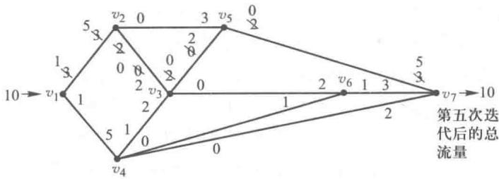

图11-23

通过第五次迭代后在图11-23中已找不到从发点到收点的一条路上的每一条弧顺流容量都大于零，运算停止.我们已得到此网络的从 $v_{1}$ 到 $v_{7}$ 的最大流量，最大流量为10，也就是从采地 $v_{1}$ 向销地 $v_{7}$ 每小时可运送10万加仑石油.具体的运送方案我们可以通过比较图11-18和图11-23即可得到.例如，在图11-18和图11-23中，弧 $(v_{1},v_{2})$ 的容量分别如图11-24中(a)和(b)所示.
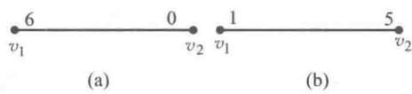

图11-24

万加仑石油.具体的运送方案我们可以通过比较图11-18和图11-23即可得到.例如，在图11-18和图11-23中，弧 $(v_{1},v_{2})$ 的容量分别如图11-24中(a)和(b)所示.

从中可知从 $v_{1}$ 到 $v_{2}$ 的顺流容量在第五次迭代后从 6 降为 1，也就是说从 $v_{1}$ 流向 $v_{2}$ 的流量为 6-1=5，这样我们就得到了例 6 的最大流量图如图 11-25 所示.

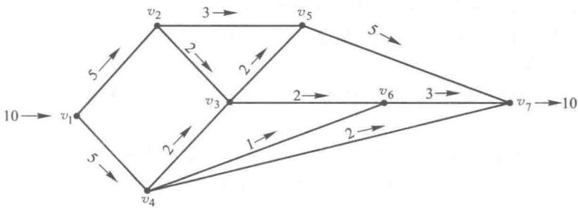

图11-25

“管理运筹学”软件中还有专门的子程序用于解决最大流问题.

## 11.5 最小费用最大流问题

在求解网络中最大流问题的时候,我们常常还考虑“费用”多少的问题.最小费用最大流问题就是这样的问题.

所谓最小费用最大流问题就是:给了一个带收发点的网络,对每一条弧 $(v_{i},v_{j})$ ,除了给出了容量 $c_{ij}$ 外,还给出了这条弧的单位流量的费用 $b_{ij}$ ,要求一个最大流F,并使得总运送费用最小.

### 一、最小费用最大流的数学模型

这个最小费用最大流也是一个线性规划的问题,为了说明问题,我们首先对例6的每一条弧 $(v_{i},v_{j})$ 给出一个单位流量的费用 $b_{ij}$ ,然后对它建立线性规划的模型.

例7 由于输油管道的长短不一，所以在例6中每段管道 $(v_{i}, v_{j})$ 除了有不同的流量限制 $c_{ij}$ 之外，还有不同的单位流量的费用 $b_{ij}, c_{ij}$ 的单位为万加仑/小时， $b_{ij}$ 的单位为百元/万加仑，对每段管道 $(v_{i}, v_{j})$ 我们都用 $(c_{ij}, b_{ij})$ 标出，如图11-26所示。如果使用这个网络系统从采地 $v_{1}$ 向销地 $v_{7}$ 运送石油，怎样运送才能运送最多的石油并使得总的运送费用最小？并求出其每小时的最大的流量及每小时的最大流量的最小费用。

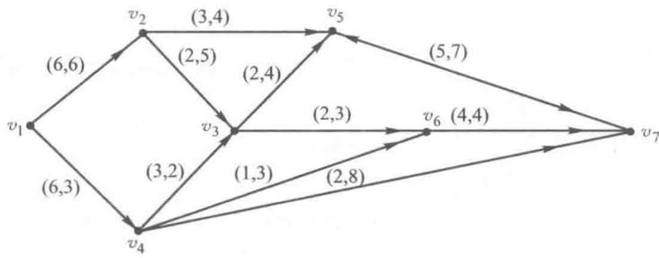

图11-26

解 我们用线性规划来求解此题,可以分两步走.

第一步:先求出此网络图中的最大流量 F, 这已在例 6 中建立了线性规划的模型, 通过“管理运筹学”软件已获得结果.

第二步: 在最大流量 F 的所有解中, 找出一个最小费用的解, 我们来建立第二步中的线性规划的模型.

仍然设弧 $(v_{i}, v_{j})$ 上的流量为 $f_{ij}$ ，这时已知网络上最大流量为 $F$ ，只要在例6的约束条件上，再加上总流量必须等于 $F$ 的约束条件： $f_{12} + f_{14} = F$ ，即得此线性规划的约束条件，此线性规划的目标显然是求其流量的最小费用 $\sum f_{ij} \cdot b_{ij}$ 。我们就得到线性规划模型如下：

$$
\min _ {(v _ {i} \cdot v _ {j}) \in A} z = f _ {i j} \cdot b _ {i j} = 6 f _ {1 2} + 3 f _ {1 4} + 4 f _ {2 5} + 5 f _ {2 3} + 2 f _ {4 3} + 4 f _ {3 5} + 7 f _ {5 7} + 3 f _ {3 6} + 3 f _ {4 6} + 8 f _ {4 7} + 4 f _ {6 7}.
$$

约束条件：

$$
\begin{array}{l} f _ {1 2} + f _ {1 4} = F = 10, \\ f _ {1 2} = f _ {2 3} + f _ {2 5}, \\ f _ {1 4} = f _ {4 3} + f _ {4 6} + f _ {4 7}, \\ f _ {2 3} + f _ {4 3} = f _ {3 5} + f _ {3 6}, \\ f _ {2 5} + f _ {3 5} = f _ {5 7}, \\ f _ {3 6} + f _ {4 6} = f _ {6 7}, \\ f _ {5 7} + f _ {6 7} + f _ {4 7} = f _ {1 2} + f _ {1 4}, \\ f _ {i j} \leqslant c _ {i j} (i = 1, 2, \dots , 6; j = 2, 3, \dots , 7), \\ f _ {i j} \geqslant 0 (i = 1, 2, \dots , 6; j = 2, 3, \dots , 7). \end{array}
$$

用“管理运筹学”软件，可求得如下结果： $f_{12}=4,f_{14}=6,f_{25}=3,f_{23}=1,f_{43}=3,f_{57}=5,f_{36}=2,f_{46}=1,f_{47}=2,f_{67}=3,f_{35}=2.$ 其最优值（最小费用）为145.对照前面例6的结果，可对最小费用最大流的概念有一个深刻的理解.

如果我们把例7的问题改为:每小时运送6万加仑的石油从采地 $v_{1}$ 到销地 $v_{7}$ 最小的费用是多少?应怎样运送,这就变成了一个最小费用流的问题.一般来说,所谓最小费用流的问题就是:在给定了收点及发点并对每条弧 $(v_{i},v_{j})$ 赋权以容量 $c_{ij}$ 及单位费用 $b_{ij}$ 的网络中,求一个给定值f的流量的最小费用,这个给定值f的流量应小于等于最大流量F,否则无解.求最小费用流的问题的线性规划的模型只要把最小费用最大流模型中的约束条件中的发点流量F改为f即可.在例7中只要把 $f_{12}+f_{14}=F$ 改为 $f_{12}+f_{14}=f=6$ 就能得到最小费用流的线性规划的模型了.

### 二、最小费用最大流的网络图论解法

我们所介绍的网络图论的解法类似于最大流的网络图论的解法.

1. 我们对网络上弧 $(v_{i}, v_{j})$ 的 $(c_{ij}, b_{ij})$ 的表示作如下的改进，在图11-27中我们用(b)来表示(a).

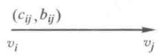
(a)

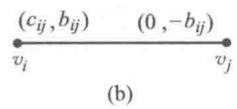

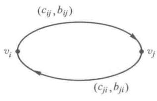
(c)

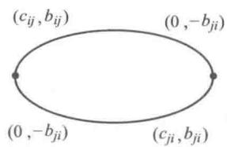
(d)

图11-27

用(d)来表示(c).(b)图中靠近 $v_{i}$ 点的双标号 $(c_{ij},b_{ij})$ 表示从 $v_{i}$ 到 $v_{j}$ 的容量为 $c_{ij}$ ，单位流量的费用为 $b_{ij}$ ；(b)图中靠近 $v_{j}$ 点的双标号 $(0,-b_{ij})$ 表示从 $v_{j}$ 到 $v_{i}$ 的容量为0，单位流量的费用为 $-b_{ij}$ ，在(d)图中我们用两条边来表示(c)图中的两条逆向的弧.用上述的方法对图11-26的弧的标号作改进得图11-28.

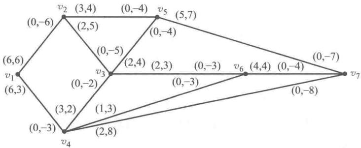

图11-28

2. 求最小费用最大流的基本算法.

在对弧的标号作了改进的网络图上求最小费用最大流的基本算法与求最大流的基本算法完全一样,不同的只是在步骤(1)中要选择一条总的单位费用最小的路,而不是包含边数最少的路.如果我们把每条弧的单位费用看成弧的长度,也就是要选择一条从发点到收点的最短路.

我们用此方法对例 7 求解如下：

第一次迭代：

找到最短路 $v_{1} \rightarrow v_{4} \rightarrow v_{6} \rightarrow v_{7}$ （找最短路过程省略），此路的总单位费用为 $3 + 3 + 4 = 10$ ，弧 $(v_{4}, v_{6})$ 顺流容量为1，决定了 $p_f = 1$ .改进的网络流量图如图11-29所示.

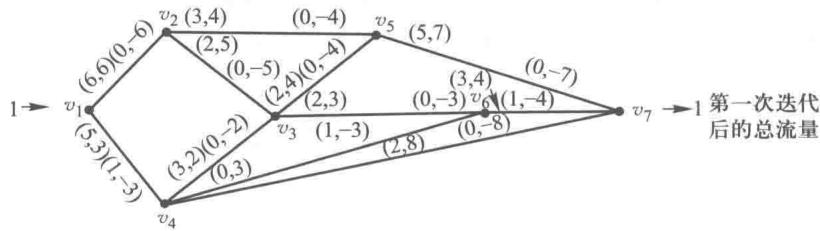

图11-29

第一次迭代后总流量为 1, 总的费用 $10 \times 1 = 10$ .

第二次迭代：

找到最短路 $v_{1} \rightarrow v_{4} \rightarrow v_{7}$ , 此路总单位费用为 $3 + 8 = 11$ , 弧 $(v_{4}, v_{7})$ 顺流容量为 2, 决定了 $p_{f} = 2$ , 改进的网络流量如图 11-30 所示.

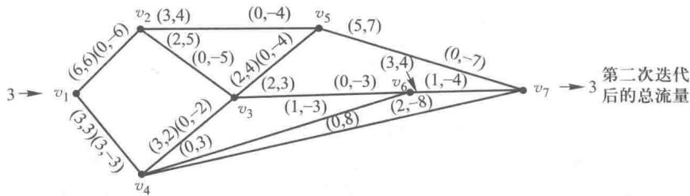

图11-30

第二次迭代后总流量为 3, 总的费用为 $10+11 \times 2 = 32$ .

第三次迭代：

找到最短路 $v_{1} \rightarrow v_{4} \rightarrow v_{3} \rightarrow v_{6} \rightarrow v_{7}$ ，此路的总的单位费用为 $3 + 2 + 3 + 4 = 12$ ，弧 $(v_{3}, v_{6})$ 的顺流容量为 2，决定了 $p_{f} = 2$ ，改进的网络流量如图 11-31 所示.

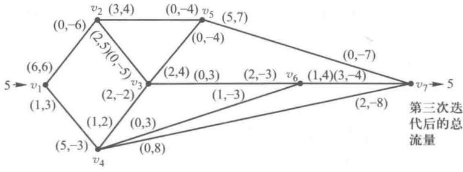

图11-31

第三次迭代后总流量为 5, 总的费用为 $32 + 12 \times 2 = 32 + 24 = 56$ .

第四次迭代：

找到最短路 $v_{1} \rightarrow v_{4} \rightarrow v_{3} \rightarrow v_{5} \rightarrow v_{7}$ ，此路的总的单位费用为 $3 + 2 + 4 + 7 = 16$ ，弧 $(v_{1}, v_{4})$ 的顺流容量为 1，决定了 $p_{f} = 1$ ，改进的网络流量如图 11-32 所示。

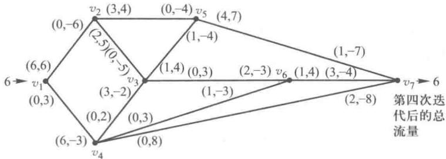

图11-32

第四次迭代后总流量为 6, 总的费用为 $56 + 16 \times 1 = 72$ .

第五次迭代：

找到最短路 $v_{1} \rightarrow v_{2} \rightarrow v_{5} \rightarrow v_{7}$ ，此路的总的单位费用为 $6 + 4 + 7 = 17$ ，弧 $(v_{2}, v_{5})$ 的顺流容量为 3，决定了 $p_{f} = 3$ ，改进的网络流量如图 11-33 所示.

第五次迭代后总流量为9,总的费用为 $72+3\times17=72+51=123$ .

第六次迭代：

找到最短路 $v_{1} \rightarrow v_{2} \rightarrow v_{3} \rightarrow v_{5} \rightarrow v_{7}$ , 此路的总的单位费用为 $6 + 5 + 4 + 7 = 22$ , 弧 $(v_{3}, v_{5})$ 的顺流容量为 1, 决定了 $p_{f} = 1$ , 改进了网络流量如图 11-34 所示.

第六次迭代后的总流量为10，总的费用为 $123 + 22 = 145.$ 因已找不到从 $v_{1}$ 到 $v_{7}$ 的每条弧容量都大于零的路了，故已求得最小费用最大流了.就像例6的方法一样，比较图11-28与图11-34 即得到其最小费用最大流的流量图如图 11-35 所示. 其总流量为 10, 即每小时最多运送 10 万加仑的石油, 而其最小的总费用为 145 百元, 这个最小费用也可以这样算得
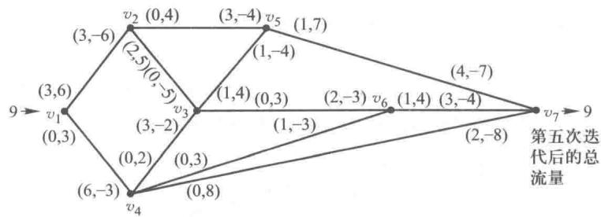

图11-33

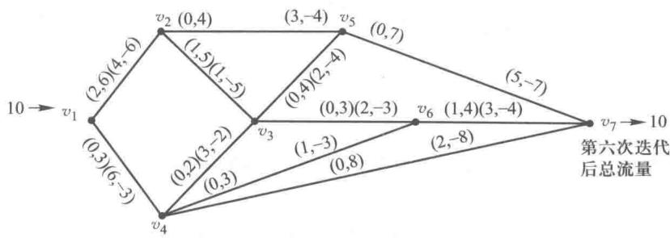

图11-34

11-34 即得到其最小费用最大流的流量图如图 11-35 所示. 其总流量为 10, 即每小时最多运送 10 万加仑的石油, 而其最小的总费用为 145 百元, 这个最小费用也可以这样算得

$$
6 \times 3 + 3 \times 2 + 1 \times 3 + 2 \times 8 + 4 \times 6 + 3 \times 4 + 1 \times 5 + 2 \times 4 \\ + 2 \times 4 + 2 \times 3 + 3 \times 4 + 5 \times 7 = 145.
$$

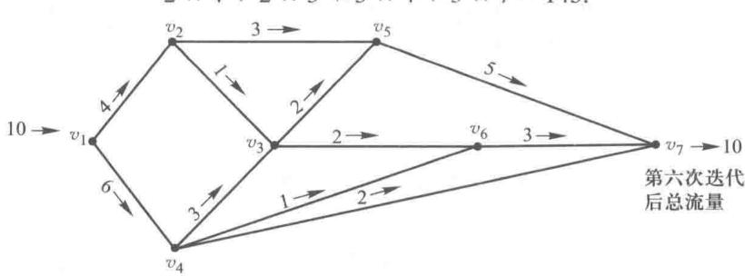

图11-35

如果对例7求一个最小费用流的问题:每小时运送6万加仑石油从 $v_{1}$ 到 $v_{7}$ 的最小费用是多少,或者每小时运送7万加仑呢?我们可以从第四次迭代及图11-32即可得到运送6万加仑最小费用为72百元,其运送方式通过比较图11-28及图11-32即得,如图11-36所示.

至于每小时送7万加仑,我们可以在图11-36的基础上,再按第五次迭代所选的最短路运送

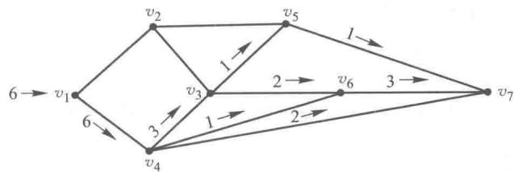

图11-36

1万加仑即得最小费用: $72+1\times17=89$ （百元），其运送方式如图11-37所示.

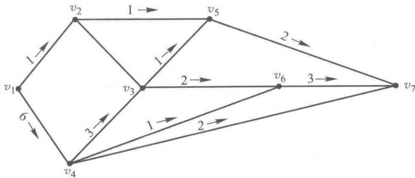

图11-37

“管理运筹学”软件有专门的子程序用于解决这类问题.

## 习题

1. 请判断下列说法是否正确：

(1) 树图中, 任意两个顶点间有且仅有一条链.

(2) 称无圈的连通图为树, 若图的顶点数为 P, 则边数为 P-1.

(3) 网络最短路径是指从网络的起点至终点的一条权和最小的路线.

(4) 若 G 中不存在流 f 增流链, 则 f 为 G 的最大流.

(5) 路的第一点和最后一点相同, 则称之为回路.

2. 用破圈法求图 11-38 中各图的最小生成树.

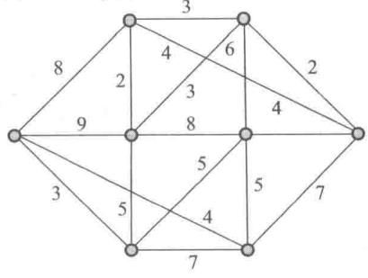
(a)

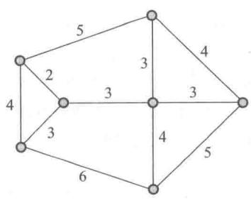

图11-38

(b)

3. 应用破圈法求图 11-39 的最小生成树.

4. 某一个配送中心要给一个快餐店送快餐原料，应按照什么路线送货才能使送货时间最短。图11-40给出了配送中心到快餐店的交通图，图中 $v_{1}, v_{2}, v_{3}, v_{4}, v_{5}, v_{6}, v_{7}$ 表示7个地名，其中 $v_{1}$ 表示配送中心， $v_{7}$ 表示快餐店，点之间的连线（边）表示两地之间的道路，边所赋的权数表示开车送原料通过这段道路所需要的时间（单位：分钟）。

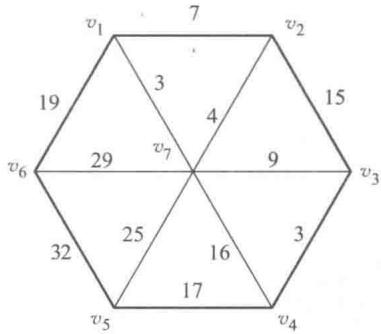

图11-39

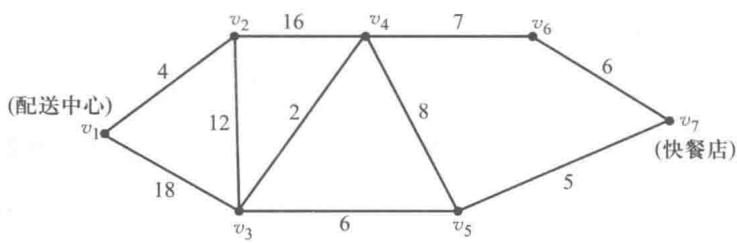

图11-40

5. 某厂商需要某种生产原料, 原料要经过 $v_{1}$ 运至 $v_{7}$ , 每一条线段旁边的数字表示两点之间的距离, 如图 11-41 所示. 如何设置路线, 才能使路线最短?

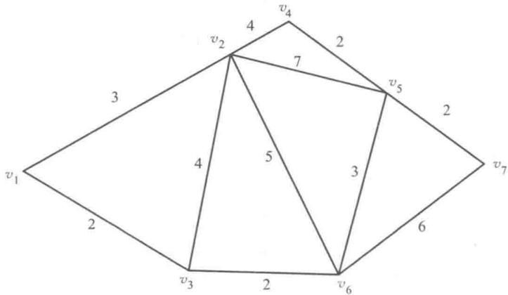

图11-41

6. 小李每天都要骑电动车去某办公大楼送午餐，起点为 $v_{1}$ ，终点为 $v_{7}$ 。图 11-42 中各条线段旁的数字为他骑电动车经过该路段所需要的时间（单位：小时），试问小李应该选择哪条路线，使送餐时间最短，并求出该值。

7. 某地区有自来水站 A, 向 11 个地区供水, 各地区位置如图 11-43 所示, 图中每条线旁边的数字表示铺设管道所需的费用, 如何设计铺设方案才能使费用最小?

8. 有 9 个小镇 $v_{1}, v_{2}, \cdots, v_{9}$ ，公路网如图 11-44 所示。弧旁数据为该段公路的长度。有运输队欲从 $v_{1}$ 到 $v_{9}$ 运货，问走哪条路最短。

9. 用 Dijkstra 方法求图 11-45 中 $v_{1}$ 到各点的最短距离.

10. $v_{1}$ 是某市邮局所在地， $v_{2} - v_{7}$ 是6个市辖小镇邮局网点，问邮递员从市邮局往返每个镇网点的最短距离是怎样的？用标号法求图11-46中 $v_{1}$ 到各点的最短距离.

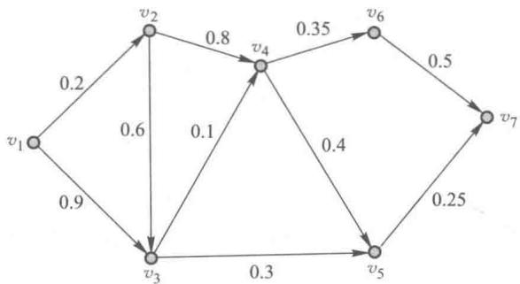

图11-42

图11-43

图11-44

图11-45

图11-46

11. 某台机器可连续工作 4 年, 也可于每年末卖掉, 换一台新的. 已知于各年初购置一台新机器的价格及不同役龄机器年末的处理价如表 11-4 所示. 又新机器第一年运行及维修费为 0.3 万元, 使用 1 至 3 年后的机器每年运行及维修费用分别为 0.8, 1.5, 2 万元. 请确定该机器的最优更新策略, 使 4 年内购买、更换、运行维修的总费用为最少.

表11-4
单位：万元

<table><tr><td></td><td>第一年</td><td>第二年</td><td>第三年</td><td>第四年</td></tr><tr><td>年初购置价</td><td>2.5</td><td>2.6</td><td>2.8</td><td>3.1</td></tr><tr><td>使用j年的机器处理价(即第j年末机器处理价)</td><td>2.0</td><td>1.6</td><td>1.3</td><td>1.1</td></tr></table>

12. 某机床生产厂有 A, B 2 个生产地和一, 二, 三 3 个销售地点, A, B 2 个产地的产量和 3 个销售地点的销量, 以及从 2 个产地到各个销售地点的单位运费如表 11-5 所示, 将此问题转化为最小费用最大流问题, 画出网络图并求解.

表11-5

<table><tr><td></td><td>一</td><td>二</td><td>三</td><td>产量</td></tr><tr><td>A</td><td>10</td><td>24</td><td>15</td><td>8</td></tr><tr><td>B</td><td>25</td><td>30</td><td>17</td><td>7</td></tr><tr><td>销量</td><td>4</td><td>5</td><td>6</td><td></td></tr></table>

13. 某电力公司要沿道路为 8 个居民点架设输电网络, 连接 8 个居民点的道路图如图 11-47 所示, 其中 $v_{1}, v_{2}, \cdots, v_{8}$ 表示 8 个居民点, 图中的边表示可架设输电网络的道路, 边上的赋权数为这条道路的长度, 单位为千米, 请设计一个输电网络, 联通这 8 个居民点, 并使总的输电线路长度为最短.

图11-47

14. 某地区的公路网如图 11-48 所示, 图中的 $v_{1}, v_{2}, \cdots, v_{6}$ 为地点, 边为公路, 边上所赋的权数为该段公路的流量(单位为千辆/小时), 请求出 $v_{1}$ 到 $v_{6}$ 的最大流量.

图11-48

15. 请求下面网络图中的最小费用最大流，图 11-49 中弧 $(v_{i}, v_{j})$ 的赋权为 $(c_{ij}, b_{ij})$ ，其中 $c_{ij}$ 为从 $v_{i}$ 到 $v_{j}$ 的流量， $b_{ij}$ 为从 $v_{i}$ 到 $v_{j}$ 的单位流量的费用。

图11-49

16. 某油田有 1,2,3 三个油井,4,5,6 三个泵站,7,8 两个脱水厂,他们的位置如图 11-50 所示,图中弧为管道,管道旁边的数字为通过的最大流量(吨/小时).求每小时从油井到脱水厂的最大输送量.

图11-50

## 案例 19: 某厂运输网络改善方案设计

A, B, C 为某公司下属三个分销商所在地. 已知三个分销商的产品分销量各为 40, 20, 10 个单位, 产品每天均需运往货仓 T. 现有的运输网络如图 11-51 所示, 箭线边的数字为相应运输线路的日运输能力. 经过一段时间的运行之后发现目前的运输网络不能保证每天将所有的产品及时运送到仓库. 试探讨发生这种情况的原因.

为了改善目前的运输状况,该公司计划新建一个仓库 I,并考虑开通 D→I,D→E,E→D 的单方向行驶运输线路(如图 11-51 中虚线所示).对于新开通的运输线路设计要求能够保证每天将所有的产品及时运送到仓库.试探讨单行道方向如何确定.

图11-51

---
