# 第12章 排序与统筹方法

在本章中,我们将介绍车间作业计划模型和统筹方法.这两个问题尽管处理的方法有所不同,但当我们面临必须完成若干项不能同时进行的工作时,它们都将帮助我们应该按照怎样的次序、怎样的时间表来做这些工作,使得效果最佳(如完成全部工作所用时间最短或费用最少等).

## 12.1 车间作业计划模型

车间作业计划是指一个工厂生产工序的计划和安排.作为一个工厂生产管理者,常常要处理一些各个零件在一些机床上加工的先后次序问题,能否在满足加工工艺流程(即各种机器加工零件的先后关系有具体要求)的前提下,通过各个零件在各台机床加工次序上的合理安排,使得完成这批零件加工任务所需的总时间最少,能最早地将这批零件交付使用,或者使得各加工零件在车间里停留的平均时间最短,在这里,各种零件在每台机器上加工的时间都是已知的.

### 一、一台机器、 $n$ 个零件的排序问题

例 1 某车间只有一台高精度的磨床,常常出现很多零件同时要求这台磨床加工的情况,现有六个零件同时要求加工,加工完即送往其他车间,这六个零件加工所需时间如表12-1所示.

表12-1

<table><tr><td>零件</td><td>加工时间/小时</td><td>零件</td><td>加工时间/小时</td></tr><tr><td>1</td><td>1.8</td><td>4</td><td>0.9</td></tr><tr><td>2</td><td>2.0</td><td>5</td><td>1.3</td></tr><tr><td>3</td><td>0.5</td><td>6</td><td>1.5</td></tr></table>

我们应该按照什么样的加工顺序来加工这六个零件,才能使得这六个零件在车间里停留的平均时间为最少?

解 首先我们知道不管我们按什么顺序来加工这六个零件都需要用 8 个小时才能加工完所有的零件.

其次,我们知道由于各个零件加工时间不同,不同的加工顺序,使得这六个零件在车间里的平均停留时间是不一样的.

按照某个加工顺序加工零件时,某个零件在车间的停留时间应该等于在它前面加工的各零件的加工时间与这一零件本身的加工时间之和.如果我们用 $P_{i}$ 表示安排在第 i 位加工的零件所需的时间,用 $T_{j}$ 表示安排在第 j 位加工的零件在车间里总的停留时间,则有

$$
T _ {j} = P _ {1} + P _ {2} + \dots + P _ {j - 1} + P _ {j} = \sum_ {i = 1} ^ {j} P _ {i}.
$$

这样我们可以计算出以先到先加工的原则按照 1,2,3,4,5,6 顺序加工零件,各零件在车间的停留时间如表 12-2 所示.

表12-2

<table><tr><td>零件</td><td>加工时间  \(P_{i}\) /小时</td><td>停留时间  \(T_{j}\) /小时</td><td>零件</td><td>加工时间  \(P_{i}\) /小时</td><td>停留时间  \(T_{j}\) /小时</td></tr><tr><td>1</td><td>1.8</td><td>1.8</td><td>4</td><td>0.9</td><td>5.2</td></tr><tr><td>2</td><td>2.0</td><td>3.8</td><td>5</td><td>1.3</td><td>6.5</td></tr><tr><td>3</td><td>0.5</td><td>4.3</td><td>6</td><td>1.5</td><td>8</td></tr></table>

按 1,2,3,4,5,6 顺序加工零件,各个零件平均停留时间为

$$
\frac {1 . 8 + 3 . 8 + 4 . 3 + 5 . 2 + 6 . 5 + 8}{6} \approx 4. 93 (\mathrm{h}).
$$

如果我们按照 3,2,4,5,6,1 顺序来加工零件,我们也可以计算出各零件在车间的停留时间如表 12-3 所示.

表12-3

<table><tr><td>零件</td><td>加工时间  \(P_{i}\) /小时</td><td>停留时间  \(T_{j}\) /小时</td><td>零件</td><td>加工时间  \(P_{i}\) /小时</td><td>停留时间  \(T_{j}\) /小时</td></tr><tr><td>3</td><td>0.5</td><td>0.5</td><td>5</td><td>1.3</td><td>4.7</td></tr><tr><td>2</td><td>2.0</td><td>2.5</td><td>6</td><td>1.5</td><td>6.2</td></tr><tr><td>4</td><td>0.9</td><td>3.4</td><td>1</td><td>1.8</td><td>8</td></tr></table>

这样各零件平均停留时间为

$$
\frac {0 . 5 + 2 . 5 + 3 . 4 + 4 . 7 + 6 . 2 + 8}{6} \approx 4. 22 (\mathrm{h}).
$$

不同的加工顺序得到不同的各零件的平均停留时间,如何得到一个加工顺序使得各零件的平均停留时间最少呢?这就是我们最后要解决的优化问题.

我们知道六个零件共有 $6! = 720$ 种不同的加工顺序，我们不能先求出这720种不同加工顺序的各零件平均停留时间，然后加以比较，最后选定一个最优顺序，因为这样做工作量太大了。我们得设法找到一种简便的算法。

对于某种加工顺序,我们知道安排在第j位加工的零件在车间里总的停留时间为 $T_{j}$ ,

$$
T _ {j} = \sum_ {i = 1} ^ {j} P _ {i}.
$$

可知这六个零件的停留时间为

$$
\begin{array}{r l} & T _ {1} + T _ {2} + T _ {3} + T _ {4} + T _ {5} + T _ {6} \\ & = P _ {1} + (P _ {1} + P _ {2}) + (P _ {1} + P _ {2} + P _ {3}) + (P _ {1} + P _ {2} + P _ {3} + P _ {4}) + \\ & (P _ {1} + P _ {2} + P _ {3} + P _ {4} + P _ {5}) + (P _ {1} + P _ {2} + P _ {3} + P _ {4} + P _ {5} + P _ {6}) \\ & = 6 P _ {1} + 5 P _ {2} + 4 P _ {3} + 3 P _ {4} + 2 P _ {5} + P _ {6}. \end{array}
$$

那么各个零件平均停留时间为

$$
\frac {6 P _ {1} + 5 P _ {2} + 4 P _ {3} + 3 P _ {4} + 2 P _ {5} + P _ {6}}{6}.
$$

要使各个零件平均停留时间为最少，只要 $6P_{1} + 5P_{2} + 4P_{3} + 3P_{4} + 2P_{5} + P_{6}$ 的值为最小即可，从上式可知只要系数越大，配上加工时间越少的 $P_{i}$ ，即按照加工时间排出加工顺序，加工时间越少的零件排在越前面，加工时间越多的零件排在越后面，也就是按照3,4,5,6,1,2的顺序来加工零件，可使各个零件的平均停留时间为最少。按3,4,5,6,1,2的顺序来加工零件，各个零件的停留时间如表12-4所示。

表12-4

<table><tr><td>零件</td><td>加工时间  \(P_{i}\) /小时</td><td>停留时间  \(T_{i}\) /小时</td><td>零件</td><td>加工时间  \(P_{i}\) /小时</td><td>停留时间  \(T_{i}\) /小时</td></tr><tr><td>3</td><td>0.5</td><td>0.5</td><td>6</td><td>1.5</td><td>4.2</td></tr><tr><td>4</td><td>0.9</td><td>1.4</td><td>1</td><td>1.8</td><td>6.0</td></tr><tr><td>5</td><td>1.3</td><td>2.7</td><td>2</td><td>2.0</td><td>8</td></tr></table>

各个零件平均停留时间为

$$
\frac {0 . 5 + 1 . 4 + 2 . 7 + 4 . 2 + 6 . 0 + 8 . 0}{6} = 3. 8 (\mathrm{h}).
$$

这与用“先到先加工”顺序所需平均停留时间4.93相比较，有很大的改进

对于一台机器 n 个零件的排序问题,我们按照加工时间从少到多排出加工零件的顺序就能使各个零件的平均停留时间为最少.

### 二、两台机器， $n$ 个零件

例 2 某工厂根据合同定做一些零件,这些零件要求先在车床上车削,然后再在磨床上加工,每台机器上各零件加工时间如表 12-5 所示.

表12-5
单位:小时

<table><tr><td>零件</td><td>车床</td><td>磨床</td><td>零件</td><td>车床</td><td>磨床</td></tr><tr><td>1</td><td>1.5</td><td>0.5</td><td>4</td><td>1.25</td><td>2.5</td></tr><tr><td>2</td><td>2.0</td><td>0.25</td><td>5</td><td>0.75</td><td>1.25</td></tr><tr><td>3</td><td>1.0</td><td>1.75</td><td></td><td></td><td></td></tr></table>

应该如何安排这五个零件的先后加工顺序才能使完成这五个零件的总的加工时间为最少？

解 由于每个零件必须先进行车床加工,再进行磨床加工,所以在车床上加工零件的顺序与在磨床上加工零件的顺序是一样的.

如果这些零件在车床上和磨床上的加工顺序都为 1,2,3,4,5. 我们用图 12-1 中的线条图来表示各零件加工的开始时间与完成时间, 这种图是由一根时间轴和车床、磨床在每个时刻的状况的图形所构成.

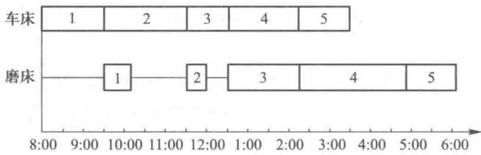

图12-1

从图中可知车床按 1,2,3,4,5 的顺序加工,零件从上午 8:00 起到 9:30 完成零件 1 的加工,紧接着开始加工零件 2 到 11:30 完成,紧接着加工零件 3 到了 12:30 完成……不间断地工作直至下午 2:30 完成所有零件的车削工作,而磨床只有在 9:30 零件 1 车削完之后才开始对零件 1 加工到 10:00 完成.之后停工待料直至 11:30 零件 2 车削完时又开始对零件 2 的磨床加工,在 11:45 时完成.又是停工待料到 12:30,零件 3 车削完时开始对零件 3 进行磨床加工,下午 2:15 完成,紧接着加工零件 4 于下午 4:45 完成,同时开始加工零件 5 于下午 6:00 完成,这样可知使用顺序 1,2,3,4,5 完成全部加工任务共需要 10 个小时(从上午 8:00 到下午 6:00).

如果我们可知按 5,3,2,1,4 顺序来加工零件,我们也可以画出其对应的线条图如图 12-2 所示.

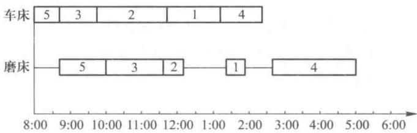

图12-2

从图 12-2 我们可知按 5,3,2,1,4 顺序加工零件, 总加工时间只需要 9 小时, 可见当若干零件必须在几台机器上加工时, 零件加工的顺序会影响到完成全部零件的加工所需的总时间.

如何来确定一种加工顺序,使得完成全部零件加工任务所需的总时间最少呢?

从上面两种加工顺序的线条图,我们知道加工时间的延长主要是由于第二台机器磨床的停工待料所造成的,只要减少磨床的停工待料的时间就能减少整个加工任务的总时间,为了减少磨床的停工待料,我们应该一方面把在车床上加工时间越短的零件越早加工,减少磨床等待的时间,另一方面把在磨床上加工时间越短的零件越晚加工,也就是说把在磨床上加工时间越长的零件越早加工,以便充分利用前面的时间,这样我们得到了使完成全部零件加工任务所需总时间最少的零件排序方法.

我们在表 12-5 中找到所列出的最短加工时间是 0.25, 它是第二道工序磨床加工零件 2 的所需时间, 由于这个时间与磨床有关, 故我们把零件 2 放在加工顺序的末尾, 并在表中划去零件 2 所在行. 如表 12-6 所示.

表12-6

<table><tr><td>零件</td><td>车床(第一工序)</td><td>磨床(第二工序)</td><td>零件</td><td>车床(第一工序)</td><td>磨床(第二工序)</td></tr><tr><td>1</td><td>1.5</td><td>0.5</td><td>4</td><td>1.25</td><td>2.5</td></tr><tr><td>2</td><td>2.0</td><td>0.25</td><td>5</td><td>0.75</td><td>1.25</td></tr><tr><td>3</td><td>1.0</td><td>1.75</td><td></td><td></td><td></td></tr></table>

零件加工顺序：

第一：

第二：

第三：

第四：

第五:零件2

接着,我们又找到最短加工时间为0.5,这一时间与磨床（第二工序）有关,我们把磨床加工时间为0.5的零件1放到除第五外的加工顺序的末尾,即第四位加工,同时把表中的零件1所在行划去.

下一个最短的加工时间为0.75，这个加工时间是车床（第一工序）加工零件5的所需时间，故我们把零件5排在加工顺序第一位上，并把零件5所在行划去，同样下一个最短加工时间为1，这是车床加工零件3的所用时间，故把零件3加工顺序尽早往前排，排到第二位上。并划去零件3所在行。如表12-7所示。

表12-7

<table><tr><td>零件</td><td>车床(第一工序)</td><td>磨床(第二工序)</td><td>零件</td><td>车床(第一工序)</td><td>磨床(第二工序)</td></tr><tr><td>1</td><td>1.5</td><td>0.5</td><td>4</td><td>1.25</td><td>2.5</td></tr><tr><td>2</td><td>2.0</td><td>0.25</td><td>5</td><td>0.75</td><td>1.25</td></tr><tr><td>3</td><td>1.0</td><td>1.75</td><td></td><td></td><td></td></tr></table>

零件加工顺序：

第一:零件5

第二:零件3

第三：

第四:零件1

第五:零件2

现在只剩下零件 4 没排序了, 显然零件 4 只能在第三位加工了.

这样我们得到了最优加工顺序 5,3,4,1,2,线条图 12-3 显示了各零件在车床与磨床的加工时间的安排.

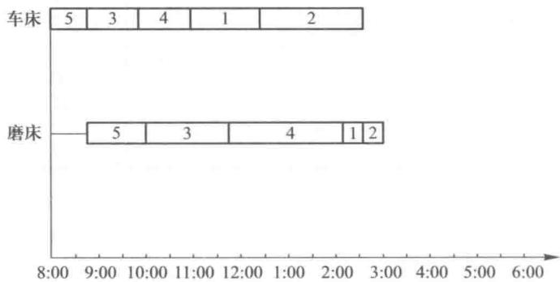

图12-3

这样一共只需7个小时就全部完成了所有零件的加工，比“先到先加工”的顺序1,2,3,4,5要提前3个小时完成任务.

从例 2 我们可以归纳出关于两台机器 n 个零件的排序问题, 使得全部任务的总时间最短的排序算法.

（1）在加工所需时间表上选出最短加工时间 $t_{ij}$ ，这是第 i 工序加工 j 零件所需时间。当 i=1 时，将零件 j 的加工顺序尽量靠前；若 i=2 时，将零件 j 的加工顺序尽量靠后。

(2) 在表上划去零件 j 的所在行, 回到步骤(1).

以上我们介绍了求解一台机器 $n$ 个零件和二台机器 $n$ 个零件的排序问题的算法. 在一般的车间作业计划问题中, 有 $m$ 台机器 $n$ 个零件, 我们一般找不到类似的有效的求解算法, 但我们可以用求解整数规划的方法加以解决, 读者可以参考有关文献\*, 本书不作详细介绍.

## 12.2 统筹方法

作为一个管理者,常常面临着一些复杂、大型的工程项目,这些工程项目涉及众多部门和单位的大量的独立的工作或活动,如何来编制计划、安排进度并进行有力的控制,这是管理的重要内容.

统筹方法是解决这些问题的强有力的工具.这种技术是在20世纪50年代末发展起来的，1956年美国杜邦公司为了协调企业不同业务部门的系统规划，应用网络方法制定了第一套网络计划，提出了关键路线方法(缩写为CPM).1958年，美国海军武装部在研制“北极星”导弹计划时，针对“北极星”导弹项目中很多工作或活动都是第一次尝试，其完成工作或活动的时间无经验数据可循的特点提出了图解评审法(缩写为PERT)，由于CPM与PERT既有着相同的目标与应用，又有很多相同的术语，这两个方法已合并为一种方法，在国外称之为PERT/CPM.60年代我国开始应用这种方法，根据它统筹安排的特点称之为统筹方法.

统筹方法可以应用在各种不同的项目计划上,特别适用于生产技术复杂,工作项目繁多且联系紧密的一些跨部门的工作计划,例如,新产品的研制开发,工厂、大楼、高速公路等大型工程项目的建设,大型复杂设备的维修以及新系统的设计与安装等计划.

统筹方法包括绘制计划网络图、进度安排、网络优化等环节，下面我们分别讨论这些内容.

### 一、计划网络图

统筹方法的第一步工作就是绘制计划网络图,也就是将工序（或称为活动）进度表转换为统筹方法的网络图.

下面用一个例题来说明计划网络图的绘制方法.

例 3 某公司研制新产品的部分工序与所需时间以及它们之间的相互关系都显示在其工序进度表如表 12-8 所示,请画出其统筹方法网络图.

表12-8

<table><tr><td>工序代号</td><td>工序内容</td><td>所需时间/天</td><td>紧前工序</td></tr><tr><td>a</td><td>产品设计与工艺设计</td><td>60</td><td>—</td></tr><tr><td>b</td><td>外购配套零件</td><td>15</td><td>a</td></tr><tr><td>c</td><td>外购生产原料</td><td>13</td><td>a</td></tr><tr><td>d</td><td>自制主件</td><td>38</td><td>c</td></tr><tr><td>e</td><td>主配件可靠性试验</td><td>8</td><td>b,d</td></tr></table>

解 我们用网络图来表示上述的工序进度表.

网络图中的点表示一个事件,是一个或若干个工序的开始或结束,是相邻工序在时间上的分界点,点用圆圈表示,圆圈里面的数字表示点的编号.

弧表示一个工序（或活动），弧的方向是从工序的开始指向工序的结束。在弧的上面，我们标以各工序的代号，在弧的下面我们标上完成此工序所需的时间（或资源）等数据，这也就是对这条弧所赋的权数。

在工序进度表里所说的工序 $b$ 的紧前工序 $a$ , 是指工序 $a$ 结束后, 紧接要进行的工序是 $b$ , 工序 $b$ 也称为工序 $a$ 的紧后工序. 从表上可知道由于工序 $a$ 没有紧前工序, 工序 $a$ 可以在任何时候开始,然后由于工序 b 的紧前工序为 a,所以只有完成了工序 a,才能紧接着开始工序 b.同样可知,只有完成了工序 a,才能紧接着开始工序 c;只有完成了工序 c,才能紧接着开始工序 d;只有完成了工序 b 和工序 d,才能紧接着开始工序 e.

在网络图中我们用一个点来表示某一个工序的开始和某紧前工序的结束.

这样我们就得到了表示此工序进度表的网络图,如图 12-4 所示.

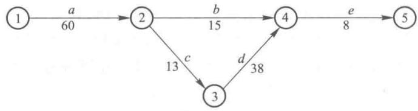

图12-4

例 4 我们把例 3 的工序进度表做一些扩充, 如表 12-9 所示, 请画出其统筹方法的网络图.

表12-9

<table><tr><td>工序代号</td><td>所需时间/天</td><td>紧前工序</td><td>工序代号</td><td>所需时间/天</td><td>紧前工序</td></tr><tr><td>a</td><td>60</td><td>—</td><td>e</td><td>8</td><td>b,d</td></tr><tr><td>b</td><td>15</td><td>a</td><td>f</td><td>10</td><td>d</td></tr><tr><td>c</td><td>13</td><td>a</td><td>g</td><td>16</td><td>d</td></tr><tr><td>d</td><td>38</td><td>c</td><td>h</td><td>5</td><td>e,f,g</td></tr></table>

解 在图 12-4 中我们已经得到了此问题的部分网络图,但是我们把工序 f 扩充到此网络图上时发生了问题,由于 d 是 f 的紧前工序,所以 d 的结束应该是 f 的开始,所以代表 f 的弧的起点应该是④,但这样一来,由于工序 b 的结束也是④,所以工序 b 也成了工序 f 的紧前工序,这和题意不符合了.

为此我们引入虚工序.虚工序是实际上并不存在而虚设的工序,为了用来表示相邻工序之间的衔接关系.虚工序不需要人力、物力等资源与时间,在本例中虚工序所需时间为零.虚工序在图中用虚线表示,在图12-4中加入f工序我们得图12-5.

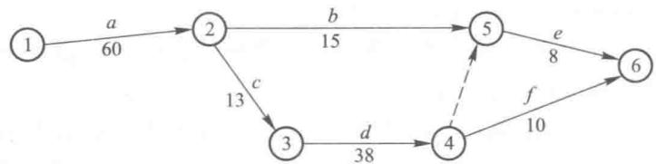

图12-5

在图 12-5 中, 我们把点的编号作了一些调整. 我们规定工序从左向右排列, 网络图中的各个点都有一个时间(某一个或若干个工序开始或结束的时间),一般按各个点的时间顺序编号,要求各工序的结束点的编号大于开始点的编号.表示了结束点的时间不早于开始点的时间,为了便于修改及调整计划,在编号过程中可以留出一些编号.

在图 12-5 中虚工序④→⑤表示只有当 d 工序结束后, e 工序才能开始.

在网络图上添上 g, h 工序得网络图如图 12-6 所示.

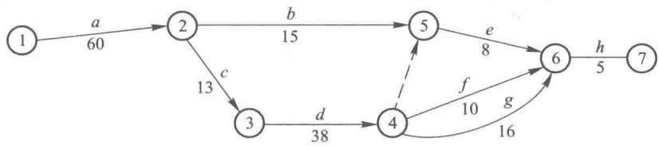

图12-6

在图 12-6 中工序 f 和工序 g 有相同的开始④和相同结束⑥.由于在统筹方法的网络中计算机程序计算时,相邻两个点之间不管有多少弧（工序）,计算机都认为它们是同一条弧（同一个工序）,因此在统筹方法的网络图中不允许两个点之间有多于一条弧的情况发生.为此我们增加了一个点和虚工序,同时调整了一些点的编号得图 12-7,这就是例 4 的统筹方法网络图.

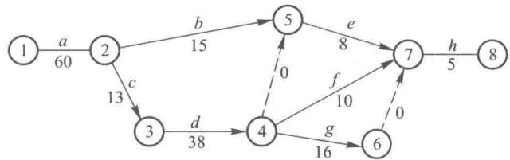

图12-7

在绘制统筹方法的网络图时,要注意图中不能有缺口和回路.

在网络图中,除发点和收点外,其他各个点的前后都应有弧连接,图中不存在缺口,使网络图从发点经任何路线都可以到达收点,否则使某些工序失去与其紧前工序的应有的联系.必要时可以添加一些虚工序以免出现缺口.

在统筹方法的网络图中不能有回路,否则将使组成的工序永远不能结束.

### 二、网络时间与关键路线

在绘制出网络图之后,我们可以用网络图求出:

(1) 完成此工程项目所需的最少时间.

(2) 每个工序的开始时间与结束时间.

(3) 关键路线及其相应的关键工序.

(4) 非关键工序在不影响工程的完成时间的前提下, 其开始时间与结束时间可以推迟多久.

例 5 某公司装配一条新的生产线, 其装配过程中的各个工序与其所需时间以及它们之间的相互衔接关系如表 12-10 所示, 求: 完成此工程所需最少时间, 关键路线及相应关键工序, 各工序的最早开始时间及结束时间和非关键工序在不影响工程完成时间的前提下, 其开始时间与结束时间可以推迟多久.

表12-10

<table><tr><td>工序代号</td><td>工序内容</td><td>所需时间/天</td><td>紧前工序</td></tr><tr><td>a</td><td>生产线设计</td><td>60</td><td>/</td></tr><tr><td>b</td><td>外购零配件</td><td>45</td><td>a</td></tr><tr><td>c</td><td>下料、锻件</td><td>10</td><td>a</td></tr><tr><td>d</td><td>工装制造1</td><td>20</td><td>a</td></tr><tr><td>e</td><td>木模、铸件</td><td>40</td><td>a</td></tr><tr><td>f</td><td>机械加工1</td><td>18</td><td>c</td></tr><tr><td>g</td><td>工装制造2</td><td>30</td><td>d</td></tr><tr><td>h</td><td>机械加工2</td><td>15</td><td>d,e</td></tr><tr><td>i</td><td>机械加工3</td><td>25</td><td>g</td></tr><tr><td>j</td><td>装配调试</td><td>35</td><td>b,i,f,h</td></tr></table>

解 根据表 12-10, 绘制网络图, 如图 12-8 所示.

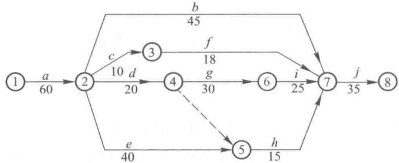

图12-8

为了求得完成此工程所需的最少时间,我们必须找到一条关键路线.在网络图上从发点开始,沿着弧的方向(即按照各个工序的顺序)连续不断地到达收点的一条路称为路线.如在图12-8中,路①→②→③→⑦→⑧就是一条路线,这条路线是由工序a,c,f,j组成,要“走”完这条路线,也就是完成a,c,f,j四个工序需要的时间为 $60+10+18+35=123$ （天）.我们要干完所有工序就必须走完所有这样的线路,由于很多工序可以同时进行,所以网络中最长的路线就决定了完成整个工程所需的最少时间,它就等于完成这条路线上的各个工序的时间之和.我们把这条路线称为关键路线,其他的路线称为非关键路线,关键路线之所以关键是因为我们缩短了完成这条路线上的各个工序的时间之和,我们就缩短了整个工程的完成时间；同样如果我们延长了这个时间之和，那么我们就延长了整个工程的完成时间。这个关键路线上的各个工序都称为关键工序，其他的工序就称为非关键工序。

下面我们给出找出关键路线的办法.

首先从网络的发点开始,按顺序计算出每个工序的最早开始时间(缩写为 ES)和最早结束时间(缩写为 EF),我们设一个工序所需时间为 t,则对同一个工序来说,有

$$
E F = E S + t.
$$

由于工序 a 最早开始时间 ES=0，所需时间 t=60，可知工序 a 的最早结束时间 $EF=0+60=60$ 。我们在网络的弧 a 的上面，字母 a 的右边标上这对数据如图 12-9 所示。

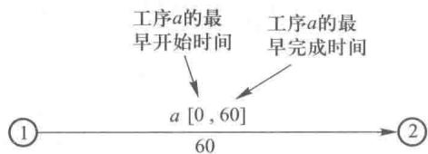

由于任一工序只有当其所有的紧前工序结束之后才能开始,所以任一工序的最早开始时间应该等于其

图12-9

所有紧前工序最早结束时间中的最后的时间.上述的等量关系我们称之为最早开始时间法则,运用这个法则以及 $EF=ES+t$ 的关系,我们可以依次算出此网络图中的各弧的最早开始时间与最早完成时间,如图12-10所示.

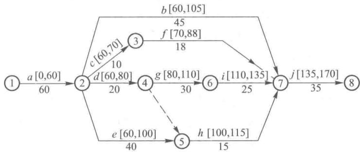

图12-10

在图12-10中，例如工序 $h$ 的最早开始时间应取工序 $d$ 和 $e$ 的最早结束时间中的最后时间，即在80与100中取最大者100，而其最早结束时间 $EF = ES + t = 100 + 15 = 115.$ 故在弧 $h$ 上标以[100,115].

其次,我们从网络的收点开始计算出在不影响整个工程最早结束时间的情况下各个工序的最晚开始时间(缩写为 LS)和最晚结束时间(缩写为 LF),显然对同一工序来说,有

$$
L S = L F - t.
$$

对工序 $j$ ，可知其 $LF = 170, t = 35$ ，可计算出 $LS = 170 - 35 = 135.$ 我们把这两个数据标在网络图弧 $j$ 的下面 $t$ 右边的方括号内.

由于任一工序必须在其所有的紧后工序开始之前结束,这样我们得到了最晚时间法则:在不影响整个工程最早结束时间的情况下,任一工序的最晚结束时间等于其所有紧后工序的最晚开始时间中的最早时间.

运用这个法则和 $LS = LF - t$ 的关系式，我们可以从收点开始计算出每个工序的 $LF$ 与 $LS$ 如图12-11所示.

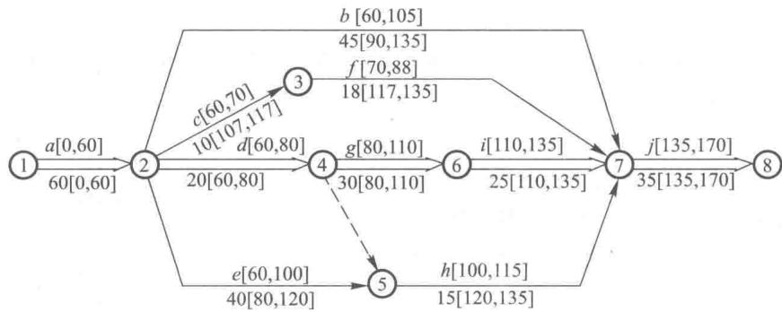

图12-11

在图 12-11 中,例如工序 b 的 LF 的值是从其紧后工序 j 的 LS 值得到,即工序 b 的 LF=135,而工序 b 的 LS 的值为 $LF-t=135-45=90$ .故在弧 b 下面 45 的右边标以 [90,135].

接着,我们可以计算出每一个工序的时差,我们把在不影响工程最早结束的条件下,工序最早开始(或结束)的时间可以推迟的时间,称为该工序的时差,对每一个工序来说其时差记为 $T_{s}$ 有

$$
T _ {\mathrm{s}} = L S - E S = L F - E F.
$$

例如,对工序 b 来说,其时差

$$
T _ {\mathrm{s}} = L S - E S = 90 - 60 = 30.
$$

这就是说工序 b 至多可以推迟 30 天开始(在第 60 天至第 90 天之间的任何时间开始)不至于影响整个工程的最早结束时间.这样可知工序 b 是非关键工序.而对工序 g 来说,其时差

$$
T _ {\mathrm{s}} = L S - E S = 80 - 80 = 0.
$$

这也就是说工序 g 的提前与推迟开始（或结束）都会使整个工程最早结束时间提前与推迟，这样可知工序 g 是关键工序，一般说关键工序的时差都为零.

最后将各工序的时差,以及其他信息构成工序时间表如表12-11所示.

表12-11

<table><tr><td>工序</td><td>最早开始时间(ES)</td><td>最晚开始时间(LS)</td><td>最早完成时间(EF)</td><td>最晚完成时间(LF)</td><td>时差(LS-ES)</td><td>是否为关键工序</td></tr><tr><td>a</td><td>0</td><td>0</td><td>60</td><td>60</td><td>0</td><td>是</td></tr><tr><td>b</td><td>60</td><td>90</td><td>105</td><td>135</td><td>30</td><td>否</td></tr><tr><td>c</td><td>60</td><td>107</td><td>70</td><td>117</td><td>47</td><td>否</td></tr><tr><td>d</td><td>60</td><td>60</td><td>80</td><td>80</td><td>0</td><td>是</td></tr><tr><td>e</td><td>60</td><td>80</td><td>100</td><td>120</td><td>20</td><td>否</td></tr><tr><td>f</td><td>70</td><td>117</td><td>88</td><td>135</td><td>47</td><td>否</td></tr><tr><td>g</td><td>80</td><td>80</td><td>110</td><td>110</td><td>0</td><td>是</td></tr><tr><td>h</td><td>100</td><td>120</td><td>115</td><td>135</td><td>20</td><td>否</td></tr><tr><td>i</td><td>110</td><td>110</td><td>135</td><td>135</td><td>0</td><td>是</td></tr><tr><td>j</td><td>135</td><td>135</td><td>170</td><td>170</td><td>0</td><td>是</td></tr></table>

这样我们找到了一条由关键工序 a, d, g, i 和 j 依次连成的从发点到收点的关键路线, 我们可以把这条关键路线用双线在网络图 12-11 上表示出来. 我们也可以用“管理运筹学”软件很快地求出这些结果, 读者不妨试试看.

工序时间表不仅为我们提供了关键路线,还为我们进行网络优化、确定最优计划方案提供了有益的信息.

### 三、完成工序所需时间不确定时的网络时间与关键路线

上面我们介绍了有确定的完成工序所需时间的情况下求网络时间和关键路线的办法.

那么当完成工序所需时间不确定的情况下怎样来求网络时间和关键路线呢？下面我们结合例题介绍求解办法.

例 6 长征研究院培训中心负责组织明年春天的各研究所和各部门领导干部的工商管理的培训,培训中心列出有关培训组织的各项活动（工序）的信息如表 12-12 所示,要求绘制出统筹方法的网络图,设法求出网络时间和关键路线,并确定开始这个组织工作的时间以保证培训工作如期举行.

表12-12

<table><tr><td>活动(工序)</td><td>活动(工序)内容</td><td>紧前活动(工序)</td></tr><tr><td>a</td><td>制订培训计划</td><td>—</td></tr><tr><td>b</td><td>选聘培训教师</td><td>a</td></tr><tr><td>c</td><td>列出一些可供选择的培训地点</td><td>—</td></tr><tr><td>d</td><td>确定培训地点</td><td>c</td></tr><tr><td>e</td><td>确定培训的日程安排</td><td>b,d</td></tr><tr><td>f</td><td>落实教学设备,器材,资料</td><td>e</td></tr><tr><td>g</td><td>发培训通知并确定学员名单</td><td>b,d</td></tr><tr><td>h</td><td>订旅馆房间</td><td>g</td></tr><tr><td>i</td><td>处理最后的一些事务</td><td>f,h</td></tr></table>

解 根据表 12-12, 我们可以绘制出统筹方法的网络图如图 12-12 所示.

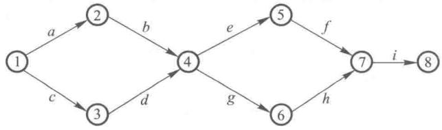

图12-12

由于这是研究院第一次搞这种类型的培训,缺乏经验和有关统计资料来确定完成每个活动所需时间,但通过调查与研究对完成每个活动的时间作了三种统计:(1)乐观时间,是指在顺利情况下,完成活动所需最少时间,常用符号a表示;(2)最可能时间,是指在正常情况下,完成活动所需时间,常用符号m表示;(3)悲观时间,是指在不顺利情况下,完成活动所需最多时间,常用符号b表示.对每个活动的三种估计时间如表12-13所示.

显然这三种完成活动所需时间都具有一定概率,根据经验,我们可以假定这些时间的概率分布近似服从 $\beta$ 分布.这样我们可以用如下公式计算出完成活动所需的平均时间.

表12-13
单位：周

<table><tr><td>活动</td><td>乐观时间</td><td>最可能时间</td><td>悲观时间</td></tr><tr><td>a</td><td>1.5</td><td>2.0</td><td>2.5</td></tr><tr><td>b</td><td>2.0</td><td>2.5</td><td>6.0</td></tr><tr><td>c</td><td>1.0</td><td>2.0</td><td>3.0</td></tr><tr><td>d</td><td>1.5</td><td>2.0</td><td>2.5</td></tr><tr><td>e</td><td>0.5</td><td>1.0</td><td>1.5</td></tr><tr><td>f</td><td>1.0</td><td>2.0</td><td>3.0</td></tr><tr><td>g</td><td>3.0</td><td>3.5</td><td>7.0</td></tr><tr><td>h</td><td>3.0</td><td>4.0</td><td>5.0</td></tr><tr><td>i</td><td>1.5</td><td>2.0</td><td>2.5</td></tr></table>

$$
T = \frac {a + 4 m + b}{6},
$$

以及方差

$$
\sigma^ {2} = \left(\frac {b - a}{6}\right) ^ {2}.
$$

例如,完成活动 g 所需平均时间

$$
T _ {g} = \frac {a + 4 m + b}{6} = \frac {3 . 0 + 4 \times 3 . 5 + 7 . 0}{6} = 4.
$$

同时我们可以求出其方差：

$$
\sigma_ {g} ^ {2} = \left(\frac {7 - 3}{6}\right) ^ {2} = \left(\frac {4}{6}\right) ^ {2} = \frac {4}{9}.
$$

活动 g 的完成时间的概率分布如图 12-13.

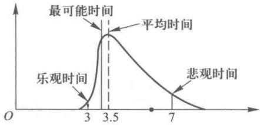

图12-13

同样我们可以求出每个活动的完成所需平均时间及其方差如表 12-14 所示.

表12-14

<table><tr><td>活动</td><td> \(T(平均时间)/周\) </td><td> \(\sigma^{2}(方差)\) </td><td>活动</td><td> \(T(平均时间)/周\) </td><td> \(\sigma^{2}(方差)\) </td></tr><tr><td> \(a\) </td><td>2</td><td>0.028</td><td> \(f\) </td><td>2</td><td>0.111</td></tr><tr><td> \(b\) </td><td>3</td><td>0.445</td><td> \(g\) </td><td>4</td><td>0.445</td></tr><tr><td> \(c\) </td><td>2</td><td>0.111</td><td> \(h\) </td><td>4</td><td>0.111</td></tr><tr><td> \(d\) </td><td>2</td><td>0.028</td><td> \(i\) </td><td>2</td><td>0.028</td></tr><tr><td> \(e\) </td><td>1</td><td>0.028</td><td colspan="3"></td></tr></table>

下面我们就用完成活动所需平均时间来代替完成活动所需时间,并且在网络图上标上每个活动最早开始时间和最早结束时间,如图 12-14 所示.

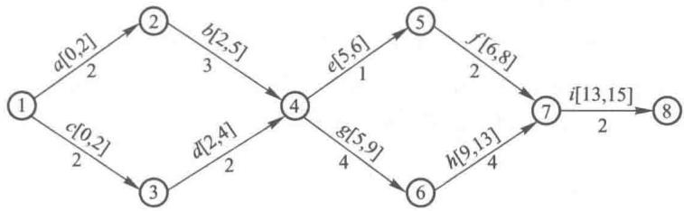

图12-14

同样,我们可以在网络图上标上最晚开始时间与最晚完成时间如图12-15所示.我们还可以求出时差 $T_{s}=LS-ES$ ,我们把这些信息都填入工序时间表12-15中.

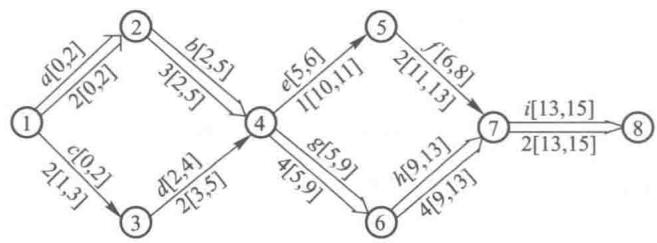

图12-15

表12-15

<table><tr><td>活动</td><td>最早开始时间(ES)</td><td>最晚开始时间(LS)</td><td>最早完成时间(EF)</td><td>最晚完成时间(LF)</td><td>时差(LS-ES)</td><td>是否为关键工序</td></tr><tr><td>a</td><td>0</td><td>0</td><td>2</td><td>2</td><td>0</td><td>是</td></tr><tr><td>b</td><td>2</td><td>2</td><td>5</td><td>5</td><td>0</td><td>是</td></tr><tr><td>c</td><td>0</td><td>1</td><td>2</td><td>3</td><td>1</td><td>否</td></tr><tr><td>d</td><td>2</td><td>3</td><td>4</td><td>5</td><td>1</td><td>否</td></tr><tr><td>e</td><td>5</td><td>10</td><td>6</td><td>11</td><td>5</td><td>否</td></tr><tr><td>f</td><td>6</td><td>11</td><td>8</td><td>13</td><td>5</td><td>否</td></tr><tr><td>g</td><td>5</td><td>5</td><td>9</td><td>9</td><td>0</td><td>是</td></tr><tr><td>h</td><td>9</td><td>9</td><td>13</td><td>13</td><td>0</td><td>是</td></tr><tr><td>i</td><td>13</td><td>13</td><td>15</td><td>15</td><td>0</td><td>是</td></tr></table>

以上的一些工作,我们都可以用“管理运筹学”软件来完成.

从表 12-15 上我们找到了一条从发点到收点由关键工序 a, b, g, h, i 组成的关键路线, 我们用双线在图 12-15 上表示出这条关键路线. 从而可知要完成领导干部的工商管理的培训组织工作所需的平均时间为各关键活动的所需平均时间之和, 即有

$$
T _ {a} + T _ {b} + T _ {g} + T _ {h} + T _ {i} = 2 + 3 + 4 + 4 + 2 = 15 (\text {周}).
$$

实际上完成整个培训组织工作所需时间是服从一定的概率分布的,由于各关键工作所需时间都服从相同的概率分布即 $\beta$ 分布,从概率论的中心极限定理可知,完成整个工作所需时间近似服从正态分布,这个正态分布的均值 $E(T)$ 即为关键路线上各关键活动之均值(平均需要时间)之和,其方差 $\sigma^{2}$ 也为其关键路线上各关键活动之方差之和,即有

$$
\begin{array}{r l} & E (T) = T _ {a} + T _ {b} + T _ {g} + T _ {h} + T _ {i} = 15. \\ & \sigma^ {2} = \sigma_ {a} ^ {2} + \sigma_ {b} ^ {2} + \sigma_ {g} ^ {2} + \sigma_ {h} ^ {2} + \sigma_ {i} ^ {2} \\ & \quad = 0. 028 + 0. 445 + 0. 445 + 0. 111 + 0. 028 \approx 1. 05. \end{array}
$$

这样我们可以计算出此项培训组织工作不同完工时间的概率,例如这项工作在16周内完工的概率.

图 12-16 就是以均值为 15, 方差为 1.05 的正态分布图, 其中图中的阴影部分就是在 16 周内完工的概率.

为求得在 16 周内完工的概率, 我们可以先求 $\mu$ 值.

$$
\mu = \frac {T - E (T)}{\sigma},
$$

式中的 T 为预定完工时间即为 16, $E(T)=15$ .

$$
\sigma = \sqrt {\sigma^ {2}} = \sqrt {1 . 05} = 1. 025,
$$

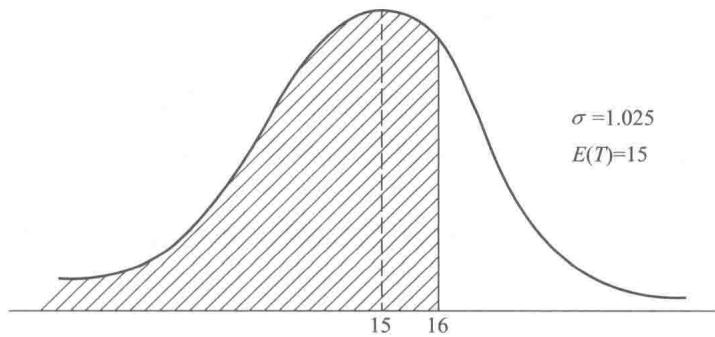

图12-16

即得

$$
\mu = \frac {1 6 - 15}{1 . 025} = \frac {1}{1 . 025} = 0. 976.
$$

查标准正态分布函数表可知概率 $\Phi(\mu)=\Phi(0.976)=0.8355$ ，即在16周内完工的概率为83.55%.

如果我们要求以 $99\%$ 的概率来保证培训组织工作如期做完，使培训工作如期举行，我们应在培训工作开始前多少周开始做培训组织工作，也就是说，概率为 $99\%$ 的完工时间应为多少周。在标准正态分布函数表中可查出 $\Phi (\mu) = 0.99$ 的 $\mu$ 值， $\mu = 2.33$ ，再从公式

$$
\mu = \frac {T - E (T)}{\sigma},
$$

得

$$
2. 33 = \frac {T - 15}{1 . 025}.
$$

可求得

$$
T = 2. 33 \times 1. 025 + 15 = 17. 39 (\text { 周 }).
$$

也就是说只要在培训工作开始前 17.39 周开始做培训组织工作就能保证培训工作如期举行.

### 四、网络优化

绘制网络图,计算网络时间和确定关键路线,得到了一个初始的计划方案,但通常要对初始方案进行调整与完善.根据计划目标,综合地考虑进度、资源和降低成本等目标,进行网络优化,确定最优的计划方案.

#### 1. 时间—资源优化

在编制网络计划安排工程进度时,我们要合理地利用现有资源,并缩短工程周期.为了使工程进度与资源利用都得到比较合理安排,我们采取以下的做法:

(1) 优先安排关键工序所需要的资源.

(2) 利用非关键工序的时差, 错开各工序的开始时间, 拉平资源需要量的高峰.

(3)要统筹兼顾工程进度的要求和现有资源的限制，往往要经过多次综合平衡，才能得到比较合理的计划方案.

下面列举一个拉平资源需要量高峰的实例.在例5中，若完成工序 $d, f, g, h, i$ 的机械加工工人人数为65人，并假定这些工人可以完成这五个工序中的任一个工序，下面我们来寻求一个时间一资源优化方案.

有关 d, f, g, h, i 工序所需的工人人数及上述工序开始时间, 所需时间及时差如表 12-16 所示.

表12-16

<table><tr><td>工序</td><td>需要机械加工工人人数</td><td>最早开始时间/天</td><td>所需时间/天</td><td>时差/天</td></tr><tr><td>d</td><td>58</td><td>60</td><td>20</td><td>0</td></tr><tr><td>f</td><td>22</td><td>70</td><td>18</td><td>47</td></tr><tr><td>g</td><td>42</td><td>80</td><td>30</td><td>0</td></tr><tr><td>h</td><td>39</td><td>100</td><td>15</td><td>20</td></tr><tr><td>i</td><td>26</td><td>110</td><td>25</td><td>0</td></tr></table>

若上述各工序都按最早开始时间安排,那么从第60天至第135天的75天里,所需的机械加工工人的人数如图12-17所示.

在图的上半部中,工序代号后括号内的数字是所需机械加工工人数,“—·—”（点划线）表示非关键工序时差长度.图的下半部表示从第60天至135天内的75天里,所需机械加工工人数,这样的图一般称为资源负荷图.

从图 12-17 中可见到:一方面在第 70 天至第 88 天和从第 100 天至第 110 天这两段时间内,需要工人数达到 80 与 81 人,远超过了现有工人人数;另一方面在第 90 天到第 100 天和第 115 天至 135 天所需工人数仅有 42 人和 26 人,远远少于现有工人数,这种安排的资源负荷是不均匀的,不妥当的.

若各工序都按最晚开始时间安排,那么在第117天至135天时期内需要工人数为87人,也大大超过了现有工人数.

我们应该优先安排关键工序所需的工人,再利用非关键工序的时差,错开各工序的开始时间,从而拉平工人需要量的高峰.经过调整,我们让非关键工序f从第80天开始,工序h从第110天开始.找到了时间——资源优化的方案,如图12-18所示,在不增加工人的情况下保证了工程按期完成.

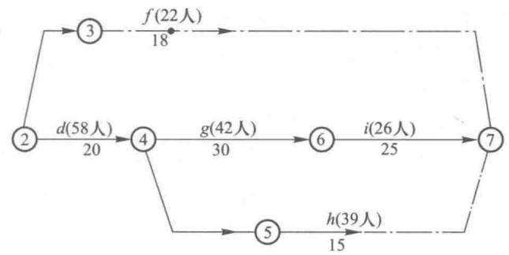

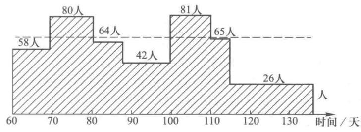

图12-17

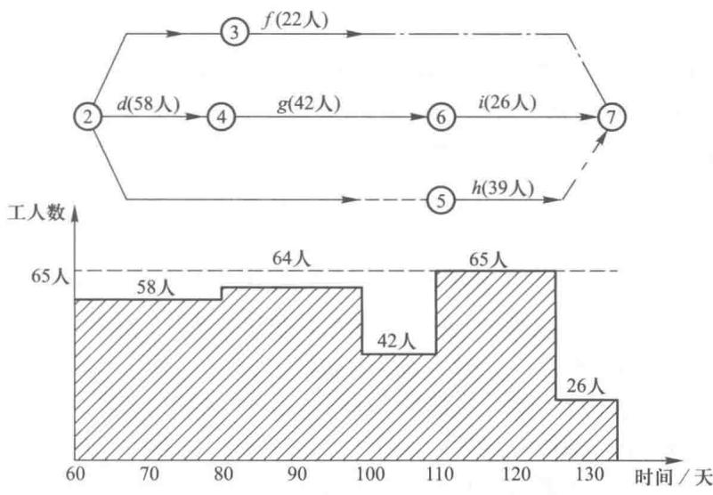

图12-18

#### 2. 时间—费用优化

在编制网络计划时,我们要考虑这样一些时间与费用的问题:在既定的时间前工程完工的前提下,使得所需要的费用最少,或者在不超过工程预算的条件下,使得工程最早完工.这些就是时间—费用优化要研究和解决的问题.

为了加快工程进度,使工程早日完工,必须设法缩短关键工序的作业时间,这样就需要增加人力、设备和工作班次,也就是这需要增加一笔费用,我们称之为直接费用.但同时,由于加快了工程进度,使工程早日完工,减少了管理人员的工资、办公费等费用我们称之为间接费用.一般来说工序的作业时间越短,直接费用越多而间接费用越少.

我们缩短工序的作业时间也有一定的限度,这个限度我们称之为工序的最快完成时间.我们设完成工序j的正常所需时间为 $T_{j}$ ,直接费用为 $c_{j}$ ,完成工序j的最快完成时间为 $T_{j}^{\prime}$ ,直接费用为 $c_{j}^{\prime}$ .这样我们可以计算出缩短工序j的一天工期所增加的直接费用,我们用 $k_{j}$ 表示,有

$$
k _ {j} = \frac {c _ {j} ^ {\prime} - c _ {j}}{T _ {j} - T _ {j} ^ {\prime}}.
$$

我们也称 $k_{j}$ 为直接费用变动率, 这是一个平均数.

时间—费用优化问题可以建立以下两个线性规划模型.

模型一,在既定的时间 T 前完工的前提下,问各活动（工序）的完成时间为多少（即各项活动如何加速）才使因缩短工期而增加的直接费用最少.

我们设网络图上点 i 发生的时间为 $x_{i}$ （例如在图 12-18 中，点 2 的发生时间为 60（天），点 6 的发生时间为 110（天），故有 $x_{2}=60, x_{6}=110$ ）.

对一个工序,我们既可以用工序的代号(例如 $a, b, \cdots$ )来表示,也可以用表示这个工序的弧[例如 $(1,2)(2,3), \cdots, (i,j), \cdots$ ]来表示,为了便于建模,这里的工序我们用弧 $(i,j)$ 来表示.

设工序 $(i,j)$ 的提前完工时间为 $y_{ij}$ ，我们用 $T_{ij}, T_{ij}'$ 分别表示正常完工时间与最快完工的时间，则有工序 $(i,j)$ 的实际完工时间为： $T_{ij}-y_{ij}$ 。我们也用 $c_{ij}$ 和 $c_{ij}'$ 表示用正常完成时间和最快完成时间完成工序 $(i,j)$ 所需要的费用， $k_{ij}$ 为工序 $(i,j)$ 的直接费用变动率。这样我们可以得到这个问题的线性规划模型如下：

约束条件：

$$
\begin{array}{r l r} & & {\min f =  \sum_ {(i, j)} (k _ {i j} \cdot y _ {i j})  ;} \\ & & {x _ {j} - x _ {i} \geqslant T _ {i j} - y _ {i j}  , \qquad \qquad \text {对一切弧} (i, j)  ,} \\ & & {y _ {i j} \leqslant T _ {i j} - T _ {i j} ^ {\prime}  , \qquad \qquad \text {对一切弧} (i, j)  ,} \\ & & {x _ {n} - x _ {1} \leqslant T  ,} \\ & & {x _ {i} \geqslant 0  , y _ {i j} \geqslant 0.} \end{array}
$$

在这个模型中,其目标函数就是取其所有缩短工期各工序增加的直接费用之和的最小值,其约束条件中,第一个约束不等式右边表示工序 $(i,j)$ 的实际作业时间,左边表示弧 $(i,j)$ 的两个顶点j和i的发生时间之差,这个不等式表示要有足够的时间间隔让工序 $(i,j)$ 进行实际作业,这个约束不等式要对每个工序都成立;第二个约束不等式的右边表示工序 $(i,j)$ 缩短工序时间的最大允许值,左边表示工序 $(i,j)$ 的实际缩短时间,这个约束不等式表示工序 $(i,j)$ 的实际缩短时间不能超过其缩短工期的最大允许值,这个不等式也要对每个工序成立.第三个约束不等式表示整个工程实际完工时间不能超过给定的期限T.

例 7 例 5 所提供的信息都作为本例的信息,另外还给出了在装配过程中各道工序所需正常完工时间与最快完工时间,以及对应正常完工时间与最快完工时间的所需的直接费用和每缩短一天工期所需增加的直接费用,如表 12-17 所示.

表12-17

<table><tr><td rowspan="2">工序</td><td colspan="2">正常情况下</td><td colspan="2">采取措施后</td><td rowspan="2">缩短一天工期增加的直接费用(费用变动率元/天) \(k_{ij}=\frac{c_{ij}&#x27;-c_{ij}}{T_{ij}-T_{ij}&#x27;}\) </td></tr><tr><td> \(T_{ij}\) 正常完工时间/天</td><td> \(c_{ij}\) 工序直接费用/元</td><td> \(T&#x27;_{ij}\) 最快完工时间/天</td><td> \(c&#x27;_{ij}\) 工序直接费用/元</td></tr><tr><td>a(1,2)</td><td>60</td><td>10 000</td><td>60</td><td>10 000</td><td>—</td></tr><tr><td>b(2,7)</td><td>45</td><td>4 500</td><td>30</td><td>6 300</td><td>120</td></tr><tr><td>c(2,3)</td><td>10</td><td>2 800</td><td>5</td><td>4 300</td><td>300</td></tr><tr><td>d(2,4)</td><td>20</td><td>7 000</td><td>10</td><td>11 000</td><td>400</td></tr><tr><td>e(2,5)</td><td>40</td><td>10 000</td><td>35</td><td>12 500</td><td>500</td></tr><tr><td>f(3,7)</td><td>18</td><td>3 600</td><td>10</td><td>5 440</td><td>230</td></tr><tr><td>g(4,6)</td><td>30</td><td>9 000</td><td>20</td><td>12 500</td><td>350</td></tr><tr><td>h(5,7)</td><td>15</td><td>3 750</td><td>10</td><td>5 750</td><td>400</td></tr><tr><td>i(6,7)</td><td>25</td><td>6 250</td><td>15</td><td>9 150</td><td>290</td></tr><tr><td>j(7,8)</td><td>35</td><td>12 000</td><td>35</td><td>12 000</td><td>—</td></tr></table>

在表 12-17 的第一栏“工序”栏中填入了工序代号及表示此工序的弧.

该工程要求在 150 天内完工,问每个工序应比正常完工时间提前多少天完成,才能使整个工程因缩短工期而增加的直接费用为最少.如果工期要求在 140 天完工呢?

解 本题的网络图,我们已在例 5 中绘制出了如图 12-19 所示,根据此网络图我们来建立数学模型.

设此网络图上第 $i$ 点发生的时间为 $x_{i}$ ，工序 $(i,j)$ 提前完工的时间为 $y_{ij}$ ，则

约束条件：

$$
\begin{array}{r l} \min f = 120 y _ {2 7} + 300 y _ {2 3} + 400 y _ {2 4} + 500 y _ {2 5} + 230 y _ {3 7} + \\ & 350 y _ {4 6} + 400 y _ {5 7} + 290 y _ {6 7}; \\ & x _ {2} - x _ {1} \geqslant 60 - y _ {1 2}, \\ & x _ {7} - x _ {2} \geqslant 45 - y _ {2 7}, \\ & x _ {3} - x _ {2} \geqslant 10 - y _ {2 3}, \\ & x _ {4} - x _ {2} \geqslant 20 - y _ {2 4}, \end{array}
$$

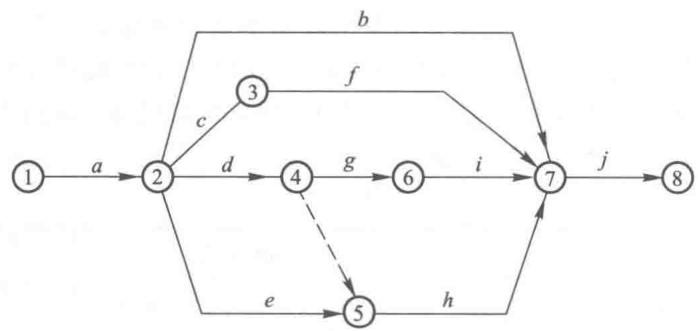

图12-19

$$
\begin{array}{r l} & {x _ {5} - x _ {2} \geqslant 40 - y _ {2 5},} \\ & {x _ {7} - x _ {3} \geqslant 18 - y _ {3 7},} \\ & {x _ {6} - x _ {4} \geqslant 30 - y _ {4 6},} \\ & {x _ {5} - x _ {4} \geqslant 0, \text {虚拟弧} (4, 5),} \\ & {x _ {7} - x _ {5} \geqslant 15 - y _ {5 7},} \\ & {x _ {7} - x _ {6} \geqslant 25 - y _ {6 7},} \\ & {x _ {8} - x _ {7} \geqslant 35 - y _ {7 8},} \\ & {x _ {1} = 0,} \\ & {y _ {1 2} \leqslant 0,} \\ & {y _ {2 7} \leqslant 15,} \\ & {y _ {2 3} \leqslant 5,} \\ & {y _ {2 4} \leqslant 10,} \\ & {y _ {2 5} \leqslant 5,} \\ & {y _ {3 7} \leqslant 8,} \\ & {y _ {4 6} \leqslant 10,} \\ & {y _ {5 7} \leqslant 5,} \\ & {y _ {6 7} \leqslant 10,} \\ & {y _ {7 8} \leqslant 0,} \\ & {x _ {8} \leqslant 150,} \\ & {x _ {i} \geqslant 0, y _ {i j} \geqslant 0. (\text {对一切可能的} i j)} \end{array}
$$

我们用“管理运筹学”软件进行运算,很快得到如下结果:

$$
f = 6400,
$$

$$
x _ {1} = 0, \qquad y _ {1 2} = 0, \qquad y _ {6 7} = 10,
$$

$$
x _ {2} = 60, \qquad y _ {2 7} = 0, \qquad y _ {7 8} = 0.
$$

$$
\begin{array}{l l} {x _ {3} = 97,} & {\quad y _ {2 3} = 0,} \\ {x _ {4} = 80,} & {\quad y _ {2 4} = 0,} \\ {x _ {5} = 100,} & {\quad y _ {2 5} = 0,} \\ {x _ {6} = 100,} & {\quad y _ {3 7} = 0,} \\ {x _ {7} = 115,} & {\quad y _ {4 6} = 10,} \\ {x _ {8} = 150.} & {\quad y _ {5 7} = 0,} \end{array}
$$

也就是我们缩短工序 g 的 10 天工期, 缩短工序 i 的 10 天工期, 这样我们可以多付出最少的直接费用 6400 元, 提前 20 天即在 150 天里完成整个工程.

如果工期要求在 140 天里完成,那么我们只要在上述的线性规划的模型里把约束条件中的最后一个:

$$
x _ {8} \leqslant 150, \text {   改为   } x _ {8} \leqslant 140,
$$

其余一切不变,就是这个问题的数学模型.

用“管理运筹学”软件运算,我们即得到如下结果:

$$
\begin{array}{l l l} {f = 14900,} \\ {x _ {1} = 0,} & {y _ {2 7} = 0,} & {y _ {1 2} = 0,} \\ {x _ {2} = 60,} & {y _ {2 3} = 0,} & {y _ {7 8} = 0.} \\ {x _ {3} = 87,} & {y _ {2 4} = 10,} \\ {x _ {4} = 70,} & {y _ {2 5} = 5,} \\ {x _ {5} = 95,} & {y _ {3 7} = 0,} \\ {x _ {6} = 90,} & {y _ {4 6} = 10,} \\ {x _ {7} = 105,} & {y _ {5 7} = 5,} \\ {x _ {8} = 140.} & {y _ {6 7} = 10,} \end{array}
$$

也就是说,为了使整个工程在140天里完成,我们至少要交付出14900元的直接费用.各个工序的开始时间如 $x_{1},x_{2},\cdots,x_{8}$ 的解所表示,要求缩短工序d的10天工期,工序e的5天工期,工序g的10天工期,工序h的5天工期,工序i的10天工期,其余的工序按正常所需时间完工.

对于例7这样的问题我们也可以用统筹法予以解决.在绘制了计划网络图、计算了工序的时间、找出了关键路线之后，由于要求我们在150天里完成工程，缩短了正常工期的20天时间.我们在关键路线上，找出直接费用变动率最低的关键工序，最大限度地缩短其完成时间.从表12-17上可知其关键工序 $a, d, g, i, j$ 中，工序 $i$ 的直接费用变动率最低，其次是工序 $g$ ，已知这两个工序都至多只能缩短10天，这样我们就缩短工序 $i$ 和 $g$ 各10天时间，而不需经缩短其他的关键工序和非关键工序就能保证在150天完成整个工程，为缩短这20天的工期付出的最少的直接费用为 $290 \times 10 + 350 \times 10 = 6400$ ，这个答案和线性规划的答案是一样的.

如果我们把工程完成时间缩短为 140 天. 同样我们要在关键工序里找出直接费用变动率最低的工序, 缩短 30 天工期. i, g 至多各缩短 10 天工期, 再缩短 d 的 10 天工期, 但这样一来①→

②→⑤→⑦→⑧变成了关键路线，因为这条路线上工序 $a, e, h, j$ 四个工序正常完成共需要时间为150天.这样我们要在这条关键路线上找直接费用变动率最低的工序 $h = 400$ ，其次为 $e = 500$ 由于 $h$ 至多缩短5天， $e$ 也至多缩短5天，这样我们把 $h, e$ 这两个工序都缩短5天.就可以使得整个工期在140天里完成了.这时要多付出的直接费用为

$$
290 \times 10 + 350 \times 10 + 400 \times 5 + 400 \times 10 + 500 \times 5 = 14900 (\text {   元   }).
$$

这个答案与用线性规划求解的结果也是一样的.

模型二,我们知道直接费用是随着完成时间的缩短而增加,而间接费用却会随着完成时间的缩短而减少,设单位时间的间接费用为 d,计划期的间接费用与总工期成正比,即为 $d(x_{n}-x_{1})$ ,那么求使包括间接费用与直接费用在内的总费用最少的整个工程最优完成时间 T 和各个工序最优完成时间的模型为

约束条件：

$$
\begin{array}{r l} & {\min f = d (x _ {n} - x _ {1}) + \sum_ {(i, j)} (k _ {i j} \cdot y _ {i j});} \\ & {\quad x _ {j} - x _ {i} \geqslant T _ {i j} - y _ {i j}, \text {对一切弧} (i, j),} \\ & {\quad y _ {i j} \leqslant T _ {i j} - T _ {i j} ^ {\prime}, \text {对一切弧} (i, j),} \\ & {\quad x _ {i} \geqslant 0, y _ {i j} \geqslant 0.} \end{array}
$$

例 8 如果在例 7 中, 每天的间接费用为 330 元, 求使包括间接费用与直接费用在内的总费用最少的整个工程最优完成时间 T 和各个工序最优完成时间.

解 决策变量 $x_{i}$ 和 $y_{ij}$ 的含义同例7.

$x_{i}$ 表示网络图上第 i 点发生的时间，

$y_{ij}$ 表示工序 $(i,j)$ 提前完工的时间.

此数学模型的目标函数为

$$
\begin{array}{r l} \min f & = 330 (x _ {8} - x _ {1}) + 120 y _ {2 7} + 300 y _ {2 3} + 400 y _ {2 4} + 500 y _ {2 5} + 400 y _ {5 7} + \\ & \quad 230 y _ {3 7} + 350 y _ {4 6} + 290 y _ {6 7} + \sum c _ {i j} \end{array}
$$

$\sum c_{ij}$ 为正常情况下所有工序直接费用之和，共计：68900元.此模型的约束条件与例7的约束条件基本相同，只要在例7的约束条件中去掉 $x_{8} \leqslant 150$ 就得到了例8模型的约束条件了.

用“管理运筹学”软件计算,得到以下结果:

$$
\begin{array}{l l l} f = 55700 + 68900 = 124600 \\ x _ {1} = 0, & y _ {1 2} = 0, & y _ {6 7} = 10, \\ x _ {2} = 60, & y _ {2 7} = 0, & y _ {7 8} = 0. \\ x _ {3} = 107, & y _ {2 3} = 0, \\ x _ {4} = 80, & y _ {2 4} = 0, \\ x _ {5} = 110, & y _ {2 5} = 0, \\ x _ {6} = 110, & y _ {3 7} = 0, \\ x _ {7} = 125, & y _ {4 6} = 0, \\ x _ {8} = 160. & y _ {5 7} = 0, \end{array}
$$

也就是说整个工程工期为 160 天时总费用最少为 $55\ 700 + \sum c_{ij} = 124\ 600$ 元，各个工序开始时间如 $x_{1}, x_{2}, \cdots, x_{8}$ 的解所示，工序 i 要提前 10 天完工，其余的工序按正常时间完工.

## 习题

1. 请判断下列说法是否正确：

(1)工程计划网络图中的关键路线上的事项的最早时间和最迟时间往往不相等.

(2) 网络图中, 完成一项活动可能需要的最长时间称为悲观时间.

(3) 一个网络图有唯一的关键路径.

(4) 求网络最大流问题可以归结为求一个线性规划问题.

(5) 在网络图中, 特殊情况下可以有多于一个的始点 （或终点）.

2. 在一台车床上要加工 7 个零件, 表 12-18 列出它们的加工时间, 请确定其加工顺序, 以使各零件在车间里停留的平均时间最短.

表12-18
单位:分钟

<table><tr><td>零件</td><td>1</td><td>2</td><td>3</td><td>4</td><td>5</td><td>6</td><td>7</td></tr><tr><td> \(p_{i}\) </td><td>10</td><td>11</td><td>2</td><td>8</td><td>14</td><td>6</td><td>5</td></tr></table>

3. 有 7 个零件, 先要在钻床上钻孔, 然后在磨床加工. 表 12-19 列出了各个零件的加工时间. 确定各零件加工顺序, 以使总加工时间最短, 并画出相应的线条图. 各台机器的停工时间是多少?

表12-19
单位: 分钟

<table><tr><td>零件</td><td>1</td><td>2</td><td>3</td><td>4</td><td>5</td><td>6</td><td>7</td></tr><tr><td>钻床</td><td>6.7</td><td>2.3</td><td>5.1</td><td>2.3</td><td>9.9</td><td>4.7</td><td>9.1</td></tr><tr><td>磨床</td><td>4.9</td><td>3.4</td><td>8.2</td><td>1.2</td><td>6.3</td><td>3.4</td><td>7.4</td></tr></table>

4. 指出图 12-20, 图 12-21 和图 12-22 所绘制的计划网络图中的错误, 如能改正, 请予改正.

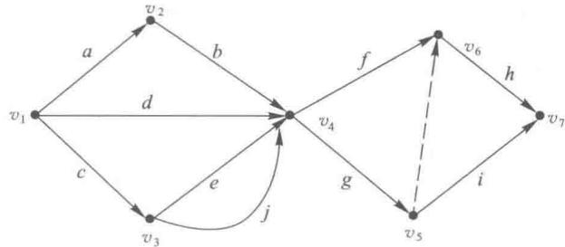

图12-20

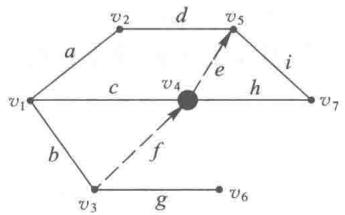

图12-21

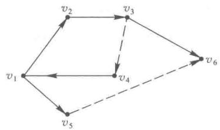

图12-22

表12-20

5. 某工厂在生产某种机床前,制定了作业明细表,如表 12-20 所示,请画出其统筹方法网络图.

<table><tr><td>工序代码</td><td>紧前工序</td><td>工序代码</td><td>紧前工序</td><td>工序代码</td><td>紧前工序</td></tr><tr><td>a</td><td>—</td><td>g</td><td>bc</td><td>m</td><td>jk</td></tr><tr><td>b</td><td>a</td><td>h</td><td>ef</td><td>n</td><td>il</td></tr><tr><td>c</td><td>a</td><td>i</td><td>f</td><td>o</td><td>n</td></tr><tr><td>d</td><td>a</td><td>j</td><td>dg</td><td>p</td><td>m</td></tr><tr><td>e</td><td>a</td><td>k</td><td>h</td><td>q</td><td>op</td></tr><tr><td>f</td><td>a</td><td>l</td><td>jk</td><td></td><td></td></tr></table>

6. 请根据表 12-21 绘制计划网络图.

表12-21

<table><tr><td>工序</td><td>紧前工序</td><td>工序</td><td>紧前工序</td></tr><tr><td>a</td><td>—</td><td>e</td><td>b</td></tr><tr><td>b</td><td>—</td><td>f</td><td>c</td></tr><tr><td>c</td><td>a,b</td><td>g</td><td>d,e</td></tr><tr><td>d</td><td>a,b</td><td></td><td></td></tr></table>

7. 对习题 6, 给出其各工序的所需时间如表 12-22 所示.

表12-22

<table><tr><td>工序</td><td>所需时间/天</td><td>工序</td><td>所需时间/天</td></tr><tr><td>a</td><td>2</td><td>e</td><td>3</td></tr><tr><td>b</td><td>4</td><td>f</td><td>2</td></tr><tr><td>c</td><td>5</td><td>g</td><td>4</td></tr><tr><td>d</td><td>4</td><td></td><td></td></tr></table>

请计算出每个工序的最早开始时间,最晚开始时间,最早完成时间,最晚完成时间;找出关键工序;找出关键路线;并求出完成此工程项目所需最少时间.

8. 对习题 6, 通过调查与研究对完成每个活动（工序）的时间作了 3 种统计, 其详细资料如表 12-23 所示.

表12-23

<table><tr><td>活动(工序)</td><td>乐观时间/天</td><td>最可能时间/天</td><td>悲观时间/天</td></tr><tr><td>a</td><td>1.5</td><td>2</td><td>3</td></tr><tr><td>b</td><td>3</td><td>4</td><td>6</td></tr><tr><td>c</td><td>3.5</td><td>5</td><td>6</td></tr><tr><td>d</td><td>3</td><td>4</td><td>5.5</td></tr><tr><td>e</td><td>2.5</td><td>3</td><td>4</td></tr><tr><td>f</td><td>1</td><td>2</td><td>4</td></tr><tr><td>g</td><td>2</td><td>4</td><td>5</td></tr></table>

请求出每个活动的最早开始时间,最晚开始时间,最早完成时间,最晚完成时间;找出关键工序;找出关键路线;并求出完成此工程项目所需平均时间;如果要求我们以98%的概率来保证工作如期完成,我们应该在多少天以前就开始这项工作.

9. 某公司内部新产品开发的安排如表 12-24 所示.

表12-24

<table><tr><td>代号</td><td>紧前工序</td><td>作业时间/天</td></tr><tr><td>a</td><td>无</td><td>6</td></tr><tr><td>b</td><td>无</td><td>12</td></tr><tr><td>c</td><td>无</td><td>13</td></tr><tr><td>d</td><td>a</td><td>3</td></tr><tr><td>e</td><td>b</td><td>6</td></tr><tr><td>f</td><td>d</td><td>4</td></tr><tr><td>g</td><td>f</td><td>2</td></tr><tr><td>h</td><td>e,g</td><td>5</td></tr><tr><td>i</td><td>c,e,g</td><td>12</td></tr><tr><td>j</td><td>c,h</td><td>10</td></tr><tr><td>k</td><td>c,h</td><td>9</td></tr><tr><td> \(l\) </td><td> \(j\) </td><td>8</td></tr><tr><td> \(m\) </td><td> \(k\) </td><td>4</td></tr><tr><td> \(n\) </td><td> \(i,l,m\) </td><td>11</td></tr></table>

请绘制网络计划图,并找出关键路线.

10. 某项工程各道工序时间及每天需要的人力资源如图 12-23 所示. 图中, 箭线上的英文字母表示工序代号, 括号内数值是该工序的时差, 箭线下左边数为工序工时, 括号内数值为该工序每天需要的人力数. 若人力资源限制每天只有 15 人, 求此条件下工期最短的施工方案.

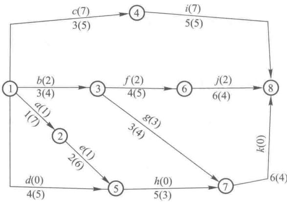

图12-23

11. 某生产车间需要生产 6 种型号的零件, 需要先在 A 机床上加工, 后在 B 机床上加工, 表 12-25 中给出了各型号的零件在 A, B 两种机床上的加工时间 （单位: 小时）, 请问如何确定零件的加工顺序, 才能使总的加工时间最短? 并求总时间.

表12-25

<table><tr><td>型号</td><td>1</td><td>2</td><td>3</td><td>4</td><td>5</td><td>6</td></tr><tr><td>A</td><td>7</td><td>5</td><td>2</td><td>3.5</td><td>4</td><td>6</td></tr><tr><td>B</td><td>1</td><td>7</td><td>5</td><td>2.5</td><td>4.5</td><td>3</td></tr></table>

12. 已知表 12-26 所列的资料, 试求该工程项目的最低成本的施工方案。(最低成本是指工程的总直接费用与总间接费用的总和为最少. 总直接费用等于各工序的直接费用之和; 总间接费用等于每天的间接费用与总施工工期的乘积.)

表12-26

<table><tr><td rowspan="2">工序代号</td><td rowspan="2">紧前工序</td><td colspan="2">正常进度</td><td colspan="2">赶工进度</td><td rowspan="2">每赶一天所需要的费用/(元/天)</td></tr><tr><td>工序时间/天</td><td>直接费用/元</td><td>工序时间/天</td><td>直接费用/元</td></tr><tr><td>a</td><td>—</td><td>3</td><td>10</td><td>1</td><td>18</td><td>4</td></tr><tr><td>b</td><td>a</td><td>7</td><td>15</td><td>3</td><td>19</td><td>1</td></tr><tr><td>c</td><td>a</td><td>4</td><td>12</td><td>2</td><td>20</td><td>4</td></tr><tr><td>d</td><td>c</td><td>5</td><td>8</td><td>2</td><td>14</td><td>2</td></tr><tr><td></td><td colspan="6">间接费用为每天4.5元</td></tr></table>

13. 某工程项目由 7 道工序组成, 图 12-24 为工序的网络图, 表 12-27 给出了各个工序的时间参数及相关费用, 另外, 工程的间接费用为 200 元/天, 试确定工程的最低成本及工期.

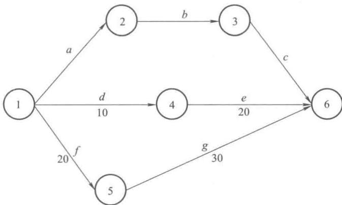

图12-24

表12-27

<table><tr><td>工序</td><td>正常完工时间/天</td><td>最快完工时间/天</td><td>直接费用/元</td><td>费用变动率/(元/天)</td></tr><tr><td>a</td><td>15</td><td>15</td><td>1 500</td><td>—</td></tr><tr><td>b</td><td>13</td><td>10</td><td>1 000</td><td>180</td></tr><tr><td>c</td><td>7</td><td>5</td><td>2 500</td><td>120</td></tr><tr><td>d</td><td>25</td><td>15</td><td>1 700</td><td>60</td></tr><tr><td>e</td><td>20</td><td>20</td><td>1 200</td><td>—</td></tr><tr><td>f</td><td>25</td><td>25</td><td>2 300</td><td>—</td></tr><tr><td>g</td><td>35</td><td>20</td><td>2 400</td><td>150</td></tr></table>

14. 某汽车公司有两条流水线 A, B, 生产流程包含 6 组零件, 其每个零件都需要先经过 A 流水线才可在 B 流水线上进行加工, 表 12-28 列出了各零件所需的时间, 请合理安排零件的加工顺序使得总加工时间最短.

表12-28

<table><tr><td>流水线\零件</td><td>1</td><td>2</td><td>3</td><td>4</td><td>5</td><td>6</td></tr><tr><td>A</td><td>3.5</td><td>4.5</td><td>1.5</td><td>4.0</td><td>9.0</td><td>5.5</td></tr><tr><td>B</td><td>2.5</td><td>5.5</td><td>2.0</td><td>7.5</td><td>3.0</td><td>5.0</td></tr></table>

15. 假设某生产过程包含 a, b, c, d, e, f, g, h, i 共 9 道工序，各工序所需时间和紧前工序如表 12-29 所示.

表12-29

<table><tr><td>工序名称</td><td>所需时间/天</td><td>紧前工序</td></tr><tr><td>a</td><td>62</td><td>/</td></tr><tr><td>b</td><td>38</td><td>/</td></tr><tr><td>c</td><td>14</td><td>a</td></tr><tr><td>d</td><td>23</td><td>b</td></tr><tr><td>e</td><td>48</td><td>b,c</td></tr><tr><td>f</td><td>22</td><td>d</td></tr><tr><td>g</td><td>30</td><td>f</td></tr><tr><td>h</td><td>16</td><td>e</td></tr><tr><td>i</td><td>29</td><td>g,h</td></tr></table>

请绘制计划网络图.

16. 根据题 15, 给出每个工序的最早开始时间、最晚开始时间、最早完成时间、最晚完成时间, 并找出关键路线, 求得最少完成时间.

17. 对习题 16, 若根据研究发现, 各工序的三种统计时间如表 12-30 所示, 那么同样求出每个工序的最早开始时间、最晚开始时间、最早完成时间、最晚完成时间, 并找出关键路线及最少完成时间, 若上级要求至少有九五成的把握按期完成任务, 且仅允许提前 3 个月开工, 请问以目前的情况能达到上级要求吗?

表12-30

<table><tr><td>工序名称</td><td>乐观时间/天</td><td>最可能时间/天</td><td>悲观时间/天</td></tr><tr><td>a</td><td>50</td><td>60</td><td>70</td></tr><tr><td>b</td><td>30</td><td>35</td><td>45</td></tr><tr><td>c</td><td>10</td><td>15</td><td>20</td></tr><tr><td>d</td><td>20</td><td>25</td><td>35</td></tr><tr><td>e</td><td>35</td><td>40</td><td>55</td></tr><tr><td>f</td><td>15</td><td>20</td><td>30</td></tr><tr><td>g</td><td>20</td><td>30</td><td>35</td></tr><tr><td>h</td><td>15</td><td>20</td><td>25</td></tr><tr><td>i</td><td>20</td><td>25</td><td>40</td></tr></table>

18. 对习题 10, 请分析调整工序 a, b, d 满足人力资源限制并实现工期最短的可行性.

19. 某建筑公司在进行一项工程时的局部网络图如图 12-25 所示. 图中每项程序之后的 3 个数字表示该程序所需的乐观时间、最可能时间和悲观时间, 这些时间的概率分布近似 $\beta$ 分布, 求完工概率等于 95.5% 时的工程总工期.

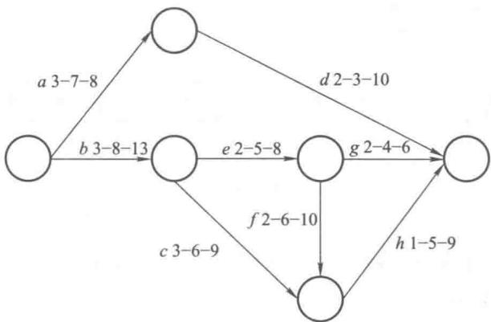

图12-25

## 案例

## 案例 20: 某科技公司项目方案设计

虚见科技有限责任公司要开发一款 AR 应用产品.项目部负责估算该项目在正常速度下需花费的时间和成本.由于公司业务发展需要,公司需要尽快启动该项目.因此,要求项目部负责人制定一份关于启动 AR 应用产品项目的时间和成本的估算报告.其中与项目相关的任务如下:

a. 比较现有同类型 AR 应用产品：按照正常速度估算完成这项任务需要花 8 天，成本为 10 000 元。如果使用最多允许的加班工作量，则可在 5 天 15 000 元的条件下完成。

b. 向董事会提交项目计划和项目定义文件：项目团队估算完成这项任务按正常速度为 6 天，成本 4000 元，如果赶工为 4 天，成本为 4500 元.

c. 需求分析: 项目团队估计需求分析为 16 天, 成本 50 000 元, 如加班则为 12 天, 成本 60 000 元.

d. 宣传与发布平台搭建:为了加强产品投入市场后的影响力,项目需要在开发的同时对该产品进行宣传以及对发布平台进行搭建.预计需要30天,成本为60 000元.若加班则为22天,70 000元.

e. 美工设计: 对应用的 UI 等进行美工设计. 在不加班时所需时间和成本分别为 5 天和 5 000 元, 加班时可以在 3 天和 7 000 元的情况下完成.

f. 开发该应用的数据库: 估计数据库的开发在不加班的时候时间和成本分别为 7 天和 8000 元, 加班时可以在 5 天和 11000 元的情况下完成.

g. 开发和编写应用代码: 项目团队估算在不加班的情况下, 开发和编写代码需要 15 天和 20 000 元, 加班则可以减少 5 天, 成本为 25 000 元.

h. 整合、测试、修改: 项目团队估算需要 4 天, 成本 3000 元. 如果加班的话, 则可以减少 1 天, 成本为 4000 元.

i. 对项目产品进行发布: 预计需要 3 天, 成本 6000 元. 加班的情况下则为 1 天, 成本 10000 元.

项目各环节的执行顺序如图 12-26 所示.

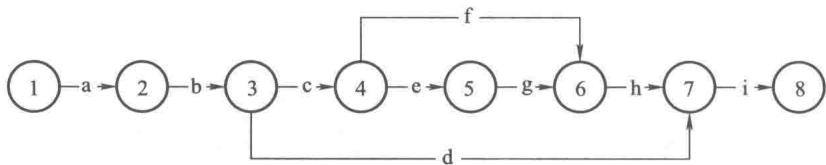

图12-26

请讨论要想该项目在 50 天内完成,需要如何对各环节进行统筹,才能使总费用变动率(缩短一天时间所增加的直接费用)最小.
