# 第13章 存储论

存储论是定量方法和技术最早应用的领域之一,是管理运筹学的重要分支.早在1915年人们就开始了对存储论的研究.

所谓存储就是将一些物资,例如原材料、外购零件、部件、在制品以及商品等存储起来以备将来的使用和消费.存储是缓解供应与需求之间出现供不应求或供过于求等不协调情况的必要和有效的方法和措施.但是要存储就需要资金和维护,存储的费用在企业经营的成本中占据非常大的部分,它是企业流动资金中的主要部分,因此如何最合理,最经济地解决好存储问题是企业经营管理中的大问题.存储论为我们解决这个问题提供了方法.

存储论主要解决存储策略问题即如下两个问题：

(1) 当我们补充存储物资时, 我们每次补充数量是多少?

(2) 我们应该间隔多长时间来补充我们的存储物资？

我们建立不同的存储模型来解决上面两个问题,我们把需求率、生产率等一些数据皆为确定数值的模型称为确定性存储模型,把含有随机变量的模型称为随机性存储模型.

以下我们介绍一些常用的存储模型及其解决办法.

## 13.1 经济订购批量存储模型

经济订购批量存储模型有人也称为不允许缺货、生产时间很短存储模型，这是一种最基本的确定性的存储模型。在这种模型里，它的需求率即单位时间从存储中取走物资的数量是常量或近似于常量；当存储降为零时，可以立即得到补充并且所要补充的数量全部同时到位（包括生产时间很短的情况，我们可以把生产时间近似地看成零）。这种模型不允许缺货，并要求单位存储费（记为 $c_{1}$ ），每次订购费（记为 $c_{3}$ ），每次订货量（记为Q）都是常量，分别为一些确定的、不变的数值。

下面举例说明经济订购批量存储模型及其解法.

益民食品批发部是个中型的批发公司,它为附近200多家食品零售店提供货源,批发部的负责人为了减少存储的成本,他选择了某种品牌的方便面进行调查研究,制定正确的存储策略.

首先他把过去 12 周的这种品牌方便面的需求数据进行了处理.

过去 12 周的这种品牌的方便面需求数据如表 13-1 所示.

表13-1

<table><tr><td>周</td><td>需求/箱</td><td>周</td><td>需求/箱</td></tr><tr><td>1</td><td>3 000</td><td>8</td><td>3 000</td></tr><tr><td>2</td><td>3 080</td><td>9</td><td>2 980</td></tr><tr><td>3</td><td>2 960</td><td>10</td><td>3 030</td></tr><tr><td>4</td><td>2 950</td><td>11</td><td>3 000</td></tr><tr><td>5</td><td>2 990</td><td>12</td><td>2 990</td></tr><tr><td>6</td><td>3 000</td><td>总计</td><td>36 000</td></tr><tr><td>7</td><td>3 020</td><td>平均每周</td><td>3 000</td></tr></table>

从表 13-1 可见,以往 12 周里每周的需求量并不是一个常量,即使以往 12 周里每周需求量是一个常量,那么在以后的时间里需求也会出现一些变动的,但是由于其方差相对来说很小,为了便于处理,我们可以近似地把它看成一个常量,即需求量为每周 3000 箱,所以这样的处理是合理的和必要的.

接着批发部负责人计算这种方便面的存储费.显然存储费由每单位商品的存储费以及存储的数量(箱数)所决定的.而每箱的存储费用由两部分组成,第一部分是用于购买一箱方便面所占用资金的利息,如果资金是从银行贷款来的,则贷款利息就是第一部分的成本.如果资金是自己的,则由于存储方便面而不能把资金用于其他的投资,我们把此资金的利息称为机会成本,这一部分的成本也应该等于同期的银行贷款利息.批发部的负责人知道每箱方便面的进价为30元,而当时的银行贷款年利息为12%,则每箱方便面储存一年要支付利息款为3.6元.每箱存储费中的第二部分是由储存仓库的费用、保险费用、损耗费用、管理费用等构成,经计算每箱方便面储存一年要支付费用2.4元,这个费用为方便面进价30元的8%,把这两部分相加,可知每箱方便面存储一年的存储费为6元,即 $c_{1}=6$ 元/年·箱,为每箱方便面进价30元的20%.

批发部负责人也分析计算了订货费，订货费是指订一次货所支付的手续费、电话费、交通费、采购人员的劳务费等，订货费与所订货的数量无关，批发部负责人算得采购人员每订一次货，批发部要支付其劳务费12元，要支付手续费、电话费、交通费等约13元，即合计订货费 $c_{3}$ 为25元/次.

批发部负责人求得关于需求、订货费、储存费一些数据之后，开始考虑每次订货量 $Q$ 应该等于多少时才能使得总的费用为最少呢？如果一次订货量 $Q$ 太小，批发部里的方便面的储存量会减少，总的储存费也相应减少，但为了满足需要，就要增加订货次数必然增加订货费，相反如果一次订货量太大，则订货次数会减少，总的订货费会减少，但储存量会增加，总的存储费也就增加了，如何找到最合适的订货量 $Q$ 呢？

假如每次的订货量为 Q，我们知道最大的存储量就为 Q，然后随着方便面不断地售出直到售完，这时的存储量最小等于零，再购进 Q 箱方便面，存储量又达到最大为 Q。又因为需求率是个常量每周需求为 3000 箱或者一周按 7 个工作日计，每日需求为 429 箱，批发部里均匀地减少存储量，如图 13-1 所示。

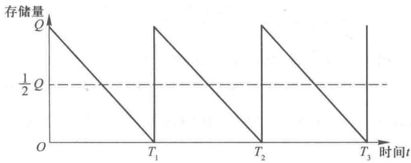

图13-1

在图 13-1 中横轴表示时间,纵轴表示存储量,图中显示了在 $O \sim T$ 的时间里存储量 Q 降至零的情况,其中 $T_{n}$ 为第 n 次补充的时间.由于需求率(减少率)为常量.故图中的 QT 呈直线状.这样很容易知道,在 O 至 T 的时间里,平均存储量为 Q/2,同样可知从 O 至 $T_{n}$ 的时间里的平均存储量也为 Q/2,其中 n 为任意正整数.

知道了平均存储量和单位存储费用,我们就可以求出一段时间内例如每周、每月、每年的存储费.由于很多工商企业习惯用年作为计算的时间单位,故在本章中以及管理运筹学软件的存储论部分都规定以年为计算的时间单位,这样得到如下公式:

一年的存储费 = 每单位商品一年的存储费 × 平均存储量

$$
= c _ {1} \cdot \frac {1}{2} Q = \frac {1}{2} Q c _ {1}.
$$

在本例中有

一年的存储费 = 每箱方便面一年的存储费 × 平均存储量

$$
= 6 \times \frac {1}{2} Q = \frac {6}{2} Q (\text {   元   }).
$$

要求出每年的订货费除了要知道每次的订货费 $c_{3}$ 以外, 我们还要求出每年的订货次数. 我们设每年的总需求量为 D, 则每年的订货次数即为 D/Q, 这样我们就得到以下公式:

一年的订货费 = 每次的订货费 × 每年订货次数

$$
= c _ {3} \cdot \frac {D}{Q} = \frac {D}{Q} c _ {3}.
$$

在本例中因为 $c_{3}=25, D=3\ 000\times52$ ，故有

$$
\mathrm{一年的订货费} = \frac {3 000 \times 52}{Q} \times 25.
$$

一年总的费用(记为 TC)的公式如下表示:

一年总的费用=一年存储费+一年的订货费，

$$
\begin{array}{r l} T C = \frac {1}{2} Q c _ {1} + \frac {D}{Q} c _ {3} & \text {(13.1)} \end{array}
$$

在本例中一年的总费用

$$
T C = \frac {6}{2} Q + 3000 \times \frac {5 2 \times 25}{Q} = 3 Q + \frac {3 900000}{Q}.
$$

找到了一年总的费用的公式之后,我们下一步的工作就是要找出使得一年总费用最小的订货量 Q. 在公式(13.1)中我们知道每单位商品每年的存储费 $c_{1}$ , 每次订货费 $c_{3}$ 以及每年的总的需求 D 都是已知的常量, Q 是未知数, 而 TC 是 Q 的函数, 利用微积分的知识知道, 当 $\frac{\mathrm{d}(TC)}{\mathrm{d}(Q)} = 0$ 时, TC 取最小值, 即当

$$
\frac {\mathrm{d} (T C)}{\mathrm{d} (Q)} = \frac {1}{2} c _ {1} + (- 1) \frac {D}{Q ^ {2}} c _ {3} = 0,
$$

$$
\frac {1}{2} c _ {1} + (- 1) \frac {D}{Q ^ {2}} c _ {3} = 0,
$$

$$
Q ^ {2} = \frac {2 D}{c _ {1}} c _ {3},
$$

$$
\begin{array}{r l} Q ^ {*} = \sqrt {\frac {2 D c _ {3}}{c _ {1}}} & \text {(13.2)} \end{array}
$$

时,一年总的费用(TC)取最小值.

公式(13.2)就是求得一年总的费用最小的最优订货量 $Q^{*}$ 的公式,我们称之为经济订货批量公式.

当我们以最优订货量 $Q^{*}$ 订货时, 可知

$$
\text {   一年的存储费   } = \frac {1}{2} Q ^ {*} c _ {1} = \frac {1}{2} \sqrt {\frac {2 D c _ {3}}{c _ {1}}} \cdot c _ {1} = \sqrt {\frac {D c _ {3} c _ {1}}{2}}.
$$

同样可知

$$
\text {一年的订货费} = \frac {D}{Q ^ {*}} \cdot c _ {3} = \frac {D c _ {3}}{\sqrt {\frac {2 D c _ {3}}{c _ {1}}}} = \sqrt {\frac {D c _ {3} c _ {1}}{2}}.
$$

可见这时一年的存储费与一年的订货费相等.

这也是最优订货量 $Q^{*}$ 的一个特征. 明确地说, 在经济订货批量的模型中, 能使得一年存储费与一年订货费相等的订货量 Q 也就是最优订货量 $Q^{*}$ .

用(13.2)经济订货批量公式,我们可以求得本例中的最优订货量

$$
Q ^ {*} = \sqrt {\frac {2 D c _ {3}}{c _ {1}}} = \sqrt {\frac {2 \times (3000 \times 52) \times 25}{6}} \approx 1140. 18 (\text {箱}).
$$

这时批发部一年的存储费与一年的订货量相等都为

$$
\sqrt {\frac {c _ {1} D c _ {3}}{2}} = \sqrt {\frac {6 \times 3000 \times 52 \times 25}{2}} \approx 3420. 53 (\text {元}).
$$

批发部一年的存储费、一年的订货费、一年总的费用以及最优订货量 $Q^{*}$ 之间的关系如图 13-2 所示.

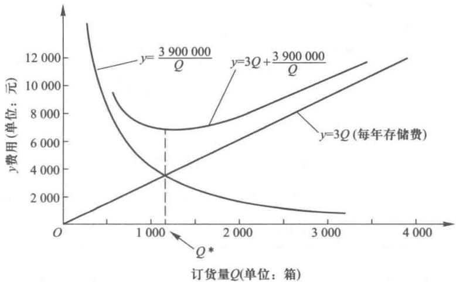

图13-2

批发部负责人知道了最优订货量 $Q^{*}=1\ 140.18$ 箱之后,很容易求出两次补充方便面所间隔的时间 $T_{0}$

$$
\begin{array}{r l} T _ {0} = \frac {3 65}{D / Q ^ {*}} (\text {天}) & \text {(13.3)} \end{array}
$$

公式(13.3)的分母表示要订货的次数.用一年的总工作日数365除以每年订货的次数,即求得两次订货间隔的时间.如果一年的总工作日为250天,则分子应改为250.在本例中可求得

$$
T _ {0} = \frac {3 65}{(3000 \times 52) / 1140 . 18} = 2. 67 (\text {天}).
$$

即每 2.67 天订一次货,每次订货量为 1140.18 箱,这时一年总的费用为最少.

一年总的费用

$$
\begin{array}{r l} T C & = \frac {1}{2} Q ^ {*} c _ {1} + \frac {D}{Q ^ {*}} c _ {3} = 3 Q ^ {*} + \frac {3 900000}{Q ^ {*}} \\ & = 3 \times 1140. 18 + \frac {3 900000}{1 140 . 18} = 6841. 05 (\text {元}). \end{array}
$$

（以上的一些求解的过程，包括下面几个存储模型的求解，我们都可以用“管理运筹学”软件来求解）.

批发部负责人在得到了最优存储策略之后,他开始考虑这样一个问题:这个最优存储策略是在每次订货费为25元,每年单位存储费6元,或为每箱方便面成本价格30元的20%（称为存储率）的情况下求得的,一旦每次订货费或存储率预测有误差,那么最优存储策略会有多大的变化呢?这就是灵敏度分析,为此我们用“管理运筹学”软件计算了当存储率和订货费发生一些变动时,最优订货量及其最小的一年总费用以及取定订货量为1140.18箱时相应的一年的总费用,如表13-2所示.

表13-2

<table><tr><td rowspan="2">可能的存储率</td><td rowspan="2">可能的每次订货费/元</td><td rowspan="2">最优订货量 \((Q^{*}/箱)\) </td><td colspan="2">一年总的费用/元</td></tr><tr><td>当订货量为  \(Q^{*}\) </td><td>当订货量  \(Q=1\ 140.18\) </td></tr><tr><td>19%</td><td>23</td><td>1 122.03</td><td>6 395</td><td>6 396.38</td></tr><tr><td>19%</td><td>27</td><td>1 215.69</td><td>6 929.2</td><td>6 943.67</td></tr><tr><td>21%</td><td>23</td><td>1 067.26</td><td>6 723.75</td><td>6 738.427</td></tr><tr><td>21%</td><td>27</td><td>1 156.35</td><td>7 285.00</td><td>7 285.717</td></tr></table>

从表 13-2 中可以看到当存储率和每次订货费起了一些变化时,最优订货量在 1067.26\~1215.69 箱之间变化,最少的一年总费用在 6395 元\~7285 元之间变化.而我们取订货量为 1140.18 是一个稳定的很好的存储策略.即使当存储率和每次订货费发生一些变化时,取订货量为 1140.18 的一年总费用与取最优订货量为 $Q^{*}$ 的一年总费用也相差无几.在相差最大的情况中,存储率为 21%,每次订货费为 23 元,最优订货量 $Q^{*}=1067.26$ 箱;最少一年的总费用为 6723.75 元,而取订货量为 1140.18 箱的一年总费用为 6738.427 元,也仅比最少的一年总费用多支出 6738.427-6723.75≈15(元).

从以上的分析,我们可以得到经济订货批量模型的一个特性:一般来说,对于存储率和每次订货费的一些小的变化或者成本预测中的一些小错误,最优方案比较稳定.

益民批发部负责人在得到了经济订货批量模型的最优方案之后,根据批发部的具体情况进行了一些修改.

（1）在经济订货模型中，最优订货量为1140.18箱，两次补充方便面所间隔时间为2.67天。2.67天这显然不符合批发部的工作习惯，负责人决定把订货量扩大为1282箱，以满足方便面的3天需求： $3 \times \frac{3000 \times 52}{365} = 1282$ 箱，这样把两次补充方便面所间隔的时间改变为3天。

（2）经济订货批量模型是基于需求率为常量这个假设，而现实中需求率是有一些变化的。为了防止有时每周的需求超过3000箱的情况，批发部负责人决定每天多存储200箱方便面以防万一，这样批发部第一次订货量为 $1282+200=1482$ （箱），以后每隔3天补充1282箱。

（3）由于方便面厂要求批发部提前一天订货才能保证厂家按时把方便面送到批发部，也就是说当批发部只剩下一天的需求量 427 箱时（不包括以防万一的 200 箱）就应该向厂家订货以保证第二天能及时得到货物，我们把这 427 箱称为再订货点。如果需要提前两天订货，则再订货点为 $427 \times 2 = 854$ （箱）。

这样益民批发部在这种方便面的一年总的费用为

$$
\begin{array}{r l} {T C} & {= \frac {1}{2} Q c _ {1} + \frac {D}{Q} c _ {3} + 200 c _ {1}} \\ & {= 0. 5 \times 1282 \times 6 + \frac {1 56000}{1 282} \times 25 + 200 \times 6} \\ & {= 3846 + 3042. 12 + 1200} \\ & {= 8088. 12 (\text {元}).} \end{array}
$$

## 13.2 经济生产批量模型

经济生产批量模型也称为不允许缺货、生产需要一定时间模型，这也是一种确定型的存储模型。这种存储模型与经济订货批量模型一样，它的需求率 $d$ ，单位存储费 $c_{1}$ ，每次生产准备费 $c_{3}$ ，以及每次生产量 $Q$ 都是常量，也不允许缺货，到存储量为零时，可以立即得到补充。所不同的是经济订货批量模型全部订货同时到位，而经济生产批量模型当存储量为零时开始生产，单位时间的产量即生产率 $p$ 也是常量，生产的产品一部分满足当时的需求，剩余部分作为存储，存储量是以 $(p - d)$ 的速度增加。当生产了 $t$ 单位时间之后，存储量达到最大为 $(p - d)t$ ，就停止生产以存储量来满足需求。当存储量降至零时，再开始生产，又开始新的一个周期。经济生产批量的模型如图13-3所示，另外在经济生产批量模型中，它的一年的总费用由一年的存储费与一年的生产准备费所构成。每次生产准备费是指为组织一次生产，在准备阶段（例如设备调整）所花费的人力、物力等成本。这与生产的数量无关，这个性质与经济订货批量模型中的订货费 $c_{3}$ 与订货数量无关的性质是一样的，所以我们用 $c_{3}$ 表示每次生产准备费。

从上述可知最高存储量为 $(p-d)t$ ，另一方面，如果设在t时间内总共生产Q件产品，由于生产率是常量p，就有pt=Q，我们可用Q和p来表示t，

$$
\begin{array}{r l} t = \frac {Q}{p} & \text {(13.4)} \end{array}
$$

这样我们可以把最高存储量表示为

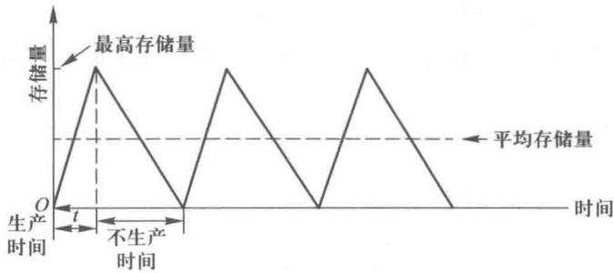

图13-3

$$
\begin{array}{r l} (p - d) t = (p - d) \frac {Q}{p} = \left(1 - \frac {d}{p}\right) Q & \text {(13.5)} \end{array}
$$

同样平均存储量为最高存储量的一半,可以表示为

$$
\begin{array}{r l} \frac {1}{2} (p - d) t = \frac {1}{2} (p - d) \frac {Q}{p} = \frac {1}{2} \left(1 - \frac {d}{p}\right) Q & \text {(13.6)} \end{array}
$$

这样一年的存储费为平均存储水平与一年的每单位产品的存储费的乘积,即为

$$
\begin{array}{r l} \frac {1}{2} \left(1 - \frac {d}{p}\right) Q c _ {1} & \text {(13.7)} \end{array}
$$

同上节一样,设 D 为产品每年的需求量,则可知一年的生产准备费用为每年生产的次数与每次准备费的乘积,即为

$$
\begin{array}{r l} \frac {D}{Q} c _ {3} & \text {(13.8)} \end{array}
$$

这样, 可知全年的总费用 TC 为

$$
\begin{array}{r l} T C = \frac {1}{2} \left(1 - \frac {d}{p}\right) Q c _ {1} + \frac {D}{Q} c _ {3} & \text {(13.9)} \end{array}
$$

在上式中除了 Q 以外, $c_{1},c_{3},D,d,p$ 都是常量,TC 是未知数 Q 的一元函数,当 $\frac{\mathrm{d}(TC)}{\mathrm{d}Q}=0$ 时,TC 取最小值,即当

$$
\begin{array}{r l} \frac {\mathrm{d} (T C)}{\mathrm{d} Q} & = \frac {1}{2} \left(1 - \frac {d}{p}\right) c _ {1} - \frac {D c _ {3}}{Q ^ {2}} = 0, \\ \frac {1}{2} \left(1 - \frac {d}{p}\right) c _ {1} & = \frac {D c _ {3}}{Q ^ {2}}, \\ Q ^ {2} & = \frac {2 D c _ {3}}{\left(1 - \frac {d}{p}\right) c _ {1}}, \end{array}
$$

$$
\begin{array}{r l} Q ^ {*} = \sqrt {\frac {2 D c _ {3}}{\left(1 - \frac {d}{p}\right) c _ {1}}} & \text {(13.10)} \end{array}
$$

时,TC 取最小值.这就是最优经济批量生产公式.当取生产量为

$$
Q ^ {*} = \sqrt {\frac {2 D c _ {3}}{\left(1 - \frac {d}{p}\right) c _ {1}}}
$$

时,每年的存储费 $\frac{1}{2}\left(1-\frac{d}{p}\right)Q^{*}c_{1}$ 与每年的生产准备 $\frac{D}{Q^{*}}c_{3}$ 相等,它们都为

$$
\begin{array}{r l} \sqrt {\frac {D c _ {3} \left(1 - \frac {d}{p}\right) c _ {1}}{2}} & \text {(13.11)} \end{array}
$$

这只要把 $\sqrt{\frac{2Dc_3}{\left(1 - \frac{d}{p}\right)c_1}}$ 代入每年存储费及每年生产准备费中的 $Q^{*}$ 即可得到：当生产量为 $Q^{*}$ 时最

大的存储量为

$$
\begin{array}{r l} \left(1 - \frac {d}{p}\right) Q ^ {*} = \left(1 - \frac {d}{p}\right) \sqrt {\frac {2 D c _ {3}}{\left(1 - \frac {d}{p}\right) c _ {1}}} = \sqrt {\frac {2 D c _ {3} \left(1 - \frac {d}{p}\right)}{c _ {1}}} & \text {(13.12)} \end{array}
$$

这时每个周期(是指从开始生产到停止生产到存储量为零整个时间)所需时间应为每年的工作日数除以每年生产次数所得的商.如果每年工作日为250天,则每个周期所需时间应为

$$
\begin{array}{r l} \frac {2 50}{D / Q ^ {*}} (\text { 天 }) & \text {(13.13)} \end{array}
$$

例 1 有一个生产和销售图书馆设备的公司,经营一种图书馆专用书架,基于以往的销售记录和今后市场的预测,估计今年一年的需求量为 4900 个,由于占有资金的利息以及存储库房以及其他人力物力的费用,存储一个书架一年要花费 1000 元,这种书架是该公司自己生产的,每年的生产能力为 9800 个,而组织一次生产要花费设备调试等生产准备费 500 元,该公司为了把成本降到最低,应如何组织生产呢?要求求出最优每次的生产量 $Q^{*}$ ,相应的周期,最少的每年的总费用,每年的生产次数.

解 从题中可知 D=4900 个/年, 每年的需求率 d=D=4900 个/年, 每年的生产率 p=9800 个/年, $c_{1}=1000$ 元/个年, $c_{3}=500$ 元/次, 即可求得最优每次生产量

$$
Q ^ {*} = \sqrt {\frac {2 D c _ {3}}{\left(1 - \frac {d}{p}\right) c _ {1}}} = \sqrt {\frac {2 \times 4900 \times 500}{\left(1 - \frac {4 900}{9 800}\right) \times 1000}}
$$

$$
= \sqrt {\frac {4 900}{1 / 2}} = \sqrt {9 800} \approx 99 (\text {个}).
$$

每年的生产次数为

$$
\frac {D}{Q ^ {*}} = \frac {4 900}{9 9} = 49. 5 \approx 50.
$$

如果每年的工作日计 250 天, 则相应的周期为

$$
\frac {2 50}{5 0} = 5 (\text {   天   }).
$$

一年最少的总的费用

$$
\begin{array}{r l} {T C} & {= \frac {1}{2} \bigg (1 - \frac {d}{p} \bigg) Q ^ {*} c _ {1} + \frac {D}{Q ^ {*}} c _ {3}} \\ & {= \frac {1}{2} \times \bigg (1 - \frac {4 900}{9 800} \bigg) \times 99 \times 1000 + 50 \times 500 = 49750 (\text {元}).} \end{array}
$$

我们也可以用管理运筹学软件来求解.

## 13.3 允许缺货的经济订货批量模型

允许缺货是指企业可以在存储降至零后,还可以再等一段时间然后订货,当顾客遇到缺货时不受损失,或损失很小并假设顾客会耐心等待直到新的补充到来.当新的补充一到,企业立即将货物交付给这些顾客,如果允许缺货,对企业来说除了支付少量的缺货费外也无其他的损失,这样企业可以利用“允许缺货”这个宽松条件,少付几次订货的固定费用,少付一些存储费,从经济观点出发这样的允许缺货现象是对企业有利的.

允许缺货的经济订货批量模型的假设条件除了允许缺货外,其余条件皆与经济订货批量模型相同,在本节中所出现的符号 $c_{1}, c_{3}, D, d, Q$ 都与第一节相同,另外我们还设 $c_{2}$ 为缺少一个单位的货物一年所支付的单位缺货费.

允许缺货的经济订货批量模型的存储量与时间的关系、最高存储量、最大缺货量 S 如图 13-4 所示.

在图13-4中，我们设总的周期时间（是指两次订货的间隔时间）为 $T$ ，其中 $t_1$ 表示在 $T$ 中不缺货的时间， $t_2$ 表示在 $T$ 中缺货的时间.设 $S$ 为最大缺货量，这时我们可知最高存储量为每次订货量 $Q$ 与最大缺货量 $S$ 的差，即为 $Q - S$ ，因为每次得到订货量 $Q$ 之后就立即支付给顾客最大缺

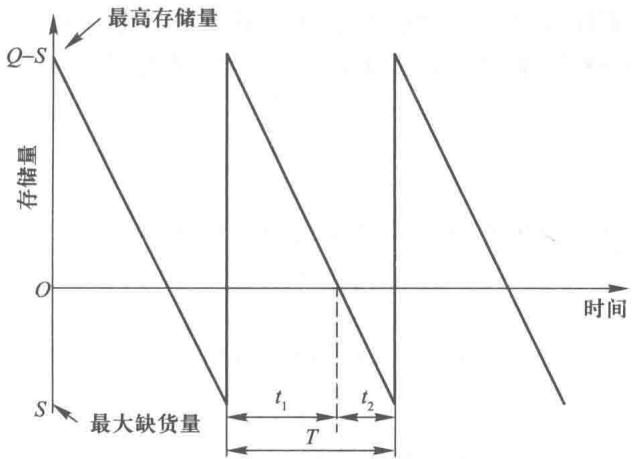

图13-4

货量 S.

从图 13-4 中, 可知在不缺货时期内平均的存储量为 $(Q-S)/2$ , 而在缺货时期内存储量都为 0, 这样我们可以计算出平均存储量, 其值等于一个周期的平均存储量:

$$
\begin{array}{r l}  {\text {平均存储量}} & {= \text {周期总存储量} / \text {周期时间}} \\ & {= (\text {周期内不缺货时总的存储量} + \text {同期内缺货时总的存储量}) /} \\ & {\qquad \text {周期时间}} \\ & {= \frac {\frac {1}{2} (Q - S) t _ {1} + 0 \cdot t _ {2}}{t _ {1} + t _ {2}}} \\ & {= \frac {\frac {1}{2} (Q - S) t _ {1}}{T}.}  & \text {(13.14)} \end{array}
$$

因为最大存储量为 Q-S，每一天的需求为 d，则可求出周期中不缺货的时间 $t_{1}$ ，

$$
\begin{array}{r l} t _ {1} = \frac {(Q - S)}{d} & \text {(13.15)} \end{array}
$$

又因为每次订货量为 Q, 可满足 T 时间的需求即有

$$
\begin{array}{r l} T = \frac {Q}{d} & \text {(13.16)} \end{array}
$$

用式(13.15)，式(13.16)代入式(13.14)，我们得到 $Q, S$ 表示的平均存储量的公式

$$
\begin{array}{r l} \mathrm{平均存储量} = \frac {\frac {1}{2} (Q - S) \cdot \frac {(Q - S)}{d}}{\frac {Q}{d}} = \frac {(Q - S) ^ {2}}{2 Q} & \text {(13.17)} \end{array}
$$

像计算平均存储量那样计算出平均缺货量. 平均缺货量等于周期 T 内的平均缺货量, 从图 13-4 可知在 $t_{1}$ 时间内不缺货, 平均缺货量为零, 而在 $t_{2}$ 时间内, 平均缺货量为 S/2, 即得

$$
\begin{array}{r l} \mathrm{平均缺货量} = \frac {0 \cdot t _ {1} + \frac {1}{2} S \cdot t _ {2}}{T} = \frac {S \cdot t _ {2}}{2 T} & \text {(13.18)} \end{array}
$$

因为最大缺货量为 S，每天需求为 d，则可求出周期中缺货时间 $t_{2}$

$$
\begin{array}{r l} t _ {2} = \frac {S}{d} & \text {(13.19)} \end{array}
$$

把式(13.19)和式(13.16)代入式(13.18)得到用 $Q$ 和 $S$ 表示的平均缺货量公式

$$
\begin{array}{r l} \mathrm{平均缺货量} = \frac {S \cdot \frac {S}{d}}{2 \frac {Q}{d}} = \frac {S ^ {2}}{2 Q} & \text {(13.20)} \end{array}
$$

在允许缺货的情况下，一年总的费用是由一年的存储费、一年的订货费以及一年因缺货而支付的缺货费三个部分组成. $c_{1},c_{2},c_{3}$ 正如上面所述分别表示每单位商品存储一年的费用，每单位商品缺货一年所支付的缺货费，订货一次所支付的订货费，则我们可知一年总的费用为

$$
\begin{array}{r l} T C = \frac {(Q - S) ^ {2}}{2 Q} c _ {1} + \frac {D}{Q} c _ {3} + \frac {S ^ {2}}{2 Q} c _ {2} & \text {(13.21)} \end{array}
$$

在式(13.21)中已知 $c_{1}, c_{2}, c_{3}, D$ 为常量，故 $TC$ 是 $Q$ 和 $S$ 这两个未知数的二元函数，利用微积分的知识知道当 $\frac{\partial(TC)}{\partial Q} = 0, \frac{\partial(TC)}{\partial S} = 0$ 时， $TC$ 取最小值，即有

$$
\begin{array}{r l}  \frac {\partial (T C)}{\partial Q} & = \frac {2 (Q - S) \cdot 2 Q - 2 (Q - S) ^ {2}}{4 Q ^ {2}} c _ {1} - \frac {D}{Q ^ {2}} c _ {3} - \frac {S ^ {2} c _ {2}}{2 Q ^ {2}} \\ & = \frac {c _ {1} Q ^ {2} - (c _ {1} + c _ {2}) S ^ {2} - 2 D c _ {3}}{2 Q ^ {2}} \\ & = 0. \\ \frac {\partial (T C)}{\partial S} & = \frac {- 2 (Q - S)}{2 Q} c _ {1} + \frac {2 S c _ {2}}{2 Q} \\ & = \frac {1}{Q} [ c _ {2} S - c _ {1} (Q - S) ] \\ & = \frac {1}{Q} [ (c _ {1} + c _ {2}) S - c _ {1} Q ] = 0.  & \text {(13.22)} \end{array}
$$

(13.23)

从式(13.23)我们得到

$$
\frac {1}{Q} \big [ (c _ {1} + c _ {2}) S - c _ {1} Q \big ] = 0,   (c _ {1} + c _ {2}) S - c _ {1} Q = 0,
$$

$$
\begin{array}{r l} S = \frac {c _ {1} Q}{c _ {1} + c _ {2}} & \text {(13.24)} \end{array}
$$

把式 $(13.24)$ 代入式 $(13.22)$ 得

$$
\frac {c _ {1} Q ^ {2} - (c _ {1} + c _ {2}) \frac {c _ {1} ^ {2} Q ^ {2}}{(c _ {1} + c _ {2}) ^ {2}} - 2 D c _ {3}}{2 Q ^ {2}} = 0,
$$

$$
c _ {1} Q ^ {2} - (c _ {1} + c _ {2}) \frac {c _ {1} ^ {2} Q ^ {2}}{(c _ {1} + c _ {2}) ^ {2}} - 2 D c _ {3} = 0,
$$

$$
\frac {c _ {1} c _ {2} Q ^ {2}}{c _ {1} + c _ {2}} - 2 D c _ {3} = 0,
$$

$$
\frac {c _ {1} c _ {2} Q ^ {2}}{c _ {1} + c _ {2}} = 2 D c _ {3},
$$

$$
\begin{array}{r l} Q ^ {*} = \sqrt {\frac {2 D c _ {3} (c _ {1} + c _ {2})}{c _ {1} c _ {2}}} & \text {(13.25)} \end{array}
$$

把式 $(13.25)$ 代入式 $(13.24)$ 得

$$
\begin{array}{r l} S ^ {*} = \frac {c _ {1}}{c _ {1} + c _ {2}} Q ^ {*}, & \text {(13.26)} \end{array}
$$

或

$$
\begin{array}{r l} S ^ {*} = \frac {c _ {1}}{c _ {1} + c _ {2}} \sqrt {\frac {2 D c _ {3} (c _ {1} + c _ {2})}{c _ {1} c _ {2}}} = \sqrt {\frac {2 D c _ {3} c _ {1}}{c _ {2} (c _ {1} + c _ {2})}} & \text {(13.27)} \end{array}
$$

式(13.25)，式(13.26)，式(13.27)就是求出使得一年总费用最少的最优订货量 $Q^{*}$ 和相应最大缺货量 $S^{*}$ 的公式。再可以由式(13.15)，式(13.16)和式(13.19)可求出相应的周期T，以及T中的不缺货的时间 $t_{1}$ 和缺货时间 $t_{2}$ 。

例 2 假如在例 1 中的图书馆设备公司只销售书架而不生产书架, 其所销售的书架是靠订货来提供的, 所订的书架厂家能及时提供. 该公司的一年的需求量仍为 4900 个, 存储一个书架一年的花费仍为 1000 元, 每次的订货费是 500 元, 每年工作日为 250 天.

（1）当不允许缺货时，求出使一年总费用最低的最优每次订货量 $Q_{1}^{*}$ ，及其相应的周期，每年的订购次数和一年总费用.

（2）当允许缺货时，设一个书架缺货一年的缺货费为2000元，求出使一年总费用最低的最优每次订货量 $Q_{2}^{*}$ ，相应的最大缺货量 $S^{*}$ 及其相应的周期T，周期中不缺货的时间 $t_{1}$ 、缺货的时间 $t_{2}$ 、每年订购次数和一年的总费用.

解（1）我们可以用经济订货批量模型来求解此题，已知 $D = 4900$ 个/年， $c_{2} = 1000$ 元/(个·年)， $c_{3} = 500$ 元/次，用公式(13.2)，求得最优订货量

$$
Q _ {1} ^ {*} = \sqrt {\frac {2 D c _ {3}}{c _ {1}}} = \sqrt {\frac {2 \times 4900 \times 500}{1 000}} = 70 (\text {个}).
$$

用(13.3)公式,求得周期所需时间 T

$$
T = \frac {2 50}{D / Q _ {1} ^ {*}} = \frac {2 50}{4 900 / 70} = \frac {2 50}{7 0} = 3. 57 (\text {   天   }).
$$

同样可求得每年订货次数为

$$
\frac {D}{Q _ {1} ^ {*}} = \frac {4 900}{7 0} = 70 (\text {次}).
$$

用公式(13.1)可求得一年总的费用

$$
\begin{array}{r l} T C & = \frac {1}{2} Q _ {1} ^ {*} c _ {1} + \frac {D}{Q _ {1} ^ {*}} c _ {3} = \frac {1}{2} \times 70 \times 1000 + \frac {4 900}{7 0} \times 500 \\ & = 70000 (\text {元}). \end{array}
$$

（2）我们用允许缺货的经济订货批量模型来求解.同样有 D=4 900 个/年, $c_{1}=1\ 000$ 元/(个·年), $c_{3}=500$ 元/次, $c_{2}=2\ 000$ 元/(个·年),用公式(13.25)求得最优订货批量

$$
\begin{array}{r l} Q _ {2} ^ {*} & = \sqrt {\frac {2 D c _ {3} (c _ {1} + c _ {2})}{c _ {1} c _ {2}}} \\ & = \sqrt {\frac {2 \times 4900 \times 500 \times (1000 + 2000)}{1 000 \times 2000}} \\ & = 85 (\text {个}). \end{array}
$$

用公式(13.26)求得相应的最大缺货量

$$
S ^ {*} = \frac {c _ {1}}{c _ {2} + c _ {2}} Q _ {2} ^ {*} = \frac {1 000}{3 000} \times 85 \approx 28 (\text {个}).
$$

用公式(13.16)，可求得周期所需时间 T

$$
T = \frac {Q _ {2} ^ {*}}{d} = \frac {8 5}{4 900 / 250} \approx 4. 34 (\text {天}).
$$

用公式(13.19)可求得周期中缺货时间 $t_{2}$

$$
t _ {2} = \frac {S ^ {*}}{d} = \frac {2 8}{1 9 . 6} \approx 1. 43 (\text {   天   }).
$$

在周期中不缺货的时间为

$$
t _ {1} = T - t _ {2} = 4. 34 - 1. 43 = 2. 91 (\text {天}).
$$

每年订购次数为

$$
\frac {4 900}{8 5} \approx 57. 6 (\text { 次 }).
$$

用公式(13.21)求出最少的一年的总费用 $TC^{*}$ ,

$$
\begin{array}{r l} T C ^ {*} & = \frac {(Q _ {2} ^ {*} - S ^ {*}) ^ {2}}{2 Q _ {2} ^ {*}} c _ {1} + \frac {D}{Q _ {2} ^ {*}} c _ {3} + \frac {(S ^ {*}) ^ {2}}{2 Q _ {2} ^ {*}} c _ {2} \\ & = \frac {(85 - 28) ^ {2}}{2 \times 85} \times 1000 + \frac {4 900}{8 5} \times 500 + \frac {2 8 ^ {2}}{2 \times 85} \times 2000 \\ & \approx 19111. 76 + 28823. 53 + 9223. 53 \\ & = 57158. 82 (\text {元}). \end{array}
$$

我们也可以用“管理运筹学”软件来求解.

从 1 和 2 两种情况比较可以看出允许缺货一般比不允许缺货有更大的选择余地,一年的总费用也可以有所降低.但如果缺货费太大,尽管允许缺货,管理者也会避免出现缺货,这时允许缺货,也就变成了不允许缺货的情况了.

## 13.4 允许缺货的经济生产批量模型

此模型与经济生产批量模型相比,放宽了假设条件:允许缺货.与允许缺货的经济订货批量模型相比,相差的只是:补充不是靠订货,补充数量不可以同时到位,补充是靠生产.开始生产时,一部分产品满足当时需要,剩余产品作为存储;生产停止时,靠存储量来满足需求.

允许缺货的经济生产批量模型的存储量与时间的关系,最高存储量,最大缺货量 S 如图 13-5 所示.

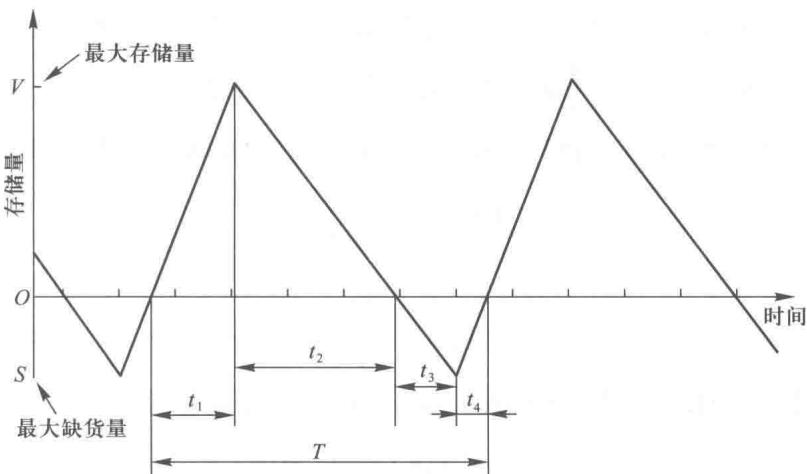

图13-5

在图13-5中 $t_1$ 为在周期 $T$ 中存储量增加的时期， $t_2$ 为在周期 $T$ 中存储量减少的时期， $t_3$ 为在周期 $T$ 中缺货量增加的时期， $t_4$ 为在周期 $T$ 中缺货量减少的时期，显然有周期 $T = t_1 + t_2 + t_3 + t_4$ ，其中 $t_1 + t_2$ 为不缺货时期， $t_3 + t_4$ 为缺货期。图13-5中的 $V$ 表示最大存储量， $S$ 表示最大缺货量。

由于在 $t_{1}$ 期间每天的存储量为 p-d，这里 p 为每天的生产量（生产率），d 为每天的需要量（需求率），可知：最大存储量 $V=(p-d)t_{1}$ ，即得到

$$
\begin{array}{r l} t _ {1} = \frac {V}{p - d} & \text {(13.28)} \end{array}
$$

同样在 $t_{2}$ 期间每天的需要量仍为 d，开始时有库存量 V，这时不生产，则有

$$
\begin{array}{r l} t _ {2} = \frac {V}{d} & \text {(13.29)} \end{array}
$$

在 $t_3$ 期间，开始时没有库存量，每天需求量仍为 $d$ ，直到缺货量为 $S$ ，则有

$$
S = d \cdot t _ {3},
$$

即

$$
\begin{array}{r l} t _ {3} = \frac {S}{d} & \text {(13.30)} \end{array}
$$

在 $t_4$ 期间，每天除了满足当天的需求外，还有 $p - d$ 的产品可用于减少缺货，则有

$$
\begin{array}{r l} t _ {4} = \frac {S}{p - d} & \text {(13.31)} \end{array}
$$

在图13-5中可知在 $t_4$ 和 $t_1$ 中边生产边销售，我们设在同期 $T$ 中总生产量为 $Q$ （都是在 $t_4$ 和 $t_1$ 期间生产），其中总生产量 $Q$ 的 $\frac{d}{p}$ 满足了当时的需求，而剩下的部分 $Q$ 的 $\left(1 - \frac{d}{p}\right)$ 用于偿还缺货和存储，我们知道这个期间（即 $t_4$ 和 $t_1$ 期间）共偿还缺货 $S$ 和存储产品量 $V$ ，即有

$$
V + S = Q \left(1 - \frac {d}{p}\right),
$$

即得最高存储量的表达式

$$
\begin{array}{r l} V = Q \left(1 - \frac {d}{p}\right) - S & \text {(13.32)} \end{array}
$$

从图 13-5 中, 可知在不缺货期间即在 $t_{1}$ 和 $t_{2}$ 期间内的平均存储量为

$$
\begin{array}{r l} \frac {1}{2} V = \frac {1}{2} \left[ Q \left(1 - \frac {d}{p}\right) - S \right], & \text {(13.33)} \end{array}
$$

$$
\begin{array}{r l} & \text {而在缺货期内存储量都为零,这样可以计算出平均存储量,其值等于一个周期的平均存储量} \\ & \text {平均存储量} = \frac {\text {周期总存储量}}{\text {周期时间}} \\ & \quad = \frac {\text {周期内不缺货时总的存储量} + \text {周期内缺货时总的存储量}}{\text {周期时间}} \end{array}
$$

$$
\begin{array}{r l} & = \frac {\frac {1}{2} \left[ Q \left(1 - \frac {d}{p}\right) - S \right] (t _ {1} + t _ {2}) + 0 \cdot (t _ {3} + t _ {4})}{t _ {1} + t _ {2} + t _ {3} + t _ {4}} \\ & = \frac {\frac {1}{2} \left[ Q \left(1 - \frac {d}{p}\right) - S \right] [ t _ {1} + t _ {2} ]}{t _ {1} + t _ {2} + t _ {3} + t _ {4}}. \end{array}
$$

把公式(13.28)，(13.29)，(13.30)，(13.31)代入上式得

$$
\begin{array}{r l} \text {平均存储量} & = \frac {\frac {1}{2} \left[ Q \left(1 - \frac {d}{p}\right) - S \right] \left[ \frac {V}{p - d} + \frac {V}{d} \right]}{\frac {V}{p - d} + \frac {V}{d} + \frac {S}{d} + \frac {S}{p - d}} \\ & = \frac {\frac {1}{2} \left[ Q \left(1 - \frac {d}{p}\right) - S \right] \cdot V \left(\frac {1}{p - d} + \frac {1}{d}\right)}{(V + S) \left(\frac {1}{p - d} + \frac {1}{d}\right)} \\ & = \frac {\frac {1}{2} \left[ Q \left(1 - \frac {d}{p}\right) - S \right] \cdot V}{V + S}. \end{array}
$$

把(13.32)代入上式,得

$$
\begin{array}{r l}  \text {平均存储量} & = \frac {\frac {1}{2} \left[ Q \left(1 - \frac {d}{p}\right) - S \right] \left[ Q \left(1 - \frac {d}{p}\right) - S \right]}{Q \left(1 - \frac {d}{p}\right) - S + S} \\ & = \frac {\left[ Q \left(1 - \frac {d}{p}\right) - S \right] ^ {2}}{2 Q \left(1 - \frac {d}{p}\right)}.  & \text {(13.34)} \end{array}
$$

同样，我们知道在 $t_3$ 和 $t_4$ 期间平均缺货量为 $\frac{1}{2} S$ ，在 $t_1$ 和 $t_2$ 期间缺货量都为零，可求得

$$
\begin{array}{r l} \text {平均缺货量} & = \text {一个周期的平均缺货量} \\ & = \frac {\text {周期内总缺货量}}{\text {周期时间}} \\ & = \frac {\text {周期内不缺货时总缺货量} + \text {周期内缺货时总缺货量}}{\text {周期时间}} \\ & = \frac {0 \cdot (t _ {1} + t _ {2}) + \frac {1}{2} S \cdot (t _ {3} + t _ {4})}{t _ {1} + t _ {2} + t _ {3} + t _ {4}}. \end{array}
$$

把公式(13.28)，(13.29)，(13.30)，(13.31)代入上式得

$$
\begin{array}{r l} \text {平均缺货量} & = \frac {\frac {1}{2} S \cdot \left(\frac {S}{d} + \frac {S}{p - d}\right)}{\frac {V}{p - d} + \frac {V}{d} + \frac {S}{d} + \frac {S}{p - d}} \\ & = \frac {\frac {1}{2} S ^ {2} \left(\frac {1}{d} + \frac {1}{p - d}\right)}{(V + S) \left(\frac {1}{d} + \frac {1}{p - d}\right)} \\ & = \frac {\frac {1}{2} S ^ {2}}{V + S}. \end{array}
$$

把(13.32)代入上式得

$$
\begin{array}{r l} \mathrm{平均缺货量} = \frac {\frac {1}{2} S ^ {2}}{\left[ Q \left(1 - \frac {d}{p}\right) - S \right] + S} = \frac {S ^ {2}}{2 Q \left(1 - \frac {d}{p}\right)} & \text {(13.35)} \end{array}
$$

在本模型中一年总费用

$TC =$ (一年的存储费) + (一年的生产准备费) + (一年的缺货费)

$= (\text{平均存储量}) \times c_{1} + (\text{一年的生产次数}) \times c_{3} + (\text{平均缺货量}) \times c_{2}$ .

式中的 $c_{1}, c_{2}, c_{3}$ 如 §3 中所述那样分别表示每单位商品存储一年的费用、每单位商品缺货一年所支付的缺货费、订货一次所支付的订货费。我们可知一年的生产次数为每年的需求量 $D$ 与每次生产量 $Q$ 之商，即为 $\frac{D}{Q}$ ，把公式（13.34）和（13.35）代入上式得

$$
\begin{array}{r l} T C = \frac {\left[ Q \left(1 - \frac {d}{p}\right) - S \right] ^ {2} c _ {1}}{2 Q \left(1 - \frac {d}{p}\right)} + \frac {D c _ {3}}{Q} + \frac {S ^ {2} c _ {2}}{2 Q \left(1 - \frac {d}{p}\right)} & \text {(13.36)} \end{array}
$$

在(13.36)中, $c_{1},c_{2},c_{3},d,p$ 都为常量,TC是Q和S的函数,同§3中所用的方法一样,当

$$
\frac {\partial (T C)}{\partial S} = 0, \quad \frac {\partial (T C)}{\partial Q} = 0
$$

时,一年总费用 TC 的值最小.这样我们就可求得使一年总费用 TC 最小的最优生产量 $Q^{*}$ 和最优缺货量 $S^{*}$ ,有

$$
\begin{array}{r l} Q ^ {*} = \sqrt {\frac {2 D c _ {3} (c _ {1} + c _ {2})}{c _ {1} c _ {2} \left(1 - \frac {d}{p}\right)}}, & \text {(13.37)} \end{array}
$$

$$
\begin{array}{r l} S ^ {*} = \frac {c _ {1} \left(1 - \frac {d}{p}\right)}{c _ {1} + c _ {2}} Q ^ {*}, & \text {(13.38)} \end{array}
$$

或

$$
\begin{array}{r l}  S ^ {*} & = \frac {c _ {1} \left(1 - \frac {d}{p}\right)}{c _ {1} + c _ {2}} \cdot \sqrt {\frac {2 D c _ {3} (c _ {1} + c _ {2})}{c _ {1} c _ {2} \left(1 - \frac {d}{p}\right)}} \\ & = \sqrt {\frac {2 D c _ {1} c _ {3} \left(1 - \frac {d}{p}\right)}{c _ {2} (c _ {1} + c _ {2})}}.  & \text {(13.39)} \end{array}
$$

把(13.37)，(13.39)代入(13.36)得一年最少的总费用

$$
\begin{array}{r l} T C ^ {*} = \sqrt {\frac {2 D c _ {1} c _ {3} c _ {2} \left(1 - \frac {d}{p}\right)}{c _ {1} + c _ {2}}} & \text {(13.40)} \end{array}
$$

例 3 假如例 1 中的生产与销售图书馆专用书架的图书馆设备公司在允许缺货的情况下，其总费用最少的最优经济生产批量 $Q^{*}$ 和最优缺货量 $S^{*}$ 应为何值，这时一年的最少总费用应该是多少？在本例中，每年的书架需求量 D 仍为 4900 个，每年生产能力 p 仍为 9800 个，每次生产准备费 $c_{3}$ 为 500 元，每年书架存储一年的费用 $c_{1}=1000$ 元，一个书架缺货一年的缺货费为 2000 元.

解 已知 D=4 900 个/年, 每年需求率 d=D=4 900 个/年, 每年生产率 p=9 800 个/年, $c_{1}=1\ 000$ 元/个年, $c_{2}=2\ 000$ 元/个年, $c_{3}=500$ 元/次, 从公式(13.37)得最优每次生产批量 $Q^{*}$ .

$$
\begin{array}{r l} Q ^ {*} & = \sqrt {\frac {2 D c _ {3} (c _ {1} + c _ {2})}{c _ {1} c _ {2} \left(1 - \frac {d}{p}\right)}} \\ & = \sqrt {\frac {2 \times 4900 \times 500 \times (1000 + 2000)}{1 000 \times 2000 \times \left(1 - \frac {4 900}{9 800}\right)}} \\ & = \sqrt {\frac {4 900 \times 3000}{2 000 \times \left(1 - \frac {1}{2}\right)}} \\ & = \sqrt {4 900 \times 3} \\ & \approx 121. 24. \\ Q ^ {*} & \approx 121 (\text {个}). \end{array}
$$

最优缺货量 $S^{*} = \frac{c_{1}\left(1 - \frac{d}{p}\right)}{c_{1} + c_{2}} Q^{*} = \frac{1000\times\left(1 - \frac{4900}{9800}\right)}{1000 + 2000}\times 121.24\approx 20$ （个）.这时一年的最少的总费用

$$
\begin{array}{r l} T C ^ {*} & = \sqrt {\frac {2 D c _ {1} c _ {3} c _ {2} \left(1 - \frac {d}{p}\right)}{c _ {1} + c _ {2}}} \\ & = \sqrt {\frac {2 \times 4900 \times 1000 \times 500 \times 2000 \times \left(1 - \frac {4 900}{9 800}\right)}{1 000 + 2000}} \\ & \approx 40414. 52 (\text {元}). \end{array}
$$

其中一年的生产准备费为

$$
\frac {D c _ {3}}{Q ^ {*}} = \frac {4 900 \times 500}{1 21} \approx 20247. 93 (\mathrm{元})
$$

其中一年的存储费为

$$
\begin{array}{r l} & {\frac {\left[ Q ^ {*} \left(1 - \frac {d}{p}\right) - S ^ {*} \right] ^ {2} c _ {1}}{2 Q ^ {*} \left(1 - \frac {d}{p}\right)}} \\ & {= \frac {\left[ 121 \times \left(1 - \frac {4 900}{9 800}\right) - 20 \right] ^ {2} \times 1000}{2 \times 121 \times \left(1 - \frac {4 900}{9 800}\right)} \approx 13555. 78 (\text {元})} \end{array}
$$

一年的缺货费为

$$
\frac {(S ^ {*}) ^ {2} c _ {2}}{2 Q ^ {*} \left(1 - \frac {d}{p}\right)} = \frac {2 0 ^ {2} \times 2000}{2 \times 121 \times \frac {1}{2}} \approx 6611. 57 (\text {元}).
$$

同时我们也可知道周期

$$
T = \frac {\text {   一年工作日数   }}{D / Q} = \frac {3 65}{4 900 / 121} = \frac {3 65}{4 0 . 50} \approx 9 (\text {   天   }).
$$

在这里我们假设一年的工作日数为 365 天.

我们也可以用“管理运筹学”软件来求解.

我们把例 1 与例 3 加以比较, 可知同样的一个经济生产批量的问题, 允许缺货一般比不允许缺货在一年的总的费用上可以少花一些.

## 13.5 经济订货批量折扣模型

所谓的经济订货批量折扣模型是第一节的经济订货批量模型的一种发展，在第一节的经济订货批量模型中商品的价格是固定的，而在这一节的经济订货批量折扣模型中商品的价格是随订货的数量的变化而变化的。一般情况下购买的数量越多，商品单价就越低，我们常看到的所谓的零售价、批发价和出厂价，就是根据商品的不同数量而订的不同的商品单价。由于不同的订货量，商品的单价不同，所以我们在决定最优订货批量时，不仅要考虑到一年的存储费和一年的订货费，而且还要考虑一年的订购商品的货款，要使得它们的总金额最少，为此在这一节里我们定义一年的总费用是由以上三项所构成，即有

$$
\begin{array}{r l} T C = \frac {1}{2} Q c _ {1} + \frac {D}{Q} c _ {3} + D \cdot c & \text {(13.41)} \end{array}
$$

在这里 c 为当订货量为 Q 时商品单价.

例 4 图书馆设备公司准备从生产厂家购进阅览桌用于销售,每个阅览桌的价格为 500 元,每个阅览桌的存储一年的费用为阅览桌价格的 20%,每次的订货费为 200 元,该公司预测这种阅览桌的每年的需求为 300 个.生产厂商为了促进销售规定:如果一次订购量达到或超过 50 个,每个阅览桌将打九六折,每个售价为 480 元;如果一次订购量达到或超过 100 个,每个阅览桌将打九五折,每个售价为 475 元.请决定为使其一年总费用最少的最优订货批量 $Q^{*}$ ,并求出这时一年的总费用为多少?

解 已知 D=300 个/年, $c_{3}=200$ 元/次, 当一次订货量小于 50 个时, 每个阅览桌价格 $c'=500$ 元, 这时存储费 $c_{1}^{\prime}=500\times20\%=100$ (元/个·年); 当一次订货量大于等于 50 个, 且小于 100 个时, 每个阅览桌价格 $c''=480$ 元, 这时存储费 $c''_{1}=480\times20\%=96$ (元/个·年); 当一次订货量大于等于 100 个时, 每个阅览桌价格 $c'''=475$ 元, 这时存储费 $c'''_{1}=475\times20\%=95$ (元/个·年). 我们可以求得这三种情况的最优订货量如下:

当订货量 Q 小于 50 个时, 有

$$
Q _ {1} ^ {*} = \sqrt {\frac {2 D c _ {3}}{c _ {1} ^ {\prime}}} = \sqrt {\frac {2 \times 300 \times 200}{1 00}} = 34. 64 \approx 35 (\text {个}).
$$

当订货量 Q 大于等于 50 小于 100 时, 有

$$
Q _ {2} ^ {*} = \sqrt {\frac {2 D c _ {3}}{c _ {1} ^ {\prime \prime}}} = \sqrt {\frac {2 \times 300 \times 200}{9 6}} = 35. 36 \approx 35 (\text {个}).
$$

当订货量 Q 大于等于 100 时, 有

$$
Q _ {3} ^ {*} = \sqrt {\frac {2 D c _ {3}}{c _ {1} ^ {\prime \prime \prime}}} = \sqrt {\frac {2 \times 300 \times 200}{9 5}} = 35. 54 \approx 36 (\text {个}).
$$

在以上第二种情况里,我们用订货量大于等于50且小于100时的阅览桌价格480元/个,计算出的最优订货批量 $Q_{1}^{*}$ 却小于50个,仅为35个,为了得到阅览桌的480元/个的折扣价格,又使得实际订货批量最接近计算所得的最优订货批量 $Q_{2}^{*}$ ,我们调整其最优订货批量 $Q_{2}^{*}$ 的值,得

$$
Q _ {2} ^ {*} = 50 (\text { 个 }).
$$

同样,我们调整第三种情况最优订货批量 $Q_{3}^{*}$ 的值,得

$$
Q _ {3} ^ {*} = 100 (\text {个}).
$$

我们用公式(13.41)可求得当 $Q_{1}^{*}=35,Q_{2}^{*}=50,Q_{3}^{*}=100$ 时的每年的总费用如表13-3所示.
表 13-3 单位: 元

<table><tr><td rowspan="2">折扣等级</td><td rowspan="2">阅览桌单价</td><td rowspan="2">最优订货批量 \(Q^*\) </td><td colspan="4">每年费用</td></tr><tr><td>存储费 \(\frac{1}{2}Q^*c_1\) </td><td>订货费 \(\frac{D}{Q^*}c_3\) </td><td>购货费DC</td><td>总费用</td></tr><tr><td>1</td><td>500</td><td>35</td><td> \(\frac{1}{2}\times 35\times 100=1750\) </td><td> \(\frac{300}{35}\times 200\approx 1714\) </td><td> \(300\times 500=150000\) </td><td>153 464</td></tr><tr><td>2</td><td>480</td><td>50</td><td> \(\frac{1}{2}\times 50\times 96=2400\) </td><td> \(\frac{300}{50}\times 200=1200\) </td><td> \(300\times 480=144000\) </td><td>147 600</td></tr><tr><td>3</td><td>475</td><td>100</td><td> \(\frac{1}{2}\times 100\times 95=4750\) </td><td> \(\frac{300}{100}\times 200=600\) </td><td> \(300\times 475=142500\) </td><td>147 850</td></tr></table>

从表 13-3 可得当 $Q^{*} = 50$ 时, 一年的总费用最少为 147600 元. $Q^{*} = 50$ , 即为最优订货量. “管理运筹学”软件能处理这类存储问题.

## 13.6 需求为随机的单一周期的存储模型

在前面的一些存储模型中,我们把需求率看成常量,我们把每年、每月、每周、甚至每天的需求都看成是固定不变的已知常量,但在现实的世界中,更多的情况需求却是一个随机变量.

所谓需求为随机变量的单一周期的存储模型,就是解决需求为随机变量的一种存储模型,在这种模型中的需求是服从某种概率分布的.在本节中将介绍需求服从均匀分布和正态分布这两种情况.模型中单一周期的存储是指在产品订货、生产、存储、销售这一周期的最后阶段或者把产品按正常价格全部销售完毕,或者把按正常价格未能销售出去的产品削价销售出去甚至扔掉.总之要在这一周期内把产品全部处理完毕,而不能把产品放在下一周期里存储和销售.季节性和易变质的产品例如季节性的服装、挂历、麦当劳店里的汉堡包都是按单一周期的方法处理的.而报摊销售报纸是需要每天订货的,今天的报纸今天必须处理完.我们可以把一个时期报纸问题看成一系列的单一周期的存储问题,每天就是一个单一的周期,任何两天（两个周期）都是相互独立的、没有联系的,每天都要做出每天的存储决策.

报童问题:报童每天销售报纸数量是一个随机变量,每日售出d份报纸的概率 $P(d)$ ,根据以往的经验是已知的.报童每售出一份报纸赚k元,如报纸未能售出,每份赔h元,问报童每日最好准备多少报纸?

这就是一个需求量为随机变量的单一周期的存储问题.在这个模型里就是要解决最优订货量 $Q$ 的问题.如果订货量 $Q$ 选得过大,那么报童就要因不能售出报纸造成损失.如果订货时 $Q$ 选得过小,那么报童因缺货失去了销售机会造成了机会损失.如何适当地选择 $Q$ 值,才能使这两种损失的期望值之和最小呢?

我们已知售出 $d$ 份报纸的概率为 $P(d)$ ，从概率知识可知 $\sum_{d=0}^{\infty} P(d) = 1$ .

（1）当供大于求时 $(Q\geqslant d)$ ，这时因不能售出报纸而承担损失，每份损失为h元，其数学期望值为 $\sum_{d=0}^{Q}h(Q-d)P(d)$ .

（2）当供不应求时 $(Q<d)$ ，这时因缺货而少赚钱造成的机会损失，每份损失为k元，其期望值为

$$
\sum_ {d = Q + 1} ^ {\infty} k (d - Q) P (d).
$$

综合(1)，(2)两种情况，当订货量为 $Q$ 时，其损失的期望值 $\operatorname{EL}(Q)$ 为

$$
\mathrm{EL} (Q) = h \sum_ {d = 0} ^ {Q} (Q - d) P (d) + k \sum_ {d = Q + 1} ^ {\infty} (d - Q) P (d).
$$

下面我们要求出使 $\mathrm{EL}(Q)$ 最小的 Q 的值.

我们设报童订购报纸最优量为 $Q^{*}$ ，这时其损失的期望值为最小，当然就有

(1) $\mathrm{EL}(Q^{*}) \leqslant \mathrm{EL}(Q^{*} + 1)$ ,

(2) $\mathrm{EL}(Q^{*}) \leqslant \mathrm{EL}(Q^{*} - 1).$

上式(1)(2)表示了订购 $Q^{*}$ 份报纸的损失期望值要不大于订购 $(Q^{*}+1)$ 份或 $(Q^{*}-1)$ 份报纸的损失期望值.

从(1)出发进行推导有

$$
h \sum_ {d = 0} ^ {Q ^ {*}} (Q ^ {*} - d) P (d) + k \sum_ {d = Q ^ {*} + 1} ^ {\infty} (d - Q ^ {*}) P (d) \leqslant h \sum_ {d = 0} ^ {Q ^ {*} + 1} (Q ^ {*} + 1 -
$$

$$
d) P (d) + k \sum_ {d = Q ^ {*} + 2} ^ {\infty} (d - Q ^ {*} - 1) P (d),
$$

经化简后得

$$
(k + h) \left[ \sum_ {d = 0} ^ {Q ^ {*}} P (d) \right] - k \geqslant 0,
$$

即

$$
\sum_ {d = 0} ^ {Q ^ {*}} P (d) \geqslant \frac {k}{k + h}.
$$

从(2)出发进行推导有

$$
\begin{array}{r l} & h \sum_ {d = 0} ^ {Q ^ {*}} (Q ^ {*} - d) P (d) + k \sum_ {d = Q ^ {*} + 1} ^ {\infty} (d - Q ^ {*}) P (d) \leqslant h \sum_ {d = 0} ^ {Q ^ {*} - 1} (Q ^ {*} - 1 - \\ & \quad d) P (d) + k \sum_ {d = Q ^ {*}} ^ {\infty} (d - Q ^ {*} + 1) P (d), \end{array}
$$

经化简后得

$$
(k + h) \left[ \sum_ {d = 0} ^ {Q ^ {*} - 1} P (d) \right] - k \leqslant 0,
$$

即

$$
\sum_ {d = 0} ^ {Q ^ {*} - 1} P (d) \leqslant \frac {k}{k + h}.
$$

这样我们可知报童所订购报纸的最优数量 $Q^{*}$ 份应按下列的不等式确定

$$
\begin{array}{r l} \sum_ {d = 0} ^ {Q ^ {*} - 1} P (d) \leqslant \frac {k}{k + h} \leqslant \sum_ {d = 0} ^ {Q ^ {*}} P (d) & \text {(13.42)} \end{array}
$$

例 5 某报亭出售某种报纸,每售出一百张可获利 15 元,如果当天不能售出,每一百张赔 20 元.每日售出该报纸份数的概率 $P(d)$ ,根据以往经验如表 13-4 所示.

表13-4

<table><tr><td>销售量/百张</td><td>5</td><td>6</td><td>7</td><td>8</td><td>9</td><td>10</td><td>11</td></tr><tr><td>概率 \(P(d)\) </td><td>0.05</td><td>0.10</td><td>0.20</td><td>0.20</td><td>0.25</td><td>0.15</td><td>0.05</td></tr></table>

试问报亭每日订购多少张该种报纸能使其赚钱的期望值最大.

解 要使其赚钱的期望值最大,也就是使其因售不出报纸的损失和因缺货失去销售机会的损失的期望值之和为最小,利用(13.42)公式确定 $Q^{*}$ 值,已知 k=15, h=20 有

$$
\frac {k}{k + h} = \frac {1 5}{1 5 + 20} = 0. 4286.
$$

当 $Q = 8$ 时，有

$$
\begin{array}{r l} \sum_ {d = 0} ^ {7} P (d) & = p (5) + p (6) + p (7) \\ & = 0. 05 + 0. 10 + 0. 20 = 0. 35. \\ \sum_ {d = 0} ^ {8} P (d) & = p (5) + p (6) + p (7) + p (8) \\ & = 0. 05 + 0. 10 + 0. 20 + 0. 20 = 0. 55. \\ & \sum_ {d = 0} ^ {7} p (d) \leqslant \frac {k}{k + h} \leqslant \sum_ {d = 0} ^ {8} p (d). \end{array}
$$

满足

故最优的订购量为 800 张报纸, 此时其赚钱的期望值最大.

例 6 某书店拟在年前出售一批新年挂历. 每售出一本可赢利 20 元, 如果在年前不能售出, 必须削价处理. 由于削价, 一定可以售完, 此时每本挂历要赔 16 元, 根据以往的经验, 市场的需求近似服从均匀分布, 如图 13-6 所示, 其最低需求为 550 本, 最高需求为 1100 本, 该书店应订购多少本新年挂历, 使其损失期望值为最小?

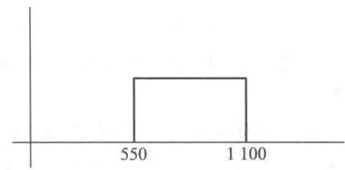

图13-6

解 首先我们来改写一下公式(13.42).

因为 $\sum_{d=0}^{Q^*} P(d)$ 表示需求量从 0 到 $Q^*$ 的概率的和, 也可以理解为需求量小于等于 $Q^*$ 的概率, 即可改写为 $P(d \leqslant Q^*)$ , 同样 $\sum_{d=0}^{Q^* - 1} P(d)$ 也可以改写 $P(d < Q^*)$ , 这样公式 (13.42) 可改写为

$$
\begin{array}{r l} P (d <   Q ^ {*}) \leqslant \frac {k}{k + h} \leqslant P (d \leqslant Q ^ {*}) & \text {(13.43)} \end{array}
$$

这样就把只适用于离散型随机变量的公式(13.42)改写为对离散型和连续型随机变量都适用的公式(13.43)，这正如微积分细分的思想一样，在一定条件下离散型和连续型是可以互相转化的。当仅对连续型随机变量来说，我们可以把公式(13.43)改写为

$$
\begin{array}{r l} P (d \leqslant Q ^ {*}) = \frac {k}{k + h} & \text {(13.44)} \end{array}
$$

我们已知 $k = 20, h = 16$ ，即有

$$
p (d \leqslant Q ^ {*}) = \frac {2 0}{2 0 + 16} = \frac {2 0}{3 6} = \frac {5}{9}.
$$

而对在[550,1100]区间上的均匀分布的需求小于等于 $Q^{*}$ 的概率

$$
p (d \leqslant Q ^ {*}) = \frac {Q ^ {*} - 550}{1 100 - 550} = \frac {Q ^ {*} - 550}{5 50},
$$

则从公式(13.44)得

$$
\frac {Q ^ {*} - 550}{5 50} = \frac {5}{9}.
$$

求得 $Q^{*}=856$ （本），并从 $p(d\leqslant Q^{*})=\frac{5}{9}$ 可知这时有 $\frac{5}{9}$ 的概率挂历有剩余，有 $1-\frac{5}{9}=\frac{4}{9}$ 的概率挂历脱销.

例7 某化工公司与一客户签订了一项供应一种独特的液体化工产品的合同，客户每隔六个月来购买一次，每次购买的数量是一个随机变量，通过对客户以往需求的统计分析，知道这个随机变量服从以均值 $\mu = 1000$ 千克，均方差 $\sigma = 100$ 千克的正态分布，化工公司生产一千克此种产品的成本为15元，根据合同规定售价为20元.合同要求化工公司必须按时提供客户的需求.一旦化工公司由于低估了需求，产量不能满足需要，那么化工公司就到别的公司以每千克19元的价格购买更高质量的替代品来满足客户的需要.一旦化工公司由于高估了需求，供大于求，由于这种产品在两个月内要老化，不能存储至六个月后再供应给客户，只能以每千克5元的价格处理掉.化工公司应该每次生产多少千克的产品才使该公司获利的期望值最大呢？

解 这是一个需求为随机变量的单一周期的问题,如果我们低估了需求,供小于求,缺少的部分公司从每千克赚5元变为仅赚1元,也即损失了4元利润,即k=4,反之如果高估了需求供大于求,则多余的部分每千克要赔15-5=10（元）,即h=10,利用公式(13.44),即得

$$
P (d \leqslant Q ^ {*}) = \frac {k}{k + h} = \frac {4}{1 0 + 4} = \frac {4}{1 4} = 0. 29.
$$

从概率统计知识可知,由于需求量服从均值 $\mu$ 为1000千克,均方差 $\sigma$ 为100千克的正态分布,上式即为

$$
\Phi \left(\frac {Q ^ {*} - \mu}{\sigma}\right) = 0. 29.
$$

通过查阅标准正态表,即得

$$
\frac {Q ^ {*} - \mu}{\sigma} = - 0. 55,
$$

得

$$
Q ^ {*} = - 0. 55 \sigma + \mu .
$$

把 $\mu=1\ 000,\sigma=100$ 代入, 得

$$
Q ^ {*} = - 0. 55 \times 100 + 1000 = 945 (\text { 千   克 }).
$$

并从 $P(d \leqslant Q^{*}) = 0.29$ ，可知当产量为945千克时，有0.29的概率产品有剩余，有 $1 - 0.29 = 0.71$ 的概率产品将不满足需求.图13-7显示了这个结果

“管理运筹学”软件有专门处理这类问题的程序.

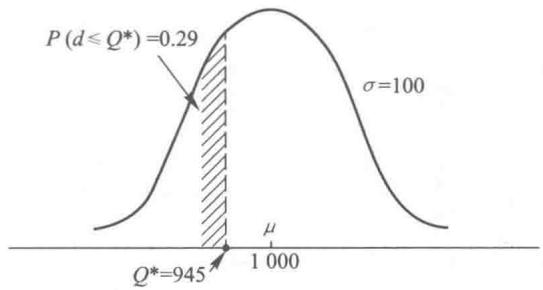

图13-7

## 13.7 需求为随机变量的订货批量、再订货点模型

在上一节里,我们讲了需求为随机变量的单一周期的存储模型,在这一节里讲一种需求为随机变量的多周期模型.在这种模型里,由于需求为随机变量,我们无法求得周期(即两次订货时间间隔)的确切时间,也无法求得再订货点确切来到的时间.但在这种多周期的模型里,在上一周期里卖不出去的产品可以放到下一个周期里出售,故不存在像单一周期模型里一个周期里出售不出去的产品就要赔偿的情况,故在这种模型里像经济订货批量模型那样,主要的费用为订货费和存储费.下面我们给出求订货量和再订货点的最优解的近似方法,而精确的数学公式太复杂,我们不作介绍.我们可以根据平均需求像经济订货批量模型那样求出使得全年的订货费和存储费总和最少的最优订货量 $Q^{*}$ .但在对再订货点的处理上是与经济订货批量模型不同.在经济订货批量模型中,由于需求率是个常量d/天,对于一个需要m天前订货的情况,我们可以把再订货点定为 $d\cdot m$ ,即当仓库里还存有dm单位的产品时,就再订货 $Q^{*}$ 单位的产品,这样当m天后 $Q^{*}$ 单位的产品补充来时,仓库里刚好把剩余的dm单位的产品处理完,仓库及时地得到补充.而对需求为随机变量的情况,这种处理显然是不恰当的,正像图13-8所示,有时在这m天里需求大于 $\overline{dm}$ (这里 $\overline{d}$ 为每天平均需求),这样在m天里就出现了缺货,而有时需求小于 $\overline{dm}$ ,这样m天后当新的 $Q^{*}$ 单位的产品补充来时,仓库里还有剩货.

在这种模型里我们要对再订货点进行讨论,而不是简单地定为 $\overline{dm}$ , 我们不妨设再订货点为 r, 即我们随时对仓库的产品库存进行检查, 当仓库里产品库存为 r 时就订货, m 天后送来 $Q^{*}$ 单位的产品, 虽然在 m 天里的需求量是随机的, 但一般来说当 r 值较大时, 在 m 天里出现缺货的概率就小,反之当 r 值较小时,在 m 天里出现缺货的概率就大.这样就需要我们根据具体情况制定出服务水平,即制定在 m 天里出现缺货的概率 $\alpha$ ,也即不出现缺货的概率为 $1-\alpha$ .即

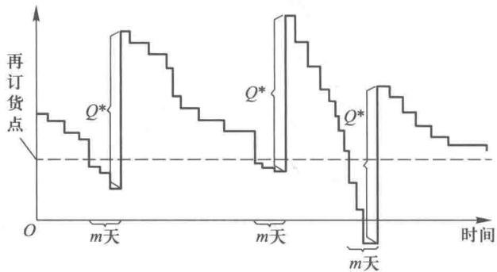

图13-8

$$
P (m \text {   天里需求量   } \leqslant r) = 1 - \alpha .
$$

由于每次的订货量 $Q^{*}$ 我们可以按经济订货批量模型求得, 每年的产品平均需求量可以求得, 这样就可以求出每年平均的订货次数, 我们也可以以每年允许在 m 天里出现缺货的次数来作为服务水平. 我们可以依据事先制定的服务水平和 m 天里需求量的概率分布来定出相应的 r 值, 并把 r 值中超过 $\overline{dm}$ 的部分叫做安全存储.

例 8 某装修材料公司经营某种品牌的地砖,公司直接从厂家购进这种产品,由于公司与厂家距离较远,双方合同规定在公司填写订货单后一个星期厂家把地砖运到公司,公司根据以往的数据统计分析知道在一个星期里此种地砖的需求量服从以均值 $\mu=850$ 箱,均方差 $\sigma=120$ 箱的正态分布,又知道每次订货费为 250 元,每箱地砖的成本为 48 元,存储一年的存储费用为成本的 20%,即每箱地砖一年的存储费为 $48\times20\%=9.6$ (元),公司规定的服务水平为允许由于存储量不够造成的缺货概率为 5%.公司应如何制定存储策略,使得一年的订货费和存储费的总和为最少?

解 首先我们可以按经济订货批量模型来求出最优订货批量 $Q^{*}$ ，已知每年的平均需求量 $\overline{D}=850\times52=44\ 200$ 箱/年， $c_{1}=9.6$ 元/箱年， $c_{3}=250$ 元，得

$$
Q ^ {*} = \sqrt {\frac {2 \overline {{{D}}} c _ {3}}{c _ {1}}} = \sqrt {\frac {2 \times 44200 \times 250}{9 . 6}} \approx 1517 (\text {箱}).
$$

由于每年平均需求为 44200 箱, 可知每年平均约订货 $\frac{44200}{1517} \approx 29$ 次.

根据服务水平的要求

$$
P (\text {   一个星期的需求量   } \leqslant r) = 1 - \alpha = 1 - 0. 05 = 0. 95.
$$

因为一个星期的需求量服从以均值 $\mu=850$ 箱，均方差 $\sigma=120$ 箱的正态分布，故有

$$
\Phi \left(\frac {r - \mu}{\sigma}\right) = 0. 95.
$$

查标准正态分布表,得

$$
\frac {r - \mu}{\sigma} = 1. 645,
$$

即有

$$
\frac {r - 850}{1 20} = 1. 645.
$$

求得

$$
r = 850 + 1. 645 \times 120 = 850 + 197 \approx 1047 (\text {箱}).
$$

这就是说当仓库里库存剩下 $r = 1047$ 箱时，就应该向厂家订货，每次的订货量为1517箱，这里的 $r = 1047$ 就是再订货点， $Q^{*} = 1517$ 就是最优订货量，而

$$
\begin{array}{r l} r - \overline {{d}} \cdot m & = 1   047   \text {箱} - 850   \text {箱} / \text {周} \times (\text {一周}) \\ & = 1   047   \text {箱} - 850   \text {箱} \\ & = 197   \text {箱}. \end{array}
$$

这 197 箱就是安全存储量, 在这样的存储策略下, 能有 95% 的概率在订了货而货物还没运到公司的一周 (简称订货期) 里不会出现缺货. 因为一年平均大约订货 29 次, 其中平均 $29 \times 95\% = 27.55$ (次) 的订货期里不会出现缺货, 也只有平均 1.45 次的订货期里会出现缺货. 图 13-9 显示了这个结果.

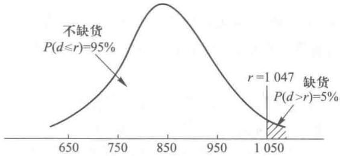

图13-9

当订货期为零时也就是说一订货就可马上拿到产品,这时显然不需要安全存储,再订货点为零,每次订货量为1517箱即可.

## 13.8 需求为随机变量的定期检查存储量模型

需求为随机变量的定期检查存储量模型是另一种处理多周期的存储问题的模型.在这个模型里管理者要定期例如每隔一周、一个月等检查产品的库存量，根据现有的库存量来确定订货量，在这模型中管理者所要做的决策是：依照规定的服务水平制定出产品的存储补充水平 $M$ .一旦确定了 $M$ ，管理者就很容易确定订货量 $Q$ 如下所示：

$$
Q = M - H,
$$

式中 H 为在检查中的库存量.

这个模型很适合于经营多种产品并进行定期盘点的企业,公司只要制定了各种产品的存储补充水平,根据盘点的各种产品的库存量,马上可以确定各产品的订货量,同时进行各种产品的订货.

需求为随机变量的定期检查库存量的存储模型处理存储问题的典型方式如图 13-10 所示.

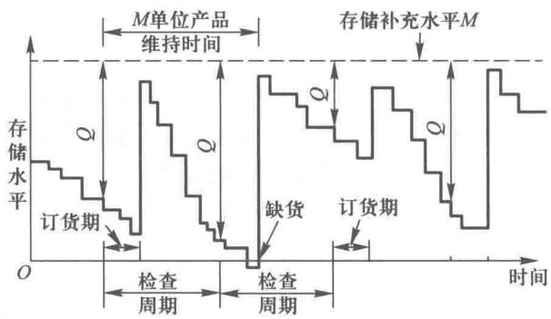

图13-10

从图 13-10 中, 我们看到在检查了存储水平 H 之后, 我们立即订货 Q = M - H, 这时库房里的实际库存量加上订货量正好为存储补充水平 M (订货的 Q 单位产品在过了订货期才能到达). 从图上可知这 M 单位的产品要维持一个检查周期再加上一个订货期的消耗, 所以我们可以从一个检查周期加上一个订货期的需求的概率分布情况结合规定的服务水平来制定存储水平 M, 以下我们举例说明.

例 9 某百货商店经营几百种商品,该商店每隔两周盘点一次,根据盘点情况同时对几百种商品进行订货,这样便于管理.又因为其中很多商品可以从同一个厂家或批发公司进货,这样也节约了订货费用.现在商店管理者要求对这几百种商品根据各自的需求情况和服务水平制定出各自的存储补充水平.现要求对其中两种商品制定出各自的存储补充水平.

商品 A 是一种名牌香烟.一旦商店缺货,顾客不会在商店里购买另一种品牌的烟,而去另外的商店购买,故商店规定其缺货的概率为 2.5%.商品 B 是一种普通品牌的儿童饼干,一旦商店缺货,一般情况下,顾客会在商店里购买其他品牌的饼干或其他儿童食品,故商店规定其缺货的概率为 $15\%$ .根据以往的数据，通过统计分析，商品A每15天（其中14天为盘点周期，1天为订货期）的需求服从均值 $\mu_{\mathrm{A}} = 550$ 条，均方差 $\sigma_{\mathrm{A}} = 85$ （条）的正态分布，商品B每15天（其中14天为盘点周期，1天为订货期）的需求服从均值 $\mu_{\mathrm{B}} = 5300$ 包，均方差 $\sigma_{\mathrm{B}} = 780$ 包的正态分布.

解 设商品 A 的存储补充水平为 $M_{A}$ ，商品 B 的存储补充水平为 $M_{B}$ ，从统计知识可知：

$P(\text{商品 A 的需求 } d \leqslant M_{\text{A}}) = 1 - \alpha_{\text{A}}$ ,

$$
\Phi \left(\frac {M _ {\mathrm{A}} - \mu_ {\mathrm{A}}}{\sigma_ {\mathrm{A}}}\right) = 97.5\%.
$$

查标准正态分布表,得

$$
\begin{array}{r l} & {\frac {M _ {\mathrm{A}} - \mu_ {\mathrm{A}}}{\sigma_ {\mathrm{A}}} = 1. 96,} \\ & {M _ {\mathrm{A}} = \mu_ {\mathrm{A}} + 1. 96 \sigma_ {\mathrm{A}} = 550 + 1. 96 \times 85 \approx 717 (\text {条}).} \end{array}
$$

$P(\text{商品 B 的需求 } d \leqslant M_{\mathrm{B}}) = 1 - \alpha_{\mathrm{B}},$

$$
\Phi \left(\frac {M _ {\mathrm{B}} - \mu_ {\mathrm{B}}}{\sigma_ {\mathrm{B}}}\right) = 85\%.
$$

查标准正态分布表,得

$$
\begin{array}{r l} & {\frac {M _ {\mathrm{B}} - \mu_ {\mathrm{B}}}{\sigma_ {\mathrm{B}}} = 1. 034,} \\ & {M _ {\mathrm{B}} = \mu_ {\mathrm{B}} + 1. 034 \sigma_ {\mathrm{B}} = 5300 + 1. 034 \times 780 \approx 6107 (\text {包}).} \end{array}
$$

也就是说，商店在每隔两周的清货盘点时，发现A商品还剩 $H_{\mathrm{A}}$ ，B商品还剩 $H_{\mathrm{B}}$ 时，马上向厂家订货：A商品为 $717 - H_{\mathrm{A}}$ 条，B商品为6107- $H_{\mathrm{B}}$ 包，使得当时A商品的库存量加上订货量正好达到存储补充水平717条，B商品的库存量加上订货量正好达到存储补充水平6107包.图13-11(a)显示了缺货概率为 $2.5\%$ 时的存储补充水平 $M_{\mathrm{A}}$ ，图13-11(b)显示了缺货概率为 $15\%$ 时存储补充水平 $M_{\mathrm{B}}$

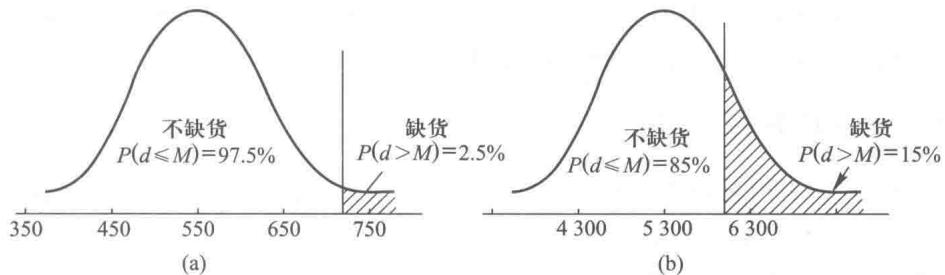

图13-11

在上述的模型里只考虑了保证一定服务水平的存储补充水平 M 的问题, 并没考虑到订货费与存储费之和最小化的问题, 要解决这类问题, 我们还必须把再订货点 r 作为另一个决策变量, 把这称为 $(t, r, M)$ 混合存储模型, 每隔 t 时间检查库存量 H, 当 H > r 时不补充, 当 $H \leqslant r$ 时补充存储量使之达到 M. 这种存储模型需要更多的数学知识, 在本书中不作介绍.

## 13.9 物料需求计划(MRP)与准时化生产方式(JIT)简介

在存储管理与控制中有两个重要的技术:物料需求计划(MRP)和准时化生产方式(JIT),我们对它们作一个简单介绍.

### 一、物料需求计划(MRP)

我们在前几节所涉及的一些存储模型中,其产品的需求都描述为独立的,也就是说一些产品的需求互相之间没有关系,但在很多情况中,尤其在制造业的工厂里,原材料的需求、零件的需求和部件的需求之间存在着依赖关系.首先它们都由最终产品的产量所决定,其次它们的生产或订购进度表可以从最终产品的生产进度的安排计算出来.物料需求计划(MRP)就是一种针对需求为依赖关系的产品进行生产与存储的管理和控制技术.

MRP 是基于计算机的生产与存储计划和控制系统, 它有三个目标: ①确认装配最终产品所需要的原料、零件与部件. ②使存储水平最小化. ③制定制造、购买和运输的时间表.

MRP 系统需要三个主要输入: ①主生产计划, 所谓主生产计划是指最终产品的生产计划. ②产品结构记录, 它包括生产每一件最终产品所需的原材料、零部件的清单和所需的生产 （订购） 时间等信息. ③原材料、零部件的库存记录. MRP 系统通过最终产品结构记录将主生产计划中对最终产品的需求进行分解, 进而确定在产品结构各层次上零部件、原材料的净需求量, 以及各零件的最优的生产 （或订购） 与存储计划; 也就是确定各种零件的生产 （订购） 数量, 以及何时下达零部件的生产任务, 何时交货, 并使存储水平最小.

MRP 的技术不断地得到发展. MRP 引入资源计划与保证、安排生产、执行监控与反馈等功能, 形成闭环的 MRP 系统. 当闭环的 MRP 进一步扩展将经营、财务与生产管理子系统相结合, 形成制造资源计划 (MRP II). 当 MRP II 融合了其他现代管理思想与技术, 形成了面向更广泛市场的企业资源计划 (Enterprise Resource Planning, ERP).

### 二、准时化生产方式（JIT）

准时化生产方式(JIT)是近年来日本人创造的一种引人注目的物料管理与控制的新方法,它的哲学目标是彻底消除包括不必要存储在内的所有的浪费.

它的基本原则是在正确的时间,生产正确数量的零件或产品,即准时生产.存储要极小化,甚至不需要.

为了达到 JIT 的目标,首先要应用 JIT 生产系统设计与计划技术,要进行广义的生产系统设计,包括市场、销售、产品设计、加工工艺、质量工程、工厂布局和生产管理等,设计一条从原材料到最终产品的高效和准时的制造过程中的物流,以便减少存储和降低成本.

JIT 的生产活动是由后续工序来加以协调的,这与传统的生产过程是不一样的,例如 MRP 是按主生产计划的要求,在需要的时间、地点生产需要的零部件,在生产过程中由前道工序向后道工序送货,这是一种“推动式”的生产方式.而 JIT 的零部件仅在后续工序提出要求时才生产,这是一种“拉动式”的生产.协调整个生产活动的关键部分是称为“看板”的信息系统,它动态地提供了各生产过程所需的原材料,零部件的数量、规格.后道工序根据“看板”向前道工序取货,前道工序根据后道工序的需要在正确的时间,生产正确数量的零件或产品,零件或产品一生产出来就被下道工序取走,防止了不必要的存储,达到了库存量最低（零库存）,同时也就要求生产的准备时间最短（零准备时间）这样才有可能采用极小批量.

保证质量是 JIT 中的一个关键问题. 在 JIT 中, 生产的数量和存储水平都是最小化的, 没什么安全存储, 任何质量问题都将打乱整个计划的物流运行, 危及整个 JIT 系统, 故要求废品率最低 （零废品）.

最后,协调好从供应商到制造商的物流是 JIT 中的另一个关键问题. JIT 不允许供应商把原材料、零部件大批量的运给制造商,因为会造成大量的存储从而提高成本.这要求供应商根据制造商的每日的需要,每日平稳地、及时地把原材料和零部件送到制造商的手里. JIT 需要制造商与供应商之间有着紧密的伙伴关系,以保证制造商及时地获得无缺陷的所需物资.

执行 JIT 生产方式可以通过减少存储成本和提高质量而获得更多的利润.从存储管理来看，JIT 可以减少存储水平，增加存储流动量，使存储总费用最低.尽管 JIT 在存储管理上有明显的效果，但是由于在文化与行为上的差别，现在还不清楚是否能把这种日本的生产方式成功地推广到中国、美国等其他国家.目前大部分的中国和美国企业仍然使用传统的存储管理方法.

## 习题

1. 假设某工厂需要外购某一个部件,年需求为4800件,单价为40元.每次的订购费用为350元,每个部件存储一年的费用为每个部件的价格的25%.又假设每年有250个工作日.该部件需要提前5天订货(即订货后5天可送货到厂),不允许缺货,请求出:

(1) 经济订货批量；

(2) 再订货点(即当部件存储量降为多少时,应该再订货);

(3)两次订货所间隔的时间；

(4) 每年订货与存储的总费用.

2. 某建筑工地每月需求水泥 1200 吨, 每吨定价为 1500 元, 不允许缺货. 设每吨每月的存储费为 2%, 每次订货为 1800 元, 需要提前 7 天订货, 每年的工作日为 365 天, 请求出:

(1) 经济订货批量；

(2) 再订货点；

(3) 两次订货所间隔时间；

(4) 每月订货和存储的总费用.

3. 某个食品批发站，用经济订货批量模型处理某种品牌啤酒的存储策略，当存储每箱啤酒一年的费用为每箱啤酒价格的 $22\%$ ，即每年存储成本率为 $22\%$ 时，该批发站确定的经济订货批量 $Q^{*} = 8000$ 箱.由于银行贷款利

息的增长,每年存储成本率增长为 27%,请问:

(1) 这时其经济订货批量应为多少?

(2) 当每年存储成本率从 i 增长到 $i'$ 时, 请推出经济订货批量变化的一般表达式.

4. 某大型百货超市出售某品牌拉杆箱，根据以往销量，每月需求量为 400 个，订货费为 500 元，每个拉杆箱的存储费为 3.6 元/月。试求：

(1) 经济订货批量.

(2) 该百货超市为少占用流动资金，希望存储量达到最低限度，决定宁可使总费用超过最低费用的 $4\%$ 作为存储策略，问这时订购批量为多少？

5. 某牛仔裤生产商预测下一年度的销售量为 12 000 件, 准备在全年的 300 个工作日内均衡组织生产. 假如为加工制作一件牛仔裤所需的各种原材料成本为 50 元, 又知制作一件牛仔裤所需原料的年存储费为其成本的 12%, 提出一次订货所需费用为 250 元, 订货提前期为零, 不允许缺货.

(1) 试求经济订货批量.

(2)若工厂一次订购半个月所需的原材料，价格上可享受9折优待（存储费也为折价后的 $12\%$ ），试问牛仔裤加工厂是否应该接受此优惠条件？

6. 某出版社要出版一本工具书,估计其每年的需求率为常量,每年需求18 000套,每套的成本为150元,每年的存储成本率为18%.其每次生产准备费为1 600元,印制该书的设备生产率为每年30 000套,假设该出版社每年250个工作日,要组织一次生产的准备时间为10天,请用不允许缺货的经济生产批量的模型,求出:

(1) 最优经济生产批量；

(2) 每年组织生产次数；

(3) 两次生产间隔时间；

(4) 每次生产所需时间；

(5) 最大存储水平；

(6) 生产和存储的全年总成本；

(7) 再订货点.

7. 某供应厂商生产某种日常零件, 其生产率和需求率都为常量, 年生产量为 60 000 个, 批发商年平均需要 30 000 个, 已知每批零件生产准备费为 1500 元, 每个零件的成本费为 150 元, 每年的存储成本率为 15%, 假设该厂每年工作日为 250 天, 要组织一次生产的准备时间为 8 天. 请用不允许缺货的经济生产批量的模型, 求出:

(1) 最优经济生产批量；

(2) 每年组织生产次数；

(3) 两次生产间隔时间；

(4) 每次生产所需时间；

(5) 最大存储水平；

(6) 生产和存储的全年总成本；

(7) 再订货点.

8. 某公司生产某种商品, 其生产率与需求率都为常量, 年生产率为 50 000 件. 年需求率为 30 000 件; 生产准备费用每次为 1 000 元, 每件产品的成本为 130 元, 而每年的存储成本率为 21%, 假设该公司每年工作日为 250 天, 要组织一次生产的准备时间为 5 天. 请用不允许缺货的经济生产批量的模型, 求出:

(1) 最优经济生产批量；

(2) 每年组织生产次数；

(3) 两次生产间隔时间；

(4) 每次生产所需时间；

(5) 最大存储水平；

(6) 生产和存储的全年总成本；

(7) 再订货点.

9. 某一生产线如果全部用于生产某型号钢笔时, 其生产能力为 6000 支/年. 根据预测, 市场对该型号钢笔的年需求量为 2000 支, 因此该生产商在该生产线上组织多品种的轮番生产. 已知该型号钢笔的存储费为 3 元/（年·支）, 不允许缺货, 更换生产品种时, 需准备结束费 500 元. 目前该生产线上每季度安排生产该型号钢笔 500 支, 问这样安排是否经济合理? 如不合理, 提出你的建议, 并计算你建议实施后可能节约的费用.

10. 对于习题 1 所提出的问题, 假如允许缺货, 并假设每个部件缺货一年的缺货费为 25 元, 请求出此问题的:

（1）最优订货批量；

（2） 再订货点；

（3）两次订货所间隔的时间；

（4）每年订货，存储与缺货的总费用；

（5）请把以上结果与习题1的结果比较，哪个结果总费用少？为什么？

11. 某汽车厂需要某种装配零件, 年需求量为 8000 件, 单价为 600 元. 每次的订购费为 6000 元, 每个零件存储一年的费用为每个零件价格的 15%, 允许缺货, 并且每个零件缺货一年的缺货费为 250 元. 假设每年的工作日为 365 天, 需要提前 10 天订货, 请求出:

（1）最优订货批量；

（2） 再订货点；

（3）两次订货所间隔的时间；

（4） 每年需要的总费用.

12. 对于习题 8 所提出的问题, 假如允许缺货, 并假设每件商品缺货一年的缺货费为 30 元, 请求出此问题的:

（1）最优订货批量；

（2） 再订货点；

（3） 两次订货所间隔的时间；

（4）每年订货，存储与缺货的总费用；

（5）请把以上结果与习题8的结果比较，哪个结果总费用少？为什么？

13. 某高校食堂对某种食材的需求量为 4000 斤/年（设一年以 300 工作日计），已知每次订货费为 200 元，该产品的存储费为 15 元/斤·年，缺货时的损失为 50 元/斤·年，订货提前期为 5 天。由于该种食材品质特殊，需用专门车辆运送，在向订货单位发货期间，每天发货量为 20 斤。试求：

(1) 经济订货批量.

(2) 最大缺货量.

(3) 再订货点.

(4) 年最小费用.

14. 某旅游鞋专卖店, 出售一种高质量品牌的旅游鞋, 根据以往的统计, 已知其需求率近似于常量为每年 2000 双. 该专卖店每次订货费为 300 元, 其进货价格是根据进货数量而定. 如表 13-5 所示.

表13-5

<table><tr><td>订货数量</td><td>每双价格/元</td><td>订货数量</td><td>每双价格/元</td></tr><tr><td>0~99</td><td>360</td><td>200~299</td><td>300</td></tr><tr><td>100~199</td><td>320</td><td>300 双或更多</td><td>280</td></tr></table>

存储成本率为 20%. 请求最小成本的订货批量. 该专卖店以前每次订货量为 500 双. 这种做法每年要比最小成本的订货批量要多花多少钱?

15. 某电脑制造商根据以往的数据统计,预测下一年对某种零部件的需求量为 10 000 个,已知每次订购费为 250 元,存储费为每年每个 5 元.

（1）假设该电脑制造商对这种零部件的需求是均匀的，且不允许缺货，问：每次订购多少个零件最佳？

（2）当订货量在1\~1999个时，零件单价为50元；订货量在2000\~3999个时，零件单价为48元；订货量在4000个或4000个以上时，零件单价为46元.问：在此情况下，如何采购最好？

16. 某出版社出售某一经典读物, 已知每年平均的需求量为 4000 本, 每次订货费为 330 元, 储存成本率为 12%, 每年的工作日为 250 天, 其进货价格根据进货数量而定. 如表 13-6 所示.

表13-6

<table><tr><td>订货数量</td><td>每本价格/元</td><td>订货数量</td><td>每本价格/元</td></tr><tr><td>0~999</td><td>35</td><td>2 000~2 999</td><td>25</td></tr><tr><td>1 000~1 999</td><td>32</td><td>3 000 或更多</td><td>22</td></tr></table>

求最小成本的订货批量.

17. 某公司经理一贯采用不允许缺货的经济订货批量公式确定订货批量，因为他认为缺货虽然随后补上总不是好事。但由于激烈竞争使他不得不考虑采用允许缺货的策略。已知该公司所销售产品的需求为 D=800 件/年，每次的订货费用为 150 元。存储费为 3 元/（件·年），发生缺货时的损失为 20 元/（件·年），试分析：

（1）计算采用允许缺货的策略比以前不允许缺货的策略节约了多少费用.

（2）该公司为了保持一定的服务水平，规定缺货随后补上的数量不超过总量的 $15\%$ ，任何一名顾客因供应不及时，需要等下批货到达，补上的时间不得超过3周，假设3周需求服从 $N(46,10)$ 的正态分布，在这种情况下，是否应该采用允许缺货的政策？

18. 某商场在夏季出售一种驱蚊剂, 每售出一瓶可获利 16 元, 但如果在当年夏季不能售出, 第二年夏季就失效, 每瓶要赔 22 元, 每年售出这种驱蚊剂的数量的概率 $P(d)$ , 根据以往经验如表 13-7 所示.

表13-7

<table><tr><td>销售量/千瓶</td><td>8</td><td>9</td><td>10</td><td>11</td><td>12</td><td>13</td><td>14</td><td>15</td></tr><tr><td>概率 \(P(d)\) </td><td>0.08</td><td>0.10</td><td>0.15</td><td>0.20</td><td>0.20</td><td>0.15</td><td>0.07</td><td>0.05</td></tr></table>

试问该商场今年夏季应订购多少驱蚊剂能使其赚钱的期望值最大？

19. 一水泥生产厂出售水泥, 每卖出一吨可以获利 150 元, 但是由于天气潮湿, 水泥出现变质现象, 剩下的水

泥减价卖出,每吨要赔30元,每年出售这种水泥的概率为 $p(d)$ ,根据以往经验其值如表13-8所示.

表13-8

<table><tr><td>销售量/t</td><td>0~900</td><td>1 000~1 900</td><td>2 000~2 900</td><td>3 000~3 900</td><td>4 000~4 900</td></tr><tr><td>概率p(d)</td><td>0.15</td><td>0.25</td><td>0.3</td><td>0.18</td><td>0.12</td></tr></table>

试问该厂生产的水泥在哪个区间时,可以使得赚钱的期望最大?

20. 某商店, 经营一种分体空调, 每台进价为 2800 元, 零售价为 4200 元. 该商店每到夏季末就把剩余的空调处理给一个批发商, 每台的价格仅为 1500 元. 假设这种空调的需求服从以均值 $\mu = 250$ , 均方差 $\sigma = 80$ 的正态分布.

(1)该商店夏季应进多少台空调，才能使该商店获利的期望值为最大？

(2) 这时,商店卖出所有空调的概率是多少?

21. 某食品商场销售一种名牌面包, 进价为每只 2.80 元, 售价为每只 4.50 元. 这种面包如果当天销售不出去, 商场只能以每只 1 元的价格赔本处理. 根据以往的经验, 这种面包的需求近似服从均匀分布, 最低需求为 600 只, 最高需求为 1000 只.

(1)该商场每天应进货多少只面包，才能使该商场获利的期望值为最大？

(2) 这时,该商场缺货的概率为多少?

22. 某木材公司经营长白山红松, 公司直接从林业局进货, 一般情况下, 从签订合同后一个月 (30) 天收到木材. 根据以往统计分析, 知道在一个月里此种木材的需求量服从以均值 $\mu = 450$ 立方米, 均方差为 70 立方米的正态分布, 又知道每次订货费 1800 元, 每立方米红松的成本为 700 元, 存储一年的存储费为成本的 $25\%$ , 公司规定服务水平为允许由于存储量不够造成的缺货情况为 $5\%$ . 公司应如何制定存储策略, 使得一年的存储费和订货费的总和最少?

23. 某公司长期进行家用灯具销售，公司直接从厂家进货，一般情况下，预订后30天收到灯具。根据以往经验分析，在这一个月里灯具的需求量服从均值 $\mu = 45$ 件，均方差为10的正态分布，每次订货费为3000元，每件灯具的成本为250元，存储一年的存储费为成本的 $12\%$ ，该公司规定服务水平为允许由于存储量不够造成的缺货情况为 $10\%$ 。请问，该公司应如何制定存储策略，才能使得一年的存储费和订货费的总和最少？

24. 某文具商店每半个月(15天)对商品进行一次清货盘点,然后根据商品库存的数量向供应商订货,把以往的数据进行统计分析得知这种笔记本在这15天里的需求服从均值 $\mu = 280$ 本,均方差 $\sigma = 40$ 本的正态分布,公司规定其服务水平为允许由于存储量不足造成的缺货情况为10%,请确定其存储补充水平M.

## 案例 21: Daynight 电动牙刷头存储问题

Daynight 是一家大型电动牙刷生产商, 因为该公司比较注重用户使用体验, 并且具有行业领先的电动牙刷制造技术和专利, 所以 Daynight 电动牙刷销售得特别好, 是市场上最热门的电动牙刷. 电动牙刷需要隔几个月就更换一次牙刷头, 因此该品牌电动牙刷的畅销带动了同品牌电动牙刷头的销量.

某小区附近的欧博商店是 Daynight 电动牙刷的经销商, 经常面临 Daynight 电动牙刷头库存方面的问题.该商店的经理发现,顾客非常忠诚于这个品牌,且因为欧博商店比其他商店的售价低25%,所以顾客愿意等待Daynight电动牙刷头运到欧博商店.这种需求意味着Daynight电动牙刷头在欧博商店中经常被售空.因为该商店离Daynight仓库只有25 km,所以商店可以在下订单之后的几个小时就收到电动牙刷头.尽管如此,目前还是存在很多库存问题,比如大量的紧急订单花费了商店很多不必要的人力和物力,而且经常性缺货还会影响顾客满意度和未来销售.

该商店经理打算利用科学的库存管理方法来解决 Daynight 电动牙刷头的库存问题。他从商店销售系统中找到 Daynight 电动牙刷头过去一年的需求和成本数据，发现牙刷头的需求数据几乎每个月都不变。顾客春夏秋冬都需要刷牙，而且顾客在电动牙刷头用坏之后，总是返回商店购买下一支牙刷头。需求数据显示欧博商店的顾客平均每月（30 天）购买 300 支 Daynight 电动牙刷头。因为欧博商店是 Daynight 公司非常好的客户，因此 Daynight 公司收取的费用较低，每支电动牙刷头收取的价格为 25 元。商店的工作人员每次向 Daynight 公司下订单需花费 20 分钟，他每月工资除以工作时间得到其每小时工资为 27 元。每年的库存成本是 Daynight 电动牙刷头进货成本的 10%。

（1）商店经理认为商品缺货会降低顾客满意度和损失未来的商机，所以不允许缺货。商店可以在下订单的几个小时后收到货物，所以经理简单假设为立即交货。在这种情况下什么是最好的存储策略？

（2）Daynight 公司由于经营战略问题出现了财务危机，所以决定关闭距离欧博商店 25 km 的仓库。现在商店必须与距离其 400 km 外的仓库订货，下订单后需等到 6 天之后才能收到货物。此时，经理应选择什么样的存储策略？

（3）商店经理想知道，如果他允许缺货的情况，会不会节省成本。因为 Daynight 公司具有很高的品牌忠诚度，并且该商店的售价较低，所以顾客会等到欧博商店有货时购买。但顾客也会因为商店缺货需再次返回商店购买变得不高兴，并可能开始寻找另一个提供更好服务的商店。经理估计，每缺货一个产品，安抚不满顾客的成本、失去顾客的诚意和未来销售的成本为 20 元。已知 6 天的前置时间和允许缺货，该怎样进行存储决策？

（4）Daynight 公司关闭仓库并没有显著改善财务困境，因此公司决定开始实施一项优惠策略以提高销售量。Daynight 对任何一家订购数量未达到 200 支电动牙刷头的客户每支收取 25 元，对订单数量超过 200 但不足 300 支的客户每支收取 23 元，对订单数量超过 300 支以上的客户每支收取 20 元。仍假设 6 天的前置时间，商店经理不希望存在缺货情况。根据新的优惠策略，他该怎样进行存储决策？

## 案例 22: 华北加气混凝土厂的钢筋存储问题

华北加气混凝土厂从瑞典某公司引进设备和技术，又改造生产线，从德国某公司引进关键设备重新投产，产品为加气混凝土砌块及加气混凝土屋面板，主要用于建筑的墙体及屋面，具有良好的保温、防火性能，且质轻易于运输，利于抗震。

从上面的情况可以知道,混凝土厂的产品前途是光明的,效益也是不错的.但由于种种原因,还有许多不尽如人意的地方,还有许多需要改善的地方.这需要掌握管理技术的人才细心地管理.这里将运筹学中的存储论的有关知识运用于该厂的钢筋存储问题中,是考虑到了能够获得相对较多的信息.

其他的大宗材料或者重要材料，如铝粉、水泥、砂、有机化合物等，由于资料不充分，未予计算。这并不说明这里面没有文章可作，相反，还有许多文章可作。另外成品的存储，积压的资金更是数量巨大，如果把这些全部考虑进来，统筹安排的话，成本会下降，效率会提高，更重要的是，最高管理人员可支配的现金量大，可以搞投资、技改等效益更好的项目。

该厂产品优势在加气混凝土板材上，钢筋是供车间生产板材时用的，如果缺货的话，将导致较大的缺货损失，包括板材相应的利润、大批工人停工的损失，顾客买不到相应的产品引起对企业不满造成的损失等，这些损失远远超过了钢筋的存储成本，所以这里视为不允许缺货的模型。

另外，由于现在是买方市场，交通方便，距离较近，价格稳中有降，视为生产时间很短的模型。

经调查求得

#### 1. 年需求量的计算

(1) 计划板材产量: $90\ 000\ m^{3}$ ;

(2) 钢筋消耗计划: $35 \, kg/m^{3}$ ;

(3) 年需求总量：

$$
90000 \mathrm{m} ^ {3} \times 35 \mathrm{kg} / \mathrm{m} ^ {3} = 3150000 \mathrm{kg} = 3150 \mathrm{t};
$$

(4) 由经验预测其中

$\phi6.5$ 的钢筋年需求量: 1 300t/年;

$\phi8$ 的钢筋年需求量: 1 050t/年;

$\phi10$ 的钢筋年需求量:800t/年.

#### 2. 存储费(=货物占用资金应付的利息+保管费+货物损坏费)

年利率为 1.24%，钢筋单价为 2400 元/t；

货物占用资金应付的利息:29.76元/t;

货物损坏变质的费用:每年总有1\~2捆钢筋因锈蚀作废物(1捆钢筋为1.5\~2t,此处计为1.5t.废钢筋为600\~800元/t,此处计为800元/t);

货物损失为： $1.5t \times (2\ 400 - 800)$ 元/t = 2 400 元；

分摊到每一吨为：2400元÷3150t=0.76元/t；

其他费用暂视为 0，则存储费用总共为： $29.76+0.76=30.52$ （元/t）.

3. 订购费(是固定费用=手续费+电信往来费+委派人员的费用)此费用为估算法.具体值供应部门可搞清楚.现作如下估计：

(1) 每次派两人: 供应科长及司机;

(2) 每次花时间为两个半天(包括洽谈订货、给支票、取发票等);

(3) 交往费.

以上三项计为 200 元/次,其他费用（手续费,电信往来费）计为 20 元/次,则定购费为 220 元/次.

4. 生产准备期(为防止订货后,钢筋进厂的时间拖后或者由于板材生产量的突然增加导致缺货而设置的缓冲量).

设为 4 天(即在钢筋用完前 4 天就订货).

请对这三种钢筋存储问题进行决策.

## 案例 23: 船用发动机零部件制造工厂存储决策问题

蓝星工厂是某大型船舶公司下属的一家零部件制造工厂，专门为该船舶公司销售的船用发动机生产零部件。船用发动机由许多坚固的金属零部件制成，这家工厂负责切割、研磨和焊接这些零部件。每当该船舶公司销售部门获得发动机的订单时，订单就会被传递到下属的装配厂。然后，装配厂再向蓝星工厂提交订单，以获取组装发动机所需的零部件。

蓝星工厂总共需要生产200多种不同的零部件. 不同型号的发动机需要不同的零部件, 而不同的零部件又需要不同的原材料. 因此, 工厂车间内有各种各样的原材料, 该怎样存储零部件的原材料是一个很大的挑战. 经理已经意识到工厂目前面临着很严重的库存问题. 比如, 工厂中某些原材料的存储量可以用来生产一年的某型号零部件, 而某些原材料的量只够生产一周的另一种型号的零部件, 浪费了大量的资金来储存不需要的原材料, 并且因为延迟交付订单而损失了大量资金. 因此, 工厂经理迫切地想知道该如何控制库存: 需要为每个零部件存储多少原材料? 需要隔多长时间订购额外的原材料? 以及应该订购多少原材料?

该工厂的库存系统是非常复杂的，工厂经理想从订单量最大的船用发动机入手，分析其零部件的库存控制。已知在过去的一段时间里，BO433型号的船用发动机的订单数量最多。某月的订单量不受前后几个月订单量的影响，服从正态分布。从公司订单系统得到其过去一段时间的月度订单如表13-9所示。

表13-9

<table><tr><td>月份</td><td>BO433 船用发动机订单数量</td></tr><tr><td>三月</td><td>27</td></tr><tr><td>四月</td><td>31</td></tr><tr><td>五月</td><td>20</td></tr><tr><td>六月</td><td>23</td></tr><tr><td>七月</td><td>42</td></tr><tr><td>八月</td><td>23</td></tr><tr><td>九月</td><td>40</td></tr><tr><td>十月</td><td>23</td></tr><tr><td>十一月</td><td>27</td></tr><tr><td>十二月</td><td>38</td></tr><tr><td>一月</td><td>34</td></tr><tr><td>二月</td><td>33</td></tr><tr><td>三月</td><td>29</td></tr></table>

当一台船用发动机订单中的所有零部件都完成时，蓝星工厂才可以向装配厂交付货物。因此，在给定的订单中，花费最长完成时间的零部件决定了订单的交付日期。在 BO433 船用发动机的所有零部件中，零部件 A-7269 是需要最长的时间来完成的，并且该零部件仅用于 BO433。如果生产过程所需的所有原材料都在手边，工厂几乎可以立即生产该零部件。所以零部件完工时间实际上取决于从原材料供应商那里获得这些原材料的时间。在所有的原材料都已经有库存的特殊情况下，零部件的完成时间基本上为零。

数据显示,仅因为零部件 A-7269 未完成,导致 BO433 发动机所有零部件多次延迟一个半月才交付给装配厂.为什么这个零部件没有完成呢?当工厂已经耗尽了这个零部件的原材料时,不得不等待其原材料供应商提供另一批原材料.供应商在收到蓝星工厂订单后生产和交付原材料需要一个半月的时间.一旦订购的原材料到达,工厂就会迅速设置并进行生产.已知向供应商订购原材料不会产生重大的管理成本,几乎可以忽略不计.每年的工厂工作日为 360 天.另外,工厂经理还提供了生产零部件 A-7269 的一些财务信息(见表 13-10).

表13-10

<table><tr><td>每次生产的启动成本</td><td>2 500 元</td></tr><tr><td>存储成本</td><td>600 元/个·年</td></tr><tr><td>缺货成本(包括外包成本、生产延迟成本和未来订单损失成本)</td><td>3 000 元/个·年</td></tr><tr><td>允许出现缺货的概率</td><td>15%</td></tr></table>

基于以上情况,探讨以下问题:

(1) BO433 船用发动机月度订单量的样本均值和样本方差为多少?

(2) 蓝星工厂应该为零部件 A-7269 制定什么样的存储策略?

(3) 如果出现缺货的概率减少到 5%, 那么存储策略会如何变化?

## 案例 24: 淘宝皇冠卖家某知名零食店分析

随着电商模式的不断发展，与电商相关的经营手段也不断体系化成熟化，更多的经营者通过更加科学的方法制定经营计划。自主经营的淘宝店铺经常会面临着补货和货物存储的问题，不想自己的货卖不出去空占货仓交租金，也不想店铺缺货而放走商机。备货这一过程代表了对流动资金的大量占用，一旦无法卖出去就面临高额的货物存储费用。什么时间补货、补多少货需要进行科学的预测和评估，这对参与电商平台交易的商户来说也是至关重要的。订货或者补货首先需要对产品的真实销售情况进行准确的预测，包括统计真实销量，尤其要考虑促销等活动和季节波动等因素。有了销量预测后，按照现有的库存推测可销售天数，还需要考虑订货周期，在可销售库存完全卖空之前使新增的订货尽量准时到达，以免断货，这需要根据产品和合作供应链的具体情况进行确定。综上所述，网店的经营也是一门学问，系统的决策过程和模型能够帮助店家获得更高的利润。

以淘宝皇冠卖家某知名零食店为例，店铺经营的某款网红零食销量较高且稳定，店家仔细统计了以往第三季度（以每年第三季度为例，不考虑公共节假日或平台大促销等突发性需求）每周该款零食

的真实销售量,如表 13-11 所示.

表13-11

<table><tr><td>月份</td><td>第一周销量(份)</td><td>第二周销量(份)</td><td>第三周销量(份)</td><td>第四周销量(份)</td></tr><tr><td>7</td><td>8 902</td><td>9 361</td><td>9 155</td><td>9 052</td></tr><tr><td>8</td><td>9 263</td><td>9 171</td><td>9 244</td><td>8 753</td></tr><tr><td>9</td><td>8 803</td><td>9 243</td><td>8 937</td><td>8 975</td></tr></table>

店铺与生产厂商签订合同，在公司确定订单之后1个星期厂家把货物送到店铺的货仓.每次订货的费用为3000元，每份零食的成本为17元，存储一年的费用为成本的 $20\%$ .店铺的现有服务水平允许缺货率为 $5\%$ .请问店铺该如何制定订货和存储策略，使得该季度的订货费和存储费总和最少？
