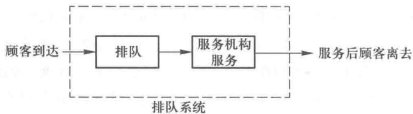
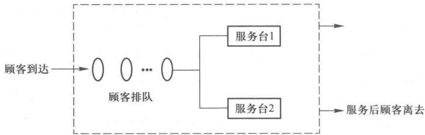
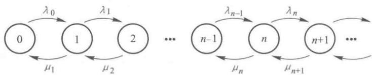
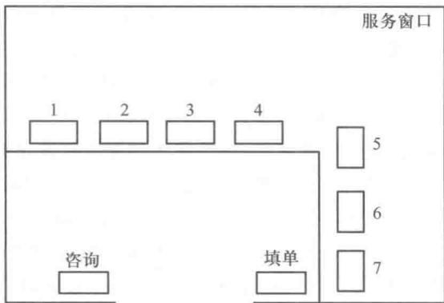

# 第14章 排队论

排队是日常生活中经常遇到的现象,如顾客到商店去买东西,病人到医院去看病,当售货员、医生的数量满足不了顾客或病人及时服务的需要时,就出现了排队的现象.出现这样的排队现象,使人感到厌烦,但由于顾客到达人数(即顾客到达率)和服务时间的随机性,可以说排队现象又是不可避免的,当然增加服务设施(如售货员、医生)能减少排队现象,但这样势必增加投资且因供大于求使设施常常空闲、导致浪费,这通常不是一个最经济的解决问题的办法.作为管理人员来说,就要研究排队问题,把排队时间控制到一定的限度内,在服务质量的提高和成本的降低之间取得平衡,找到最适当的解.

排队论就是解决这类问题的一门科学,它被广泛地用于解决诸如电话局的占线问题,车站、码头、机场等交通枢纽的堵塞与疏导,故障机器的停机待修,水库的存储调节等有形无形的排队现象的问题.

排队论模型是由一些数学公式和它们相互之间的关系所组成,这些数学公式使我们可以求出排队系统的数量指标,这些数量指标刻画了排队系统运行的优劣情况.其中一些重要的数量指标如下所示:

(1) 在系统里没有顾客的概率, 即所有服务设施空闲的概率, 记为 $P_{0}$ .

(2) 排队的平均长度, 即排队的平均顾客数记为 $L_{q}$ .

(3) 在系统里的平均顾客数, 它包括排队的顾客数和正在被服务的顾客数, 记为 $L_{s}$ .

(4) 一位顾客花在排队上的平均时间, 记为 $W_{q}$ .

(5) 一位顾客花在系统里的平均逗留时间, 它包括排队时间和被服务的时间, 记为 $W_{s}$ .

(6) 顾客到达系统时, 得不到及时服务, 必须排队等待服务的概率, 记为 $P_{w}$ .

(7) 在系统里正好有 n 个顾客的概率, 这 n 个顾客包括排队的和正在被服务的顾客, 这个概

率记为 $P_{n}$ .

## 14.1 排队过程的组成部分

排队过程的基本组成部分为:顾客的到达、排队规则和服务机构的服务.图 14-1 显示了排队过程中的这些组成部分.

图14-1

我们举例说明排队过程的这些组成部分,中国工商银行在某居民小区的储蓄所,其主要业务是为居民的定期、活期储蓄提供服务和销售国库券和债券.虽然储蓄所希望当每一位顾客一到马上为其提供服务,但是有时到达的顾客的人数过多,储蓄所不能同时为所有的顾客提供服务,顾客不得不排队等待服务.储蓄所的领导为了减少顾客的等待时间改进服务,开始对储蓄所的排队系统进行了调查研究,首先做了以下的一些调查:

（1）服务机构的服务台（或通道）的数目.这个储蓄所只设一个服务窗口,所有的业务都由这个窗口来处理,也就是说服务机构只有一个服务台,我们把这样的排队系统称之为单服务台（或单通道）的排队系统.

（2）顾客到达过程.来储蓄所办理业务的顾客,因为有关各自家庭的财务机密,一般不会相约一起来,故一位顾客的到达相对于另外的顾客的到达是独立的,没有联系的.储蓄所通过调查又了解到顾客到达储蓄所的时间是随机的,有一个顾客到达的概率与某一时刻t无关,但与时间的间隔长度有关,即在较长的时间间隔里有一个顾客到达的概率也较大,并且当时间间隔 $\Delta t$ 充分小时,有一个顾客到达的概率与 $\Delta t$ 的长度成正比例.并了解到在充分小的时间间隔里有两个顾客同时到的概率极小,可以忽略不计.这些特征正好满足了泊松分布的三个条件,也就是说储蓄所的顾客到达过程形成了泊松流.

运用泊松概率分布函数,知道在单位时间里有 x 个顾客到达的概率

$$
\begin{array}{r l r} & P (x) = \frac {\lambda^ {x} \mathrm{e} ^ {- \lambda}}{x !} \quad (x = 0, 1, 2, \dots), \\ & (14.1) \end{array}
$$

这里 x 为单位时间到达的顾客数, $\lambda$ 为单位时间平均到达的顾客数, e=2.71828.

储蓄所通过分析顾客到达的数据,得到如下结论:每小时顾客平均到达的人数为36,或者说平均每分钟顾客到达人数为 $\frac{36}{60}=0.6$ .如果我们把时间单位定为分钟,则平均到达率 $\lambda=0.6$ ,每分钟有x个顾客到达的概率

$$
P (x) = \frac {\lambda^ {x} \mathrm{e} ^ {- \lambda}}{x !} = \frac {0 . 6 ^ {x} \mathrm{e} ^ {- 0 . 6}}{x !}.
$$

运用计算器或查表计算,很容易求得

$$
P (0) = \frac {(0 . 6) ^ {0} \mathrm{e} ^ {- 0 . 6}}{0 !} \approx 0. 5488,
$$

$$
P (1) = \frac {(0 . 6) ^ {1} \mathrm{e} ^ {- 0 . 6}}{1 !} = 0. 6 \times 0. 5488 = 0. 3293,
$$

$$
P (2) = \frac {(0 . 6) ^ {2} \mathrm{e} ^ {- 0 . 6}}{2 !} = \frac {0 . 36 \times 0 . 5488}{2} = 0. 099.
$$

以上我们看到在一分钟里没有人到达的概率为 0.5488，正好有一个人到达的概率为 0.3293，正好有两个人到达的概率为 0.099。储蓄所把前一个时期到达情况的记录数据的频率分布情况与上述结果比较，认为 $\lambda = 0.6$ 的泊松分布近似地描述了储蓄所到达人数的概率分布情况。

### 一、服务时间的分布

服务时间是指顾客从开始接受服务到服务完成所花费的时间,由于每位顾客要办的业务都不一样,又存在很多影响服务机构的服务时间的随机因素,服务时间也是一个随机变量,一般说,负指数概率分布能较好地描述一些排队系统里的服务时间的概率分布情况,在负指数概率分布里,服务时间小于或等于时间长度 t 的概率

$$
\begin{array}{r l r} & P (\text {服务时间} \leqslant t) = 1 - \mathrm{e} ^ {- \mu t}, \\ & (14.2) \end{array}
$$

这里 $\mu$ 为在单位时间里被服务完的平均顾客数.

储蓄所认为负指数概率分布能近似地反映储蓄所的服务时间的概率分布情况，并统计出这一个服务窗口平均每小时能处理48位顾客的业务，也就是说每分钟平均能处理 $\frac{48}{60} = 0.8$ 位顾客的业务，即平均服务率 $\mu = 0.8$ ，这样我们可求得

$$
\begin{array}{r l} P (\text {服务时间} \leqslant 0. 5 \text {分}) & = 1 - \mathrm{e} ^ {- (0. 8 \times 0. 5)} = 1 - \mathrm{e} ^ {- 0. 4} \\ & \approx 1 - 0. 6703 = 0. 3297. \end{array}
$$

$$
\begin{array}{r l} {P (\text {服务时间} \leqslant 1 \text {分})} & {= 1 - \mathrm{e} ^ {- 0. 8 \times 1} \approx 1 - 0. 4493} \\ & {= 0. 5507.} \end{array}
$$

$$
\begin{array}{r l} {P (\text {服务时间} \leqslant 2 \text {分})} & {= 1 - \mathrm{e} ^ {- 0. 8 \times 2} = 1 - \mathrm{e} ^ {- 1. 6}} \\ & {\approx 1 - 0. 2019 = 0. 7981.} \end{array}
$$

在求得以上结果之后,储蓄所又收集了关于实际服务时间情况的数据,经分析得到 $\mu=0.8$ 的负指数概率分布能较好地描述储蓄所的服务时间.

### 二、排队规则

排队规则也是排队系统的一个重要组成部分.当顾客到达时,所有服务台都正被占用,在有些排队系统里顾客随即离去，如电话呼唤系统，在另一些排队系统里顾客会排队等待服务，如机场候机排队系统。我们把前者称为损失制，后者称为等待制。对于等待制系统，为顾客进行服务的次序可以采用以下一些规则：先到先服务，这是最常见的情形；后到先服务，如乘用电梯的顾客常是先入后出；随机服务，如邮局分信常常是随机分拣的；有优先权的服务，如医院对于病情严重的患者将给予优先治疗。在这一章排队模型里都是按照先到先服务的规则处理问题的。储蓄所的排队规则显然也是先到先服务的。

### 三、平稳状态

当储蓄所早上刚开门营业时,顾客很少,一般把这个时间称为过渡时期,过了过渡时期,储蓄所的业务活动才进入正常的平稳状态,排队论的模型是描述排队系统的平稳状态.

## 14.2 单服务台泊松到达、负指数服务时间的排队模型

这样排队模型我们记为 $M / M / 1 / \infty / \infty$ ，式中第一位的 $M$ 表示顾客到达过程服从泊松流，第二位的 $M$ 表示服务时间服从负指数分布（因为当服务时间服从负指数分布时，单位时间里完成服务的顾客数即服务率就服从泊松分布，故第二位也用 $M$ 来表示），第三位的1表示单通道即一个服务台，第四位的 $\infty$ 表示排队的长度无限制，第五位的 $\infty$ 表示顾客的来源无限制，我们可以把这个模型简记为 $M / M / 1$ 。在这个模型中排队规则为排单队，先到先服务。

储蓄所的排队系统满足上面的条件,就是一个 M/M/1 模型,储蓄所需要使用这个模型来求得储蓄所排队系统的一些有用的数量指标为改进储蓄所的服务水平提供有益的信息.

在下面我们将给出求得 M/M/1 的数量指标的公式, 鉴于这些公式的理论推导比较繁琐, 我们省略不讲.

设 $\lambda$ 为单位时间的平均到达率, $\mu$ 为单位时间的平均服务率,则有

(1) 在系统中没顾客的概率

$$
\begin{array}{r l r} & P _ {0} = 1 - \frac {\lambda}{\mu}. \\ & (14.3) \end{array}
$$

(2) 平均排队的顾客数

$$
\begin{array}{r l r} & L _ {\mathrm{q}} = \frac {\lambda^ {2}}{\mu (\mu - \lambda)}. \\ & (14.4) \end{array}
$$

(3) 在系统里的平均顾客数

$$
\begin{array}{r l r} & L _ {\mathrm{s}} = L _ {\mathrm{q}} + \frac {\lambda}{\mu}. \\ & (14.5) \end{array}
$$

(4) 一位顾客花在排队上的平均时间

$$
\begin{array}{r l r} & W _ {\mathrm{q}} = \frac {L _ {\mathrm{q}}}{\lambda}. \\ & (14.6) \end{array}
$$

(5) 一位顾客在系统里的平均逗留时间

$$
\begin{array}{r l r} & W _ {\mathrm{s}} = W _ {\mathrm{q}} + \frac {1}{\mu}. \\ & (14.7) \end{array}
$$

(6) 顾客到达系统时, 得不到及时服务, 必须排队等待服务的概率

$$
\begin{array}{r l r} & P _ {\mathrm{w}} = \frac {\lambda}{\mu}. \\ & (14.8) \end{array}
$$

(7) 在系统里正好有 n 个顾客的概率

$$
\begin{array}{r l r} & P _ {n} = \left(\frac {\lambda}{\mu}\right) ^ {n} P _ {0}. \\ & (14.9) \end{array}
$$

在上面的公式中,我们都认定 $\lambda<\mu$ , 即到达率小于服务率, 如果没有这个条件, 则排队的长度将无限制地增加, 服务机构根本没有能力处理所有到达的顾客. $\lambda<\mu$ , 也就是 $\frac{\lambda}{\mu}<1$ . 我们称 $\frac{\lambda}{\mu}$ 为服务强度.

储蓄所的平均到达率 $\lambda=0.6$ ，平均服务率 $\mu=0.8$ ，也就是每分钟平均有 0.6 个顾客到达，每分钟可以为 0.8 个顾客提供服务。利用上述（14.3）至（14.8）公式，我们可求得

$$
P _ {0} = 1 - \frac {0 . 6}{0 . 8} = 1 - \frac {3}{4} = \frac {1}{4} = 0. 25.
$$

$$
L _ {\mathrm{q}} = \frac {\lambda^ {2}}{\mu (\mu - \lambda)} = \frac {(0 . 6) ^ {2}}{0 . 8 \times (0 . 8 - 0 . 6)} = 2. 25 (\text {个顾客}).
$$

$$
L _ {\mathrm{s}} = L _ {\mathrm{q}} + \frac {\lambda}{\mu} = 2. 25 + \frac {0 . 6}{0 . 8} = 2. 25 + 0. 75 = 3 (\text {个顾客}).
$$

$$
W _ {\mathrm{q}} = \frac {L _ {\mathrm{q}}}{\lambda} = \frac {2 . 25}{0 . 6} = 3. 75 (\text { 分钟 }).
$$

$$
W _ {\mathrm{s}} = W _ {\mathrm{q}} + \frac {1}{\mu} = 3. 75 + 1. 25 = 5 (\text { 分钟 }).
$$

$$
P _ {\mathrm{w}} = \frac {\lambda}{\mu} = \frac {0 . 6}{0 . 8} = 0. 75.
$$

用公式(14.9) $P_{n}=\left(\frac{\lambda}{\mu}\right)^{n}P_{0}$ ，我们可求出在储蓄所里有n个顾客（即系统里有n个顾客）的概率，计算结果如表14-1所示.

表14-1

<table><tr><td>系统里的顾客数</td><td>概率</td><td>系统里的顾客数</td><td>概率</td></tr><tr><td>0</td><td>0.250 0</td><td>4</td><td>0.079 1</td></tr><tr><td>1</td><td>0.187 5</td><td>5</td><td>0.059 3</td></tr><tr><td>2</td><td>0.140 6</td><td>6</td><td>0.044 5</td></tr><tr><td>3</td><td>0.105 5</td><td>7或7个以上</td><td>0.133 5</td></tr></table>

从以上的数据,我们知道储蓄所这个排队系统并不尽如人意,到达储蓄所有75%的概率要排队等待,排队的长度平均为2.25个人,排队的平均时间为3.75分钟是平均服务时间1.25分钟的3倍,而且在储蓄所里有7个或更多的顾客的概率为13.35%,这个概率太高了.在计划经济体制下这种现象司空见惯,但现在是市场经济,除了中国工商银行外,还有中国建设银行、中国农业银行、交通银行、招商银行等,市场竞争日趋激烈,该储蓄所因此必须提高服务水平,必须改进这个排队系统.

要提高服务水平,减少顾客在系统里的平均逗留时间,即减少顾客的平均排队时间和平均服务时间,一般可采用两种措施:第一,减少服务时间,提高服务率;第二,增加服务台即增加服务窗口.储蓄所认为这两种方法都可以考虑,储蓄所对这两种方法作了如下的分析.

如采取第一种方法,不增加服务窗口,而增加新型点钞机,建立储户管理信息系统,可以缩短储蓄所每笔业务的服务时间,使每小时平均服务的顾客数目从原来的48人提高到60人,即每分钟平均服务的顾客数从0.8人提高到1人,这时 $\lambda$ 仍然为0.6, $\mu$ 为1,我们用(14.3)至(14.9)公式得到结果如表14-2所示.

表14-2

<table><tr><td>系统里没顾客的概率</td><td> \(P_{0} = 0.4\) </td></tr><tr><td>平均排队的顾客人数</td><td> \(L_{q} = 0.9\) (人)</td></tr><tr><td>系统里的平均顾客数</td><td> \(L_{s} = 1.5\) (人)</td></tr><tr><td>一位顾客平均排队时间</td><td> \(W_{q} = 1.5\) (分钟)</td></tr><tr><td>一位顾客平均逗留时间</td><td> \(W_{s} = 2.5\) (分钟)</td></tr><tr><td>顾客到达系统必须等待排队的概率</td><td> \(P_{w} = 0.6\) </td></tr><tr><td>系统里有7个或更多顾客的概率为</td><td>0.0279</td></tr></table>

从表 14-2, 我们可以看到由于把服务率从 0.8 提高到 1, 其排队系统有了很大的改进, 顾客平均排队时间为 3.75 分钟减少到 1.5 分钟,顾客平均逗留时间从 5 分钟减少到 2.5 分钟,在系统里有 7 或超过 7 个人的概率有大幅度的下降,从 13.35% 下降到 2.79%.

如果采用第二个方法,再开设一个服务窗口,排队的规则为每个窗口排一个队,先到先服务,并假设顾客一旦排了一个队,就不能再换到另一个队上去(譬如,当把这个服务台设在另一个地点,上述的假设就成立了).这种处理方法就是把顾客分流,把一个排队系统分成两个排队系统,每个系统中有一个服务台,每个系统的服务率仍然为0.8,但到达率由于分流,只有原来的一半了, $\lambda=\frac{0.6}{2}=0.3$ ,这时我们可求得每一个排队系统的数量指标如表14-3所示.

表14-3

<table><tr><td>系统里没顾客的概率</td><td> \(P_0 = 0.6250\) </td></tr><tr><td>平均排队的顾客人数</td><td> \(L_q = 0.2250\) (人)</td></tr><tr><td>系统里的平均顾客数</td><td> \(L_s = 0.6\) (人)</td></tr><tr><td>一位顾客平均排队时间</td><td> \(W_q = 0.75\) (分钟)</td></tr><tr><td>一位顾客平均逗留时间</td><td> \(W_s = 2.000\) (分钟)</td></tr><tr><td>顾客到达系统必须等待排队的概率</td><td> \(P_w = 0.375\) </td></tr><tr><td>系统里有5个或更多顾客的概率为</td><td>0.0074</td></tr></table>

与原始结果相比较,我们知道采用第二个方法的服务水平也使得原来的服务水平有了很大的提高,采用第二种方法顾客平均排队时间减少到了0.75(分钟),顾客平均逗留时间减少到了2分钟,第二种方法的排队系统为两个M/M/1的排队系统.如果在第二种方法中把排队的规则变一下,在储蓄所里采用排号机排队,这样的排队系统就变成了M/M/2排队系统.

## 14.3 多服务台泊松到达、负指数服务时间的排队模型

这种排队模型我们记为 $M/M/c/\infty/\infty$ ，这与第二节单服务台的模型的差别，就在于服务台的数量为 c，我们可以把这个模型简记为 M/M/c。储蓄所里有两个服务窗口，其排队的示意图如图 14-2 所示。

在 M/M/c 模型里, 其到达过程为泊松流, 每个服务台的服务时间分布为同样的负指数分布,排队的长度与顾客的来源都无限制,其排队规则为只排一个队,先到先服务,当其中一个服务台有空时,排在第一个的顾客就上去接受服务.

图14-2

我们设系统的平均顾客到达率为 $\lambda$ ，每个服务台的平均服务率都为 $\mu$ ，有 c 个服务台，这样可知 c 个服务台的总的平均服务率为 $c\mu$ ，像单服务台的模型那样，我们认定 $c\mu > \lambda$ 时，得到如下的计算数量指标的公式.

(1) 系统里没顾客的概率

$$
\begin{array}{r l r} & P _ {0} = \frac {1}{\sum_ {n = 0} ^ {c - 1} \frac {\left(\lambda / \mu\right) ^ {n}}{n !} + \frac {\left(\lambda / \mu\right) ^ {c}}{c !} \left(\frac {c \mu}{c \mu - \lambda}\right)}. \\ & (14.10) \end{array}
$$

(2) 平均的排队顾客数

$$
\begin{array}{r l r} & L _ {\mathrm{q}} = \frac {(\lambda / \mu) ^ {\mathrm{c}} \lambda \mu}{(c - 1) ! (c \mu - \lambda) ^ {2}} P _ {0}. \\ & (14.11) \end{array}
$$

(3) 在系统里的平均顾客数

$$
\begin{array}{r l r} & L _ {\mathrm{s}} = L _ {\mathrm{q}} + \frac {\lambda}{\mu}. \\ & (14.12) \end{array}
$$

(4) 一位顾客花在排队上的平均时间

$$
\begin{array}{r l r} & W _ {\mathrm{q}} = \frac {L _ {\mathrm{q}}}{\lambda}. \\ & (14.13) \end{array}
$$

(5) 一位顾客在系统里的平均逗留时间

$$
\begin{array}{r l r} & W _ {\mathrm{s}} = W _ {\mathrm{q}} + \frac {1}{\mu}. \\ & (14.14) \end{array}
$$

(6) 顾客到达系统时,得不到及时服务,必须排队等待服务的概率

$$
\begin{array}{r l r} & P _ {\mathrm{w}} = \frac {1}{c !} \left(\frac {\lambda}{\mu}\right) ^ {c} \left(\frac {c \mu}{c \mu - \lambda}\right) P _ {0}. \\ & (14.15) \end{array}
$$

(7) 在系统里正好有 n 个顾客的概率

$$
\begin{array}{r l r} & P _ {n} = \frac {(\lambda / \mu) ^ {n}}{n !} P _ {0}, \text {当} n \leqslant c \text {时}. \\ & (14.16) \end{array}
$$

$$
\begin{array}{r l r} & P _ {n} = \frac {\left(\lambda / \mu\right) ^ {n}}{c ! c ^ {(n - c)}} P _ {0}, \text {当} n > c \text {时}. \\ & (14.17) \end{array}
$$

我们用以上公式可以计算出储蓄所采用 M/M/2 模型的一些数量指标, 这时 c=2, $\lambda=0.6$ , $\mu=0.8$ , $\frac{\lambda}{\mu}=\frac{0.6}{0.8}=0.75$ , 则有

$$
\begin{array}{r l} P _ {0} & = \frac {1}{\sum_ {n = 0} ^ {1} \frac {0 . 75 ^ {n}}{n !} + \frac {0 . 75 ^ {2}}{2 !} \left(\frac {2 \times 0 . 8}{2 \times 0 . 8 - 0 . 6}\right)} \\ & = \frac {1}{0 . 75 ^ {0} + 0 . 75 ^ {1} + \frac {0 . 75 ^ {2}}{2} \times \left(\frac {1 . 6}{1 . 6 - 0 . 6}\right)} \\ & = \frac {1}{1 + 0 . 75 + 0 . 2813 \times 1 . 6} \approx 0. 4545. \end{array}
$$

$$
\begin{array}{r l} L _ {\mathrm{q}} & = \frac {0 . 75 ^ {2} \times 0 . 6 \times 0 . 8}{(2 \times 0 . 8 - 0 . 6) ^ {2}} \times 0. 4545 \\ & = \frac {0 . 27}{1} \times 0. 4545 \approx 0. 1227 (\text {人}). \end{array}
$$

$$
L _ {\mathrm{s}} = L _ {\mathrm{q}} + \frac {\lambda}{\mu} = 0. 1227 + 0. 75 = 0. 8727 (\text {人}).
$$

$$
W _ {\mathrm{q}} = \frac {L _ {\mathrm{q}}}{\lambda} = \frac {0 . 1227}{0 . 6} = 0. 2045 (\text {分钟}).
$$

$$
W _ {\mathrm{s}} = W _ {\mathrm{q}} + \frac {1}{\mu} = 0. 2045 + \frac {1}{0 . 8} = 1. 4545 (\text { 分钟 }).
$$

$$
\begin{array}{r l} P _ {\mathrm{w}} & = \frac {1}{2 !} 0. 75 ^ {2} \times \left(\frac {2 \times 0 . 8}{2 \times 0 . 8 - 0 . 6}\right) \times 0. 4545 \\ & = 0. 2045. \end{array}
$$

我们还可用(14.16)，(14.17)公式求得

系统里有 1 个人的概率 $P_{1}=0.3409$ .

系统里有 2 个人的概率 $P_{2}=0.1278$ .

系统里有 3 个人的概率 $P_{3}=0.0479$ .

系统里有 4 个人的概率 $P_{4}=0.0180$ .

系统里有 5 个人的概率 $P_{5}=0.0067$ .

系统里有 6 个人的概率或多于 6 个人的概率为 0.0040.

在储蓄所里使用 M/M/2 模型与使用两个 M/M/1 模型它们的服务台数都是 2, 服务率和顾客到达率都一样, 只是在 M/M/2 中只排一队, 在 2 个 M/M/1 中排两个队, 结果却不一样. M/M/2使得服务水平有了很大的提高,每个顾客的平均排队时间从0.75分钟减少到0.2045分钟,每个顾客在系统里逗留时间从2分钟减少到1.4545分钟,平均排队的人数也从0.2250人减少到0.1227人,系统里平均顾客数也从 $0.6\times2=1.2$ 人减少到0.8727人.如果把M/M/2与原先一个M/M/1比较,那么服务水平之间的差别就更大了.

当然在多服务台的 M/M/c 模型中, 计算求得这些数量指标是很繁琐的. 管理运筹学软件有排队论的程序, 可以由它来帮你作繁琐的计算.

我们在第二节与第三节发现公式（14.5）与公式（14.12）完全相同，公式（14.6）与公式（14.13）完全相同，公式（14.7）与公式（14.14）完全相同，实际上这三个公式表示了任一个排队模型（不仅仅是 $M / M / 1$ 或 $M / M / 2$ )中， $L_{\mathrm{s}}, L_{\mathrm{q}}, W_{\mathrm{s}}, W_{\mathrm{q}}$ 之间的关系，也就是说

$$
\begin{array}{r l r} & L _ {\mathrm{s}} = L _ {\mathrm{q}} + \frac {\lambda}{\mu}. \\ & (14.5) \end{array}
$$

$$
\begin{array}{r l r} & W _ {\mathrm{q}} = \frac {L _ {\mathrm{q}}}{\lambda}. \\ & (14.6) \end{array}
$$

$$
\begin{array}{r l r} & W _ {\mathrm{s}} = W _ {\mathrm{q}} + \frac {1}{\mu}. \\ & (14.7) \end{array}
$$

对任一排队模型成立，这里 $L_{\mathrm{s}}, L_{\mathrm{q}}, W_{\mathrm{q}}, W_{\mathrm{s}}, \mu$ 的定义如上所述，而 $\lambda$ 应为实际进入系统平均到达率，对于排队长度无限制的模型，实际进入系统平均到达率即为到达率 $\lambda$ ，而对排队长度有限制的模型，我们设因排队长度的限制顾客被拒绝的概率为 $P_{N}$ ，则实际进入系统平均到达率应为 $\lambda(1 - P_{N})$ ，这时(14.5)和(14.6)中的 $\lambda$ 应改写为 $\lambda(1 - P_{N})$

## 14.4 排队系统的经济分析

从以上二节我们看到对于储蓄所来说 M/M/2 系统显然比两个 M/M/1 系统要好, 花的一样的成本, 服务水平却提高了. 但是当我们比较 M/M/2 与一个 M/M/1 时, 虽然 M/M/2 的服务水平比 M/M/1 提高了很多, 但是是多花了成本的. 那么, 多花了一些成本, 提高了一些服务水平到底值不值得呢? 这就需要进行经济分析.

在进行经济分析时,我们除了计算服务机构的费用外,我们还应计算顾客在排队系统里逗留而付出的费用或损失.当顾客是待修的机器设备时我们很容易理解这一点,由于修理耽误了生产会造成损失,这个损失是可以计算出来的.同样作为储蓄所的顾客,他在储蓄所里所逗留的时间本来也是可以为他创造价值的,所以他在储蓄所逗留就等于他付出了费用.这样我们把一个排队系统的单位时间的总费用 TC 定义为服务机构的单位时间的费用和顾客在排队系统里逗留单位时间的费用之和,并有

$$
\begin{array}{r l r} & T C = c _ {\mathrm{w}} L _ {\mathrm{s}} + c _ {\mathrm{s}} c. \\ & (14.18) \end{array}
$$

其中 $c_{w}$ 为一个顾客在排队系统里逗留一个单位时间所付出的费用； $L_{s}$ 为在系统里的顾客数； $c_{s}$ 为每个服务台单位时间的费用；c 为服务台的数目.

储蓄所的每个服务台的费用将包括服务员的工资、津贴以及其他开设这个服务台的直接费用，这个费用估计为每小时18元，即 $c_{s}=18$ 元。顾客在储蓄所逗留一小时的成本，通过对该地区居民收入数据的分析，估计为10元，即 $c_{w}=10$ 元。

这样,对储蓄所 M/M/1 模型可知 $L_{s}=3, c=1$ , 得

$$
T C = c _ {\mathrm{w}} L _ {\mathrm{s}} + c _ {\mathrm{s}} c = 10 \times 3 + 18 = 48 (\text {   元   /   小时   }).
$$

对 M/M/2 模型, 可知 $L_{s}=0.8727, c=2$ , 得

$$
T C = c _ {\mathrm{w}} L _ {\mathrm{c}} + c _ {\mathrm{s}} c = 10 \times 0. 8727 + 18 \times 2 \approx 44. 73 (\text {   元   /   小时   }).
$$

通过经济分析可知储蓄所里 M/M/2 系统是一个更为经济的模型.

实际上用“管理运筹学”软件可以容易地对排队系统进行经济分析，求出排队系统的总费用，并能求出排队系统的最经济的服务台数。例如在上述的问题中，我们可用软件分别求得当 $c = 1,2,3$ 时的总费用 $TC(c = 1) = 48$ （元/小时）； $TC(c = 2) = 44.73$ （元/小时）； $TC(c = 3) = 61.65$ （元/小时）。这样可知 $TC(c = 2) \leqslant TC(c = 1)$ ； $TC(c = 2) \leqslant TC(c = 3)$ 。用边际分析法可知： $c = 2$ 是该排队系统最经济的服务台数。

当一些顾客和服务机构从属于同一单位,如同一个企业或同一个公司时,经济分析更受欢迎,更为可取.例如在工厂的设备维修部门的排队系统中“顾客”是要检修的设备,“服务机构”是工厂的维修车间,如何确定维修车间的服务水平,使得维修车间的费用和因设备检修造成的工厂损失之总和为最小,这都可以通过经济分析而得到.又如某公司卡车装货的排队系统中,“顾客”为卡车,“服务机构”是装货工人,公司要支付卡车和装货工人的费用,通过经济分析可使公司的费用为最小.

## 14.5 单服务台泊松到达、任意服务时间的排队模型

这种模型我们记为 $M/G/1/\infty/\infty$ ，这个记法中的第二位的字母 G 表示服务时间分布可以是任意的概率分布，当然我们要求得这种服务时间的分布的均值和均方差；第一位中的 M 仍表示到达过程为泊松流；第三位中的1仍表示服务台数为1；第四位中的 $\infty$ 仍表示排队长度没限制；第五位中的 $\infty$ 仍表示顾客的来源无限制，这个模型可简记为 $M / G / 1$

我们仍设 $\lambda$ 为平均到达率, $\mu$ 为平均的服务率, 可知平均服务时间变为 $\frac{1}{\mu}$ , 我们还设服务时间的均方差为 $\sigma$ , 这样我们可用以下的公式来求得数量指标.

(1) 系统里没有顾客的概率

$$
\begin{array}{r l r} & P _ {0} = 1 - \frac {\lambda}{\mu}. \\ & (14.19) \end{array}
$$

(2) 平均排队的顾客数

$$
\begin{array}{r l r} & L _ {\mathrm{q}} = \frac {\lambda^ {2} \sigma^ {2} + (\lambda / \mu) ^ {2}}{2 (1 - \lambda / \mu)}. \\ & (14.20) \end{array}
$$

(3) 在系统里的平均顾客数

$$
\begin{array}{r l r} & L _ {\mathrm{s}} = L _ {\mathrm{q}} + \frac {\lambda}{\mu}. \\ & (14.21) \end{array}
$$

(4) 一位顾客花在排队上的平均时间

$$
\begin{array}{r l r} & W _ {\mathrm{q}} = \frac {L _ {\mathrm{q}}}{\lambda}. \\ & (14.22) \end{array}
$$

(5) 一位顾客在系统里的平均逗留时间

$$
\begin{array}{r l r} & W _ {\mathrm{s}} = W _ {\mathrm{q}} + \frac {1}{\mu}. \\ & (14.23) \end{array}
$$

(6) 顾客到达系统时,得不到及时服务,必须排队等待服务的概率

$$
\begin{array}{r l r} & P _ {\mathrm{w}} = \frac {\lambda}{\mu}. \\ & (14.24) \end{array}
$$

例 1 某杂货店只有一名售货员, 已知顾客到达过程服从泊松流, 已知平均到达率为每小时20人, 不清楚这个系统的服务时间服从什么分布. 但从统计分析知道售货员平均服务一名顾客的时间为2分钟, 服务时间的均方差为1.5分钟, 请求这个排队系统的数量指标. $P_{0}, L_{q}, L_{s}, W_{q}, W_{s}$ 以及 $P_{w}$ .

解 这是一个 M/G/1 的排队系统, 其中

$$
\lambda = \frac {2 0}{6 0} = 0. 3333 (\text {人 / min}), \frac {1}{\mu} = 2 (\text {min}), \mu = \frac {1}{2} = 0. 5 (\text {人 / min}), \sigma = 1. 5 (\text {min}).
$$

从(14.19)至(14.24)公式可计算得：

$$
P _ {0} = 1 - \frac {0 . 3333}{0 . 5} = 0. 3334.
$$

$$
L _ {\mathrm{q}} = \frac {0 . 3333 ^ {2} \times 1 . 5 ^ {2} + 0 . 6666 ^ {2}}{2 \times (1 - 0 . 6666)} = 1. 0415 (\text {人}).
$$

$$
L _ {\mathrm{s}} = L _ {\mathrm{q}} + \frac {\lambda}{\mu} = 1. 0415 + 0. 6666 = 1. 7081 (\text {人}).
$$

$$
W _ {\mathrm{q}} = \frac {L _ {\mathrm{q}}}{\lambda} = \frac {1 . 0415}{0 . 3333} = 3. 1248 (\text {分钟}).
$$

$$
W _ {\mathrm{s}} = W _ {\mathrm{q}} + \frac {1}{\mu} = 3. 1248 + 2 = 5. 1248 (\text { 分钟 }).
$$

$$
P _ {\mathrm{w}} = \frac {\lambda}{\mu} = 0. 6666.
$$

从这些数量指标,可以看到这家杂货店的服务水平不高,经营者可以根据内部和外部的情况的分析来决定是否要再增加一个售货员.

## 14.6 单服务台泊松到达、定长服务时间的排队模型

这个模型是 M/G/1 的一种特殊情况, 在这个模型中, 服务时间是个常量, 我们把这个模型记为 M/D/1, 这种排队模型在一些自动控制的生产设备和装配线常常出现的. 因为服务时间是常量, 也就是均方差等于零, 第五节的公式 (14.19) 至 (14.24) 对该模型仍适用, 只是在使用 (14.20) 时把 $\sigma=0$ 代入即可, 有

$$
\begin{array}{r l r} & L _ {\mathrm{q}} = \frac {\lambda^ {2} \sigma^ {2} + (\lambda / \mu) ^ {2}}{2 (1 - \lambda / \mu)} = \frac {(\lambda / \mu) ^ {2}}{2 (1 - \lambda / \mu)}. \\ & (14.25) \end{array}
$$

例 2 某汽车冲洗服务营业部,有一套自动冲洗设备,冲洗每辆车所需时间是 6 分钟,到此营业部来洗车的汽车到达过程服从泊松流,每小时平均到达 6 辆,求该排队系统的数量指标 $P_{0}$ , $L_{q}$ , $L_{s}$ , $W_{q}$ , $W_{s}$ 以及 $P_{w}$ .

解 这是一个 $M / D / 1$ 排队模型, 其中 $\lambda = 6$ (辆/小时), $\mu = \frac{60}{6} = 10$ (辆/小时), 得

$$
P _ {0} = 1 - \frac {\lambda}{\mu} = 1 - \frac {6}{1 0} = 0. 4.
$$

$$
L _ {\mathrm{q}} = \frac {(\lambda / \mu) ^ {2}}{2 (1 - \lambda / \mu)} = \frac {0 . 6 ^ {2}}{2 \times (1 - 0 . 6)} = \frac {0 . 36}{2 \times 0 . 4} = \frac {0 . 36}{0 . 8} = 0. 45 (\text { 辆 }).
$$

$$
L _ {\mathrm{s}} = L _ {\mathrm{q}} + \frac {\lambda}{\mu} = 0. 45 + 0. 6 = 1. 05 (\text { 辆 }).
$$

$$
W _ {\mathrm{q}} = \frac {L _ {\mathrm{q}}}{\lambda} = \frac {0 . 45}{6} = 0. 075 (\text {小时}).
$$

$$
W _ {\mathrm{s}} = W _ {\mathrm{q}} + \frac {1}{\mu} = 0. 075 + \frac {1}{1 0} = 0. 175 (\text {小时}).
$$

$$
P _ {\mathrm{w}} = \frac {\lambda}{\mu} = \frac {6}{1 0} = 0. 6.
$$

## 14.7 多服务台泊松到达、任意服务时间、损失制排队模型

这种排队模型记为 $M / G / c / c / \infty$ ，式中第一位 $M$ 表示到达过程服从泊松流，第二位 $G$ 表示服务时间的概率分布可以是任意的，第三位 $c$ 表示有 $c$ 个服务台，第四位的 $c$ 表示系统里至多能容纳 $c$ 个顾客，顾客排队的长度有限制为 $c - c = 0$ ，也就是顾客一看服务台都被占了，就走开，不会排队等待服务的，第五位的 $\infty$ 表示顾客源无限制.

这种模型是一种损失制的模型,它要解决的主要问题是在服务机构的空闲与顾客的流失之间找到平衡,找出最合适服务台数,使得该系统收益最大.例如民航电话订票系统就是典型的这种排队模型,如果服务台(接受订票的电话)太少,顾客会常常因为打不通电话而去别的公司订票,如果服务台太多,那么公司将为过多服务台的设置付出过多的费用.

下面我们给出计算该模型数量指标的一些公式,由于是损失制,故不存在排队顾客的数目,排队所需时间.我们只需给出系统里有几个顾客的概率 $P_{n}$ 以及在系统里的平均顾客数 $L_{s}$ .

$$
\begin{array}{r l r} & P _ {n} = \frac {\left(\lambda / \mu\right) ^ {n} / n !}{\sum_ {i = 0} ^ {c} \left(\lambda / \mu\right) ^ {i} / i !} \quad (n \leqslant c), \\ & (14.26) \end{array}
$$

在式中， $\lambda$ 仍为平均到达率， $\mu$ 为平均服务率，c 为服务台数.

$$
\begin{array}{r l r} & L _ {\mathrm{s}} = \frac {\lambda}{\mu} (1 - P _ {\mathrm{c}}). \\ & (14.27) \end{array}
$$

其中 $P_{c}$ 为系统里正好有 c 个顾客的概率,也就是系统里 c 个服务台都被顾客占满的概率.

例 3 某电视商场专营店开展了电话订货业务. 据统计分析电话到达过程服从泊松流, 平均到达率为每小时 16 个, 而一个接话员处理订货事宜的时间是随着订货的产品、规格、数量及顾客的不同而变化的, 但平均每个人每小时可以处理 8 个订货电话, 在此电视商场专营店里安装了一台电话自动交换台, 它接到电话后可以接到任一个空闲的接话员的电话上, 试问该公司应安装多少台接话员的电话, 使得订货电话因电话占线而损失的概率不超过 10%.

解 这是一个 $M / G / c / c / \infty$ 模型.

当 $c = 3$ 时，我们来计算 $M / G / 3 / 3 / \infty$ 系统中正好有3位顾客的概率，这时 $c = n = 3$ 用公式(13.25)得

$$
\begin{array}{r l} P _ {3} & = \frac {(\lambda / \mu) ^ {3} / 3 !}{\sum_ {i = 0} ^ {3} (\lambda / \mu) ^ {i} / i !} \\ & = \frac {(16 / 8) ^ {3} / 6}{(16 / 8) ^ {0} / 1 + (16 / 8) ^ {1} / 1 + (16 / 8) ^ {2} / 2 + (16 / 8) ^ {3} / 6} \\ & = \frac {1 . 3333}{6 . 3333} \approx 0. 2105. \end{array}
$$

这也就是说,当设置三个接受订货的电话时,三个电话都被占满的概率为21.05%,这时别的电话就打不进来损失掉了,也就是在这个系统里因电话占线而损失的概率为21.05%,超过了10%的要求,显然是不合适的,如果我们设置四个接受订货的电话呢?这时c=4,在M/G/4/4/∞系统中,正好有4位顾客的概率为

$$
\begin{array}{r l} P _ {4} & = \frac {\left(\lambda / \mu\right) ^ {4} / 4 !}{\sum_ {i = 0} ^ {4} \left(\lambda / \mu\right) ^ {i} / i !} \\ & = \frac {(16 / 8) ^ {4} / 24}{(16 / 8) ^ {0} / 1 + (16 / 8) ^ {1} / 1 + (16 / 8) ^ {2} / 2 + (16 / 8) ^ {3} / 6 + (16 / 8) ^ {4} / 24} \\ & = \frac {0 . 6667}{7} = 0. 0952. \end{array}
$$

可见当设置四个电话时,四个电话都被占满,别的电话打不进来,损失掉的概率为9.52%,这就符合公司的目标,故公司应设置四个电话,另外我们也可以计算求得,此电话系统里平均顾客数为

$$
L _ {\mathrm{s}} = \lambda / \mu \times (1 - P _ {4}) = 16 / 8 \times (1 - 0. 0952) \approx 1. 81.
$$

也就是此电话系统里平均有 1.81 个电话在使用.

这种形式的更一般形式为 $M / G / c / N / \infty$ ，这个一般形式和 $M / G / c / c / \infty$ 的区别在于这个形式允许排队，但排队长度不超过 $(N - c)$ ，例如在理发室里安排一些等候理发的顾客的椅子，就属于这种情况.

## 14.8 顾客来源有限制的排队模型

以上所介绍的排队模型都是顾客来源无限制的情况,这一节我们将介绍顾客来源有限制的情况.在实际的管理问题中,有些排队系统是属于这种模型的,如机器设备的维修,某公司有m台机器,有c个修理工人负责机器的维修.这就是一个顾客源有限制的情况,这里顾客总体(顾客源)为有限数m.在这种模型中,顾客平均到达率 $\lambda$ 是指一个顾客在单位时间里平均到达服务机构的次数,这是与其他的排队模型都不一样的,以前几个模型的顾客平均到达率 $\lambda$ 是指顾客总体到达服务机构的平均人数.在这一节里我们仅介绍 $M/M/1/\infty/m$ 排队模型.

从 $M / M / 1 / \infty /m$ 这个记号中我们可以知道这个排队模型的顾客到达过程服从泊松流，服务时间服从负指数分布，有一个服务台，在系统中排队的长度没有限制，而顾客的总数为有限数 $m$ 设 $\lambda$ 为每个顾客在单位时间里到达系统的平均次数， $\mu$ 仍然为一个服务台在单位时间里所服务顾客的平均数， $m$ 为顾客总体的人数，我们有如下求该系统数量指标的公式.

(1) 系统里没有顾客的概率

$$
\begin{array}{r l r} & P _ {0} = \frac {1}{\sum_ {n = 0} ^ {m} \frac {m !}{(m - n) !} \left(\frac {\lambda}{\mu}\right) ^ {n}}. \\ & (14.28) \end{array}
$$

(2) 平均排队的顾客数

$$
\begin{array}{r l r} & L _ {\mathrm{q}} = m - \frac {\lambda + \mu}{\lambda} (1 - P _ {0}). \\ & (14.29) \end{array}
$$

（3）在系统里的平均顾客数

$$
\begin{array}{r l r} & L _ {\mathrm{s}} = L _ {\mathrm{q}} + (1 - P _ {0}). \\ & (14.30) \end{array}
$$

(4) 一位顾客在排队上平均花费的时间

$$
\begin{array}{r l r} & W _ {\mathrm{q}} = \frac {L _ {\mathrm{q}}}{(m - L _ {\mathrm{s}}) \lambda}. \\ & (14.31) \end{array}
$$

(5) 一位顾客在系统里平均逗留时间

$$
\begin{array}{r l r} & W _ {\mathrm{s}} = W _ {\mathrm{q}} + \frac {1}{\mu}. \\ & (14.32) \end{array}
$$

(6) 在系统里有 n 个顾客的概率

$$
\begin{array}{r l r} & P _ {n} = \frac {m !}{(m - n) !} \left(\frac {\lambda}{\mu}\right) ^ {n} P _ {0}, n = 0, 1, 2, \dots , m. \\ & (14.33) \end{array}
$$

例 4 某车间有 5 台机器, 每台机器连续运转时间服从负指数分布, 平均连续运转时间为 15 分钟. 有一个修理工, 每次修理时间服从负指数分布, 平均每次 12 分钟. 假设一个机器停一个小时损失 1000 元, 而一个机修工及其设备运行 1 小时费用为 350 元. 求该排队系统的数量指标 $P_{0}, L_{q}, L_{s}, W_{q}$ , $W_{s}$ 以及 $P_{5}$ ; 并用“管理运筹学”软件进行经济分析, 问安排多少个修理工可使公司的运行最经济?

解 因为每台机器的连续运转时间服从负指数分布,故每台机器每小时出故障的平均次数服从泊松分布,故该排队系统为 $M/M/1/\infty/5$ 系统,其中, $m=5,\lambda=1/15,\mu=1/12,\lambda/\mu=0.8$ .用公式(14.28)至(14.33)可求得

$$
P _ {0} = \left[ \frac {5 !}{5 !} (0. 8) ^ {0} + \frac {5 !}{4 !} (0. 8) ^ {1} + \frac {5 !}{3 !} (0. 8) ^ {2} + \frac {5 !}{2 !} (0. 8) ^ {3} + \frac {5 !}{1 !} (0. 8) ^ {4} + \frac {5 !}{0 !} (0. 8) ^ {5} \right] ^ {- 1}
$$

$$
= \frac {1}{1 36 . 8} \approx 0. 0073.
$$

$$
\begin{array}{r l} L _ {\mathrm{q}} & = 5 - \frac {\frac {1}{1 5} + \frac {1}{1 2}}{\frac {1}{1 5}} \times (1 - 0. 0073) \\ & \approx 2. 766 (\text { 台 }). \end{array}
$$

$$
\begin{array}{r l} L _ {\mathrm{s}} & = L _ {\mathrm{q}} + (1 - P _ {0}) \\ & = 2. 766 + (1 - 0. 0073) \\ & \approx 3. 759 (\text {台}). \end{array}
$$

$$
\begin{array}{r l} W _ {\mathrm{q}} & = \frac {L _ {\mathrm{q}}}{(5 - L _ {\mathrm{s}}) \lambda} \\ & = \frac {2 . 766}{(5 - 3 . 759) \times \frac {1}{1 5}} \\ & \approx 33. 43 (\text {分钟}). \end{array}
$$

$$
\begin{array}{r l} W _ {\mathrm{s}} & = W _ {\mathrm{q}} + \frac {1}{\mu} = 33. 43 + \frac {1}{\frac {1}{1 2}} \\ & = 33. 43 + 12 = 45. 43 (\text { 分钟 }). \end{array}
$$

$$
\begin{array}{r l} P _ {5} & = \frac {m !}{(m - 5) !} \left(\frac {\lambda}{\mu}\right) ^ {5} P _ {0} \\ & = \frac {5 !}{0 !} 0. 8 ^ {5} \times 0. 0073 \\ & \approx 0. 2870. \end{array}
$$

从上面可见修理工几乎没有空闲时间,机器排队的时间过长,为了提高服务水平可以提高服务率(如增加一个工人,两个工人为一组同时修一台机器或增添新设备提高服务率),或增加服务台数目(如增加一个工人,两个人自己单独修机器,变成两个服务台).下面就服务台数目进行经济分析.

我们用“管理运筹学”软件对上述问题进行经济分析，当通道数分别输入1,2,3和4时，求得的单位时间的总成本分别为4119.936元、3485.85元、3401.406元和3645.577元，可知安排3个修理工可使公司的运行最经济。

以上的一些排队论的模型,我们都可以用“管理运筹学”软件求解.

## 14.9 单服务台泊松到达、负指数服务时间、系统容量有限制的排队模型

这种模型我们记为 $M / M / 1 / K / \infty$ ，这个记法中的第四位字母 $K$ 表示这个系统的最大容量为 $K$ ，因为这是一个单服务台的情况，所以排队的顾客服务最多为 $K - 1$ ，在某时刻一顾客到达时，如系统中已有 $K$ 个顾客，那么这个顾客就被拒绝进入系统.这个模型可简写为 $M / M / 1 / K$

由于所考虑的排队系统中最多只能容纳 K 个顾客(等待位置只有 K-1 个), 因而有

$$
\lambda_ {n} = \left\{ \begin{array}{l l} \lambda , n = 0, 1, 2, \dots , K - 1, \\ 0, n \geqslant K. \end{array} \right.
$$

令 $\rho=\frac{\lambda}{\mu}.$

(1) 系统里没有顾客的概率

$$
P _ {0} = \left\{ \begin{array} {l l r} \frac {1 - \rho}{1 - \rho^ {K + 1}}, \rho \neq 1, \\ \frac {1}{K + 1}, \rho = 1. \\ & (14.34)\end{array} \right.
$$

(2) 在系统里的平均顾客数

$$
L _ {\mathrm{s}} = \left\{ \begin{array} {l r} \frac {\rho}{1 - \rho} - \frac {(K + 1) \rho^ {K + 1}}{1 - \rho^ {K + 1}}, \rho \neq 1, \\ \frac {K}{2}, \rho = 1. \\ & (14.35)\end{array} \right.
$$

(3) 平均的排队顾客数

$$
L _ {\mathrm{q}} = \left\{ \begin{array} {l r} \frac {\rho}{1 - \rho} - \frac {\rho (1 + K \rho^ {K})}{1 - \rho^ {K + 1}}, \rho \neq 1, \\ \frac {K (K - 1)}{2 (K + 1)}, \rho = 1. \\ & (14.36)\end{array} \right.
$$

(4) 有效到达率

因为当此系统中顾客数小于 K 时,顾客进入系统率为 $\lambda$ ; 当系统中顾客数等于 K 时,顾客进入系统的概率为 0,所以单位时间内进入系统的顾客平均数即有效到达率为

$$
\begin{array}{r l r} & \lambda_ {\mathrm{e}} = \lambda (1 - P _ {K}) + 0 \cdot P _ {K} = \lambda (1 - P _ {K}). \\ & (14.37) \end{array}
$$

(5) 一位顾客花在排队上的平均时间

$$
\begin{array}{r l r} & w _ {\mathrm{q}} = \frac {L _ {\mathrm{q}}}{\lambda (1 - P _ {K})} = \frac {L _ {\mathrm{q}}}{\lambda_ {\mathrm{e}}}. \\ & (14.38) \end{array}
$$

(6) 一位顾客在系统中平均逗留时间

$$
\begin{array}{r l r} & w _ {\mathrm{s}} = \frac {L _ {\mathrm{s}}}{\lambda (1 - P _ {K})} = \frac {L _ {\mathrm{s}}}{\lambda_ {\mathrm{e}}}. \\ & (14.39) \end{array}
$$

(7) 在系统里正好有 n 个顾客的概率

$$
\begin{array}{r l r} & P _ {n} = \rho^ {n} P _ {0}, n = 1, 2, \dots , K. \\ & (14.40) \end{array}
$$

例 5 某理发店只有一个理发师,且店里最多可容纳 4 名顾客,设顾客按泊松流到达,平均每小时 5 人,理发时间服从负指数分布,平均每 15 分钟可为 1 名顾客理发,试求该系统的有关指标.

解 该系统可以看成一个 M/M/1/4 排队系统, 其中

$$
\lambda = 5 (\text { 人   /   小   时 }),
$$

$$
\mu = \frac {6 0}{1 5} = 4 (\text {人 / 小时}), \rho = \frac {\lambda}{\mu} = \frac {5}{4} > 1, K = 4.
$$

所以由(14.34)式,得

$$
P _ {0} = \frac {1 - \frac {5}{4}}{1 - \left(\frac {5}{4}\right) ^ {5}} = \frac {1}{4} \times \frac {1}{1 . 25 ^ {5} - 1} \approx 0. 122.
$$

顾客的损失率为

$$
P _ {4} = \rho^ {4} \cdot P _ {0} = 1. 25 ^ {4} \times 0. 122 \approx 0. 298.
$$

有效到达率为

$$
\lambda_ {\mathrm{e}} = \lambda (1 - P _ {4}) = 5 \times (1 - 0. 298) = 3. 51 (\text {人 / 小时}).
$$

系统里平均顾客数

$$
\begin{array}{r l} L _ {\mathrm{s}} & = \frac {\rho}{1 - \rho} - \frac {(K + 1) \rho^ {K + 1}}{1 - \rho^ {K + 1}} \\ & = \frac {1 . 25}{1 - 1 . 25} - \frac {(4 + 1) \times 1 . 25 ^ {5}}{1 - 1 . 25 ^ {5}} = 2. 44 (\text {人}). \end{array}
$$

平均的排队顾客数

$$
\begin{array}{r l} L _ {\mathrm{q}} & = \frac {\rho}{1 - \rho} - \frac {\rho (1 + K \rho^ {K})}{1 - \rho^ {K + 1}} \\ & = \frac {1 . 25}{1 - 1 . 25} - \frac {1 . 25 \times (1 + 4 \times 1 . 25 ^ {4})}{1 - 1 . 25 ^ {5}} = 1. 56 (\text {人}). \end{array}
$$

平均逗留时间

$$
w _ {\mathrm{s}} = \frac {L _ {\mathrm{s}}}{\lambda_ {\mathrm{e}}} = \frac {2 . 44}{3 . 51} = 0. 696 (\text {小时}).
$$

平均排队时间

$$
w _ {\mathrm{q}} = \frac {L _ {\mathrm{q}}}{\lambda_ {\mathrm{e}}} = \frac {1 . 56}{3 . 51} = 0. 44 (\text {小时}).
$$

## 14.10 多服务台泊松到达、负指数服务时间、系统容量有限制的排队模型

这种排队模型我们记为 $M / M / c / K / \infty$ ，这与第9节单服务台模型的区别，就在于服务台的数量为 $c$ ，我们可以把这个模型简记为 $M / M / c / K$

在此系统中到达率与服务率分别为

$$
\lambda_ {n} = \left\{ \begin{array}{l l} \lambda , n = 0, 1, \dots , K - 1, \\ 0, n = K. \end{array} \right.
$$

$$
\mu_ {n} = \left\{ \begin{array}{l l} n \mu , 0 \leqslant n <   c, \\ c \mu , c \leqslant n \leqslant K. \end{array} \right.
$$

令 $\rho = \frac{\lambda}{c\mu}$ , 则对任意 $n \geqslant K$ , 令 $\lambda_{n} = 0, \mu_{n} = c\mu$ , 有

(1) 系统里没有顾客的概率

$$
P _ {0} = \left\{ \begin{array} {l l r} \left[ \sum_ {n = 0} ^ {c - 1} \frac {(c \rho) ^ {n}}{n !} + \frac {c ^ {c}}{c !} \frac {(\rho^ {c} - \rho^ {K + 1})}{1 - \rho} \right] ^ {- 1}, & \rho \neq 1, \\ \left[ \sum_ {n = 0} ^ {c - 1} \frac {(c \rho) ^ {n}}{n !} + \frac {(c \rho) ^ {c}}{c !} (K - c + 1) \right] ^ {- 1}, & \rho = 1. \\ & (14.41)\end{array} \right.
$$

(2) 子系统里正好有 n 个顾客的概率

$$
P _ {n} = \left\{ \begin{array} {l l r} \frac {(c \rho) ^ {n}}{n !} P _ {0}, & n = 1, 2, \dots , c - 1, \\ \frac {c ^ {c}}{c !} \rho^ {n} P _ {0}, & n = c, c + 1, \dots , K. \\ & (14.42)\end{array} \right.
$$

(3) 平均的排队顾客数

$$
\begin{array}{r l r} & L _ {\mathrm{q}} = \sum_ {n = c} ^ {K} (n - c) P _ {n}. \\ & (14.43) \end{array}
$$

$$
L _ {\mathrm{q}} = \left\{ \begin{array} {l l r} \frac {P _ {0} (c \rho) ^ {c} \rho}{c ! (1 - \rho) ^ {2}} [ 1 - \rho^ {K - c + 1} - (1 - \rho) (K - c + 1) \rho^ {K - c} ], & \rho \neq 1, \\ \frac {P _ {0} (c \rho) ^ {c}}{2 c !} (K - c) (K - c + 1), & \rho = 1. \\ & (14.44)\end{array} \right.
$$

(4) 系统里平均顾客数

$$
\begin{array}{r l r} & L _ {\mathrm{s}} = L _ {\mathrm{q}} + c \rho (1 - P _ {K}). \\ & (14.45) \end{array}
$$

(5) 有效到达率

在此系统中当系统中的顾客小于 K 时,顾客进入系统率为 $\lambda$ ; 当系统中的顾客数等于 K 时,顾客进入系统率为 0,所以在单位时间里进入系统的平均顾客数即有效到达率为

$$
\begin{array}{r l r} & \lambda_ {\mathrm{e}} = \lambda (1 - P _ {K}) + 0 \cdot P _ {K} = \lambda (1 - P _ {K}). \\ & (14.46) \end{array}
$$

(6) 顾客花在排队上的平均时间

$$
\begin{array}{r l r} & W _ {\mathrm{q}} = \frac {L _ {\mathrm{q}}}{\lambda (1 - P _ {K})} = \frac {L _ {\mathrm{q}}}{\lambda_ {\mathrm{e}}}. \\ & (14.47) \end{array}
$$

(7) 顾客在系统里平均逗留时间

$$
\begin{array}{r l r} & W _ {\mathrm{s}} = \frac {L _ {\mathrm{s}}}{\lambda (1 - P _ {K})} = \frac {L _ {\mathrm{s}}}{\lambda_ {\mathrm{e}}}. \\ & (14.48) \end{array}
$$

特别地，当 K=c 时即为第七节的 $M/M/c/c/\infty$ 的模型.

例 6 某公司维修服务中心有两名维修工,中心内至多可以停放 6 台机器(包括正在维修的两台机器).假设待修机器按泊松过程到达此中心,平均每小时 3 台,维修每台机器平均需要 20 分钟,试求该系统的各项性能指数.

解 该子系统可看成一个 M/M/2/6 排队系统, 其中 $\lambda = 3$ (台/时), $\mu = \frac{60}{20} = 3$ (台/时), $\rho = \frac{\lambda}{2\mu} = \frac{1}{2}$ , 则由 (14.41) 式

得

$$
P _ {0} = \left[ \sum_ {n = 0} ^ {1} \frac {1}{n !} + \frac {1 - 0 . 5 ^ {5}}{2 ! (1 - 0 . 5)} \right] ^ {- 1} \approx 0. 34.
$$

$$
L _ {\mathrm{q}} = \frac {0 . 34 \times 0 . 5}{2 ! \times (1 - 0 . 5) ^ {2}} \times [ 1 - 0. 5 ^ {5} - (1 - 0. 5) \times 5 \times 0. 5 ^ {4} ] \approx 0. 28 (\text {台}).
$$

$$
L _ {\mathrm{s}} = L _ {\mathrm{q}} + 2 \times \frac {1}{2} \bigg (1 - \frac {1}{2 \times 2 ^ {4}} P _ {0} \bigg) = 1. 27 (\text {台}).
$$

在维护中心的机器平均逗留时间为

$$
W _ {\mathrm{s}} = \frac {L _ {\mathrm{s}}}{\lambda (1 - P _ {6})} \approx 0. 43 (\text {小时}).
$$

平均维修时间

$$
W _ {\mathrm{q}} = \frac {L _ {\mathrm{q}}}{3 (1 - P _ {6})} \approx 0. 09 (\text {小时}).
$$

## 14.11 生灭过程及生灭过程排队系统

有一群细菌, 每个细菌在 $(t, \Delta t)$ 时间区间内分裂成两个的概率为 $\lambda \Delta t + O(\Delta t)$ , 死亡的概率为 $\mu \Delta t + O(\Delta t)$ , 既不分裂也不死亡保持不变的概率为 $1 - (\lambda + \mu) \Delta t + O(\Delta t)$ , 且这一切的发生都与这个细菌在时刻 $t$ 之前已经活了多长时间没有关系. 各个细菌在任何时段的分裂和死亡都是相互独立的. 如果将细菌的分裂和死亡都看成一个事件的话, 那么可知, 在 $\Delta t$ 内发生两个或两个以上的事件概率为 $O(\Delta t)$ . 假定初始时刻细菌的个数是已知的, 那么在任意时刻 $t$ 时细菌的总数 $X(t)$ 为多少呢? 这就是典型的生灭过程的例子. 生灭过程是非常简单且具有广泛应用的一类随机过程, 很多排队模型中都假设其状态过程为生灭过程. 这样的排队系统如: $M / M / C$ 和 $M / M / C / R$ , 我们也称之为生灭过程的排队系统. 在这样的排队系统中, 一个新顾客的到达看做“生”, 一个顾客服务完之后离开系统看做是“死”, 设 $N(t)$ 为任意时刻 $t$ 排队系统的状态 (即排队系统中的总顾客数), 则对 $M / M / C / K$ 来说, $N(t)$ 具有有限个状态 $0, 1, \dots, K$ ; 对 $M / M / C$ 来说 $N(t)$ 具有可列个状态 $0, 1, 2, \dots$ . 一般来说, 随机过程 $\{N(t)\}_{t \geqslant 0}$ 满足以下条件, 称为生灭过程:

（1）假设 $N(t)=n$ ，则从时刻 t 起到下一个顾客到达时刻为止的时间服从参数为 $\lambda_{n}$ 的负指数分布， $n=0,1,2,\cdots$ .

（2）假设 $N(t)=n$ ，则从时刻 t 起到下一个顾客离去时刻为止的时间服从参数为 $\mu_{n}$ 的负指数分布， $n=0,1,2,\cdots$ .

（3）同一时刻时只有一个顾客到达或离去.

一般来说,得到 $N(t)$ 的分布 $P_{n}(t)=P\{N(t)=n\}, n=0,1,2,\cdots$ 是比较困难的,因此通常是求当系统运行一段时间达到平稳状态后的状态分布,记为 $P_{n}$ .

当系统运行长时间达到平稳状态后,对于任一个状态 n,单位时间内进入该状态的平均次数和单位时间离开该状态的平均次数应该相等,这就是系统的统计平衡下的“流入=流出”原理.

图14-3

我们用“流入 $=$ 流出”的原理在生灭过程状态转移图（图14-3）上导出任意状态的平衡方程.对状态0来说，因为在 $\Delta t$ 内发生两个或两个以上事件的概率为 $0(\Delta t)$ ，所以系统中只有状态1进入状态0，在系统状态处于1的条件下，进入状态0的平均进入率为 $\mu_{1}$ .这样系统从任意状态进入状态0的平均进入为 $\mu_{1}P_{1}$ ，同样，系统离开状态0的平均离开为 $\lambda_0P_0$ ，则得到状态0的平衡方程：

$$
\mu_ {1} P _ {1} = \lambda_ {0} P _ {0}.
$$

对状态 $n(n \geqslant 1)$ 来说，因为系统只能从状态 $n - 1, n + 1$ 分别以 $\lambda_{n-1}$ 和 $\mu_{n+1}$ 为平均进入率进入状态 $n$ ，即流入状态 $n$ 为 $(\lambda_{n-1}P_{n-1} + \mu_{n+1}P_{n+1})$ .另一方面，系统只能从状态 $n$ 分别以 $\lambda_n$ 和 $\mu_n$ 为平均速率进入状态 $n + 1$ 和状态 $n - 1$ ，即流出状态 $n$ 为 $(\lambda_n + \mu_n)P_n$ ，即将任意状态 $n$ 的平衡方程为

$$
\left\{ \begin{array}{l} {\mu_ {1} p _ {1} = \lambda_ {0} p _ {0},} \\ {\lambda_ {n - 1} p _ {n - 1} + \mu_ {n + 1} p _ {n + 1} = (\lambda_ {n} + \mu_ {n}) p _ {n}, \quad n \geqslant 1.} \end{array} \right.
$$

由此可求得生灭过程的平稳状态的分布：

$$
\left\{ \begin{array}{l} P _ {1} = \frac {\lambda_ {0}}{\mu_ {1}} P _ {0}, \\ P _ {n} = \frac {\lambda_ {n - 1} \cdots \lambda_ {0}}{\mu_ {n} \cdots \mu_ {1}} P _ {0}, \quad n \geqslant 1. \end{array} \right.
$$

由于 $\sum_{n=0}^{\infty} P_n = 1$ ，即有

$$
P _ {0} + P _ {1} + \dots + P _ {n} + \dots = 1, \text {即有}
$$

即有

$$
\begin{array}{r l} & P _ {0} + \frac {\lambda_ {0}}{\mu_ {1}} P _ {0} + \frac {\lambda_ {1} \lambda_ {0}}{\mu_ {2} \mu_ {1}} P _ {0} + \dots + \frac {\lambda_ {n - 1} \cdots \lambda_ {0}}{\mu_ {n} \cdots \mu_ {1}} P _ {0} = 1, \\ & P _ {0} = \left(1 + \sum_ {n = 1} ^ {\infty} \frac {\lambda_ {n - 1} \cdots \lambda_ {0}}{\mu_ {n} \cdots \mu_ {1}}\right) ^ {- 1}, \end{array}
$$

即当

$\sum_{n=1}^{\infty}\frac{\lambda_{n-1}\lambda_{n-2}\cdots\lambda_{0}}{\mu_{n}\mu_{n-1}\cdots\mu_{1}}<\infty$ 时，此生灭过程存在平稳状态分布：

$$
\left\{ \begin{array} {l r} P _ {0} = \left(1 + \sum_ {n = 1} ^ {\infty} \frac {\lambda_ {n - 1} \lambda_ {n - 2} \cdots \lambda_ {0}}{\mu_ {n} \mu_ {n - 1} \cdots \mu_ {1}}\right) ^ {- 1}, \\ P _ {n} = \frac {\lambda_ {n - 1} \lambda_ {n - 2} \cdots \lambda_ {0}}{\mu_ {n} \mu_ {n - 1} \cdots \mu_ {1}} P _ {0}, \quad n = 1, 2, \dots . \\ & (14.49)\end{array} \right.
$$

M/M/c 和 M/M/c/K 排队系统,顾客到达间隔服从 $\lambda(\lambda>0)$ 为参数的负指数分布,顾客在系统中服务时间服从参数为 $\mu(\mu>0)$ 为参数的负指数分布,并满足生灭过程的其他条件.它们都是生灭过程的排队系统,我们都可以从生灭过程的平衡方程来推导出这些排队公式.

我们以 M/M/1 系统为例进行推导. 在这个系统中,

$$
\begin{array}{l l} {\lambda_ {n} = \lambda ,} & {n = 0, 1, 2, \dots ,} \\ {\mu_ {n} = \mu ,} & {n = 0, 1, 2, \dots .} \end{array}
$$

令 $\rho = \frac{\lambda}{\mu}$ 则从（14-49）式可知

$$
P _ {0} = \left[ 1 + \sum_ {n = 1} ^ {\infty} \rho^ {n} \right] ^ {- 1} = \frac {1}{1 + \sum_ {n = 1} ^ {\infty} \rho^ {n}} = \frac {1}{1 + \frac {\rho}{1 - \rho}} = 1 - \rho .
$$

当 $\rho = \frac{\lambda}{\mu} < 1$ 时，

$$
P _ {n} = \rho^ {n} (1 - \rho).
$$

同时也可计算出此系统的其他性能指标.

(1) 在系统中的平均顾客数

$$
\begin{array}{r l} L _ {s} & = \sum_ {n = 0} ^ {\infty} n P _ {n} \\ & = \sum_ {n = 1} ^ {\infty} n (1 - \rho) \rho^ {n} = (\rho + 2 \rho^ {2} + 3 \rho^ {3} + \dots) - (\rho^ {2} + 2 \rho^ {3} + 3 \rho^ {4} \dots) \\ & = \rho + \rho^ {2} + \rho^ {3} \dots = \frac {\rho}{1 - \rho}, \quad 0 <   \rho <   1 \end{array}
$$

或

$$
L _ {\mathrm{s}} = \frac {\lambda}{\mu - \lambda}.
$$

(2) 排队平均顾客数 $L_{q}$

$$
\begin{array}{r l} & L _ {\mathrm{q}} = \sum_ {n = 1} ^ {\infty} (n - 1) P _ {n} = \sum_ {n = 1} ^ {\infty} n P _ {n} - \sum_ {n = 1} ^ {\infty} P _ {n} \\ & = L _ {\mathrm{s}} - \rho = \frac {\rho^ {2}}{1 - \rho} = \frac {\rho \lambda}{\mu - \lambda}. \end{array}
$$

关于顾客在系统中逗留时间 w（随机变量）在 M/M/1 情况下，它服从参数为 $\mu-\lambda$ 的负指数分布，即

分布函数

概率密度

$$
\begin{array}{r l} F (w) & = 1 - \mathrm{e} ^ {- (\mu - \lambda) w}, \quad w \geqslant 0. \\ f (w) & = (\mu - \lambda) \mathrm{e} ^ {- (\mu - \lambda) w}. \end{array}
$$

于是得

(3) 在系统中顾客平均逗留时间 $w_{s}$

$$
w _ {\mathrm{s}} = E [ w ] = \int_ {0} ^ {\infty} w (\mu - \lambda) \mathrm{e} ^ {- (\mu - \lambda) w} \mathrm{d} w = \frac {1}{\mu - \lambda}.
$$

(4) 在系统中顾客花在排队上的平均时间 $w_{q}$

$$
w _ {\mathrm{q}} = w _ {\mathrm{s}} - \frac {1}{\mu} = \frac {1}{\mu - \lambda} - \frac {1}{\mu} = \frac {\rho}{\mu - \lambda}.
$$

同样我们也可用生灭过程的平衡方程推导出 M/M/1/K 系统的公式在这个系统中

$$
\lambda_ {n} = \left\{ \begin{array}{l l} \lambda , & n = 0, 1, 2, \dots , k - 1, \\ 0, & n = k, \end{array} \right.
$$

$$
\mu_ {n} = \mu , \quad n = 1, 2, \dots , k.
$$

令 $\rho = \frac{\lambda}{\mu}$ , 则由 (14-49) 式, 对任意 $n \geqslant k$ , 令 $\lambda_{n} = 0, \mu_{n} = \mu$ ,

得

$$
P _ {0} = \left[ 1 + \sum_ {j = 1} ^ {k} \rho^ {j} \right] ^ {- 1} = \left( \begin{array}{l l} \frac {1 - \rho}{1 - \rho^ {k + 1}}, & \rho \neq 1, \\ \frac {1}{k + 1}, & \rho = 1. \end{array} \right.
$$

$$
P _ {n} = \rho^ {n} P _ {0} \quad n = 1, 2, \dots , k.
$$

于是当 $\rho \neq 1$ 时，该系统的状态分布为

$$
\left\{ \begin{array}{l} P _ {0} = \frac {1 - \rho}{1 - \rho^ {k + 1}}, \\ P _ {n} = \rho^ {n} P _ {0}, \quad n = 1, 2, \dots , k. \end{array} \right.
$$

当 $\rho=1$ 时,该系统的状态分布为

$$
\left\{ \begin{array}{l} P _ {0} = \frac {1}{k + 1}, \\ P _ {n} = \rho^ {n} P _ {0}, \quad n = 1, 2, \dots , k. \end{array} \right.
$$

利用上面给出的平稳状态的分布,即可推出此系统的其他性能指标.这些指标我们已经在前面告诉大家了(计算过程从略).

## 习题

1. 来某大学图书馆的一个借书柜台的顾客流服从泊松流, 平均每小时 50 人, 为顾客服务的时间服从负指数分布, 平均每小时可服务 80 人, 求

(1) 顾客来借书不必等待的概率.

(2) 柜台前平均顾客数.

(3) 顾客在柜台前平均逗留时间.

(4) 顾客在柜台前平均等候时间.

2. 一个新开张的理发店准备雇佣一名理发师，有两名理发师应聘，由于水平不同，理发师甲平均每小时可服务3人，雇佣理发师甲的工资为每小时14元，理发师乙平均每小时可服务4人，雇佣理发师乙的工资为每小时20元，假设两名理发师的服务时间都服从负指数分布，另外假设顾客到达服从泊松分布，平均每小时2人.

（1）如果理发师甲应聘，请计算其排队系统的一些数量指标 $P_{0}, L_{\mathrm{q}}, L_{\mathrm{s}}, W_{\mathrm{q}}, W_{\mathrm{s}}$

（2）如果理发师乙应聘，请计算其排队系统的一些数量指标 $P_{0}, L_{\mathrm{q}}, L_{\mathrm{s}}, W_{\mathrm{q}}, W_{\mathrm{s}}$

（3）假设来此理发店理发的顾客等候一小时的成本为 30 元，请进行经济分析，选出一位使排队系统更为经济的理发师.

3. 一个小型的平价自选市场只有一个收款出口, 假设到达收款出口的顾客流为泊松流, 平均每小时为 30 人, 收款员的服务时间服从负指数分布, 平均每小时可服务 40 人.

(1) 计算这个排队系统的数量指标 $P_{0}, L_{q}, L_{s}, W_{q}, W_{s}$ .

(2) 顾客对这个排队系统抱怨花费的时间太多，商店为了改进服务准备对以下两个方案进行选择.

① 在收款出口，除了收款员外还专雇一名装包员，这样可使每小时的服务率从40人提高到60人.

② 增加一个收款出口,使排队系统变成 M/M/2 系统,每个收款出口的服务率仍为 40 人.请对这两个排队系统进行评价,并做出选择.

4. 暑假期间某高校校医院财务报销部只有一个值班老师,需办理报销业务的同学到达过程为泊松流,平均到达时间间隔为20分钟,报销业务处理时间服从负指数分布,平均需12分钟,求:

（1）办理报销业务的同学到来不用等待的概率；

（2）财务部室内办理报销业务的同学的平均数；

（3）办理报销业务的同学在财务部的平均逗留时间；

（4）若办理报销业务的同学在财务部室内的平均逗留时间超过1小时，则学校校医院将考虑增加值班老师。问办理报销业务的同学平均到达率为多少时，校医院才会增加值班老师？

5. 某工厂有一个工具检测部门, 里面有 4 个工作人员, 需要检测的工具按泊松分布到达, 平均每小时到达 20 件. 4 个工作人员服务时间服从负指数分布, 每个工作人员平均每小时可检测 10 件工具. 求:

(1) 前来检测的工具平均等待的时间；

(2) 工具被拿来检测时,4 个工作人员都在工作,这时工具的平均等待时间.

6. 一个小汽车冲洗服务站，只有一套冲洗设备，假设要冲洗的汽车到达服从泊松分布，平均每12分钟一辆，但不清楚这个系统的服务时间服从什么分布，从统计分析知道冲洗一辆汽车平均需要花费5分钟，服务时间的均方值为2分钟，求该排队系统的数量指标 $P_{0}, L_{q}, L_{s}, W_{q}, W_{s}$ 以及 $P_{w}$ .

7. 由于换季原因,某寄宿制学校患感冒的学生很多,所以学校为学生设立了昼夜24小时都能看病的急诊室(设只有一个医生).学生到达服从泊松流,平均到达时间为每小时20人,看病时间服从分布不明,但平均看病时间为2分钟,看病时间的均方差为1.5分钟,问学生到达急诊室,不能得到及时救治,必须排队的概率为多少?

8. 光明公司下属医院为职工体检，职工到达医院服从泊松分布，每小时平均到达50人，若职工不能按时得到体检，造成的损失为每小时每人平均100元。体检所花时间服从负指数分布，平均每小时服务率为 $\mu, \mu$ 值每提高一人的费用为50元，试确定使公司总支出最少的医院服务率参数 $\mu$ 。

9. 某街道口有一电话亭，在步行距离为4分钟的拐弯处有另一个电话亭，已知每次电话的平均通话时间为 $1/\mu=3$ 分钟的负指数分布，又已知到达这两个电话亭的顾客流均为 $\lambda=10$ 个/小时的泊松流，假如有名顾客去其中一个电话亭打电话，到达时正好有人通话，并且还有一个人在等候，问该顾客应在原地等候，还是转去另一个电话亭打电话？

10. 某快递公司中转站平均每天有 20 车快递入库, 物流运输车到达服从泊松分布, 卸货率服从负指数分布, 平均每人每天卸货 5 车, 每个装卸工每天总费用 200 元, 由于人手不够而影响当天装卸货物, 进而影响快递到达准时率, 会给公司带来损失. 运输车逗留一天的平均费用为 100 元, 试问, 该快递中转站应安排几名装卸工才最节省开支?

11. 某大型游乐园售票处开展网上人工订票业务. 据统计分析, 顾客在网上平台咨询购票到达过程服从泊松分布,平均到达率为每小时20个,平均每个业务员每小时可以处理10笔网上订票业务.请问该游乐园应该聘请多少业务员才能使因网络占线而造成损失的概率小于10%?

12. 习题6问题中，如果冲洗一辆汽车的时间是一定的，都为5分钟，请求该系统的数量指标 $P_{0}, L_{\mathrm{q}}, L_{\mathrm{s}}, W_{\mathrm{q}}, W_{\mathrm{s}}$ 以及 $P_{\mathrm{w}}$ .

13. 某汽车生产厂商有 5 条生产线, 1 个专职负责诊断生产线损坏情况的工人, 每条生产线的到达诊断时间服从泊松流, 平均到达时间为每分钟 0.3 条, 每条生产线的诊断时间服从负指数分布, 平均为 1.5 分钟, 问生产线不能得到及时诊断, 必须排队的概率为多少?

14. 某单位电话交换台有一部 300 门内线的总机, 已知上班时间, 有 30% 的内线分机平均每 30 分钟要一次外线电话, 70% 的分机在平均每隔 1 小时要一次外线电话, 又知从外单位打来的电话的呼唤率平均 30 秒一次, 设通话平均时间为 2 分钟, 又以上时间都属负指数分布. 如果要求外线电话接通率为 95% 以上, 问该交换台应设置多少条外线?

15. 某理发店有 5 名理发师,顾客到达服从泊松流,平均每小时到达 10 个,不知道服务时间服从什么分布,但平均每位理发师每小时可以给 4 名顾客理发,假设顾客看到 5 位理发师都有客人则离开,即不等待,则理发店内的平均顾客数为多少?

16. 一个车间内有 10 台相同的机器, 每台机器运行时每小时能创造 60 元的利润, 且平均每小时损坏一次. 而一个修理工修复一台机器需 $\frac{1}{4}$ 小时, 以上时间均服从负指数分布. 设一名修理工每小时的工资为 90 元, 求:

(1) 该车间应设多少修理工，使总费用为最少？

(2) 若要求损坏的机器等待修理的时间不超过 $\frac{1}{2}$ 小时, 应设多少名修理工.

此题请用“管理运筹学”软件做.

17. 某家 KTV 打算开设分店, 准备在该分店内设 8 个包房, 顾客到达每个包房都服从泊松流, 平均每小时到达 6 人, 顾客平均唱歌时间服从负指数分布, 平均唱歌时间为 2 小时. 当包房被占满时, 不再接受新来顾客. 问 8 个包房全部被占满的概率为多少?

18. 有一名理发员的某理发店，除理发椅外，尚有一把等待用椅。顾客按泊松流到达，平均3人/小时，理发员为顾客服务时间服从负指数分布，平均每人12分钟。当顾客到达时，若理发椅及等待椅均有人，将自动离去不再进入；否则进入该理发店。请求 $\lambda_{\mathrm{e}}, L_{\mathrm{s}}, L_{\mathrm{q}}, W_{\mathrm{s}}$ 及 $W_{\mathrm{q}}$ ；又假如该理发店有两个等待用椅，请求 $\lambda_{\mathrm{e}}, L_{\mathrm{s}}, L_{\mathrm{q}}, W_{\mathrm{s}}$ 及 $W_{\mathrm{q}}$ 。

19. 某食品厂有 5 台加工机器, 每台机器的连续运转时间服从负指数分布, 平均连续运转时间为 10 分钟, 有一个专职修理机器的员工, 每次修理时间服从负指数分布, 平均每次 8 分钟, 求:

(1) 修理工无加工机器可修理的概率.

(2) 5 台加工机器都无法运转的概率.

(3) 无法运转的机器的平均台数.

(4) 加工机器等待修理的平均台数.

(5) 加工机器等待修理的平均时间.

## 案例 25: 减少在制品库存

前进机械设备制造厂负责制造的副厂长在生产线巡查中发现，7块金属板在等待形成设备模具时，隔壁的检查站却已经积存了10个设备模具。检查员正在检查其中一个，其他9个只是放在一旁。每个设备模具均价值几十万元，所以在冲床和检验站之间，有价值数百万元的资金滞留。

该厂的生产主管以及相关分析人员试图解决这一问题. 生产过程描述如下: 10 台相同的冲床中的每台都被用来用经过特殊加工的大金属板形成模具. 这些板材以平均每小时 6 个的速度随机送到冲床组. 冲床从金属板中形成模具所需的时间具有负指数分布, 平均为 0.5 小时. 完成后, 模具以与金属板到达冲床相同的平均速度随机到达检查站 (每小时 6 个). 公司配有一个全职检查员检查这些模具, 以确保它们符合规范. 每次检查需要 7.5 分钟, 因此每小时可以检查 10 个模具. 除了已经发现的情况外, 这种检查率已经导致检查站的在制品库存量达到了相当大的平均值 (即等待完成检查的模具的平均数量相当大).

每个金属板在冲床进行锻造或各个模具在检查站检查的在制品库存成本估计为每小时7元. 因此, 生产主管提出了两个备选方案, 以降低在制品库存的平均水平.

方案 1 是稍微减少冲床的功率(这将使冲床形成模具的平均时间增加到 0.8 小时)，以便检查员更好地跟上其输出。这也将使每台机器的运行成本从每小时 7.5 元降低到 7 元。

方案 2 是启用一个年轻的检查员来完成检查工作. 年轻员工动作快(尽管由于经验不足, 检查时间会有些变化), 可以更好地跟上输出(其检查时间的平均值为 7 分钟). 检查员工作的标准薪酬(包括福利)为每小时 15 元, 而当前检查员的级别较低, 薪酬为每小时 13 元(每个检查员的检查时间是同一类工作中的典型时间).

你作为工厂的 OR 分析师, 被要求分析这个问题. 工厂希望你使用最新的 OR 技术来了解每个提案将削减多少在制品库存, 然后提出建议.

(1)为了进行比较，可以从评估现状开始，确定冲床以及检验站的期望在制品库存量。然后，在考虑以下所有因素时，计算每小时的期望总成本。因素包括：在制品库存成本、运行冲床的电源成本和检查员成本。

(2) 方案 1 的效果如何？为什么？与原有结果进行具体比较，并解释.

(3) 确定方案 2 的效果. 与方案 1 的结果进行具体比较, 并解释.

## 案例 26: 技术支持遇到窘境

长辉荣聚是一家制造计算机外设的公司. 该公司的客服中心为全国约 40 个经销商提供在线技术支持服务. 由于客服中心的超负荷需求, 客户表示出了普遍的不满. 准确预测客服中心的需求成了解决问题的关键.

公司聘请某咨询公司对客服中心的需求进行了预测，并使用历史数据和预测结果计算了中心每周的平均需求。计算将每周平均需求量除以每周工作时间转化为每小时的平均需求量。然后，公司通过考虑每小时能够处理的平均接入数，为该中心配备人员，以满足平均每小时的需求。但是，运营数据记录显示，仍有超过30%的客户等待超过5分钟才能接通客服。

通过与专业人员的讨论发现,关键问题在于,由于需求的随机性以及咨询类型的不同,在一个小时内接到的咨询数量可能比平均值要大得多(或少得多).此外,每小时能够处理的接入数可能比平均数少得多(或大得多).这个问题可以用排队论解决,并帮助公司确定合适的人员配置水平.

（1）描述需求和服务率. 客服中心随机接收技术咨询, 平均每小时接收 6 个. 由于技术咨询的类型是随机的, 因此处理的时间是随机的, 在这种情况下, 时间通常很短, 但有时可能很长. 平均来说, 每小时可以处理 5 个咨询. 那么基于以上条件, 哪种排队模型适合这种情况? 考虑到超过 $15\%$ 的客户在接通电话前等待超过 5 分钟, 使用此模型来估计公司目前雇用的人数.

（2）公司要求 95% 的客户只需等待 1 分钟或更短时间接通客服才算达标。鉴于此客户服务水平和 (1) 中的平均到达率和服务率，公司应雇用多少员工？

（3）每位员工的时薪为13元，公司没有足够的资金来雇用达到第2部分客户服务水平所需的员工。现要求做敏感度分析。公司需要雇用多少员工才能确保85%的客户等待4分钟或更短时间？需要雇用多少人来确保95%的客户等待90秒或更短的时间？选择哪种客户服务级别为佳？

（4）公司对实现高品质客户服务水平所需的员工人数不满意，因此，希望探索其他替代方案，而不仅仅是雇用更多的员工。另一种选择是建立一个培训计划，教员工更有效地使用计算机工具。这一替代方案将使一位员工每小时能够处理的平均次数从5次增加到8次。由于员工的知识必须每年更新，因此培训计划每小时为每位员工花费8元。为达到（2）中所要求的客户服务水平，需要雇用和培训多少员工？

## 案例 27: 工商银行某储蓄所排队问题

### 问题的提出

俗话说，“钱不是万能的，但没钱是万万不能的”。目前中国的老百姓，一旦手中有了闲钱，做得最多的事恐怕就算是储蓄了。再加上职工的工资越来越多地发在了存折上，生活缴费、保险缴费也可以从银行划转，于是，银行的人气越发旺盛了起来。但随着人们生活节奏的加快，排老长老长的队又成了一件令人苦恼却无可奈何的事情。

对此，银行提出了自己的解决方案，即增加窗口，推出自动存、取款机等。对于自动存、取款机的使用情况，我们走访了北京海淀某工商银行，在这里只有两个人工服务窗口，自动存、取款机有十部。然而人工窗口前排起长队，自动存、取款机却闲置，很少有人使用。经了解，推出自动存取款机所需要的投入和维护费用较高，机器操作仍不够简便，不易被中、老年人接受，再加上机器出错的可能依然存在，这使得人工服务窗口更受欢迎，解决排队问题提高系统服务效率才是重中之重。

为此,我们选择一家储蓄所——工商银行某储蓄所进行了调研.

该储蓄所业务范围仅限于储蓄、生活缴费。每逢月底月初，这里人满为患，主要原因是场地狭小，有效面积只有大约30平方米（如图14-4），此外该地区就业人员众多。

门

图14-4

我们于 3 月中旬的一个下午来到这里进行了数据采集, 结果如下:

平均到达率:132人/小时 服从泊松分布

每个窗口平均服务率: 约 35 人/小时 服从负指数分布

服务台个数:3 13:30 左右,顾客较少,但很快大量增加
4 13:50 左右,增加一个服务窗口
5 14:10 左右,又增加一个服务窗口

服务时间数据(表 14-4):

表14-4

<table><tr><td>被服务人序号</td><td>1</td><td>2</td><td>3</td><td>4</td><td>5</td><td>6</td><td>7</td><td>8</td><td>9</td><td>10</td><td>11</td><td>12</td><td>13</td><td>14</td></tr><tr><td>时间/秒</td><td>40</td><td>90</td><td>55</td><td>70</td><td>115</td><td>65</td><td>275</td><td>90</td><td>110</td><td>70</td><td>61</td><td>108</td><td>36</td><td>68</td></tr><tr><td>被服务人序号</td><td>15</td><td>16</td><td>17</td><td>18</td><td>19</td><td>20</td><td>21</td><td>22</td><td>23</td><td>24</td><td>25</td><td>26</td><td>27</td><td></td></tr><tr><td>时间/秒</td><td>86</td><td>.64</td><td>93</td><td>133</td><td>195</td><td>33</td><td>245</td><td>56</td><td>202</td><td>77</td><td>145</td><td>136</td><td>94</td><td></td></tr></table>

均值为 104 秒.

每个窗口排一行队，请对该储蓄所的排队系统进行评价，并对该排队系统进行优化.
