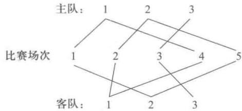
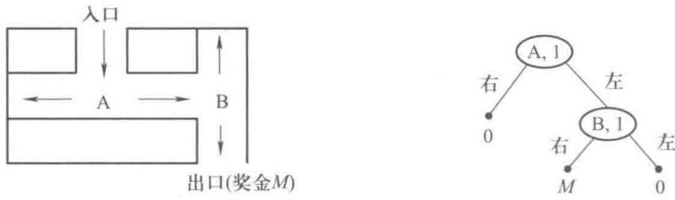
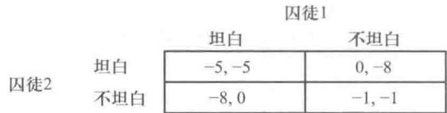
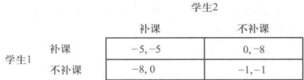
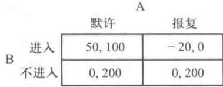
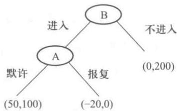

# 第15章 对策论

竞争性质的活动是人类生活中常见的现象,如下棋、打牌、体育比赛、军事斗争中双方兵力的对抗,各公司企业之间的经济谈判以及为争夺市场而进行的竞争等.在竞争过程的各方为了达到自己的目标和利益,必须考虑对手的各种可能的行动方案,并力图选取对自己最为有利或最为合理的方案,也就是说要研究采取对抗其他竞争者的策略,这就是对策问题,对策就是决策者在竞争场合下作出的决策.对策论是研究对策的理论与方法,它既是现代数学的一个新分支,也是管理运筹学的一个重要学科,对策论也叫博弈论.

在我国古代，“齐王赛马”就是一个典型的对策论研究的例子。

战国时期,有一次齐王要与他的大将田忌赛马,双方约定,比赛三局,每局各出赛马一匹,负者要付胜者千金,双方都有上、中、下三个等级的马,已知在同等级的马中,田忌的马不如齐王的马,但如果田忌的马比齐王的马高一等级,则田忌的马就能取胜,如果田忌与齐王的同等级的马比赛,则田忌要连输三局而输掉三千金,当时田忌手下的一位谋士出了一个好对策,每局比赛时先让齐王牵出他的马,然后用下马对齐王的上马,用中马对齐王的下马,以上马对齐王的中马,结果田忌二胜一负,得了千金,这个例子也就说明了对策的重要性.

## 15.1 对策论的基本概念

对策论西方将其翻译为 Game Theory, 直译过来是游戏理论, 我们不妨分析一下游戏的几个特征. 首先是规则, 这是游戏中的规则, 无论是玩纸牌还是打比赛, 都会先设定规则, 比如 2 人打牌还是 4 人打牌? 游戏中什么牌是大牌, 什么牌是小牌? 在游戏中的对峙关系如何? 其次, 我们还会关注游戏中的策略, 这是游戏制胜的关键, 以下象棋为例, 怎么谋划移动棋子的顺序? 怎样引诱或牵制对手? 如何统筹布局赢得游戏? 还有就是策略的依存性, 这一点即游戏的动态特征, 也正因此, 游戏才会生动而不重复, 因为对手不同, 出牌的习惯、下棋的套路也不同, 要想取胜必须要了解对手的特征, 所谓兵来将挡, 水来土掩就是这个意思. 最后, 是比赛的结果, 也就是谁赢谁输的问题, 尽管这可能并非游戏中最重要的, 但大家可能会关注结果如何, 是平局、输局还是胜局?

让我们举个例子来加以说明.这出自普林斯顿大学1981年“博弈论”课程中的一道习题,模拟诺曼底登陆.给你两个师的兵力,由你来当司令,任务是攻克敌方占据的一座城市,而敌军的守备力量是三个师,规定双方的兵力只能整师调动.通往城市的道路只有甲乙两条.当你发起攻击的时候,你的兵力超过敌人,你就获胜;你的兵力比敌人的守备兵力少或者相等,你就失败,那么,你将如何制定攻城方案?

<table><tr><td rowspan="2" colspan="2"></td><td colspan="4">敌方(守城方)</td></tr><tr><td>3甲</td><td>2甲1乙</td><td>1甲2乙</td><td>3乙</td></tr><tr><td rowspan="3">我方(进攻方)</td><td>2甲</td><td>-, +</td><td>-, +</td><td>+, -</td><td>+, -</td></tr><tr><td>1甲1乙</td><td>+, -</td><td>-, +</td><td>-, +</td><td>+, -</td></tr><tr><td>2乙</td><td>+, -</td><td>+, -</td><td>-, +</td><td>-, +</td></tr></table>

图15-1

接到这个任务,恐怕你会觉得吃亏吧?但如果用博弈论的理论来分析一下,便可轻松发现这是个50%对50%的较量.我们从图15-1可看出原委.

图 15-1 中, 我方作为进攻方, 可以有 3 种策略集合, 2 个师攻打甲路, 记为 2 甲, 或者一个师攻占甲路, 一个师攻占乙路, 记为 1 甲 1 乙, 也可 2 个师均攻占乙路, 记为 2 乙. 对于敌方 (守城方), 他们有 3 个师的兵力, 因此可以有 4 种策略集合, 可以 3 个师均守甲路, 或 2 甲 1 乙布局, 或 1 甲 2 乙布局, 或者 3 个师均守乙路. 通过矩阵可以得到每一种策略组合下双方的收益情况, 正号代表赢, 负号代表输. 左侧数据为我方收益, 右侧数据为敌方的收益. 根据前述规则, 我们可以制作出每个格的收益情况. 从对战结果看, 显然在 12 种可能的策略的组合中, 我方胜出 6 场, 敌方胜出 6 场, 因此, 双方获胜的概率各为 $50\%$ .

我们重新回到“齐王赛马”例子中,根据上面游戏的分析,可以归纳出作为对策模型必须包含的三个基本要素:

### 1. 局中人

是指参与对抗的各方,如在“齐王赛马”例子中有两个局中人,一位是齐王,一位是田忌.局中人的数目不一定是2位,也可以多位,如有n个局中人.在这里局中人的“人”的概念是广义的,可以是个人,也可以是某个集体,如球队、交战国、企业、公司等,还可以把大自然作为局中人.

#### 2. 策略集

我们把可供局中人选择对付其他局中人的行动方案称为一个策略，把一个局中人拥有的策略全体称之为该局中人的策略集。例如，在“齐王赛马”的例子中，田忌上、中、下三匹马出赛的次序就是一个策略，田忌的策略集里有6个策略：（上，中，下）、（上，下，中）、（中，上，下）、（中，下，上）、（下，上，中）、（下，中，上），这6个策略的全体就是田忌的策略集，同样齐王的策略集里也有这样的6个策略。

#### 3. 每一局势对策的益损值

各局中人使用一定的对策时形成了一个局势，一个局势就决定了各局中人的对策的结果也称为对策的益损值。如在“齐王赛马”中，若齐王使用（上，中，下）对策，田忌使用（上，下，中）对策，这样就形成了一个局势，在这个局势中，齐王胜了第一，第二局比赛，田忌胜了第三局比赛，这样齐王二胜一负, 得 1 千金, 齐王在这一局势的益损值为 1（千金）. 同样, 我们也可计算得出田忌在这一局势的益损值为 -1（千金）. 我们可以把齐王在各个局势中的益损值都计算出来, 列在表 15-1 中.

表15-1
单位：千金

<table><tr><td> \(S_1\)  \益损值\齐王  \(S_2\) </td><td> \(β_1\) (上,中,下)</td><td> \(β_2\) (上,下,中)</td><td> \(β_3\) (中,上,下)</td><td> \(β_4\) (中,下,上)</td><td> \(β_5\) (下,上,中)</td><td> \(β_6\) (下,中,上)</td></tr><tr><td> \(α_1\) (上中下)</td><td>3</td><td>1</td><td>1</td><td>1</td><td>-1</td><td>1</td></tr><tr><td> \(α_2\) (上下中)</td><td>1</td><td>3</td><td>1</td><td>1</td><td>1</td><td>-1</td></tr><tr><td> \(α_3\) (中上下)</td><td>1</td><td>-1</td><td>3</td><td>1</td><td>1</td><td>1</td></tr><tr><td> \(α_4\) (中下上)</td><td>-1</td><td>1</td><td>1</td><td>3</td><td>1</td><td>1</td></tr><tr><td> \(α_5\) (下上中)</td><td>1</td><td>1</td><td>1</td><td>-1</td><td>3</td><td>1</td></tr><tr><td> \(α_6\) (下中上)</td><td>1</td><td>1</td><td>-1</td><td>1</td><td>1</td><td>3</td></tr></table>

在表 15-1 中, 局中人甲方齐王的策略集为

$$
S _ {1} = \left\{\alpha_ {1}, \alpha_ {2}, \dots , \alpha_ {6} \right\},
$$

局中人乙方田忌的集略集为

$$
S _ {2} = \left\{\beta_ {1}, \beta_ {2}, \dots , \beta_ {6} \right\},
$$

我们把表15-1中的数值矩阵

$$
A = \left[ \begin{array}{r r r r r r} 3 & 1 & 1 & 1 & - 1 & 1 \\ 1 & 3 & 1 & 1 & 1 & - 1 \\ 1 & - 1 & 3 & 1 & 1 & 1 \\ - 1 & 1 & 1 & 3 & 1 & 1 \\ 1 & 1 & 1 & - 1 & 3 & 1 \\ 1 & 1 & - 1 & 1 & 1 & 3 \end{array} \right]
$$

称为局中人甲方齐王的赢得矩阵.

一般而言,当以上三个基本因素确定后一个对策模型也就确定了.

在众多对策模型中，占有重要地位的是二人有限零和对策。所谓二人有限零和对策是指有2个局中人；每个局中人的策略集的策略数目都是有限的；每一局势的对策都有确定的益损值，并且对同一局势的两个局中人的益损值之和为零。二人有限零和对策也称为矩阵策略，如“齐王赛马”就是一个矩阵策略问题；局中人为两人：齐王和田忌；齐王和田忌的策略集的策略数目都是有限的，都为6；每一个局势的对策都有确定的益损值如表15-1所示，并且对同一局势的两个局中人的益损值之和都为零，例如当齐王益损值为3时即齐王赢得3千金时，田忌的益损值为-3，

即田忌就输3千金，有 $3+(-3)=0$ .

在这一章里,我们研究的对策论的模型主要为矩阵对策.通常将矩阵对策记为

$$
G = \left\{S _ {1}, S _ {2}, A \right\},
$$

表示局中人为甲,乙两人,各自的策略集分别为 $S_{1}$ 、 $S_{2}$ ,以及局中人甲的赢得矩阵为 A.

## 15.2 矩阵对策的最优纯策略

每个对策模型都有三个基本要素,对于矩阵对策模型来说,只要确定了甲方赢得矩阵,也就确定了其矩阵对策模型.赢得矩阵每一行代表了局中人甲的一个策略,每一列代表了局中人乙的一个策略;行的数目表示了甲的策略集的策略数目,列的数目表示了乙的策略集的策略数目;赢得矩阵的第i行第j列的数值表示了甲出第i个策略,乙出第j个策略时,甲所得的益损值(乙所得的益损值应为该数值的相反数).

例1 甲乙乒乓球队进行团体对抗赛，每队由三名球员组成，双方都可排成三种不同的阵容，每一种阵容可以看成一种策略，双方各选一种策略参赛。比赛共赛三局，规定每局胜者得1分，输者得-1分，可知三赛三胜得3分，三赛二胜得1分，三赛一胜得-1分，三赛三负得-3分。甲队的策略集为 $S_{1} = \{\alpha_{1}, \alpha_{2}, \alpha_{3}\}$ ，乙队的策略集为 $S_{2} = \{\beta_{1}, \beta_{2}, \beta_{3}\}$ 。根据以往比赛得分资料，可得甲队的赢得矩阵为 $A$ ，如下所示：

$$
\boldsymbol {A} = \left[ \begin{array}{c c c} 1 & 1 & 1 \\ 1 & - 1 & - 3 \\ 3 & - 1 & 3 \end{array} \right].
$$

试问这次比赛各队应采用哪种阵容上场最为稳妥.

解 由 A 可看出, 局中人甲队的最大赢得为 3, 要得到这个赢得, 他就应该选择策略 $\alpha_{3}$ . 由于假定局中人乙队也是理智的, 他考虑到甲队打算出 $\alpha_{3}$ 的心理, 于是准备用 $\beta_{2}$ 来对付甲队, 这样使得甲队反而失掉 1 分……双方都考虑到对方为使自己尽可能地少得分而所做的努力, 所以双方都不存在侥幸心理, 而是从各自可能出现的最不利的情形中选择一种最为有利的情况作为决策的依据, 这就是所谓“理智行为”, 也就是对策双方实际上都能接受的一种稳妥方法.

甲队(局中人甲方)的 $\alpha_{1}, \alpha_{2}, \alpha_{3}$ 三种策略可能带来的最少赢得, 即矩阵 A 中每行的最小元素分别为:

$$
1, - 3, - 1,
$$

在这些最少赢得中最好的结果是1,即甲队应采取策略 $\alpha_{1}$ ,无论对手采用什么策略,甲队至少得1分.而对乙队来说,策略 $\beta_{1},\beta_{2},\beta_{3}$ 可能带来的最少赢得,即矩阵A中每列的最大元素(因为两人零和对策,甲队得分越多,就使得乙队得分越少),分别为

3,1,3,

其中乙队最好的结果为甲队得1分，这时乙队采取 $\beta_{2}$ 策略，不管甲队采用什么策略甲队的得分不会超过1分（即乙队的失分不会超过1).这样可知甲队应采用 $\alpha_{1}$ 策略，乙队应采用 $\beta_{2}$ 策略，这时甲队的赢得值和乙队的损失值都是1，我们把 $\alpha_{1},\beta_{2}$ 分别称为局中人甲队、乙队的最优策略.由于甲队无论乙队采用什么策略都采用一种策略 $\alpha_{1}$ ，而乙队也无论甲队采用什么策略都采用一种策略 $\beta_{2}$ ，我们把这种最优策略 $\alpha_{1}$ 和 $\beta_{2}$ 分别称为局中人甲队、乙队的最优纯策略，这种最优纯策略只有当赢得矩阵 $A = (a_{ij})$ 中等式

$$
\max _ {i} \min _ {j} a _ {i j} = \min _ {j} \max _ {i} a _ {i j}
$$

成立时，局中人甲、乙两方才有最优纯策略，并把 $(\alpha_{1},\beta_{2})$ 称为对策 $G$ 在纯策略下的解，又称 $(\alpha_{1},\beta_{2})$ 为对策 $G$ 的鞍点.把其值 $V$ 称为对策 $G = \{S_1,S_2,A\}$ 的值.在此例中 $V = 1$

上面例子是有实际背景支撑的,就如同世乒赛的男子团体赛.以斯韦思林杯为例,比赛赛制为5局3胜,赛前各队伍先要抽签确定主队、客队,然后双方各派3名选手参赛,并确定第1、2、3号队员的名单,对战场次分别是第1场,主队1号对战客队2号,第2场主队2号对战客队1号,第3场主队3号对战客队3号,第4场主队1号对战客队1号,第5场主队2号对战客队2号,如图15-2所示.要想取胜对方,除了自身队员具有很强的实力,还要考虑对手排兵布阵的可能,便于避其锋芒,择优安排,进而可以做到未雨绸缪,心中有数.

图15-2

例 2 某单位采购员在秋天决定冬季取暖用煤的储量问题,已知在正常的冬季气温条件下要消耗 15 吨煤,在较暖与较冷的气温条件下分别要消耗 10 吨和 20 吨.假定冬季的煤价随天气寒冷程度而有所变化,在较暖、正常、较冷的气候条件下每吨煤价分别为 10 元,15 元和 20 元,又设秋季时煤价为每吨 10 元.在没有关于当年冬季准确的气象预报的条件下,秋季储煤多少吨能使单位的支出量最少?

解 我们可以把这一储量问题看成一个对策问题.局中人Ⅰ为采购员,局中人Ⅱ为大自然,采购员有三个策略,在秋季买10吨,15吨与20吨,分别记为 $\alpha_{1},\alpha_{2},\alpha_{3}$ .大自然也有三个策略,分别为冬季气候较暖,正常与较冷,分别记为 $\beta_{1},\beta_{2},\beta_{3}$ .

通过计算冬季取暖用煤实际费用(为秋季购煤费用和冬季不够时再补购的费用总和)，作为

局中人Ⅰ采购员的赢得,得赢得矩阵如下所示.

$$
\begin{array}{l l l l} & \beta_ {1} (\text {较暖}) & \beta_ {2} (\text {正常}) & \beta_ {3} (\text {较冷}) \\ \alpha_ {1} (10 \text {吨}) & - 100 & - 175 & - 300 \\ \alpha_ {2} (15 \text {吨}) & - 150 & - 150 & - 250 \\ \alpha_ {3} (20 \text {吨}) & - 200 & - 200 & - 200 \end{array}
$$

并在此赢得表上计算,有

$$
\begin{array}{l l l l l} & \beta_ {1} & \beta_ {2} & \beta_ {3} & \min \\ \alpha_ {1} & \left[ \begin{array}{c c c} - 100 & - 175 & - 300 \\ - 150 & - 150 & - 250 \\ - 200 & - 200 & - 200 \end{array} \right] & - 200 * \\ \alpha_ {2} & \\ \alpha_ {3} & \\ \max & - 100 & - 150 & - 200 \end{array}
$$

得

$$
\max _ {i} \min _ {j} a _ {i j} = \min _ {j} \max _ {i} a _ {i j} = a _ {3 2} = - 200,
$$

故 $(\alpha_{3},\beta_{3})$ 为对策G的解, $V_{G}=-200$ ,即秋季储煤20吨为最优纯策略,这时支付冬季取暖用煤实际费用为200元.

## 15.3 矩阵对策的混合策略

对矩阵对策 $G=\{S_{1},S_{2},A\}$ 来说, 如果

$$
\max _ {i} \min _ {j} a _ {i j} \neq \min _ {j} \max _ {i} a _ {i j},
$$

那么是否还可以按照从最不利情况中选取最有利的结果的原则来选择纯策略呢？为了说明问题，不妨设赢得矩阵

$$
\boldsymbol {A} = \left[ \begin{array}{l l} 5 & 9 \\ 8 & 6 \end{array} \right],
$$

这时我们可求得

$$
\begin{array}{c c c} & & \min \\ & \left[ \begin{array}{l l l} 5 & 9 & 5 \\ 8 & 6 \end{array} \right] & 6 \\ \max & 8 & 9 \end{array} ,
$$

即

$$
\begin{array}{r l} \min _ {j} \max _ {i} a _ {i j} & = 8, \max _ {i} \min _ {j} a _ {i j} = 6, \\ \min _ {j} \max _ {i} a _ {i j} & \neq \max _ {i} \min _ {j} a _ {i j}. \end{array}
$$

按上述原则甲应该选取 $\alpha_{2}$ ，乙应该选取 $\beta_{1}$ ，此时甲将赢得8，比其预期赢得 $\max_{i} \min_{j} a_{ij} = 6$ 更多。其问题就出在乙选择了 $\beta_{1}$ ，使得他的对手甲多得了本来不该得的赢得，这也就是说 $\beta_{1}$ 对乙并不是最优策略，因此乙会考虑出 $\beta_{2}$ 。这时甲将赢得6，也即乙损失为6比乙预期的损失 $\min_{j} \max_{i} a_{ij} = 8$ 要少，这对甲是不利的，甲也会考虑采用 $\alpha_{1}$ 的策略。作为乙就要考虑用其 $\beta_{1}$ 来对付甲的 $\alpha_{1}$ 了。这样甲出 $\alpha_{1}$ 和 $\alpha_{2}$ 的可能性和乙出 $\beta_{1}$ 和 $\beta_{2}$ 的可能性都不能排除。对两个局中人甲、乙来说，不存在一个双方都可接受的平衡局势，其主要的原因就是甲和乙没有执行上述原则的共同基础，即 $\max_{i} \min_{j} a_{ij} \neq \min_{j} \max_{i} a_{ij}$ 。在这种情况下矩阵对策不存在纯策略意义下的解，即不存在其最优纯策略。局中人不能单独的使用某个策略，以不变应万变。一个比较自然且合乎实际的想法是：是否可以对甲（乙）给出一个选取不同策略的概率分布以使得局中人甲（乙）在各种情况下的平均赢得（损失）最多（少）。我们把这种策略称之为混合策略。解一个混合策略问题就是求两个局中人各自选取不同策略的概率分布。求解一个最优纯策略问题可以被看成求解混合策略问题的一个特例，它的答案是两个局中人各自以 $100\%$ 的概率选取其某一个策略，而其他的策略选取的概率皆为零。

求解混合策略的问题有图解法、迭代法、线性方程组法和线性规划法等，考虑到我们学习了线性规划并在“管理运筹学”软件包里拥有求解线性规划的程序，故在这里我们介绍线性规划解法.

以下我们仍以赢得矩阵

$$
\boldsymbol {A} = \left[ \begin{array}{l l} 5 & 9 \\ 8 & 6 \end{array} \right]
$$

为例来建立此混合策略的线性规划模型.

首先设甲使用 $\alpha_{1}$ 的概率为 $x_{1}^{\prime}$ ，使用 $\alpha_{2}$ 的概率为 $x_{2}^{\prime}$ ，并设在最坏的情况下（即为乙出对其最有利的策略情况下），甲的赢得的平均值等于 V。这样我们建立了以下的数学关系：

1. 甲使用 $\alpha_{1}$ 的概率 $x_{1}^{\prime}$ 和使用 $\alpha_{2}$ 的概率 $x_{2}^{\prime}$ 的和为 1，并知概率值具有非负性，即

$$
x _ {1} ^ {\prime} + x _ {2} ^ {\prime} = 1, \text {且有} x _ {1} ^ {\prime} \geqslant 0, x _ {2} ^ {\prime} \geqslant 0.
$$

2. 当乙使用 $\beta_{1}$ 策略时，甲的平均赢得为： $5x_{1}^{\prime}+8x_{2}^{\prime}$ ，此平均赢得应大于等于 V，即

$$
5 x _ {1} ^ {\prime} + 8 x _ {2} ^ {\prime} \geqslant V.
$$

3. 当乙使用 $\beta_{2}$ 策略时，甲的平均赢得为 $9x_{1}^{\prime}+6x_{2}^{\prime}$ ，此平均赢得应大于等于 V，即

$$
9 x _ {1} ^ {\prime} + 6 x _ {2} ^ {\prime} \geqslant V.
$$

第二步,我们来考虑 V 的值,V 的值与赢得矩阵 A 的各元素的值是有关的,如果 A 的各元素的值都大于零,即不管甲采用什么策略,乙采用什么策略,甲的赢得都是正的.这时的 V 值即在乙出对其最有利的策略时甲的平均赢得也显然是正的.在本例子中,因为 A 的所有元素都取正值,

所以可知 V>0.

第三步,作变量替换,令

$$
x _ {i} = \frac {x _ {i} ^ {\prime}}{V} (i = 1, 2).
$$

考虑到 V>0, 这样把以上 5 个数量关系式变为

$$
\begin{array}{r l} x _ {1} + x _ {2} & = \frac {1}{V}, x _ {1} \geqslant 0, x _ {2} \geqslant 0, \\ & 5 x _ {1} + 8 x _ {2} \geqslant 1, \\ & 9 x _ {1} + 6 x _ {2} \geqslant 1. \end{array}
$$

对甲来说,希望 V 值越大越好,也就是希望 1/V 的值越小越好,最后,我们就建立起求甲的最优混合策略的线性规划的模型如下:

约束条件：

$$
\begin{array}{l} \min x _ {1} + x _ {2}; \\ 5 x _ {1} + 8 x _ {2} \geqslant 1, \\ 9 x _ {1} + 6 x _ {2} \geqslant 1, \\ x _ {1} \geqslant 0, x _ {2} \geqslant 0. \end{array}
$$

用“管理运筹学”软件,我们求得

$$
\begin{array}{r l} & x _ {1} = 0. 048, \\ & x _ {2} = 0. 095. \end{array}
$$

从 $\frac{1}{V} = x_1 + x_2$ ，我们可求得 $V = \frac{1}{0.048 + 0.095}\approx 6.993.$

再从 $x_{i}^{\prime} = V\cdot x_{i}$ ，可得

$$
\begin{array}{l} X _ {1} ^ {\prime} = 0. 048 \times 6. 993 \approx 0. 336, \\ X _ {2} ^ {\prime} = 0. 095 \times 6. 993 \approx 0. 664. \end{array}
$$

这样,我们知道甲的最优混合策略是以0.336的概率出 $\alpha_{1}$ 策略,以0.664的概率出 $\alpha_{2}$ 策略,简记为 $X^{*}=(0.0336,0.664)^{\mathrm{T}},V=6.993$ 也就是对策G的值,记为 $V_{G}=6.993$ .

同样我们可以求出乙最优混合策略.

设 $y_{1}^{\prime}, y_{2}^{\prime}$ 分别为乙出策略 $\beta_{1}, \beta_{2}$ 的概率, V 为甲出对其最有利的策略的情况下, 乙的损失的平均值. 同样我们可以得到:

$$
\begin{array}{r l} & y _ {1} ^ {\prime} + y _ {2} ^ {\prime} = 1, \\ & 5 y _ {1} ^ {\prime} + 9 y _ {2} ^ {\prime} \leqslant V, \\ & 8 y _ {1} ^ {\prime} + 6 y _ {2} ^ {\prime} \leqslant V, \\ & y _ {1} ^ {\prime} \geqslant 0, y _ {2} ^ {\prime} \geqslant 0. \end{array}
$$

注意在第二、第三个关系式里我们用了“≤”符号, 这是因为乙希望损失的越少越好. 乙的损失就是甲的赢得, 故有 V>0.

同样作变量替换,令

$$
y _ {i} = \frac {y _ {i} ^ {\prime}}{V} (i = 1, 2),
$$

得关系式

$$
\begin{array}{l} y _ {1} + y _ {2} = 1 / V, \\ 5 y _ {1} + 9 y _ {2} \leqslant 1, \\ 8 y _ {1} + 6 y _ {2} \leqslant 1, \\ y _ {1} \geqslant 0, y _ {2} \geqslant 0. \end{array}
$$

乙希望损失的越少越好,即 V 越小越好而 1/V 越大越好,这样我们也建立了求乙的最优混合策略的线性规划模型如下:

约束条件：

$$
\begin{array}{l} \max y _ {1} + y _ {2}; \\ 5 y _ {1} + 9 y _ {2} \leqslant 1, \\ 8 y _ {1} + 6 y _ {2} \leqslant 1, \\ y _ {1} \geqslant 0, y _ {2} \geqslant 0. \end{array}
$$

用“管理运筹学”软件,我们求得 $y_{1}=0.0715, y_{2}=0.0715$ .

从 $\frac{1}{V} = y_1 + y_2$ ，求得 $V = \frac{1}{y_1 + y_2} = \frac{1}{0.0715 + 0.0715}\approx 6.993.$

再从 $y_{i}^{\prime}=V\cdot y_{i}$ ，得

$$
\begin{array}{r l} & y _ {1} ^ {\prime} = 6. 993 \times 0. 0715 \approx 0. 5, \\ & y _ {2} ^ {\prime} = 6. 993 \times 0. 0715 \approx 0. 5. \end{array}
$$

即乙的最优混合策略为以0.5的概率出 $\beta_{1}$ ，以0.5的概率出 $\beta_{2}.V = 6.993$ 也同样是对策 $G$ 的值，即 $V_{G} = 6.993$

在解上述例题时的第二步中,我们从 A 的元素都大于零这一事实判断了 V 大于零.但是在更多的问题中 A 的元素不一定都大于零,我们就无法判断出 V 大于零这个条件,或者在一些问题中 V 本来就小于零或者等于零,这时我们可以把 A 中的每一个元素都加上同样的一个足够大的正数 k 使得所得的新的赢得矩阵 $A'$ 的每一个元素都大于零.有定理保证这两个矩阵对策

$$
\begin{array}{l} G = \left\{S _ {1}, S _ {2}, A \right\}, \\ G ^ {\prime} = \left\{S _ {1}, S _ {2}, A ^ {\prime} \right\} \end{array}
$$

的最优混合策略是相同的.这样我们求出了 $G' = \{S_1, S_2, A'\}$ 的最优混合策略，也就求出了 $G = \{S_1, S_2, A\}$ 的最优混合策略，而且有 $V_G = V_{G'} - k$ .

下面我们来求田忌赛马的最优策略,已知齐王的赢得矩阵

$$
A = \left[ \begin{array}{r r r r r r} 3 & 1 & 1 & 1 & - 1 & 1 \\ 1 & 3 & 1 & 1 & 1 & - 1 \\ 1 & - 1 & 3 & 1 & 1 & 1 \\ - 1 & 1 & 1 & 3 & 1 & 1 \\ 1 & 1 & 1 & - 1 & 3 & 1 \\ 1 & 1 & - 1 & 1 & 1 & 3 \end{array} \right].
$$

求得 $\max_{i}\min_{j}a_{ij}=-1,\min_{j}\max_{i}a_{ij}=3,$

可知 $\max_{i}\min_{j}a_{ij}\neq \min_{j}\max_{i}a_{ij}.$

故此问题不存在纯策略意义下的解.我们可求其混合策略,因为A中有负元素,我们可以取k=2,即在A的每个元素上加2得 $A'$ 如下所示:

$$
\boldsymbol {A} ^ {\prime} = \left[ \begin{array}{c c c c c c} 5 & 3 & 3 & 3 & 1 & 3 \\ 3 & 5 & 3 & 3 & 3 & 1 \\ 3 & 1 & 5 & 3 & 3 & 3 \\ 1 & 3 & 3 & 5 & 3 & 3 \\ 3 & 3 & 3 & 1 & 5 & 3 \\ 3 & 3 & 1 & 3 & 3 & 5 \end{array} \right].
$$

我们建立对 $G'=\{S_{1},S_{2},A'\}$ 的求甲方最优策略的线性规划模型如下所示：

约束条件：

$$
\begin{array}{r l} & \min x _ {1} + x _ {2} + x _ {3} + x _ {4} + x _ {5} + x _ {6}; \\ & 5 x _ {1} + 3 x _ {2} + 3 x _ {3} + x _ {4} + 3 x _ {5} + 3 x _ {6} \geqslant 1, \\ & 3 x _ {1} + 5 x _ {2} + x _ {3} + 3 x _ {4} + 3 x _ {5} + 3 x _ {6} \geqslant 1, \\ & 3 x _ {1} + 3 x _ {2} + 5 x _ {3} + 3 x _ {4} + 3 x _ {5} + x _ {6} \geqslant 1, \\ & 3 x _ {1} + 3 x _ {2} + 3 x _ {3} + 5 x _ {4} + x _ {5} + 3 x _ {6} \geqslant 1, \\ & x _ {1} + 3 x _ {2} + 3 x _ {3} + 3 x _ {4} + 5 x _ {5} + 3 x _ {6} \geqslant 1, \\ & 3 x _ {1} + x _ {2} + 3 x _ {3} + 3 x _ {4} + 3 x _ {5} + 5 x _ {6} \geqslant 1, \\ & x _ {i} \geqslant 0 (i = 1, 2, \dots , 6) \end{array}
$$

用“管理运筹学”软件,我们求得此线性规划问题的解为:

求得

$$
\begin{array}{r l} & x _ {1} = x _ {4} = x _ {5} = 0, \\ & x _ {2} = x _ {3} = x _ {6} = 0. 111. \\ & V ^ {\prime} = \frac {1}{x _ {1} + x _ {2} + x _ {3} + x _ {4} + x _ {5} + x _ {6}} = 3, \\ & x _ {1} ^ {\prime} = x _ {4} ^ {\prime} = x _ {5} ^ {\prime} = 0 \times 3 = 0, \\ & x _ {2} ^ {\prime} = x _ {3} ^ {\prime} = x _ {6} ^ {\prime} = 0. 111 \times 3 = 0. 333 = \frac {1}{3}. \\ & X ^ {\prime *} = (0, 1 / 3, 1 / 3, 0, 0, 1 / 3) ^ {\mathrm{T}}, \end{array}
$$

即

所以甲的最优混合策略为出策略 $\alpha_{2}$ 、 $\alpha_{3}$ 、 $\alpha_{6}$ 的概率都为 0.333（即为 1/3），而出 $\alpha_{1}$ 、 $\alpha_{4}$ 、 $\alpha_{5}$ 的概率为零，此时 $V_{G}^{\prime}=V^{\prime}=3$ .

请注意,上述的线性规划的解不是唯一的,其有无穷组解,例如 $x_{1}=x_{2}=x_{3}=x_{4}=x_{5}=x_{6}=0.0556$ 也是其中一个解,对应可求得

$$
x _ {1} ^ {\prime} = x _ {2} ^ {\prime} = x _ {3} ^ {\prime} = x _ {4} ^ {\prime} = x _ {5} ^ {\prime} = x _ {6} ^ {\prime} = V \times 0. 0556
$$

$$
\begin{array}{r l} & = 3 \times 0. 0556 \\ & = 0. 1668 (\text {   即为   } 1 / 6), \end{array}
$$

也即甲的最优混合策略为出 $\alpha_{1},\alpha_{2},\alpha_{3},\alpha_{4},\alpha_{5},\alpha_{6}$ 的概率都为 $1 / 6$

$$
V _ {G} ^ {\prime} = V ^ {\prime} = 1 / (6 \times 0. 0556) = 3.
$$

如上面所指出的那样，

$$
G = \{S _ {1}, S _ {2}, A \} \text {与} G ^ {\prime} = \{S _ {1}, S _ {2}, A ^ {\prime} \}
$$

有相同的矩阵策略的解,即原问题齐王赛马齐王的最优混合策略也为出 $\alpha_{2},\alpha_{3},\alpha_{6}$ 的概率都为 $\frac{1}{3}$ , 而出 $\alpha_{1},\alpha_{4},\alpha_{5}$ 的概率都为零. 对应的另一解也有齐王的最优混合策略为出 $\alpha_{1},\alpha_{2},\alpha_{3},\alpha_{4},\alpha_{5},\alpha_{6}$ 的概率都为 1/6. 这时 $V_{G}=V_{G}^{\prime}-k=3-2=1$ , 即齐王的平均赢得为 1.

同样可以建立对策 $G'=\{S_{1},S_{2},A'\}$ 的求乙方最优策略的线性模型如下所示：

约束条件：

$$
\begin{array}{r l} & \max y _ {1} + y _ {2} + y _ {3} + y _ {4} + y _ {5} + y _ {6}; \\ & 5 y _ {1} + 3 y _ {2} + 3 y _ {3} + 3 y _ {4} + y _ {5} + 3 y _ {6} \leqslant 1, \\ & 3 y _ {1} + 5 y _ {2} + 3 y _ {3} + 3 y _ {4} + 3 y _ {5} + y _ {6} \leqslant 1, \\ & 3 y _ {1} + y _ {2} + 5 y _ {3} + 3 y _ {4} + 3 y _ {5} + 3 y _ {6} \leqslant 1, \\ & y _ {1} + 3 y _ {2} + 3 y _ {3} + 5 y _ {4} + 3 y _ {5} + 3 y _ {6} \leqslant 1, \\ & 3 y _ {1} + 3 y _ {2} + 3 y _ {3} + y _ {4} + 5 y _ {5} + 3 y _ {6} \leqslant 1, \\ & 3 y _ {1} + 3 y _ {2} + y _ {3} + 3 y _ {4} + 3 y _ {5} + 5 y _ {6} \leqslant 1, \\ & y _ {i} \geqslant 0 (i = 1, 2, \dots , 6). \end{array}
$$

用“管理运筹学”软件解得

求得

$$
\begin{array}{r l} & y _ {1} = y _ {4} = y _ {5} = 0. 111, \\ & y _ {2} = y _ {3} = y _ {6} = 0. \\ & V ^ {\prime} = \frac {1}{y _ {1} + y _ {2} + y _ {3} + y _ {4} + y _ {5} + y _ {6}} = \frac {1}{0 . 333} \approx 3, \text {得到} \\ & y _ {1} ^ {\prime} = y _ {4} ^ {\prime} = y _ {5} ^ {\prime} = V ^ {\prime} \times 0. 111 = 3 \times 0. 111 = 0. 333 = 1 / 3, \\ & y _ {2} ^ {\prime} = y _ {3} ^ {\prime} = y _ {6} ^ {\prime} = V ^ {\prime} \times 0 = 0, \text {即} Y ^ {\prime *} = (1 / 3, 0, 0, 1 / 3, 1 / 3, 0). \end{array}
$$

类似地,我们可以知道在齐王赛马问题中田忌的最优混合策略为田忌出 $\beta_{1},\beta_{4},\beta_{5}$ 的概率都为 1/3, 而出 $\beta_{2},\beta_{3},\beta_{6}$ 的概率都为零, 同样田忌的最优混合策略也不是唯一的, 例如田忌出 $\beta_{1},\beta_{2},\beta_{3},\beta_{4},\beta_{5},\beta_{6}$ 的概率都为 1/6, 也是一个最优混合策略, 这时

$$
V _ {G} = V _ {G} ^ {\prime} - k = V ^ {\prime} - k = 3 - 2 = 1.
$$

即田忌的平均损失为 1.

齐王赛马问题的对策最优解我们可简记为 $X^{*} = (0,1 / 3,1 / 3,0,0,1 / 3)^{\mathrm{T}}$ （或 $X^{*} = (1 / 6,1 / 6,$ $1 / 6,1 / 6,1 / 6,1 / 6)$ ， $Y^{*} = (1 / 3,0,0,1 / 3,1 / 3,0)^{\mathrm{T}}$ （或 $Y^{*} = (1 / 6,1 / 6,1 / 6,1 / 6,1 / 6,1 / 6)$ )，其对策值 $V_{G} = 1$

其实，在“管理运筹学”软件中，为了读者的方便，专门设计了一个处理矩阵对策的混

合策略问题的子程序, 只要输入赢得矩阵, 就得到其对策的最优解.

例 3 两个局中人进行对策,规则是两人互相独立地各自从 1、2、3 这三个数字中任意选写一个数字. 如果两人所写的数字之和为偶数,则局中人乙付给局中人甲以数量为此和数的报酬; 如果两人所写数字之和为奇数,则局中人甲付给局中人乙以数量为此和数的报酬. 试求出其最优策略.

解 首先我们可计算出局中人甲的赢得表如表 15-2 所示.

表15-2

<table><tr><td>甲的赢得\甲的策略\乙的策略</td><td> \(\beta_1(写1)\) </td><td> \(\beta_2(写2)\) </td><td> \(\beta_3(写3)\) </td></tr><tr><td> \(\alpha_1(写1)\) </td><td>2</td><td>-3</td><td>4</td></tr><tr><td> \(\alpha_2(写2)\) </td><td>-3</td><td>4</td><td>-5</td></tr><tr><td> \(\alpha_3(写3)\) </td><td>4</td><td>-5</td><td>6</td></tr></table>

即甲的赢得矩阵

$$
\boldsymbol {A} = \left[ \begin{array}{r r r} 2 & - 3 & 4 \\ - 3 & 4 & - 5 \\ 4 & - 5 & 6 \end{array} \right],
$$

因为

即

$$
\begin{array}{r l} \max _ {i} \min _ {j} a _ {i j} & = - 3, \min _ {j} \max _ {i} a _ {i j} = 4, \\ \max _ {i} \min _ {j} a _ {i j} & \neq \min _ {j} \max _ {i} a _ {i j}. \end{array}
$$

所以此对策问题无在纯策略意义下的解,我们可以求其在混合策略意义下的解,即可求出甲和乙的最优混合策略.为了求解方便,使V值大于零,取k等于6,即A的各元素都加上6,得到新矩阵如下

$$
\boldsymbol {A} ^ {\prime} = \left[ \begin{array}{c c c} 8 & 3 & 10 \\ 3 & 10 & 1 \\ 10 & 1 & 12 \end{array} \right],
$$

并建立其相应的两个互为对偶的线性规划模型如下：

约束条件：

$$
\begin{array}{l} \min x _ {1} + x _ {2} + x _ {3}; \\ 8 x _ {1} + 3 x _ {2} + 10 x _ {3} \geqslant 1, \\ 3 x _ {1} + 10 x _ {2} + x _ {3} \geqslant 1, \\ 10 x _ {1} + x _ {2} + 12 x _ {3} \geqslant 1, \end{array}
$$

$$
x _ {1} \geqslant 0, x _ {2} \geqslant 0, x _ {3} \geqslant 0.
$$

$$
\max y _ {1} + y _ {2} + y _ {3};
$$

约束条件：

$$
8 y _ {1} + 3 y _ {2} + 10 y _ {3} \leqslant 1,
$$

$$
3 y _ {1} + 10 y _ {2} + y _ {3} \leqslant 1,
$$

$$
10 y _ {1} + y _ {2} + 12 y _ {3} \leqslant 1,
$$

$$
y _ {1} \geqslant 0, y _ {2} \geqslant 0, y _ {3} \geqslant 0.
$$

用“管理运筹学”软件,分别求得

$$
x _ {1} = 0. 042, x _ {2} = 0. 083, x _ {3} = 0. 042,
$$

$$
y _ {1} = 0. 042, y _ {2} = 0. 083, y _ {3} = 0. 042.
$$

我们可以求得

$$
V = \frac {1}{x _ {1} + x _ {2} + x _ {3}} = \frac {1}{0 . 167} = 5. 988.
$$

并得到

$$
x _ {1} ^ {\prime} = V x _ {1} = 5. 988 \times 0. 042 \approx 0. 25,
$$

$$
x _ {2} ^ {\prime} = V x _ {2} = 5. 988 \times 0. 083 \approx 0. 50,
$$

$$
x _ {3} ^ {\prime} = V x _ {3} = 5. 988 \times 0. 042 \approx 0. 25,
$$

$$
y _ {1} ^ {\prime} = V y _ {1} = 5. 988 \times 0. 042 \approx 0. 25,
$$

$$
y _ {2} ^ {\prime} = V y _ {2} = 5. 988 \times 0. 083 \approx 0. 50,
$$

$$
y _ {3} ^ {\prime} = V y _ {3} = 5. 988 \times 0. 042 \approx 0. 25.
$$

即此对策的解为

$$
\boldsymbol {X} ^ {*} = (0. 25, 0. 50, 0. 25) ^ {\mathrm{T}}, \boldsymbol {Y} ^ {*} = (0. 25, 0. 50, 0. 25) ^ {\mathrm{T}},
$$

且 $V_{G}=V_{G}^{\prime}-k=5.988-6\approx0.$

这也就是说甲出 $\alpha_{1},\alpha_{2},\alpha_{3}$ 的概率分别为0.25,0.50,0.25.这是甲的最优混合策略，而乙的最优混合策略为出 $\beta_{1},\beta_{2},\beta_{3}$ 的概率为0.25,0.50,0.25，并知道甲的平均赢得（赢得的期望值）为零，乙的平均损失也为零.

例 4 甲乙两个企业生产同一种电子产品,两个企业都想在经营管理上采取措施而获得更多的市场销售份额,甲企业可以采用的策略措施有:①降低产品价格;②提高产品质量;③推出新产品.乙企业考虑采取的策略措施有:①增加广告费用;②增设维修网点,加强售后服务;③改进产品性能.由于甲、乙两企业财力有限,都只能采取一个措施.假定这两个企业所占的市场总份额一定,由于各自采取的措施不同,通过预测今后两个企业的市场占有份额变动情况如表15-3所示(正值为甲企业所增加的市场占有份额,负值为甲企业所减少的市场份额),试求这两个企业各自的最优策略.

表15-3

<table><tr><td>甲的赢得\甲企业策略\乙企业策略</td><td> \(\beta_1\) (措施1)</td><td> \(\beta_2\) (措施2)</td><td> \(\beta_3\) (措施3)</td></tr><tr><td> \(\alpha_1\) (措施1)</td><td>10</td><td>-6</td><td>3</td></tr><tr><td> \(\alpha_2\) (措施2)</td><td>8</td><td>5</td><td>-5</td></tr><tr><td> \(\alpha_3\) (措施3)</td><td>-12</td><td>10</td><td>8</td></tr></table>

解 易见此对策无纯策略意义下的解．因为甲的赢得矩阵 A 中有负元素，令 k=12，把 12 加到 A 中的每一个元素上得 $A'$ .

$$
\boldsymbol {A} ^ {\prime} = \left[ \begin{array}{c c c} 22 & 6 & 15 \\ 20 & 17 & 7 \\ 0 & 22 & 20 \end{array} \right].
$$

建立相应的两个互为对偶的线性规划模型如下：

$$
\begin{array}{l} \min x _ {1} + x _ {2} + x _ {3};  \end{array}
$$

约束条件：

$$
\begin{array}{l} \\ 22 x _ {1} + 20 x _ {2} \geqslant 1, \\ 6 x _ {1} + 17 x _ {2} + 22 x _ {3} \geqslant 1, \\ 15 x _ {1} + 7 x _ {2} + 20 x _ {3} \geqslant 1, \\ x _ {1} \geqslant 0, x _ {2} \geqslant 0, x _ {3} \geqslant 0 \end{array}
$$

以及

$$
\begin{array}{l} \max y _ {1} + y _ {2} + y _ {3};\end{array}
$$

约束条件：

$$
\begin{array}{l} \\ 22 y _ {1} + 6 y _ {2} + 15 y _ {3} \leqslant 1, \\ 20 y _ {1} + 17 y _ {2} + 7 y _ {3} \leqslant 1, \\ 22 y _ {2} + 20 y _ {3} \leqslant 1, \\ y _ {1} \geqslant 0, y _ {2} \geqslant 0, y _ {3} \geqslant 0. \end{array}
$$

用“管理运筹学”软件计算得

$$
x _ {1} = 0. 027, \qquad x _ {2} = 0. 020, \qquad x _ {3} = 0. 023;
$$

$$
y _ {1} = 0. 0225, \qquad y _ {2} = 0. 0225, \qquad y _ {3} = 0. 025.
$$

$$
V = \frac {1}{x _ {1} + x _ {2} + x _ {3}} = \frac {1}{0 . 027 + 0 . 020 + 0 . 023} = \frac {1}{0 . 07} = 14. 29,
$$

并可计算得

$$
x _ {1} ^ {\prime} = V x _ {1} = 14. 29 \times 0. 027 = 0. 3858,
$$

$$
x _ {2} ^ {\prime} = V x _ {2} = 14. 29 \times 0. 020 = 0. 2858,
$$

$$
x _ {3} ^ {\prime} = V x _ {3} = 14. 29 \times 0. 023 \approx 0. 3287;
$$

$$
y _ {1} ^ {\prime} = V y _ {1} = 14. 29 \times 0. 0225 \approx 0. 3215,
$$

$$
y _ {2} ^ {\prime} = V y _ {2} = 14. 29 \times 0. 0225 \approx 0. 3215,
$$

$$
y _ {3} ^ {\prime} = V y _ {3} = 14. 29 \times 0. 025 \approx 0. 3573.
$$

即此对策的解为：

$$
\boldsymbol {X} ^ {*} = (0. 3858, 0. 2858, 0. 3287) ^ {\mathrm{T}},
$$

$$
\boldsymbol {Y} ^ {*} = (0. 3215, 0. 3215, 0. 3573) ^ {\mathrm{T}},
$$

且

$$
V _ {G} = V _ {G} ^ {\prime} - k = 14. 29 - 12 = 2. 29.
$$

即甲的最优混合策略为出措施1,2,3的概率分别为0.3858,0.2858,0.3287;乙最优混合策略为出措施1,2,3的概率分别为0.3215,0.3215,0.3573.并知道甲的平均赢得即是乙的平均损失为2.29.这将为企业决策提供参考.

在这一节的最后,我们将介绍一下优超原则.

设 $A=(a_{ij})$ 为局中人甲的赢得矩阵, 如果在矩阵 A 中存在两行 s 行与 t 行, s 行的元素均不小于 t 行的元素, 即对一切 $j=1,2,\cdots,n$ 都有

$$
a _ {i j} \leqslant a _ {s j},
$$

则称局中人甲的策略 $\alpha_{s}$ 优超于 $\alpha_{t}$ ，同样如果在矩阵 A 中存在两列，k 列与 l 列，k 列的元素都不小于 l 列的元素，即对一切 $i=1,2,\cdots,m$ 都有

$$
a _ {i l} \leqslant a _ {i k},
$$

则称局中人乙的策略 $\alpha_{l}$ 优超于 $\alpha_{k}$ .

优超原则: 当局中人甲的某策略 $\alpha_{i}$ ，被其他策略之一所优超时，可在 A 中划去第 i 行，同样对局中人乙来说，可从在 A 中划去被其他策略之一所优超的那些列，所得的阶数较小的矩阵 $A'$ ，它所对应的对策 $G'$ 与原对策 G 等价，即它们有相同的矩阵对策的解。

利用优超原则,我们可以简化对策问题,下面举例说明优超原则的应用.

例5 设对策问题局中人甲的赢得矩阵为

$$
\boldsymbol {A} = \left[ \begin{array}{c c c c c} 3 & 2 & 0 & 3 & 0 \\ 5 & 0 & 2 & 5 & 9 \\ 7 & 3 & 9 & 5 & 9 \\ 4 & 6 & 8 & 7 & 5. 5 \\ 6 & 0 & 8 & 8 & 3 \end{array} \right],
$$

求解这个矩阵对策.

解 由于第4行优超于第1行,第3行优超于第2行,故可以划去第1行和第2行得到新的赢得矩阵 $A_{1}$ ,为了能记住新矩阵行与列在原矩阵的位置,我们将标上其在原矩阵的位置.

$$
\begin{array}{r l} & \beta_ {1} \quad \beta_ {2} \quad \beta_ {3} \quad \beta_ {4} \quad \beta_ {5} \\ & \alpha_ {3} \left[ 7 \quad 3 \quad 9 \quad 5 \quad 9 \right. \\ & A _ {1} = \alpha_ {4} \left[ 4 \quad 6 \quad 8 \quad 7 \quad 5. 5 \right. \\ & \alpha_ {5} \left[ 6 \quad 0 \quad 8 \quad 8 \quad 3 \right] \end{array} .
$$

对于 $A_{1}$ ，第1列优超于第3列，第2列优超于第4列，因此去掉第3列、第4列，得到

$$
\begin{array}{r l} & \beta_ {1} \quad \beta_ {2} \quad \beta_ {5} \\ & \alpha_ {3} \left[ \begin{array}{l l l} 7 & 3 & 9 \\ 4 & 6 & 5. 5 \\ 6 & 0 & 3 \end{array} \right]. \end{array}
$$

这时第1行又优超于第3行，故在 $A_{2}$ 中划去第3行，得到

$$
\boldsymbol {A} _ {3} = \begin{array}{c c c} \beta_ {1} & \beta_ {2} & \beta_ {5} \\ \alpha_ {3} & 7 & 3 & 9 \\ \alpha_ {4} & 4 & 6 & 5. 5 \end{array} .
$$

在 $A_{3}$ 中可见第1列优超于第3列，把第3列划去，得到

$$
\boldsymbol {A} _ {4} = \begin{array}{c c} \beta_ {1} & \beta_ {2} \\ \alpha_ {3} & 7 \\ \alpha_ {4} & 4 \end{array} .
$$

对于 $A_{4}$ ，易知无最优纯策略，我们可以用线性规划的方法求其解，其相应的相互对偶的线性规划模型如下：

约束条件：

约束条件：

$$
\begin{array}{r l} & \min x _ {3} + x _ {4}; \\ & 7 x _ {3} + 4 x _ {4} \geqslant 1, \\ & 3 x _ {3} + 6 x _ {4} \geqslant 1, \\ & x _ {3} \geqslant 0, x _ {4} \geqslant 0. \\ & \max y _ {1} + y _ {2}; \\ & 7 y _ {1} + 3 y _ {2} \leqslant 1, \\ & 4 y _ {1} + 6 y _ {2} \leqslant 1, \\ & y _ {1} \geqslant 0, y _ {2} \geqslant 0. \end{array}
$$

用“管理运筹学”软件求解得

计算

$$
\begin{array}{r l} & x _ {3} = 0. 067, x _ {4} = 0. 133; \\ & y _ {1} = 0. 1, y _ {2} = 0. 1. \\ & V = \frac {1}{x _ {3} + x _ {4}} = \frac {1}{0 . 067 + 0 . 133} = 5. \end{array}
$$

这样可求得

$$
x _ {3} ^ {\prime} = V x _ {3} = 5 \times 0. 067 = 0. 335,
$$

$$
x _ {4} ^ {\prime} = V x _ {4} = 5 \times 0. 133 = 0. 665,
$$

$$
y _ {1} ^ {\prime} = V y _ {1} = 5 \times 0. 1 = 0. 5,
$$

$$
y _ {2} ^ {\prime} = V y _ {2} = 5 \times 0. 1 = 0. 5,
$$

$$
V _ {G} = V = 5.
$$

于是原矩阵对策的一个解为

$$
\boldsymbol {X} ^ {*} = (0, 0, 0. 335, 0. 665, 0) ^ {\mathrm{T}},
$$

$$
\boldsymbol {Y} ^ {*} = (0. 5, 0. 5, 0, 0, 0) ^ {\mathrm{T}}.
$$

读者也可以不用优超原则化简,而直接用线性规划问题求解,所得结果是一样的.在这我们要提及两个事实:

1. 利用优超原则化简赢得矩阵时, 有可能将原矩阵对策的解也划去一些.

2. 用线性规划求解矩阵对策时, 只能求得一个解, 而矩阵对策可能有无数多个解. 但它们的对策的值 $V_{G}$ 都是一样的. 在本书的第三章里我们已经介绍了如何从计算机输出中判断线性规划是否有无穷多组解.

所以本书建议当“管理运筹学”软件能处理某些对策问题时，就不必用优超原则化简，这样我们可以从输出中判断该对策是否有无穷多组解，而当对策问题的赢得矩阵的阶太大以至于超出“管理运筹学”软件所能处理的范围时，可用优超原则化简。

当然,如果我们用“管理运筹学”软件中的矩阵对策的混合策略的子程序来解决这类问题,那是再方便不过的了,但它不能得到用线性规划子程序求解时所得到的更多的信息.

## 15.4 其他类型的对策论简介

在对策论中可以根据不同方式对对策问题进行分类,通常分类的方式为:

（1）根据局中人的个数，可分为单人博弈和双人博弈。图15-3是一个单人迷宫的例子，局中人只有1个，这也是退化的博弈。只要它能够顺利一次性选对方向，走到出口就可以获得 $M$ 单位的奖金，否则什么也得不到。举例说明，当这个人从入口进入，到达A口，他可以做出向左走还是向右走的决定，如果选择向右走，势必会走到死胡同，所以此时他的收益为0，如果向左走，将会到达B口，此时如果选对了向右走，就可以走到出口进而拿到奖金 $M$ ，反之选择向左走，收益依旧为0。如何表示这个单人博弈呢？可以用动态博弈的表达方法扩展型来表示，如图15-4所示。

图15-3

图15-4

二人对策也称双人博弈，即有两个局中人的对策，这也是博弈论研究最多、最基本和有用的对策类型。二人对策有多种可能性，局中人的利益方向可能一致，也可能不一致，如齐王赛马、猜拳游戏、囚徒困境等都属于二人对策。

本节重点介绍囚徒困境(Prisoner's Dilemma).这是美国普林斯顿大学数学家阿尔伯特·塔克(Albert Tucker)教授1950年提出来的,该对策是对策论最经典、最著名的对策,也可以扩展到许多经济问题以及社会问题,如双寡头垄断、价格战、军备竞赛等.

例 6 囚徒困境讲的是两个犯罪嫌疑人的故事. 两个犯罪嫌疑人(称为囚徒 1 和囚徒 2)作案后被警察抓住, 将他们隔离审讯, 警方的政策是“坦白从宽, 抗拒从严”, 如果两人都坦白则各判 5 年; 如果一人坦白另一人不坦白, 坦白者当场释放, 不坦白者判 8 年; 如果都不坦白则因证据不足各判 1 年. 这个问题最终可能的均衡是什么呢? 如图 15-5 所示.

图15-5

从对策模型的三要素来看，局中人即为囚徒1和囚徒2，每个人的策略集合为“坦白”或“不坦白”，对应的收益矩阵如图15-5所示，每个格中逗号左侧为左面博弈方（囚徒2）的收益，逗号右侧为上面博弈方（囚徒1）的收益。举例说明，以左上格为例，当囚徒1选择坦白囚徒2也选择坦白时，双方各判5年，所以大家的收益为负数-5，而当囚徒1选择坦白，囚徒2选择不坦白时，囚徒1被无罪释放，即为0，而对应的囚徒2却要承受8年的重罪。显然，从表格上看，双方的最优选择是均不坦白，各判1年。而事实上的均衡会怎样呢？

假定囚徒1选择坦白,我们分析囚徒2的选择,当他选择坦白时收益为-5,而不坦白时收益为-8,对比-5与-8,囚徒2一定会选择有利于自己的策略,即坦白,此时收益为-5;而当囚徒1选择不坦白时,我们再来分析囚徒2的选择,当他选择坦白时收益为0,不坦白时收益为-1,相比之下,0优于-1,因此坦白仍是囚徒2的最优选择.综上,无论囚徒1选择什么样的策略,坦白都是囚徒2的最优选择.由于这个损益矩阵是对称的,因此,对于囚徒1而言,无论囚徒2怎么选择,坦白也是他的最优策略,因此,最终的结果是双方都会选择坦白的策略,(坦白,坦白)成了本例中的均衡解.

囚徒困境反映了个人理性和集体理性的矛盾.尽管(不坦白,不坦白)的结果是最好的,但因为每个囚徒都是理性人,他们追求自身效应的最大化,结果就变成了(坦白,坦白).个人理性导致了集体不理性,这也是为什么称之为囚徒“困境”的原因.为什么会造成这样的结果呢?

这要从均衡的概念出发进行讨论,因为上述问题的均衡(坦白,坦白)是所有局中人的最优策略组合.所谓均衡,就是一种稳定状态,符合系统工程中关于稳定性的要求,即系统受到扰动后其运动能恢复到原平衡状态的性能——即系统抗击扰动的特性.在当前的(坦白,坦白)状态下,如果单方面变动会使自己陷入更糟的境地,则不会有人愿意变动.那为什么(不坦白,不坦白)不是均衡或稳态呢,因为这个组合并不稳定,一旦一方不能信守承诺,选择了坦白,他可以获得当场释放的好处,而恪守承诺的一方,即选择不坦白的一方则要蒙受巨大损失,获得8年的牢狱之灾,谁都不愿意冒这个风险,因此,大家都有偏离(不坦白,不坦白)的动机,所以这并不是均衡解.

纵观我们的现实社会,囚徒困境依然存在.以中学补课为例,如果大家都选择不补课,孩子们学业压力小,双方都可以学得轻松自然,然而如果都补课,大家要承受更多压力,学得辛苦,具体收益如图15-6所示.然而在当前状态下,没有学生愿意冒不补课的风险,因为那样会导致自己学习成绩掉队造成更大的损失,因此,(补课,补课)是该问题的均衡组合,囚徒困境再次出现.

图15-6

如何破解囚徒困境呢,恐怕需要社会制度的约束和观念的转换,这留待感兴趣的同学后续进行探索.

最后我们看一下三人或多人的对策.

有三个或三个以上对策方参加的对策就是“多人对策”。多人对策同样也是对策方在意识到其他对策方的存在，意识到其他对策方对自己决策的反应和反作用存在的情况下寻求自身最大利益的决策活动。因而，它们的基本性质和特征与两人对策是相似的，我们常常可以用研究两人对策同样的思路和方法来研究它们，或将两人对策的结论推广到多人对策。不过，毕竟多人对策中出现了更多的追求各自利益的独立决策者，因此，策略的相互依存关系也就更为复杂，对任一对策方的决策引起的反应也就要比两人对策复杂得多。并且，在多人对策中还有一个与两人对策有本质区别的特点，即可能存在“破坏者”。所谓破坏者即一个对策中具有下列特征的对策方：其策略选择对自身的得益没有任何影响，但却会影响其他对策方的得益，有时这种影响甚至有决定性的作用。以1993年9月23日北京申办第27届2000年奥运会为例，共有5个城市参加角逐，中国的北京在前二轮的得票分别是32和37。进入到第三轮，剩下北京、悉尼和曼彻斯特三个城市，他们的得票分别是40、37和11票，此时的曼彻斯特落选。进入第四轮时，只剩下北京和悉尼两个候选城市，假定原来支持北京和悉尼的投票意向不变，此时剩下的11票将重新分配，不妨将其设为第三方，此时第三方已经落选，但是在第四轮的投票中，他们却可以决定北京和悉尼的命运.最终,北京以2票之差,43票对45票惜败悉尼,未能承办2000年的奥运会,但2008年的奥运会却是依然精彩.可见,对于多人对策,如三人对策,每一方的策略都将影响博弈的最终均衡,比如上面的第三方就属于前述的“破坏者”,尽管在第四轮投票中,其策略选择对自身的利益并没有影响,但却会对其他参与方的利益产生很大的,有时甚至是决定性的影响.因此,如果我们将申办奥运会的决策活动看做是一个三人对策,每个局中人都可以做出自己的决策,则前面所述的第三方很可能成为这个问题的“破坏者”.

多人对策可以分为合作的和非合作的．非合作对策顾名思义，就是局中人之间不存在合作，即各局中人在采取行动之前，没有事前的交流和约定，在其行为发生相互作用时，也不会达成任何有约束力的协议．每个局中人都选择于己最有利的策略以使效用水平最大化．然而，在非合作对策中，双方的利益也并非是完全冲突的，即对一个局中人有利的局势并不一定对其他局中人不利．

如同矩阵对策中纯策略意义下的解有时不存在一样,有些非合作对策也不存在纯策略纳什均衡.在这种情况下,局中人就必须考虑混合策略.

（2）根据对策中的策略数量划分，可分为有限对策和无限对策。有限对策，即每个局中人的策略数都是有限的，如囚徒困境模型，策略是有限的；而对于无限对策，至少有某些局中人有无限多个策略，如下文介绍的连续产量古诺模型。

例 7 设一市场有两个厂商供应同样的产品. 厂商 1 产量为 $q_{1}$ ，厂商 2 产量为 $q_{2}$ ，市场总供给 $Q = q_{1} + q_{2}$ . 市场出清价格 P（可以将产品全部都卖出去的价格）是市场总供给的函数 $P = P(Q) = 8 - Q$ . 再设两个厂商生产都无固定成本，每增加一单位产量的边际成本 $c_{1} = c_{2} = 2$ ，最后强调两个厂商同时决策，即决策之前都不知道另一方产量.

该博弈中,两博弈方的策略空间是他们可以选择的产量.假设产量是连续可分的,即使由于受生产能力限制等原因产量是有上限的,两厂商也都有无限多种可选策略.两博弈方的得益是两个厂商各自的利润,即各自的销售收入减去各自的成本,根据设定情况分别为

$$
\begin{array}{r l} & u _ {1} = q _ {1} P (Q) - c _ {1} q _ {1} = q _ {1} \left[ 8 - (q _ {1} + q _ {2}) \right] - 2 q _ {1} = 6 q _ {1} - q _ {1} q _ {2} - q _ {1} ^ {2} \\ & u _ {2} = q _ {2} P (Q) - c _ {2} q _ {2} = q _ {2} \left[ 8 - (q _ {1} + q _ {2}) \right] - 2 q _ {2} = 6 q _ {2} - q _ {1} q _ {2} - q _ {2} ^ {2} \end{array}
$$

容易看出,两博弈方的得益都取决于双方策略(产量).正是由于双方都有无限多种可选策略,因而博弈无法用得益矩阵表示,但纳什均衡概念还是适用的,只要策略组合 $(q_{1}^{*},q_{2}^{*})$ 满足 $q_{1}^{*}$ 和 $q_{2}^{*}$ 相互都是对方的最佳对策,即可构成纳什均衡.如果可以证实它是该博弈的唯一纳什均衡,即理性博弈的结果,可以预言两个理性的厂商将分别选择这两个产量.

在此,可直接根据纳什均衡的定义求解该博弈的纳什均衡.根据定义,纳什均衡就是相互为最优对策的各博弈方策略组合,因此如果策略组合 $(q_{1}^{*},q_{2}^{*})$ 是本博弈的纳什均衡,就必须是最大值问题

$$
\left\{ \begin{array}{l} \max _ {q _ {1}} (6 q _ {1} - q _ {1} q _ {2} ^ {*} - q _ {1} ^ {2}) \\ \max _ {q _ {2}} (6 q _ {2} - q _ {2} q _ {1} ^ {*} - q _ {2} ^ {2}) \end{array} \right.
$$

的解.

上述两个求最大值的式子都是各自变量的二次式，且二次项系数都小于0，因此只要 $q_{1}^{*}, q_{2}^{*}$ 能使两式各自对 $q_{1}, q_{2}$ 的导数为0，就能实现两式的最大值. 令

$$
\left\{ \begin{array}{l} 6 - q _ {2} ^ {*} - 2 q _ {1} ^ {*} = 0 \\ 6 - q _ {1} ^ {*} - 2 q _ {2} ^ {*} = 0 \end{array} \right.
$$

解之得该方程组的唯一解 $q_{1}^{*}=q_{2}^{*}=2$ . 因此策略组合 $(2,2)$ 是本博弈的唯一的纳什均衡. 可预测两个厂商都会生产 2 单位产量, 市场总供给为 $2+2=4$ , 市场价格为 8-4=4, 双方各自得益 (利润) 为 $2\times(8-4)-2\times2=4$ , 两个厂商利润总和为 $4+4=8$ .

如果从两个厂商总体利益最大化角度出发进行统一的产量选择, 就要求实现使两个厂商利润总和最大的总产量. 设总产量为 Q, 则总利润为

$$
U = P \cdot Q - c Q = Q (8 - Q) - 2 Q = 6 Q - Q ^ {2}
$$

容易求得使总得益最大的总产量 $Q^{*}=3$ ，最大总得益 $u^{*}=9$ 。将此结果与两个厂商独立决策，追求各自利润最大化时的博弈结果相比，不难发现这里的总产量较小，而总利润却较高。因此从两个厂商的总体来看，根据总体利益最大化决策效率更高。换言之，如果两个厂商联合起来决定产量，先定出使总利益最大的产量（3单位）后各自生产其中的一半（1.5单位），则各自可分享到4.5单位利润，比各自独立决策得到的要高。

然而,这也同样面临囚徒困境问题,(1.5,1.5)单位的产量为什么不能成为纳什均衡的组合策略呢?是因为当一方生产1.5单位的产量时,另一方如果突破了1.5单位产量的限制,比如生产古诺产量2个单位,则可以获得超高的利润5,而恪守承诺生产1.5单位产量的博弈方只能得到3.75的收益,如图15-7所示.

厂商1

<table><tr><td colspan="2"></td><td>不突破1.5</td><td>突破2</td></tr><tr><td rowspan="2">厂商2</td><td>不突破1.5</td><td>4.5,4.5</td><td>3.75,5</td></tr><tr><td>突破2</td><td>5,3.75</td><td>4,4</td></tr></table>

图15-7

因此(1.5,1.5)的组合策略不具有稳定型,而古诺模型中的(2,2)才是真正稳定的纳什均衡.

（3）根据对策中的得益可以将其分为零和、常和和非零和对策.得益即参加对策的各个对策方从对策中所获得的利益，它是各对策方追求的根本目标，也是他们行为和判断的主要依据.

乙

在两人或多人对策中,每个对策方在每种结果(策略组合)下都有各自相应的得益,我们可将每个对策方在同一种结果中各自的得益相加计算出各对策方得益的总和.不同对策问题中,总得益的情况会有所不同.根据总得益是否为零可以将对策分为“零和对策”和“非零和对策”.

所谓零和对策, 就是一方的收益必定是另一方的损失. 这种对策的特点是不管各对策方如何决策, 最后各对策方得益之和总是为零. 有某些对策中, 每种结果之下各对策方的得益之和不等于 0, 但总是等于一个非零常数, 就称为“常和对策”. 当然, 可以将零和对策本身看作是常和对策的特例.

“零和对策”和“常和对策”之外的所有对策都可被称为“非零和对策”。非零和对策即意味着在不同策略组合（结果）下各对策方的得益之和一般是不相同的。如前述囚徒困境就是典型的非零和对策。应该说，非零和对策是最一般的对策类型，而常和对策和零和对策都是它的特例。在非零和对策中，存在着总得益较大的策略组合和总得益较小的策略组合之间的区别，这也就意味着在对策方之间存在着互相配合，争取较大的总得益和个人得益的可能性。

两人零和对策是完全对抗性的,总得益为0,其解法可能性根据矩阵对策予以求解,但在非零和对策下,矩阵对策求解法已经不适用了,下面用例子予以说明.

例 8 甲乙两公司生产同一产品,均想以登广告扩大产品销售,每家公司都有“登”与“不登”两种策略,双方的得益矩阵如图 15-8 所示.

我们根据得益矩阵来分析．从甲公司立场上看，登有利，不管乙公司如何，保证赢利至少是3，最多是9．如果不登，可能要蒙受损失2．从乙公司的立场上看，同样理由，还是登广告好．但是，这是从理智行为出发的策略，是以彼此不能合作为前提的．上述两公司均采取登广告的策略是稳定的结局．

<table><tr><td></td><td>登</td><td>不登</td></tr><tr><td>登</td><td>3,2</td><td>9,-3</td></tr><tr><td>不登</td><td>-2,8</td><td>6,5</td></tr></table>

图15-8

可是，如果彼此能够合作，而都不登广告，免去了广告费，反而各自的赢利要多。在彼此不能合作的情况下，如果甲不登，恰好乙登，甲只好出现败局，这是非理智的策略，带有危险性。因此，非零和对策常常不易获得最理想的答案。对于三个以上的多人非零和对策，互相利害关系更加复杂，局中人之间还有相互结盟的可能性，也有不结盟的对策，还有连续对策，要想研究这些对策，请阅读相关专门书籍。

（4）根据对策的过程，可以分为静态对策、动态对策、重复对策。根据局中人行动的先后顺序，可以将博弈划分为静态对策和动态对策。所谓静态对策，指所有局中人同时选择或虽非同时但后行动者并不知道前行动者采取了什么具体行动，即可看作同时选择策略的对策，如齐王赛马、囚徒困境、乒团体赛等；动态对策，指各局中人的选择和行动有先后次序且后选择、后行动的局中人在自己选择、行动之前可以看到其他局中人的选择和行动，如弈棋、市场进入、领导—追随型市场结构，行动顺序有时也会对结果产生影响，有时有先发优势或后发优势，比如后面我们将举例的斯坦克博格模型就是有先发优势的例子。重复对策，指同一个对策反复进行所构成的对策，通过有效的机制设计，可以实现更高效的合作，进而达到新的均衡，现实生活中如长期客户、长期合同、信誉问题等，都属于多次的重复博弈，重复博弈可以分为有限次重复和无限次重复。

（5）根据对策的信息结构分类.所谓知己知彼，百战不殆，战争也罢，商业的较量也罢，往往信息掌握不同，局中人的收益情况也会大不相同.因此，信息对博弈结果有着至关重要的作用.根据局中人掌握信息的情况分为：完全信息对策，即各局中人都完全了解所有局中人各种情况下的得益.如囚徒困境中，每个囚徒既对自己的得益情况完全清楚，对另外一名囚徒的得益也很清楚.然而，并非所有的对策局中人都了解对策所需的全部信息，当至少部分局中人不完全了解其他局中人得益情况时，这类对策称为不完全信息对策，也称为非对称信息对策.比如二手车市场是一个信息极其不对称的市场，买卖双方对车辆好坏的信息掌握不同，信息不对称会对博弈的效率产生影响，因此，很多时候克服信息不对称往往是提高效率的关键因素，比如市场监管中很重要的一部分就是完善监督，进而降低信息不对称产生的负面影响.

（6）对策的分类及对应均衡.根据行动顺序（静态、动态）和掌握信息（完全信息、不完全信息）的情况,可以将博弈划分为以下4种不同类型的博弈,即完全信息静态博弈,完全信息动态博弈,不完全信息静态博弈和不完全信息动态博弈.与此对应的四个均衡概念分别是,纳什均衡(Nash Equilibrium),子博弈精炼纳什均衡(Subgame Perfect Nash Equilibrium),贝叶斯纳什均衡(Bayesian Nash Equilibrium)及精炼贝叶斯纳什均衡(Perfect Bayesian Nash Equilibrium).表15-4概括了以上四种博弈及对应的均衡概念,也大致反映了三位诺贝尔经济学奖得主在非合作博弈中的地位.

表15-4

<table><tr><td>信息\行动顺序</td><td>静态</td><td>动态</td></tr><tr><td>完全信息</td><td>完全信息静态对策纳什均衡纳什(1950—1951)</td><td>完全信息动态对策子博弈精炼纳什均衡泽尔腾(1965)</td></tr><tr><td>不完全信息</td><td>不完全信息静态对策贝叶斯纳什均衡海萨尼(1967—1968)</td><td>不完全信息动态对策精炼贝叶斯纳什均衡泽尔腾(1975)Kreps 和 Wilson(1982)Fudenberg 和 Tirole(1991)等</td></tr></table>

① 完全信息静态对策.该对策是指掌握了局中人的特征、策略空间、支付函数等知识和信息并且局中人同时选择行动方案或虽非同时但后行动者并不知道前行动者采取了什么行动方案.纳什均衡是一个重要概念.在一个策略组合中,给定其他参与者策略的情况下,任何参与者都不愿意脱离这个组合,或者说打破这个僵局,这种均衡就称为纳什均衡,如前文提到的“囚徒困境”.

② 完全信息动态对策.如果各方行动存在先后顺序,后行动的一方会参考先行者的策略而采取行动,而先行者也会知道后行者会根据他的行动采取何种行动,因此先行者会考虑自己的行动对后行者的影响后选择行动.这类问题称为完全信息动态对策问题,如弈棋问题.

例 9 某行业中只有一个垄断企业 A, 有一个潜在进入者企业 B. B 可以选择进入或不进入该行业这两种行动, 而 A 当 B 进入时, 可以选择默认或者报复两种行动. 如果 B 进入后 A 企业报复, 将造成两败俱伤的结果, 但如果 A 默认 B 进入, 必然对 A 的收益造成损失. 如果 B 不进入, 则 B 无收益而 A 不受损. 把此关系用图 15-9 表示.

假设 B 进入, A 只能选择默许, 因为可以得到 100 的收益, 而报复后只得到 0. 假设 A 选择报复, B 只能选择不进入, 因为进入损失更大. 因此, (B 选择不进入, A 选择报复) 和 (B 选择进入, A 选择默许) 都是纳什均衡解, 都能达到均衡.

但在实际中，(B 选择不进入, A 选择报复) 这种情况是不

图15-9

可能出现的.因为B知道他如果进入，A只能默许，所以只有（B选择进入，A选择默许）会发生.或者说，A选择报复行动是不可置信的威胁.对策论的术语中，称（A选择默许，B选择进入）为精炼纳什均衡.当只当参与人的战略在每一个子对策中都构成纳什均衡，那么，这个纳什均衡才称为精炼纳什均衡.

当然,如果 A 下定决心一定要报复 B,即使自己暂时损失.这时威胁就变成了可置信的,B 就会选择不进入,(B 选择不进入,A 选择报复)就成为精炼纳什均衡.

军事交战时，“破釜沉舟”讲的就是一种可置信威胁。项羽与秦军作战时，率兵过河后就砸锅沉船，把自己后路给封死了，就是为了展示背水一战的姿态，自然军心大振。

实际企业经营中有很多类似的例子.比如,和例9情形类似,行业中的领导企业通常会想方设法增大报复的威胁.比如新建一些平常根本不用的生产线,对外宣称如果其他企业进入该行业,这些空闲的生产线就马上生产,提高产量,从而对新进入者造成打击.这种威胁显然是很有威慑力的.

其实,除了用矩阵以外,动态博弈通常用扩展型来表示,如图15-10所示.末端叶子节点下的括号为博弈双方的收益情况,第一个数据指最先出现的博弈方的收益,逗号后面为依次出现的博弈方的收益.本例中B首先行动,因此,收益中最先出现的是B的收益,然后是A的收益.动态博弈中要想找到精炼纳什均衡,或者排除不可置信的威胁,可以用动态博弈求解的基本方法即逆推归纳法.本例中,从最后一个阶段开始,A此时的选择一

图15-10

定是默许,因为默许带来的收益100大于报复带来的收益0,继续回溯到第一阶段,此时B的选择一定是进入,可以带来50的收益,而不进入的收益为0.因此该博弈的精炼纳什均衡为(B进

入，A 默许）.

例10 寡占的斯塔克博格模型

动态的寡头市场产量博弈,称为斯塔克博格(Stacklberg)模型,与古诺模型很类似,只是该模型是两个厂商先后选择产量的产量竞争博弈.由于两厂商中,一方较强,一方较弱,较强的一方先选择产量,较弱的一方后选择产量,且后选择厂商在选择时知道前者的选择,因此是一个动态博弈问题.假设博弈结构的策略空间、得益函数等与两寡头连续产量静态博弈的古诺模型一致.

斯塔克博格模型中，两博弈方的决策内容是产量 $(q_{1}, q_{2})$ ，可以选择的产量水平理论上无限多，因此是有无限多种可选策略的无限策略动态博弈。设两个寡头为厂商1和厂商2，厂商1先选择，厂商2后选择；策略空间都是 $[0, Q_{\max})$ 中的所有实数，其中 $Q_{\max}$ 可看作不至于使价格降到亏本的最大限度产量，或者厂商生产能力限度；价格函数为 $P = P(Q) = 8 - Q$ （其中 $Q = q_{1} + q_{2}$ ），两个厂商的边际生产成本为 $c_{1} = c_{2} = 2$ ，且没有固定成本。

根据上述假设,得出两个厂商的得益函数分别为

$$
\begin{array}{l} u _ {1} = q _ {1} P (Q) - c _ {1} q _ {1} = q _ {1} \left[ 8 - \left(q _ {1} + q _ {2}\right) \right] - 2 q _ {1} = 6 q _ {1} - q _ {1} q _ {2} - q _ {1} ^ {2}; \\ u _ {2} = q _ {2} P (Q) - c _ {2} q _ {2} = q _ {2} \left[ 8 - \left(q _ {1} + q _ {2}\right) \right] - 2 q _ {2} = 6 q _ {2} - q _ {1} q _ {2} - q _ {2} ^ {2}. \end{array}
$$

它们和古诺模型的得益函数完全相同.

直接用逆推归纳法求子博弈精炼纳什均衡.先分析第二阶段厂商2的决策,此时厂商1的 $q_{1}$ 已经决定,且厂商2知道,因此对厂商2来说是在给定 $q_{1}$ 的情况下求使 $u_{2}$ 最大的 $q_{2}.q_{2}$ 必须满足一阶条件,即

$$
6 - q _ {1} - 2 q _ {2} = 0.
$$

求得

$$
\begin{array}{r l r} & q _ {2} = \frac {1}{2} (6 - q _ {1}) = 3 - \frac {q _ {1}}{2}. \\ & (15.1) \end{array}
$$

这就是厂商 2 对厂商 1 产量的反应函数.

厂商 1 知道厂商 2 的决策思路, 在选择 $q_{1}$ 时就知道厂商 2 的产量会根据 (15.1) 式确定, 所以可以直接将式 (15.1) 代入自己的得益函数, 这样厂商 1 的得益函数转化成自己产量的一元函数, 即

$$
\begin{array}{r l r} & u _ {1} = 6 q _ {1} - q _ {1} q _ {2} - q _ {1} ^ {2} = 6 q _ {1} - q _ {1} \left(3 - \frac {q _ {1}}{2}\right) - q _ {1} ^ {2} = 3 q _ {1} - \frac {q _ {1} ^ {2}}{2} = u _ {1} (q _ {1}). \\ & (15.2) \end{array}
$$

(15.2)式表明当把厂商2的反应方式考虑进来以后，厂商1的得益完全是由自己控制的。厂商1可以根据(15.2)式直接求得致自己得益最大的 $q_{1}^{*}$ 。令 $q_{1}=q_{1}^{*}$ 时式(15.2)对 $q_{1}$ 的导数等于0，得

$$
\begin{array}{c} 3 - q _ {1} ^ {*} = 0, \\ q _ {1} ^ {*} = 3, \end{array}
$$

即厂商1的最佳产量是生产3单位.代入式(15.1)，得厂商2的最佳产量 $q_{2}^{*} = 3 - \frac{q_{1}}{2} = 3 - 1.5 = 1.5$

单位.此时市场价格为3.5,双方的得益(利润)分别为4.5和2.25单位.

厂商 1 第一阶段选择 3 单位产量, 厂商 2 第二阶段选择 1.5 单位产量, 是运用逆推归纳法分析得出的策略组合, 是这个斯塔克博格动态产量博弈唯一的子博弈精炼纳什均衡.

将上述结果与两寡头同时选择产量的古诺模型进行比较,不难发现斯塔克博格模型的产量大于古诺模型,价格低于古诺模型,总利润(两厂商得益之和)小于古诺模型,但厂商1的得益大于古诺模型两个厂商的得益.这反映了两个厂商之间地位不对称性的影响.此处厂商1作为强势的一方,具有先发优势.

以上所谈的对策都是假设所有参与者都知道其他参与者的行动集以及收益等,所有人都是“透明”的,这种对策称为完全信息对策.更复杂的对策是信息不完全时的对策,称为不完全信息对策,这类对策本书就不再介绍了.

## 习题

1. 设有参加对策的局中人 A 和 B, A 的损益矩阵如下, 求最优纯策略和对策值.

$$
\begin{array}{c c c c} & \beta_ {1} & \beta_ {2} & \beta_ {3} \\ \alpha_ {1} & - 500 & - 100 & 700 \\ \alpha_ {2} & 100 & 0 & 200 \\ \alpha_ {3} & 500 & - 200 & - 700 \end{array}
$$

2. 甲、乙两学校组织羽毛球团体赛, 每学校由两个人组成一个队参加比赛. 甲学校根据不同组合可组成 3 个队, 乙学校的人员可组成 4 个队, 根据以往比赛的记录, 已知各种组队法相遇后甲学校的得分如表 15-5 所示.

表15-5

<table><tr><td>甲学校\乙学校</td><td>1 队</td><td>2 队</td><td>3 队</td><td>4 队</td></tr><tr><td>1 队</td><td>-5</td><td>2</td><td>-9</td><td>-4</td></tr><tr><td>2 队</td><td>5</td><td>2</td><td>4</td><td>3</td></tr><tr><td>3 队</td><td>7</td><td>-3</td><td>-7</td><td>6</td></tr></table>

问双方应各派哪个队上场是最优决策？

3. 设有参加对策的局中人甲和乙，甲的损益矩阵为 A. 当 A 为下列矩阵时，试求 p 和 q 的取值范围，使得该矩阵在元素 $a_{22}$ 处存在鞍点.

$$
\beta_ {1} \quad \beta_ {2} \quad \beta_ {3}
$$

$$
\beta_ {1} \quad \beta_ {2} \quad \beta_ {3}
$$

(1)

$$
\begin{array}{l} \alpha_ {1} \left[ \begin{array}{c c c} 1 & q & 6 \\ p & 5 & 10 \\ 6 & 2 & 3 \end{array} \right] \\ \alpha_ {2} \left[ \begin{array}{c c c} 1 & q & 6 \\ p & 5 & 10 \\ 6 & 2 & 3 \end{array} \right] \end{array}
$$

(2)

$$
\begin{array}{l} \alpha_ {1} \\ \alpha_ {2} \\ \alpha_ {3} \end{array} \left[ \begin{array}{c c c} 2 & 4 & 5 \\ 10 & 7 & q \\ 4 & p & 6 \end{array} \right]
$$

4. 二指莫拉问题: 甲、乙二人游戏, 每人出一个或两个手指, 同时又把猜测对方所出的指数叫出来, 如果只有一人猜测正确, 则他所应得的数目为二人所出指数之和, 否则重新开始, 写出该对策中各局中人的策略集合及甲

的赢得矩阵,试问该问题存在最优纯策略吗?

5. 用线性规划法求下列矩阵对策, 其中 A 为

(1)

$$
\left[ \begin{array}{c c c} 8 & 2 & 4 \\ 2 & 6 & 6 \\ 6 & 4 & 4 \end{array} \right]
$$

(2)

$$
\left[ \begin{array}{c c c} 2 & 0 & 2 \\ 0 & 3 & 1 \\ 1 & 2 & 1 \end{array} \right]
$$

6. 请判断下列说法是否正确：

（1）矩阵对策的对策值, 相当于进行若干次对策后, 局中人 I 的平均赢得或局中人 II 的平均损失值.

（2）对任一矩阵对策 $G=\{S_{1},S_{2},A\}$ ，一定存在混合策略解.

（3）矩阵对策中，如果最优解要求一个局中人采用纯策略，则另一局中人也必须采取纯策略.

（4）设矩阵对策 $G_{1}=\{S_{1},S_{2},A\}$ 和 $G_{2}=\{S_{1},S_{2},B\}$ ，其中 $A=(a_{ij})_{m\times n}$ ， $B=(b_{ij})_{m\times n}$ 。如果 $b_{ij}=ka_{ij}(i=1,2,\cdots,m;j=1,2,\cdots,n;k>0)$ ，则 $G_{1}$ 和 $G_{2}$ 具有相同的最优策略且它们的对策值 $V_{1}$ 和 $V_{2}$ 之间有关系： $V_{2}=kV_{1}$ 。

7. 甲乙双方争夺 A 城. 乙方用三个师守城, 有两条公路通入 A 城; 甲方用两个师攻城, 可能各走一条公路, 也可能从一条公路进攻. 乙方可用三个师守一条公路, 或者两个师守一条公路, 第三个师守另一条公路. 假设哪方的军队数量多, 哪方就能控制该公路; 若双方在同一条公路上的数量相同, 则双方取胜的概率各占一半. 试把这个问题构成对策模型, 并求甲乙双方的最优策略以及甲方攻城的可能性.

8. 某大学城有 A, B, C 三个学校, 分别居住着该大学城 40%, 30%, 30% 的学生. 甲和乙两个公司都计划在大学城内建造大型书店, 公司甲计划建两个书店, 公司乙计划建一个. 两公司都明白如果在某个学校内设有两个书店, 那么这两个书店将平分该学校的消费, 如果在某个学校只有一个书店, 则该书店将独揽这个学校的消费. 如果在一个学校没有书店, 则该学校的消费将平分给三个书店. 每个公司都想使自己的营业额尽可能地多. 试把这个问题表示成一个对策问题, 写出公司甲的赢得矩阵, 并求两个公司的最优策略以及各占有多大的市场份额.

9. 甲乙两个企业生产同一种电子产品，甲企业可以采取的策略措施有：(1)降低产品价格；(2)提高产品质量；(3)推出新产品。乙企业考虑采取的策略措施有：(1)增加广告费用；(2)增设维修网点，加强售后服务；(3)改进产品性能。由于甲乙两个企业财力有限，都只能采取一个措施。假定这两个企业所占有的市场总份额一定，由于各自采取的措施不同，通过预测今后两个企业的市场占有份额变动情况如表15-6所示，试求出这两个企业各自的最优策略。

表15-6

<table><tr><td>甲的赢得\甲策略\乙策略</td><td> \(\beta_{1}\) 措施 1</td><td> \(\beta_{2}\) 措施 2</td><td> \(\beta_{3}\) 措施 3</td></tr><tr><td> \(\alpha_{1}\)  措施 1</td><td>10</td><td>-6</td><td>3</td></tr><tr><td> \(\alpha_{2}\)  措施 2</td><td>8</td><td>5</td><td>-5</td></tr><tr><td> \(\alpha_{3}\)  措施 3</td><td>-12</td><td>10</td><td>8</td></tr></table>

10. A, B 两家公司各控制市场的 50%, 最近两家公司都改进了各自的产品, 准备发动新的广告宣传. 如果这两家公司都不做广告, 那么平分市场的局面将保持不变, 但如果一家公司发动强大广告宣传, 那么另一家公司将按比例失去其一定数量的顾客, 市场调查表明, 潜在顾客的 50%, 可以通过电视广告争取到, 30% 通过报纸, 其余的 $20\%$ 可通过无线电广播争取到. 现每一家公司的目标是选择最有利的广告手段.

（1）把这个问题表达成一个矩阵的对策，求出局中人A的损益矩阵.

(2) 这个对策有鞍点吗？A, B 两公司的最优策略各是什么？对策值为多少？

（提示：每个公司有8个策略，如不做广告、做电视广告、做电视报纸广告……）

11. 某小区两家超市相互竞争, 超市 A 有 4 个广告策略, 超市 B 也有 4 个广告策略. 已经算出当双方采取不同的广告策略时, A 方所占的市场份额增加的百分数如下:

$$
\begin{array}{c c c c c} & \beta_ {1} & \beta_ {2} & \beta_ {3} & \beta_ {4} \\ \alpha_ {1} & 3 & 0 & 4 & - 2 \\ \alpha_ {2} & 0 & 6 & - 1 & - 3 \\ \alpha_ {3} & 4 & - 2 & 3 & 5 \\ \alpha_ {4} & - 5 & - 1 & 8 & 7 \end{array}
$$

请把此对策问题表示成一个线性规划模型，并求出最优策略。

12. 有甲、乙两支游泳队举行包括三个项目的对抗赛。这两支游泳队各有一名健将运动员（甲队为李，乙队为王）在三个项目中成绩很突出，但规则准许他们每人只能参加两项比赛，每队的其他两名运动员可以参加全部的三项比赛。已知各运动员的平时成绩（秒）见表15-7。

表 15-7

<table><tr><td rowspan="2"></td><td colspan="3">甲 队</td><td colspan="3">乙 队</td></tr><tr><td> \(A_1\) </td><td> \(A_2\) </td><td>李</td><td>王</td><td> \(B_1\) </td><td> \(B_2\) </td></tr><tr><td>100 米蝶泳</td><td>59.7</td><td>63.2</td><td>57.1</td><td>58.6</td><td>61.4</td><td>64.8</td></tr><tr><td>100 米仰泳</td><td>67.2</td><td>68.4</td><td>63.2</td><td>61.5</td><td>64.7</td><td>66.5</td></tr><tr><td>100 米蛙泳</td><td>74.1</td><td>75.5</td><td>70.3</td><td>72.6</td><td>73.4</td><td>76.9</td></tr></table>

假定各运动员在比赛中都发挥正常水平,又比赛第一名得5分,第二名得3分,第3名得1分,问教练员应决定让自己的健将参加哪两项比赛,使本队得分最多?(各队参加比赛的名单互相保密,一旦确定不准变动.)

13. A, B 两人分别有 1 角、5 分和 1 分的硬币各一枚，在双方互不知道的情况下，各出一枚硬币，并规定当和为奇数时，A 赢得 B 所出的硬币；当和为偶数时，B 赢得 A 所出硬币。试据此列出两人零和对策的模型，并说明该项游戏对双方是否公平合理。

14. A, B 为作战双方, A 方拟派两架轰炸机 I 和 II 去轰炸 B 方的指挥部, 轰炸机 I 在前面飞行, II 随后. 两架轰炸机中只有一架带有炸弹, 而另一架仅为护航. 轰炸机飞至 B 方上空, 受到 B 方战斗机的阻击. 若战斗机阻击后面的轰炸机 II, 它仅受 II 的射击, 被击中的概率为 0.3 (I 来不及返回攻击它). 若战斗机阻击 I, 它将同时受到两架轰炸机的射击, 被击中的概率为 0.7. 一旦战斗机未被击中, 它将以 0.6 的概率击毁其选中的轰炸机. 请为 A, B 双方各选择一个最优策略, 即: 对于 A 方应选择哪一架轰炸机装载炸弹? 对于 B 方战斗机应阻击哪一架轰炸机? B 方指挥部被轰炸的概率值为多大?

15. 某厂用三种不同的设备 $\alpha_{1}, \alpha_{2}, \alpha_{3}$ 加工三种不同的产品 $\beta_{1}, \beta_{2}, \beta_{3}$ ，已知三种设备分别加工三种产品时，单位时间内创造的价值由表 15-8 给出。出现负值是由于设备的消耗大于创造出的价值。在上述条件下，求合理的加工方案。

表15-8

<table><tr><td rowspan="2" colspan="2"></td><td colspan="3">被加工产品</td></tr><tr><td> \(\beta_1\) </td><td> \(\beta_2\) </td><td> \(\beta_3\) </td></tr><tr><td rowspan="3">使用设备</td><td> \(α_1\) </td><td>3</td><td>-2</td><td>4</td></tr><tr><td> \(α_2\) </td><td>-1</td><td>4</td><td>2</td></tr><tr><td> \(α_3\) </td><td>2</td><td>2</td><td>6</td></tr></table>

16. 我们重新考虑齐王赛马的问题, 假如齐王和田忌拥有马匹的情况仍如上所述: 各有上、中、下三个等级的马, 同等级的马中, 田忌的马不如齐王的马, 但如果田忌的马比齐王的马高一等级, 则田忌的马能取胜. 只是比赛规则有些变化, 假如双方约定: 第一局比赛, 胜者可以从负者处赢得三千金; 第二局比赛, 胜者可以从负者处赢得两千金; 第三局比赛, 胜者可以从负者处赢得一千金, 仍然一共比赛三局, 这时齐王和田忌的最优比赛对策是什么?

## 案例 28: 沃尔玛 VS 克林斯吉

1962年7月2日，第一家沃尔玛折扣百货店在罗杰斯城开业，店名为沃尔玛.第一家沃尔玛折扣店在第一年的营业额就达到70万美元，两年后，山姆将这家店扩大了近400平方米.1968年、1969年，又经两次扩大，总面积达到了3300平方米，在这期间该店营业额以每年 $30\%$ 的速度递增.随后，第一家沃尔玛店被重新安置在一栋5500平方米的新建筑里，销售额达到了540万美元.

然而，在沃尔玛的经营过程中，竞争是不可避免的，甚至可以说万分激烈。实际上，1962年，可以说是美国廉价销售业大发展的一年，在那一年里至少有三家大公司开设了廉价销售连锁商店，一家是克林斯吉公司，是拥有800个店铺的杂货连锁店，在密歇根州的加登城开了一家廉价商店，称为凯马特商店；另一家是伍尔沃斯公司，也是一家从事廉价零售业的公司，开设了伍尔科连锁商店；还有一家是从明尼阿波利斯发展起来的戴顿-赫德森公司，开设了它的第一家塔吉特折扣商店。

这些大公司拥有很强实力，沃尔玛最初的发展势头是无法与之匹敌的。假设此时克林斯吉公司决定进驻罗杰斯城，在这场竞争中假设双方考虑和采用的市场策略均为三种：广告、降价、完善售后服务，且双方用于营销的资金相同，根据市场预测，二者采取不同决策对应的沃尔玛的市场占有率如表15-9所示。试计算二者的最优决策（在这里假设沃尔玛和克林斯吉两者的市场占有率之和为 $100\%$ ）。

表15-9

<table><tr><td rowspan="5">沃尔玛</td><td colspan="4">克林斯吉</td></tr><tr><td>策略</td><td>广告 \(\beta_1\) </td><td>降价 \(\beta_2\) </td><td>售后服务 \(\beta_3\) </td></tr><tr><td>广告 \(\alpha_1\) </td><td>0.55</td><td>0.60</td><td>0.62</td></tr><tr><td>降价 \(\alpha_2\) </td><td>0.75</td><td>0.66</td><td>0.75</td></tr><tr><td>售后服务 \(\alpha_3\) </td><td>0.72</td><td>0.75</td><td>0.80</td></tr></table>
