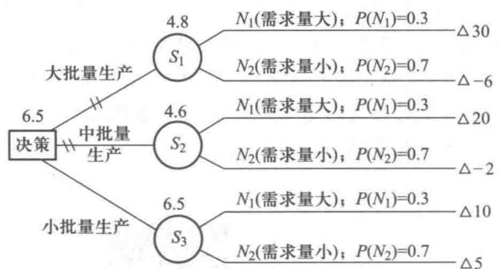
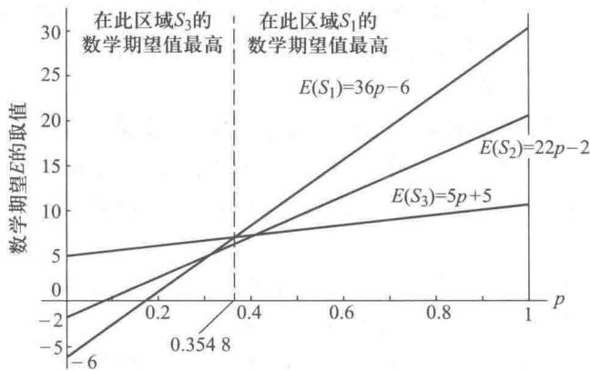
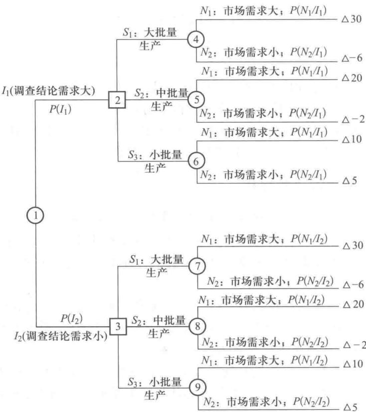
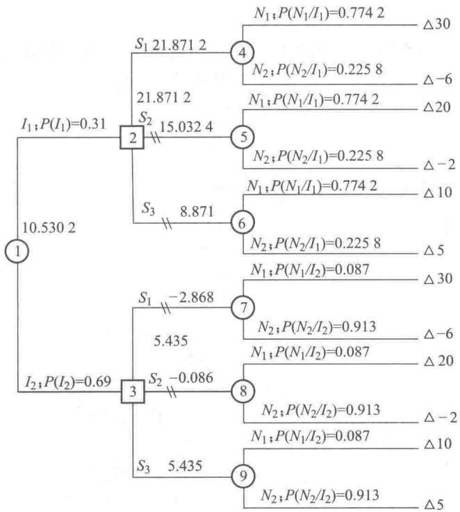
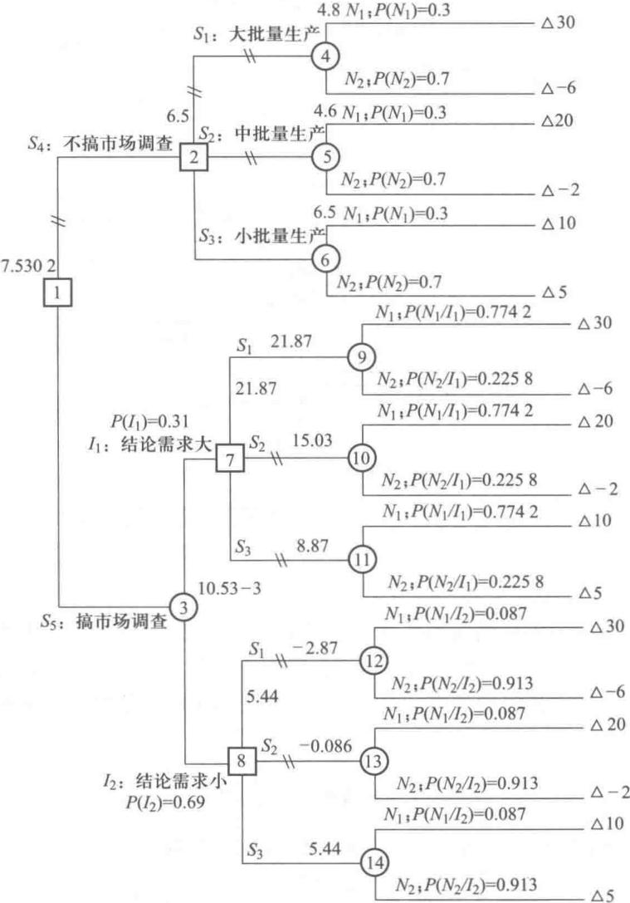
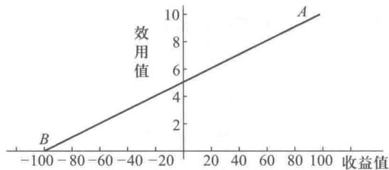
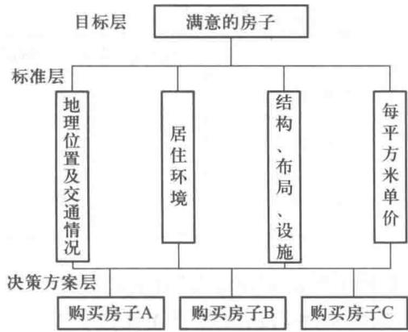
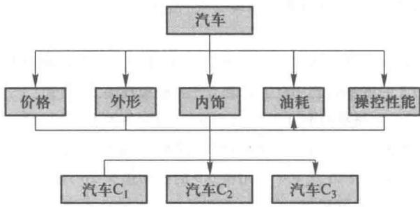

# 第16章 决策分析

决策分析是人们生活和工作中普遍存在的一种活动,是为处理当前或未来可能发生的问题,选择最佳方案的一种过程.比如,一个企业对某种新产品的市场需求情况不十分清楚,即可能有好、中、差三种情况,情况好就能获利,中等情况就不赔不赚,如果情况差就要亏本,到底投不投产,这就需要进行决策分析.

一项设计或计划通常总会面对几种不同的情况(决策分析中称为自然状态),有几种不同的方案(决策分析中称为行动方案)可供选择,决策的好坏,小则关系到能否达到预期目的,大则决定企业的成败,关系到部门、地区以至全国经济的盛衰.决策是管理过程的核心.管理者必须要有科学的作风,掌握科学的决策原理和方法.

决策问题通常分为三类: 确定型、风险型、不确定型.

其中确定型决策是在决策环境完全确定的条件下进行的,因而其所作的选择的结果也是确定的,譬如前面所讲的线性规划的问题就属于确定情况下的决策问题.

所谓风险型情况下的决策和不确定情况下的决策,它们都是在决策环境不是完全确定的情况下进行决策,它们之间的区别在于:前者对于各自然状态发生的概率,决策者是可以预先估计或计算出来的;而后者对于各自然状态发生的概率,决策者是一无所知的,只能靠决策者的主观倾向进行决策了.

在这一章里我们先介绍不确定情况下的几个决策准则,接着介绍在风险情况下的决策准则和方法,然后介绍效用理论在决策中的应用,最后将介绍层次分析法.

## 16.1 不确定情况下的决策

在不确定的情况下,决策者知道将面对一些自然状态,并知道将采用的几种行动方案在各个不同的自然状态下所获得的相应的收益值.但决策者不能预先估计或计算出各种自然状态出现的概率.

以下介绍不确定情况下的几个准则,决策者可以根据其具体情况,选择一个最合适的准则进

行决策.

### 一、最大最小准则

决策者从最不利的角度去考虑问题,先选出每个方案在不同自然状态的最小收益值,再从这些最小收益值中选取一个最大值,从而确定最优行动方案,故此准则又称悲观准则.

例 1 某公司现需对某新产品生产批量作出决策, 现有三种备选行动方案. $S_{1}$ : 大批量生产; $S_{2}$ : 中批量生产; $S_{3}$ : 小批量生产. 未来市场对这种产品的需求情况有两种可能发生的自然状态: $N_{1}$ : 需求量大; $N_{2}$ : 需求量小. 经估计, 采用某一行动方案而实际发生某一自然状态时, 公司的收益如表 16-1 所示, 也称此收益表为收益矩阵, 请用最大最小准则作出决策.

表16-1

<table><tr><td>自然状态公司收益值/万元行动方案</td><td> \(N_{1}\) (需求量大)</td><td> \(N_{2}\) (需求量小)</td></tr><tr><td> \(S_{1}\) (大批量生产)</td><td>30</td><td>-6</td></tr><tr><td> \(S_{2}\) (中批量生产)</td><td>20</td><td>-2</td></tr><tr><td> \(S_{3}\) (小批量生产)</td><td>10</td><td>5</td></tr></table>

解 我们用 $\alpha(S_{i}, N_{j})$ 表示采用方案 $S_{i}$ 而发生的自然状态为 $N_{j}$ 时公司的收益值, 这样可知采用 $S_{1}$ 时在各种不同自然状态下的最小收益为 -6, 即

同样有

$$
\begin{array}{r l} & {\underset {1 \leqslant j \leqslant 2} {\min} \left[ \alpha (S _ {1}, N _ {j}) \right] = \min \{3 0, - 6 \} = - 6.} \\ & {\underset {1 \leqslant j \leqslant 2} {\min} \left[ \alpha (S _ {2}, N _ {j}) \right] = \min \{2 0, - 2 \} = - 2,} \\ & {\underset {1 \leqslant j \leqslant 2} {\min} \left[ \alpha (S _ {3}, N _ {j}) \right] = \min \{1 0, 5 \} = 5.} \end{array}
$$

再从这些最小收益中选取一个最大值 5, 即

$$
\max _ {1 \leqslant i \leqslant 3} \left\{\min _ {1 \leqslant j \leqslant 2} \left[ \alpha (S _ {i}, N _ {j}) \right] \right\} = \max \{- 6, - 2, 5 \} = 5.
$$

在此准则下,方案 $S_{3}$ 即小批量生产为最优,我们用表格方式求解此题如表 16-2 所示.

从表 16-2 可知在最大最小准则下, 方案 $S_{3}$ 为最优.

表16-2

<table><tr><td>自然状态公司收益值/万元行动方案</td><td> \(N_{1}\) (需求量大)</td><td> \(N_{2}\) (需求量小)</td><td> \(\min _{1\leq j\leq 2}\left[\alpha(S_{i},N_{j})\right]\) </td></tr><tr><td> \(S_{1}\) (大批量生产)</td><td>30</td><td>-6</td><td>-6</td></tr><tr><td> \(S_{2}\) (中批量生产)</td><td>20</td><td>-2</td><td>-2</td></tr><tr><td> \(S_{3}\) (小批量生产)</td><td>10</td><td>5</td><td>5(max)</td></tr></table>

### 二、最大最大准则

根据此准则,决策者从最有利的结果去考虑问题,先找出每个方案在不同自然状态下最大的收益值,再从这些最大收益值中选取一个最大值,相应方案为最优方案.故此准则也称乐观准则.

用例 1 说明, 见表 16-3.

表16-3

<table><tr><td>自然状态公司收益值/万元行动方案</td><td> \(N_{1}\) (需求量大)</td><td> \(N_{2}\) (需求量小)</td><td> \(\max _{1\leqslant j\leqslant 2}\left[\alpha(S_{i},N_{j})\right]\) </td></tr><tr><td> \(S_{1}\) (大批量生产)</td><td>30</td><td>-6</td><td>30(max)</td></tr><tr><td> \(S_{2}\) (中批量生产)</td><td>20</td><td>-2</td><td>20</td></tr><tr><td> \(S_{3}\) (小批量生产)</td><td>10</td><td>5</td><td>10</td></tr></table>

很容易得到

$$
\max _ {1 \leqslant j \leqslant 2} [ \alpha (S _ {1}, N _ {j}) ] = \max \{3 0, - 6 \} = 30,
$$

$$
\max _ {1 \leqslant j \leqslant 2} \left[ \alpha (S _ {2}, N _ {j}) \right] = \max \{2 0, - 2 \} = 20,
$$

$$
\max _ {1 \leqslant j \leqslant 2} [ \alpha (S _ {3}, N _ {j}) ] = \max \{1 0, 5 \} = 10.
$$

最后得到

$$
\max _ {1 \leqslant i \leqslant 3} \{\max _ {1 \leqslant j \leqslant 2} [ \alpha (S _ {i}, N _ {j}) ] \} = \max \{3 0, 20, 10 \} = 30.
$$

可见在此准则下,方案 $S_{1}$ 最优.

### 三、等可能性准则

根据此准则,决策者把各自然状态发生的可能性看成是相同的,即每个自然状态发生的概率都是 $\frac{1}{事件数}$ .这样决策者可以计算各行动方案的收益期望值.然后在所有这些期望值中选择最大者,以它对应的行动方案为最优方案.

用例 1 说明, 见表 16-4.

表16-4

<table><tr><td rowspan="2">自然状态公司收益值/万元概率行动方案</td><td> \(N_{1}\) (需求量大)</td><td> \(N_{2}\) (需求量小)</td><td rowspan="2">收益期望值/万元 \(E(S_{i})\) </td></tr><tr><td>1/2</td><td>1/2</td></tr><tr><td> \(S_{1}\) (大批量生产)</td><td>30</td><td>-6</td><td>12(max)</td></tr><tr><td> \(S_{2}\) (中批量生产)</td><td>20</td><td>-2</td><td>9</td></tr><tr><td> \(S_{3}\) (小批量生产)</td><td>10</td><td>5</td><td>7.5</td></tr></table>

可得

$$
\begin{array}{l} E (S _ {1}) = 0. 5 \times 30 + 0. 5 \times (- 6) = 15 - 3 = 12, \\ E (S _ {2}) = 9, \\ E (S _ {3}) = 7. 5. \end{array}
$$

其中 $E(S_{1})$ 最大, 根据等可能性准则方案 $S_{1}$ 为最优.

### 四、乐观系数准则

此准则为乐观准则和悲观准则之间的折中,故也称折中准则.决策者根据以往经验,确定了一个乐观系数 $\alpha(0 \leqslant \alpha \leqslant 1)$ . 利用公式

$$
C V _ {i} = \alpha \cdot \max _ {j} [ \alpha (S _ {i}, N _ {j}) ] + (1 - \alpha) \cdot \min _ {j} [ \alpha (S _ {i}, N _ {j}) ]
$$

计算出方案 $S_{i}$ 在折中准则下的收益值 $CV_{i}$ ，然后在 $CV_{i}(i=1,2,3,\cdots,m)$ 中选出最大值，相应的方案确定为最优方案。

很容易看到当 $\alpha=1$ ，乐观系数准则即为乐观准则；当 $\alpha=0$ 时，乐观系数准则即为悲观准则。用例 1 说明，取 $\alpha=0.7$ ，见表 16-5。

表16-5

<table><tr><td>自然状态公司收益值/万元行动方案</td><td> \(N_{1}\) (需求量大)</td><td> \(N_{2}\) (需求量小)</td><td> \(CV_{i}\) </td></tr><tr><td> \(S_{1}\) </td><td>30</td><td>-6</td><td>19.2(max)</td></tr><tr><td> \(S_{2}\) </td><td>20</td><td>-2</td><td>13.4</td></tr><tr><td> \(S_{3}\) </td><td>10</td><td>5</td><td>8.5</td></tr></table>

可得

$$
C V _ {1} = 0. 7 \times 30 + 0. 3 \times (- 6) = 19. 2,
$$

$$
C V _ {2} = 0. 7 \times 20 + 0. 3 \times (- 2) = 13. 4,
$$

$$
C V _ {3} = 0. 7 \times 10 + 0. 3 \times 5 = 8. 5.
$$

即得 $\max_{1\leqslant i\leqslant 3}[CV_i] = 19.2$ ，故方案 $S_{1}$ 为最优方案.

### 五、后悔值准则

后悔值准则是由经济学家沙万奇(Savage)提出的,故又称沙万奇准则.决策者制定决策之后,若情况未能符合理想,必将后悔.这个方法是将各自然状态下的最大收益值定为理想目标,并将该状态中的其他值与最高值之差称为未达到理想目标的后悔值,然后从各方案中的最大后悔值中取一个最小的.相应的方案为最优方案.

要用“后悔值”决策时，先画出后悔矩阵，例1的后悔矩阵情况如表16-6所示.

表16-6

<table><tr><td>自然状态公司后悔值/万元行动方案</td><td> \(N_{1}\) (需求量大)</td><td> \(N_{2}\) (需求量小)</td><td> \(\max a&#x27;_{ij}\)  \(1 \leqslant j \leqslant 2\) </td></tr><tr><td> \(S_{1}\) (大批量生产)</td><td>0</td><td>11</td><td>11</td></tr><tr><td> \(S_{2}\) (中批量生产)</td><td>10</td><td>7</td><td>10(min)</td></tr><tr><td> \(S_{3}\) (小批量生产)</td><td>20</td><td>0</td><td>20</td></tr></table>

在后悔矩阵 $(a_{ij}^{\prime})_{m\times n}$ 中，元素 $a_{ij}^{\prime}$ 表示的后悔值.

例如

$$
a _ {i j} ^ {\prime} = \left\{\max _ {s} \left(a _ {s j}\right) - a _ {i j} \right\},
$$

$$
\begin{array}{r l} a _ {1 1} ^ {\prime} & = \{\max _ {s} (a _ {s 1}) - a _ {1 1} \} \\ & = \{\max (30, 20, 10) - 30 \} \\ & = 30 - 30 = 0. \end{array}
$$

$$
\begin{array}{r l} a _ {2 2} ^ {\prime} & = \{\max _ {s} (a _ {s 2}) - a _ {2 2} \} \\ & = \{\max (- 6, - 2, 5) - (- 2) \} \\ & = 5 - (- 2) = 7. \end{array}
$$

再从后悔矩阵中，找出各方案的最大后悔值，方案 $S_{1}$ 的最大后悔值为 $11; S_{2}$ 的最大后悔值为 $10; S_{3}$ 的最大后悔值为20. 填入表16-6的最后一列．最后从这些最大后悔值中找出最小值． $\min_{i} \max_{j} a_{ij}' = \min \{11, 10, 20\} = 10$ ，故在后悔值准则下取方案 $S_{2}$ .

在不确定性决策中是因人因地因时选择准则的．在实际中决策者面临不确定性决策问题时，往往首先设法获取有关自然状态的信息，把不确定性决策问题转化为风险决策．

## 16.2 风险型情况下的决策

如果决策者不仅知道所面临的一些自然状态,以及将采用的一些行动方案在各个不同的自然状态下所得的相应的收益值,而且还知道这些自然状态的概率分布,这就是风险型情况下的决策问题.

### 一、最大可能准则

由概率论知识可知,一个事件其概率越大,则其发生的可能性就越大.在风险型决策中选择一个概率最大的自然状态进行决策,置其他自然状态于不顾,这就叫做最大可能准则.利用这个准则,实际上把风险型决策问题变成确定型决策问题.

例 2 在例 1 的基础上,根据以往的经验,估计出需求量大 $(N_{1})$ 这个自然状态出现的概率为 0.3,需求量小 $(N_{2})$ 这个自然状态出现的概率为 0.7. 用最大可能准则进行决策.

解 由于需求量小 $(N_{2})$ 出现的概率是0.7为最大，我们用最大可能准则进行决策时，就按此自然状态进行决策，已知在此自然状态下采用 $S_{1}$ 方案，收益为-6万元；采用 $S_{2}$ 方案收益为-2万元；采用 $S_{3}$ 方案收益为5万元，可知公司采用 $S_{3}$ 方案采用小批量生产最佳，获利最多。

此决策应用较广,例如我们打桥牌时常常采用此决策准则,但当在一组自然状态中,它们发生的概率相差不大,则不宜采用此准则.

### 二、期望值准则

期望值准则就是把每个方案在各种自然状态下的收益值看成离散型的随机变量,我们求出每个方案的收益值的数学期望,加以比较,选取一个收益值的数学期望最大的行动方案为最优方案.

现用期望值准则对例 2 进行决策,我们可算出每一个行动方案的收益的期望.

$$
\begin{array}{l} E (S _ {1}) = 0. 3 \times 30 + 0. 7 \times (- 6) = 4. 8, \\ E (S _ {2}) = 0. 3 \times 20 + 0. 7 \times (- 2) = 4. 6, \\ E (S _ {3}) = 0. 3 \times 10 + 0. 7 \times 5 = 6. 5. \end{array}
$$

可知 $E(S_{3}) = 6.5$ 为最大收益期望值，故应采用 $S_{3}$ （小批量生产）的行动方案．如表16-7所示.

表16-7

<table><tr><td rowspan="2">自然状态 收益值/万元 概率 行动方案</td><td> \({N}_{1}\) </td><td> \({N}_{2}\) </td><td> \(E\left( {S}_{i}\right)\) </td></tr><tr><td> \(P\left( {N}_{1}\right) = {0.3}\) </td><td> \(P\left( {N}_{2}\right) = {0.7}\) </td><td>—</td></tr><tr><td> \({S}_{1}\) </td><td>30</td><td>-6</td><td>4.8</td></tr><tr><td> \({S}_{2}\) </td><td>20</td><td>-2</td><td>4.6</td></tr><tr><td> \({S}_{3}\) </td><td>10</td><td>5</td><td>6.5 (max)</td></tr></table>

### 三、决策树法

在用期望值准则决策时,对于一些较为复杂的风险型决策问题,例如多级决策问题,光用表格是难以表达和分析的.为此我们引入了决策树法,决策树法同样是使用期望值准则进行决策,但它具有形象直观、思路清晰等优点.

由前面表16-7的数据作出的决策树如图16-1所示.

图16-1

图中符号说明：

□——表示决策点,从它引出的分支叫方案分支,分支数反映可能的行动方案数.

○——表示方案节点,其上方数字表示该方案的收益的期望值(例如方案 $S_{1}$ 的收益期望值 $=30\times0.3+(-6)\times0.7=4.8$ 写在 $S_{1}$ 的上方),从它引出的分支叫概率分支,每条分支的上面写明了自然状态及其出现的概率,分支数反映可能的自然状态数.

△——表示结果节点(或称“末梢”),它旁边的数字是每一个方案在相应状态下的收益值.

这个决策树显示了一个随着时间发展的自然过程.首先,公司必须做出它的决策 $(S_{1},S_{2}$ 或 $S_{3})$ ,然后执行它的行动方案,某种自然状态 $(N_{1}$ 或 $N_{2})$ 将出现,结果节点旁的数字就是这个执行方案在这种自然状态下的收益值.

我们将各方案节点上的期望值加以比较,选取最大的收益期望值6.5写在决策点的上方,说明选定了方案 $S_{3}$ ,方案分支中打有一—记号的表示该方案删除掉,或称剪枝方案.

为了掌握和运用决策树方法进行决策,需要掌握几个关键步骤:

(1) 绘制决策树.

(2) 自右到左计算各个方案的期望值, 并将结果写在相应的方案节点处.

(3)选取收益期望值最大（或损失期望值最小）的方案作为最优方案.

以上的例子只包括一级决策,叫单级决策问题.有些决策问题包括两级以上的决策,叫多级决策问题.在后面我们使用决策树方法时,会涉及多级决策的问题.

### 四、灵敏度分析

在用期望值准则进行决策的过程中,依赖于各自然状态的发生概率及各方案在各自然状态下的收益值,而这些值都是估算或预测所得,不可能十分精确.所以我们用期望值准则求出最优策略后,有必要像线性规划那样进行最优化后的分析——灵敏度分析.灵敏度分析就是分析决策所用的数据在什么范围内变化时,原最优决策方案仍然有效.在这里我们对自然状态发生概率进行灵敏度分析,也就是考虑自然状态发生概率的变化如何影响最优方案的决策.

如果我们把例2中自然状态发生的概率作一个变化,不妨设 $P(N_{1})=0.6,P(N_{2})=0.4$ ,这时我们用数学期望准则进行决策,有

$$
\begin{array}{l} E (S _ {1}) = 0. 6 \times 30 + 0. 4 \times (- 6) = 15. 6, \\ E (S _ {2}) = 0. 6 \times 20 + 0. 4 \times (- 2) = 11. 2, \\ E (S _ {3}) = 0. 6 \times 10 + 0. 4 \times 5 = 8. \end{array}
$$

这样,易见随着自然状态概率的变化,最优行动方案也由 $S_{3}$ 变成 $S_{1}$ 了,这时最大的数学期望值也由 6.5 万元变成 15.6 万元了.

为了进一步对自然状态发生的概率进行灵敏度分析,我们设自然状态 $N_{1}$ 发生的概率为 p, 则自然状态 $N_{2}$ 的发生概率为 1-p, 即

$$
\begin{array}{l} {P (N _ {1}) = p  ,} \\ {P (N _ {2}) = 1 - P (N _ {1}) = 1 - p.} \end{array}
$$

这样我们可计算得到各行动方案的数学期望值

$$
\begin{array}{l} {E (S _ {1}) = p \times (30) + (1 - p) \cdot (- 6) = 36 p - 6,} \\ {E (S _ {2}) = p \times (20) + (1 - p) \cdot (- 2) = 22 p - 2,} \\ {E (S _ {3}) = p \times (10) + (1 - p) \cdot (5) = 5 p + 5.} \end{array}
$$

为了说明问题,我们作一个直角坐标系,横轴表示 p 的取值,从 0 到 1;纵轴表示数学期望值,这样我们就可以把以上三个直线方程在这个直角坐标系中表示出来,如图 16-2 所示.

图16-2

在图16-2上，我们可以求出直线 $E(S_{1}) = 36p - 6$ 与直线 $E(S_{3}) = 5p + 5$ 的交点，此时 $E(S_{1}) = E(S_{3})$ ，即

$$
\begin{array}{l} 36 p - 6 = 5 p + 5, \\ 31 p = 11, \\ p = 11 / 31 \approx 0. 3548. \end{array}
$$

可见当 $p = 0.3548$ 时 $E(S_{1}) = E(S_{3})$ . 而当 $p < 0.3548$ 时从图16-2上可见到 $E(S_{1}), E(S_{2}), E(S_{3})$ 中 $E(S_{3})$ 取值为最大, 这时行动方案 $S_{3}$ 为最优行动方案, 当 $p > 0.3548$ 时从图16-2上可见在 $E(S_{1}), E(S_{2}), E(S_{3})$ 中 $E(S_{1})$ 取值为最大, 这时行动方案 $S_{1}$ 为最优行动方案. 我们称 $p = 0.3458$ 为转折概率.

在实际工作中,如果状态概率、收益值在其可能发生的变化的范围内变化时,最优方案保持不变,则这个方案是比较稳定的.反之如果参数稍有变化时,最优方案就有变化,则这个方案就不稳定,需要我们作进一步的分析.就自然状态 $N_{1}$ 的概率而言,当其概率值越远离转折概率,则其相应的最优方案就越稳定;反之,就越不稳定.

### 五、全情报的价值(EVPI)

所谓的全情报就是关于自然状态的确切的信息.为了获得更多的收益,有必要计算全情报的价值,记为 EVPI,即全情报所带来的额外的收益.计算出全情报的价值将有利于作出决策,如果获得全情报的成本小于全情报的价值,决策者就应该投资获得全情报,反之,决策者就不应该投

资获得全情报.

我们仍从例 2 来说明问题, 当我们不掌握全情报用期望值准则来决策时, 我们知道 $S_{3}$ (小批量生产) 是最优行动方案, 此时其数学期望值最大

$$
0. 3 \times 10 + 0. 7 \times 5 = 6. 5 (\text {   万元   }).
$$

我们称之为没有全情报的期望收益,记为 $EV_{w0}PI$ .

如果决策者获得了全情报即知道了自然状态的确切信息,那么决策者的收益的期望值应为多少呢?显然,当全情报告诉决策者自然状态是 $N_{1}$ 即产品需求量大时,决策者一定采取 $S_{1}$ 行动方案;当全情报告诉决策者自然状态是 $N_{2}$ 即产品需求量小时,决策者一定采取 $S_{3}$ 行动方案.决策者根据确切情报“随机应变”而获得最大收益.这样决策者收益的平均值是多少呢?因为 $N_{1}$ 发生的概率为0.3, $N_{2}$ 发生的概率为0.7.也就是说决策者有0.3的概率采用 $S_{1}$ 而获得30万元;有0.7的概率采用 $S_{3}$ 而获得5万元.故有

$$
0. 3 \times 30 + 0. 7 \times 5 = 9 + 3. 5 = 12. 5.
$$

我们称之为全情报的期望收益,记为 $EV_{w}PI$ .

显然全情报的期望收益超过没有全情报的期望收益部分即为全情报的价值,记为 EVPI 即有

$$
\begin{array}{r l} E V P I & = E V _ {\mathrm{w}} P I - E V _ {\mathrm{w0}} P I \\ & = 12. 5 - 6. 5 \\ & = 6. \end{array}
$$

对此例来说当投资研究或购买以获得全情报的成本小于全情报的价值6万元时,决策者应该投资于全情报的获得,否则就不应该投资于全情报的获得.

一般说来,研究或购买并不能得到真正的“全”情报.然而一些“部分”情报的价值也应该是部分的全情报的价值,下面我们解决“部分”情报的决策分析.

### 六、具有样本情报的决策分析

在例 2 中, 我们提到根据以往的经验, 估计 $N_{1}$ 发生的概率为 0.3, $N_{2}$ 发生的概率为 0.7. 我们把这样由过去经验或专家估计所获得的将发生事件的概率称为先验概率. 为了做出可能的最好决策, 除了先验概率外, 决策者要追求关于自然状态的另外信息用于修正先验概率以得到对自然状态更好的概率估计.

这种另外的信息一般是通过调查或试验提供的关于自然状态的样本信息或称样本情报.当然这种样本情报不是“全”情报只是“部分”情报.以下仍以例2为例,说明如何用样本情报来修正先验概率,这种修正了的概率我们称之为后验概率.

在例2中，我们知道 $N_{1}$ 发生的先验概率为0.3， $N_{2}$ 发生的概率为0.7。用期望值准则求得最优行动方案为 $S_{3}$ （小批量生产），所获得的期望收益为6.5万元。并且我们也已求得了该全情报的价值为6万元。

在例 2 的基础上我们推出了例 3, 来了解具有样本情报的决策分析.

例 3 某公司现有三种备选行动方案. $S_{1}$ : 大批量生产; $S_{2}$ : 中批量生产; $S_{3}$ 小批量生产.未来市场对这种产品需求情况有两种可能发生的自然状态—— $N_{1}$ : 需求量大, $N_{2}$ : 需求量小,且 $N_{1}$ 的发生概率即 $P(N_{1})=0.3,N_{2}$ 的发生概率即 $P(N_{2})=0.7$ .经估计,在采用不同行动方案下发生不同自然状态时,公司的收益如表 16-7 所示.

该公司为了得到关于对新产品需求量这个自然状态的更多的信息,委托一个咨询公司做市场调查.咨询公司调查的结果也有两种:(1)市场需求量大;(2)市场需求量小.我们用 $I_{1}$ 表示咨询公司结论为市场需求量大;用 $I_{2}$ 表示咨询公司结论为市场需求量小.根据该咨询公司积累的资料统计得知,当市场需求量大时,该咨询公司调查结论也为市场需求量大的条件概率 $P(I_{1}/N_{1})=0.8$ ;而调查结论却为市场需求量小的条件概率 $P(I_{2}/N_{1})=0.2$ .当市场需求量小时,咨询公司调查结论也为市场需求量小的某种概率 $P(I_{2}/N_{2})=0.9$ ;结论为市场需求量大的条件概率 $P(I_{1}/N_{2})=0.1$ .

我们应该如何用样本情报进行决策呢？用样本情报决策其期望收益应该是多少呢？样本情报的价值是多少呢？如果样本情报要价3万元，决策者是否要使用样本情报呢？

为了解决这些问题我们首先画出该问题的决策树如图 16-3 所示.

图16-3

在图 16-3 中, 点 1 是一个方案节点表示要进行市场调查, 点 1 引出的两个概率分支分别表示调查结论为需求大和调查结论为需求小. 点 2 是一个决策点, 它表示在调查结论为需求大时, 对生产批量进行决策, 点 2 引出三个方案分支分别表示它们采用的大批量, 中批量, 小批量三个行动方案. 同样点 3 为决策点, 它表示在调查结论为需求小时, 对生产批量进行决策, 它同样引出了三个方案分枝. 点 4, 点 5 和点 6 为方案中节点分别表示采用大、中、小批量三个方案, 它们分别引出了市场需求大和小的两个概率分枝. 对应市场需求的大、小, 要求我们在每条分枝上写上其在调查结论为需求大的条件下的条件概率. 同样对方案节点 7, 8, 9 每点的两个概率分枝上也要求分别写上在调查结论为需求小的条件下发生市场需求大或小的条件概率. 在结果节点旁, 我们都写上了采用的方案在相应的状态下的收益值.

为了求解这个决策树,我们必须求出 $P(I_{1}), P(I_{2}), P(N_{2}/I_{1}), P(N_{1}/I_{1}), P(N_{1}/I_{2})$ 以及 $P(N_{2}/I_{2})$ .

我们已经知道 $P(I_1 / N_1) = 0.8, P(I_2 / N_1) = 0.2, P(I_1 / N_2) = 0.1, P(I_2 / N_2) = 0.9$ 以及 $P(N_1) = 0.3, P(N_2) = 0.7$ . 由全概率公式，可知：

$$
\begin{array}{r l} P (I _ {1}) & = P (N _ {1}) \cdot P (I _ {1} / N _ {1}) + P (N _ {2}) \cdot P (I _ {1} / N _ {2}) \\ & = 0. 3 \times 0. 8 + 0. 7 \times 0. 1 \\ & = 0. 24 + 0. 07 = 0. 31. \\ P (I _ {2}) & = P (N _ {1}) \cdot P (I _ {2} / N _ {1}) + P (N _ {2}) \cdot P (I _ {2} / N _ {2}) \\ & = 0. 3 \times 0. 2 + 0. 7 \times 0. 9 \\ & = 0. 06 + 0. 63 \\ & = 0. 69. \end{array}
$$

由贝叶斯公式,我们可求得

$$
\begin{array}{r l} P (N _ {1} / I _ {1}) & = \frac {P (N _ {1}) \cdot P (I _ {1} / N _ {1})}{P (I _ {1})} = \frac {0 . 3 \times 0 . 8}{0 . 31} \\ & = 0. 3 \times 0. 8 / 0. 31 \\ & \approx 0. 7742. \\ P (N _ {2} / I _ {1}) & = \frac {P (N _ {2}) \cdot P (I _ {1} / N _ {2})}{P (I _ {1})} = \frac {0 . 7 \times 0 . 1}{0 . 31} \\ & = 0. 7 \times 0. 1 / 0. 31 \\ & \approx 0. 2258. \\ P (N _ {1} / I _ {2}) & = \frac {P (N _ {1}) \cdot P (I _ {2} / N _ {1})}{P (I _ {2})} = \frac {0 . 3 \times 0 . 2}{0 . 69} \\ & = 0. 3 \times 0. 2 / 0. 69 \\ & \approx 0. 0870. \\ P (N _ {2} / I _ {2}) & = \frac {P (N _ {2}) \cdot P (I _ {2} / N _ {2})}{P (I _ {2})} = \frac {0 . 7 \times 0 . 9}{0 . 69} \end{array}
$$

$$
\begin{array}{r l} & = 0. 7 \times 0. 9 / 0. 69 \\ & \approx 0. 9130. \end{array}
$$

我们把所计算的结果填入决策树上,然后自右到左计算各个方案的期望值.方案节点4的期望值为:

$$
\begin{array}{r l} E (\text {点} 4) & = P (N _ {1} / I _ {1}) \times 30 + P (N _ {2} / I _ {1}) \times (- 6) \\ & = 0. 7742 \times 30 + 0. 2258 \times (- 6) \\ & = 21. 8712. \end{array}
$$

同样可求得：

$$
\begin{array}{l} {E (\text {点} 5) = 0. 774   2 \times 20 + 0. 225   8 \times (- 2) = 15. 032   4,} \\ {E (\text {点} 6) = 0. 774   2 \times 10 + 0. 225   8 \times 5 = 8. 871,} \\ {E (\text {点} 7) = 0. 087   0 \times 30 + 0. 913   0 \times (- 6) = -   2. 868,} \\ {E (\text {点} 8) = 0. 087   0 \times 20 + 0. 913   0 \times (- 2) = -   0. 086,} \\ {E (\text {点} 9) = 0. 087   0 \times 10 + 0. 913   0 \times 5 = 5. 435.} \end{array}
$$

比较 $E$ （点4）， $E$ （点5）， $E$ （点6）的值可知 $E$ （点4）的值最大，故我们在决策点2的上方填上 $E$ （点4）的值21.8712，并把 $S_{2}$ 和 $S_{3}$ 这两个方案分枝打上——记号，表示把这两个方案删除掉，这也就是说，当咨询公司市场调查结论为市场需求量大时，就采用 $S_{1}$ 方案，而不采用 $S_{2}, S_{3}$ 方案，这时决策者在点2的收益期望为21.8712.

同样我们比较 $E$ （点7）， $E$ （点8）， $E$ （点9）的值，可知 $E$ （点9）的值最大，故在决策点3的上方填上 $E$ （点9）的值5.435，并把由决策点3引出的 $S_{1}$ 和 $S_{2}$ 两个方案分枝删除掉，这告诉我们，当咨询公司市场调查结论为市场需求量小时，就采用 $S_{3}$ 方案，而不采用 $S_{1}, S_{2}$ 方案。这时决策者在点3的收益期望为5.435。

因为咨询公司调查结论为市场需求大的概率为 $P(I_{1})=0.31$ ，而调查结论为市场需求小的概率为 $P(I_{2})=0.69$ ，在方案节点 1 的收益期望值为

$$
E (\text {   点   } 1) = 0. 31 \times 21. 8712 + 0. 69 \times 5. 435 \approx 10. 5302.
$$

我们把 10.5302 写在方案点 1 的上面, 这也就是说当我们采用请咨询公司做市场调查的方案时, 在考虑了调查结论为需求大和需求小的两种情况下, 其收益期望为 10.5302 万元. 我们具体采取的行动方案为: 当调查结论为需求大时, 采用大批量生产 ( $S_{1}$ ), 当调查结论为需求小时, 采用小批量生产 ( $S_{3}$ ). 图 16-4 显示了用决策树求解此问题的全过程.

从上面可知当委托咨询公司进行市场调查即具有样本情报时,公司的收益期望可达到10.5302万元,比不进行市场调查的公司收益6.5万元要高,其差额

$$
10. 5302 - 6. 5 = 4. 0302 (\text {万元}).
$$

就是这样本情报的价值记为 EVSI. 一般有

$$
E V S I = \left[ \begin{array}{l} {{\text {用样本情报}}} \\ {{\text {进行决策的}}} \\ {{\text {收益期望值}}} \end{array} \right] - \left[ \begin{array}{l} {{\text {不用样本情报}}} \\ {{\text {进行决策的}}} \\ {{\text {收益期望值}}} \end{array} \right].
$$

图16-4

这样可知当咨询公司市场调查的要价低于4.0302万元时，公司可考虑委托其进行市场调查，否则就不宜委托其进行市场调查。因为咨询公司要价3万元，所以应该委托其进行市场调查。

在前面我们定义了全情报的价值(EVPI)，在这里我们用样本情报的效率作为样本情况的度量标准.

$$
\text{样本情报的效率} = \frac {E V S I}{E V P I} \times 100 \%.
$$

例如,在此例题中进行市场调查的这个样本情报的效率为

$$
\frac {E V S I}{E V P I} \times 100\% = \frac {4.0302}{6} \times 100\% = 67.17\%
$$

这也就是说这个样本情报相当于全情报效果的 67.17%.

样本情报的效率越高,则这个样本情报越好.当样本情报的效率为100%的时候,则样本情报就成了全情报.如果某个样本情报效率太低,那么我们就没有必要花人力、物力去获取它,而应该去寻找更高效率的其他的样本情报.

在“管理运筹学”软件包里有关于决策分析的程序,我们可以用它来做不确定型的决策问题,也可以用它来做风险型的决策问题,可以用它来求出全情报的价值(EVPI),样本情报的价值(EVSI)以及样本情报的效率.用“管理运筹学”软件的决策分析的程序,很容易得到上述例题

结果.

在这一节的最后,用多级(两级)决策树的方法来解决上面问题.解决过程如图 16-5 所示.

图16-5

图 16-5 中的两级决策树,实际上用一个决策点 1 把图 16-1 的不做市场调查的决策树和图 16-4 的做市场调查的决策树合并而成的.首先,决策点 1 要求我们决策做不做市场调查.做市场调查要付 3 万元,故在方案节点 3 上的收益期望要减去 3 万元,但能做出更好的决策而获得更多的收益期望;不做市场调查不用付钱,但决策的方案所获得的收益期望要少一点.如果不做市场调查,那么在决策点 2 进行第二个决策,决定采用 $S_{1}$ （大批量）, $S_{2}$ (中批量）， $S_{3}$ （小批量）中的哪个方案，在决策树中可见要采用 $S_{3}$ 方案。如果做市场调查，从决策树中可见在决策点7，也就当调查结论为需求大时采用大批量生产；在决策点8，也就当调查结论为需求小时采用小批量生产。这样可知方案节点3的收益期望为10.5302-3=7.5302万元（3万元是调查成本）。因为7.5302万元大于6.5万元，所以删除不做市场调查的方案分枝，这个决策树告诉我们的两个决策是：

(1) 要做市场调查.

（2）根据调查的结果组织生产：当调查结论为需求大时做大批量，当结论为需求小时做小批量。这样收益期值最大，为7.5302万元。

## 16.3 效用理论在决策中的应用

在前两节里,我们都是用金额作为收益指标.在风险型的决策问题中,我们也是把能获得最高金额的收益期望的行动方案选为最优方案.然而在很多情况下,能获得最高金额的收益期望的行动方案并不是对决策者最有利的方案.决策者认为最有利的方案并不是单由金额来决定的,还有很多其他因素,例如决策者风险承受程度的影响.有很多这样的例子,例如买财产保险的人并不比不买财产保险的人得到更高的金额收益期望,否则保险公司将由于无力支付工作经费和不能创造利润而破产.又例如尽管人们都了解各种彩票的金额收益期望都是负的,但是还是有非常多的人踊跃购买彩票.

这些行为我们可以用效用概念来加以解释. 效用是衡量一个决策方案的总体指标, 它反映了决策者对决策问题的诸如利润、损失、风险等各种因素的总体的看法.

使用效用值进行决策,首先把要考虑的因素折合成效用值,然后用决策准则,选出效用值最大的方案为最优方案.例如在风险型决策问题中,我们把效用值为指标,用期望值准则进行决策,把效用期望值最大的方案选为最优方案.

下面我们用例子加以说明.

例 4 某公司是一个小型的进出口公司, 目前它面临着两笔进口生意可做, 项目 A 和项目 B, 这两笔生意都需要现金支付. 鉴于公司财务状况, 公司至多做 A、B 中的一笔生意, 根据以往的经验, 各自然状态商品需求量大、中、小的发生概率以及在各自然状况下做项目 A 或项目 B 以及不做任何项目的收益都如表 16-8 所示.

表16-8

<table><tr><td rowspan="2">自然状态 收益值/万元 概率 行动方案</td><td> \({N}_{1}\) (需求量大)</td><td> \({N}_{2}\) (需求量中)</td><td> \({N}_{3}\) (需求量小)</td></tr><tr><td>0.3</td><td>0.5</td><td>0.2</td></tr><tr><td> \({S}_{1}\) (做项目A)</td><td>60</td><td>40</td><td>-100</td></tr><tr><td> \({S}_{2}\) (做项目B)</td><td>100</td><td>-40</td><td>-60</td></tr><tr><td> \({S}_{3}\) (不做任何项目)</td><td>0</td><td>0</td><td>0</td></tr></table>

对这个问题如果我们用收益期望值法,我们容易算得

$$
E (S _ {1}) = 0. 3 \times 60 + 0. 5 \times 40 + 0. 2 \times (- 100) = 18 (\text {万元}).
$$

$$
E (S _ {2}) = 0. 3 \times 100 + 0. 5 \times (- 40) + 0. 2 \times (- 60) = - 2 (\text {万元}).
$$

$$
E (S _ {3}) = 0. 3 \times 0 + 0. 5 \times 0 + 0. 2 \times 0 = 0 (\text {万元}).
$$

用收益期望准则来决策, $S_{1}$ 是最优方案,其收益期望值最高,为18万元.

但是该公司的经理不是这样考虑的.他看到目前公司的财务状况不佳,已经不起较大风险,如果采用 $S_{1}$ 方案,一旦出现市场需求量小的自然状态,公司就要亏损100万元,风险太大.实际上,公司经理看到,如果公司近期经营亏损额达到50万元以上,公司就可能一蹶不振,被挤出该行业,这样看来 $S_{2}$ 也不是最优方案,公司经理决定用 $S_{3}$ 方案:不做A,B中的任一项目.

对公司经理的决策,我们用效用理论加以说明.

首先,我们对表 16-8 中的每一个收益值赋予一个效用值,表示了公司经理对这个收益值的相对评价.我们把表 16-8 中的最高收益 100 万元的效用定为 10,记为 $U(100)=10$ , 把最低收益值 $(-100)$ 万元的效用定为 0, 记为 $U(-100)=0$ , 然后在此基础上请公司经理根据公司情况结合收益、风险等因素对表 16-8 中的每一个收益值都定出相应的效用值.

对表 16-8 中的收益值 60 万元, 我们可按如下的方法来确定其效用值. 请公司经理在下面两项中做出一个选择.

(1) 得到确定的收益 60 万元.

(2) 以概率 p 得到 100 万元, 而以概率 $(1-p)$ 损失 100 万元.

显然当 $p$ 非常靠近1时，经理愿意选择2，因为这样实际上可得100万元，而当 $p$ 靠近0时，经理愿意选择1.这样随着 $p$ 值从1不断地下降到0的过程中，经理从选择2而变为选择1，也就是说在1与0之间，存在一个数值，当 $p$ 取其值时，经理认为1和2是等值的.我们假设这时 $p = 0.95$ ，得到了 $p$ 值我们就可以计算出60万元的效用值如下所示：

$$
\begin{array}{r l} U (60) & = p \cdot U (100) + (1 - p) U (- 100) \\ & = 0. 95 \times 10 + 0. 05 \times 0 \\ & = 9. 5. \end{array}
$$

这样我们用 100 万元和 -100 万元的效用值, 确定了 60 万元的效用值 $U(60)=9.5$ .

同样我们可以用 100 万元和 -100 万元的效用值按如上的方法来确定 40 万元的效用值，因为经理认为得到确定的 40 万元，与当 p=0.90 时，以概率 p 得 100 万元，而以概率 $(1-p)$ 损失 100 万元是等值的，即

$$
\begin{array}{r l} U (40) & = p \cdot U (100) + (1 - p) \cdot U (- 100) \\ & = 0. 9 \times 10 + 0. 1 \times 0 \\ & = 9. 0. \end{array}
$$

因为经理认为得到确定的 0 万元与当 p=0.75 时, 以概率 p 得 100 万元, 以概率 $(1-p)$ 损失 100 万元是等值的. 可计算得到

$$
\begin{array}{r l} U (0) & = p \cdot U (100) + (1 - p) \cdot U (- 100) \\ & = 0. 75 \times 10 + 0. 25 \times 0 \\ & = 7. 5. \end{array}
$$

这样我们也可以一一求得 $(-40)$ 万元、 $(-60)$ 万元的效用值.

因为经理认为得到确定的(-40)万元等值于当 $p = 0.55$ 时以 $p$ 的概率得100万元，而以概率 $(1 - p)$ 损失100万元；而得到确定的(-60)万元等值于当 $p = 0.40$ 时，以概率 $p$ 得100万元，而以概率 $(1 - p)$ 损失100万元.即得

$$
\begin{array}{r l} U (- 40) & = p \cdot U (100) + (1 - p) \cdot U (- 100) \\ & = 0. 55 \times 10 + 0. 45 \times 0 \\ & = 5. 5. \\ U (- 60) & = p \cdot U (100) + (1 - p) \cdot U (- 100) \\ & = 0. 40 \times 10 + 0. 60 \times 0 \\ & = 4. 0. \end{array}
$$

这样我们求得了表 16-8 中所有收益值的效用值如下所示：

$$
\begin{array}{l} {U (100) = 10,} \\ {U (60) = 9. 5,} \\ {U (40) = 9. 0,} \\ {U (0) = 7. 5,} \\ {U (- 40) = 5. 5,} \\ {U (- 60) = 4. 0,} \\ {U (- 100) = 0.} \end{array}
$$

把表 16-8 中的收益值用其效用值来代替, 并计算得各方案的效用期望值, 如表 16-9 所示.

表16-9

<table><tr><td rowspan="2">自然状态效用值概率行动方案</td><td> \(N_{1}\) (需求量大)</td><td> \(N_{2}\) (需求量中)</td><td> \(N_{3}\) (需求量小)</td><td rowspan="2"> \(E[U(S_{i})]\) </td></tr><tr><td>0.3</td><td>0.5</td><td>0.2</td></tr><tr><td> \(S_{1}\) (做项目A)</td><td>9.5</td><td>9.0</td><td>0</td><td>7.35</td></tr><tr><td> \(S_{2}\) (做项目B)</td><td>10</td><td>5.5</td><td>4.0</td><td>6.55</td></tr><tr><td> \(S_{3}\) (不做任何项目)</td><td>7.5</td><td>7.5</td><td>7.5</td><td>7.5(max)</td></tr></table>

表16-9中

$$
E [ U (S _ {1}) ] = 0. 3 \times 9. 5 + 0. 5 \times 9. 0 + 0. 2 \times 0 = 7. 35,
$$

$$
E \left[ U \left(S _ {2}\right) \right] = 0. 3 \times 10 + 0. 5 \times 5. 5 + 0. 2 \times 4. 0 = 6. 55,
$$

$$
E [ U (S _ {3}) ] = 0. 3 \times 7. 5 + 0. 5 \times 7. 5 + 0. 2 \times 7. 5 = 7. 5.
$$

易见 $S_{3}$ 的效用期望值为最大, 故 $S_{3}$ 即不做任何项目为该公司的最优方案. 在用效用期望值决策时, 我们也可使用决策树的方法, 不过这时要把决策树中的所用收益值用其效用值来代替.

一般来说,如果收益期望值能合理地反映决策者的看法和偏好,那么我们就可以用收益期望值进行决策,否则,我们应该进行效用分析.

实际上收益期望值决策是效用期望值决策的一种特殊情况.如果我们用收益值与效用值作为直角坐标系的 $x$ 轴与 $y$ 轴，并用 $A, B$ 两点作一直线，其中 $A$ 的坐标为 $x_{\mathrm{A}} =$ 最大收益值； $y_{\mathrm{A}} = 10$ ； $B$ 的坐标 $x_{\mathrm{B}} =$ 最小收益值； $y_{\mathrm{B}} = 0$ ；如果某问题的所有的收益值与其对应的效用值组成的点都在此直线上，那么用这样的效用值进行期望值决策和用收益值进行期望值决策的结果完全一样的。我们可以用上面的例子来加以说明如图16-6所示。

图16-6

在图 16-6 的直线坐标中, 其 A 的坐标为: $x_{A}=100, y_{A}=U(100)=10; x_{B}=-100, y_{B}=U(-100)=0.$ 用这条直线我们可以确定其他收益值的效用. 这条直线方程为 $y=\frac{5}{100}x+5$ , 求得

$$
U (- 60) = y = \frac {5}{1 00} \times (- 60) + 5 = 2,
$$

$$
U (- 40) = y = \frac {5}{1 00} \times (- 40) + 5 = 3,
$$

$$
U (0) = y = \frac {5}{1 00} \times 0 + 5 = 5,
$$

$$
U (40) = y = \frac {5}{1 00} \times 40 + 5 = 7,
$$

$$
U (60) = y = \frac {5}{1 00} \times 60 + 5 = 8.
$$

用这样的效用值,进行期望值决策,见表 16-10 所示.

表16-10

<table><tr><td rowspan="2">自然状态效用值概率行动方案</td><td> \(N_{1}\) (需求量大)</td><td> \(N_{2}\) (需求量中)</td><td> \(N_{3}\) (需求量小)</td><td rowspan="2"> \(E[U(S_{i})]\) </td></tr><tr><td>0.3</td><td>0.5</td><td>0.2</td></tr><tr><td> \(S_{1}\) (做项目A)</td><td>8</td><td>7</td><td>0</td><td>5.9(max)</td></tr><tr><td> \(S_{2}\) (做项目B)</td><td>10</td><td>3</td><td>2</td><td>4.9</td></tr><tr><td> \(S_{3}\) (不做任何项目)</td><td>5</td><td>5</td><td>5</td><td>5</td></tr></table>

回顾一下,当我们对收益值进行期望值决策时,知

$E(S_{1})=18,E(S_{2})=-2,E(S_{3})=0$ ，而 $E[U(S_{1})]=5.9,E[U(S_{2})]=4.9,E[U(S_{3})]=5$ ，实际上后面的值也是由直线方程：

$$
E [ U (S _ {i}) ] = \frac {5}{1 00} [ E (S _ {i}) ] + 5
$$

所决定的,即有

$$
E [ U (S _ {1}) ] = \frac {5}{1 00} [ E (S _ {1}) ] + 5 = \frac {5}{1 00} \times 18 + 5 = 5. 9,
$$

$$
E [ U (S _ {2}) ] = \frac {5}{1 00} [ E (S _ {2}) ] + 5 = \frac {5}{1 00} \times (- 2) + 5 = 4. 9,
$$

$$
E [ U (S _ {3}) ] = \frac {5}{1 00} [ E (S _ {3}) ] + 5 = \frac {5}{1 00} \times 0 + 5 = 5.
$$

显然一个有序的数组中的每一个数同乘一个正数再同加一个数,则这数组中的各数之间的大小关系是不会改变的.故用这两种方法决策是同解的.

## 16.4 层次分析法

层次分析法是由美国运筹学家 T. L. 沙旦于 20 世纪 70 年代提出的, 是一种解决多目标的复杂问题的定性与定量相结合的决策分析方法. 层次分析法用决策者的经验判断各衡量目标能否实现的标准之间的相对重要程度, 并合理地给出每个决策方案的每个标准的权数, 利用权数求出各方案的优劣次序.

### 一、问题提出

下面我们就用例子来说明如何用层次分析法解决多目标复杂问题.

一位顾客决定要购买一套新住宅,经过初步调查研究确定了三套候选的房子 A,B,C,问题是如何在这三套房子里选择一套较为满意的房子呢?顾客从房地产公司得到了有关这三套房子的资料,各套资料都给出了下面有关的数据和资料:

(1) 住房的地理位置.

(2) 住房的交通情况.

(3)住房附近的商业、卫生、教育资源情况.

(4) 住房小区的绿化、清洁、安静等自然环境.

(5) 建筑结构.

(6) 建筑材料.

(7) 房子布局.

(8) 房子设备.

(9) 房子面积.

(10) 房子每平方米建筑面积的单价.

实际上这 10 方面也就给出了评判房子满意程度的 10 个标准.为了简化问题,我们把这 10 个标准归纳 4 个标准:

（1）房子的地理位置与交通（包括前面的第1,2项）.

（2）房子的居住环境（包括前面的第 3,4 项）.

（3）房子结构、布局与设施（包括前面的第5,6,7,8,9项）.

（4）房子的每平方米建筑面积的单价（包括前面的第10项）.

这样,我们就用这4个标准来评判房子的满意程度,以便选出较满意的房子.

### 二、层次结构图

为了解决这个问题,我们首先画出其层次结构图,此结构图分三个层次:目标层、标准层和决策方案层,如图 16-7 所示.

从图 16-7 可知,一个满意的房子是用地理位置及交通情况、居住环境、结构布局设施、每平方米单价四个标准综合衡量的.这就需要我们求出每个标准的相对权重,也就是把每个标准相对于总目标满意的房子的重要程度予以量化.另外,我们还需要分别用这四个标准中的单一标准对三个方案进行评估,求得每一个标准下,每个方案的相对的权重.

图16-7

### 三、标度及两两比较矩阵

为了使各个标准,或在某一标准下各方案两两比较以求得其相对权重,我们引入了相对重要性的标度,如表 16-11 所示.

表16-11

<table><tr><td>标度 \(a_{ij}\) </td><td>定义</td></tr><tr><td>1</td><td>i因素与j因素相同重要</td></tr><tr><td>3</td><td>i因素比j因素略重要</td></tr><tr><td>5</td><td>i因素比j因素较重要</td></tr><tr><td>7</td><td>i因素比j因素非常重要</td></tr><tr><td>9</td><td>i因素比j因素绝对重要</td></tr><tr><td>2,4,6,8</td><td>为以上两判断之间的中间状态对应的标度值</td></tr><tr><td>倒数</td><td>若j因素与i因素比较,得到的判断值为 \(a_{ji}=1/a_{ij}\) </td></tr></table>

表 16-11 中的两个因素 $i$ 和 $j$ 分别表示两个进行比较的标准或在某一标准下比较的两个方案. 由标度 $a_{ij}$ 为元素构成的矩阵称为两两比较矩阵.

下面我们用单一标准房子的“地理位置及交通情况”来评估三个方案，从两两比较的方法得出两两比较矩阵，如表16-12所示.

表16-12

<table><tr><td rowspan="2"></td><td colspan="3">地理位置及交通情况</td></tr><tr><td>房子A</td><td>房子B</td><td>房子C</td></tr><tr><td>房子A</td><td>1</td><td>2</td><td>8</td></tr><tr><td>房子B</td><td> \(1/2\) </td><td>1</td><td>6</td></tr><tr><td>房子C</td><td> \(1/8\) </td><td> \(1/6\) </td><td>1</td></tr></table>

在表 16-12 中, 我们用“地理位置及交通情况”作为评估三个方案的标准, 通过分析认为在这方面房子 A 比房子 B 略好, 故定 $a_{12} = 2$ ; 认为房子 A 比房子 C 非常好有余, 绝对好不足, 故定 $a_{13} = 8$ ; 认为房子 B 比房子 C 较好有余, 非常好不足, 故定 $a_{23} = 6$ ; 由标度倒数的定义, 可得 $a_{21} = \frac{1}{a_{12}} = \frac{1}{2}$ ; $a_{31} = \frac{1}{a_{13}} = \frac{1}{8}$ ; $a_{32} = \frac{1}{a_{23}} = \frac{1}{6}$ ; 又显然每个房子与自己比都同等重要, 可得 $a_{11} = a_{22} = a_{33} = 1$ .

### 四、求各因素权重的过程

下面我们用两两比较矩阵来求出房子 A, 房子 B, 房子 C 在地理位置及交通情况的得分 (权重).

第一步,先求出两两比较矩阵每一列的总和.如表 16-13 所示.

表16-13

<table><tr><td rowspan="2"></td><td colspan="3">地理位置及交通情况</td></tr><tr><td>房子A</td><td>房子B</td><td>房子C</td></tr><tr><td>房子A</td><td>1</td><td>2</td><td>8</td></tr><tr><td>房子B</td><td>1/2</td><td>1</td><td>6</td></tr><tr><td>房子C</td><td>1/8</td><td>1/6</td><td>1</td></tr><tr><td>列总和</td><td>13/8</td><td>19/6</td><td>15</td></tr></table>

第二步,把两两比较矩阵的每一元素除以其相应列的总和,所得商所组成的新的矩阵称为标准两两比较矩阵,如表 16-14 所示.

表16-14

<table><tr><td rowspan="2"></td><td colspan="3">地理位置及交通情况</td></tr><tr><td>房子A</td><td>房子B</td><td>房子C</td></tr><tr><td>房子A</td><td>8/13</td><td>12/19</td><td>8/15</td></tr><tr><td>房子B</td><td>4/13</td><td>6/19</td><td>6/15</td></tr><tr><td>房子C</td><td>1/13</td><td>1/19</td><td>1/15</td></tr></table>

第三步,计算标准两两比较矩阵的每一行的平均值,这些平均值就是各方案在地理位置及交通方面的权重,如表 16-15 所示.

表16-15

<table><tr><td rowspan="2"></td><td colspan="4">地理位置及交通情况</td></tr><tr><td>房子A</td><td>房子B</td><td>房子C</td><td>行平均值</td></tr><tr><td>房子A</td><td>0.615</td><td>0.631</td><td>0.533</td><td>0.593</td></tr><tr><td>房子B</td><td>0.308</td><td>0.316</td><td>0.400</td><td>0.341</td></tr><tr><td>房子C</td><td>0.077</td><td>0.053</td><td>0.067</td><td>0.066</td></tr></table>

总和 1.000

这种求各因素的权重的方法叫做规范列平均法,是一种求权重的近似计算法,其他的方法如方根法、幂乘法在本书中不作介绍.

从表 16-14 可见标准两两比较矩阵的每列和为 1.

从表 16-15 可见房子 A, B, C 三个方案在地理位置及交通情况的得分(权重)分别为 0.593, 0.341, 0.066, 其权重之和也为 1. 我们称 $\begin{bmatrix} 0.593 \\ 0.341 \\ 0.066 \end{bmatrix}$ 为房子选择问题中地理位置及交通方面的特征向量.

同样,我们可以求得在居住环境、结构布局设施、每平方米单价等方面的两两比较矩阵,如表16-16所示.

表16-16

<table><tr><td rowspan="2"></td><td colspan="3">居住环境</td><td rowspan="2"></td><td colspan="3">结构、布局、设施</td><td rowspan="2"></td><td colspan="3">每平方米单价</td></tr><tr><td>房子A</td><td>房子B</td><td>房子C</td><td>房子A</td><td>房子B</td><td>房子C</td><td>房子A</td><td>房子B</td><td>房子C</td></tr><tr><td>房子A</td><td>1</td><td>1/3</td><td>1/4</td><td>房子A</td><td>1</td><td>1/4</td><td>1/6</td><td>房子A</td><td>1</td><td>1/3</td><td>4</td></tr><tr><td>房子B</td><td>3</td><td>1</td><td>1/2</td><td>房子B</td><td>4</td><td>1</td><td>1/3</td><td>房子B</td><td>3</td><td>1</td><td>7</td></tr><tr><td>房子C</td><td>4</td><td>2</td><td>1</td><td>房子C</td><td>6</td><td>3</td><td>1</td><td>房子C</td><td>1/4</td><td>1/7</td><td>1</td></tr></table>

同样我们可以从表 16-16 的两两比较矩阵求得房子 A, B, C 三个方案在居住环境、结构布局设施、每平方米单价等方面得分（权重），即这三方面的特征向量如表 16-17 所示.

表16-17

<table><tr><td></td><td>居住环境</td><td>结构、布局、设施</td><td>每平方米单价</td></tr><tr><td>房子A</td><td rowspan="3"> \(\begin{bmatrix} 0.123 \\ 0.320 \\ 0.557 \end{bmatrix}\) </td><td rowspan="3"> \(\begin{bmatrix} 0.087 \\ 0.274 \\ 0.639 \end{bmatrix}\) </td><td rowspan="3"> \(\begin{bmatrix} 0.265 \\ 0.655 \\ 0.080 \end{bmatrix}\) </td></tr><tr><td>房子B</td></tr><tr><td>房子C</td></tr></table>

另外,我们还必须取得每个标准在总目标满意的房子里相对重要的程度,即要取得每个标准相对的权重,即标准的特征向量.我们就需要把这四个标准两两比较,得到两两比较矩阵,如表16-18所示.

表16-18

<table><tr><td rowspan="2"></td><td colspan="4">标准</td></tr><tr><td>地理位置及交通情况</td><td>居住环境</td><td>结构、布局、设施</td><td>每平方米单价</td></tr><tr><td>地理位置及交通情况</td><td>1</td><td>2</td><td>3</td><td>2</td></tr><tr><td>居住环境</td><td> \(1/2\) </td><td>1</td><td>4</td><td> \(1/2\) </td></tr><tr><td>结构、布局、设施</td><td> \(1/3\) </td><td> \(1/4\) </td><td>1</td><td> \(1/4\) </td></tr><tr><td>每平方米单价</td><td> \(1/2\) </td><td>2</td><td>4</td><td>1</td></tr></table>

通过这两两比较矩阵,我们同样可求出标准的特征向量,如下所示:

$$
\left[ \begin{array}{l} 0. 398 \\ 0. 218 \\ 0. 085 \\ 0. 299 \end{array} \right],
$$

即地理位置及交通情况相对权重为 0.398, 居住环境相对权重为 0.218, 结构布局设施相对权重为 0.085, 每平方米单价相对权重为 0.299.

### 五、两两比较矩阵的一致性检验

两两比较矩阵的元素是通过两个因素两两比较得到的，而在很多这样的比较中，往往可能得到一些不一致性的结论。例如当因素 $i,j,k$ 的重要性很接近时，我们在两两比较时，可能得出 $i$ 比 $j$ 重要， $j$ 比 $k$ 重要，而 $k$ 又比 $i$ 重要等矛盾的结论，这在因素的数目多的时候更容易发生。要完全达到判断一致性是非常困难的，我们允许在一致性上有一定的偏离，在这里我们将引入检验一致性的指标并介绍检验一致性的方法。

以下我们仍以购买房子的例子加以说明,现在我们来检验表 16-12 中由“地理位置及交通情况”这一标准来评估房子 $A, B, C$ 三个方案所得的两两比较矩阵. 通过上面的计算我们已求得其特征向量为

$$
\left[ \begin{array}{l} 0. 593 \\ 0. 341 \\ 0. 066 \end{array} \right].
$$

检验一致性由五个步骤组成.

第一步:由被检验的两两比较矩阵乘以其特征向量,所得的向量称为赋权和向量,在此例中即

$$
\left( \begin{array}{c c c} 1 & 2 & 8 \\ 1 / 2 & 1 & 6 \\ 1 / 8 & 1 / 6 & 1 \end{array} \right) \quad \left( \begin{array}{l} 0. 593 \\ 0. 341 \\ 0. 066 \end{array} \right) = \left[ \begin{array}{l} 1. 803 \\ 1. 034 \\ 0. 197 \end{array} \right]
$$

第二步:每个赋权和向量的分量分别除以对应的特征向量的分量,即第i个赋权和向量的分量除以第i个特征向量的分量,在本例中有:

$$
\begin{array}{r l} & \frac {1 . 803}{0 . 593} \approx 3. 040, \\ & \frac {1 . 034}{0 . 341} \approx 3. 032, \\ & \frac {0 . 197}{0 . 066} \approx 2. 985. \end{array}
$$

第三步: 计算出第二步结果中的平均值, 记为 $\lambda_{max}$ , 在本例中有

$$
\lambda_ {\max} = \frac {3 . 040 + 3 . 032 + 2 . 985}{3} = 3. 019.
$$

第四步: 计算一致性指标 CI:

$$
C I = \frac {\lambda_ {\max} - n}{n - 1}.
$$

在这里 n 为比较因素的数目, 在本例中也就是买房子方案的数目, 即为 3. 在本例中, 我们得到

$$
C I = \frac {3 . 019 - 3}{3 - 1} \approx 0. 010.
$$

第五步: 计算出一致性率 CR:

$$
C R = \frac {C I}{R I}.
$$

在这里 $RI$ 是自由度指标，上面我们已经指出当比较的因素越多也就是两两比较矩阵维数越大时，判断的一致性就越差，故应放宽对高维两两比较矩阵一致性的要求，于是就引入修正值 $RI$ ，见表16-19.

表16-19

<table><tr><td>维数(n)</td><td>1</td><td>2</td><td>3</td><td>4</td><td>5</td><td>6</td><td>7</td><td>8</td><td>9</td></tr><tr><td>RI</td><td>0.00</td><td>0.00</td><td>0.58</td><td>0.96</td><td>1.12</td><td>1.24</td><td>1.32</td><td>1.41</td><td>1.45</td></tr></table>

在本例中可算得

$$
C R = \frac {0 . 01}{0 . 58} \approx 0. 017.
$$

一致性规定当 $CR \leqslant 0.1$ 时，认为两两比较矩阵的一致性可以接受，否则就认为两两比较矩阵一致性太差，必须重新进行两两比较判断。在本例中， $CR = 0.017 \leqslant 0.1$ ，所以“地理位置及交通情况”两两比较矩阵满足一致性要求，其相应求得的特征向量有效。

同样,我们可以通过计算“居住环境”,“结构布局设施”,“每平方米单价”以及“四个标准”的两两比较矩阵的一致性 CR 值,可知它们都小于等于 0.10,这些比较矩阵都满足一致性要求,即其相应求得的特征向量都有效.

### 六、利用权数或特征向量求出各方案的优劣次序

在上面我们已求出了四个标准的特征向量,以及四个在单一标准下的三个购房方案的特征向量,如表 16-20 所示.

表16-20

<table><tr><td colspan="2">四个标准特征向量</td><td colspan="5">单一标准下的三个购房方案的特征向量</td></tr><tr><td>地理位置及交通情况</td><td>0.398</td><td colspan="2">地理位置及交通情况</td><td>居住环境</td><td>结构、布局、设施</td><td>每平方米单价</td></tr><tr><td>居住环境</td><td>0.218</td><td>房子A</td><td>0.593</td><td>0.123</td><td>0.087</td><td>0.265</td></tr><tr><td>结构、布局、设施</td><td>0.085</td><td>房子B</td><td>0.341</td><td>0.320</td><td>0.274</td><td>0.655</td></tr><tr><td>每平方米单价</td><td>0.299</td><td>房子C</td><td>0.066</td><td>0.557</td><td>0.639</td><td>0.080</td></tr></table>

我们可以利用这些权数或向量来计算出每个方案总的得分(权数).

房子 A 方案在“地理位置及交通情况”中得分(权数)为 0.593, 而“地理位置和交通”在满意房子的总目标中所占的重要性(权数)为 0.398, 故房子 A 方案由于其地理位置和交通情况在总目标中的得分为 $0.398 \times 0.593$ . 同样可知房子 A 方案由于其居住环境的情况在总目标中的得分为 $0.218 \times 0.123$ ; 由于其结构布局及设施方面的情况在总目标中的得分为 $0.085 \times 0.087$ ; 由于其每平方米的价格的情况在总目标中的得分为 $0.299 \times 0.265$ , 故房子 A 方案在总目标中的总得分为

$$
0. 398 \times 0. 593 + 0. 218 \times 0. 123 + 0. 085 \times 0. 087 + 0. 299 \times 0. 265 \approx 0. 349.
$$

同样可得到房子 B 方案在总目标中的总得分为

$$
0. 398 \times 0. 341 + 0. 218 \times 0. 320 + 0. 085 \times 0. 274 + 0. 299 \times 0. 655 \approx 0. 425.
$$

房子 C 方案在总目标中的总得分为

$$
0. 398 \times 0. 066 + 0. 218 \times 0. 557 + 0. 085 \times 0. 639 + 0. 299 \times 0. 080 \approx 0. 226.
$$

通过比较可知房子 B 的得分(权重)最高,房子 A 的得分次之,而房子 C 的得分最少.故应该购买房子 B,通过权衡知道这是最优方案.

“管理运筹学”软件可以解决此类层次分析法的问题.

## 习题

1. 已知面对四种自然状态的三种备选行动方案的公司收益如表 16-21 所示.

表16-21

<table><tr><td>方案\自然状态</td><td> \(N_1\) </td><td> \(N_2\) </td><td> \(N_3\) </td><td> \(N_4\) </td></tr><tr><td> \(S_1\) </td><td>15</td><td>8</td><td>0</td><td>-6</td></tr><tr><td> \(S_2\) </td><td>4</td><td>14</td><td>8</td><td>3</td></tr><tr><td> \(S_3\) </td><td>1</td><td>4</td><td>10</td><td>12</td></tr></table>

假定不知道各种自然状态出现的概率,请分别用以下五种方法求最优行动方案:

(1) 最大最小准则.

(2) 最大最大准则.

(3) 等可能性准则.

(4) 乐观系数准则(取 $\alpha=0.6$ ).

(5) 后悔值准则.

2. 根据以往的资料,一家面包店所需要的面包数(即面包当天的需求量)可能为下面各个数量中的一个:
120,180,240,300,360.

但不知其分布概率.如果一个面包当天没销售掉,则在当天结束时以0.10元处理给饲养场,新面包的售价为每个1.20元,每个面包的成本为0.50元,假设进货量限定为需求量中的某一个,求:

(1) 作出面包进货问题的收益矩阵.

(2) 分别用最大最小准则、最大最大准则, 后悔值法以及乐观系数法 ( $\alpha=0.7$ ) 进行决策.

3. 某服装企业计划通过旗下网店销售一批特价 T 恤, 每件售价 10 元. 生产此类服装有三种方案:

方案 1 固定成本为 10 万元, 变动成本为一件 5 元;

方案 2 固定成本为 16 万元, 变动成本为一件 4 元;

方案 3 固定成本为 25 万元, 变动成本为一件 3 元.

对此类服装的需求量有以下三种可能,分别为30 000件、120 000件、200 000件,概率未知.

求：

(1) 建立收益矩阵；

(2) 分别用最大最小、最大最大、等可能性和后悔值准则决定该企业的最优方案.

4. 假如习题 2 中根据以往的经验, 每天的需求量的分布概率, 如表 16-22 所示:

表16-22

<table><tr><td>需求量</td><td>120</td><td>180</td><td>240</td><td>300</td><td>360</td></tr><tr><td>概率</td><td>0.1</td><td>0.3</td><td>0.3</td><td>0.2</td><td>0.1</td></tr></table>

请用期望值法求出面包店的最优进货方案.

5. 某汽车制造厂需要 10 000 个轮胎. 轮胎来源有两种选择, 一是用设备费 12 000 元及每个成本 650 元进行制造; 二是以每个 700 元的价格购买成品. 外购成品可保证全部是正品, 而自行制造则有一定次品, 次品率的分布如表 16-23 所示.

表16-23

<table><tr><td>次品率</td><td>0</td><td>0.1</td><td>0.2</td><td>0.3</td><td>0.4</td></tr><tr><td>概率</td><td>0.15</td><td>0.25</td><td>0.20</td><td>0.25</td><td>0.15</td></tr></table>

若次品被组装后,在检验时发现,则每件需花费120元的修理费,问该厂应如何决策?两种决策方案效果的差别是多少?

6. 某制造厂加工制造一批鼠标共 10 000 个, 如加工后逐个进行检验, 则全部可以合格, 但每批需检验费 300 元, 如不进行检验则可能产生次品, 据以往统计数据, 次品率情况如表 16-24 所示.

表16-24

<table><tr><td>次品率</td><td>0.02</td><td>0.04</td><td>0.06</td><td>0.08</td><td>0.10</td></tr><tr><td>概率</td><td>0.20</td><td>0.40</td><td>0.25</td><td>0.10</td><td>0.05</td></tr></table>

一旦使用中发现次品，则每个次品需花修理费0.50元，要求：

（1）用期望值法确定是否对每个鼠标进行检验；

（2）如果在刚加工完成的一批10 000个鼠标中，随机抽取130个样品，经检验后发现其中有9个次品，试求后验概率，并重新确定是否对每个鼠标进行检验.

7. 某制造厂加工了150个机器零件，经验表明由于加工设备的原因，这一批零件不合格率 $p$ 不是0.05就是0.25，且所加工的这批量中 $p$ 等于0.05的概率是0.8，这些零件将被用来组装部件。制造厂可以在组装前按每个零件10元的费用来检验这批零件的每个零件，发现不合格立即更换，也可以不予检验就直接组装，但发现一个不合格品进行返工的费用是100元。

(1) 写出这个问题的收益矩阵.

(2) 用期望值法求出该厂的最优检验方案.

(3) 对此问题进行灵敏度分析, 求出转折概率.

8. 用决策树方法解习题7.

9. 习题 3 中, 若已知三种需求量的概率如表 16-25 所示.

表16-25

<table><tr><td>需求量</td><td>30 000</td><td>120 000</td><td>300 000</td></tr><tr><td>概率</td><td>0.15</td><td>0.75</td><td>0.10</td></tr></table>

求：

(1)请用期望值准则决定该企业最优方案.

(2) 若该企业能确切掌握市场需求信息, 求全情报的期望收益值 $(EV_{w}PI)$ .

(3) 求其全情报价值(EVPI).

10. 某公司有 50 000 元多余资金, 如用于某项开发事业估计成功率为 96%, 成功时一年可获利 20%, 但一旦失败, 有丧失全部资金的危险, 如把资金存放银行中, 则可稳得年利 6%.

（1）用期望值准则进行决策，应采用哪个方案？（并求 $EV_{wo}PI$ ）

（2）请求出这个问题的全情报的期望收益 $(EV_{\mathrm{w}}PI)$ ，并求此全情报价值 $(EVPI)$ .

（3）假如为了获取更多情报，该公司求助咨询服务，但咨询意见只是提供参考，帮助下决心，据过去咨询公司类似200例咨询意见，统计结果表明，当咨询项目确定应开发时，咨询意见也为应该开发的条件概率为 $90\%$ 而咨询意见为不应开发的条件概率为 $10\%$ ；当咨询项目不应开发时，咨询意见也为不应开发的条件概率为 $60\%$ 而咨询意见为应该开发的条件概率为 $40\%$ ，请求出此样本情报的价值(EVSI)以及样本情报效率.如果该咨询服务费用为800元是否值得？

11. 某著名食品公司为了扩大新产品的市场，想在近期举办一个大型的室外展销会，现考虑该展销会的举办时间计划。假定影响展销会举办时间的唯一因素是天气情况。如果能按计划顺利举办完展销会，可获利润5万元；但如果遇天气不好而拖延展销会举办时间，则由于一些食品不能久放而亏损1万元。根据以往气象资料，估计最近安排举办展销会后天气晴朗的概率是0.20，举办展销会后遇到阴雨天气的概率为0.80。又如果最近不安排举办展销会，则将负担推迟举办展销会损失费1000元。有关数据如表16-26所示。

表16-26

<table><tr><td>自然状态损益值/元行动方案</td><td>天气好 \(P_1=0.2\) </td><td>天气不好 \(P_2=0.8\) </td><td>期望值/元</td></tr><tr><td>举办展销会  \(S_1\) </td><td>50 000</td><td>-10 000</td><td>2 000</td></tr><tr><td>不举办展销会  \(S_2\) </td><td>-1 000</td><td>-1 000</td><td>-1 000</td></tr></table>

为了进一步确定天气情况,该公司还可从气象咨询事务所购买气象情报,但需要花1 000元咨询费.过去资料表明,该事务所在天气好时预报天气的可靠性为0.7,在天气坏时预报天气的可靠性是0.8.

(1) 不购买气象情报时应如何决策？

(2) 画出购买气象情报的风险决策树.

(3)该公司是否应该购买气象情报，以期获得最多的利润？

12. 某汽车制造商考虑推出一款新能源汽车，在决策以前预见到三种结果，即需求情况高、一般、低，三种结果的概率及相应的条件收益如表 16-27 所示.

表16-27

<table><tr><td>需求情况(θ)</td><td>概率P(θ)</td><td>条件收益/万元</td></tr><tr><td> \(\theta_1\) (高)</td><td>0.25</td><td>1 500</td></tr><tr><td> \(\theta_2\) (一般)</td><td>0.30</td><td>100</td></tr><tr><td> \(\theta_3\) (低)</td><td>0.45</td><td>-600</td></tr></table>

制造商有可能要花 60 万元做市场需求调查进行预测.虽然不知道这一预测的准确性,但有过去实践的记录如表 16-28 所示.

表16-28

<table><tr><td rowspan="2">调查结论(S)</td><td colspan="3">实践结果</td></tr><tr><td> \(\theta_1(高)\) </td><td> \(\theta_2(一般)\) </td><td> \(\theta_3(低)\) </td></tr><tr><td> \(S_1(高)\) </td><td>0.65</td><td>0.25</td><td>0.10</td></tr><tr><td> \(S_2(一般)\) </td><td>0.25</td><td>0.45</td><td>0.30</td></tr><tr><td> \(S_3(低)\) </td><td>0.10</td><td>0.30</td><td>0.60</td></tr></table>

问该制造商要不要做市场需求调查进行预测？若需要，根据预测结果应如何做决策？其期望收益为多少？

13. 某企业为增强其市场竞争力, 欲引进先进技术, 提升产品的附加值. 如今有三个方案可供选择, 分别为 $d_{1}, d_{2}, d_{3}$ . 改进后的产品面临三种不同的市场需求状态, 分别为高需求、一般需求和低需求. 这三种自然状态的概率分别为 $\theta_{1} = 0.5, \theta_{2} = 0.3, \theta_{3} = 0.2$ . 收益矩阵如表 16-29 所示.

表16-29

<table><tr><td>方案\收益\自然状态</td><td> \(\theta_{1}\) </td><td> \(\theta_{2}\) </td><td> \(\theta_{3}\) </td></tr><tr><td> \(d_{1}\) </td><td>40</td><td>20</td><td>10</td></tr><tr><td> \(d_{2}\) </td><td>70</td><td>30</td><td>0</td></tr><tr><td> \(d_{3}\) </td><td>110</td><td>10</td><td>-50</td></tr></table>

求：
(1) 用期望值准则进行决策.
(2) 用决策树方法进行决策.
(3) 求其全情报价值(EVPI).
14. 某投资者想在光明区加盟一家咖啡馆. 加盟咖啡馆有两个方案, 一个是开设大咖啡馆, 另一个是开设小咖啡馆. 根据市场对该品牌咖啡的需求调查, 需求高的概率是 0.5, 需求一般的概率为 0.3, 需求低的概率是 0.2,

而每年的收入情况如表 16-30 所示(单位:万元).

表16-30

<table><tr><td rowspan="2">方案</td><td>状态</td><td> \(E_{1}\) (高)</td><td> \(E_{2}\) (一般)</td><td> \(E_{3}\) (低)</td></tr><tr><td>概率</td><td> \(P(E_{1})=0.5\) </td><td> \(P(E_{2})=0.3\) </td><td> \(P(E_{3})=0.2\) </td></tr><tr><td colspan="2"> \(S_{1}\) (大咖啡馆)</td><td>100</td><td>60</td><td>-20</td></tr><tr><td colspan="2"> \(S_{2}\) (小咖啡馆)</td><td>25</td><td>45</td><td>55</td></tr></table>

(1) 按利润期望值准则, 应采取哪一种方案?

(2) 投资者认为按利润期望值准则进行决策风险太大，改用效用值准则进行决策。在对决策者进行了一系列询问后，得到以下结果：

损失 20 万元的效用值为 0；获得 100 万元的效用值为 100；且对以下事件效用值无差别：

① 肯定得到 25 万元或 0.5 的概率得到 100 万元和 0.5 的概率损失 20 万元；

② 肯定得到 60 万元或 0.75 的概率得到 100 万元和 0.25 的概率损失 20 万元；

③ 肯定得到 45 万元或 0.6 的概率得到 100 万元和 0.4 的概率损失 20 万元；

④ 肯定得到 55 万元或 0.7 的概率得到 100 万元和 0.3 的概率损失 20 万元；

要求用效用值期望值法确定最优策略.

15. 某工厂正在考虑是现在还是明年扩大生产规模问题. 由于可能出现的市场需求情况不一样, 预期利润也不一样. 已知市场需求为高 $(N_{1})$ 、中 $(N_{2})$ 、低 $(N_{3})$ 的概率及不同方案时的预期利润 (单位: 万元) 如表 16-31 所示:

表16-31

<table><tr><td rowspan="2">方案\概率\自然状态</td><td> \(N_{1}\) </td><td> \(N_{2}\) </td><td> \(N_{3}\) </td></tr><tr><td> \(P(N_{1})=0.2\) </td><td> \(P(N_{2})=0.5\) </td><td> \(P(N_{3})=0.3\) </td></tr><tr><td> \(S_{1}\) (现在扩大)</td><td>100</td><td>80</td><td>-10</td></tr><tr><td> \(S_{2}\) (明年扩大)</td><td>80</td><td>60</td><td>10</td></tr></table>

对该厂来说获得100万元的效用值 $U(100) = 10$ ，损失10万元的效用值 $U(-10) = 0$ ，对该厂领导进行了一系列询问，现集询问的结果归纳如下：

（1）该厂领导认为：“以90%的概率得100万元和以10%的概率损失10万元”和“稳获80万元”二者对他来说没有差别.

（2）该厂领导认为：“以80%的概率得100万元和以20%的概率失去10万元”和“稳获60万元”二者对他来说没有差别.

（3）该厂领导认为：“以25%的概率得100万元和以75%的概率失去10万元”和“稳获10万元”二者对他来

说没有差别.要求：

① 建立效用值矩阵.

② 分别根据实际盈利和效用值按期望值法确定最优决策.

16. 某银行要进行投资,连续投资两期,投资本金 1 000 万.每期投资都从以下两个方案中进行选择:

方案 1 该期期末有 0.4 的概率失去全部资金, 有 0.6 的概率回收该期投资额的 200%.

方案 2 该期期末有 0.9 的概率收回本金(即不盈不亏),有 0.1 的概率能够收回该期投资额的 200%.

要求：

每期投资只允许选择一种方案,试用决策树法求最优投资方案.

17. 某消费者摇号中签后要买车，有三种车型进行选择。选择标准有5个，分别为价格、外形、内饰、油耗、操控性能（见图16-8）。判断矩阵如下（见表16-32）： $\left(\mathrm{B}_{1}\right.$ 到 $B_{5}$ 分别为价格、外形、内饰、油耗、操控性能5个选择标准； $C_{1}$ 到 $C_{3}$ 分别为三款不同型号的汽车）

图16-8

表 16-32

<table><tr><td></td><td> \(B_1\) </td><td> \(B_2\) </td><td> \(B_3\) </td><td> \(B_4\) </td><td> \(B_5\) </td></tr><tr><td> \(B_1\) </td><td>1</td><td>2</td><td>7</td><td>5</td><td>5</td></tr><tr><td> \(B_2\) </td><td>1/2</td><td>1</td><td>4</td><td>3</td><td>4</td></tr><tr><td> \(B_3\) </td><td>1/7</td><td>1/4</td><td>1</td><td>1/2</td><td>1/3</td></tr><tr><td> \(B_4\) </td><td>1/5</td><td>1/3</td><td>2</td><td>1</td><td>1</td></tr><tr><td> \(B_5\) </td><td>1/5</td><td>1/3</td><td>3</td><td>1</td><td>1</td></tr></table>

<table><tr><td>B1</td><td>C1</td><td>C2</td><td>C3</td></tr><tr><td>C1</td><td>1</td><td>1/5</td><td>1/8</td></tr><tr><td>C2</td><td>5</td><td>1</td><td>1/3</td></tr><tr><td>C3</td><td>8</td><td>3</td><td>1</td></tr></table>

<table><tr><td>B2</td><td>C1</td><td>C2</td><td>C3</td></tr><tr><td>C1</td><td>1</td><td>2</td><td>5</td></tr><tr><td>C2</td><td>1/2</td><td>1</td><td>2</td></tr><tr><td>C3</td><td>1/5</td><td>1/2</td><td>1</td></tr></table>

<table><tr><td>B3</td><td>C1</td><td>C2</td><td>C3</td></tr><tr><td>C1</td><td>1</td><td>1</td><td>3</td></tr><tr><td>C2</td><td>1</td><td>1</td><td>3</td></tr><tr><td>C3</td><td>1/3</td><td>1/3</td><td>1</td></tr></table>

<table><tr><td> \(B_{4}\) </td><td> \(C_{1}\) </td><td> \(C_{2}\) </td><td> \(C_{3}\) </td></tr><tr><td> \(C_{1}\) </td><td>1</td><td>3</td><td>4</td></tr><tr><td> \(C_{2}\) </td><td>1/3</td><td>1</td><td>1</td></tr><tr><td> \(C_{3}\) </td><td>1/4</td><td>1</td><td>1</td></tr></table>

根据层次分析法求对于该消费者的最优选择.
18. 试用层次分析法对自己碰到的问题进行决策.

## 案例 29: 对风险决策原则的反思——从一个投资案例说起

翻开运筹学的教科书，在风险决策一章都会有决策的评判原则。“期望收益最大”或“期望后悔值最小”是被多次强调的。在许多教科书上，仅列举了这两项原则，而且这两项原则在本质上是一致的。

仔细想来,这里有一个问题:通常说期望收益与风险是正相关的,为什么在风险决策时把风险忘了?难道人们在决策时真的为了期望的利益就不考虑风险?

### 一个多次投资的案例

为了仔细探讨这一问题,我们从 Morton Davis 的 The Art of Decision-Making(1986)书中举的一个案例讲起.

案例原文的缩写如下：

You know of a venture that succeeds half the time. For each invested \$1, you make \$1.60 when the venture succeeds; you lose \$1.00 when the venture fails. You may invest as often as you like; you may risk as much as you please. To avoid that you lose all your money, you adopt the following rule: Always invest exactly half the money in your possession. Suppose your starting capital were \$1 000 000.

What is the effect of combining such an attractive investment with this capital-preserving strategy? In particular, do you gain or lose money on average? If you invested in 10 000 ventures like this how much money would you have on average? How likely is it that you will have less than the \$1 000 000 with which you started when your 10 000th investment is completed?

中文大意如下(为方便理解,单位用元):

有一风险投资机会,成功和失败的概率都是0.5.你每投资1元,若成功,可以得到1.6元的利润(注:原投资本金仍归还给你);若失败,则损失1元(注:仅失去投资额).投资次数和投资额不限.你为了不把钱亏光,采取了如下策略:总是拿你所持有的钱的一半去投资(注:若钱是可以无限可分的,你可以一直投资下去,不会破产).你开始的资金是1 000 000元.

在如此吸引人的投资环境中运用此资本保护的投资策略的结果如何呢？具体说，平均说来你是盈还是亏？如果你投资了10 000次，平均说来，你最后有多少钱？你有多大的可能在最后拥有的钱少于开始的1 000 000元？

### 争论不休的课堂

此案例曾在北京大学硕士生(包括 MBA)运筹学课上用过多次,引起同学的热烈争论.

大部分学生认为这是一个绝好的投资机会,投资者会发大财.一部分同学找出的依据如下:

设投资者初始资本为 a 元, 经依次投资后的资本有两种可能:

(1) 若成功, 资本为 $a_{1}=a+1.6(a/2)=1.8a$ .

(2) 若失败, 资本变为 $a_{1}=0.5a$ .

一期投资后的资本期望值为 $E_{1}=0.5(1.8a+0.5a)=1.15a$ .

可以证明,第二次投资后的期望资本值为 $E_{2}=1.15^{2}a$ ,第三次投资后的期望资本值为 $E_{3}=1.15^{3}a$ ……以此类推,投资10 000次后的资本期望值为 $E_{10\ 000}=1.15^{10\ 000}a$ 元.这可是个天文数值,只要看 $1.15^{100}=1\ 174\ 313>1\ 000\ 000$ ,即投资100次后期望资本就大于10 000亿元.若投资10 000次,期望资本值将大于 $10^{606}$ 元.即使太阳系的每个分子都变成100元的人民币,恐怕也不能凑够这么多钱.

在列举了以上理由后,更多的同学赞成这一派的意见,真希望有这样的投资机会一显身手.

另有一部分同学持怀疑态度.有的是反向思维,觉得老师提出此案例,一定设下了陷阱.也有的想寻找其中的道理.经启发,几个“悲观派”得出如下论据:

由于投资的胜率为 0.5，在 10 000 次投资中赢和输的次数很可能都接近 5 000。由于在赢时，资本值会由 a 变为 1.8a；在输时，资本会从 a 变为 0.5a。根据乘法的交换律和结合律，在胜负次数确定的情况下，投资胜负的顺序如何是没有关系的。

若假设总投资次数为 N，胜负次数各半，投资 N 次后的资本额变为 $a(1.8)^{N/2}(0.5)^{N/2}=a(0.9)^{N/2}$ . 为了说明这一数值的大小，我们假设投资次数 N=360, a=1 000 000. 则可以得出：

$$
a _ {3 60} = a (1. 8) ^ {1 80} (0. 5) ^ {1 80} = a (0. 9) ^ {1 80} = 0. 0058 (\text {元}).
$$

只剩下不到1分钱.讨论到这里，“乐观派”的多数人心凉了半截.但有些人还在各执一词地争论.

以下是在老师引导下的深入分析：

设 N 次中有 n 次赢, N-n 次输, 开始有 a 元, 最后有

$$
a _ {N} = a (1. 8) ^ {n} (0. 5) ^ {N - n}.
$$

我们先考虑要使投资者不输,需要赢的次数:

要使

$$
a _ {N} = a (1. 8) ^ {n} (0. 5) ^ {N - n} \geqslant a,
$$

只需

$$
(1. 8) ^ {n} (0. 5) ^ {N - n} \geqslant 1,
$$

$$
(1. 8) ^ {n} \geqslant (2) ^ {N - n},
$$

$$
n \ln 1. 8 \geqslant (N - n) \ln 2,
$$

$$
n \geqslant N \ln 2 / (\ln 3. 6),
$$

即

$$
n \geqslant 0. 5411 N,
$$

若 $N = 10000$ ，需要 $n\geqslant 5411$ 才能保本或获利.然而，其概率微乎其微.在试验次数充分大时，我们可以用正态分布作为伯努利试验概率分布的近似估计.由于 $p = q = 0.5$ ，可知

$$
\sigma \approx \sqrt {N p q} = 50.
$$

成功次数大于 5411 的概率为：

$$
P (n > 5411) = P (x > 8 \sigma \mid x \sim N (0, \sigma)) \approx 10 ^ {- 15}.
$$

为了理解此概率有多么小,我们可以设想全世界有100亿人( $10^{10}$ ),每人有10万根头发,合计有 $10^{15}$ .如果在某一个人的头上选一根头发,刻上记号,然后把所有人的头发剃下来,放在太平洋里均匀搅拌,再让一个人随机地抓一根头发.抓到的头发正好是预先做记号的那一根的概率就是你投资能保本或盈利的概率.换句话说,抓不到那根头发的概率就是你会赔本的概率.

### “乐观派”和“悲观派”都有理

“乐观派”和“悲观派”都有依据，而且数理推导都没有问题，如何解释这一看似矛盾的结论呢？

“乐观派”的观点是:投资者在10 000次投资后的资本期望值几乎是无穷大.这一结论是对的.也可以说,平均说来,投资者会赢.可以用英文表述为:“You will gain money on average”,“If you invested in 10 000 ventures, the money that you will have on average will be infinite”.

“悲观派”的观点也是对的.他们说的不是期望值,而是多次投资后所持有的实际资本,两者所说的对象不同.其结论是:如果投资10 000次,投资者赢的概率微乎其微.或者换句话说,几乎必定要输.但没有说资本期望值微乎其微.

既然都有道理,为什么还争论不休呢?因为大家时常混淆期望和可能性这两个概念.经常强调期望收益,而不注意期望值实现的可能性有多大.既然我们的教科书上都把期望收益最大列为唯一决策原则,学生们的认识误区也就很自然了.

### 何必投资一万次

有些同学仍然不满足以上的解释,总想深思其中的奥妙.这一投资环境无疑是很好的.在现实中,这样的机会是太难得了,简直是天赐良机,怎么就几乎要输光呢?

投资机会确实是很好,问题出在投资策略上.

你何必投资 1 万次呢. 投资次数有时少些倒好. 虽然, 投资次数越多, 期望收益越大, 但成功的概率却会降低. 继续以上的讨论, 看减少投资次数的结果如何.

若 $N = 1000, P(n > 541) = P[x > 2.6\sigma |x \sim N(0,\sigma)] \approx 0.005$

若 $N = 100, P(n > 54) = P[x > 0.8\sigma | x \sim N(0, \sigma)] \approx 0.21$

若 $N = 10, P(n > 5.4) = P(n > 5) \approx 0.38$ ，这就是一个很可观的数值了。

最极端的是投资一次, N=1, P=0.5. 但按这种类型的投资策略, 赢的概率至多为 0.5.

### 投资比例的优化

投资者选择投资现有资金的一半进行投资,看似很聪明,因为这样一来不会全部输光.其实,为达到能多次投资的目的,也可以每次拿出1/3或其他比例的资本去投资,不一定是一半.一般说来,可设现有资金为a,投资数所占当前资金的比例为 $\alpha(0<\alpha<1)$ .仍设赢率为0.5.若赢,资金变为 $a(1+1.6\alpha)$ ,若输变为 $a(1-\alpha)$ .一次投资后的期望资本为

$$
E _ {1} = 0. 5 a (1 + 1. 6 \alpha) + 0. 5 a (1 - \alpha) = a (1 + 0. 3 \alpha) > a.
$$

仍设在 N 次投资中赢得 n 次, N 次投资后所有的资金为

$$
a _ {N} = a (1 + 1. 6 \alpha) ^ {n} (1 - \alpha) ^ {(N - n)}.
$$

由于 $n$ 的取值在 $N / 2$ 附近的概率比较大，我们可以考虑 $n = N / 2$ 时的最优的投资比例 $\alpha$ ，即求 $\left[(1 + 1.6\alpha)(1 - \alpha)\right]^n$ 的极大值，也即 $(1 + 1.6\alpha)(1 - \alpha) = -1.6\alpha^2 +0.6\alpha +1$ 的极大值.

这是一个二次函数的极值问题.利用中学的知识可以得出：

当 $\alpha=3/16\approx0.1875$ 时，此函数的极大值为 $(1+1.6\alpha)(1-\alpha)=1.056>1$ .

若初始资本为 1 000 000 元, 投资 10 000 次, 赢 5 000 次, 最后的资金为

$$
a _ {N} = 1000000 \left[ (1 + 1. 6 \alpha) (1 - \alpha) \right] ^ {5 000} > 10 ^ {1 10},
$$

这同样是一个天文数字.至于获胜的概率,由于 $P(n \geqslant 5\ 000) > P(n < 5\ 000)$ ，至少赢 $10^{110}$ 元的概率大于 0.5.

其实，使用此种投资策略输的概率很小。要解出盈亏平衡点，需要令 $(1 + 1.6\alpha)^n (1 - \alpha)^{(N - n)} = 1, n = -N\log (1 - \alpha) / [\log (1 + 1.6\alpha) - \log (1 - \alpha)]$ ，将 $\alpha = 3 / 16$ 代入，得 $n = 4418$ 。投资者输的概率为

$$
P (n \leqslant 4418) <   P (x > 11 \sigma | x \sim N (0, \sigma)) \approx 0.
$$

此概率比前面用头发比喻的概率还要小.

如果用一般的符号表示投资收益,比如,获胜时得到投资额的 $\beta$ 倍 ( $\beta$ 相当例题中的 1.6). 按比例投资的最优比例 $\alpha = (\beta - 1) / (2\beta) = 0.5 - 1 / (2\beta)$ . 仅当 $\beta > 1$ 时有意义. 当 $\beta \to \infty$ 时, $\alpha \to 0.5$ . 此案例中的投资者把 $\alpha$ 定为 0.5, 不是因为没有学好数学, 就是没有动脑筋.

### 等量投资的策略

要投资 10 000 次, 不一定按比例进行投资, 还有其他的投资策略. 等量投资就是其中之一. 若初始资本为 1 000 000 元, 可等分为 10 000 份, 每份 100 元. 分别进行投资.

一般说来，若投资环境如上所述并沿用上面的记号。将初始资本 $a$ 等分为 $N$ 份，每份为 $a / N$ 。任意一份投资后，若成功，资金变为 $(1 + \beta)a / N$ ，若失败，资金变为0。其期望值为 $0.5(1 + \beta)a / N$ 。N份投资的总和的期望为 $E = 0.5(1 + \beta)a$ 。当 $\beta = 1.6, a = 1000000$ 时， $E = 0.5(1 + \beta)a = 1300000$ 。若按期望值算收益率只是 $30\%$ 而已。

假设 N 次里有 n 次成功, 投资后的资金为

$$
a _ {N} = (1 + \beta) (a / N) n.
$$

下面我们计算投资者亏损的概率：

$$
P (a _ {N} <   a) = P (n <   N / (1 + \beta)).
$$

若代入 $\beta = 1.6$ ，得

$$
P (a _ {N} <   a) = P (n <   N / 2. 6) = P (n <   0. 3846 N).
$$

若 N=10 000,

$$
P (a _ {N} <   a) = P (x <   - 23 \sigma | x \sim N (0, \sigma)) \approx 1.
$$

值得一提的是, 当 N 由大变小时, 亏损的概率会变大, 但期望值不变.

此案例的讨论给同学的印象深刻,也让我们对风险决策的原则进行了比较全面的反思.
参考文献：

Morton Davis. The Art of Decision-Making. London: Springer-Verlag, 1986

## 案例 30: 东华化肥厂租赁方案决策分析

东华化肥公司拟以租赁方式接管某化肥厂，现对租赁方案作出分析，以资决策参考（因是否接管主动权掌握在该公司手中，故仅从该公司利益出发考虑方案的可行性）.

### 一、该厂现状

生产能力:合成氨4万吨/年,尿素4万\~6万吨/年,尿素完全成本1750元/吨,生产装置基本完好,因亏损现已停产.主要亏损原因:一是规模偏小,生产能力处于盈亏平衡点以下;二是技改投入严重不足,消耗大、成本高;三是管理不善,效率低下;四是银行债务负担过重.

### 二、租赁条件

租期内，该公司每年付租综合费400万元，此项费用可进入成本。该厂经营管理由我公司全权负责。按当地政府的优惠政策，经与债权人协商，银行债务可作挂账处理。

### 三、市场预测

1997 年下半年起, 尿素市场需求下降, 价格低迷. 造成这种状况的主要原因有: 粮食市场不景气, 粮价低, 卖粮难, 农民种粮积极性受挫, 农业投入减少; 近年来化肥工业发展迅速, 国内氮肥生产能力已基本能够满足农业需求, 但由于利益驱动, 多家竞相进口, 导致大量进口氮肥涌入国内, 对市场形成了较大的冲击. 如此内外夹击, 化肥生产企业陷于空前的困境. 然而物极必反, 一部分规模太小, 管理混乱, 产品质量低, 经济效益差的企业被淘汰出局; 同时, 国家及时采取措施, 明令停止了氮肥的进口, 市场供大于求的状况得到缓解, 恶性竞争有所减少. 另外, 粮食流通体制改革逐步施行并初见成效, 也使农民的种粮积极性得到恢复. 当然, 最根本的一点是我国还处于经济发展的起步阶段, 农业作为经济发展的基础仍将不断得到加强, 在相当长的一个时期内, 粮食问题仍将是我国的头等大事. 因此, 有理由相信农业投入将会不断加大, 化肥需求将继续增长, 化肥市场必将好转.

从微观上来看,即使处于目前的不太景气的市场中,也有相当一部分具备一定的规模,技术先进,管理好,效率高的化肥生产企业取得了较好的经济效益,其中尿素生产能力达到10万\~12万吨/年的企业,年利润可达3 000万元.

根据统计资料,尿素出厂价一般在1 100\~1 400元之间波动,目前的平均价格约为1 250元.假设市场好时出厂价为1 400元,市场较好时出厂价为1 200元,市场差时出厂价为1 100元.

### 四、经营设想

东华公司租该厂后，只要投入一定的资金，进行设备大修与技术改造，就能使生产能力达到合成氨5万\~6万吨/年，相应尿素能力8万\~10万吨/年，同时依靠本公司技术与管理上的优势，将使尿素的完全成本降至1100\~1200元/吨，按目前的市场水平计，平均每年利润将达400万\~1000万元。

### 五、具体方案（以10年租赁期计）

方案一：

投入 2 500 万元,生产能力达到合成氨 5 万吨/年,相应尿素 8 万吨/年,每吨尿素工厂成本 1 080 元.租赁费用 400 万元,合每吨尿素 50 元;贷款分 5 年还清本息(以 3 000 万元计),平均每年 600 万元,合每吨尿素 75 元,则尿素完全成本为 1 205 元(前 5 年)/1 130 元(后 5 年).

方案二：

投入 4 000 万元,生产能力达到合成氨 6 万吨/年,相应尿素 10 万吨/年,每吨尿素工厂成本降为 950 元.租赁费用 400 万元,合每吨尿素 40 元;贷款分 5 年还清本息(以 4 800 万元计),平均每年 960 万元,合每吨尿素 96 元,则尿素完全成本为 1 086 元(前 5 年)/990 元(后 5 年).

方案三：

先期投入2500万元，生产能力达到合成氨5万吨/年，相应尿素8万吨/年，每吨尿素工厂成本1080元。租赁费用400万元，合每吨尿素50元；贷款分5年还清本息（以3000万元计），平均每年600万元，合每吨尿素75元，则尿素完全成本1205元。5年后再投入1500万元，生产能力达到合成氨6万吨，相应尿素10万吨，每吨尿素工厂成本950元。租赁费用400万元，合每吨尿素40元；贷款分5年还清本息（以1800万元计），平均每年360万元，合每吨尿素36元，则尿素完全成本为1026元。

请在这三个方案中作出决策.

## 案例 31: “联智上学”产品的推出

联智软行是第一批在互联网上销售软件的公司之一，并且开发了基于PC以及移动端的App.公司的两种产品创造了 $80\%$ 的收入：“联智出行”和“联智就医”.去年每种产品的销售量都超过了10万个单位.业务是在网上进行的：顾客可以下载软件的试用版，在试用后如果顾客表示满意，可以购买产品.这两种产品的售价都为12元.

在网上销售软件消除了许多消费品的传统成本: 包装、存储、分销、销售等. 潜在顾客可以下载试用版, 先试用部分功能以后, 再决定是否购买. 此外, 联智软行总是能够提供给顾客最新的版本, 免去软件使用过程中产生的问题.

目前,公司正在考虑新产品“联智上学”的上线问题.“联智上学”可能会成为焦点并热销,但也存在一定的风险.是否应当继续推进,组织营销攻势?或者放弃这个产品?或者在决定推出产品前从一个当地的市场调查公司购买更多的市场调查信息?董事会必须尽快地做出决策.

在线营销总监指出，公司应当推出“联智上学”。从过去2年公司推出产品的有关数据可以得到市场对新产品反应的可靠估计。数据显示，在一个时期里公司总共推出了10种新产品，其中3种产品的销售量在头6个月就超过了2万个单位。推出的最后2种产品的销售量在头2个季度超过了3万个单位。但是，在过去3年里公司快速发展，财务能力已经相当有限。如果“联智上学”失败，公司会损失大量的资金，就目前的资金现状而言，这样的损失是公司无法承担的。

市场总监指出这个项目的成功与3个主要因素有关:竞争、销售量、成本.基于董事会提出的3种定价方案(以40元的价格销售,使收入最大化;以20元的价格销售,使市场份额最大化;以30元销售,使二者兼得),他认为以30元的价格销售的选择是最好的.考虑到成本,公司必须在销售中分摊“联智上学”的开发费用. 到目前为止, 研发已经花费 40 万元, 预计每年还需花费 3 万元用于为顾客提供完善的线上后台服务. 目前该行业的数据如表 16-33、表 16-34、表 16-35 所示, 每一个表格用于一种定价战略. 每一个表格显示了在其他公司的竞争影响下(激烈、中等、温和)不同的销售量对应的概率.

表 16-33 高价格下 (40 元) 销售量的概率分布

<table><tr><td rowspan="2">销售量</td><td colspan="3">竞争水平</td></tr><tr><td>激烈</td><td>中等</td><td>温和</td></tr><tr><td>6万个单位</td><td>0.20</td><td>0.25</td><td>0.30</td></tr><tr><td>4万个单位</td><td>0.25</td><td>0.30</td><td>0.35</td></tr><tr><td>3万个单位</td><td>0.55</td><td>0.45</td><td>0.35</td></tr></table>

表 16-34 中等价格下 (30 元) 销售量的概率分布

<table><tr><td rowspan="2">销售量</td><td colspan="3">竞争水平</td></tr><tr><td>激烈</td><td>中等</td><td>温和</td></tr><tr><td>6万个单位</td><td>0.25</td><td>0.30</td><td>0.40</td></tr><tr><td>4万个单位</td><td>0.35</td><td>0.40</td><td>0.50</td></tr><tr><td>3万个单位</td><td>0.40</td><td>0.30</td><td>0.10</td></tr></table>

表 16-35 低价格下 (20 元) 销售量的概率分布

<table><tr><td rowspan="2">销售量</td><td colspan="3">竞争水平</td></tr><tr><td>激烈</td><td>中等</td><td>温和</td></tr><tr><td>6万个单位</td><td>0.35</td><td>0.40</td><td>0.50</td></tr><tr><td>4万个单位</td><td>0.40</td><td>0.50</td><td>0.45</td></tr><tr><td>3万个单位</td><td>0.25</td><td>0.10</td><td>0.05</td></tr></table>

如果要雇用营销调查公司，可在一星期内得到推出“联智上学”面临的竞争状况和销售结果的研究报告，成本为1.5万元。营销调查公司的预测具有以下特征：激烈竞争的情况下，调查结果同样为激烈竞争的概率为0.80，结果为中等竞争水平的概率为0.15，温和竞争的概率为0.05。对于中等竞争水平的情况，调查结果同样为中等竞争水平的概率为0.80，结果为激烈竞争的概率为0.15，温和竞争的概率为0.05。对于温和竞争的情况，调查结果同样为温和竞争的概率为0.90，有0.07的概率预测为中等竞争水平，有0.03的概率预测为激烈竞争。

先验概率方面,从过去的经验来看,面对激烈竞争的可能性是0.15,0.75的可能性是中等水平的竞争,0.10的可能性是温和竞争.

那么：

（1）在不考虑雇用营销调查公司获得更多信息的情况下，明确备选方案和自然状态，构建收益表，然后用一个决策树将这个决策问题表示出来。明确区分决策节点和事件节点并包含所有的相关数据。

（2）如果公司使用最大可能准则, 决策是什么? 如果使用最大最小准则呢?

（3）考虑进行市场调查的可能性，做出相应的决策树，计算相关的概率并分析决策树。公司是否应当花1.5万元进行营销调查？最优策略是什么？

## 案例 32: DJK 公司投资决策分析

DJK 公司为一家新兴的地产投资公司，以地产开发和自持运营为双轮，以股权投资、资产管理为纽带，以“4C、融社区、金融集、特色小镇”四大服务体系为支撑，持续提升房地产全产业链的价值创造能力。现打算以 1 000 万元来进行投资，最终决定在 A, B, C 三种方案中选取收益可能最高的方案作为最终选择，投资的收益与经济形势有关，决策如表 16-36 所示（单位：万元）。

表16-36

<table><tr><td rowspan="2"></td><td colspan="3">收益/万元</td></tr><tr><td>经济形势好</td><td>经济形势一般</td><td>经济形势差</td></tr><tr><td>概率(P)</td><td>0.3</td><td>0.5</td><td>0.2</td></tr><tr><td>投资方案A</td><td>88</td><td>50</td><td>32</td></tr><tr><td>投资方案B</td><td>56</td><td>60</td><td>54</td></tr><tr><td>投资方案C</td><td>24</td><td>42</td><td>100</td></tr></table>

公司目前无法获得有关经济形势的完全情报,但可以通过某些经济指标预测未来的经济形势.根据历史经验,如果未来的经济形势向好,则预测的结果为好的概率为0.75;如果未来的经济形势一般,预测结果为好的概率为0.2;如果未来的经济形势差,预测结果为好的概率为0.05.现已知预测的结果为好,请你利用贝叶斯方法帮助DJK公司进行决策.
