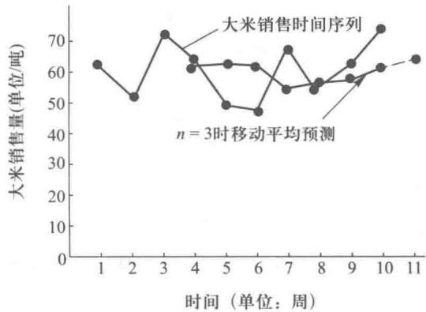
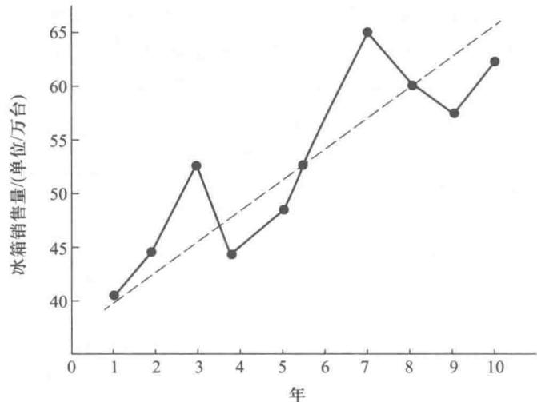
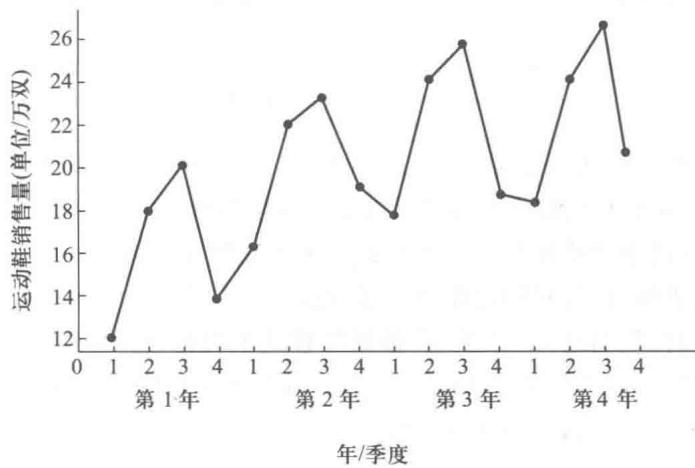

# 第17章 预测

预测在决策中占有不可替代的重要位置,一个好的决策都基于一个好的预测.一个公司对今后一年的经营做计划时,它首先要对市场需求做好预测,在这个基础上才能做出切合实际的、有利公司发展的生产计划、原材料采购计划、存储策略、销售计划.股市上的投资者对预测的重要性是深有体会的,如果能对股市的行情或某种股票的股价能做出一个准确的预测,然后进行投资,那么他能赢得利益和避免损失.

如何进行预测呢？光凭管理者的感觉进行预测是不行的。我们要进行科学的预测，科学的预测方法分成两类：一类叫定量预测，另一类叫定性预测。

定量的预测方法是基于对历史数据以及其他相关数据的分析而对将来做出预测的方法,其可以分为因果关系预测和时间序列预测.在本章中介绍的因果关系预测方法是回归分析方法,而介绍的时间序列预测方法有:平滑法(包括移动平滑法和指数平滑法)趋势预测和调整季节影响的趋势预测.

定性预测方法主要是利用专家的判断来预测将来,如德尔斐(Delphi)法就是综合专家意见,以技术专家预测为主的一种定性预测方法.在本章中对定性预测方法将不予介绍.

## 17.1 时间序列预测法

时间序列是指在一些连续的时间点或时间区间上测量到的一系列的数据,例如我们把过去12个月某百货公司服装部每个月的营业额按时间先后列出来或在图表上表示出来,这就是时间序列.时间序列预测法就是只利用这些历史数据来预测未来的数据值(譬如第13个月,第14个月的营业额)的方法.为了掌握时间序列预测法,我们首先要了解时间序列的数据值是由哪些因素所决定的,我们把决定时间序列数据值的那些因素称之为时间序列的成分.

### 一、时间序列的成分

一般认为时间序列数据值由趋势、季节性、周期和不规则等四个因素所决定,即时间序列的因素为趋势、季节性、周期和不规则.

时间序列的数据可以每隔一小时、一天、一周、一月、一年或其他任何等间隔的时间采集.显然这些数据具有随意的波动性,但是在较长的时间段里,这些数据值会相对平滑地即逐渐地变大或变小.这种时间序列的长时间的逐渐变化被称为时间序列的趋势,这种时间序列的趋势通常是由于长期的因素诸如人口、人口结构、技术、顾客的喜好的变化

所引起的.

在某一个特别时间段里如在一个特别的月份里时间序列的数据值很可能受到季节性因素的影响,而与趋势所期望的数据值不同.例如一个公司的空调的销售情况很能说明季节因素,由于夏天空调销售明显高于冬天,所以每年的空调销售随着季节变化而呈现了某些规律的变化,这种变化的规律我们可以用季节指数来表示.

另外,还存在一个使得时间序列的数据值偏离趋势的因素就是周期.例如社会的经济活动具有周期性,经济萧条、经济复苏、经济扩张反复地更迭.像这种有一定周期性的变化反映在时间序列上就是时间序列的周期因素.

时间序列除了受到趋势、季节和周期因素的影响外，还受到了不规则因素的影响。不规则因素解释了时间序列里的随机的变化，不规则因素是由影响时间序列的短期性、不可预测性以及非线性的原因所构成的。显然不规则因素是不可预测的，所以我们也不能利用历史数据来预测不规则因素对未来的影响。

### 二、用平滑法进行预测

对于没有明显的趋势、季节、周期影响的相对平稳的时间序列,我们可以用平滑法进行预测.平滑法就是通过平均过程来去掉时间序列中不规则的因素,在这里我们将介绍三种平滑方法.

#### 1. 移动平均法

移动平均法就是用时间序列中最近的 n 个数据的平均值来作为下个时期的数据的预测值，计算的数学公式为

$$
\begin{array}{r l r} & \mathrm{移动平均数} = \frac {\sum (\mathrm{最近} n \mathrm{个数据值})}{n}. \\ & (17.1) \end{array}
$$

所谓移动就是不断地用最近几个数据来代替老数据,随着预测时期的推进,预测值也不断变化.

下面我们用例 1 来说明如何用移动平均法进行预测.

例 1 某粮油食品公司最近 10 周的大米销售数量如表 17-1 所示,请预测第 11 周的大米销售数量.

表17-1

<table><tr><td>周期</td><td>大米销售量/吨</td></tr><tr><td>1</td><td>62</td></tr><tr><td>2</td><td>51</td></tr><tr><td>3</td><td>72</td></tr><tr><td>4</td><td>64</td></tr><tr><td>5</td><td>50</td></tr><tr><td>6</td><td>48</td></tr><tr><td>7</td><td>67</td></tr><tr><td>8</td><td>54</td></tr><tr><td>9</td><td>63</td></tr><tr><td>10</td><td>73</td></tr></table>

解 大米是顾客的日常生活必需品,一般来说,它不受季节,周期的影响,又因为记录数据的单位时间为周,时间间隔比较短,很少受到趋势的长时期因素的影响,所以我们可用平滑方法进行预测,在这里我们可以用移动平均法预测.

用移动平均法预测,我们必须选定 n 的取值,一般来说 n 值越大越平滑,在这里我们不妨取 n 值为 3,我们可以把离第 11 周最近的 3 周数据的平均值,即第 8、第 9、第 10 周的数据平均值作为第 11 周的预测值即:

第11周销售量预测值为： $\frac{54 + 63 + 73}{3}\approx 63.33$ （吨）.

求得了第 11 周的销售量的预测值之后,我们还要利用时间序列的数据来估计预测的偏差.我们可以用移动平均法来预测第 4 周,第 5 周,…,第 10 周的销售量,然后再求出这些预测量与实际销售量的偏差,再求出偏差平方值,我们可以把这些偏差平方值的平均值作为第 11 周预测值 63.63 的偏差的平方的估计值.下面我们列表 17-2 来计算该偏差平方的估计值.

从表 17-2 可见, 我们把第 1,2,3 周的时间序列值的平均数 61.67 作为第 4 周的预测值, 同时也求出预测值与实际值 64 偏差为 64-61.67=2.33. 最后一栏填上偏差的平方值即 $2.33^{2}=5.43$ . 同样我们可以把第 5 周至第 10 周的预测值, 预测偏差以及预测偏差平方值求出填入表 17-2 中. 我们还可以求出其 7 个预测偏差之和以及其 7 个预测偏差平方值之和如表所示. 我们很容易理解, 由于预测偏差之和中存在正负值互相抵消的问题, 故其预测偏差之和不能反映预测方法的精确度, 就不能用于第 11 周预测的偏差估计; 而把预测偏差平方值之和用于第 11 周的预测偏差估计, 我们把预测平方值之和的平均数作为衡量预测方法精度的指标, 也作为第 11 周预测的偏差平方值的估计. 在本例中

表17-2

<table><tr><td>周数</td><td>时间序列值</td><td>n=3时移动平均法预测值</td><td>预测偏差</td><td>预测偏差平方值</td></tr><tr><td>1</td><td>62</td><td></td><td></td><td></td></tr><tr><td>2</td><td>51</td><td></td><td></td><td></td></tr><tr><td>3</td><td>72</td><td></td><td></td><td></td></tr><tr><td>4</td><td>64</td><td>61.67</td><td>2.33</td><td>5.43</td></tr><tr><td>5</td><td>50</td><td>62.33</td><td>-12.33</td><td>152.03</td></tr><tr><td>6</td><td>48</td><td>62.00</td><td>-14.00</td><td>196.00</td></tr><tr><td>7</td><td>67</td><td>54.00</td><td>13.00</td><td>169.00</td></tr><tr><td>8</td><td>54</td><td>55.00</td><td>-1.00</td><td>1.00</td></tr><tr><td>9</td><td>63</td><td>56.33</td><td>6.67</td><td>44.49</td></tr><tr><td>10</td><td>73</td><td>61.33</td><td>11.67</td><td>136.19</td></tr><tr><td></td><td></td><td></td><td>合计:6.34</td><td>合计:704.14</td></tr></table>

预测偏差平方值之和的平均数 $= \frac{704.14}{7}\approx 100.59.$

即第11周预测为63.30时，其预测偏差平方值的估计为100.59，或者说其预测偏差的估计为 $\pm \sqrt{100.59} \approx \pm 10.03$ .

我们会注意到不同的 $n$ 的取值会得到不同的预测值，也会得到不同的预测精度，我们可以求得当 $n = 2, n = 4, n = 5$ 时其第11周的预测值分别为68.00,64.25,61.00.其预测偏差的平方值估计分别为150.53,108.75,118.84.或者说其预测偏差的估计分别为 $\pm \sqrt{150.53},\pm \sqrt{108.75}$ $\pm \sqrt{118.84}$ ，即分别为 $\pm 12.27,\pm 10.43,\pm 10.90.$

我们可以从不同的 $n$ 值来找到一个 $n$ 值使得其预测偏差估计值为最小，即精度为最高。实际上，当 $n = 7$ 时，第11周的预测值为59.86，其预测偏差估计值为 $\pm \sqrt{75.99} = \pm 8.72$ ，此时预测精度为最高，为了减少大家的计算工作量，我们在“管理运筹学软件”里也编了有关的程序，运用此程序，我们很快就能得到这结果。但同时我们也应注意到当 $n$ 越大时，丢失的信息就越多，而且 $n$ 越大曲线更趋于平滑，很可能掩盖时间序列的某些变动特征，如果仅仅为了消除其不规则性，一般取 $n = 3,4,5$ 较为恰当。

图 17-1 显示了表 17-1 中的时间序列,以及表 17-2 中的 n=3 时移动平均的预测.

#### 2. 加权移动平均法

加权移动平均法是移动平均法的一个改进,它根据 n 个最近的数据的不同位置,赋予不同的权数.然后把 n 个加了权的数据之和作为下一时期的预测值.移动平均法是加权移动平均法的一个特例,它对 n 个最近的数据都赋予相同的权数.在大多数情况下,对越近的数据赋予越大的权数,对越远的数据赋予越小的权数.例如在对某种股票的股价进行预测的时候,由于越近的股票的价格对未来股票价格的影响越大,所以要赋予较大的权数,相反较远时候的股价对未来股票的价格影响就小多了,就赋予相对小的权数.权数的确定要根据历史的数据、我们的经验以及对具体情况的具体分析.合适的权数可减少预测的偏差.

图17-1

如果我们在例1中对 $n = 3$ 的移动平均法根据时间的远近，设其三个数据的权数比关系为 $1:3:5$ ，则可知这三个数据的权数分别为 $\frac{1}{1 + 3 + 5} = \frac{1}{9},\frac{3}{1 + 3 + 5} = \frac{3}{9},\frac{5}{1 + 3 + 5} = \frac{5}{9}.$ 如果我们用这种加权移动平均法来预测第四周的数据值应计算如下：

第4周大米销售量预测值 $= \frac{1}{9}\times 62 + \frac{3}{9}\times 51 + \frac{5}{9}\times 72\approx 63.89$ （吨）.

#### 3. 指数平滑法

指数平滑法是用过去的时间序列的实际值和预测值加权平均来进行预测.其基本的模型如下所示：

$$
\begin{array}{r l r} & F _ {t + 1} = \alpha \cdot y _ {t} + (1 - \alpha) F _ {t}, \\ & (17.2) \end{array}
$$

其中：

$F_{t+1}$ 为第 $t+1$ 时期的时间序列的预测值；

$y_{t}$ 为第 t 时间的时间序列的实际值；

$F_{t}$ 为第 t 时间的时间序列的预测值；

$\alpha$ 为平滑系数 $(0 \leqslant \alpha \leqslant 1)$ .

我们仍以例 1 来说明这种预测法的使用方法, 我们不妨先取定 $\alpha=0.3$ .

从公式(17.2)可知我们要预测下一时期的值必须知道上一时期的实际值和预测值,为了预测第11周的大米销售量,我们除了要知道前10周的实际销售量之外,我们还必须知道第10周的预测值.而要知道第10周的预测值又必须知道第9周的预测值.以此类推我们必须知道第8周,第7周,直至第1周的预测值.故我们从t=1算起.由于t=1是个起始点,我们规定 $F_{1}=y_{1}$ ,之后我们就用(17.2)公式来依次计算 $F_{2},F_{3},\cdots,F_{11}$ .显然有

$$
\begin{array}{r l} F _ {2} & = 0. 3 y _ {1} + 0. 7 F _ {1} \\ & = 0. 3 y _ {1} + 0. 7 y _ {1} \\ & = y _ {1} = 62. 00. \\ F _ {3} & = 0. 3 y _ {2} + 0. 7 F _ {2} \\ & = 0. 3 \times 51 + 0. 7 \times 62 \\ & = 58. 70. \end{array}
$$

我们把所有计算结果列入表17-3，在表17-3中，我们列出了预测偏差与预测偏差平方值，如在第2周那一行里可知时间序列值为51，预测 $F_{2}=62.00$ ，预测偏差为 $51-62=-11$ ，而偏差平方为 $(-11)^{2}=121$ .

表17-3

<table><tr><td>周数</td><td>时间序列值</td><td> \(\alpha=0.3\) 时指数平滑法预测值</td><td>预测偏差</td><td>预测偏差平方值</td></tr><tr><td>1</td><td>62</td><td></td><td></td><td></td></tr><tr><td>2</td><td>51</td><td>62.00</td><td>-11.00</td><td>121.00</td></tr><tr><td>3</td><td>72</td><td>58.70</td><td>13.30</td><td>176.89</td></tr><tr><td>4</td><td>64</td><td>62.69</td><td>1.31</td><td>1.72</td></tr><tr><td>5</td><td>50</td><td>63.08</td><td>-13.08</td><td>171.09</td></tr><tr><td>6</td><td>48</td><td>59.16</td><td>-11.16</td><td>124.55</td></tr><tr><td>7</td><td>67</td><td>55.81</td><td>11.19</td><td>125.22</td></tr><tr><td>8</td><td>54</td><td>59.17</td><td>-5.17</td><td>26.73</td></tr><tr><td>9</td><td>63</td><td>57.62</td><td>5.38</td><td>28.94</td></tr><tr><td>10</td><td>73</td><td>59.23</td><td>13.77</td><td>189.61</td></tr><tr><td></td><td></td><td></td><td></td><td>合计:965.75</td></tr></table>

从表 17-3 中的数据, 可以计算

$$
\begin{array}{r l} F _ {1 1} & = 0. 3 Y _ {1 0} + 0. 7 F _ {1 0} \\ & = 0. 3 \times 73 + 0. 7 \times 59. 23 \\ & = 63. 36. \end{array}
$$

我们也可求出从第2周到第10周的预测偏差平方值的平均数为 $\frac{965.75}{9} = 107.30$ ，并把此作为第11周预测偏差的平方值.

对于不同的 $\alpha$ 的取值 $(0 \leqslant \alpha \leqslant 1)$ ，可以得到不同的第 11 周的预测值并具有不同的预测偏差的平方值。为了使预测精度最高即预测偏差的平方值最小，我们要选定合适的 $\alpha$ 的值。首先我们把公式 (17.2) 改写如下：

$$
\begin{array} {r l} F _ {t + 1} & = \alpha y _ {t} + (1 - \alpha) F _ {t} \\ & = \alpha y _ {t} + F _ {t} - \alpha F _ {t} \\ & = F _ {t} + \alpha (y _ {t} - F _ {t}). \\ & (17.3)\end{array}
$$

从公式(17.3)可知第 $(t+1)$ 时期的预测值等于第t时期的预测值加上一个修正量,这个修正量为平滑系数与第t时期预测偏差的乘积.一般来说当时间序列数据随机变化很大时,为提高预测精度,我们不希望过快地过多地作修正,这时 $\alpha$ 的取值以取小为宜,反之当时间序列数据值随机变化相对小时,为了提高预测精度,要求更快地修正以前预测的偏差,这时 $\alpha$ 的取值以取大为宜.

为了找到合适的 $\alpha$ 的取值, 我们可以用“管理运算学软件”用不同的 $\alpha$ 的取值对第 11 周销售量进行预测和偏差平方值的计算, 通过比较, 找到最为合适的 $\alpha$ 值. 对一些不同的 $\alpha$ 取值, 计算所得的第 11 周预测值以及预测偏差平方估计值列在表 17-4 中.

表17-4

<table><tr><td>α取值</td><td>第11周预测值</td><td>第11周预测偏差平方估计值</td></tr><tr><td>0.0</td><td>62.00</td><td>86.22</td></tr><tr><td>0.1</td><td>61.39</td><td>93.04</td></tr><tr><td>0.2</td><td>62.07</td><td>100.30</td></tr><tr><td>0.3</td><td>63.36</td><td>107.30</td></tr><tr><td>0.4</td><td>64.90</td><td>114.24</td></tr><tr><td>0.5</td><td>66.47</td><td>121.50</td></tr><tr><td>0.6</td><td>67.99</td><td>129.40</td></tr><tr><td>0.7</td><td>69.40</td><td>138.16</td></tr><tr><td>0.8</td><td>70.72</td><td>147.93</td></tr><tr><td>0.9</td><td>71.92</td><td>158.76</td></tr><tr><td>1.0</td><td>73.00</td><td>170.78</td></tr></table>

从表 17-4, 可见对本例题来说, 当 $\alpha$ 取 0 时, 用指数平滑法求得第 11 周的预测值为 62.00, 其预测偏差平方估计值最小, 为 86.22. 即 0 为 $\alpha$ 的最合适取值, 62.00 为第 11 周最精确的预测值.

### 三、用时间序列趋势进行预测

对于显示了长期趋势的时间序列,我们可以用时间序列的趋势进行预测.这种长期趋势可以呈现为线性的与非线性的.在这里我们只介绍时间序列趋势呈现为线性的情况.

为了说明这种预测法,我们用下面的例子加以说明.

例 2 某种品牌的冰箱最近十年的销售数量如表 17-5 所示：

表17-5

<table><tr><td>年(t)</td><td>销售量( \(y_t\) )/万台</td><td>年(t)</td><td>销售量( \(y_t\) )/万台</td></tr><tr><td>1</td><td>40.3</td><td>6</td><td>54.8</td></tr><tr><td>2</td><td>44.2</td><td>7</td><td>64.1</td></tr><tr><td>3</td><td>50.4</td><td>8</td><td>59.2</td></tr><tr><td>4</td><td>43.3</td><td>9</td><td>56.4</td></tr><tr><td>5</td><td>47.3</td><td>10</td><td>63.1</td></tr></table>

我们可以用图 17-2 来表示.

图17-2

从表 17-5 和图 17-2, 我们都可以看到尽管每一年的冰箱销售量有忽上忽下的变化, 但这 10 年里销售量的趋势是增长的. 这种趋势与图 17-2 中直线 (虚线) 较好地吻合, 我们就称这种趋势为线性趋势. 这条直线我们可以用如下线性方程来表示

$$
\begin{array}{r l r} & T _ {t} = b _ {0} + b _ {1} t. \\ & (17.4) \end{array}
$$

其中：

$T_{t}$ 为在第 t 时期（年）冰箱的销售量；

$b_{0}$ 为趋势直线在纵轴上的截距；

$b_{1}$ 为趋势直线的斜率.

下面的事情就要找出这条趋势直线或者说要确定直线方程中参数 $b_{0}$ 和 $b_{1}$ 的值.我们可以用回归分析的思想找到一条直线，使得直线上所有的预测值与时间序列的实际值偏差平方之和为最小.即这条直线与这时间序列的趋势最为吻合，这就是我们要找的趋势直线. $b_{1}$ 和 $b_{0}$ 可由以下公式所确定.

$$
\begin{array} {r l} b _ {1} = & \frac {\sum t \cdot Y _ {t} - (\sum t \cdot \sum Y _ {t}) / n}{\sum t ^ {2} - (\sum t) ^ {2} / n}, \\ & b _ {0} = \overline {{Y}} - b _ {1} \overline {{t}}. \\ & (17.5)\end{array}
$$

(17.6)

其中：

$Y_{t}$ 为第 t 时期时间序列的实际值；

n 为时期的数目；

$\overline{Y}$ 为时间序列的平均值,即 $\overline{Y}=\frac{\sum Y_{t}}{n}$ ;

$\bar{t}$ 为 t 的平均值, 即 $\bar{t}=\frac{\sum t}{n}$ .

我们进行如下计算：

<table><tr><td>t</td><td> \(Y_t\) </td><td> \(t \cdot Y_t\) </td><td> \(t^2\) </td></tr><tr><td>1</td><td>40.3</td><td>40.3</td><td>1</td></tr><tr><td>2</td><td>44.2</td><td>88.4</td><td>4</td></tr><tr><td>3</td><td>50.4</td><td>151.2</td><td>9</td></tr><tr><td>4</td><td>43.3</td><td>173.2</td><td>16</td></tr><tr><td>5</td><td>47.3</td><td>236.5</td><td>25</td></tr><tr><td>6</td><td>54.8</td><td>328.8</td><td>36</td></tr><tr><td>7</td><td>64.1</td><td>448.7</td><td>49</td></tr><tr><td>8</td><td>59.2</td><td>473.6</td><td>64</td></tr><tr><td>9</td><td>56.4</td><td>507.6</td><td>81</td></tr><tr><td>10</td><td>63.1</td><td>631.0</td><td>100</td></tr><tr><td>合计</td><td>55</td><td>523.1</td><td>3 079.3</td></tr></table>

并求得

$$
\begin{array}{r l} & \overline {{t}} = \frac {5 5}{1 0} = 5. 5, \\ & \overline {{Y}} = \frac {5 23 . 1}{1 0} = 52. 31, \\ b _ {1} & = \frac {\sum t \cdot Y _ {t} - (\sum t \cdot \sum Y _ {t}) / n}{\sum t ^ {2} - (\sum t) ^ {2} / n} \\ & = \frac {3 079 . 3 - (55 \times 523 . 1) / 10}{3 85 - (55) ^ {2} / 10} = 2. 45. \\ & b _ {0} = \overline {{Y}} - b _ {1} \overline {{t}} \end{array}
$$

$$
\begin{array}{l} = 52. 31 - 2. 45 \times 5. 5 \\ \approx 38. 84. \end{array}
$$

所以趋势直线为

$$
\begin{array}{r l r} & T _ {t} = 38. 84 + 2. 45 t. \\ & (17.7) \end{array}
$$

这样我们就可用(17.7)来计算下一年即第11年的趋势值,即有

$$
T _ {1 1} = 38. 84 + 2. 45 \times 11 = 65. 79.
$$

并把这个趋势值作为下一年冰箱销售量的预测值.

### 四、体现时间序列的趋势和季节因素的预测方法

在上面我们讲述了对具有趋势的时间序列进行预测的方法,在这里我们要对同时具有趋势和季节因素的时间序列进行预测,具体的做法如下所示:

（1）首先把具有趋势和季节因素的时间序列中的季节的成分从时间序列中分离出来.

（2）然后对这个具有趋势的时间序列求出它的趋势预测.

（3）最后，用季节指数来修正趋势预测，使预测体现出趋势因素和季节因素.

对这样的时间序列 t 时期的数据 $Y_{t}$ ，它受到 t 时期的趋势因素 $T_{t}$ 和季节因素 $S_{t}$ 的影响，当然它也受到 t 时期有不规则因素的影响。因此 $Y_{t}$ 可用如下的时间序列的乘积模型来表示

$$
\begin{array}{r l r} & Y _ {t} = T _ {t} \times S _ {t} \times I _ {t}. \\ & (17.8) \end{array}
$$

在这个模型里趋势因素 $T_{t}$ 是用预测单位值来表示.例如在 $t$ 时期冰箱的销售量趋势为 $T_{t}$ 台，而季节因素 $S_{t}$ 和不规则因素 $I_{t}$ 是以指数的形式来表示的.当指数值大于1时表示受季节因素 $S_{t}$ 或不规则因素 $I_{t}$ 的影响，预测值将高于趋势预测值.当指数小于1时同样表示受季节因素 $S_{t}$ 或不规则因素 $I_{t}$ 的影响，预测值将低于趋势预测值.

为了说明这种预测方法,我们举下面的例子:

例 3 某运动鞋厂近四年销售的运动鞋数量按季节统计的数据如表 17-6 和图 17-3 所示.

表17-6

<table><tr><td>年</td><td>季度</td><td>销售量/万双</td></tr><tr><td rowspan="4">1</td><td>1</td><td>12.2</td></tr><tr><td>2</td><td>18.1</td></tr><tr><td>3</td><td>20.3</td></tr><tr><td>4</td><td>13.8</td></tr><tr><td rowspan="4">2</td><td>1</td><td>16.0</td></tr><tr><td>2</td><td>21.4</td></tr><tr><td>3</td><td>23.1</td></tr><tr><td>4</td><td>17.7</td></tr><tr><td rowspan="4">3</td><td>1</td><td>16.8</td></tr><tr><td>2</td><td>23.8</td></tr><tr><td>3</td><td>24.2</td></tr><tr><td>4</td><td>18.3</td></tr><tr><td rowspan="4">4</td><td>1</td><td>18.0</td></tr><tr><td>2</td><td>24.1</td></tr><tr><td>3</td><td>26.0</td></tr><tr><td>4</td><td>19.2</td></tr></table>

图17-3

从表 17-6 和图 17-3, 我们可以看到该厂的运动鞋销售有明显的上升趋势以及受季节影响, 当然也受到不规则因素的影响, 所以 (17.8) 的时间序列的乘积模型适用于这个问题.

为了解决预测问题,我们首先求出季节指数.

#### 1. 季节指数的算法

我们先用移动平均法来消除时间序列中季节因素和不规则因素的影响.在这里,考虑到一年有四个季度,故取n=4,把四个季度的平均值作为某一季度的值,以达到消除季节和不规则因素影响的目的,与一般移动平均法的做法不同的是,我们不是把四个季度的平均值作为下一季度的预测值,而是把它作为四个季度中的“中间”那个季度消除季节和不规则因素影响之后受趋势因素影响的数值.显然这个数值来表示“中间”那个季度的趋势值比用来表示“开头”或“结束”那个季度的趋势值更为合理.因为趋势值是在较长时期里相对平滑地即逐渐变大或变小的,譬如趋势值在四个季度里逐渐变大,这四季度的平均值较好地反映了“中间”季度的趋势,而比“开头”的季度的趋势值要大,比“结束”的季度的趋势值要小.但四个季度中哪个季度是“中间”的季度?第一季度、第四季度显然不是“中间”季度,第二、第三季度也不是中间季度.这四个季度中由第二季度的下半季度与第三季度的上半季度组成的季度为“中间”季度.同样第一年第二季度至第二年第一季度这四个季度同样包含一、二、三、四四个季度,它们时间序列数据的平均值作为这四个季度的“中间”季度的趋势值,即为第一年第三季度的下半季度与第四季度的上半季度所组成的季度的趋势值.如此进行下去.

我们把例子中所求得的四个季度的平均值填入表 17-7 中适当的位置,例如第一年四个季度的平均值 16.1,我们填在第一年第二与第三季度的两行中间,它表示第二季度的下半季度与第三季度的上半季度所组成“中间”季度的趋势值.把第一年第二季度与第二年第一季度的平均值 17.05 填在第一年第三与第四季度的两行中间……在填完了四个季度的移动平均值这一列数之后,我们还要填写中心移动平均值这栏数值.它是用两个邻近的四季度移动平均值作为其数值填在这两个邻近四季度移动平均值所在行之间,作为其对应行的季度的趋势值.例如第一个中心移动平均值的数值为

$$
\frac {1 6 . 1 + 17 . 05}{2} \approx 16. 58.
$$

把它填在 16.1 与 17.05 所在两行之间, 这位置正好为第一年第三季度的所在行, 故 16.58 为第一年第三季度的趋势值. 事实上我们把由第二季度下半季度与第三季度的上半季度组成的一个“中间”季度和由第三季度的下半季度与第四季度的上半季度组成的另一个“中间”季度的趋势平均值作为第三季度的趋势值, 这与我们前面的处理方法是一样的.

如果当 n 为奇数时, 我们把 n 个“季节”数据的移动平均值作其“中间”“季节”的趋势值时, 因为确实存在这样的“中间”“季节”, 所以我们就不需要再进行中心移动平均了. 这里的“季节”是广义的, 它可以是季度, 月或其他的时间单位.

表17-7

<table><tr><td>年</td><td>季度</td><td>运动鞋销售量/万双</td><td>四个季度移动平均值</td><td>中心移动平均值</td></tr><tr><td rowspan="4">1</td><td>1</td><td>12.2</td><td></td><td></td></tr><tr><td>2</td><td>18.1</td><td></td><td></td></tr><tr><td>3</td><td>20.3</td><td>16.100</td><td>16.575</td></tr><tr><td>4</td><td>13.8</td><td>17.050</td><td>17.463</td></tr><tr><td rowspan="4">2</td><td>1</td><td>16.0</td><td>17.875</td><td>18.225</td></tr><tr><td>2</td><td>21.4</td><td>18.575</td><td>19.063</td></tr><tr><td>3</td><td>23.1</td><td>19.550</td><td>19.650</td></tr><tr><td>4</td><td>17.7</td><td>19.750</td><td>20.050</td></tr><tr><td rowspan="4">3</td><td>1</td><td>16.8</td><td>20.350</td><td>20.488</td></tr><tr><td>2</td><td>23.8</td><td>20.625</td><td>20.700</td></tr><tr><td>3</td><td>24.2</td><td>20.775</td><td>20.925</td></tr><tr><td>4</td><td>18.3</td><td>21.075</td><td>21.113</td></tr><tr><td rowspan="4">4</td><td>1</td><td>18.0</td><td>21.150</td><td>21.375</td></tr><tr><td>2</td><td>24.1</td><td>21.600</td><td>21.713</td></tr><tr><td>3</td><td>26.0</td><td>21.825</td><td></td></tr><tr><td>4</td><td>19.2</td><td></td><td></td></tr></table>

表 17-7 中的某一季度的中心移动平均值表示了如果不受季节与不规则因素的影响该季节的时间序列的值.

我们把时间序列的值与其相应的中心移动平均值之比称之为季节与不规则因素的指标,它度量了季节与不规则因素造成的影响程度.例如第一年的第三季度的季节与不规则因素的指标为 $\frac{20.3}{16.575}\approx1.225$ ,我们把所有的季节与不规则因素的指标都列于表17-8之中.

从表 17-8 中可见有 12 个季度的季节与不规则因素的指标, 其中第一、二、三、四季度各有三个季度与不规则因素的指标, 且这三个同季度的指标值各不相同, 例如第一年、第二年、第三年的第三季度的指标值分别为 1.225, 1.176, 1.157. 它们的各不相同主要是由不规则因素所造成的. 我们可以用平滑法即求平均值法去掉指标值中不规则因素, 例如我们把这三个数的平均值

$$
\frac {1 . 225 + 1 . 176 + 1 . 157}{3} \approx 1. 19.
$$

表17-8

<table><tr><td>年</td><td>季度</td><td>运动鞋销售量/万双</td><td>中心移动平均值</td><td>季节与不规则因素的指标值</td></tr><tr><td rowspan="4">1</td><td>1</td><td>12.2</td><td></td><td></td></tr><tr><td>2</td><td>18.1</td><td></td><td></td></tr><tr><td>3</td><td>20.3</td><td>16.575</td><td>1.225</td></tr><tr><td>4</td><td>13.8</td><td>17.463</td><td>0.790</td></tr><tr><td rowspan="4">2</td><td>1</td><td>16.0</td><td>18.225</td><td>0.878</td></tr><tr><td>2</td><td>21.4</td><td>19.063</td><td>1.123</td></tr><tr><td>3</td><td>23.1</td><td>19.650</td><td>1.176</td></tr><tr><td>4</td><td>17.7</td><td>20.050</td><td>0.883</td></tr><tr><td rowspan="4">3</td><td>1</td><td>16.8</td><td>20.488</td><td>0.820</td></tr><tr><td>2</td><td>23.8</td><td>20.700</td><td>1.150</td></tr><tr><td>3</td><td>24.2</td><td>20.925</td><td>1.157</td></tr><tr><td>4</td><td>18.3</td><td>21.113</td><td>0.867</td></tr><tr><td rowspan="4">4</td><td>1</td><td>18.0</td><td>21.375</td><td>0.842</td></tr><tr><td>2</td><td>24.1</td><td>21.713</td><td>1.110</td></tr><tr><td>3</td><td>26.0</td><td></td><td></td></tr><tr><td>4</td><td>19.2</td><td></td><td></td></tr></table>

作为第三季度的季节指数,它度量了第三季度的季节因素的影响,类似地,我们可以求出第四、第一、第二季度的季节指数,如表17-9所示.

表17-9

<table><tr><td>季节</td><td>季节与不规则因素指标值</td><td>季节指数</td><td>调整后的季节指数</td></tr><tr><td>1</td><td>0.878;0.820;0.842</td><td>0.85</td><td>0.85</td></tr><tr><td>2</td><td>1.123;1.150;1.110</td><td>1.13</td><td>1.12</td></tr><tr><td>3</td><td>1.225;1.176;1.157</td><td>1.19</td><td>1.18</td></tr><tr><td>4</td><td>0.790;0.883;0.867</td><td>0.85</td><td>0.85</td></tr></table>

从表 17-9, 我们知道, 由于季节因素的影响, 使得第一季度销售量平均值下降了 15%, 因为第一季度的季节指数为 0.85, 1-0.85=0.15. 同样可知由于季节因素的影响, 使得第二季度销售量平均值上升了 13%, 第三季度上升了 19%, 第四季度下降了 15%.

最后我们还要对季节指数进行一些调整.在这乘积模型里要求季节指数的平均值为1.因为在这个例子里有四个季度.有四个季节指数,所以这四个季节指数的和应该等于4.但是我们通过计算知道这四个季节指数和为

$$
0. 85 + 1. 13 + 1. 19 + 0. 85 = 4. 02.
$$

所以我们把季节指数乘以 4/4.02, 这样所得到的四个调整后的季节指数之和为 4, 满足了要求. 这四个调整后的季节指数分别为

$$
0. 85 \times \frac {4}{4 . 02} = 0. 85.
$$

$$
1. 13 \times \frac {4}{4 . 02} = 1. 12.
$$

$$
1. 19 \times \frac {4}{4 . 02} = 1. 18.
$$

$$
0. 85 \times \frac {4}{4 . 02} = 0. 85.
$$

我们把调整后的季节指数分别填入表 17-9 中. 当然如果季节指数的平均值正好为 1 时, 就不需要调整了.

#### 2. 在时间序列中去掉季节因素

在求得了时间序列的季节因素之后,我们要在时间序列中去掉季节因素,具体的做法把原来的时间序列的每一个数据值除以相应的季节指数,所得到的新的时间序列就消除了季节因素,使得原来的乘积模型

$$
Y _ {t} = T _ {t} \times S _ {t} \times I _ {t}
$$

变成了

$$
Y _ {t} / S _ {t} = T _ {t} \times I _ {t}.
$$

此例子消除季节因素之后的时间序列如表 17-10 最后一列所示.

3. 使用消除季节因素后的时间序列确定时间序列的趋势

我们看到表 17-10 中消除季节因素后的时间序列呈现一种向上的线性趋势,为了找出这条趋势直线,我们采用前面所介绍的求趋势直线的方法,设这条直线方程为

$$
T _ {t} = b _ {0} + b _ {1} t.
$$

表17-10

<table><tr><td>年</td><td>季度</td><td>运动鞋销售量 \((Y_t)/万双\) </td><td>季节指数 \((S_t)\) </td><td>消除季节因素后销售量 \((Y_t/S_t)=T_tI_t\) </td></tr><tr><td rowspan="4">1</td><td>1</td><td>12.2</td><td>0.85</td><td>14.35</td></tr><tr><td>2</td><td>18.1</td><td>1.12</td><td>16.16</td></tr><tr><td>3</td><td>20.3</td><td>1.18</td><td>17.20</td></tr><tr><td>4</td><td>13.8</td><td>0.85</td><td>16.24</td></tr><tr><td rowspan="4">2</td><td>1</td><td>16.0</td><td>0.85</td><td>18.82</td></tr><tr><td>2</td><td>21.4</td><td>1.12</td><td>19.11</td></tr><tr><td>3</td><td>23.1</td><td>1.18</td><td>19.58</td></tr><tr><td>4</td><td>17.7</td><td>0.85</td><td>20.82</td></tr><tr><td rowspan="4">3</td><td>1</td><td>16.8</td><td>0.85</td><td>19.76</td></tr><tr><td>2</td><td>23.8</td><td>1.12</td><td>21.25</td></tr><tr><td>3</td><td>24.2</td><td>1.18</td><td>20.51</td></tr><tr><td>4</td><td>18.3</td><td>0.85</td><td>21.53</td></tr><tr><td rowspan="4">4</td><td>1</td><td>18.0</td><td>0.85</td><td>21.18</td></tr><tr><td>2</td><td>24.1</td><td>1.12</td><td>21.52</td></tr><tr><td>3</td><td>26.0</td><td>1.18</td><td>22.03</td></tr><tr><td>4</td><td>19.2</td><td>0.85</td><td>22.59</td></tr></table>

其中：

$T_{t}$ 为求第 t 时期运动鞋的销售量；

$b_{0}$ 为趋势直线纵轴上的截距；

$b_{1}$ 为趋势直线的斜率.

在这里的 $b_{0}, b_{1}$ 可由公式(17.5)，(17.6)求出. 我们也可以用“管理运筹学”软件来求得. 我们求得

$$
T _ {t} = 15. 518 + 0. 473 t.
$$

用这个公式可预测未来季度的运动鞋的销售量趋势,例如下一个季度的销售量的趋势值为

$$
\begin{array}{r l} T _ {1 7} & = 15. 518 + 0. 473 \times 17 \\ & = 23. 559 (\text {万双}). \end{array}
$$

#### 4. 季节调整

由于该运动鞋的销售受到季节的影响,故我们要在趋势预测值的基础上进行季节因素的调整.下一个季节,即第17个季度是第五年的第一季度,而第一季度的季节指数为0.85(见表17-9)其预测值应为趋势预测值与季节指数的乘积,可得第17季度的销售量预测值应为 $23.559\times0.85=20.025$ (万双).

同样我们可得到第 17 至 20 季度的经季节调整后的销售预测值, 如表 17-11 所示.

如果销售量的数据按月提供,那么我们就应该首先取 n=12,进行移动平均法,然后计算这 12 个月的季节指数,再求出消除季节因素的时间序列并得到其趋势直线,最后进行季节调整得到其预测值.

表17-11

<table><tr><td>年</td><td>季度</td><td>趋势预测值</td><td>季节指数(见表17-9)</td><td>季度预测值</td></tr><tr><td rowspan="4">5</td><td>1</td><td>23.559</td><td>0.85</td><td> \(23.559 \times 0.85 = 20.025\) </td></tr><tr><td>2</td><td>24.032</td><td>1.12</td><td> \(24.032 \times 1.12 = 26.916\) </td></tr><tr><td>3</td><td>24.505</td><td>1.18</td><td> \(24.505 \times 1.18 = 28.916\) </td></tr><tr><td>4</td><td>24.978</td><td>0.85</td><td> \(24.978 \times 0.85 = 21.231\) </td></tr></table>

在“管理运筹学”软件里有专门的程序来解决体现时间序列的趋势和季节因素的预测问题.如果考虑到周期因素 $C_{t}$ 的影响,我们可以把(17.8)的时间序列模型扩充为如下的模型:

$$
Y _ {t} = T _ {t} \times C _ {t} \times S _ {t} \times I _ {t}.
$$

其中周期因素 $C_{t}$ 也和季节因素 $S_{t}$ 一样都是以指数的形式来表示的. 解决周期因素 $C_{t}$ 的影响已超过了本教科书的范围, 在这里不予以介绍.

## 17.2 用回归分析方法进行预测

回归分析是用于处理变量间相关关系的一种数理统计方法.

在回归分析里我们把要预测的变量称之为因变量,而把与因变量相关的变量称之为自变量,例如在时间序列中我们把要预测的时间序列的值 $T_{t}$ 称之为因变量,而把与时间序列值相关的时期 t 称为自变量.对只含一个自变量和一个应变量的回归分析叫做一元回归分析,而含有多个自变量的回归分析叫做多元回归分析.在一元回归分析中,自变量与因变量的次数都为一次的称为一元线性回归,否则称为一元非线性回归.

回归分析就是通过对自变量及其因变量的对应数据的统计分析而建立变量间因果关系模型的方法,用回归分析方法进行预测就是通过求得的因果关系的模型对因变量进行预测.

### 一、对时间序列的数据,用回归分析方法进行预测

在例 2 中, 我们对某种品牌的冰箱进行预测时已经运用了回归分析的方法, 在这里自变量是年份 t, 因变量是销售量 $Y_{t}$ , 而建立的变量间因果关系的模型即为:

$$
\hat {Y} _ {t} = T _ {t} = b _ {0} + b _ {1} t = 38. 84 + 2. 45 t.
$$

在这里 $\hat{Y}_t$ 为 $Y_{t}$ 估计值.这是一个一元线性回归模型，我们用这个模型预测了第11年的销售量

$$
\hat {Y} _ {1 1} = T _ {1 1} = 38. 84 + 2. 45 \times 11 = 65. 79 (\text {万台}).
$$

但在实际问题中往往包含了更多的自变量.以下我们来看如何对时间序列的数据,用多元回归分析的方法进行预测.

我们设:时间序列有 n 个时期的数据,并设

$Y_{t}$ 为时期 t 的时间序列的实际值；

$\hat{Y}_{t}$ 为时期 t 的时间序列的估计值；

$X_{1t}$ 为时期 t 自变量 1 的值；

$X_{2t}$ 为时期 t 自变量 2 的值；

$X_{kt}$ 为时期 t 自变量 k 的值.

则这多元回归的模型为

$$
\hat {Y} _ {t} = b _ {0} + b _ {1} X _ {1 t} + b _ {2} X _ {2 t} + b _ {3} X _ {3 t} + \dots + b _ {k} X _ {k t}.
$$

在这里 $b_{0}, b_{1}, \cdots, b_{k}$ 为估计的回归系数，这些回归系数是通过求

$$
\left(y _ {1} - \hat {y} _ {1}\right) ^ {2} + \left(y _ {2} - \hat {y} _ {2}\right) ^ {2} + \dots + \left(y _ {n} - \hat {y} _ {n}\right) ^ {2}
$$

的最小值来确定的. 换句话来说这里的 $b_{0}, b_{1}, \cdots, b_{k}$ 的取值使得几个时间序列的实际值与对应的估计值差的平方之和为最小.

求 $b_{0}, b_{1}, \cdots, b_{k}$ 的方法, 很多统计书有介绍, 我们就不做详细的阐述, 实际上我们可以使用统计软件很容易求得, Microsoft Excel 软件也具有这个功能, 我们不妨自己试试.

求得了多元回归模型,我们只要代入相应的自变量值,就可以得到预测结果了.

在时间序列中,我们可以把时间 t 的 i 次幂 $t^{i}$ 看成自变量 $x_{it}$ , 把一元非线性回归看成多元回归,例如我们取 k=3 时,此多元回归模型为

$$
\begin{array}{r l} \hat {Y} _ {t} & = b _ {0} + b _ {1} X _ {1 t} + b _ {2} X _ {2 t} + b _ {3} X _ {3 t} \\ & = b _ {0} + b _ {1} t + b _ {2} t ^ {2} + b _ {3} t ^ {3}. \end{array}
$$

一般此模型要比一元线性回归模型提供更为精确的预测.

在例 2 和例 3 的趋势预测中,我们都可以用多元回归分析.

有时,我们把时间序列的前些时期的值看成自变量.例如我们设 $X_{kt}=\hat{Y}_{t-k}$ ，当我们取 k=3 时，就有

$$
\hat {Y} _ {t} = b _ {0} + b _ {1} Y _ {t - 1} + b _ {2} Y _ {t - 2} + b _ {3} Y _ {t - 3}.
$$

像这样的回归模型称为自动回归模型.

我们还常常把一些经济和人口统计方面的因素看成自变量,例如对金银珠宝首饰的销售额的预测中,我们可以选择如下的自变量:

$X_{1t}$ 为时期 t 的价格；

$X_{2t}$ 为时期 t 的国民经济生产总值；

$X_{3t}$ 为时期 t 的预测人口数；

$X_{4t}$ 为时期 t 的平均工资收入；

$X_{5t}$ 为时期 t 的广告预算.

当然我们也可以在选择的自变量中既有表示时期 t 的 i 次幂的自变量,又有表示前些时期值的自变量,同时还有表示经济和人口统计学方面因素的自变量.

用回归分析方法预测的好坏很大程度上取决于自变量的选择.我们要认真分析并找出与时间序列值密切相关的自变量.

### 二、没有可用的时间序列数据时，用回归分析进行预测

有时,当我们进行预测时,没有合适的时间序列数据可用,例如一个高档餐厅打算在一个街区开设一个新分店,需要对这个新店的当年的年营业额进行预测,显然对这个新店的年营业额没有任何的时间序列数据.那么,应该怎样用回归分析进行预测呢?这个高档餐厅的经理认为,餐厅的营业额与餐厅所在地区的公司企业的数量有着因果关系.为了对这个新店的年营业额进行预测,他调查了他的餐厅十个分店的年营业额与这些分店所在地区的公司企业的数量,如表17-12所示.

表17-12

<table><tr><td>分店</td><td>Y=年营业额/万元</td><td>X=所在地公司企业的数量</td></tr><tr><td>1</td><td>58</td><td>20</td></tr><tr><td>2</td><td>105</td><td>60</td></tr><tr><td>3</td><td>88</td><td>80</td></tr><tr><td>4</td><td>118</td><td>80</td></tr><tr><td>5</td><td>117</td><td>120</td></tr><tr><td>6</td><td>137</td><td>160</td></tr><tr><td>7</td><td>157</td><td>200</td></tr><tr><td>8</td><td>169</td><td>200</td></tr><tr><td>9</td><td>149</td><td>220</td></tr><tr><td>10</td><td>202</td><td>260</td></tr></table>

该餐厅的经理对上面的数据(不是时间序列数据)进行回归分析,求出该问题估计值的一元线性回归方程,找到所在地公司数量与餐厅年营业额之间的关系.

该问题的一元线性回归方程为

$$
\hat {Y} = b _ {0} + b _ {1} X.
$$

这里：

$\hat{Y}$ 为因变量(年营业额)的估计值；

$b_{0}$ 为此回归方程的截距；

$b_{1}$ 为此回归方程的斜率；

X 为自变量的值(所在地公司企业的数量).

这个一元线性回归方程的求法是和前面所介绍的方法完全一样,只不过自变量不再是时间段 t,而因变量也不再是依赖时间段 t 的变量了.

我们可以容易地求出此一元线性回归方程为

$$
\hat {Y} = 60 + 0. 5 X.
$$

这样餐厅经理只要对新分店所在地的公司企业数进行调查,得到正确数字,就可以对新店的年营业额进行预测.经调查在该地区的公司企业数为150家,于是得到新分店年营业额的预测值为 $\hat{Y}=60+0.5\times150=135$ (万元).

理论上还应进行回归方程的显著性检验,有关方法可参见相关统计书籍.

## 习题

1. 表 17-13 是过去 12 个月某种产品的销售量的数据.

表17-13

<table><tr><td>月</td><td>销售量</td><td>月</td><td>销售量</td></tr><tr><td>1</td><td>105</td><td>7</td><td>140</td></tr><tr><td>2</td><td>135</td><td>8</td><td>135</td></tr><tr><td>3</td><td>115</td><td>9</td><td>100</td></tr><tr><td>4</td><td>100</td><td>10</td><td>85</td></tr><tr><td>5</td><td>95</td><td>11</td><td>100</td></tr><tr><td>6</td><td>120</td><td>12</td><td>105</td></tr></table>

（1）分别取 $n = 3$ 和 $n = 4$ 用移动平均法对第13个月的销售量进行预测.并进行比较

（2）分别用 $\alpha=0.3$ 和 $\alpha=0.5$ 的指数平滑法对第 13 个月的销售量进行预测，并进行比较.

2. 下面是过去 10 周的某种股票的价格：

9.5, 9.3, 9.2, 9.6, 9.8, 10.5, 9.9, 9.7, 9.6, 9.4.

请用加权移动平均法对第11周的该股票价格进行预测.

(1)取 $n = 3$ ，根据时间的远近其三个数据的权数比关系为 $1:2:4.$

(2) 取 n=3，根据时间的远近其三个数据的权数比关系为 1:3:5.

(3) 对 a, b 两个结果进行比较.

3. 请根据以下对于某商品过去8周价格(单位:万元)的统计回答问题:

5.5,6.0,5.1,5.4,6.6,6.2,5.5,5.8

请用加权移动平均法对第9周的商品价格进行预测.

(1) 取 n=3 根据时间的远近三个数据的权数比关系为 1:3:4.

(2) 取 n=3 根据时间的远近三个数据的权数比关系为 1:2:6.

4. 已知过去 6 个月某地区商品房销售价格如表 17-14 所示.

表17-14

<table><tr><td>月数</td><td>1</td><td>2</td><td>3</td><td>4</td><td>5</td><td>6</td></tr><tr><td>商品房售价(万元/平方米)</td><td>4.2</td><td>4.8</td><td>5.1</td><td>5.4</td><td>6.6</td><td>5.8</td></tr></table>

请用加权移动平均法对第7个月的商品房价格进行预测.

(1) 取 n=4，根据时间的远近 3 个数据的权数比关系为 1:3:5:7；

(2) 取 n=3，根据时间的远近 3 个数据的权数比关系为 2:3:5.

5. 某长途汽车司机为均衡预算, 欲分析每天的加油情况, 得 12 天的汽油添加情况如表 17-15 所示.

表17-15

<table><tr><td>天数</td><td>1</td><td>2</td><td>3</td><td>4</td><td>5</td><td>6</td><td>7</td><td>8</td><td>9</td><td>10</td><td>11</td><td>12</td></tr><tr><td>加油量/升</td><td>17</td><td>23</td><td>19</td><td>23</td><td>18</td><td>16</td><td>20</td><td>18</td><td>22</td><td>20</td><td>15</td><td>22</td></tr></table>

求：

(1) n=3 时,用移动平均法对第 13 天的加油量进行预测.

(2) 用 $\alpha=0.2$ 的指数平滑法对第 13 天的加油量进行预测.

(3) 求趋势曲线.

6. 某互联网公司欲分析其门户网站每天的用户访问量, 得 7 个月的访问情况如表 17-16 所示.

表17-16

<table><tr><td>天数</td><td>1</td><td>2</td><td>3</td><td>4</td><td>5</td><td>6</td><td>7</td></tr><tr><td>访问量/十万人</td><td>2.4</td><td>2.3</td><td>1.9</td><td>1.8</td><td>2.7</td><td>3.1</td><td>3.5</td></tr></table>

求：

(1) n=4 时,用移动平均法对第 8 个月的用户访问量进行预测;

(2)用 $\alpha=0.3$ 的指数平滑法对第 8 个月的用户访问量进行预测；

(3) 求趋势曲线.

7. 某种品牌的电视机最近 10 年的销售量如表 17-17 所示.

表17-17

<table><tr><td>年(t)</td><td>销售量( \(y_t\) )/万台</td><td>年(t)</td><td>销售量( \(y_t\) )/万台</td></tr><tr><td>1</td><td>20.0</td><td>6</td><td>30.0</td></tr><tr><td>2</td><td>24.5</td><td>7</td><td>31.0</td></tr><tr><td>3</td><td>28.2</td><td>8</td><td>36.0</td></tr><tr><td>4</td><td>27.5</td><td>9</td><td>35.2</td></tr><tr><td>5</td><td>26.6</td><td>10</td><td>37.4</td></tr></table>

(1) 请画图表示这时间序列，该时间序列是否有线性趋势？

(2) 求出此趋势直线,并对第11年后的销售量进行预测.

8. 某大学欲对居民运动习惯以及发展趋势进行调查分析, 过去 8 个月某地区居民人均运动时间如表 17-18 所示.

表17-18

<table><tr><td>月数</td><td>1</td><td>2</td><td>3</td><td>4</td><td>5</td><td>6</td><td>7</td><td>8</td></tr><tr><td>人均运动时间/小时</td><td>10</td><td>13</td><td>15</td><td>14</td><td>19</td><td>20</td><td>18</td><td>22</td></tr></table>

（1）分别取 n=2 和 n=4，用移动平均法对第 9 个月的人均运动时间进行预测，并比较；

（2）分别取 $\alpha=0.3$ 和 $\alpha=0.8$ ，用指数平滑法对第9个月的人均运动时间进行预测，并比较.

9. 表 17-19 为过去 10 天某冷饮店某品牌汽水的销售量.

表17-19

<table><tr><td>天数</td><td>1</td><td>2</td><td>3</td><td>4</td><td>5</td><td>6</td><td>7</td><td>8</td><td>9</td><td>10</td></tr><tr><td>销售量/瓶</td><td>100</td><td>150</td><td>142</td><td>151</td><td>145</td><td>160</td><td>180</td><td>172</td><td>170</td><td>182</td></tr></table>

(1) 分别取 n=3 和 n=4，用移动平均法对第 11 天的销售量进行预测，并比较结果.

(2) 分别取 $\alpha=0.2$ 和 $\alpha=0.5$ ，用指数平滑法对第 11 天的销售量进行预测，并比较结果.

10. 某宾馆记录了过去 9 年的旅客入住情况(如表 17-20 所示), 欲预测将来的入住人数, 以决定是否扩建. 假设有如下时间序列数据, 请建立一个一元线性回归模型, 预测第 11 年的入住人数.

表17-20

<table><tr><td>年(X)</td><td>入住人数(Y)/百人</td><td> \(X^{2}\) </td><td>XY</td></tr><tr><td>1</td><td>17</td><td>1</td><td>17</td></tr><tr><td>2</td><td>16</td><td>4</td><td>32</td></tr><tr><td>3</td><td>16</td><td>9</td><td>48</td></tr><tr><td>4</td><td>21</td><td>16</td><td>84</td></tr><tr><td>5</td><td>20</td><td>25</td><td>100</td></tr><tr><td>6</td><td>20</td><td>36</td><td>120</td></tr><tr><td>7</td><td>23</td><td>49</td><td>161</td></tr><tr><td>8</td><td>25</td><td>64</td><td>200</td></tr><tr><td>9</td><td>24</td><td>81</td><td>216</td></tr><tr><td> \(\sum X=45\) </td><td> \(\sum Y=182\) </td><td> \(\sum X^{2}=285\) </td><td> \(\sum XY=978\) </td></tr></table>

11. 某景区管理部门想要预测未来该景区游客访问量的情况以及趋势,已有过去5年的游客访问数据(见表17-21).假设有如下时间序列数据,请建立一个一元线性回归模型,预测第6年的游客访问量.

表17-21

<table><tr><td>年(X)</td><td>游客访问量(Y)/万人</td><td> \(X^{2}\) </td><td>XY</td></tr><tr><td>1</td><td>2.4</td><td>1</td><td>2.4</td></tr><tr><td>2</td><td>2.1</td><td>4</td><td>4.2</td></tr><tr><td>3</td><td>2.3</td><td>9</td><td>6.9</td></tr><tr><td>4</td><td>2.6</td><td>16</td><td>10.4</td></tr><tr><td>5</td><td>3.2</td><td>25</td><td>16</td></tr><tr><td> \(\sum X=15\) </td><td> \(\sum Y=12.6\) </td><td> \(\sum X^{2}=55\) </td><td> \(\sum XY=39.9\) </td></tr></table>

12. 某面馆连续 6 天特色面食的销售情况与气温关系如表 17-22 所示.

表17-22

<table><tr><td>日期</td><td>4月23日</td><td>4月24日</td><td>4月25日</td><td>4月26日</td><td>4月27日</td><td>4月28日</td></tr><tr><td>气温/°C</td><td>29</td><td>26</td><td>21</td><td>23</td><td>25</td><td>28</td></tr><tr><td>热汤面/碗</td><td>12</td><td>24</td><td>30</td><td>28</td><td>23</td><td>14</td></tr><tr><td>冷面/碗</td><td>23</td><td>15</td><td>1</td><td>2</td><td>16</td><td>28</td></tr></table>

求：
(1) 判断哪种商品的销售情况与气温间呈近似线性关系，并求线性回归方程.
(2) 若已知 4 月 29 日的气温为 $27^{\circ}C$ ，问两种面的可能销售量为多少？

13. 某地区连续 7 个月汽车的销售量与汽油平均价格(以 95 号汽油为例)的关系如表 17-23 所示.

表17-23

<table><tr><td>月份</td><td>1</td><td>2</td><td>3</td><td>4</td><td>5</td><td>6</td><td>7</td></tr><tr><td>95号汽油价格(元/升)</td><td>6.73</td><td>7.04</td><td>7.27</td><td>7.48</td><td>7.23</td><td>7.37</td><td>7.64</td></tr><tr><td>传统能源汽车/万辆</td><td>5.5</td><td>5.2</td><td>5.3</td><td>5.3</td><td>5.8</td><td>6.3</td><td>6.2</td></tr><tr><td>新能源汽车/万辆</td><td>0.2</td><td>0.5</td><td>0.6</td><td>0.5</td><td>0.4</td><td>0.6</td><td>0.7</td></tr></table>

求：

(1) 判断哪种汽车的销售情况与油价间呈近似线性关系，并求线性回归方程；

(2) 若已知 8 月的油价为 7.8 元/升, 两种汽车的可能销售量为多少?

14. 某毛衣厂过去 3 年的销售量数据如表 17-24 所示.

表17-24

<table><tr><td>季度</td><td>第 1 年</td><td>第 2 年</td><td>第 3 年</td></tr><tr><td>1</td><td>1 650</td><td>1 800</td><td>1 850</td></tr><tr><td>2</td><td>900</td><td>840</td><td>1 040</td></tr><tr><td>3</td><td>2 580</td><td>2 850</td><td>2 880</td></tr><tr><td>4</td><td>2 460</td><td>2 300</td><td>2 560</td></tr></table>

(1) 该时间序列体现趋势和季节因素吗?

(2) 计算 4 个季度的季节指数.

(3)用体现时间序列的趋势和季节因素的预测方法，预测第4年4个季度的销售量.并说明这种预测方法是否合理.

15. 某空调专卖点的一种品牌的空调最近7年的销量(单位:百台)数据如表17-25所示.

表17-25

<table><tr><td>年</td><td>第1季度</td><td>第2季度</td><td>第3季度</td><td>第4季度</td><td>全年</td></tr><tr><td>1</td><td>6</td><td>15</td><td>10</td><td>4</td><td>35</td></tr><tr><td>2</td><td>10</td><td>18</td><td>15</td><td>7</td><td>50</td></tr><tr><td>3</td><td>14</td><td>26</td><td>23</td><td>12</td><td>75</td></tr><tr><td>4</td><td>19</td><td>28</td><td>25</td><td>18</td><td>90</td></tr><tr><td>5</td><td>22</td><td>34</td><td>28</td><td>21</td><td>105</td></tr><tr><td>6</td><td>24</td><td>36</td><td>30</td><td>20</td><td>110</td></tr><tr><td>7</td><td>28</td><td>40</td><td>35</td><td>27</td><td>130</td></tr></table>

（1）该时间序列体现趋势和季节因素吗？为什么？

（2）计算 4 个季度的季节指数.

（3）用体现时间序列的趋势和季节因素的预测方法，预测第8年4个季度的销售量.

## 案例 33: 爱华生空调销量预测分析

爱华生集团是全球技术领先企业，在全球设有85家公司，致力于创建将人、物与信息互联的智能电器新时代。爱华生（中国）有限公司成立于2000年，总部设在深圳，负责爱华生在中国的投资和业务拓展。其目前在中国开展的业务主要有空调、洗衣机、热水器等产品业务，并以卓越的品质和节能环保的特点，赢得了中国消费者的青睐。

公司在中国共有10家生产工厂，其中位于青岛的工厂主要负责生产在中国销售的AHS50007型号空调。AHS50007空调中的部分零部件是由国外工厂生产，并运到中国来进行组装。爱华生集团一直非常重视AHS50007空调的软硬件更新以及营销，使得该空调在中国的销售数量不断增长，成为该集团最近几年在中国销售数量最大的产品。目前，青岛工厂的一处仓库面临拆迁，而且暂时未找到其他合适的仓库。因此，生产经理在安排生产计划时遇到了很大的挑战：如何安排生产计划，既满足中国市场需求又尽可能少地占用库存？预测的销售量成为生产经理制定生产计划的重要参考指标。已知AHS50007空调在中国过去三年的销售数据如表17-26所示。

表17-26

<table><tr><td>月份</td><td>2016年销量/万台</td><td>2017年销量/万台</td><td>2018年销量/万台</td></tr><tr><td>1</td><td>18.7</td><td>22.2</td><td>25.4</td></tr><tr><td>2</td><td>15.4</td><td>17.6</td><td>20.4</td></tr><tr><td>3</td><td>14.2</td><td>17.1</td><td>20.3</td></tr><tr><td>4</td><td>16.4</td><td>19.9</td><td>22.5</td></tr><tr><td>5</td><td>19.0</td><td>22.1</td><td>25.8</td></tr><tr><td>6</td><td>23.3</td><td>27.1</td><td>31.0</td></tr><tr><td>7</td><td>25.0</td><td>29.6</td><td>32.0</td></tr><tr><td>8</td><td>27.7</td><td>30.6</td><td>33.9</td></tr><tr><td>9</td><td>29.4</td><td>32.8</td><td>35.0</td></tr><tr><td>10</td><td>24.9</td><td>28.3</td><td>30.9</td></tr><tr><td>11</td><td>25.2</td><td>29.3</td><td>33.2</td></tr><tr><td>12</td><td>20.5</td><td>22.8</td><td>26.4</td></tr></table>

请帮助生产经理完成以下分析：

(1) 请决定用何种时间序列的方法对2019年1月至12月AHS50007空调销售量进行预测并解

释原因.

(2) 2019 年 1 月至 12 月 AHS50007 空调销售量的预测值为多少?

(3) 如果2019年7月的实际销售量为50万台，此时预测的误差为多少？如果这个预测误差太大，为了解决时间序列中的不确定性，在预测过程中可以做哪些处理？

## 案例 34: 中国充电桩与新能源汽车销售预测分析

在低碳环保、能源安全及产业扶植等因素的驱动下，全球新能源汽车市场发展迅速，全球汽车电动化趋势已十分明朗，产业格局正在加速形成。国内新能源市场中，国家对新能源的管控政策已从补贴、引导向以市场管理为主、提高产品竞争力的方向转变，双积分制将代替补贴成为行业长期发展的管理基础。充电设施布局的逐渐完善，在一定程度上刺激了市场上对新能源汽车的消费。

在这样的背景下,平安汽车公司试图通过全国充电桩的累计安装数量以及以往该公司的新能源汽车销量来探究充电桩数量与新能源汽车销量之间的关系,并试图通过该关系预测市场并制定销售目标.自2016年1月起的全国充电桩累计安装数量以及该公司新能源汽车销量的月度数据如表17-27所示.

表17-27

<table><tr><td>时间</td><td>全国充电桩累计安装量/个</td><td>新能源汽车销量/辆</td><td>时间</td><td>全国充电桩累计安装量/个</td><td>新能源汽车销量/辆</td></tr><tr><td>2016年1月</td><td>58 758</td><td>1 112</td><td>2017年4月</td><td>161 193</td><td>2 812</td></tr><tr><td>2016年2月</td><td>60 023</td><td>812</td><td>2017年5月</td><td>166 946</td><td>4 038</td></tr><tr><td>2016年3月</td><td>65 109</td><td>700</td><td>2017年6月</td><td>171 609</td><td>4 288</td></tr><tr><td>2016年4月</td><td>72 296</td><td>2 048</td><td>2017年7月</td><td>180 684</td><td>5 020</td></tr><tr><td>2016年5月</td><td>77 634</td><td>2 021</td><td>2017年8月</td><td>185 990</td><td>6 081</td></tr><tr><td>2016年6月</td><td>81 780</td><td>2 941</td><td>2017年9月</td><td>190 559</td><td>6 192</td></tr><tr><td>2016年7月</td><td>85 537</td><td>1 316</td><td>2017年10月</td><td>194 594</td><td>7 510</td></tr><tr><td>2016年8月</td><td>92 500</td><td>1 020</td><td>2017年11月</td><td>204 729</td><td>6 849</td></tr><tr><td>2016年9月</td><td>102 375</td><td>1 610</td><td>2017年12月</td><td>213 903</td><td>11 805</td></tr><tr><td>2016年10月</td><td>107 098</td><td>1 798</td><td>2018年1月</td><td>225 071</td><td>2 873</td></tr><tr><td>2016年11月</td><td>115 792</td><td>3 301</td><td>2018年2月</td><td>244 023</td><td>2 822</td></tr><tr><td>2016年12月</td><td>141 254</td><td>3 701</td><td>2018年3月</td><td>253 074</td><td>3 850</td></tr><tr><td>2017年1月</td><td>148 236</td><td>1 582</td><td>2018年4月</td><td>262 058</td><td>5 671</td></tr><tr><td>2017年2月</td><td>151 062</td><td>2 164</td><td>2018年5月</td><td>266 231</td><td>7 050</td></tr><tr><td>2017年3月</td><td>156 192</td><td>2 896</td><td>2018年6月</td><td>271 751</td><td>8 908</td></tr></table>

（1）请选择一种方法预测2018年7月到12月的全国充电桩安装数量并解释原因.

（2）根据全国充电桩安装数量用线性回归的方式估计2018年7月到12月平安汽车公司的新能源汽车销量.

（3）如果实际值与预测值相比误差较大, 可能的影响因素有哪些?

---
