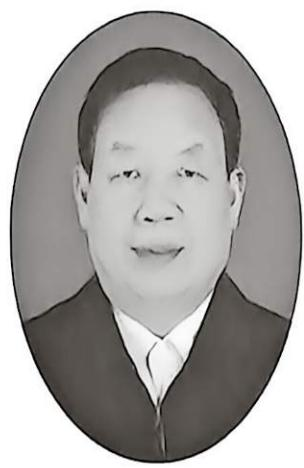

# 作者简介

潘存云，1955年生，博士，原国防科技大学教授，博士生导师。享受国务院特殊政府津贴、军队优秀专业技术人才一类岗位津贴，荣获全国模范教师、军队院校育才奖金奖等称号。社会兼职有：原教育部机械基础课程教学指导委员会副主任委员，中国机构学专业委员会委员，中国现代设计法研究会理事，中国机械工业教育协会高等学校机电类学科教学委员会委员，全国高等教育机械原理课程研究会委员。在国防科技大学担任机械设计系列课程岗位责任救援期间，带领团队完成了“机械设计基础”“工程制图基础”国家精品课程、

“国家级精品资源共享课”建设，主讲的“千年机械话创新”入选国家级精品视频公开课。主讲“机械原理”“机械设计基础”“机器人操作手”“机械 CAD”“工程设计基础”等课程。科研方向包括：机器人机构学、新型机械传动、数字化设计与制造、无人智能装备等理论研究与技术开发。负责完成科研项目 36 项，其中省部级和国家级项目 22 项，参与完成了 2008 年第 29 届北京奥运会和第 13 届残奥会开闭幕式舞台美术装备的研制工作。获国家技术发明四等奖 1 项，省部级科技进步一等奖 1 项、二等奖 2 项、三等奖 1 项，中国发明协会金奖 2 项、银奖 1 项，获发明专利授权 120 多项，发表学术论文 180 余篇。在学术研究方面取得了以“球齿轮机构”“机器人柔性手腕机构”“变异型剪叉式机构”“活塞式发动机新型功率传输机构”为代表的若干原创发明成果。出版学术著作和教材 10 部，其中国家级规划教材 2 部，获国家级优秀教材一等奖 1 项，军队级和省级教学成果一、二等奖 3 项。指导学生参加学科竞赛获全国一、二等奖 5 项，培养硕士和博士研究生 71 名。因在工作中作出了突出贡献，十个月内两次受到习近平主席亲切接见。

2016 年从国防科技大学退休后投身到创新创业大潮中，先后担任多家集团公司的 CTO，现任龙合智能装备制造有限公司总工程师。负责完成了多种非标自动化产线、智能物联安全锁具、新一代大容量智能快递柜、超大容量智能零售柜、系列化智能无人装卸车系统等 20 多款智能无人装备的研发和产业化工作，顺利完成了从教育领域到工程领域的跨界转型。
