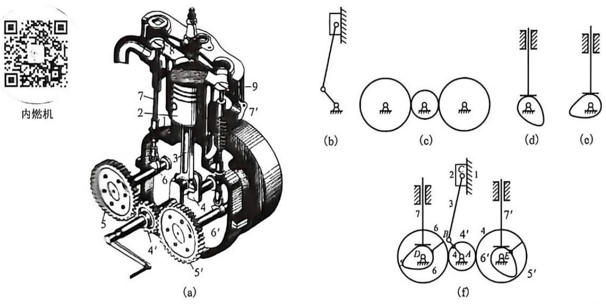
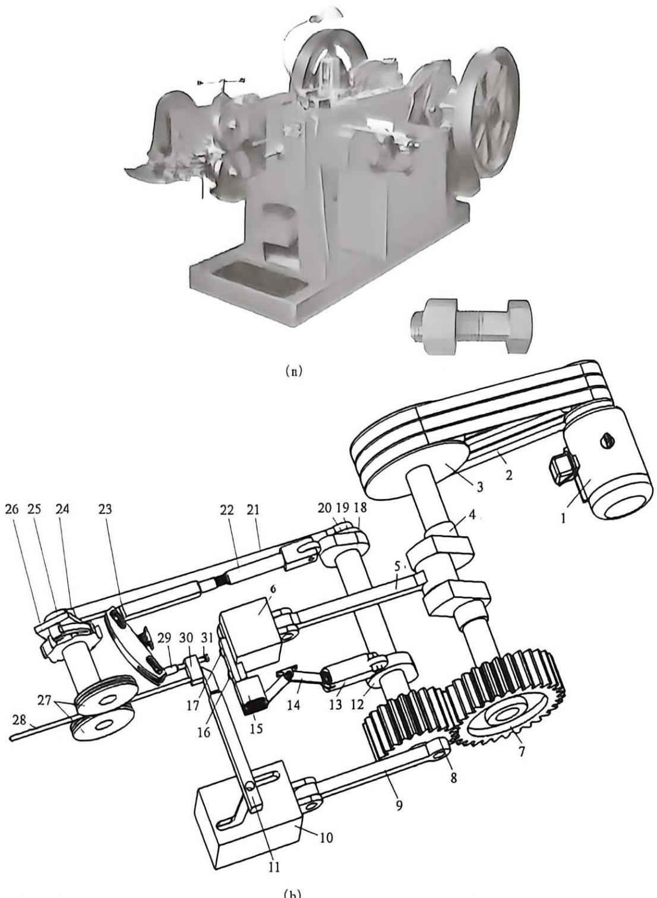
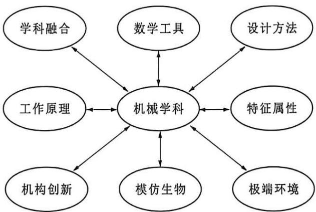
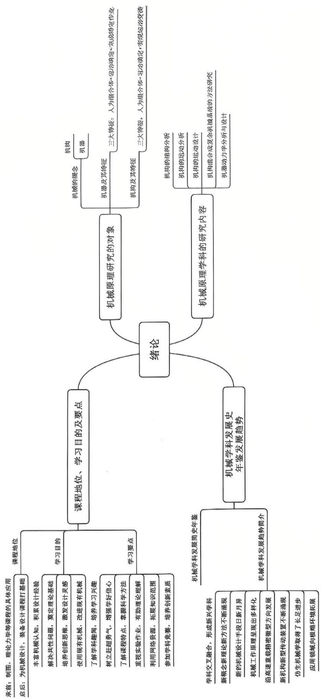

# 第1章 绪论

【概述】

◎本章主要介绍本课程的研究对象——机械、机器和机构的基本概念。

◎本章还介绍本课程的研究内容、性质、学习要点和任务等。

## 1.1 机械原理研究的对象及内容

本课程名称为机械原理，其中包含两层含义：其一，本课程的研究对象是“机械”；其二，本课程的研究内容是机械之“原理”，如机械的组成原理、分析原理、设计原理等。

### 1.1.1 机械的概念

什么是机械呢？机械（machine，machinery），源自希腊语mechine及拉丁文mechina，原意指“巧妙的设计”。传统的“机械”是一个古老的概念，可以追溯到古罗马时期，主要指人们为了满足人类社会自身生产和生活需求而发明的，较

之手工工具更为复杂、能完成特定作业的动作的一类实物装置。传统意义上的机械主要用来代替人类的手工劳动，可理解为人之体力的延伸。人类社会经历了基于蒸汽机的机械化时代、基于电动机的电气化时代和基于计算机的信息化时代三次工业革命的洗礼，目前已快速进入了基于人工智能的智能化时代。机械也正在经历从传统机械过渡到现代机械的转变。现

代机械本质上是将其他相关学科领域不断出现的新技术与传统机械进行有效的融合，形成一个包含光、机、电、气、液、磁等功能部件，在控制器的统一协调控制下，能灵活实现多种复杂动作，并完成物质流、能量流、信息流传递与转换任务的智能实物系统。现代机械不仅是人之体力的延伸，更是人脑智力的延伸。

从发展的眼光来看，任何机械产品都经历了由简单到复杂的演变过程。例

如起重机就经历了以下发展阶段：斜面→杠杆→起重轱辘→滑轮组→手动葫芦→现代起重机（包括龙门吊、鹤式吊、汽车吊、卷扬机、叉车、电梯等）。只要人类社会不停止发展的进程，人们对各种原有机械产品的改进升级和各种新机械的创新设计活动就永远不会停下来。各种新机械的不断涌现，对人类社会的

发展产生了巨大的推动作用。

从机械原理学科研究的内涵而言，一般认为机械包含机器与机构两部分。

### 1.1.2 机器及其特征

对机器一词，人们几乎耳熟能详，在日常生活或工作中，我们会接触到许多不同种类的机器。例如，为各种装备提供动力来源的动力机器，如水轮机、蒸汽机、内燃机、风力发电机、磁力发电机等；为人类日常生活带来极大方便的各种家用电器，包括空调、洗衣机、缝纫机、绞肉机、榨汁机，以及其他具有运动部件的各种小家电等；娱乐健身用的自动发牌机、麻将机、保龄球机、跑步机、发

球机、多功能健身器等；在工业部门中广泛使用的各种金属切削机床，如车床、铣床、刨床、磨床、钻床等；各种农机设备，如拖拉机、播种机、耕作机、收割机等；各种运输设备，如汽车、火车、磁悬浮列车、船舶、电梯等；各种轻工设备，如包装机、吹瓶机、清洗机、灌装机等；各种化工设备，如蒸馏塔、反应釜、分离机、输送机等；各种食品机械，如脱水机、造粒机、烘干机、榨油机、脱粒机、磨粉机等；各种建筑设备，如打桩机、旋挖机、搅拌机、压路机、铺路机、盾构机等；各种矿山设备，如挖掘机、铲运机、装载机等；专门用来处理信息的机器，如数码摄像机、照相机、打印机、绘图机、复印机、刻录机、传真机、阅卷机等。本课程所指的机器，泛指人们根据某种作业要求而设计的实物系统，具有广义而抽象的含义，它既包含了世界上所有的机器，而又非特指某一种具体的机器。那么，这种抽象的机器具有哪些共有特征呢？下面分别以工程上广泛应用的内燃机和冷镦机为对象进行剖析。

图 1-1 为在工农业领域广泛使用的四冲程单缸内燃机，其包括气缸体 1、活塞 2、连杆 3、曲轴 4、齿轮 4'、5、5'、凸轮 6、6'、进、排气阀顶杆 7、7' 等主要部件。由物理学知识可知，四冲程单缸内燃机工作过程分为进气、压缩、爆炸、排气四个阶段，在一个完整的运动循环中，曲轴旋转 $720^{\circ}$ 共两圈，对应各主要活动组件的运动如表 1-1 所示。各活动组件之间的运动关系必须严格协调一致，否则就不能完成正常的工作循环，也就不能实现将燃料中的化学

图1-1 立式单缸内燃机
{: .figure-caption }

1—气缸体；2—活塞；3—连杆；4—曲轴；4'、5、5'—齿轮；6、6'—凸轮；7、7'—顶杆；8—进气阀；9—排气阀。

能转换成曲轴输出的机械能的功能。

表 1-1 四冲程单缸内燃机各主要活动组件的运动

<table><tr><td>工作循环</td><td>进气</td><td>压缩</td><td>爆炸</td><td>排气</td></tr><tr><td>曲轴转角</td><td> \(0^{\circ} \sim 180^{\circ}\) </td><td> \(180^{\circ} \sim 360^{\circ}\) </td><td> \(360^{\circ} \sim 540^{\circ}\) </td><td> \(540^{\circ} \sim 720^{\circ}\) </td></tr><tr><td>活塞</td><td>下行</td><td>上行</td><td>下行</td><td>上行</td></tr><tr><td>进气阀</td><td>打开</td><td>关闭</td><td>关闭</td><td>关闭</td></tr><tr><td>排气阀</td><td>关闭</td><td>关闭</td><td>关闭</td><td>打开</td></tr><tr><td>小齿轮</td><td colspan="4">旋转两圈</td></tr><tr><td>大齿轮</td><td colspan="4">旋转一圈</td></tr></table>

图 1-2(a) 是目前工程上应用最广泛的双击式冷镦机，这是一种高效率镦造螺母、螺钉头、铆钉等连接件的自动化生产机器，图 1-2(b) 是其简化的传动机构示意图。双击式冷镦机的工艺过程包括进料→切断→送坯→镦锻→顶出五个动作，而这五个工艺动作分别由多种机构组成的五条传动路线来实现。该机器的工作原理分别描述如下：

(1) 主传动系统完成镦制动作: 电动机 1 的输出轴端带轮通过带传动 2 驱动飞轮 3 和曲轴 4 旋转, 曲轴 4 通过连杆 5 带动滑块 6 做往复直线移动, 从而实现大功率的镦制动作。

(2) 送料系统完成原料棒的间歇式送进动作: 安装在曲轴端部的主动齿轮 7 驱动从动齿轮 8 旋转, 并带动二轴 18 和送料偏心轮 20 一起转动, 通过右侧连杆 21 带动棘爪摆杆 24 做往复摆动, 棘爪 25 驱动棘轮 26 做间歇转动, 驱动送料轮 27 带动原料棒 28 完成原料棒的送进动作。

(3) 切料系统连续完成原料棒的切断动作: 固联在从动齿轮 8 上的偏心轮通过左侧连杆 9 驱动移动凸轮 10 做往复移动, 迫使切刀杆 11 做直线移动, 完成对原料棒的切断动作。

(4) 双工位控制系统完成初镦和精镦双工位模具切换动作：二轴 18 带动换模凸轮 12 连续旋转，驱动推杆 13 做直线移动，以及摆杆 14 做往复摆动，带动冲模架 15、初冲头 16、光冲头 17 做直线移动，完成初镦和精镦双工位模具切换动作。

(5)工件顶出系统将加工好的工件从模具顶出, 完成卸料动作: 二轴 18 带动卸料凸轮 19 旋转, 驱动推杆 22 做直线移动, 带动摇杆 23 做摆动, 然后再带动顶出器 29 做直线移动并将工件 31 顶出, 从而完成工件卸料动作。

上述五个动作中，各部分必须相互配合与协调，对应各主要活动组件的运动时序，如表 1-2 所示。显然，各部件的运动必须严格协调一致，如果其中一个部分出现故障，就会发生模毁机损的安全事故。

1—电动机；2—带传动；3—飞轮；4—曲轴；5—连杆；6—滑块；7—主动齿轮；8—从动齿轮；9—左侧连杆；10—移动凸轮；11—切刀杆；12—换模凸轮；13—推杆；14—摆杆；15—冲模架；16—初冲头；17—光冲头；18—二轴；19—卸料凸轮；20—送料偏心轮；21—右侧连杆；22—推杆；23—摇杆；24—棘爪摆杆；25—棘爪；26—棘轮；27—送料轮；28—原料棒；29—顶出器；30—凹模；31—工件。

图1-2 二模三冲多工位紧固件冷镦机
{: .figure-caption }

表1-2 双击式冷镦机各主要活动组件的运动时序

<table><tr><td>主曲轴转角</td><td colspan="7"> \(0^{\circ}\)  90° 180° 270° 360°</td></tr><tr><td>送料</td><td>送</td><td colspan="6">静止</td></tr><tr><td>切断</td><td></td><td>切断</td><td colspan="5"></td></tr><tr><td>镦头滑块</td><td colspan="3">前行</td><td>镦制</td><td colspan="3">返回</td></tr><tr><td>顶出器</td><td colspan="5">静止</td><td>顶出</td><td>返回</td></tr></table>

从以上两种典型机器实例可以看出，尽管它们所具有的功能、结构、性能、用途等都不一样，但仍然具有以下共同的特征：

(1)机器是一种人造实物组合体，而非自然形成的物体。

(2) 组成机器的各活动部分之间具有确定的相对运动关系。

(3) 必须做有用功，完成能量、物料、信息的变换或传递。

按机器所起作用的不同，可把机器分为原动机和工作机两类。其中原动机是用来实现能量转换的机器、如内燃机、外燃机、旋转电机、直线电机、超声波电机、压电陶瓷驱动器、超磁致微制动器、水轮机、风轮机、汽轮机、气动缸、液压缸等，其种类有限；而工作机则是用来完成某种特定作业的机器，如缝纫机、冷镦机、输送机、起重机、各种机床等，工作机的种类繁多，数不胜数。

### 1.1.3 机构及其特征

从机器的构成要素来看, 现代机器无论其结构和动作多么复杂, 都可分解为若干组能实现简单动作的运动转换单元, 把这种运动转换单元称为机构。换句话说, 机器是由若干组机构按照一定规律组合而成的。根据机器复杂程度的不同, 组成机器的机构数目不同。例如, 最简单的机器是电动机, 它是由定子和转子构成的一个双杆回转机构。而如图 1-1 所示, 内燃机中就包含了三种不同的机构, 其中, 如活塞-连杆-曲轴-气缸体组成了一种所谓的连杆机构, 它的作用是把燃烧气体推动活塞产生的直线移动转换为曲轴部件的连续旋转运动, 即把往复直线运动转换为连续旋转运动; 又如凸轮-顶杆-气缸体则组成了凸轮机构, 其作用是精确控制进、排气阀的启闭时间, 即把连续旋转运动转换为往复直线移动; 而大、小齿轮则组成了一种齿轮机构, 它的作用是将曲轴的旋转速度降低一半后驱动凸轮轴旋转, 且两者旋转方向正好相反, 即实现变速及换向传动。再比如冷镦机中的摇杆-棘爪-棘轮组成了一种棘轮机构, 用来控制螺栓棒料的间歇送进, 即该机构能实现把摇杆的往复摆动转换为送料轮的间歇转动。此外, 冷镦机还包括五组连杆机构、一组齿轮机构、三组凸轮机构等。工程上此类情况还有很多, 在此不一一列举。

以内燃机中的连杆机构为例，它包括了曲轴、连杆、活塞三个活动实体及气缸体这一起固定支撑作用的实体体，而且曲轴、连杆、活塞三个活动实体之间的运动位置关系是一一严格对应的。换句话说，连杆的空间位置和曲轴的转角位置由活塞的位置唯一确定。如果分析上述其他种类的机构，同样会发现其中的活动实体之间的运动位置关系也是唯一确定的。因此，不难归纳出机构具有如下共有特征：

(1)机构是一种人造实物组合体，而非自然形成的物体。

(2) 组成机构的各活动部分之间具有确定的相对运动关系。

(3) 机构能把一种运动形式转换成另外一种运动形式，或者实现力的传递。

按机构应用范围，可将机构分为通用机构和专用机构两大类。通用机构的用途广泛，如连杆机构、凸轮机构、齿轮机构等。而专用机构只能用于特定场合，如钟表的擒纵机构。本课程只研究通用机构。

如果把机器比作一座建筑物的话，那么机构就好比是其中的砖、瓦、门、窗、梁等基本建筑元素，建筑物的功能、形态可能千差万别，但基本建筑元素的种类却是极其有限的。机构亦是如此，其种类不多，但由它们构造出来的机器种类却数不胜数。

比较机器与机构的特征，可知两者的前两个特征是相同的，仅作用不同而已。若从结构和运动的观点出发，两者并无实质性区别，因此，工程上常把机器与机构统称为机械。

由以上分析，可以给出机构和机器完整的定义如下：

机构——能实现预期运动或实现力传递的人造实物组合体。

机器——能实现预期运动并完成特定作业任务的机构系统。

如图 1-3 所示，按机械各部分所起的作用，工作机械一般划分成如下几个功能模块：

图1-3 工作机械的功能模块划分
{: .figure-caption }

原始动作部分——为机械正常工作提供动力来源，最常见的原动机是电动机和内燃机。

执行工作部分——完成预定的作业动作，一般位于传动路线的终点。

传递运动部分——将原动机和执行工作机构连接起来的中间部分，用来实现运动传递或变换。

控制调节部分——根据传感器监测到的机械运转状态和实际作业要求对机械适时发出启动、停止、变速、换向等控制指令，其操作方式可以是机械式、电子式、计算机控制等形式。

以全自动洗衣机为例, 其中原动机为电动机, 传动系统包括带传动和减速器, 波轮用来执行洗衣工作, 单片机系统则用来实现对洗衣机的全自动控制。

## 1.2 机械原理学科的研究内容

本课程以机械为对象，对如下内容展开研究。

### 1. 机构的结构分析

首先，要研究机构中的多个实体体是按何种方式组合在一起的，即机构的组成要素；其次，要研究这些实体体组合在一起之后，是否还能运动，进而研究在什么条件下能保证实体体之间具有确定的相对运动，即机构的可动性及具有确定运动的条件；再次，为了将机构从实际形态中抽象出来，必须研究如何用简单的图形符号表示实际结构复杂的机械，即机构运动简图的绘制方法；最后，为便于设计新机构和建立通用的运动分析方法，就要研究机构的结构分类及机构的组成规律。

### 2. 机构的运动分析

要了解所设计的机械是否满足预定的运动特性要求，就必须对机构进行运动分析，所以要研究机构上某些特殊点的位置、速度、加速度，以及某些部件的角位置、角速度、角加速度等运动参数的基本求解原理和方法。这是改善原有机械性能和设计新机械的重要步骤之一。

### 3. 机构的运动设计

任何复杂的作业任务最终都可分解成一连串的简单动作，而这些简单动作的最终实现都是由机构来完成的，因此，探索常用机构的运动设计方法，以及如何根据具体的运动要求来设计常用机构是本课程的重要内容之一。

### 4. 机构组合成复杂机械系统的方法研究

一方面，任意复杂的机械系统都是由若干机构组合而成的；另一方面，每种常用机构都有自己特定的运动转换模式，因此，按照何种方法来选择若干合适的机构并将它们进行有机组合才能实现预定的作业要求，值得全面、深入研究。这些方法包括：如何根据作业任务拟定机械的工作原理；根据工作原理的运动特点进行运动分解，并建立各分解运动之间的协调关系，即运动循环图；如何根据分解运动特点选择合适的机构类型，即机构类型综合；根据执行机构的运动特点选择合适的原动机；拟定运动传递路线，确定机构的组合方式；对机械系统运动方案进行评价；等等。

### 5. 机器动力学分析与设计

运动副中反力大小和方向是决定运动副元素摩擦、磨损状态的重要因素，进而直接影响到机械效率的高低，因此，必须对各种运动副中的反力及其方向进行研究；惯性力和惯性力矩是机械变速运动产生的必然结果，它是影响机械运动状态、动力性能，甚至工艺过程的重要因素，因此，必须研究惯性力的产生原因、分布规律、计算方法，并研究使惯性力和惯性力矩平衡的方法；作用在机械上的力是影响机械运动性能的主要因素，有必要研究分析机械在外力作用下的真实运动规律和速度波动问题，并研究采取增加飞轮的方法对速度波动范围进行调节，以降低速度波动带来的不利影响。所有这些是保证所设计机械系统的动态工作特性能满足实际需求的重要理论基础。

## 1.3 本课程的地位、学习目的与学习要点

### 1.3.1 机械原理课程的地位

本课程是各高等院校机械类专业本科生必修的一门主干技术基础课。它在教学计划中起承上启下的作用，占有十分重要的地位。一方面，机械原理课程的知识体系建立在高等数学、普通物理、机械制图和理论力学等先修课程的理论基础之上；另一方面，本课程的许多理论知识又直接为学习机械设计及有关专业课等后续课程打好理论基础，使学生受到必要的基本技能和创新思维的训练。研制一种新的机械设备，要经过工作原理的拟定、运动方案设计、本体结构设计、制造工艺编程、加工、安装、调试等诸多环节，涉及机械原理、机械设计、工程力学、材料学、制造工程学等多门学科理论知识的综合应用，其中工作原理的拟定和运动方案设计属于本课程需要解决的内容范畴，因此，机械原理课程的知识无疑是基本而重要的。

### 1.3.2 学习目的

本课程的总任务和目标是使学生掌握机构学和机械动力学的基本理论、基本知识和基本技能，并初步具有拟定机械运动方案、分析和设计机构的能力。学习本课程的目的主要体现在如下几个方面。

#### 1. 便于认知世界上现有丰富多样的机械产品，为机械设计工作积累经验

有人说，机械设计工程师就像医生一样，越老越有价值。这种说法虽不一定科学，但从侧面反映了在机械设计过程中，个人的设计经验具有举足轻重的作用。当然，设计经验不可能从天上掉下来，也不可能自己跑到人们的头脑中去，靠的是平时的积累，除了要多参与机械设计工作之外，更多的经验来源于对世界上现有机械产品的认知过程。只有掌握了本课程有关机构分析的基本原理和方法，才可以对现有的各种具体机械展开深入研究，了解其工作原理，分析其结构特点，剖析其巧妙之处，学习他人的经验，使其服务于自己的设计工作。

#### 2. 重点解决机械的共性问题，为后续学习专业机械课程奠定理论基础

世界上所有的机械产品都是人们为了满足社会和人类需求而创造出来的，它们种类繁多，功能各异，外观结构差异很大。因此，为了培养各机械行业的专门人才，在高校中设置了相应的专业课程，例如，为内燃机专业学生开设的《内燃机原理与构造》，为汽车专业学生开设的《车辆底盘结构》等课程。对某一种具体机械展开深入研究，一般可将其研究内容分解为该机械独有的特殊问题和所有机械的共性问题两大部分，专业课程往往只研究该机械独有的特殊问题，而所有机械的共性问题则是机械原理课程的研究范畴。共性问题是研究专业问题的基础，不打牢理论基础，就不能顺利进行专业课程的学习。

#### 3. 培养学生的创新思维，激发机械创新设计灵感

习近平总书记强调：创新是引领发展的第一动力，是建设现代化经济体系的战略支撑。在党的二十大报告中，习近平总书记又提出：必须坚持科技是第一生产力、人才是第一资源、创新是第一动力。创新人才的培养是实现科技强国和人才强国战略的重要途径。制造业的核心就是创新，其基本特征是制造大量原创性产品，以更好地满足人们对美好生活的需求。而新产品的设计必然要依靠一大批具有创新思维和创新精神的工程技术人员去完成。机械原理课程围绕机械系统方案设计这一中心主题，通过介绍机械共性的基础理论知识、机构设计的基本原理与方法、机构变异演化与组合的创新设计规律等内容，达到培养学生的创新思维和能力，使学生掌握机械系统方案设计技能的目的。

#### 4. 为现有机械产品的合理使用和革新改造打基础

高校培养的机械专业创新型人才，除了一部分从事新产品的设计开发工作之外，相当一部分毕业生将从事与现有机械装备直接相关的诸如操作、使用、试验、维护保养等技术工作。具备了机械原理的知识，就可以快速了解机器的性能和特点，熟练、正确地操作机器，使机器处于最佳工作状态，发挥出最大效益，并且避免事故的发生；试验过程中，可以快速、准确获取机械装备的试验数据，通过分析对机械工作性能做出正确的评价；维护保养工作是确保机器在生命周期内正常工作必不可少的重要环节，机械原理课程知识将有利于对机器工作状态进行评估，及时找出故障部位和原因，制定维修方案，尽快恢复机器的正常工作；甚至在维修过程中会发现机器的设计缺陷，从而进行技术革新。另外在消化吸收国内外引进的先进技术时，为了规避全盘照抄、仿制可能带来的专利侵权纠纷，也需要对现有机械中的专利保护部分进行替代性设计。由此可知，机械原理的知识是非常重要的。

### 1.3.3 学习要点

机械原理课程是一门技术基础课程，与过去学过的基础理论课程的特点有所不同，因此在学习过程中应注意以下学习要点。

#### 1. 通过了解机械学科发展史和发明家的趣闻轶事，培养学习本课程的兴趣

兴趣是一个人力求认识并趋向某种事物特有的意向，是个体主观能动性的一种体现。大教育家孔子认为：“知之者不如好知者，好知者不如乐知者。”美国心理学家和教育家布鲁纳说：“学习的最好刺激，乃是对所学材料的兴趣。”伟大的科学家爱因斯坦有句至理名言：“兴趣是最好的老师。”心理学家的大量研究成果表明：一个人一旦对某事物产生了浓厚的兴趣，就会主动去求知、去探索、去实践，并在求知、探索、实践中产生愉快的情绪和体验，兴趣对于开发机械创新设计潜能具有极其重要的作用。机械学科是一门非常古老的学科，自从人类学会制造和使用工具起，它就伴随人类社会的前进步伐而不断向前发展。尤其是在近代历史上，以爱迪生为代表的一大批发明家为满足人类的需要完成了许许多多的伟大发明，他们的发明经历中有许多生动而有趣的传奇故事，他们的精神无疑对后人具有强烈的激励作用，是后人学习的楷模。一件成功的机械创新设计作品虽然是多门课程知识综合运用的结果，但《机械原理》课程的知识在方案设计中无疑具有不可替代的重要作用。

#### 2. 要有敢于超越前人的信心与勇气，增强学好本课程的信心

许多成功人士都有这样一种体会：在走向成功的路上，我们可以缺少任何东西，但就是不能缺少一样东西，那就是自信。发明大王爱迪生说过：“自信是成功的第一秘诀。”通过本课程的学习，达到培养学生初步具有机械创新设计能力的目标。机械创新设计作为工程领域从事发明创造的实践性活动之一，没有自信心是绝对不行的。机械学科本身的发展充满了曲折和艰辛，世界上永远不会有十全十美的机械产品，机构学理论也需要后人的不断完善和创新，这些都为广大从事机械创新设计的技术人员提供了施展才华的广阔舞台。作为一名现代大学生，要有超越前人的雄心壮志，肩负起改造世界、推动社会进步的历史责任。学好本课程，个人的自信心非常重要，在此奉献给读者三句话：

发明创新不仅是发明家的本事，人人都具有发明创新的潜能。

发明创新来源于生产生活实际，处处存在着发明创造的机遇。

发明创新不受时间与年龄限制，漫漫人生皆可完成发明创造。

#### 3. 深入了解本课程特点，掌握科学的学习方法

要学好本课程，光有兴趣和自信心是不够的，还要掌握科学的学习方法。本课程具有“三强四多”的特点，“三强”是指实践性强、综合性强、独立性强，“四多”是指内容多、概念多、符号多、公式多。根据这些特点，学习时应重点把握以下几个方面。

(1)着重搞清楚基本概念, 理解基本原理和掌握基本方法。基本原理如机构演化原理、功能转换原理、动力等效原理、相对运动不变性原理、共轭包络原理等。基本方法如杆组拆分法、转换机架法(反转法)、图解法、解析法、试验法等。这些原理和方法是机构分析与综合的有力工具。

(2) 注意把一般性原理和方法与具体运用密切联系起来, 从机构学的角度观察日常生活与生产遇到的各种机械, 运用所学理论知识去分析和解决工程实际问题。

(3) 学习本课程时, 要综合运用其他课程已学过的知识。其部分内容与理论力学直接有关, 是理论力学的延续与扩展 (指用理论力学的原理分析具体的机械)。因此, 一定要复习理论力学中的有关内容, 如运动学、摩擦学、力系分析、功能原理等。

(4)注意培养综合分析、全面考虑问题的能力。解决同一实际问题，往往有多种解决方案，不同的方案各有优缺点、要善于归纳总结各种方案的优缺点，通过分析、对比、判断和决策，反复斟酌，优中选优。

(5)注意培养科学严谨、一丝不苟的工作作风。当大学生完成学业，毕业之后走向工作岗位成为一名工程技术人员时，必然要参与机械装备的设计、使用、维护、试验等具体工作，稍有不慎，哪怕是一个微不足道的设计错误，都有可能造成重大损失，甚至要承担法律责任。

#### 4. 参与实验和完成作业，加深理论知识的理解

开设本课程实验的目的是，培养大学生实事求是的科学态度，理论联系实际的工作作风，严谨认真的工程素养，视野开阔的创新思维，使大学生初步掌握应用书本理论指导解决工程实际问题的方法，强化动手实践能力。完成适量的作业题是很有必要的，通过求解作业题可以加深理论知识的理解。值得注意的是，做作业前应重点复习有关例题，归纳总结解题思路与方法，从中得到启发、以达到举一反三的效果。

#### 5. 充分利用网络教学资源，拓展个人知识面

在信息呈爆发式增长的今天，互联网已经成为影响社会的重要连接纽带。近年来，教育部实施了教育质量工程，以精品课程建设为目标的教学改革活动在国内各高校中开展得如火如荼、精品课程自然是课程中的精品，它凝聚了教学名师们几十年的教学智慧与经验。每门精品课程都建有自己的课程网站，其中包含了大量与课程学习密切相关的有用信息，诸如课程学习指南、课堂教学素材、虚拟模型动画、典型工程案例、典型例题详解、先进教学理念、学习心得体会等。要学会利用网络教学资源为本课程学习服务。

#### 6. 积极参加学科竞赛，全面培养机械创新设计的综合素质

教育部主办的全国大学生机械创新设计大赛是以提高大学生机械设计能力、实践操作能力、综合创新能力的竞赛活动，该活动已经成为每两年一次的全国大学生相互切磋技艺和学习观摩的盛会。举办全国大学生机械创新设计大赛活动的目的是引导高等学校在教学中注重培养大学生的创新设计能力、综合设

计能力与团队协作精神；加强学生动手能力的培养和工程实践的训练，提高学生针对实际需求进行机械创新思维、设计、制作等实际工作能力，吸引、鼓励广大学生踊跃参加课外科技活动，为优秀人才脱颖而出创造条件。另外，由共青团中央等部门主办的全国大学生课外学术科技作品竞赛(简称“挑战杯”)也成为大学生展现自我专业知识和创新思维能力的重要舞台。大量实例证明，参与学科竞赛对于激发大学生的创新思维、训练动手能力、锻炼科技报告的写作水平等综合素质具有不可替代的作用，获奖学生已成为企业争先录用的优秀人才。学科竞赛活动受到大学生们、高等院校、用人单位等社会各界的普遍欢迎，目前，高校大学生参加各类学科竞赛的积极性空前高涨。根据笔者指导学生参赛的经历，参加学科竞赛时要把握以下要点：激发兴趣，积极参与、明确方向、瞄准目标、制定方案，集思广益、强化技能，动手实践、善于总结、形成理论。

作为老一辈的科技和教育工作者，笔者再次奉献给读者六句话与大家共勉：

人类社会的需求永无止境，需要我们勇于探索、不断创新。

世上万物不可能尽善尽美，需要我们不断完善、推陈出新。

历史发展永远都不会停止，需要我们跟上时代步伐、与时俱进。

身为技术人员的责任心，是驱使我们勤奋工作、永不停歇的动力。

怀有浓厚兴趣的好奇心，是吸引我们不断探索、勇于创新的源泉。

具备不断进取的好胜心，是鞭策我们精益求精、尽善尽美的关键。

## 1.4 机械学科发展史年鉴及发展趋势

### 1.4.1 机械学科发展史简介

对于机械工程学科专业的大学生来说, 了解机械学科的发展历史对于今后从事的科学研究工作是很有帮助的。本书附录 1 罗列了人类社会几千年来在机械科学领域取得的标志性成果。

### 1.4.2 机械学科发展趋势简介

随着微电子技术、光技术、信息技术、自动控制技术、计算机技术、生物技术等新兴技术的崛起，人类社会正被快速推向一场以信息化为特征的新技术革命进程之中。作为向各行各业提供装备的机械工业也正在经历从传统机械过渡到现代机械的转变，伴随这种转变的不仅是机械学科与其他学科的交叉融合日益增强，同时机械学科各个专业领域也得到了迅猛发展。如图1-4所示为现代机械学科发展的一些主要方面，以下将就这些方面的发展趋势做一简单概述。

图1-4 机械学科的发展方向
{: .figure-caption }

1. 与其他相关学科的交叉融合日益明显, 形成了多个交叉边缘的新兴学科

人类社会正快速进入以人工智能为标志的第四次工业革命时期，现代机械的内涵也发生了相应的变化，传统意义上的纯机械产品越来越少，更多的是机械学与其他各种新兴学科结合的产物，由此诞生了一批新兴学科。例如，机械学与电子学的交叉融合形成了机械电子学；机械学与生物学和材料学的交叉融合，诞生了仿生机械学；机械学与信息科学和控制论的结合诞生了机器人机构学；机械学与计算机学科的融合诞生了 CAX（CAD/CAE/CAM/

CAPP/CAT)技术，括号中的英文简写分别为 CAD——计算机辅助设计、CAE——计算机辅助工程分析、CAM——计算机辅助制造、CAPP——计算机辅助工艺设计、CAT——计算机辅助测试。其中，CAD 技术被评为人类 20 世纪最杰出的工程成就之一。

#### 2. 各种新概念、新理论、新工具不断涌现，促进了机构学各专业领域的快速发展

机构学的理论研究从来就离不开各种数学工具。近年来，各种新的数学工具不断被应用于机构运动分析，尤其是空间机构的运动分析、例如矢量法、张量法、矩阵法、对偶数法、四元数法、旋量计算法等。另外，在机构的结构理论方面利用应用图论、网络理论、线形几何学、螺旋坐标等一些新的数学工具和计算技术来研究轮系的类型综合及运动分析和力分析问题也得到大力开展，并取得一些成绩。从机构学理论的发展历程来看，一种新的数学工具的诞生往往能促进机构学某一专业领域的快速发展。

#### 3. 新的机械设计手段日新月异

伴随着计算机硬件技术、大规模并行算法、数值计算方法和计算机图形学等领域的快速发展，机械设计手段也取得了巨大进步。工程界从传统的手工绘图全面过渡到计算机辅助二维绘图和三维造型设计，另外一些新的设计理念和手段，如广义优化设计、概率设计、综合设计、三次设计、并行设计、智能设计、虚拟设计、网络设计、绿色设计、定制设计、非线性动力学设计、多变量多约束设计、机电耦合设计等正在逐步应用到机械产品的设计过程中。

#### 4. 机械产品工作原理呈现多样化趋势

机械产品工作原理呈现多样化趋势主要体现在两个方面：一方面，完成相同功能的机械产品采用完全不同的工艺原理来实现；另一方面，同一种技术被用于设计不同功能的机械产品。例如，切割机是一类工程上应用广泛的将物质材料从母体上分离出来的机器，针对不同材质相继出现了基于不同工艺原理的切割机器，如各类刃具切削机床、磨粒锯片切割机、激光气化切割机、水射流切割机、超声波切割机、等离子切割机、电火花线切割机、气体火焰切割机、冷脆断切割机、柔带切割机等。再比如，随着超声波技术的发展，在不同的应用领域内陆续涌现了许多基于超声波原理的机电设备，不需要任何洗涤剂的超声波清洗机、超声波焊接机、超声波鱼群探测仪、超声波精密拉丝机、超声波金属熔化机、超声波研磨机、超声波医用诊断仪（B超机、彩超机）、超声波洁牙机、超声波钻孔机、超声波定位仪、超声波流体参数测量仪、超声波雾化加湿机、超声波声学透镜、超声波探伤仪、超声波振动时效机、超声波电机等。

#### 5. 现代机械产品正朝着高速、重载、精密、微型化方向发展

高效率的产品生产过程是人类永远追求的目标，高效率需要机器的高速运转来保证。目前，在工程界许多领域中应用的机械速度已达到了令人叹为观止的程度。例如，在交通领域，上海市投入运营的磁悬浮列车的设计速度高达430 km/h，被称为“零高度”飞行器。在轻工机械领域，最早的卷烟机生产率只

有 60 支/min，而现在的香烟卷接机组的生产效率高达 20000 支/min，烟丝运行线速度为 20 m/s。目前国产齿轮线速度达到了 180 m/s，转速高达 67608 r/min。电子工业 PCB 板数控打孔机主轴转速高达 200000 r/min。高速机械的出现极大地促进了机械动力学的发展。

目前, 世界上最大的油轮载重量为 $564763 \mathrm{t}$ , 最大的游轮长 $360 \mathrm{~m}$ , 宽 $65 \mathrm{~m}$ , 高 $72 \mathrm{~m}$ , 2800 间客房, 近 6000 个床位, 5 个标准游泳池, 4 个大型超市, 15 个餐厅和酒吧, 是一座名副其实的海上移动城市; 最大的船用柴油机单机功率高达 80056 千瓦; 最大的民航飞机 A380载客人数高达840人, 起飞重量达560t, 机翼面积达845m²; 最大的货运飞机AN-225, 起飞重量可达620t, 净载重量可达250t, 一次可装载80辆轿车, 全球仅此一架; 张家界百龙天梯是目前世界上升程最高、运行速度最快、载客量最大的户外观光电梯, 不到2min即可将游客从山脚下输送到垂直高度达380m的山顶, 每小时载客量超过3000人; 重载列车牵引吨位每列高达20000t; 最大的矿山汽车载重量可达250t; 最大的起重机起吊重量可达20160t; 最大的油压机自身重3000余t, 高度达到了24m, 其中一个螺母的重量就达到了6t, 它产生的压力吨位高达16500t, 能把近1000t重的钢锭像揉面团一样实现锻压加工。

机械产品的精密化主要体现在两方面：一是零件本身制造精度达到很高的精度等级；二是机械中执行机构能实现精密的运动定位。目前，超精密加工获得的零件尺寸和位置精度为0.01\~0.3 μm，形状和轮廓精度为0.003\~0.1 μm，表面粗糙度Ra<0.01 μm；高精度的数控机床可以保证零件的尺寸加工精度稳定达到1 μm；齿轮的最高加工精度达到了DIN 2级标准；而采用压电陶瓷驱动器的执行机构直线定位精度可达纳米级；角度定位精度可达秒级；用于远程精确打击的武器命中精度已经达到米级范围。

随着光刻加工、电子束直写、电化学腐蚀加工、镀膜积层法等精密加工技术的成熟, 机械装备的微型化趋势日益明显, 并形成了一门新的机构学分支——微纳机械与制造技术MEMS。目前, 微纳技术的发展方向主要集中在纳米粒子获取和微纳结构与零部件制造两个方面。基于微纳技术制造获得的世界上最小的电机直径只有 $60 \mu \mathrm{m}$ ; 最小的钟表齿轮直径为 $0.2 \mathrm{~mm}$ , 齿间距为 $0.025 \mathrm{~mm}$ ; 最小的滚动轴承尺寸为 $2 \mathrm{~mm} \times 0.6 \mathrm{~mm} \times 0.8 \mathrm{~mm}$ (外径×内径×宽度); 正在研制的“机器人医生”直径只有 $1/4 \mathrm{~mm}$ (相当于 $2 \sim 3$ 根头发直径), 可沿着血管逆流而上, 既可发回血管内的清晰图像, 又可以完成血管修复手术; 最小的内燃式发动机尺寸仅为 $6 \mathrm{~mm} \times 4 \mathrm{~mm} \times 3 \mathrm{~mm}$ ; 最小的直升机仅重 $10 \mathrm{~g}$ ; 微型惯性陀螺尺寸和重量成几十至上百倍地减小。

#### 6. 各种新机构和新型传动装置不断涌现

近年来，在机械工程各领域中，不断涌现出各种新机构和新型传动装置。如连杆机构中出现了变胞机构、可重构机构、柔顺铰链机构、折叠展开机构、变异型剪叉式机构等，其相关的理论研究也正在深入进行；凸轮机构中出现了高速分度凸轮机构、轴线正交摆动凸轮机构、空间凸轮活齿精密传动等；新型齿轮

机构不断涌现，如离散齿球齿轮机构、渐开线环形齿球齿轮机构、抛物线齿廓的齿轮机构、余弦曲线齿廓的齿轮机构、弹性啮合齿轮机构、面齿轮机构等；间歇运动机构中出现了曲线槽轮机构、串联槽轮机构、星形轮机构、链条式槽轮机构、行星链轮式槽轮机构等；在轮系方面，涌现出一批新型大功率或精密传动装置，如平动齿轮减速器、活飞行星传动、行星摩擦传动、非圆齿轮周转轮系、锥齿轮谐波传动、摩擦式谐波传动、RV传动、Dojen传动、Twinspin传动、双摆线钢球传动、零侧隙新型锥形摆线行星传动等；将连杆、凸轮和齿轮三大常用基本机构进行复合而成的新型组合式机构在农业机械、轻工机械、纺织机械、冶金机械

中的应用日益增多，其理论研究成果日趋成熟；螺旋传动出现了分离式存放动态组合螺旋，具有结构十分紧凑、总体质量轻、传动行程大、承载能力大等许多优点。

#### 7. 仿生机械学取得了长足进步

自然界里所有的生物都是经过了千百万年长期进化的结果，其肢体或骨骼结构精巧，运动灵活，具有很强的自然环境适应能力。因此，研制具备生物功能或运动的仿生机械一直是工程技术人员追求的目标。目前、仿生机械的研究取得了巨大进展，例如仿人形机器人研究方兴未艾，已经研制成功能跳“集体舞”的机器人；具有128种面部表情的美女接待机器人：能骑自行车过独木桥的“木村顽童”机器人；能由人脑电波控制的用于残疾人功能恢复的机械手，仿生人工肌肉，能理解人类情绪作出数十种不同反映动作的仿生宠物狗、猫、兔等，能模仿长鳍魔鬼鱼波动推进的水下机器人仿生推进器，能模仿墨鱼实现裙边波动推进的水下机器人，仿生喷水推进器、能模仿摆尾推进的水下机器海豚，能调节水下载运器浮力大小的仿生膘，惟妙惟肖足以乱真的多种仿生机器鱼，另外，还有仿生蚯蚓和仿生穿山甲的钻洞机器人、仿生机器蛇、仿生蜘蛛、仿生青蛙、仿鸟扑翼飞行器等。特别是2022年11月波士顿动力公司展示的人形机器人“阿特拉斯”，能够实现模拟人连续高速凌空跨越奔跑式登高，而特斯拉公司在2023年3月展示的人形机器人“擎天柱”视频，更是夸张地再现了“自己造自己”的惊人画面。

8. 应用领域不断扩大，并向极端应用环境进行渗透(上天入地、宇宙太空、深海探测、进入人体)

目前，人类对自然界探索的足迹已经延伸到天上、地下、深海和宇宙，甚至研制的微小型机械装置进入了人体，完成医学监测和外科手术。在航空领域，自从1903年莱特兄弟驾驶自行研制的世界上第一架飞机试飞成功之后，各种航空器得到了快速发展，新概念航空器层出不穷。在航天领域，自从1957年苏联成功发射世界上第一颗人造地球卫星以来，人类从此迈开了向外层空间进军的

步伐。迄今为止，世界各国一共发射了各种应用人造地球卫星数千颗，人类已经登上了月球、研制的多种火星探测器已经成功登陆火星表面，发回了数十万张的高清晰图片。旅行者号宇宙探测器携带人类的信息经过10多年飞行，已经脱离太阳系的束缚，正向茫茫宇宙飞去。我国的航天科技从20世纪70年代初开始起步，经过30多年的发展，航天事业取得了巨大的进步。迄今为止，我国已成功发射了通信、气象、遥感、导航、对地观测、科学实验、载人航天、月球探测等多种应用卫星或飞船，为我国的国民经济和国防建设奠定了坚实的基础。目前，我国已经成为世界上四大航天成员国之一，下一步发展目标是实现飞船交会对接、筹建空间站、登陆月球。表1-3罗列了航空航天器的若干典型代表。

世界上绝大多数的矿产资源都蕴藏在地层深处，要想开发利用这些资源为人类社会服务，最直接和最有效的手段就是通过开凿地下巷道或者通过地层钻孔来实现。这些需求极大地促进了地下作业机械装备的快速发展。在浅表地层的工作机械方面，目前，世界上最大的具有掘进、排土、支护和衬砌等多种功能于一体的泥水加压平衡盾构机隧道成孔直径已经达到了 $16 \mathrm{~m}$ ，钻进效率为 $10 \mathrm{~m} / \mathrm{d}$ 。在深孔钻探方面，苏联用了20年的时间，完成一口深达 $12260 \mathrm{~m}$ ——世界上最深孔的钻探，获取了许多地下深层的宝贵地质资料。随着新型钻井工艺的出现，石油勘探钻井形式已开始从传统的垂直井向低成本、高产油率的水平井、丛式井和树杈井拓展。这些新型钻井工艺要求钻具能够根据需要自行调整钻进方向，即具有定向钻进的功能。此外，为了检测成孔质量，需要一种称之为拖拉器的检测设备载运装置。由于地层深处处于高温高压的极端恶劣环境，工作机械的研制难度极大，成本很高。目前，租用一套国外的定向钻具，每天的租金高达数十万美元。我国在863计划资助下，已经研制成功了运动补偿式定向钻原理样机。

表 1-3 典型航空和航天飞行器

<table><tr><td>典型代表及特征</td><td>产地、型号</td><td>性能参数或时间</td></tr><tr><td>载客量最多的飞机</td><td>Λ380</td><td>840人</td></tr><tr><td>飞行距离最远的飞机</td><td>波音梦幻787</td><td>连续飞行17750km</td></tr><tr><td>最大的直升机</td><td>米格-26</td><td>起飞重量56t,净载20t</td></tr><tr><td>飞行速度最快的飞机</td><td>X-43Λ</td><td>11260km/h</td></tr><tr><td>最大的货运飞机</td><td>安-225</td><td>起飞重量600t,载重量250t</td></tr><tr><td>飞得最高的飞机</td><td>X-15Λ</td><td>108000m</td></tr><tr><td>最小的无人机</td><td></td><td>重量为10g</td></tr><tr><td>陆地空中两用飞行汽车</td><td>美国</td><td>2009年3月19日试飞成功</td></tr><tr><td>第一颗人造地球卫星</td><td>苏联</td><td>1957年10月4日发射升空</td></tr><tr><td>第一艘载人飞船</td><td>苏联人尤里·加加林</td><td>1961年4月12日发射升空</td></tr><tr><td>第一颗金星探测器</td><td>美国水手1号</td><td>1962年8月27日发射升空</td></tr><tr><td>第一艘登月飞船</td><td>美国</td><td>1969年7月16日发射升空</td></tr><tr><td>第一颗飞离太阳系的星际飞行器</td><td>先驱者10号</td><td>1972年3月2日发射升空,1983年6月13日飞出海王星轨道进入茫茫太空,被称为第一个飞离太阳系的人造物体</td></tr><tr><td>第一座长期停留太空的空间站</td><td>苏联礼炮1号空间站</td><td>1971年4月9日发射升空</td></tr><tr><td>第一个火星探测器</td><td>欧盟火星快车-猎兔犬2号</td><td>2003年6月2日发射升空</td></tr><tr><td>第一个水星探测器</td><td>美国信使号探测器</td><td>2004年8月3日发射升空</td></tr><tr><td>第一个土星探测器</td><td>欧盟卡西尼</td><td>2004年7月1日发射升空</td></tr><tr><td>第一个彗星探测器</td><td>美国深度撞击号探测器</td><td>2005年1月12日发射升空,同年7月4日释放撞击器命中坦普尔1号彗星</td></tr><tr><td>第一枚回收式运载火箭</td><td>美国SpaceX公司猎鹰9号</td><td>2015年12月21日发射并首次回收成功</td></tr><tr><td>第一枚采用新一代推进剂液氧甲烷低温发动机的航天运载火箭</td><td>朱雀二号</td><td>2023年7月12日发射升空</td></tr></table>

海洋是一切生命的摇篮，蕴藏了丰富的生物与矿产资源，是地球上取之不尽的自然资源宝库，是保障人类生存的食物、药物、矿物、能源的重要来源地。我国“十五”规划纲要明确提出：把实施可持续发展放在更突出的位置，要加强对海洋资源的综合开发利用和保护。海洋资源探测、开发和保护离不开各类复杂的机械装备，目前，我国已经研制出了能下潜7000 m的有人操作深海探测器、海底锰结核矿物采集输送作业一体化成套机械装置、高机动性水下螺旋桨

矢量推进装置、“天鲲号”自航绞吸式挖泥船、海洋石油勘探平台、多种水下作业机器人、可实现全球洲际潜航的战略核潜艇等。尤其是我国在深海钻探装备研发方面，取得了领先世界水平的重大成果。成功研制出“海牛丑号”深海钻机，在南海超2000 m深水成功下钻231 m，刷新世界深海海底钻机钻探深度世界纪录，标志着我国在这一技术领域已达到世界领先水平，为海洋可燃冰的开采保驾护航。

机械学科与医学及其他学科的有效结合，极大地推动了医疗专用机械装备的快速发展。典型装备有：计算机断层扫描（CT）、磁共振成像（MRI）、心脏介入治疗仪、骨密度测试仪、四维彩色超声诊断仪、可实现远距离操作的精密定位的脑外科手术机器人、可完成生物基因片段剪切操作的机器人。近年来诞生的机器人胶囊是一种检测消化道疾病的现代化医学检查装置、外观与普通药物胶囊相当，内部安装有无线发射装置的摄像机，被人从口中吞人之后，依靠其自身的蠕动能实现螺旋式缓慢前进，在依次通过食管、胃、肠道的过程中，无线发射装置将沿途拍摄的数千张消化道内壁图像照片传输给计算机，医生可以根据这些照片对消化道疾病进行准确判断，再比如，对人体内脏进行修复的微创外科手术器械，实际上就是一种以机械为主，机电结合的高科技产品，在不需要切开人体内腔的情况下，手术器械通过一个小孔，外科医生就能在实时采集的计算机屏幕图像的引导下，对人体内的病状器官实施修补或摘除等外科手术，大大减轻了手术器械对病员造成的二次创伤，缩短了病员的恢复周期。

机械产品无处不在，机械学科范围深广，以上仅仅是对机械学科宏观发展趋势的若干方面做一简单介绍。随着以微处理器普及应用为标志的第三次信息工业革命时期的到来，机械学科进入了一日千里、飞速发展的快车道。一方面，社会生产力的快速发展迫使机械产品朝着高速化、重载化、精密化、专用化、柔性化、综合化、集成化、模块化、大型化、微型化、自动化、智能化、数字化、网络化、绿色化等方向发展，生产的需要无疑成为推动学科发展的主要动力。另一方面，学科的发展丰富了基础理论、提出了新的研究方法、发明出新的机械产品，以满足社会生产力的不同需求；学科的发展反过来又促进了生产力的发展，提高了生产力的水平。可以预见，随着社会生产对技术现代化要求的不断提高，作为国民经济支柱产业的机械制造业将继续迎接各种挑战，机械学科必将迎来新一轮的快速发展时期。

## 思考题与练习题

1. 机器、机构和机械三者有何联系与区别？

2. 原动机的作用是什么？常见的原动机有哪些？

3. 工作机的作用是什么？它由哪几部分组成？

4. 以家用洗衣机为例，说明其组成和功能。

5. 学好机械原理课程要注意哪些学习方法及要点？
