# 第2章 机构的结构分析

**【概述】**

◎本章主要介绍构件、运动副、运动链、机构等基本概念，机构运动简图及其绘制方法，运动链成为机构的条件及其判定方法，机构的组成原理与结构分析方法。

◎通过本章的学习，达到了解机构组成原理、掌握运动简图绘制和机构自由度计算方法的目的。

## 2.1 机构结构分析的任务与目的

本章围绕机构结构主要解决以下问题：

(1)研究机构的组成要素及机构的符号表示方法。

首先, 要了解机构是由哪些要素组合而成的, 为方便研究, 给各要素分别赋予一个恰当的名称。其次, 为了对机构进行结构和运动分析, 有必要研究如何

把构成机构的要素抽象成一些规定的简单图形符号, 那么机构就可用这些简单图形符号的集合来表示, 这种用来表示机构的图形符号集被称为机构运动简图。

(2)研究机构的可动性以及具有确定运动的条件。

如绪论所述，机构是人为地具有确定相对运动的实物组合体。那么，这些实体体组合在一起之后，是否还能运动？更进一步地说，各实体体彼此之间是否具有确定的相对运动？为此，就必须研究机构的可动性及具有确定运动的条件。

(3)研究机构的组成原理。

机构有简有繁，构成机构的实物体数量有多有少，而运动是它们的共同特征。研究机构的组成原理，其目的是搞清楚构成机构的实物体是按何种规律彼此连接组合在一起才能形成机构。了解和掌握机构的组成原理对于机构的创新设计具有重要的理论指导意义。

(4)研究机构的结构分类。

按结构特点对机构进行分类是机构结构分析的重要内容之一，其目的是针对不同结构类型的机构建立统一的运动分析与综合方法，为了解所设计机构是否满足预定的运动特性和动力特性要求提供分析手段，有利于设计机构和创造新机构。

## 2.2 机构的组成

### 2.2.1 构件

因为机构是可动的，所以机构应是由两个以上实物体组合而成的。把那些构成一个独立运动单元的实物组合体称为构件，而把那些不能再拆分的单个实物体称为零件，零件是单独制造出来的，称为独立的制造单元。构件可以是单个零件（如齿轮），也有可能因为装配工艺的需要，而把若干个零件刚性连接成为一个运动整体。如图2-1所示内燃机中的连杆就是由连杆体、连杆盖、轴瓦、

螺栓、螺母、垫圈、套筒等零件组成。构件是组成机构的一个基本要素，是一个独立的运动单元。构件的本质是运动，现象是外形、颜色、材料、表面形貌等。只要运动完全相同，即使构件的外形各异，材料千差万别，也是完全相同的构件。所以在进行机构的结构分析时，应该透过外形、材料等现象分析构件的本质，即其运动。

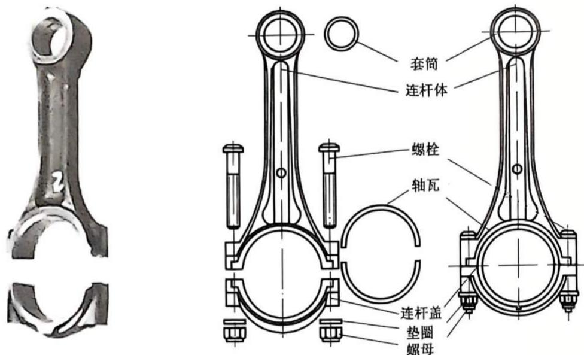

图2-1 内燃机中连杆的零件组成
{: .figure-caption }

### 2.2.2 运动副

机构是由若干个构件组合而成的，而构件组合是通过一定的连接方式来实现的，无论是何种连接方式，都必须保证被连接在一起的构件仍能实现彼此间做相对运动，即构件之间构成一种可动连接。这种由两个构件直接接触而又能实现相对运动的可动连接被称为运动副，而把两个构件直接接触的表面称为运动副元素。如图2-2所示内燃机中曲轴与轴承之间的连接，活塞与气缸套之间

的连接, 凸轮与顶杆之间的连接, 配气齿轮之间的连接等都构成了运动副。它们的运动副元素分别为圆柱面、平面与曲面、两齿廓曲面。

如图 2-3(a) 所示, 有构件 1 和构件 2, 其中构件 2 固定在坐标系 $Oxyz$ 中, 当两个构件彼此未组成运动副之前, 构件 1 相对于构件 2 可以分别沿 $x 、 y 、 z$ 轴移动和绕 $x 、 y 、 z$ 轴转动, 即两个构件在空间中具有 6 个相对自由度。当这两个构件组成运动副之后, 由于运动副元素始终要保持接触, 必然使得两个构件原有的相对运动受到限制, 事实上, 这两个构件通过圆柱面接触之后, 只剩下一个绕 $z$ 轴的转动自由度, 其余 5 个相对运动全被限制了, 如图 2-3(b)所示。这种对运动的限制称为约束, 每增加一个约束, 构件便失去一个自由度, 但剩下的自由

度与约束数之和应该等于构件自由状态下的自由度数6。由于两个构件组成运动副之后还能做相对运动，因此，运动副产生的约束数最大为5，而最少则只有一个约束，运动副产生约束的多少及对运动的限制形式完全取决于运动副本身的类型。

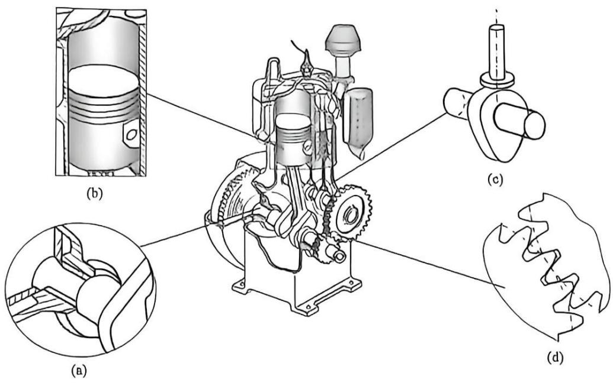

(a)曲轴与轴承之间形成转动副；(b)活塞与气缸套之间形成移动副；

(c)凸轮与顶杆之间形成高副；(d)配气齿轮之间形成高副。

图2-2 内燃机中各构件之间的运动副
{: .figure-caption }

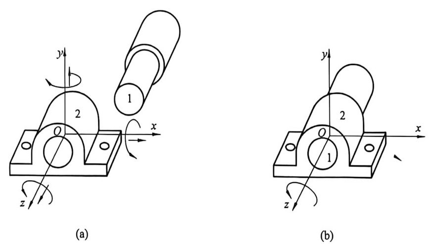

图2-3 运动副的形成
{: .figure-caption }

(a)两个构件组成运动副之前具有6个相对自由度；(b)组成转动副之后只剩余1个转动自由度。

工程上，一般按以下四种方法对运动副进行分类。

(1) 按运动副产生的约束数目分类。把产生一个约束的运动副称为 I 级副，而产生两个约束的运动副称为 II 级副。依此类推，分别还有 III、IV、V 级副。

(2) 按运动副的接触形式分类。两个构件的直接接触形式不外乎是点接触、线接触和面接触，当运动副元素为点和线接触时，在载荷作用下，接触区域内单位面积内承载力较大，应力值高，称为高副。相对于高副而言，面与面接触的运动因为应力值较低，称为低副。

(3) 按两构件相对运动形式分类。两构件组成运动副之后的相对运动若为平面运动，则称为平面运动副、平面运动副中最常见的两种形式分别为：

①转动副或回转副，俗称铰链，此时，两构件做相对转动[图2-2(a)]。

按相对运动形式分类

②移动副，相对运动为移动[图2-2(b)]。

两构件组成运动副之后的相对运动若为空间运动，则称为空间运动副。

(4) 按运动副元素始终保持接触的方式分类。机构在运动过程中，两个构件上的运动副元素必须始终保持接触，不能脱离，这种状态称为运动副的封闭。按实现封闭的手段有以下形式的运动副：

①几何形状封闭运动副，通常是一个构件上的凹曲面包容另一个构件上的凸曲面，如图2-2(a)(b)中的轴承包容轴径、气缸套包容活塞等。

②外力封闭运动副,依靠重力、弹簧力、气液压力等外力来维持两个构件的接触,如图2-2(c)为依靠弹簧力使顶杆与凸轮始终保持接触。

为了便于技术交流, 工程界常采用简单图形符号来表示运动副, 《机械制图 机构运动简图用图形符号》(GB/T 4460—2013) 对各种类型的运动副及其表示符号作了相应的规定, 如表 2-1 所示。

表 2-1 常用运动副符号

<table><tr><td rowspan="2">名称代号</td><td rowspan="2">类型级别</td><td rowspan="2">3D模型</td><td rowspan="2" colspan="2">简图符号</td><td rowspan="2">自由度</td><td colspan="2">约束</td></tr><tr><td>转动</td><td>移动</td></tr><tr><td>转动副(R)</td><td>平面V级低副</td><td></td><td colspan="2">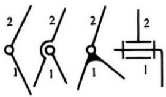 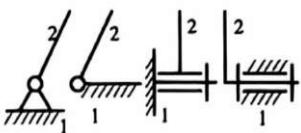</td><td>1</td><td>2</td><td>3</td></tr><tr><td>移动副(P)</td><td>平面V级低副</td><td></td><td colspan="2">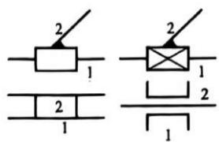 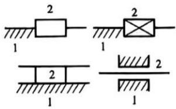</td><td>1</td><td>3</td><td>2</td></tr><tr><td>高副(RP)</td><td>平面IV级高副</td><td>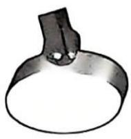</td><td colspan="2">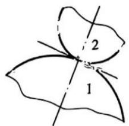 </td><td>2</td><td>2</td><td>2</td></tr></table>

续表2-1

<table><tr><td rowspan="2">名称代号</td><td rowspan="2">类型级别</td><td rowspan="2">3D模型</td><td rowspan="2">简图符号</td><td rowspan="2">自由度</td><td colspan="2">约束</td></tr><tr><td>转动</td><td>移动</td></tr><tr><td>平面副(F)</td><td>平面III级低副</td><td>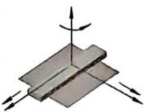</td><td>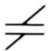</td><td>3</td><td>2</td><td>1</td></tr><tr><td>球面副(S)</td><td>空间III级低副</td><td>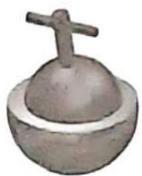</td><td>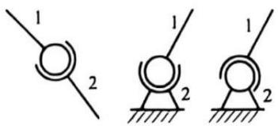</td><td>3</td><td>0</td><td>3</td></tr><tr><td>球销副(S&#x27;)</td><td>空间IV级低副</td><td>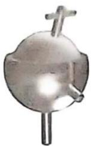</td><td>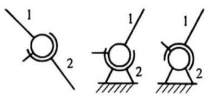</td><td>2</td><td>1</td><td>3</td></tr><tr><td>圆柱副(C)</td><td>空间IV级低副</td><td>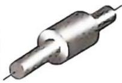</td><td>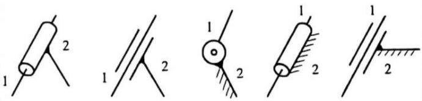</td><td>2</td><td>2</td><td>2</td></tr><tr><td>螺旋副(H)</td><td>空间V级低副</td><td>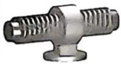</td><td>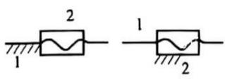</td><td>1</td><td>2或3</td><td>3或2</td></tr></table>

### 2.2.3 运动链

若干个构件经运动副连接而成的构件系统被称为运动链。如果组成运动链的所有构件依次连接，形成首末封闭的系统[图2-4(a)(b)]，则称之为闭式运动链、简称为闭链；否则，称之为开式运动链，简称为开链[图2-4(c)]。相对

而言, 闭链的运动形式比较简单, 工程上大多数机械均采用闭链机构。而开链可提供非常复杂的运动形式, 在工业机械手中常采用开链机构 [图 2-4(d)]。从机构学的观点来看, 人类四肢骨骼构成了一个非常复杂的开链系统, 其动作形式丰富多样, 几乎无所不能, 因此, 研制模拟人手动作的万能型机械手是工程技术人员永远追求的目标。2021 年, 神舟十二号三名航天员与机械臂相互配合, 完成了中国空间站首次出舱活动, 其中的机械臂就是一个具有

7个自由度的大型运动链。

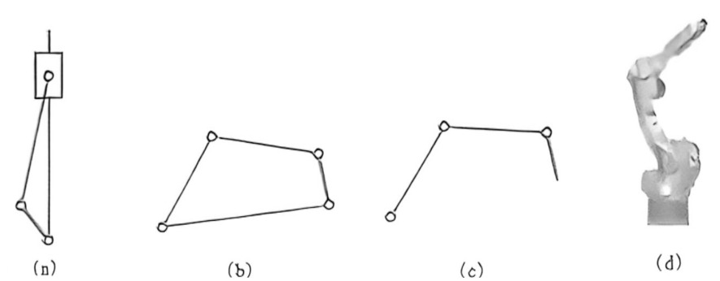

图2-4 运动链
{: .figure-caption }

(b)闭储：(b)闭储：(c)开储：(d)开储应用实例。

### 2.2.4 机构 ——

在运动链中，将其中某一个构件相对固定作为运动参考系，另外一个（或几个）构件按预先给定的运动规律相对于参考系运动，若其余构件也能获得确定的相对运动，那么该运动链就成为机构。作为参考系的固定构件被称为机架、机架可以固定在地面不动，如机床的床身，也可以作为一个平台载体带动所有安装在其上的构件一起相对于地面运动，如车辆的底盘、飞机的机身等。按预先给定运动规律独立运动的构件被称为原动件，而其余的活动构件则被称为从动件。因此，机构的组成规律可以描述为：机构由一个机架与一个或几个原动件，再加上若干从动件组合而成。

如果机构中所有的运动副均为平面运动副，则称该机构为平面机构；反之，若至少包含一个空间运动副，则称为空间机构。工程实际中大量应用的是平面机构，故本书仅针对平面机构开展研究。

## 2.3 机构运动简图及其绘制

一般而言，对于一台实际的机械，其结构装配图是非常复杂的。因为机构的运动唯一取决于运动副的类型和构件的运动尺寸，而与运动副的实际形状、构件的外形、断面尺寸大小、组成构件的零件总数及零件之间的连接方式等大量结构信息无关。所以在对具体的机械进行组成原理、工作原理及运动特性分析，或者设计新机械的运动原理方案构思初始阶段的时候，完全可以忽略掉大量与运动无关的结构细节，只需要用一些简单抽象的图形符号来表示运动副和构件，并按正确位置摆放各运动副使其与真实机构成比例即可。根据运动相似性原理，所得简单图形与真实机构具有相同的运动特性。把这种表明机构的组成、运动传递过程及各构件相对运动特征的简单图形称为机构运动简图。

工程上, 有时候只需要说明机械的组成状况和结构特点, 而不必严格按比例尺绘制简图, 这种简图被称为机构示意图。

对于常用机构的简图表示方法，《机械制图 机构运动简图用图形符号》(GB/T 4460—2013)已经作了明确的规定，表2-2摘录了部分常用机构运动简图，表2-3则是常见构件的表示方法。

表 2-2 常用机构运动简图

<table><tr><td>机构名称</td><td>3D 模型或实物</td><td>简图</td><td>机构名称</td><td>3D 模型或实物</td><td>简图</td></tr><tr><td>电动机及安装支架</td><td>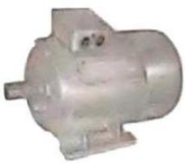</td><td>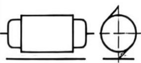</td><td>凸轮机构</td><td>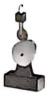</td><td>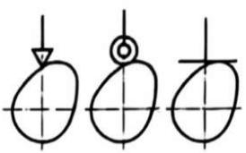</td></tr><tr><td>外啮合圆柱齿轮机构</td><td>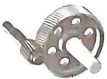</td><td>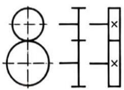</td><td>槽轮机构</td><td>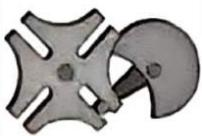</td><td>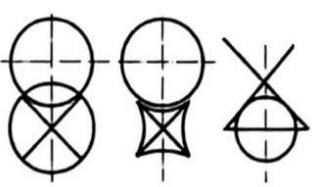</td></tr><tr><td>内啮合圆柱齿轮机构</td><td>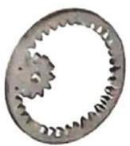</td><td>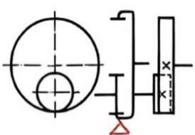</td><td>棘轮机构</td><td></td><td>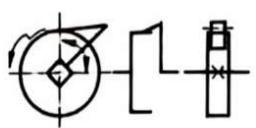</td></tr><tr><td>齿轮齿条机构</td><td>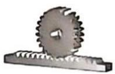</td><td>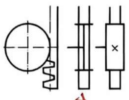</td><td>带传动</td><td>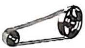</td><td>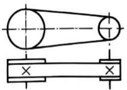</td></tr><tr><td>圆锥齿轮机构</td><td>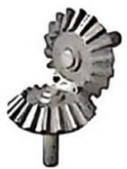</td><td>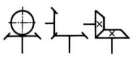</td><td>链传动</td><td></td><td>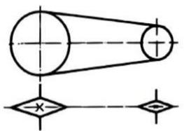</td></tr><tr><td>交错轴斜齿轮机构</td><td></td><td>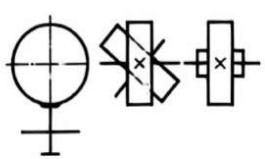</td><td>摩擦传动</td><td>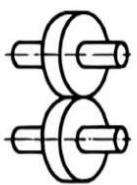</td><td>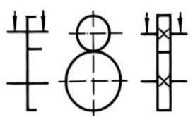</td></tr><tr><td>蜗轮蜗杆</td><td></td><td>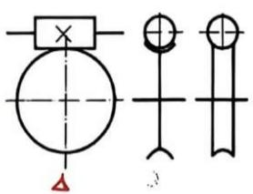</td><td></td><td></td><td></td></tr></table>

表 2-3 常见构件的表示方法

<table><tr><td>机构名称</td><td colspan="4">表示方法简图</td></tr><tr><td>杆状、轴类构件</td><td colspan="4">——</td></tr><tr><td>机架</td><td colspan="4">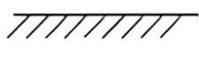 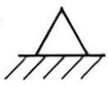 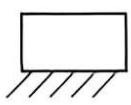 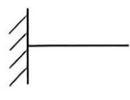 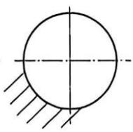</td></tr><tr><td>同一个构件</td><td colspan="4">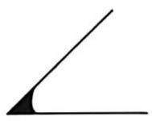 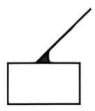 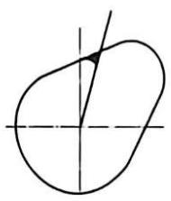 </td></tr><tr><td>双副构件</td><td colspan="4">GCY2   </td></tr><tr><td>三副构件</td><td colspan="4">   </td></tr></table>

机构运动简图的绘制可按如下思路和步骤进行：

(1)首先要搞清楚该机械的功用, 完成作业工艺过程需要实现哪些动作, 这些动作具体由哪些构件来完成 (执行动作的构件一般位于传动链的末端), 提供动力来源的原动机是什么 (大多数情况下是电动机, 与电动机输出轴相连的就是原动件), 确定哪个构件是机架 (多数情况下为固定不动的构件)。

(2)从原动件出发, 顺着运动的传递路线, 直到执行动作的最终构件, 分析其运动的传递过程。尤其要注意, 对于有多个工艺执行动作的机械, 往往是一个动作对应有一条运动传递路线。

(3)针对一条确定的运动传递路线, 弄清楚共有多少个活动构件, 以及这些构件的依次连接方式, 根据相邻构件的相对运动特点, 确定运动副的类型和运动副的数目, 并测量相邻两个运动副的相对位置尺寸。重复该过程, 直到处理完所有的运动传递路线。

(4) 合理选择绘制简图的视图平面, 一般选择与多数构件运动平面平行的平面作为绘制简图的视图平面, 如果一个视图表达有困难时, 也可以选择多个投影平面绘制简图, 然后把它们展开放在一个视图中。

(5)根据纸面大小, 选择适当的绘图比例尺 $\mu_{l}[\mu_{l}= \text{实际尺寸(m)/图上长度(mm)}]$ , 确定各运动副之间的相对位置, 用国标规定的样式绘制运动副符号, 然后用简单线条将同一个构件上的运动副符号连接起来, 就得到了所测绘机械装备的机构运动简图。

(6)检验机构是否具有确定运动的条件。

例 2-1 试绘制立式单缸内燃机的机构运动简图。

解: 如图 1-1(a) 所示单缸内燃机, 其包括气缸体 1、活塞 2、连杆 3、曲轴 4、齿轮 $4^{\prime}$ 、5、 $5^{\prime}$ 、齿轮 6、 $6^{\prime}$ 、进、排气阀顶杆 7、 $7^{\prime}$ 等主要部件。其中曲轴两端通过轴承与气缸体 (机架) 连接, 它们之间构成转动副 $A$ , 曲轴与连杆构成转动副 $B$ , 连杆与活塞构成移动副 $C$ , 而活塞与气缸体之间构成移动副, 因此, 气缸体 - 曲轴 - 连杆 - 活塞 - 气缸体形成一个闭式运动链, 即平面连杆机构, 其简图如图 1-1(b) 所示。齿轮 $4^{\prime}$ 固定在曲轴的一端, 它与气缸体构成的转动副就是 $A$ , 齿轮 5 和齿轮 $5^{\prime}$ 分别固定在凸轮轴上, 它与气缸体分别构成转动副 $D$ 和转动副 $E$ , 而齿轮 $4^{\prime}$ 与齿轮 5 及齿轮 $5^{\prime}$ 之间构成一高副连接, 该部分称为齿轮机构, 其运动简图如图 1-1(c) 所示。凸轮 $6^{\prime}$ 与齿轮 $5^{\prime}$ 共一根轴, 因此, 凸轮 $6^{\prime}$ 与气缸体构成转动副 $D$ , 通过高副与排气阀顶杆 $7^{\prime}$ 连接, 而排气阀顶杆与气缸体构成了移动副, 该部分称为凸轮机构, 其运动简图如图 1-1(d) 所示。同理, 凸轮 6 与进气阀顶杆 7 及气缸体之间也为一凸轮机构, 其运动简图如图 1-1(e) 所示。由以上分析可知, 立式单缸内燃机包含了图 1-1(b)(c)(d)(e) 所示四组机构, 最后将它们合并, 即得到立式单缸内燃机完整的机构运动简图, 如图 1-1(f) 所示。

例2-2 试绘制偏心泵的机构运动简图。

解：如图 2-5(a) 所示为用来输送流体的偏心泵，其组成包括偏心轮 1、外环 2、摆转轴 3、泵体 4。将各构件拆解后所得如图 2-5(b)\~(e) 所示，其中偏心轮 1 与泵体 4 通过轴孔配合构成转动副，转动中心为 A；偏心轮 1 外轮廓与外环 2 的内孔配合构成转动副，相对转动中心为 B；摆转轴 3 与泵体 4 通过轴孔配合

形成转动副，转动中心为 C；与外环固连的滑杆与摆转轴 3 的内孔配合形成移动副。由以上分析可知，该偏心泵有 4 个构件，3 个转动副，1 个移动副，选定比例尺后，不难绘出机构运动简图[图 2-5(f)]。

(a)偏心泵；(b)泵体；(c)偏心轮；(d)摆转轴；(e)外环；(f)机构运动简图。1—偏心轮；2—外环；3—摆转轴；4—泵体。

图2-5 偏心泵运动简图绘制
{: .figure-caption }

## 2.4 机构自由度的计算及机构具有确定运动的条件

### 2.4.1 机构自由度的计算

如图 2-6 所示的内燃机连杆机构中，活塞是原动件，当爆炸气体推动活塞从初始位移 $S_{3}$

经过时间 t 运动到 $S_{3}^{\prime}$ 时，对应的连杆到达 $C^{\prime}B^{\prime}$ 位置，而连杆将驱动曲柄转过角度 $\theta_{1}$ 到达 $B^{\prime}A$ 位置。在任意时刻 $\theta_{1}(t)$ 与 $S_{3}(t)$ 之间都具有一一对应的关系，即该机构所有构件的运动唯一由原动件提供的独立运动参数 $S_{3}$ 确定。把机构的这种维持确定运动所必需的独立运动参数称为机构的自由度。

因为机构是由若干个构件经运动副连接而成的，所以机构的自由度必定与构件的自由度及运动副引入的约束数相关。对于平面机构而言，所有的构件均被限制在平面内运动，每个构件在未构成运动副之前有3个自由度，而当构成运动副之后，由于引入了约束，其自由度还将进一步减少。如图2-7(a)所示，每个转动副产生2个约束，剩下1个转动自由度；每个移动副也产生2个约束，剩下1个移动自由度[图2-7(b)]；而每个高副只产生1个约束，还剩下2个自由度[图2-7(c)]。由此可知，构件剩余的自由度数目与运动副产生的约束数之和仍等于单个构件平面自由状态下的自由

度数 3，或者构件的自由度等于 3 减去运动副的约束数。将此重要结论推广到一般情况，便形成了机构自由度计算思路，即平面机构的自由度数等于机构中所有活动构件在平面自由状态下的自由度总数减去由运动副产生的约束总数。按此思路，可推导机构自由度计算公式如下。

(a)转动副；(b)移动副；(c)高副。

图2-7 各运动副下的自由度
{: .figure-caption }

图2-6 内燃机连杆机构
{: .figure-caption }

假设机构中共有 $n$ 个活动构件, 那么, 未形成运动副之前所有活动构件的自由度为 $3 \times n$ 。若机构中共有 $P_{\mathrm{L}}$ 个低副, 每个低副产生 2 个约束, 则共有 $2 \times P_{\mathrm{L}}$ 个低副约束。若机构中共有 $P_{\mathrm{H}}$ 个高副, 每个高副产生 1 个约束, 则共有 $P_{\mathrm{H}}$ 个高副约束。因此, 所有运动副产生的约束总数为 $(2 \times P_{\mathrm{L}} + P_{\mathrm{H}})$ 。于是, 平面机构的自由度 $F$ 可按如下公式计算:

$$
F = 3 \times n - (2 \times P _ {1} + P _ {1 1})\tag{2-1}
$$

至于空间机构自由度计算公式，按照这一思路，很容易推出如下计算公式：

$$
F = 6 \times n - (5 \times P _ {3} + 4 \times P _ {4} + 3 \times P _ {3} + 2 \times P _ {2} + P _ {1})\tag{2-2}
$$

式中： $6 \times n$ 为所有活动构件在空间自由状态下自由度总数： $P_{5}$ 为机构中 V 级副的个数，而 $5 \times P_{5}$ 为 V 级副产生的约束数，依此类推， $(5 \times P_{5} + 4 \times P_{4} + 3 \times P_{3} + 2 \times P_{2} + P_{1})$ 即为所有各级别运动副产生的约束总数。该公式由俄国数学家契贝舍夫(Chebychev)于 1854 年所提出，适用于绝大部分的平面机构自由度的计算。

### 2.4.2 机构具有确定运动的条件

对所设计的机构进行可动性和运动确定性评价，是工程技术人员进行机械系统创新设计过程中的重要环节。显然，只有当机构的自由度大于零时 $(F>0)$ ，机构才能运动。那么，机构满足什么条件，其运动才能确定而不至于乱动呢？以下通过两个实例进行分析。

如图 2-6 所示的内燃机连杆机构，其自由度 $F = 3 \times 3 - (2 \times 4 + 0) = 1$ 。如前所述，该机构只需要给定原动件活塞 3 的运动规律 $S_{3}(t)$ ，则机构中所有活动构件的运动都是确定的。由此可知，自由度为 1 的机构，运动确定的条件是需要一个原动件（因为一个原动件只能提供一个独立运动）。

如图2-8所示的五杆机构, 其自由度 $F = 3 \times 4 - (2 \times 5 + 0) = 2$ 。若只给定一个原动件, 即驱动构件1按给定的运动规律 $\theta_{1}(t)$ 运动, 当构件1转过角度 $\theta_{1}$ 占据 $AB$ 位置时, 3个活动构件2、3、4既可以占据位置 $BCDE$ , 也可以占据位置 $BC'D'E$ , 甚至还可以占据位置 $BC''D''E$ , 可知, 该机构运动不确定。倘若增加一个原动件, 即驱动构件4按给定的运动规律 $\theta_{4}(t)$ 运动时, 则构件2、3的位置就能唯一确定。若再增加一个原动件来驱动构件2独立运动, 则会出现运动干涉而使构件3无法运动。由该例可知, 自由度为2的机构, 运动确定的条件是需要2个原动件。

图2-8 五杆机构
{: .figure-caption }

(a)运动不确定；(b)运动确定。

对于自由度大于 2 的机构，分析后同样可以得到上述结论。推广到一般，可得机构具有确定运动的条件是机构的自由度数目等于原动件的数目。当原动件数目少于机构的自由度数目时，机构运动是不确定的；而当原动件数目大于机构的自由度数目时，机构不能产生运动，并将导致机构中最薄弱环节的损坏。

## 2.5 计算平面机构自由度的特殊情况

公式(2-1)是计算机构自由度的理论依据，但是针对工程上的一些特殊情况，应用该公式时，可能会出现一些与实际结果不符的计算结果，因此必须关注以下特殊情况。

### 2.5.1 复合铰链

在计算如图 2-9 所示圆盘锯机构的自由度时, 特别容易将转动副的个数误判为 6 而导致自由度计算结果 $F = 3 \times 7 - 2 \times 6 = 9$ 的错误结论, 但实际上该机构的转动副数目应为 10 , 其自由度为 1 。出错的原因是在铰链点 $B 、 C 、 D 、 E$ 各有两个转动副重叠在一起而漏数了 4 个转动副。如图 2-10 所示, 把这种两个以上的构件因为转动轴线重合而叠加在一起的情形称为复合铰链 (compound hinges), 由于每 2 个构件形成 1 个转动副, 由 $m$ 个构件组成的复合铰链将有 $(m - 1)$ 个转动副。

圆盘锯

### 2.5.2 局部自由度

如图 2-11(a) 所示的凸轮机构中, 为了改善高副表面的摩擦, 减缓磨损, 在凸轮和推杆之间安装有圆柱形滚子, 显然, 加装滚子后并不影响从动件 3 的运动规律。但此时按自由度计算公式可得加装滚子后凸轮机构的自由度 $F = 3 \times 3 - (2 \times 3 + 1) = 2$ , 这多出来的 1 个自由度就是滚子绕自身轴线的旋转运动, 把这种不影响机构中其他构件运动的自由度称为局部自由度 (local degree of freedom)。

图2-9 圆盘锯机构
{: .figure-caption }

图2-10 复合铰链
{: .figure-caption }

在计算机构自由度时，应将局部自由度 $F'$ 减去。具体处理时，可按如下两种方法处理，结论都一样。

(1)修正机构自由度计算公式(2-1)，即 $F=3\times n-(2\times P_{L}+P_{H})-F'$ ，其中 $F'$ 为局部自由度数目。此例中，重新计算机构自由度可得： $F=3\times3-(2\times3+1)-1=1$ 。

(2)如图 2-11(b) 所示, 假想将滚子与支撑滚子的构件焊接在一起, 此时, 减少了 1 个构件和 1 个转动副, 仍按公式 (2-1) 计算。重新计算机构自由度可得: $F = 3 \times 2 - (2 \times 2 + 1) = 1$ 。

图2-11 凸轮机构
{: .figure-caption }

(a) 存在局部自由度；(b) 消除局部自由度。

### 2.5.3 虚约束

如图2-12(a)所示为蒸汽机车的车轮驱动机构, 按公式(2-1)计算其自由度为 $F = 3 \times 4 - (2 \times 6) = 0$ , 计算结果表明该机构不能运动, 但实际情况是该机构具有确定的相对运动。仔细分析发现该机构的结构特殊, 可以认为是在平行四边形机构ABCD的基础上, 再增加一个中间构件5所得, 而且满足 $EF \parallel AB \parallel CD$ 。首先, 假设没有中间构件5, 则四铰链平行四边形机构的自由度为 $F = 3 \times 3 - (2 \times 4) = 1$ , 说明运动确定。依据平行四边形机构的特性, 运动中相对边总是处于平行状态, 即构件2作平动。由理论力学可知, 平动刚体上所有点的运动轨迹形状相同, 因此, 构件2上B、C、E三点的轨迹都是圆弧[图2-12(b)], 且圆弧半径相等, 但圆心位置分别位于A、D、F。接下来考虑把构件5添加到机构中, 此时, 增加了1个构件和2个回转副, 自由度增加3个, 但同时带来4个约束, 所以整个机构的自由度变成了零。显然, 构件5作定轴转动, 与构件2在E点构成回转副之后, 其作用是约束构件2上的E点作圆弧运动。而以上分析表明, 构件2上的轨迹本来就是一个圆。因此, 增加1个活动构件(引入3个自由度)和2个转动副(引入了4个约束)等于多引入了1个约束, 而这个约束对机构的运动只起重复的约束作用(即转动副E连接前后连杆上E点的运动轨迹是一样的), 因而是一个虚假约束。工程上, 把机构中不起实际作用的约束称为虚约束, 在计算机构自由度时应去掉虚约束。参照处理局部自由度的做法, 可以按以下两种方法处理:

图2-12 蒸汽机车的车轮驱动机构
{: .figure-caption }

(a) 机构运动简图；(b) 消除虚约束；(c) 机构无法运动。

(1)修正机构自由度计算公式(2-1)，即 $F=3\times n-(2\times P_{L}+P_{H}-P')$ ，其中 $P'$ 为虚约束数目。此例中，重新计算机构自由度可得： $F=3\times4-(2\times6-1)=1$ 。

(2)如图 2-12(b) 所示, 去掉中间构件 5 及其关联的运动副 $E$ 、 $F$ , 此时, 减少了 1 个构件和 2 个转动副, 仍按公式 (2-1) 计算。重新计算机构自由度可得: $F = 3 \times 3 - (2 \times 4) = 1$ 。

必须特别指出, 上述机构中构件 5 引入的虚约束是有条件的, 即 $EF = AB = CD$ , 如果不满足该条件, 如图 2-12(c) 所示, 则构件 5 上的 $E$ 点与构件 2 上的 $E$ 点运动轨迹就不会重合,必然产生真实约束使其不能运动而成为桁架。

严格来讲，平面机构中是否存在虚约束，需要从理论上予以证明。但以下6种特殊情况存在虚约束，前人已经作过理论证明，本书不妨直接引用。

(1)两构件构成转动副前，后运动轨迹重合。如图2-12所示机构中构件5与构件2上的 $E$ 点运动轨迹前后重合。又如图2-13所示椭圆仪机构中构件1上 $B$ 点的轨迹与构件2上 $B$ 点的轨迹重合。

(2)两构件上两点之间的距离恒定. 不随机构运动变化, 当用一个构件通过转动副连接该两点时, 会引入一个虚约束。如图 2-14 所示平行四边形机构中 $E$ 、 $F$ 两点距离始终不变, 引入构件 5 后会产生一个虚约束 $P'$ 。对于这种特殊情况, 此处引入构件 5 后实际上构成了两个平行四边形机构, 这在工程上是非常有必要的, 因为单个平行四边形机构在四个构件处于共线位置时, 会出现运动不确定的情况, 而两套机构彼此错开一定角度后, 当一套机构运动到共线位置而出现运动不确定时, 另外一套机构能正常运动, 从而彻底消除平行四边形机构运动不确定的现象。

距离不变

(3)两构件构成多个转动副，且所有转动副的轴线重合。如图2-15所示多缸内燃机中曲轴与箱体之间布列有 $N+1$ 个转动副，其中N是气缸数。这 $N+1$ 个转动副带来的约束作用是等同的，只要计算一次即可，不能重复计数。

图2-13 椭圆仪机构
{: .figure-caption }

图2-14 平行四边形机构
{: .figure-caption }

多转动副同轴

(4)两构件构成多个移动副，且所有移动副的导路平行(图2-16)。

(5)两构件在多处接触构成平面高副，且接触点处的公法线方向彼此重合。如图2-17所示构件1、2在B、 $B'$ 两处接触，由于两处公法线重合而具有相同的约束特性，故其中一处实际不起约束作用而成为虚约束，只能按一个高副计数。

图2-15 转动副构成的虚约束
{: .figure-caption }

图2-16 移动副构成的虚约束
{: .figure-caption }

如果不满足多处接触公法线重合的条件，则约束会起作用而变成真实约束，如图2-18所示V形支撑块，会产生2个移动约束，而只剩下1个转动自由度。如图2-19所示高副也产生1个移动约束和1个转动约束，剩下1个移动自由度。

图2-17 虚约束
{: .figure-caption }

图2-18 V形支撑块
{: .figure-caption }

(6)机构中存在对运动起重复约束作用的对称结构。如图2-20所示行星轮系,从传递运动而言,一个行星轮就足够了,此时每增加一个行星轮,就会引入2个齿轮高副和1个转动副,共计4个约束,而行星轮本身就有3个自由度,因而多出1个约束,该约束实际上并不起作用而成为虚约束。如果有N个行星轮,则会产生N-1个虚约束,即 $P'=N-1$ 。

图2-19 高副变成移动副
{: .figure-caption }

图2-20 行星轮系中的虚约束
{: .figure-caption }

由上述分析, 可归纳形成以下两种机构自由度的计算方法:

方法一 把机构中产生局部自由度和虚约束的构件及其运动副全部剔除，然后按公式(2-1)计算。

方法二 将所有的活动构件 $n$ 和局部自由度 $F'$ 及虚约束 $P'$ 一并考虑，对公式(2-1)作如下修正。

基本机构
34

$$
F = 3 \times n - (2 \times P _ {\mathrm{L}} + P _ {\mathrm{H}} - P ^ {\prime}) - F ^ {\prime}\tag{2-3}
$$

应用上述修正公式时应特别注意以下两点：

①虚约束 $P'$ 中只包括特殊情况(1)、(2)、(6)所产生的虚约束数目。

②低副数 $P_{1}$ 和高副数 $P_{11}$ 应剔除特殊情况(3)、(4)、(5)所产生虚约束的运动副数目。

增加虚约束虽然给自由度的计算带来麻烦，但是却可以带来以下好处：

①改善构件的受力情况，如多个行星轮。

②增加机构的刚度，如内燃机曲轴与箱体多处分布有轴承。

③使机构运动顺利，避免运动不确定，如火车轮驱动机构。

例2-3 计算如图2-21(a)所示机构的自由度，已知其中构件 $EF$ 、GH、IJ平行且相等。

图2-21 多杆机构
{: .figure-caption }

(b)

解: ①滚子2绕自身轴线的转动为局部自由度 $F'$ ; ②构件3与机架11在 $C$ 、 $C'$ 两处构成移动副, 且导路平行, 故存在一处虚约束, 计数低副时只能算一个; ③构件4、5、6在 $E$ 处形成复合铰链; ④因为构件 $EF$ 、 $GH$ 、 $IJ$ 平行且相等, 机构在运动过程中 $G$ 、 $H$ 两点间的距离始终保持不变, 所以用双转动副杆7连接此两点将引入1个虚约束。

按方法一计算：

将滚子2与构件3固连，去掉构件7，则得到如图2-21(b)所示机构，其中 $n = 8$ ， $P_{\mathrm{L}} = 11$ ， $P_{\mathrm{H}} = 1$ ，代入公式(2-1)得：

$$
F = 3 \times n - (2 \times P _ {\mathrm{L}} + P _ {\mathrm{H}}) = 3 \times 8 - (2 \times 1 1 + 1) = 1
$$

按方法二计算：

此时有 n=10， $P_{L}=14$ ， $P_{H}=1$ ， $F'=1$ ， $P'=1$ ，代入公式(2-3)得：

$$
F = 3 \times n - (2 \times P _ {\mathrm{L}} + P _ {\mathrm{H}} - P ^ {\prime}) - F ^ {\prime} = 3 \times 1 0 - (2 \times 1 4 + 1 - 1) - 1 = 1
$$

两种计算方法所得结果一致。因为该机构有一个原动件，故机构运动确定。

## 2.6 机构的组成原理与结构分析

### 2.6.1 机构的组成原理

如前所述, 机构是由若干个构件经运动副连接组成而又具有确定相对运动的构件系统, 其中包含了一个机架构件, 一个或多个原动件, 以及若干个从动件, 而且机构具有确定运动的条件是机构的自由度数目与原动件的数目必须相等。因为机架固定不动, 其自由度为零, 又每个原动件的自由度为 1 , 因此, 如果把机架和原动件从机构中分离出来, 那么可以肯定, 剩余的由从动件构成的构件组, 其自由度必定为零。下面将对这个自由度为零的从动件组进行深入分析。

#### 1. 杆组

对于工程上较为复杂的机构，上述由从动件组成的自由度为零的构件组还可以继续分解成为若干个结构更加简单且自由度为零的构件组，把这种最简单的构件组称为基本杆组，简称为杆组。对于仅包含低副的杆组而言，假设杆组中包含了 $n$ 个活动构件和 $P_{1}$ 个低副，由杆组的自由度为零可知：

由此可得

$$
\begin{array}{l} 3 n - 2 P _ {\mathrm{L}} = 0 \\ P _ {\mathrm{L}} = (3 / 2) n \end{array}\tag{2-4}
$$

因为构件数和运动副数目均为整数, 所以构件数 $n$ 的数值只能取偶数。例如: $n=2$ , $P_{L}=3$ ; $n=4$ , $P_{L}=6$ ……其中, 最简单的杆组只包含 2 个构件和 3 个低副, 这种杆组被称为 II 级杆组。II 级杆组是工程上应用最多的杆组, 它共有 5 种不同的类型, 如图 2-22 所示。

图2-22 Ⅱ级杆组
{: .figure-caption }

若 $n = 4, P_{\mathrm{L}} = 6$ ，则有3种类型，如图2-23所示。这3种结构中都有一个包含3个低副的构件，此类杆组被称为Ⅲ级杆组。Ⅳ级或更高级别的杆组在工程上很少出现，在此不作介绍。

图2-23 Ⅲ级杆组
{: .figure-caption }

杆组中与其他杆组相连的运动副被称为外端副，而把内部彼此相连的运动副称为内端副。所有的从动件杆组就是由若干基本杆组通过外端副彼此依次连接而成的。

根据机构复杂程度的不同, 同一机构中可能包含 II 级杆组、III 级杆组或者两者都有。一般按机构中所含杆组的最高级别对机构命名, 如 II 级机构就是全部由 II 级杆组构成的机构,至少含有一个 III 级杆组的机构被称为 III 级机构, 而把仅由一个活动构件与机架组成的机构称为 I 级机构, 如杠杆机构、斜面机构等。工程上绝大多数机械系统由 II 级机构构成。

#### 2. 机构的组成原理

由以上机构分解原理可知，机构可以分解成原动件、机架和杆组。反之，把若干杆组按顺序依次经由外端副连接到原动件和机架上即可形成一种新的机构，此机构的自由度数目就是所连接原动件的数目。可以认为，所有机构都是按照这种方法组合而成的，称为机构的组成原理。

例如, 将如图 2-24 所示的 II 级杆组 [图 2-24(b)] 与原动件 [图 2-24(c)] 和机架相连, 即得到一个四杆机构 $ABCD$ , 然后将 III 级杆组 [图 2-24(a)] 连接到构件 3 和机架上, 即得到如图 2-24(d) 所示的八杆机构。

图2-24 八杆机构的组成
{: .figure-caption }

(a) Ⅲ级杆组；(b) Ⅱ级杆组；(c) 原动件；(d) 八杆机构。

机构的组成原理是创新设计复杂多杆机构的理论基础，从理论上讲，依据此原理可以构造出任意复杂的机构，但在运用该原理设计新机构时，必须注意以下两条原则：

(1) 结构最简性原则。即在满足机构运动要求的前提下，所设计的机构结构越简单、杆组的级别越低、构件数和运动副数量越少越好。

(2) 运动不干涉原则。添加杆组时，必须保证构件组中所有的构件仍能运动，为此，不能将杆组中的所有外端副连接到其他杆组的同一个构件上，否则会产生运动干涉而使构件组成为桁架。如图 2-25 所示，无论是Ⅱ级杆组还是Ⅲ级杆组与同一个构件相连时，都变成了一个刚性桁架而成为一个构件。

(a) Ⅲ级杆组与同一构件相连；

(b) Ⅱ级杆组与同一构件相连。

图2-25 形成刚性桁架
{: .figure-caption }

### 2.6.2 机构的结构分析

对现有机械设备进行技术革新改造是作为工程技术人员必备的基本素质之一。技术革新的首要任务是必须了解、剖析现有机械存在哪些缺陷与不足，才能采取措施，对症下药。为此，必须对机械进行机构结构分析、工作原理分析、运动分析与动力学分析等理论准备工作，其中的机构结构分析是所有分析工作的基础和前提。结构分析的主要目的是通过对机构的分拆达到了解机构组成并确定机构的级别的目的。不难看出，机构结构分析的过程正好与组成新机构的过程相反，即把机构分拆成原动件、机架、杆组。

对机构进行结构分析分拆杆组时可按以下步骤进行：

(1)依据机构运动简图, 计算机构的自由度, 并确定原动件。

(2)从远离原动件的构件开始, 先尝试以 II 级杆组进行拆解, 如果不行再以 III 级杆组进行拆解。此时应特别注意, 每拆除一个杆组后, 剩余的运动链仍应是一个具有与原机构自由度相同的机构, 直到所有的杆组拆除只剩下原动件和机架为止。

(3) 根据杆组最高级别数确定机构的级别。

如图 2-24(d) 所示机构, 先尝试按Ⅱ级杆组拆解, 此时, 无论是按 5-6、5-7、5-4 Ⅱ级杆组中的哪种组合方式分解, 都得不到正确的结果; 再尝试按Ⅲ级杆组拆解, 可得如图 2-24(a) 所示的 4-5-6-7 杆组, 剩余部分为铰链四杆机构。继续拆解得如图 2-24(b) 所示的 2-3 杆组, 为Ⅱ级杆组, 剩下如图 2-24(c) 所示原动件 1 和机架 8 组成的 I 级机构。该机构杆组级别最高为Ⅲ级, 故该机构是一个Ⅲ级机构。

应特别指出，对于由同一个运动链组成的机构，当选择的原动件不同时，机构的级别可能不同。如图 2-26 和图 2-27 所示机构的运动链与图 2-24 相同，但原动件分别选择构件 6 和构件 7，分拆后所得的杆组全部为Ⅱ级杆组，故这两种机构均为Ⅱ级机构。

图2-26 八杆机构的拆解(1)
{: .figure-caption }

图2-27 八杆机构的拆解(2)
{: .figure-caption }

上述结构分析方法和结论均以平面低副机构为研究对象所得，如果机构中存在高副，则可以按下一小节介绍的方法先将高副机构转化为低副机构，然后直接引用低副机构的结构分析方法和结论。

### 2.6.3 用低副代替机构中高副的方法

工程上为了对含高副的机构也能像低副机构那样方便地进行结构分析，在保证机构运动状态不变的前提下，可设想将其中的高副按特定条件转化为低副，即把含高副机构虚拟地转化为全低副机构。这种将机构中的高副用虚拟低副代替的方法称为高副低代。

为了确保机构运动状态不变，进行高副低代应满足以下条件：

(1) 虚拟转化所得全低副机构与原机构的自由度应一致。

(2)转化机构和原机构的瞬时速度和瞬时加速度也应完全相同。

由机构自由度计算公式(2-1)可知, 含高副机构的自由度为:

$$
F = 3 \times n - (2 \times P _ {\mathrm{L}} + P _ {\mathrm{H}})
$$

假设高副低代后所得全低副机构的构件数为 $n^{\mathrm{L}}$ ，其低副数目为 $P_{\mathrm{L}}^{\mathrm{L}}$ ，那么，转化机构的自由度 $F^{\mathrm{L}}$ 为：

$$
F ^ {\mathrm{L}} = 3 \times n ^ {\mathrm{L}} - 2 \times P _ {\mathrm{L}} ^ {\mathrm{L}}\tag{2-5}
$$

根据高副低代条件(1)，2个机构的自由度不变，有 $F^{L}=F$ ，即

$$
3 \times n - (2 \times P _ {\mathrm{L}} + P _ {\mathrm{H}}) = 3 \times n ^ {\mathrm{L}} - 2 \times P _ {\mathrm{L}} ^ {\mathrm{L}}
$$

整理可得：

$$
P _ {1 1} = 2 \times (P _ {L} ^ {L} - P _ {L}) - 3 \times (n ^ {L} - n)\tag{2-6}
$$

式中： $P_{H}$ 为原机构的高副数； $(P_{L}^{L}-P_{L})$ 为转化机构低副较原机构低副的增加数； $(n^{L}-n)$ 为转化机构构件较原机构构件的增加数。式中所有参数取值均为整数。

由式(2-6)可得各参数取值, 列入表 2-4 中。

表 2-4 高副低代后构件数与低副数的变化

<table><tr><td>原机构高副数 \(P_{\parallel}\) </td><td>转化机构的低副数增量( \(P_{L}^{L}-P_{L}\) )</td><td>转化机构的构件数增量( \(n^{L}-n\) )</td></tr><tr><td>1</td><td>2</td><td>1</td></tr><tr><td>2</td><td>4</td><td>2</td></tr><tr><td>...</td><td>...</td><td>...</td></tr></table>

由表 2-4 可得以下重要结论：为了保证替代前后机构的自由度不变，每个高副需用 1 个活动构件和 2 个低副来替代。

如何保证转化机构和原机构的瞬时速度和瞬时加速度完全一致呢？下面将通过机构实例来说明。如图2-28所示为一具有圆形轮廓的高副机构，其中构件1为原动件。该机构在运动过程中，两个圆形轮廓表面始终保持接触，显然，过接触点 $P$ 的公法线必然经过两构件轮廓的圆心 $B 、 C$ 点。可知， $A 、 B 、 C 、 D$ 四点之间的距离 $l_{\mathrm{AB}} 、 l_{\mathrm{BC}} 、 l_{\mathrm{CD}} 、 l_{\mathrm{DA}}$ 不随机构运动而变化，均为恒定数值，因此，可以设想在 $B 、 C$ 两点处设置铰链，并用虚拟转化的四杆机构ABCD来替代原来的高副机构。不难理解，该转化机构具有与原高副机构完全相同的运动特性，从而满足高副低代条件(2)。这种高副低代的机构转化方法可以推广到一般情况，以下通过三种实例来说明高副低代方法的具体应用。

如图 2-29 所示机构, 两构件的外轮廓为任意非圆曲线, 两构件轮廓接触点 $P$ 的曲率中心分别为 $B 、 C$ 点, 因此, 可用虚拟转化四杆机构 $A B C D$ 来替代原来的高副机构。与图 2-28 机构的区别在于, 此例中两构件轮廓上不同位置接触点的曲率中心和曲率半径总是在变化, 故转化机构的构件长度也是变化的, 但仍能保证转化机构的瞬时运动参数与原机构相同。

图2-28 圆形轮廓的高副机构
{: .figure-caption }

图2-29 任意非圆曲线轮廓的高副机构
{: .figure-caption }

如图 2-30 所示机构中构件 1 在接触点处的曲率中心位于公法线上的 B 点，而构件 2 在接触点处的曲率中心位于公法线上的无穷远处，其曲率半径亦趋于无穷大，此时，两构件在接触点处的相对运动为移动，因此可用一个移动副来代替，转化机构为 ABPC。

图2-30 含平面接触构件的高副机构
{: .figure-caption }

如图 2-31 所示为渐开线齿轮机构，在任意位置接触时，在接触点 P 的公法线恒切于基圆，且两个切点 $N_{1}$ 、 $N_{2}$ 分别是两轮廓在接触点处的曲率中心，因此，齿轮机构的转化机构为 $O_{1}N_{1}N_{2}O_{2}$ 。

图2-31 渐开线齿轮机构
{: .figure-caption }

由上述高副机构的转化实例可知，任何含有高副的平面机构都可以转化成全低副机构，因而只需要对平面低副机构进行结构分析就可以了。

## 本章思维导图

定义：由规定符号和连线组成用来表示机构组成、运动传递路线、以及构件相对运动特征、按比例绘制的简单图形

## 思考题与练习题

1. 什么是零件、构件、机构、机器、机械？它们有什么联系？又有什么区别？

2. 何谓运动副和运动副元素？运动副有哪些类型？各有几个自由度？用什么符号表示？

3. 机构是如何组成的？机构运动确定必须具备什么条件？当原动件多于或少于机构的自由度时，机构将发生什么情况？

4. 什么是机构的自由度？如何计算？

5. 什么是局部自由度？它出现在哪些场合？什么是复合铰链？铰链数和构件数有何关系？什么是虚约束？它一般出现在哪些场合？具体计算机构自由度时如何正确去掉局部自由度和虚约束？

6. 为什么要绘制机构运动简图？它有何用处？它能表示机构哪些方面的特征？绘制运动简图的方法和步骤是怎样的？

7. 何谓机构的组成原理？何谓基本杆组？它具有什么特性？如何确定基本杆组的级别和机构的级别？

8. 如图 2-32 所示为一小型冲床，试绘制其机构运动简图，并计算机构自由度。

9. 如图 2-33 所示为一齿轮齿条式活塞泵，试绘制其机构运动简图，并计算机构自由度。

10. 如图 2-34 所示为一简易冲床的初步设计方案, 设计者的意图是电动机通过一级齿轮 1、2 减速后带动凸轮 3 旋转, 然后通过摆杆 4 带动冲头实现上下往复冲压运动。试根据机构自由度分析该方案的合理性, 并提出修改后的新方案。

11. 如图 2-35 所示为一小型压力机，试绘制其机构运动简图，并计算机构自由度。

12. 如图 2-36 所示为一人体义肢膝关节机构，若以胫骨 1 为机架，试绘制其机构运动简图，并计算机构自由度。

图2-32 小型冲床
{: .figure-caption }

图2-33 齿轮条式活塞泵
{: .figure-caption }

图2-34 简易冲床的初步设计方案
{: .figure-caption }

图2-35 小型压力机
{: .figure-caption }

图2-36 人体义肢膝关节机构
{: .figure-caption }

13. 计算图 2-37 所示压榨机机构的自由度。

14. 计算图 2-38 所示测量仪表机构的自由度。

图2-37 压榨机机构
{: .figure-caption }

图2-38 测量仪表机构
{: .figure-caption }

15. 如图 2-39 所示为一物料输送机构，试绘制机构运动简图，并计算机构的自由度。

图2-39 物料输送机构
{: .figure-caption }

16. 如图 2-40 所示为一拟人食指机械手，试绘制其机构运动简图，并计算机构的自由度。

17. 如图 2-41 所示为某一机械中制动器的机构运动简图, 工作中当活塞杆 1 被向右拉时, 通过各构件传递运动迫使摆杆 4、6 做相向摆动, 制动块压紧制动轮实现制动; 当活塞杆 1 被向左拉时, 迫使构件 4、6 做反相摆动, 此时制动块与制动轮脱离接触, 不起制动作用。试分析该机构由不制动状态过渡到制动状态时机构自由度的变化情况。

图2-40 拟人食指机械手机构
{: .figure-caption }

图2-41 制动器的机构运动简图
{: .figure-caption }

18. 如图 2-42 所示外科手术用剪刀, 其中弹簧的作用是保持剪刀口张开, 并且便于医生单手操作。忽略弹簧, 并以构件 1 为机架, 分析机构的工作原理, 绘制其机构运动简图。

19. 如图 2-43 所示为一内燃机简图，试计算该机构的自由度，并确定该机构的级别。若选构件 5 为原动件，那么该机构是几级机构？

图2-42 外科手术用剪刀
{: .figure-caption }

图2-43 内燃机简图
{: .figure-caption }
