# 第3章 平面连杆机构分析与设计

**【概述】**

◎本章以平面四杆机构运动设计为主线，在简要阐明平面四杆机构基本类型及其演化，讨论平面四杆机构设计的共性问题之后，重点阐述平面四杆机构设计及其运动分析的几何法、解析法。另外，对平面多杆机构的有关问题也作了简要介绍。

◎要求重点掌握平面连杆机构设计中的共性问题及其基本原理和方法。

连杆机构早在 13 世纪前期就已经得到广泛的应用。我国利用连杆机构进行工作的历史非常悠久，如图 3-1 所示的发明于东汉初年的水排，就利用了连杆机构。水排用于冶铸鼓风，是机械工程史上一项重要的发明。18 世纪，著名发明家瓦特将四杆机构应用到他发明的蒸汽机里，为活塞提供近似直线运动。现代工程机械的很多工作装置都用到了连杆机构，如混凝土泵车、汽车起重机的臂架系统、液压挖掘机的控制铲斗动作装置。连杆机构在重载装备中的应用也举足轻重，航空太阳能折展机构如图 3-2 所示。载人航空航天、深海探测、智能机器、并联机床等设备中都有连杆机构的身影。

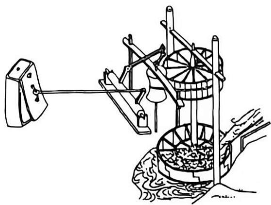

图3-1 水排
{: .figure-caption }

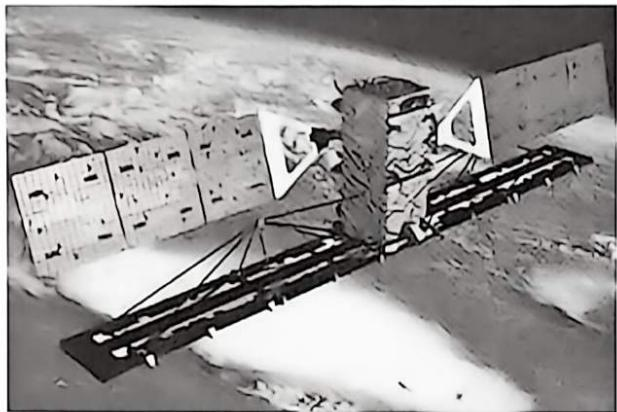

图3-2 太阳能折展机构
{: .figure-caption }

## 3.1 连杆机构及其传动特点

如图 3-1 所示的水排, 其工作原理是由流水驱动卧式水排, 带动大轮旋转, 大轮与小轮之间依靠绳带传动, 小轮上有偏心曲柄, 利用曲柄连杆机构把旋转运动转换为推拉皮囊的直

线往复运动。

连杆机构是由若干构件通过低副(转动副、移动副、球面副、球销副、圆柱副及螺旋副等)连接而成的，故又称为低副机构。连杆机构根据其构件之间的相对运动为平面运动或空间运动，分为平面连杆机构和空间连杆机构。

平面连杆机构是由若干构件通过低副(转动副和移动副)连接而成的平面机构, 它是一种应用十分广泛的机构。其共同的结构特点是原动件的运动都要经过一个不直接与机架相连的中间构件才能传动到输出构件, 该中间构件称为连杆;

平面连杆机构具有以下传动特点：

(1) 平面连杆机构中的运动副为低副。构成低副的两个运动副为面接触，压强较小，故可承受较大的载荷；而且有利于润滑，磨损较小；此外，运动副的几何形状比较简单，便于加工制造。

(2) 在平面连杆机构中，当原动件运动规律不变时，可通过改变各构件的相对长度来使从动件得到不同的运动规律，以满足预期的功能要求。

连杆机构的缺点是在连接处存在一定间隙，因而会降低运动精度；因为连杆做平面运动时所产生的惯性力不易平衡，故高速运动时，容易产生冲击、振动和噪声；构件数增多时，设计较困难。近年来，随着电子计算机的普及，设计方法的不断改进，平面连杆机构的应用范围还在进一步扩大。

在平面连杆机构中，其构件多呈杆状，故构件简称为杆。平面连杆机构常根据其所含杆之数目而命名，如四杆机构、六杆机构等。单闭环的空间连杆机构的构件数至少为3，因而可由三个构件组成空间三杆机构；单闭环的平面连杆机构的构件数至少为4，因而没有平面三杆机构。其中平面四杆机构不仅应用广泛，而且是常见的多杆机构的基础。本章着重讨论平面四杆机构的有关基本知识和设计问题。

## 3.2 平面四杆机构的类型

若平面四杆机构中的各运动副都是转动副，则称为铰链四杆机构，它是平面四杆机构的基本类型，其他类型的四杆机构都可看成是在它的基础上演变而成的。研究连

杆机构时通常以铰链四杆机构为研究对象。如图3-3所示的铰链四杆机构中，固定不动的构件4称为机架，与机架用转动副相连接的构件1和构件3称为连架杆不与机架直接相连的构件2称为连杆。在连架杆中能绕机架上的转动副做360°整周转动的连架杆称为曲柄不能绕机架上的转动副做360°整周转动，而只能在一定角度往复摆动的连架杆称为摇杆。

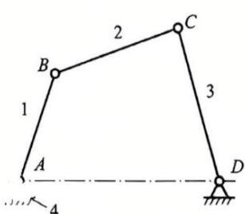

图3-3 铰链四杆机构
{: .figure-caption }

### 3.2.1 平面四杆机构的基本类型

对于铰链四杆机构，机架和连杆总是存在的，故根据两个连架杆是曲柄或摇杆，可将铰链四杆机构分为三种基本类型，即曲柄摇杆机构、双曲柄机构和双摇杆机构。

#### 1. 曲柄摇杆机构

铰链四杆机构的两个连架杆中，若一个为曲柄，另一个为摇杆，则称其为曲柄摇杆机构。当以曲柄为原动件时，曲柄摇杆机构可将曲柄的连续转动变为摇杆的往复摆动。其应用甚广，如图3-4所示的雷达天线俯仰机构即为一例。当以摇杆为原动件时，可将摇杆的往复摆动转变为曲柄的整周转动，此种机构在以人力为动力的机械中应用较多，如图3-5所示的缝纫机踏板机构即为一例。当人用脚踏动踏板1时，通过连杆，此机构可将踏板1的摆动转变为飞轮3的整周转动。

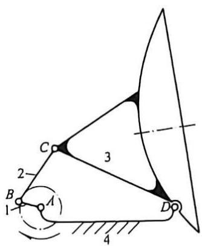

图3-4 雷达天线俯仰机构
{: .figure-caption }

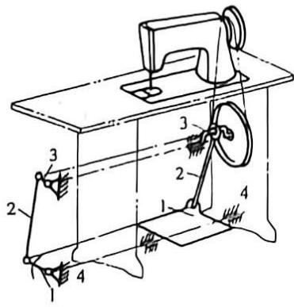

图3-5 缝纫机踏板机构
{: .figure-caption }

#### 2. 双曲柄机构

若铰链四杆机构中的两个连架杆均为曲柄，则称其为双曲柄机构。在一般形式的双曲柄机构中，如图3-6所示的冲床机构中的双曲柄机构ABCD，当主动曲柄AB做匀速转动时，从动曲柄CD做变速转动，从而可使滑块F在冲压行程时慢速前进，而在空回行程时快速返回，以利于冲压工作的进行。

如图 3-7 中的双曲柄机构与悬梯是“嫦娥三号”探测器中将月球从着陆器转移到月面上的转移机构。当着陆器稳定着陆后，悬梯展开，月球车从着陆器移动到悬梯上，然后双曲柄机构在自身重力和缓释绳的作用下缓慢旋转使悬梯下降（此时悬梯平动）。当悬梯接触月面后，月球车从悬梯移动到月面上。

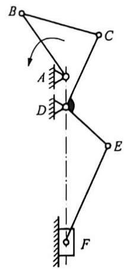

图3-6 冲床机构
{: .figure-caption }

在双曲柄机构中, 若相对的两杆平行且长度相等则称其为平行四边形机构(图 3-8)。它有两个显著特征: 一是两个曲柄以相同速度同向转动; 二是连杆作平动。这两个特征在机械工程上均已获得广泛应用。如图 3-9 所示的机车车轮的联动机构就利用了其第一个特征, 而摄影平台升降机构则是利用了其第二个特征(图 3-10)。

若双曲柄机构中两相对杆的长度分别相

等，但不平行，则称其为逆平行(或反平行)四边形机构。如图3-11所示的车门开闭机构就是一例，其运动特点是两个连架杆的转动方向相反，它可使两扇车门同时敞开或关闭。

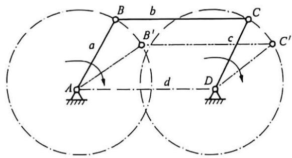

图3-8 平行四边形机构
{: .figure-caption }

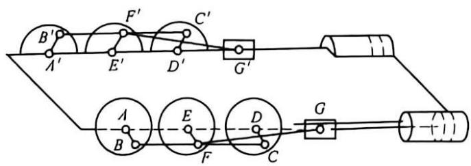

图3-9 车轮联动机构
{: .figure-caption }

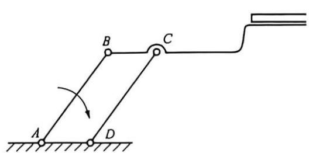

图3-10 摄影平台升降机构
{: .figure-caption }

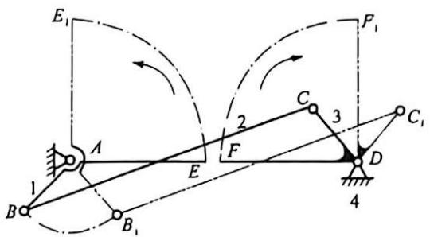

图 3-11 车门开闭机构
{: .figure-caption }

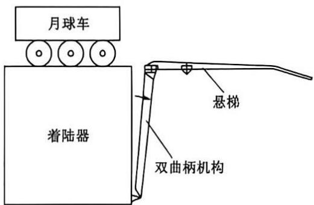

图3-7 着陆器
{: .figure-caption }

#### 3. 双摇杆机构

若铰链四杆机构的两个连架杆都是摇杆，则称其为双摇杆机构。如图3-12所示的铸造用造型机的翻箱机构就应用了双摇杆机构ABCD。它可将固定在连杆BC上的砂箱在BC位置进行造型振实后，翻转 $180^{\circ}$ ，转到 $B^{\prime}C^{\prime}$ 位置，以便进行拔模。

在双摇杆机构中，若两个摇杆长度相等，则形成等腰梯形机构。如图3-13所示的汽车、拖拉机前轮的转向机构，即为其应用实例。

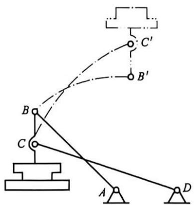

图3-12 造型机的翻箱机构
{: .figure-caption }

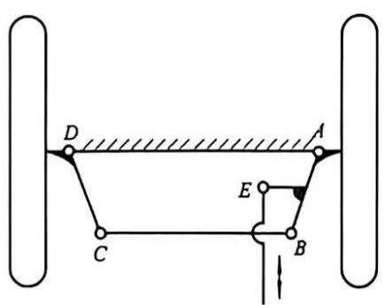

图3-13 汽车转向机构
{: .figure-caption }

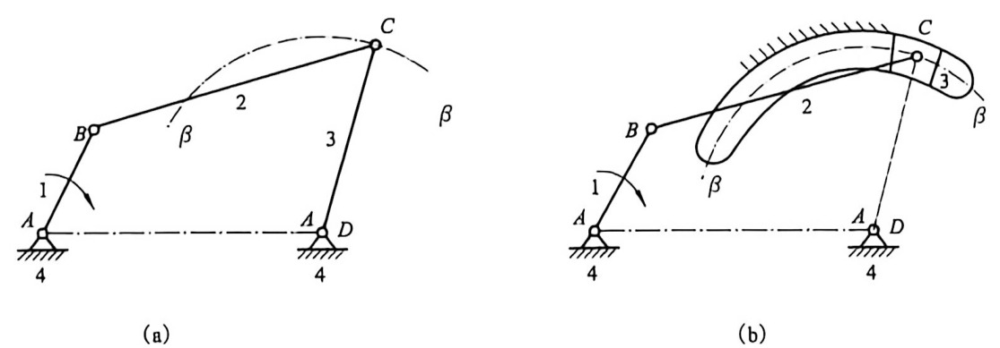

图 3-14 曲柄摇杆机构演化成曲柄滑块机构
{: .figure-caption }

### 3.2.2 平面四杆机构的演化

除上述三种类型的铰链四杆机构之外，在机械中还广泛采用其他类型的四杆机构。不过这些类型的四杆机构，可认为是由四杆机构的基本类型演化而来的。四杆机构的演化，不仅是为了满足运动方面的要求，而且是为了改善受力状况及满足结构设计上的需要等。各种演化机构的外形虽然各不相同，但它们的性质及分析和设计的方法却是相同的或类似的。

下面对各种演化方法及其应用举例加以介绍。

#### 1. 改变构件的形状和运动尺寸

如图 3-14(a) 所示的曲柄摇杆机构中, 当曲柄 1 绕轴 $A$ 回转时, 铰链 $C$ 将沿圆弧 $\beta \beta$ 往复运动。如图 3-14(b) 所示, 现将摇杆 3 做成滑块形式, 使其沿圆弧导轨 $\beta \beta$ 往复滑动, 显然其运动性质并未发生改变, 但此时铰链四杆机构已演化为具有曲线导轨的曲柄滑块机构。

若将图 3-14(a) 中摇杆 3 的长度增至无限大, 则图 3-14(b) 中的曲线导轨将变成直线导轨, 于是铰链四杆机构就演化为常见的曲柄滑块机构 (图 3-15)。图 3-15(a) 为具有偏距 $e$ 的偏置曲柄滑块机构; 图 3-15(b) 则为无偏距的对心曲柄滑块机构。

(α)

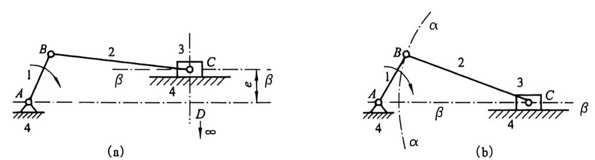

图3-15 曲柄滑块机构
{: .figure-caption }

曲柄滑块机构应用于榫槽侧拉床机构中。榫槽侧拉床是高精密机床，主要用来加工飞机发动机、汽轮机涡流盘等的榫槽和榫头，属于国防工业的尖端装备，国外拥有该项技术的国家对我国进行技术封锁。我国在榫槽侧拉床机构中应用曲柄滑块巧妙地将圆弧运动的角度变化转变为直线方向上的位移变化，实现了直线位移与角度位移的一一对应，不仅降低了加工成本，还降低了对装配的要求，节约了成本。

如图 3-15(b) 所示的曲柄滑块机构还可以进一步演化为图 3-16 所示的双滑块四杆机构。在图 3-16(b) 所示机构中，从动件 3 的位移与原动件 1 的转角的正弦呈正比 ( $s = l_{\mathrm{All}} \sin \varphi$ )，故称为正弦机构。

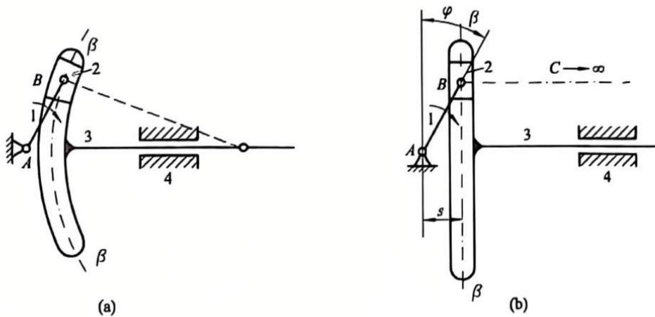

图3-16 双滑块四杆机构
{: .figure-caption }

#### 2. 改变运动副的尺寸

如图 3-17(a) 所示的曲柄滑块机构中, 当曲柄 $AB$ 的尺寸较小时, 由于结构的需要, 常将曲柄改为如图 3-17(b) 所示的偏心圆盘, 其回转中心至几何中心的偏心距等于曲柄的长度, 这种机构称为偏心轮机构。其运动特性与曲柄滑块机构完全相同。偏心轮机构可认为是将曲柄滑块机构中的转动副 $B$ 的半径扩大, 使之超过曲柄长度演化而成的。偏心轮机构在锻压设备和柱塞泵中应用较广。

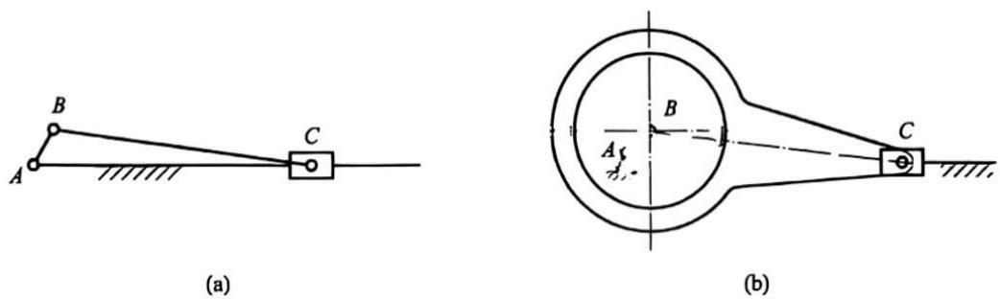

图3-17 偏心轮机构
{: .figure-caption }

#### 3. 选用不同的构件作为机架（

如图 3-18(a) 所示的曲柄滑块机构, 若以构件 1 为机架 [图 3-18(b)], 此时构件 4 绕轴 $A$ 转动, 而构件 3 则以构件 4 为导轨沿其相对移动, 构件 4 称为导杆, 该机构则称为导杆机构; 若以构件 2 为机架 [图 3-18(c)], 则演化成为曲柄摇块机构, 其中构件 3 仅能绕点 $C$ 摇摆; 又若以滑块 3 为机架 [图 3-18(d)], 则曲柄滑块机构演化成为直动导杆机构。

在导杆机构中, 如果导杆能做整周转动, 则称为回转导杆机构。如图 3-19 所示的小型刨床中的 $ABC$ 部分即为回转导杆机构。如果导杆仅能在某一角度范围内摆动, 则称为摆动导杆机构。如图 3-20 所示牛头刨床的导杆机构 $ABC$ 即为一例。

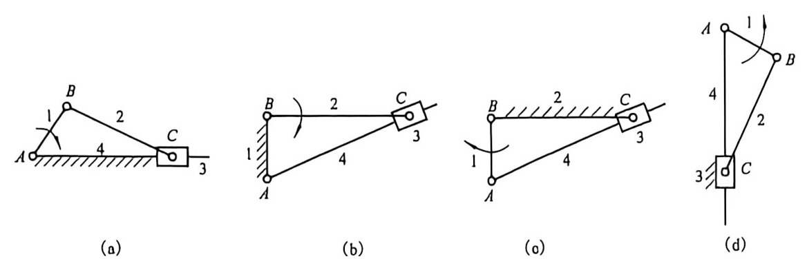

图3-18 选择不同机架的演化方式
{: .figure-caption }

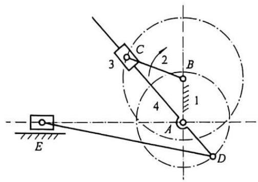

图3-19 小型刨床机构
{: .figure-caption }

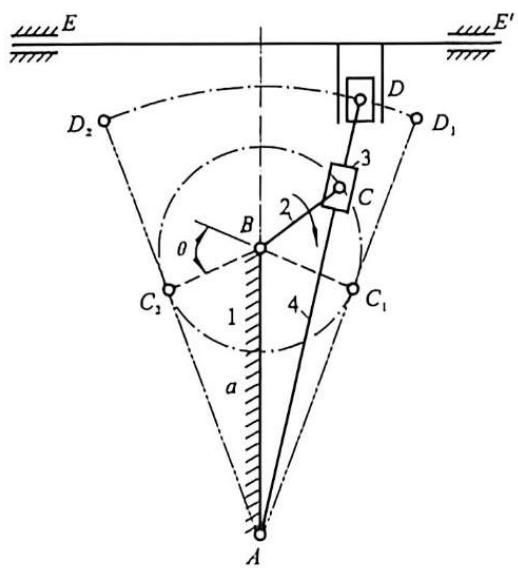

图3-20 牛头刨床机构
{: .figure-caption }

选用运动链中不同构件作为机架以获得不同机构的演化方法称为机构的倒置。铰链四杆机构、双滑块四杆机构等同样可以经过机构的倒置来获得不同形式的四杆机构。

由上述可见，四杆机构的类型多种多样，我们可根据演化的概念，研究设计出形式各异的四杆机构。

#### 4. 平面连杆机构与平面凸轮机构的关联

当平面凸轮机构的凸轮副(高副)的两个元素为圆、直线或点(圆半径为零的特例)时, 可以用平面连杆机构替代平面凸轮机构, 其运动特性与被替代的凸轮机构完全相同。如果不满足上述条件, 即不是圆、直线和点, 而是变曲率曲线, 则这种替代只具有瞬时性, 即两机构在该瞬时位置的运动(速度和加速度)相同。

(1)组成高副的两个元素均为圆。

如图 3-21(a) 所示的凸轮机构中, 凸轮 1 与从动件 3 组成高副, 两个元素分别为圆心 $A$ 和 $B$ , 半径 $r_1$ 和 $r_2$ 的圆。在机构运动过程中, $A 、 B$ 两点间的距离 $r_1 + r_2$ 始终保持不变。若将构件 2 分别与构件 1、3 在 $A 、 B$ 点处铰接, 从而形成铰链四杆机构 $O_1 A B O_2$ , 如图 3-21(b) 所示, 两个机构的运动特性完全一样。

(2) 组成高副的两个元素一个为圆，另一个为点。

如图 3-22(a) 所示的凸轮机构中, 凸轮 1 与从动件 3 组成高副, 两个元素分别为圆心 $A$ 、半径 $r_1$ 的圆与 $B$ 点接触。在机构运动过程中, $A$ 、 $B$ 两点间的距离 $r_1$ 始终保持不变。若将构件 2 分别与构件 1、3 在 $A$ 、 $B$ 点处铰接, 从而形成曲柄滑块机构 $O_1 A B$ , 如图 3-22(b) 所示, 两个机构的运动特性完全一样。

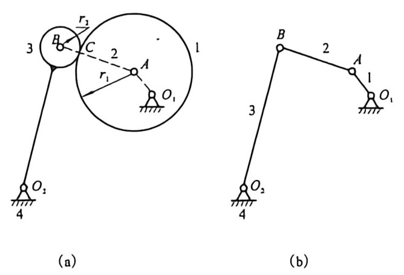

图3-21 用铰链四杆机构替代凸轮机构
{: .figure-caption }

(b)

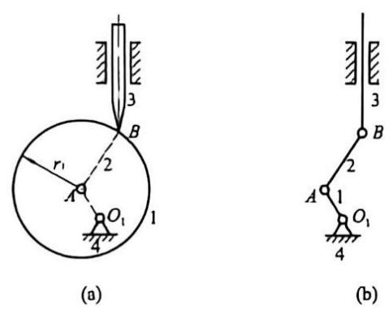

图3-22 用曲柄滑块机构替代凸轮机构
{: .figure-caption }

(3) 组成高副的两个元素一个为圆另一个为直线。

如图 3-23(a) 所示的凸轮机构中, 凸轮 1 与从动件 3 组成高副, 两个元素分别为圆心 $A$ 、半径 $r_1$ 的圆与直线 $O_3B$ 接触。在机构运动过程中, $A$ 点至直线 $O_3B$ 的垂直距离 $AB$ ( $B$ 点为垂足) 始终保持不变。若将构件 2 与构件 1 在 $A$ 点处铰接, 与构件 3 组成移动副, 其导轨方向沿 $O_3B$ , 从而形成导杆机构 $O_1ABO_3$ , 如图 3-23(b) 所示, 两个机构的运动特性完全一样。

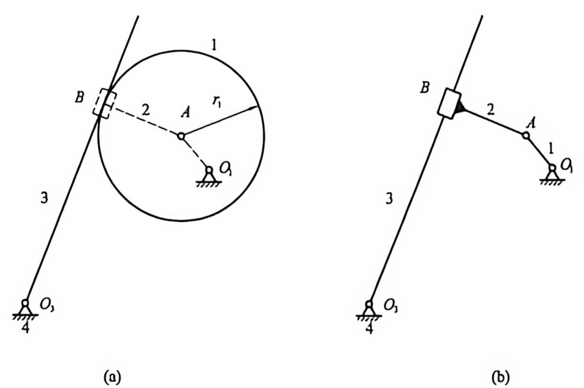

图3-23 用导杆机构替代凸轮机构
{: .figure-caption }

平面连杆机构和平面凸轮机构是平面机构中用得最多的两个机构。掌握了这两个机构之间的关联，就可以用平面连杆机构的运动分析来研究平面凸轮机构，以简化平面凸轮机构的运动分析和设计思路，进而扩大平面连杆机构分析方法的应用。

## 3.3 平面四杆机构的基本知识

在具体讨论平面机构的有关设计问题之前，有必要先阐述设计中的一些共性问题。

### 3.3.1 铰链四杆机构有曲柄的条件

在铰链四杆机构中，各运动副都是转动副。如组成转动副的两个构件能相对整周转动，则称其为周转副。下面在图3-24所示的四杆机构中，讨论转动副 $\Lambda$ 成为周转副的条件。

设图 3-24 所示四杆机构各杆的长度分别为 a、b、c、d。设 $a \leqslant d$ ，要转动副 A 成为周转副，则 AB 杆应能到达整周回转中的任何位置。由 AB 杆与机架 AD 两次共线的位置可分别得到 $\triangle DB'C'$ 和 $\triangle DB''C''$ ，由三角形边

长公理可知，三角形中任意两边长度之和大于或等于第三边长度，由此可得以下关系式：

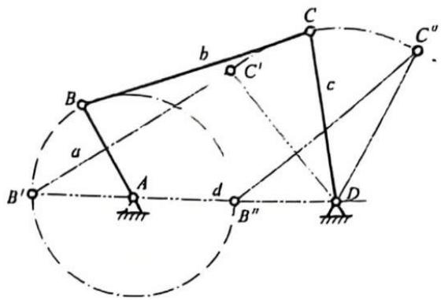

图3-24 曲柄摇杆机构
{: .figure-caption }

$$
\begin{array}{c} {a + d \leqslant b + c} \\ {b \leqslant (d - a) + c, \text {即} a + b \leqslant c + d} \\ {c \leqslant (d - a) + b, \text {即} a + c \leqslant b + d} \end{array}
$$

将上述三式分别两两相加得：

$a \leqslant b, a \leqslant c, a \leqslant d$ ，即 $AB$ 为最短杆

若 $d < a$ ，用同样的方法可得转动副 $A$ 为周转副的条件：

$$
\begin{array}{l} d + a \leqslant b + c \\ d + b \leqslant a + c \\ d + c \leqslant a + b \end{array}
$$

$$
d \leqslant a, d \leqslant b, d \leqslant c, \text { 即 } A D \text { 为最短杆 }
$$

分析上述各式，可得出转动副 $\Lambda$ 成为周转副的必要条件为：①最短杆长度+最长杆长度 $\leqslant$ 其余两杆长度之和，此条件称为杆长条件；②组成该周转副的两杆中必有一杆为最短杆。

上述条件表明：当四杆机构各杆的长度满足杆长条件时，有最短杆参与构成的转动副都是周转副（图3-24中的 $A$ 、 $B$ 副），而其余的转动副（如 $C$ 、 $D$ 副）则不是整转副。

曲柄是连架杆, 周转副处于机架上才能形成曲柄, 于是, 四杆机构有曲柄的条件是各杆的长度应满足杆长条件, 且其最短杆为连架杆或机架。在满足杆长条件的四杆机构中, 当以最短杆的相邻杆为机架时, 机构为曲柄摇杆机构 [图 3-25(a) 和图 3-25(b)]；当以最短杆为机架时则为双曲柄机构 [图 3-25(c)]；当以最短杆的对边为机架, 则机构为双摇杆机构 [图 3-25(d)]。如果铰链四杆机构各杆的长度不满足杆长条件, 则无周转副, 此时不论以哪个构件为机架, 均为双摇杆机构。

### 3.3.2 平面四杆机构输出件的急回特性

如图 3-26 所示为曲柄摇杆机构，设曲柄 AB 为原动件，在其匀速转动一周的过程中，有两次与连杆 BC 共线，这时摇杆 CD 分别处于两个极限位置 $C_{1}D$ 和 $C_{2}D$ 。机构所处的这两个位置称为极位。机构处在两个极位时，原动件 AB 所在的两个位置之间所夹的锐角 $\theta$ 称为极位夹角。

如图 3-26 所示，当曲柄以等角速度 $\omega_{1}$ 顺时针转过 $\alpha_{1}=180^{\circ}+\theta$ 时，摇杆将从位置 $C_{1}D$ 摆到 $C_{2}D$ ，其摆角为 $\psi$ ，设所需时间为 $t_{1}$ ，则 C 点的平均速度为 $v_{1}=C_{1}C_{2}/t_{1}$ 。当曲柄继续转过 $\alpha_{1}=180^{\circ}-\theta$ 时，此时摇杆从位置 $C_{2}D$ 返回到 $C_{1}D$ ，摆角仍然为 $\psi$ ，设所需时间为 $t_{2}$ ，则 C 点的平均速度为 $v_{2}=\widehat{C_{1}C_{2}}/t_{2}$ 。由于曲柄为等速转动，而 $\alpha_{1}>\alpha_{2}$ ，所以有 $t_{1}>t_{2}, v_{1}<v_{2}$ 。摇杆的这种运动性质称为急回运动。为了表明急回运动的程度，可用行程速比系数（或行程速度变化系数）K 来衡量，即 \_\_\_\_

$$
K = \frac {v _ {2}}{v _ {1}} = \frac {C _ {1} C _ {2} / t _ {2}}{C _ {1} C _ {2} / t _ {1}} = \frac {t _ {1}}{t _ {2}} = \frac {\alpha_ {1}}{\alpha_ {2}} = \frac {1 8 0 ^ {\circ} + \theta}{1 8 0 ^ {\circ} - \theta}\tag{3-1}
$$

式(3-1)表明, 当机构存在极位夹角 $\theta$ 时, 机构便具有急回运动特性。 $\theta$ 愈大, 机构的急回特性愈显著。如图 3-27(a) 所示的对心曲柄滑块机构, 由于其 $\theta = \Omega^{\circ} \quad K = 1$ , 故无急回作用; 而图 3-27(b) 所示的偏置曲柄滑块机构, 因其 $\theta$ 不等于 $0^{\circ}$ , 故有急回作用。在图 3-28 所示的摆动导杆机构中, 当曲柄 $AC$ 两次转到与导杆垂直时, 导杆处于两个极限位置。由于其 $\theta$ 不等于 $0^{\circ}$ , 故也有急回作用。

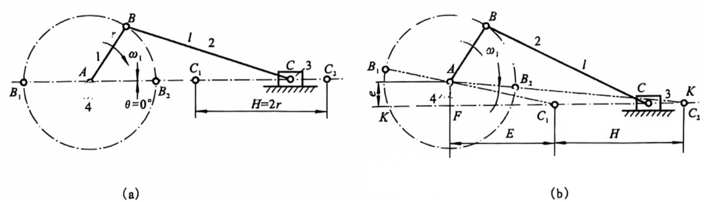

图3-27 曲柄滑块机构中的极位夹角
{: .figure-caption }

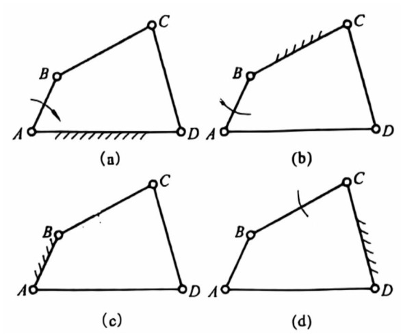

图3-25 四杆机构类型与机架选择的关系
{: .figure-caption }

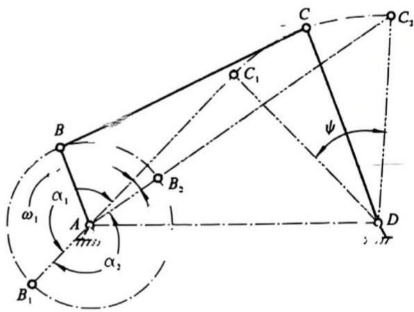

图3-26 曲柄摇杆机构中的极位夹角
{: .figure-caption }

机构的这种急回运动在机械中常被用来节省空回行程的时间，以提高劳动生产率。例如在牛头刨床中采用摆动导杆机构就是一例。对于一些要求具有急回运动性质的机械，如牛头刨床、往复式运输机等，在设计时要根据所需要的行程速比系数 K 来设计，这时应先利用下式求出 $\theta$ ，然后再设计各构件的尺寸。

$$
\theta = 1 8 0 ^ {\circ} \times (K - 1) / (K + 1)\tag{3-2}
$$

### 3.3.3 平面四杆机构的压力角和传动角

如图 3-29 所示的四杆机构中, 若不考虑各运动副中的摩擦力及构件重力和惯性力的影响, 主动构件 AB 经连杆 BC

传递到从动件 CD 上点 C 的力 F，沿 BC 方向，力 $F_{0}$ 与点 C 速度方向之间所夹的锐角 $\alpha$ 称为机构在此位置时的压力角，而连杆 BC 和从动件 CD 之间所夹的锐角 $\gamma$ 称为连杆机构在此位置时的传动角。 $\gamma$ 和 $\alpha$ 互为余角。因为驱动从动件 CD 转动的有效分力 $F_{1}=F\cdot\sin\gamma$ ，显然传动角 $\gamma$ 愈大，对机构的传力愈有利，所以在连杆机构中常用传动角的大小及其变化情况来衡量机构传力性能。

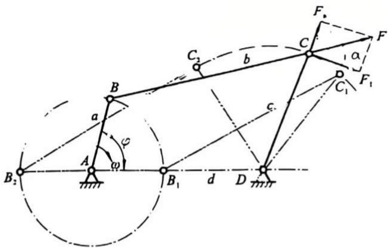

图3-29 曲柄摇杆机构的压力角和传动角
{: .figure-caption }

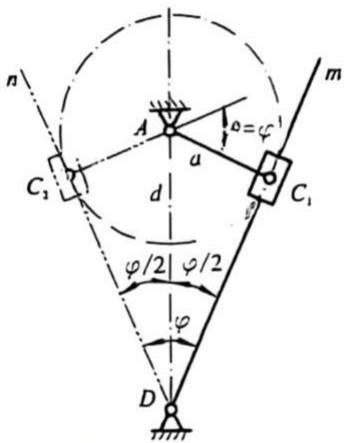

图3-28 摆动导杆机构中的极位夹角
{: .figure-caption }

在机构运动过程中，传动角 $\gamma$ 的大小

是变化的，为了保证机构传力性能良好，设计时，通常应使 $\gamma_{min} \geqslant 40^{\circ}$ ；在传递力矩较大时，则应使 $\gamma_{min} \geqslant 50^{\circ}$ 。对于一些受力很小或不常使用的操纵机构，则可允许传动角小些，只要不发生自锁即可。

出现最小传动角 $\gamma_{min}$ 的位置分析如下：

$$
\left\{ \begin{array}{l l} \gamma_ {1} = \angle B C D (\angle B C D \leqslant 9 0 ^ {\circ} \text {时}) \\ \gamma_ {2} = 1 8 0 ^ {\circ} - \angle B C D (\angle B C D > 9 0 ^ {\circ} \text {时}) \end{array} \right.\tag{3-3}
$$

对于曲柄摇杆机构 $\gamma_{\min} = \min |\gamma_{1}, \gamma_{2}|$ ，如图 3-29 所示 $\gamma_{\min}$ 为主动曲柄与机架共线的两个位置之一，这时传动角的大小与机构中各杆的长度有关，故可按给定的许用传动角来设计四杆机构。

### 3.3.4 平面四杆机构的死点问题

如图 3-30 所示的曲柄摇杆机构中，设摇杆 CD 为主动件，则当连杆与从动曲柄共线时（虚线位置），机构的传动角 $\gamma=0^{\circ}$ ，这时主动件 CD 通过连杆作用在从动件 AB 上的力恰好通过其回转中心，致使构件 AB 不能转动而出现“顶死”的现象，机构的这种位置称为死点。同样，对于曲柄滑块机构，当滑块为主动件时，若连杆与从动曲柄共线，机构也处于死点位置。

机构的死点和极位实际上是机构的同一位置，所不同的是机构的原动件不同（当原动件与连杆共线时为极位）。机构在死点时本不能运动，为了使机构能顺利地通过死点而正常运转，必须采取适当的措施。如可采用将两组以上的相同机构组合使用，而使各组机构的死点相互错开排列的方法，如图 3-9 所示的机车车轮联动机构，其两侧曲柄滑块机构的曲柄位置相互错开了 $90^{\circ}$ ；也可采用安装飞轮加大惯性的方法，借惯性作用使机构闯过死点，如图 3-5 所示的缝纫机踏板机构中的大带轮即兼有飞轮的作用等。

任何事物都有两面性, 死点也不例外, 虽然多数情况下应避免死点, 但在工程实践中,也常利用机构的死点来实现特定的工作要求。例如, 图 3-31 所示的飞机起落架机构, 在机轮放下时, 杆 $BC$ 和 $CD$ 成一直线, 此时机轮上虽受到很大的力, 但由于机构处于死点位置,起落架不会反转(折回), 这可使飞机起落和停放更加可靠。

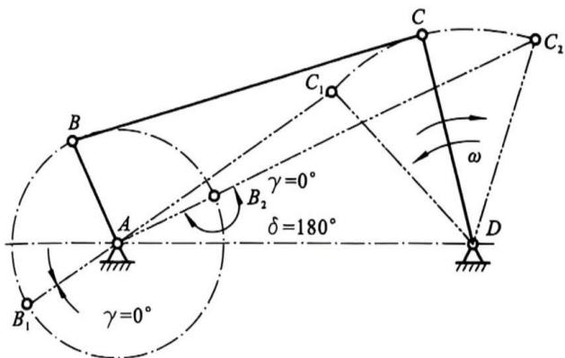

图3-30 曲柄摇杆机构的死点位置
{: .figure-caption }

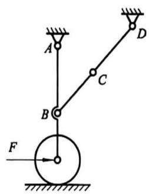

图 3-31 飞机起落架机构
{: .figure-caption }

## 3.4 平面连杆机构的运动分析

机构运动分析的任务是在已知机构尺寸及原动件运动规律的情况下，确定机构中其他构件上某些点的轨迹、位移、速度及加速度和构件的角位移、角速度及角加速度。通过对机构进行位移和轨迹分析，可以了解机构能否满足预期的位置功能要求，以及各构件所需的空间会不会发生干涉。通过对机构进行速度分析，可以了解从动件速度波动的变化规律，为速度波动调节做准备，而且为进行加速度分析提供基础。对机构进行加速度分析，可以了解加速度的大小及其变化规律，从而计算惯性力及对机构进行进一步的分析、强度计算等。

运动分析的方法很多，主要有图解法、解析法和试验法等。本章主要介绍图解法和解析法。

### 3.4.1 用矢量方程图解法作平面机构的运动分析

矢量方程图解法又称相对运动图解法，其所依据的基本原理是理论力学中的运动合成原理。

根据不同的相对运动情况，机构的运动分析可按以下两类讨论。

1. 同一构件上两点间的速度和加速度关系

(1) 速度之间的关系。

如图 3-32(a) 所示机构，

$$
\boldsymbol {v} _ {\mathrm{B}} = \boldsymbol {v} _ {\mathrm{A}} + \boldsymbol {v} _ {\mathrm{BA}}
$$

|  | $\boldsymbol{v}_{\mathrm{B}}$ | $=$ | $\boldsymbol{v}_{\mathrm{A}}$ | $+$ | $\boldsymbol{v}_{\mathrm{BA}}$ |
| :--- | :---: | :---: | :---: | :---: | :---: |
| 大小 | ? | | ✓ | | ? |
| 方向 | ✓ | | ✓ | | $\perp AB$ |

如图 3-32（b）所示，选速度比例尺 $\mu_{\mathrm{v}}(\mathrm{m} / \mathrm{s} / \mathrm{mm})$ ，在任意点 $p$ 作图使 $\overline{pa} = v_{\mathrm{A}} / \mu_{1}$ 画出 $v_{\mathrm{B}}$ 和 $v_{\mathrm{AB}}$ 矢量的方向线，相交于 $b$ 点，连接 $pb$ ，按图解法得： $v_{\mathrm{B}} = \mu_{\mathrm{v}} \cdot \overline{pb}$ ，方向为 $p \to b$ 。

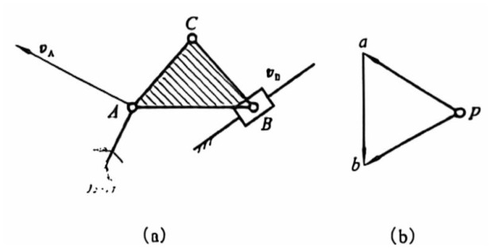

相对速度为： $v_{\mathrm{BA}}=\mu_{\mathrm{v}}\overline{ab}$ ，方向为 $a\rightarrow b$ 。

角速度 $\omega_{AB}$ 为： $\omega_{AB}=v_{BA}/l_{AB}=\mu_{\mathrm{v}}\overline{ab}/\mu_{\mathrm{l}}\overline{AB}$ ，方向为顺时针方向。

图3-32 同一构件上两点间的速度关系
{: .figure-caption }

(2)加速度之间的关系。

如图 3-33(a) 所示机构，设已知角速度 $\omega$ ，A 点加速度和 $a_{B}$ 的方向。

A、B 两点间加速度之间的关系有：

$$
\boldsymbol {a} _ {\mathrm{B}} = \boldsymbol {a} _ {\mathrm{A}} + \boldsymbol {a} _ {\mathrm{BA}} ^ {\mathrm{n}} + \boldsymbol {a} _ {\mathrm{BA}} ^ {\prime}
$$

|  | $\boldsymbol{a}_{\mathrm{B}}$ | $=$ | $\boldsymbol{a}_{\mathrm{A}}$ | $+$ | $\boldsymbol{a}_{\mathrm{BA}}^{\mathrm{n}}$ | $+$ | $\boldsymbol{a}_{\mathrm{BA}}^{\prime}$ |
| :--- | :---: | :---: | :---: | :---: | :---: | :---: | :---: |
| 大小 | ? | | ✓ | | $\omega_{\mathrm{BA}}^{2}l_{\mathrm{AB}}$ | | ? |
| 方向 | ✓ | | ✓ | | $B \rightarrow A$ | | $\perp AB$ |

如图 3-33(b) 所示，选加速度比例尺 $\mu_{a}(m/s^{2}/mm)$ 。

图3-33 同一构件上两点之间的加速度关系
{: .figure-caption }

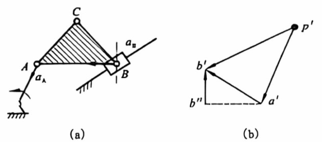

在任意点 $p'$ 作图使 $a_{A}=\mu_{a}\overline{p'a'}$ ， $a_{BA}^{n}=\mu_{a}\overline{a'b''}$ ，画出 $a_{B}$ 和 $a_{AB}'$ 的方向线，相交于 $b'$ 点。求得： $a_{B}=\mu_{a}\overline{p'b'}$ ，方向为 $b''\rightarrow b'$ 。

$a_{BA}^{1}=\mu_{a}\overline{b^{\prime\prime}b^{\prime}}$ ，方向为 $a^{\prime}\rightarrow b^{\prime}$ 。

角加速度： $\alpha=a_{BA}^{\prime}/l_{\mathrm{AB}}=\mu_{a}\overline{b^{\prime\prime}b^{\prime}}/\mu_{\mathrm{l}}\overline{AB}$ ，方向为逆时针方向。

#### 2. 两个构件重合点的速度及加速度的关系

(1) 速度之间的关系。

如图 3-34(b) 所示机构, 构件 2、构件 3 重合点 $B_{2} 、 B_{3}$ 之间的速度关系为:

$$
\boldsymbol {v} _ {\mathrm{B3}} = \boldsymbol {v} _ {\mathrm{B2}} + \boldsymbol {v} _ {\mathrm{B3B2}}
$$

|  | $\boldsymbol{v}_{\mathrm{B3}}$ | $=$ | $\boldsymbol{v}_{\mathrm{B2}}$ | $+$ | $\boldsymbol{v}_{\mathrm{B3B2}}$ |
| :--- | :---: | :---: | :---: | :---: | :---: |
| 大小 | ? | | ✓ | | ? |
| 方向 | ✓ | | ✓ | | $\perp BC$ |

如图 3-34(a) 所示，选取速度比例尺 $\mu_{v}$ m/s/mm，在任意点 p 作图使 $v_{\mathrm{B2}}(v_{\mathrm{B2}}=v_{\mathrm{B1}})=\mu_{v}\overline{pb}_{2}$ ，画出 $v_{B3}$ 和 $v_{B3B2}$ 矢量的方向线，相交

于 $b_{3}$ 点。按图解法得： $v_{\text{B3}} = \mu_{\text{v}} \overline{p} b_{3}$ ，方向为 $p \to b_{3}$ ； $\omega_{3} = \mu_{\text{v}} \overline{p} b_{3} / l_{\text{CB}}$ ，方向为顺时针方向。

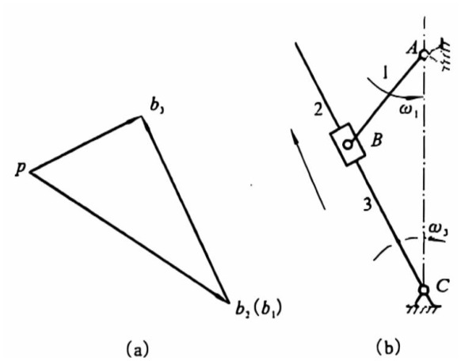

图3-34 两个构件重合点之间的速度关系
{: .figure-caption }

(2)加速度之间的关系。

如图 3-35(b) 所示机构, 已知 $\omega_{1}$ , 并由上述方法求得 $\omega_{3}$ 。重合点 $B_{2} 、 B_{3}$ 之间的加速度关系有:

$$
a _ {\mathrm{B} 3} = a _ {\mathrm{B} 3} ^ {n} + a _ {\mathrm{B} 3} ^ {\prime} = a _ {\mathrm{B} 2} + a _ {\mathrm{B} 3 \mathrm{B} 2} ^ {r} + a _ {\mathrm{B} 3 \mathrm{B} 2} ^ {k}
$$

|  | $a_{\mathrm{B3}}$ | $=$ | $a_{\mathrm{B3}}^{\mathrm{n}}$ | $+$ | $a_{\mathrm{B3}}^{\prime}$ | $=$ | $a_{\mathrm{B2}}$ | $+$ | $a_{\mathrm{B3B2}}^{\mathrm{r}}$ | $+$ | $a_{\mathrm{B3B2}}^{\mathrm{k}}$ |
| :--- | :---: | :---: | :---: | :---: | :---: | :---: | :---: | :---: | :---: | :---: |
| 大小 | ? | | $\omega_{3}^{2}l_{\mathrm{BC}}$ | | ? | | $l_{\mathrm{AB}}\omega^{2}$ | | ? | | $2v_{\mathrm{B3B2}}\omega_{3}$ |
| 方向 | ? | | $B \rightarrow C$ | | ✓ | | $B \rightarrow A$ | | $\perp BC$ | | ✓ |

如图 3-35(a) 所示，选取加速度比例尺 $\mu_{a}$ ，在任意点 $p'$ 作图 $a_{B2}$ 、 $a_{B3B2}^{k}$ 、 $a_{B3}^{n}$ ，画出 $a_{B3}^{t}$ 和 $a_{B3B2}^{r}$ 矢量的方向线，相交于 $b_{3}'$ 点。

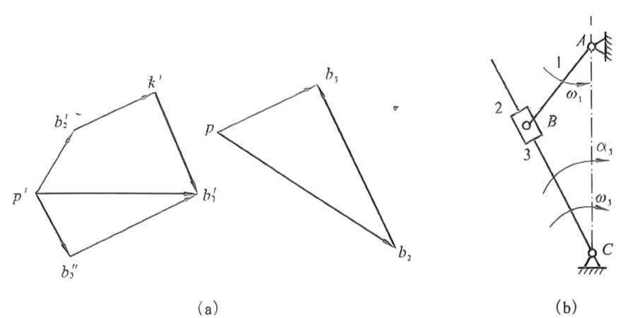

图3-35 两个构件重合点之间的加速度关系
{: .figure-caption }

$a_{B3B2}^{k}=2v_{B3B2}\omega_{3},\quad a_{B3B2}^{k}$ 的方向： $v_{B3B2}$ 顺 $\omega_{3}$ 转过 $90^{\circ}$ 。

由图解得： $a_{B3}=\mu_{a}\overline{p^{\prime}b_{3}^{\prime}}$ ，方向为 $p^{\prime}\rightarrow b_{3}^{\prime}$ ； $a_{B3B2}^{r}=\mu_{a}\overline{k^{\prime}b_{3}^{\prime}}$ ，方向为 $B\rightarrow C$ ； $\alpha_{3}=a_{B3}^{t}/l_{BC}=\mu_{a}\overline{b_{3}^{\prime\prime}b_{3}^{\prime}}/\mu_{\mathrm{l}}\overline{B}C$ ，方向为顺时针方向。

结论：当两个构件构成移动副时，重合点的加速度不相等，且移动副有转动分量时，必然存在哥氏加速度分量。

### 3.4.2 用速度瞬心法作平面机构的速度分析

#### 1. 速度瞬心的定义

如图 3-36 所示，在某一瞬时，若两个做平面运动的构件上存在绝对速度相同的一对重合点，两个构件相对于该点做相对转动，则该点称瞬时速度中心，即瞬心。

若瞬心的绝对速度为零，则为绝对瞬心；否则为相对瞬心。用符号 $P_{ij}$ 表示构件i和j的瞬心。

速度瞬心的特点：

(1)该点涉及两个构件。

(2) 绝对速度相同，相对速度为零。

(3) 相对回转中心。

#### 2. 瞬心数目 $K$

若机构中有 N 个构件，则因为每两个构件就有一个瞬心，所以根据排列组合有：

$$
K = N (N - 1) / 2\tag{3-4}
$$

#### 3. 机构瞬心位置的确定

(1) 直接观察法。

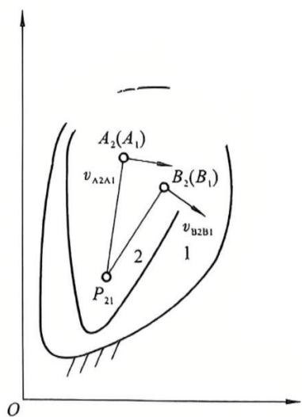

图3-36 速度瞬心
{: .figure-caption }

直接观察法适用于求通过运动副直接相连的两个构件的瞬心位置。如图 3-37 所示，当两个构件以转动副相连时，转动中心即为两构件的瞬心[图 3-37(a)]；当两个构件通过移动副相连时，两个构件的瞬心位于垂直于导轨方向无穷远处[图 3-37(b)]；当两个构件以高副相连，且绕接触点做纯滚动时，接触点即为两个构件的瞬心[图 3-37(c)]；当两个构件以高副相连，在接触点既有滚动又存在滑动时，其瞬心位于接触点的公法线上，具体位置尚须其他条件确定[图 3-37(d)]。

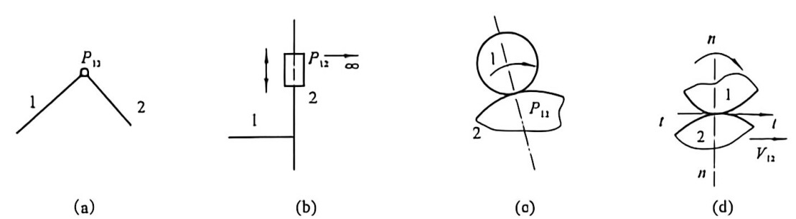

图3-37 直接观察法求瞬心
{: .figure-caption }

(d)

(2)借助三心定理确定瞬心位置。

当求机构中没有通过运动副直接连接的两构件的瞬心时，用上述方法往往不易求得，在这种情况下，可应用三心定理求得。

三心定理: 三个做平面运动的构件共有三个瞬心, 且它们位于同一条直线上。

如图 3-38 所示，构件 1、构件 2、构件 3 为彼此做相对运动的三个构件。根据式(3-4)，它们共有三个瞬心，即 $P_{12}$ 、 $P_{13}$ 和 $P_{23}$ 。其中 $P_{12}$ 、 $P_{13}$ 分别位于

两转动副中心。为简单起见，设构件1是固定的。这时在构件2及构件3上任一点的速度必分别与该点至 $P_{12}$ 及 $P_{13}$ 的连线垂直。现如图设K点为构件2及构件3上不在 $P_{12}$ 及 $P_{13}$ 连线上的重合点，显然因重合点 $K_{2}$ 、 $K_{3}$ 的速度 $v_{k2}$ 、 $v_{k3}$ 方向不同而重合点K不可能成为瞬心 $P_{23}$ ，而只有将重合点K选在 $P_{12}$ 及 $P_{13}$ 的连线上两速度方向才能一致，故知 $P_{23}$ 与 $P_{12}$ 、 $P_{13}$ 必在同一直线上。

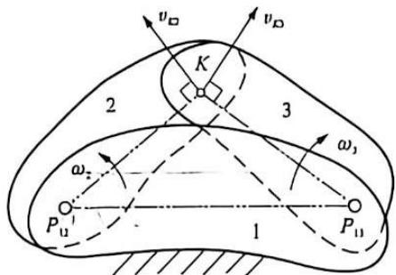

图3-38 三心定理
{: .figure-caption }

#### 4. 速度瞬心在机构速度分析中的应用

(1) 求线速度。

如图 3-39 所示的平面凸轮机构，已知凸轮转速 $\omega_{1}$ ，求推杆的速度 $v_{2}$ 。

问题的关键是要求出已知运动规律的构件 1 与待求运动规律的构件 2 之间的瞬心 $P_{12}$ 及其速度。

解：①直接观察法求瞬心 $P_{13}, P_{23}(\rightarrow \infty), P_{12}(n - n)$ ；②根据三心定理求得 $P_{12}$ ；③求瞬心 $P_{12}$ 的速度。

$$
v _ {2} = v _ {P 1} = v _ {P 2} = \mu_ {l} (\overline {{P _ {1 3} P}} _ {1 2}) \cdot \omega_ {1}
$$

长度 $\overline{P_{13}P_{12}}$ 直接从图上量取，方向如图 3-39 所示。

(2) 求角速度。

如图 3-40 所示的铰链四杆机构，已知构件 2 的转速 $\omega_{2}$ ，求构件 4 的角速度 $\omega_{4}$ 。解：①瞬心数为 6 个；②直接观察法能求出 4 个，余下的 2 个用三心定理求出；③求 $\omega_{4}$ 。由瞬心 $P_{24}$ 的速度，得：

$$
\begin{array}{r l} & v _ {P _ {2 4}} = \mu_ {1} (\overline {{P _ {2 4} P _ {1 2}}}) \cdot \omega_ {2} \\ & v _ {P _ {2 4}} = \mu_ {1} (\overline {{P _ {2 4} P _ {1 4}}}) \cdot \omega_ {4} \\ & \omega_ {4} = \omega_ {2} \cdot (\overline {{P _ {2 4} P _ {1 2}}}) / (\overline {{P _ {2 4} P _ {1 4}}}) \end{array}
$$

方向：与 $\omega_{2}$ 相同。

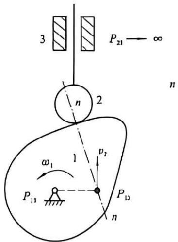

图3-39 瞬心法作凸轮机构的速度分析
{: .figure-caption }

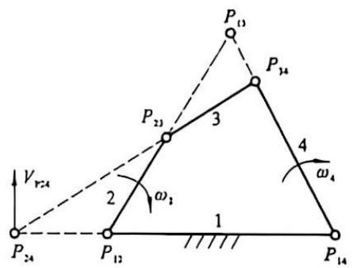

图3-40 瞬心法作四杆机构的速度分析
{: .figure-caption }

### 3.4.3 用解析法作平面机构的运动分析

平面机构运动分析的解析法有多种，如矩阵法、复数法、杆组法等。下面主要介绍方便运用标准计算程序的矩阵法。

如图 3-41 所示四杆机构，已知各构件尺寸和 $\theta_{1}$ 、 $\omega_{1}$ （ $\omega_{1}$ 为常数），试求构件 2、3 的角位移 $\theta_{2}$ 、 $\theta_{3}$ 、角速度 $\omega_{2}$ 、 $\omega_{3}$ 、角加速度 $\alpha_{2}$ 、 $\alpha_{3}$ ，以及连杆上点 P 的位移 $x_{P}$ 、 $y_{P}$ 、速度 $v_{P}$ 和加速度 $a_{P}$ 。

首先建立如图 3-41 所示直角坐标系。标出各构件矢量及其位置角。为方便起见，取 $x$ 轴与 $l_{4}$ 的正向一致，并以 $x$ 轴为各构件杆矢量位置角 $\theta$ 的起始线，逆时针方向为正，反之为负。

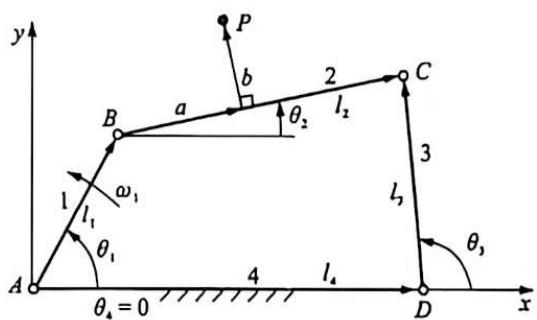

图3-41 机构的封闭矢量多边形
{: .figure-caption }

#### 1. 位置分析

如图 3-41 所示, 根据各构件所构成的封闭矢量多边形, 可写出如下矢量方程:

$$
l _ {1} + l _ {2} = l _ {3} + l _ {4}\tag{3-5}
$$

将上式分别向 x 轴和 y 轴投影得：

$$
\left\{ \begin{array}{l} l _ {1} \cos \theta_ {1} + l _ {2} \cos \theta_ {2} = l _ {3} \cos \theta_ {3} + l _ {4} \cos \theta_ {4} \\ l _ {1} \sin \theta_ {1} + l _ {2} \sin \theta_ {2} = l _ {3} \sin \theta_ {3} + l _ {4} \sin \theta_ {4} \end{array} \right.\tag{3-6}
$$

上式即为机构的位置方程式，其中仅含 $\theta_{2}$ 、 $\theta_{3}$ 两个未知量，故可以求解。

连杆上 $P$ 点的坐标:

$$
\left\{ \begin{array}{l} x _ {\mathrm{p}} = l _ {1} \cos \theta_ {1} + a \cos \theta_ {2} + b \cos (9 0 ^ {\circ} + \theta_ {2}) \\ y _ {\mathrm{p}} = l _ {1} \sin \theta_ {1} + a \sin \theta_ {2} + b \sin (9 0 ^ {\circ} + \theta_ {2}) \end{array} \right.\tag{3-7}
$$

由式(3-6)求得 $\theta_{2}$ 后, 上式右端均为已知参数, 故可以求得 $x_{P} 、 y_{P}$ 。

#### 2. 速度分析

将式(3-6)对时间求导，并整理得

$$
\left\{ \begin{array}{l} - l _ {2} \omega_ {2} \sin \theta_ {2} + l _ {3} \omega_ {3} \sin \theta_ {3} = \omega_ {1} l _ {1} \sin \theta_ {1} \\ l _ {2} \omega_ {2} \cos \theta_ {2} - l _ {3} \omega_ {3} \cos \theta_ {3} = - \omega_ {1} l _ {1} \cos \theta_ {1} \end{array} \right.\tag{3-8}
$$

上式即为机构的速度方程式，由式(3-6)求得 $\theta_{2} 、 \theta_{3}$ 后，式中仅含两个未知数 $\omega_{2} 、 \omega_{3}$ ，故可以求解。上式可写成矩阵形式：

$$
\left[ \begin{array}{l l} - l _ {2} \sin \theta_ {2} & l _ {3} \sin \theta_ {3} \\ l _ {2} \cos \theta_ {2} & - l _ {3} \cos \theta_ {3} \end{array} \right] \left[ \begin{array}{l} \omega_ {2} \\ \omega_ {3} \end{array} \right] = \omega_ {1} \left[ \begin{array}{l} l _ {1} \sin \theta_ {1} \\ - l _ {1} \cos \theta_ {1} \end{array} \right]\tag{3-9}
$$

在矩阵法中，为便于书写和记忆，速度方程的一般表达式

$$
[ A ] \mid \omega \mid = \omega_ {1} \mid B \mid\tag{3-10}
$$

式中：[A]为机构从动件的位置参数矩阵； $|\omega|$ 为机构从动件的角速度矩阵； $\omega_{1}$ 为机构原动件的角速度； $|B|$ 为机构原动件的位置参数矩阵。

将式(3-7)对时间求导得 $P$ 点速度方程的矩阵形式:

速度合成:

$$
\begin{array}{r l} \left[ \begin{array}{l} v _ {\mathrm{px}} \\ v _ {\mathrm{py}} \end{array} \right] = & \left[ \begin{array}{l} \dot {x} _ {\mathrm{p}} \\ \dot {y} _ {\mathrm{p}} \end{array} \right] = \left[ \begin{array}{l l} - l _ {1} \sin \theta_ {1} & - a \sin \theta_ {2} - b \sin (9 0 ^ {\circ} + \theta_ {2}) \\ l _ {1} \cos \theta_ {1} & a \cos \theta_ {2} + b \cos (9 0 ^ {\circ} + \theta_ {2}) \end{array} \right] \left[ \begin{array}{l} \omega_ {1} \\ \omega_ {2} \end{array} \right] \\ v _ {\mathrm{P}} = & \sqrt {v _ {\mathrm{px}} ^ {2} + v _ {\mathrm{py}} ^ {2}} \quad \alpha_ {\mathrm{pv}} = \arctan (v _ {\mathrm{py}} / v _ {\mathrm{px}}) \end{array}\tag{3-11}
$$

由式(3-11)可得机构中某一点速度矩阵的一般表达式:

$$
\left| v \right| = \left[ C \right] \left| \omega_ {\mathrm{p}} \right|\tag{3-12}
$$

式中： $|v|$ 为机构中某点的速度分量矩阵； $[C]$ 为机构中某点的位置参数矩阵； $|\omega_{p}|$ 为机构从主动件至某点 P 所在构件的角速度矩阵。

#### 3. 加速度分析

将式(3-8)对时间求导得加速度方程的矩阵形式:

$$
\left[ \begin{array}{l l} - l _ {2} \sin \theta_ {2} & l _ {3} \sin \theta_ {3} \\ l _ {2} \cos \theta_ {2} & - l _ {3} \cos \theta_ {3} \end{array} \right] \left[ \begin{array}{l} \alpha_ {2} \\ \alpha_ {3} \end{array} \right] = \left[ \begin{array}{l l} l _ {2} \omega_ {2} \cos \theta_ {2} & - l _ {3} \omega_ {3} \cos \theta_ {3} \\ l _ {2} \omega_ {2} \sin \theta_ {2} & - l _ {3} \omega_ {3} \sin \theta_ {3} \end{array} \right] \left[ \begin{array}{l} \omega_ {2} \\ \omega_ {3} \end{array} \right] + \omega_ {1} \left[ \begin{array}{l} l _ {1} \omega_ {1} \cos \theta_ {1} \\ l _ {1} \omega_ {1} \sin \theta_ {1} \end{array} \right]\tag{3-13}
$$

加速度方程矩阵的一般表达式：

$$
[ A ] | \alpha | = - [ \dot {A} ] | \omega | + \omega_ {1} [ \dot {B} ]\tag{3-14}
$$

式中： $|\alpha|$ 为机构从动件的角加速度矩阵； $\dot{A}=\mathrm{d}A/\mathrm{d}t$ ； $\dot{B}=\mathrm{d}B/\mathrm{d}t$ 。

将式(3-11)对时间求导得 $P$ 点加速度方程的矩阵形式:

$$
\begin{array}{r l} & {\left[ \begin{array}{l} {a _ {\mathrm{px}}} \\ {a _ {\mathrm{py}}} \end{array} \right] = \left[ \begin{array}{l} {\ddot {x} _ {\mathrm{px}}} \\ {\ddot {y} _ {\mathrm{py}}} \end{array} \right] = \left[ \begin{array}{l l} {- \omega_ {1} l _ {1} \cos \theta_ {1}} & {- \omega_ {2} a \cos \theta_ {2} - \omega_ {2} b \cos (9 0 ^ {\circ} + \theta_ {2})} \\ {- \omega_ {1} l _ {1} \sin \theta_ {1}} & {- \omega_ {2} a \sin \theta_ {2} - \omega_ {2} b \sin (9 0 ^ {\circ} + \theta_ {2})} \end{array} \right] \left[ \begin{array}{l} {\omega_ {1}} \\ {\omega_ {2}} \end{array} \right] +} \\ & {\qquad \left[ \begin{array}{l l} {- l _ {1} \sin \theta_ {1}} & {- a \sin \theta_ {2} - b \sin (9 0 ^ {\circ} + \theta_ {2})} \\ {l _ {1} \cos \theta_ {1}} & {a \cos \theta_ {2} + b \cos (9 0 ^ {\circ} + \theta_ {2})} \end{array} \right] \left[ \begin{array}{l} {0} \\ {\alpha_ {2}} \end{array} \right]} \\ & {\text {成}: a _ {\mathrm{p}} = \sqrt {a _ {\mathrm{px}} ^ {2} + a _ {\mathrm{py}} ^ {2}} \quad \alpha_ {\mathrm{pa}} = \arctan (a _ {\mathrm{py}} / a _ {\mathrm{px}})} \end{array}\tag{3-15}
$$

加速度合成:

由式(3-15)可得机构某一点加速度方程矩阵的一般表达式:

$$
\mid a \mid = [ \dot {C} ] \mid \omega_ {p} \mid + C \mid \alpha_ {p} \mid\tag{3-16}
$$

式中： $|a|$ 为机构中某点的加速度分量矩阵； $\dot{C}=dC/dt$ ； $|\alpha_{p}|$ 为机构从主动件至某点 P 所在构件的角加速度矩阵。

至此，机构运动分析的数学模型已建立。由以上分析可知用解析法进行运动分析的关键在于正确建立机构的位置方程。至于速度和加速度分析只不过是对位置方程作进一步的数学运算而已。

下面举例说明。

图 3-42 所示为牛头刨床的机构运动简图。已知各构件的尺寸为： $l_{1}=110\ mm,\ l_{3}=650\ mm,\ l_{4}=195\ mm,\ H=305\ mm,\ G=635\ mm$ ，原动曲柄 AB 的方位角 $\theta_{1}=0^{\circ}\sim360^{\circ}$ 和等角速

度 $\omega_{1}=5\ rad/s$ 。试用矩阵法求该机构中各从动件的方位角、角速度和角加速度，以及 E 点的位移、速度和加速度的运动线图。

解：如图3-42所示，先建立一直角坐标系，并标出各杆矢量及其方位角。其中共有四个未知量 $\theta_{3}$ 、 $\theta_{4}$ 、 $s_{3}$ 及 $s_{E}$ 。利用两个封闭图形CABC及CDEJC，建立两个封闭矢量方程，可得

$$
l _ {6} + l _ {1} = s _ {3}, l _ {3} + l _ {4} = l _ {6} ^ {\prime} + s _ {E}
$$

分别在 $x$ 、 $y$ 轴上投影，得：

$$
\begin{array}{r l} & s _ {3} \cos \theta_ {3} = l _ {1} \cos \theta_ {1} \\ & s _ {3} \sin \theta_ {3} = l _ {1} \sin \theta_ {1} \\ & l _ {3} \cos \theta_ {3} + l _ {4} \cos \theta_ {4} = s _ {E} \\ & l _ {3} \sin \theta_ {3} + l _ {4} \sin \theta_ {4} = l _ {6} ^ {\prime} \end{array}
$$

由以上各式即可求得 $\theta_{3}$ 、 $\theta_{4}$ 、 $s_{3}$ 及 $s_{E}$ 四个运动变量，而滑块 2 的方位角 $\theta_{2}=\theta_{3}$ 。

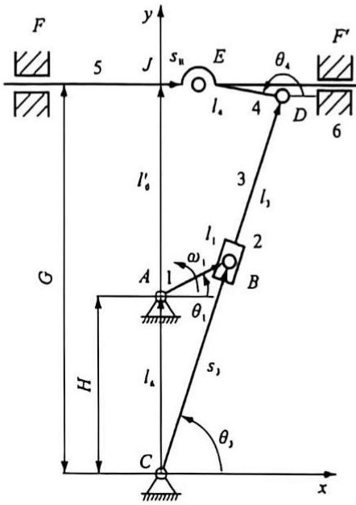

图3-42 牛头刨床机构简图
{: .figure-caption }

然后，分别将上述各式对时间求一次、二次导数，并写成矩阵形式，即可得以下速度和加速度方程式：

$$
\left[ \begin{array}{c c c c} \cos \theta_ {3} & - s _ {3} \sin \theta_ {3} & 0 & 0 \\ \sin \theta_ {3} & s _ {3} \cos \theta_ {3} & 0 & 0 \\ 0 & - l _ {3} \sin \theta_ {3} & - l _ {4} \sin \theta_ {4} & - 1 \\ 0 & l _ {3} \cos \theta_ {3} & l _ {4} \cos \theta_ {3} & 0 \end{array} \right] \left[ \begin{array}{l} \dot {s} _ {3} \\ \omega_ {3} \\ \omega_ {4} \\ v _ {\mathrm{E}} \end{array} \right] = \omega_ {1} \left[ \begin{array}{c} - l _ {1} \sin \theta_ {1} \\ l _ {1} \cos \theta_ {1} \\ 0 \\ 0 \end{array} \right] \left[ \begin{array}{c c c c} \cos \theta_ {3} & - s _ {3} \sin \theta_ {3} & 0 & 0 \\ \sin \theta_ {3} & s _ {3} \cos \theta_ {3} & 0 & 0 \\ 0 & - l _ {3} \sin \theta_ {3} & - l _ {4} \sin \theta _ {4} & - 1 \\ 0 & l _ {3} \cos \theta_ {3} & l _ {4} \cos \theta_ {3} & 0 \end{array} \right] \left[ \begin{array}{l} \ddot {s} _ {3} \\ \alpha_ {3} \\ \alpha_ {4} \\ a _ {\mathrm{E}} \end{array} \right]
$$

$$
\begin{array}{r l} & = - \left[ \begin{array}{c c c c} - \omega_ {1} \sin \theta_ {3} & - \dot {s} _ {3} \sin \theta_ {3} - s _ {3} \omega_ {3} \cos \theta_ {3} & 0 & 0 \\ \omega_ {3} \cos \theta_ {3} & \dot {s} _ {3} \cos \theta_ {3} - s _ {3} \omega_ {3} \sin \theta_ {3} & 0 & 0 \\ 0 & - l _ {3} \omega_ {3} \cos \theta_ {3} & - l _ {4} \omega_ {4} \cos \theta_ {4} & 0 \\ 0 & - l _ {3} \omega_ {3} \sin \theta_ {3} & - l _ {4} \omega_ {4} \sin \theta_ {4} & 0 \end{array} \right] \left[ \begin{array}{l} \dot {s} _ {3} \\ \omega_ {3} \\ \omega_ {4} \\ v _ {E} \end{array} \right] + \\ & \omega_ {1} \left[ \begin{array}{c} - l _ {1} \omega_ {1} \cos \theta_ {1} \\ - l _ {1} \omega_ {1} \sin \theta_ {1} \\ 0 \\ 0 \end{array} \right] \left[ \begin{array}{c c c c} \cos \theta_ {3} & - s _ {3} \sin \theta_ {3} & 0 & 0 \\ \sin \theta_ {3} & s _ {3} \cos \theta_ {3} & 0 & 0 \\ 0 & - l _ {3} \sin \theta_ {3} & - l _ {4} \sin \theta_ {4} & - 1 \\ 0 & l _ {3} \cos \theta_ {3} & l _ {4} \cos \theta_ {4} & 0 \end{array} \right] \left[ \begin{array}{l} \ddot {s} _ {3} \\ \alpha_ {3} \\ \alpha_ {4} \\ a _ {E} \end{array} \right] = \end{array}
$$

而 $\omega_{3} = \omega_{2}$ 、 $\alpha_{3} = \alpha_{2}$ 。

由以上各式, 将已知参数代入, 通过计算机进行计算, 得到的数值列于表 3-1 中。可根据所得数据作出机构的位置线图(图 3-43)、速度线图(图 3-44)和加速度线图(图 3-45)。通过这些线图可以很清楚地看到机构在一个运动循环中各从动件的位移、速度和加速度随原动件运动的变化情况, 有利于进一步掌握机构的性能。

表 3-1 各构件的位移、速度和加速度

<table><tr><td> \(\theta_{1}\) /( \(^{\circ}\) )</td><td> \(\theta_{3}\) /( \(^{\circ}\) )</td><td> \(\theta_{4}\) /( \(^{\circ}\) )</td><td> \(s_{E}\) /m</td><td> \(\omega_{3}\) /(rad \(\cdot\) s \(^{-1}\) )</td><td> \(\omega_{4}\) /(rad \(\cdot\) s \(^{-1}\) )</td><td> \(v_{E}\) /(m \(\cdot\) s \(^{-1}\) )</td><td> \(\alpha_{3}\) /(rad \(\cdot\) s \(^{-2}\) )</td><td> \(\alpha_{4}\) /(rad \(\cdot\) s \(^{-2}\) )</td><td> \(a_{E}\) /(m \(\cdot\) s \(^{-2}\) )</td></tr><tr><td>0</td><td>70.16787</td><td>173.06318</td><td>0.02695</td><td>0.57551</td><td>0.65563</td><td>-0.36733</td><td>6.14191</td><td>5.89851</td><td>-3.88421</td></tr><tr><td>5</td><td>70.79503</td><td>173.76629</td><td>0.01997</td><td>0.67692</td><td>0.74666</td><td>-0.43132</td><td>5.490348</td><td>4.54439</td><td>-3.45643</td></tr><tr><td>10</td><td>71.51811</td><td>174.54884</td><td>0.11935</td><td>0.76753</td><td>0.81472</td><td>-0.48825</td><td>4.90178</td><td>3.26896</td><td>-3.07492</td></tr><tr><td>⋮</td><td>⋮</td><td>⋮</td><td>⋮</td><td>⋮</td><td>⋮</td><td>⋮</td><td>⋮</td><td>⋮</td><td>⋮</td></tr><tr><td>355</td><td>69.64800</td><td>172.46310</td><td>0.31508</td><td>0.46214</td><td>0.54042</td><td>-0.29546</td><td>6.86062</td><td>7.31083</td><td>-4.35983</td></tr><tr><td>360</td><td>70.16787</td><td>173.06318</td><td>0.02695</td><td>0.57551</td><td>0.65563</td><td>-0.36733</td><td>6.14191</td><td>5.89851</td><td>-3.88421</td></tr></table>

## 3.5 平面四杆机构的运动设计

平面四杆机构设计的基本内容：首先根据工作要求选择机构的类型，然后根据给定的运动条件和其他附加要求（如最小传动角 $\gamma_{min}$ 等）确定机构的几何尺寸，并绘出机构的运动简图。

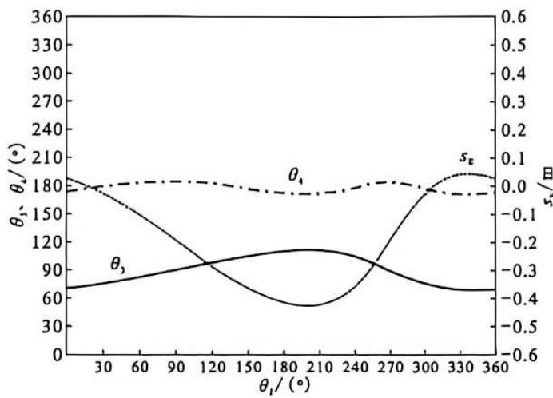

图3-43 位置线图
{: .figure-caption }

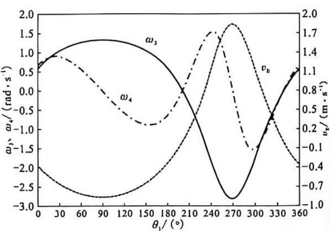

图3-44 速度线图
{: .figure-caption }

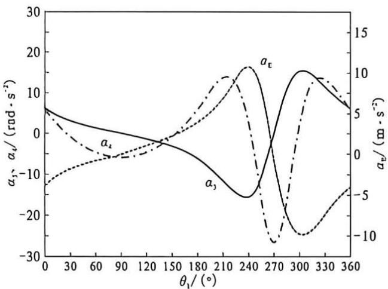

图3-45 加速度线图
{: .figure-caption }

根据机械的用途和性能等不同要求，对连杆机构设计的要求也不同，但这些设计要求一般可归纳为如下两类：

(1) 按照给定从动件(连杆或连架杆)的位置设计四杆机构, 称为位置设计。

(2) 按照给定点的轨迹设计四杆机构，称为轨迹设计。

设计四杆机构的方法有解析法、图解法和实验法。解析法精度高，但解题方程的建立和求解有时不易，随着数学手段的发展和电子计算机的普遍应用，求解变得迅速方便，便于进行优选，该法的应用日趋广泛；图解法直观，易理解，但精度较低；实验法简单，但常需试凑，费时较多，精度亦不太高。设计时采用哪种方法，主要取决于所给定的条件和机构的实际工作要求。

### 3.5.1 按照给定行程速比系数设计四杆机构

在设计具有急回运动特性的四杆机构时,一般是根据工作要求先给定行程速比系数 $K$ 的数值,然后由机构在极限位置处的几何关系,结合其他辅助条件,确定机构运动简图的尺寸参数。

#### 1. 曲柄摇杆机构的设计

$$
k = \frac {1 8 0 ^ {\circ} + \theta}{1 8 0 ^ {\circ} - \theta} \rightarrow \theta = 1 8 0 ^ {\circ} \cdot \frac {k - 1}{k + 1} \quad (\theta \text {: 极位夹角})
$$

如图 3-46 所示, 已知摇杆长度 $l_{3}$ 、摆角 $\psi$ 和行程速比系数 $K$ , 设计曲柄摇杆机构。

设计的实质是确定铰链中心 $A$ 点的位置, 并求出其他三杆的尺寸 $l_{1} 、 l_{2}$ 和 $l_{4}$ 。具体设计步骤如下:

(1)由给定的行程速比系数 K，按式(3-1)计算极位夹角 $\theta$ :

$$
\theta = 1 8 0 ^ {\circ} \cdot \frac {K - 1}{K + 1}\tag{3-17}
$$

(2) 在图纸上任选一点作为固定铰链中心 D 的位置，以此为顶点作等腰三角形，使两腰之长等于摇杆长 $l_{3}$ 和 $\angle C_{1}DC_{2} = \psi$ ，作出摇杆的两个极限位置 $C_{1}D$ 和 $C_{2}D$ 。

(3) 过 $C_{1}$ 、 $C_{2}$ 作直角三角形 $C_{1}PC_{2}$ ，使 $\angle PC_{1}C_{2}=90^{\circ}$ ， $\angle C_{1}C_{2}P=90^{\circ}-\theta$ ，由三角形内角和等于 $180^{\circ}$ 可知 $\angle C_{1}PC_{2}=\theta$ 。

(4) 以 $C_{2}P$ 为直径, 作直角三角形 $C_{1}PC_{2}$ 的外接圆, 在该圆周上取一点 $A$ , 并分别与 $C_{1} 、 C_{2}$ 相连, 则 $\angle C_{1}AC_{2} = \theta$ (同一圆弧所对的圆周角相等), 故 $A$ 点即为曲柄与机架组成的固定铰链中心。

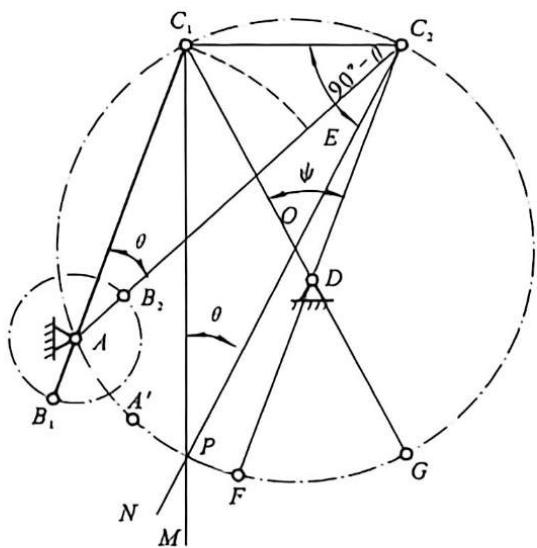

图3-46 根据 $K$ 设计曲柄摇杆机构
{: .figure-caption }

(5)确定 $A$ 点后, 以 $A$ 点为圆心, $AC_{1}$ 为半径作圆弧交 $AC_{2}$ 线于 $E$ 点; 以 $A$ 点为圆心, 以 $EC_{2} / 2$ 为半径作圆分别交 $C_{1}A$ 和 $AC_{2}$ 于 $B_{1}$ 和 $B_{2}$ 点, $B_{1}$ 和 $B_{2}$ 点即是曲柄与连杆共线时铰链 $B$ 的位置。则该铰链四杆机构的曲柄长 $l_{1} = AB_{1} = AB_{2}$ , 连杆长 $l_{2} = B_{1}C_{1} = B_{2}C_{2}$ , 机架长 $l_{4} = AD$ 。由于 $A$ 点选取的任意性, 故仅按行程速比系数 $K$ 设计, 就可得无穷多的铰链四杆机构。

关于曲柄与机架组成的固定铰链中心 $A$ 的选取: 曲柄的转动中心 $A$ 不能选在 $F G$ 弧段上, 否则, 机构将不满足运动的连续性要求, 即此时机构的两个极限位置 $C_{1} D$ 和 $C_{2} D$ 将位于两个不连通的可行域内。若曲柄的转动中心 $A$ 选在 $C_{2} G$ 和 $C_{1} F$ 两弧段上, 当 $A$ 向 $G(F)$ 靠近时, 机构的最小传动角将随之减小, 故若要增大最小传动角 $\gamma_{\min}$ , 取点 $A$ 作为曲柄的转动中心显然较点 $A'$ 有利。如果还给出其他附加条件, 如给定机架尺寸, 则点 $A$ 的位置也随之确定。

#### 2. 偏置曲柄滑块机构的设计

如图 3-47 所示, 已知滑块行程 $H$ 、偏心距 $e$ 和行程速比系数 $K$ , 设计曲柄滑块机构。

设计的实质是确定铰链中心 $A$ 点的位置, 并求出曲柄和连杆的长度尺寸 $l_{1}$ 和 $l_{2}$ 。具体设计时, 可根据滑块行程 $H$ 确定滑块的极限位置 $C_{1}$ 和 $C_{2}$ , 类似摇杆的两个极限位置, 参照上述曲柄摇杆机构的设计步骤进行设计即可。

#### 3. 导杆机构的设计

如图 3-48 所示，已知导杆机构的机架长度 $d$ 和行程速比系数 $K$ ，设计导杆机构。

设计的实质是确定曲柄的长度尺寸 $a$ 。具体设计时, 先按行程速比系数 $K$ 求出极位夹角 $\theta$ , 由于导杆机构的极位夹角与导杆的摆角相等, 故在图纸上任选一点 $D$ 作为导杆的转动中心, 作出导杆的摆角, 再作其角平分线, 在其角平分线上取 $DA = d$ , 即得曲柄的转动中心 $A$ 。过点 $A$ 作导杆任一极限位置 $Am$ : (或 $An$ ) 的垂线 $AB$ , 则该线段长即为曲柄的长度 $a$ , 故 $a = d\sin(\theta/2)$ 。

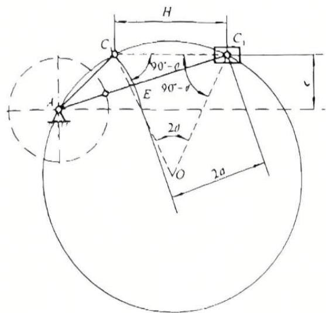

图3-47 偏置曲柄滑块机构的设计
{: .figure-caption }

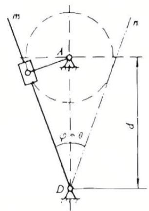

图 3-48 导杆机构的设计
{: .figure-caption }

### 3.5.2 按照给定连杆位置设计四杆机构

在生产实践中，常需要根据连杆的两个位置或三个位置来设计平面四杆机构。如图3-49所示为铸造厂的振实造型机的翻转机构，当翻台2处于位置Ⅰ时，砂箱1和翻台2固连，在砂箱7内填砂造型，振实砂型后起模时，需要翻转砂箱，使翻台2转至位置Ⅱ，托台10上升，接触砂箱，解除砂箱和翻台间的连接并起模，即要求放置砂箱的翻台2实现翻转动作。因此，该机构的设计属于实现连杆两个位置的设计问题。

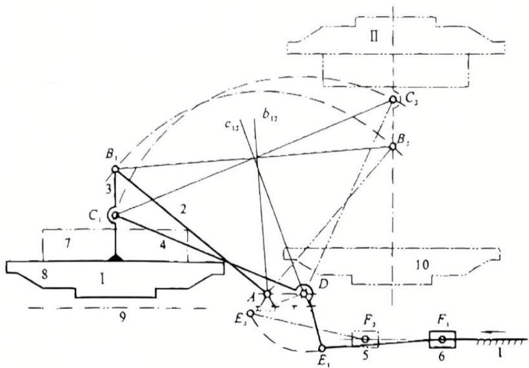

图3-49 振实造型机的翻转机构
{: .figure-caption }

#### 1. 根据连杆的两个位置设计平面四杆机构

如图 3-49 所示，已知连杆长度 $l_{nc}$ 及两个位置 $B_{1}C_{1}$ 和 $B_{2}C_{2}$ ，设计的实质是确定连架杆 AB 和 CD 与机架组成的铰链中心 A 和 D 的位置，并由此求出两个连架杆及机架的长度。具

体设计步骤如下：

(1)由已知条件绘出连杆的两个位置 $B_{1}C_{1}$ 和 $B_{2}C_{2}$ 。

(2) 连接 $B_{1} B_{2}$ 和 $C_{1} C_{2}$ , 并分别作它们的垂直平分线 $b_{12}$ 和 $c_{12}$ 。

(3)由于连杆上的铰链中心 B 和 C 的运动轨迹是分别以 A 和 D 为圆心的圆弧，故可在 $b_{12}$ 上任选一点 A，在 $c_{12}$ 上任选一点 D 作为机架的两个铰链点，因而有无穷多个解。在设计

时，可考虑其他辅助条件，例如最小传动角、各杆尺寸所允许的范围或其他结构上的要求等。振实造型机要求 A 和 D 两点在同一水平线上，且 AD = BC，则可确定铰链中心 A、D 的位置。

(4) 连接 $AB_{1}$ 和 $DC_{1}$ ，则 $AB_{1}C_{1}D$ 即为所求的铰链四杆机构，在图中即可量得各构件的长度。

#### 2. 根据连杆的三个位置设计平面四杆机构

设计步骤与上述步骤基本相同。如图 3-50 所示，由于连杆有三个确定位置，其铰链中心 $B_{1} 、 B_{2} 、 B_{3}$ （或 $C_{1} 、 C_{2} 、 C_{3}$ ）三点确定的圆只有一个，因此，机架铰链点 $A$ （或 $D$ ）的位置只有一个确定解。

图3-50 已知连杆的三个位置设计平面四杆机构
{: .figure-caption }

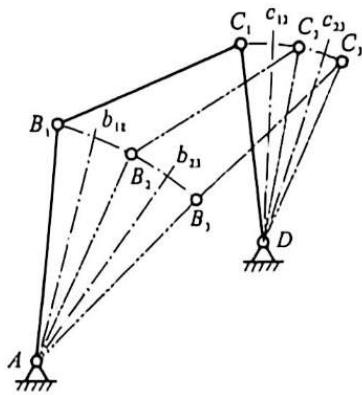

### 3.5.3 按照给定两个连架杆对应位置设计四杆机构

1 图解法

如图 3-51 所示，由固定铰链 A、D 和连架杆位置，确定活动铰链 B、C 的位置。

机构的转化原理：

对于上述问题，如果能将两个连架杆 AB、DC 预定的对应位置转化为连杆的预定对应位置，则可应用前面介绍的方法加以解决。如图 3-52 所示，如果将 CD 杆作为机架（而不是 AD 杆为机架），则 AB 杆转化为连杆[图 3-52(a)]。而机架不可能有三个位置，因此必须将 $DC_{1}$ 、DC、 $DC_{2}$ 作归一化处理，选定其中某一位置 DC 作为机架位置，其余位置回归该位置，

即机架位置只能是一个确定的位置。于是，AB 杆（原连架杆）的三个位置将转化为连杆 $A_{1}B_{1}$ 、AB、 $A_{2}B_{2}$ 的三个新的位置。由 $B_{1}^{\prime}$ 、B、 $B_{2}^{\prime}$ 点确定的圆心，即为铰链 C 的位置，同理，由 $A_{1}$ 、A、 $A_{2}$ 点确定的圆心，即为铰链 D 的位置[图 3-52(b)]。

图3-51 图解法设计四杆机构
{: .figure-caption }

如图 3-53 所示, 按两个连架杆三组对应位置设计四杆机构。已知: 机架长度 $d$ 和两个连架杆三组对应位置。

设计步骤:选定 $\overline{DE}_{1}$ 为机架位置。

①任意选定构件 $\overline{AB}$ 的长度(不影响两个连架杆对应的角度位置关系)。

②连接 $B_{2}E_{2}$ 、 $DB_{2}$ , 得 $\triangle B_{2}E_{2}D$ 。

③绕 D 将 $\triangle B_{2}E_{2}D$ 旋转 $\varphi_{1}-\varphi_{2}$ ，得 $B_{2}^{\prime}$ 点。

图3-52 机构转化原理
{: .figure-caption }

图3-53 按两个连架杆三组对应位置设计四杆机构
{: .figure-caption }

④连接 $B_{3}E_{3}$ 、 $DB_{3}$ , 得 $\triangle B_{3}E_{3}D$ 。

⑤将 $\triangle B_{3}E_{3}D$ 绕D旋转 $\varphi_{1}-\varphi_{3}$ ，得 $B_{3}^{\prime}$ 点。

⑥由 $B_{1} 、 B_{2}^{\prime} 、 B_{3}^{\prime}$ 三点，求圆心 $C_{1}$ 。

⑦连接 $AB_{1}C_{1}D$ 即为所要求的四杆机构。

#### 2. 解析法求解

如图 3-54 所示的铰链四杆机构中，已知连架杆 $AB$ 和 $CD$ 的三组对应位置 $\varphi_{1} 、 \varphi_{2} 、 \varphi_{3}$ 和 $\psi_{1} 、 \psi_{2} 、 \psi_{3}$ ，要求确定各杆的长度 $l_{1} 、 l_{2} 、 l_{3}$ 和 $l_{4}$ 。由于机构中各杆长度按同一比例增减时，各杆对应转角间的关系不变，故只需确定各杆的相对长度即可。因此，可取 $l_{1} = 1$ ，则该机构的待求参数只有三个。

该机构的四个构件组成封闭多边形，取各杆在坐标轴 x 和 y 上的投影，可得以下关系式：

图3-54 机构封闭多边形
{: .figure-caption }

$$
\left\{ \begin{array}{l} \cos \varphi + l _ {2} \cos \delta = l _ {4} + l _ {3} \cos \psi \\ \sin \varphi + l _ {2} \sin \delta = l _ {3} \sin \psi \end{array} \right.\tag{3-18}
$$

将 $\cos \delta$ 和 $\sin \delta$ 移到等式右边，再把等式两边平方相加，即可消去 $\delta$ ，整理后得：

$$
\cos \varphi = \frac {l _ {4} ^ {2} + l _ {3} ^ {2} + 1 - l _ {2} ^ {2}}{2 l _ {4}} + l _ {3} \cos \psi - \frac {l _ {3}}{l _ {4}} \cos (\psi - \varphi)\tag{3-19}
$$

为简化上式，令

$$
\left\{ \begin{array}{l} P _ {0} = l _ {3} \\ P _ {1} = - \frac {l _ {3}}{l _ {4}} \\ P _ {2} = \frac {l _ {4} ^ {2} + l _ {3} ^ {2} + 1 - l _ {2} ^ {2}}{2 l _ {4}} \end{array} \right.\tag{3-20}
$$

则有：

$$
\cos \varphi = P _ {0} \cos \psi + P _ {1} \cos (\psi - \varphi) + P _ {2}\tag{3-21}
$$

上式即为两连架杆转角之间的关系式。将已知的三对转角 $\varphi_{1}$ 、 $\psi_{1}$ ， $\varphi_{2}$ 、 $\psi_{2}$ ， $\varphi_{3}$ 、 $\psi_{3}$ 分别代入式(3-21)，可得方程组

$$
\left\{ \begin{array}{l} \cos \varphi_ {1} = P _ {0} \cos \psi_ {1} + P _ {1} \cos (\psi_ {1} - \varphi_ {1}) + P _ {2} \\ \cos \varphi_ {2} = P _ {0} \cos \psi_ {2} + P _ {1} \cos (\psi_ {2} - \varphi_ {2}) + P _ {2} \\ \cos \varphi_ {3} = P _ {0} \cos \psi_ {3} + P _ {1} \cos (\psi_ {3} - \varphi_ {3}) + P _ {2} \end{array} \right.
$$

由方程组可以求出三个未知数 $P_{0} 、 P_{1}$ 和 $P_{2}$ 。将它们代入式(3-20)，即可求得 $l_{2} 、 l_{3} 、 l_{4}$ 。以上求出的杆长 $l_{1} 、 l_{2} 、 l_{3} 、 l_{4}$ 可同时乘以任意比例常数，所得的机构都能实现对应的转角。

若仅给定连架杆两组位置，则方程组中只能得到两个方程， $P_{0}$ 、 $P_{1}$ 和 $P_{2}$ 三个参数中的一个可以任意取定，故有无穷组解。

若给定的连架杆位置超过三组，如图3-55所示，已知连架杆1、3之间的四对对应转角为 $\varphi_{12}$ 、 $\varphi_{23}$ 、 $\varphi_{34}$ 、 $\varphi_{45}$ 和 $\psi_{12}$ 、 $\psi_{23}$ 、 $\psi_{34}$ 、 $\psi_{45}$ ，则不可能有精确解，只能用优化或试凑的方法求其近似解。下面介绍一种近似设计用的几何实验法。

图3-55 两连架杆的对应位置
{: .figure-caption }

#### 3. 实验法求解

具体设计步骤如下：

(1)如图3-56(a)所示,在图纸上选取一点作为连架杆1的转动中心A,并任选AB $_{1}$ 作为连架杆1的长度l $_{1}$ ,根据给定的φ $_{12}$ 、φ $_{23}$ 、φ $_{34}$ 和φ $_{45}$ 作出AB $_{2}$ 、AB $_{3}$ 、AB $_{4}$ 和AB $_{5}$ 。

(2)选取连杆2的适当长度 $l_{2}$ ，以 $B_{1}$ 、 $B_{2}$ 、 $B_{3}$ 、 $B_{4}$ 和 $B_{5}$ 各点为圆心， $l_{2}$ 为半径，作圆弧 $K_{1}$ 、 $K_{2}$ 、 $K_{3}$ 、 $K_{4}$ 和 $K_{5}$ 。

(3)另如图 3-56(b)所示,在透明纸上选取一点作为连架杆 3 的转动中心 $D$ , 并任取 $Dd_{1}$ 作为连架杆 3 的第一位置, 根据给定的 $\psi_{12} 、 \psi_{23} 、 \psi_{34}$ 和 $\psi_{45}$ 作出 $Dd_{2} 、 Dd_{3} 、 Dd_{4}$ 和 $Dd_{5}$ 。再以 $D$ 为圆心, 用连架杆 3 可能的不同长度为半径作许多同心圆弧。

(4) 将画在透明纸上的图 3-56(b) 覆盖在图 3-56(a) 上进行试凑，如图 3-56(c) 所示。

图3-56 几何实验法设计四杆机构
{: .figure-caption }

使圆弧 $K_{1} 、 K_{2} 、 K_{3} 、 K_{4} 、 K_{5}$ 分别与连架杆 3 的对应位置 $Dd_{1} 、 Dd_{2} 、 Dd_{3} 、 Dd_{4} 、 Dd_{5}$ 的交点 $C_{1} 、 C_{2} 、 C_{3} 、 C_{4} 、 C_{5}$ 均落在以 $D$ 为圆心的同一圆弧上, 则图形 $AB_{1}C_{1}D$ 即为所求的四杆机构。

如果移动透明纸不能使交点 $C_1$ 、 $C_2$ 、 $C_3$ 、 $C_4$ 、 $C_5$ 落在以 $D$ 为圆心的同一圆弧上, 那就需要改变连杆 2 的长度, 然后重复以上步骤, 直到这些交点正好落在或近似落在以 $D$ 为圆心的同一圆弧上为止。

应当指出，由上述方法求出的图形 $AB_{1}C_{1}D$ 只表达所求机构各杆的相对长度。各杆的实际尺寸只要与 $AB_{1}C_{1}D$ 保持同样比例，都能满足设计要求。

这种几何实验法方便、实用，故在机械设计中常被采用。它同样适用于曲柄滑块机构的设计，使之实现曲柄与滑块的多组对应位置。

### 3.5.4 按照给定点的运动轨迹设计四杆机构

如图 3-57 所示, 设给定原动件 $AB$ 的长度及其转动中心 $A$ 和连杆上一点 $M$ 。现要求设计一四杆机构, 使其连杆上的点 $M$ 沿着预期的运动轨迹运动。为解决此设计问题, 可在连杆上另外固结若干杆件, 则它们的端点 $C, C', C'', \cdots$ 在原动件运动过程中也将描绘出各自的连杆曲线。在这些曲线中找出圆弧或近似圆弧的曲线, 即可将描绘此曲线的点作为连杆与另一连杆的铰链中心 $C$ , 而将此曲线的曲率中心作为该连架杆的转动中心 $D$ 。因此 $AD$ 即为机架, $CD$ 即为从动连架杆。这样就设计出了能够实现预期运动轨迹的四杆机构。

按照给定点的运动轨迹设计四杆机构的另一种简单的方法是利用连杆曲线图谱进行设计。图3-58所示为一描绘连杆曲线的仪器模型，这种装置的各杆长度可以调节，在连杆上固定一块不透明的多孔薄板，当机构运动时，板上的每个孔的运动轨迹就是一条连杆曲线，而为了把这些曲线记录下来，可利用光束照射的办法把这些曲线印在感光纸上，这样就得到了一组连杆曲线。如果改变各杆的相对长度，就可以作出另外许多形状不同的连杆曲线，把记录下来的这些连杆曲线顺序整理汇编成册，即成连杆曲线图谱，图3-59即为《四杆机构分析图谱》中的一张图。图中取原动

曲柄 1 的长度等于 1，其他各杆的长度以相对于原动曲柄长度的比值表示。图中每一连杆曲线由 72 段长度不等的短线组成，每一短线的长度表示原动曲柄转过 $5^{\circ}$ 时连杆上该点的位移。

图3-58 连杆曲线的绘制
{: .figure-caption }

图3-59 连杆曲线图谱
{: .figure-caption }

图3-57 按给定的运动轨迹设计四杆机构
{: .figure-caption }

根据已知的运动轨迹设计四杆机构时，可从图谱中查出形状与要求实现的轨迹相似的连杆曲线及相应四杆机构中各构件的相对长度，然后用缩放仪求出图谱中的连杆曲线和所要求的轨迹之间相差的倍数，即可求得四杆机构各杆的实际尺寸。

## 3.6 多杆机构及应用

### 3.6.1 多杆机构及作用

四杆机构虽然结构简单，设计也方便，但有时却难以满足现代机械所提出的多方面的复杂要求，这时就不得不借助于多杆机构。多杆机构的运动构件较四杆机构要多，因此采用多杆机构可满足更多的设计要求。

#### 1. 可改变从动件的运动特性

如图 3-60 所示为 Y52 插齿机的主传动机构，它采用的是一个六杆机构，使插刀在工作过程中得到近似的等速运动，弥补了一般四杆急回机构虽可满足急回要求，但其工作行程的等速性能往往不好的不足。

#### 2. 取得有利的传动角

当从动件的摆角较大，机构的外廓尺寸或铰链位置的布置受到严格限制时，采用四杆机构往往不能获得有利的传动角，而采用多杆机构则可使传动角条件得到改善。如图3-61(a)所示为某

型洗衣机的搅拌机构, 图 3-61(b)为其机构运动简图。图中用虚线示出了机构的两个极位,从图中可以看出, 机构没有传动角过小(接近 $0^{\circ}$ )或过大(接近 $180^{\circ}$ )的情况。

图3-61 洗衣机的搅拌机构
{: .figure-caption }

图3-60 Y52插齿机主传动机构
{: .figure-caption }

#### 3. 实现机构从动件带停歇的运动

某些机械有时要求在原动件连续运转的过程中, 其从动件能作一段时间的停歇, 且整个运动应是连续平稳的。如图 3-62 所示连杆上 $E$ 点的连杆曲线为腰子形, 其 $\overline{\alpha\alpha}$ 和 $\overline{\beta\beta}$ 两段为近似圆弧 (其半径相等), 圆心分别在 $F$ 和 $F'$ 点。连杆 4 的长度与圆弧的半径相等, 当 $E$ 点在 $\overline{\alpha\alpha}$ 或 $\overline{\beta\beta}$ 曲线段上运动时, 从动件 5 将处于停歇状态。

#### 4. 扩大机构从动件的行程

图 3-63 为一种新型电力机车受电弓升降机构运动简图, 采用多杆机构可使从动件(受电
{: .figure-caption }

弓)3的行程扩大，而其所占用的面积变小。

图3-62 六杆机构实现停歇状态
{: .figure-caption }

图3-63 电力机车受电弓升降机构
{: .figure-caption }

#### 5. 使机构从动件的行程可调

某些机械根据工作的需要, 要求其从动件的行程(或摆角)可以调节。例如图 3-64 所示的机械式无级变速器主传动所用的多杆机构中, 当构件 6 调到不同位置时, 可使从动件 5 得到不同大小的摆角。

#### 6. 可获得较大的机械利益

如图 3-65 所示为广泛应用于锻压设备中的肘杆机构。曲柄 1 为原动件，滑块 5 为从动件，当其接近下死点时，由于速比 $v_{\mathrm{B}} / v_{5}$ 很大，故可用较小的力 $F$ 产生很大的锻压力 $G$ ，从而获得很大的机械利益，以满足锻压工作的需要。

图3-64 机械无级变速主传动机构
{: .figure-caption }

图3-65 锻压设备中的肘杆机构
{: .figure-caption }

### 3.6.2 多杆机构设计举例

如图 3-66 所示的六杆机构由铰链四杆机构 $ABCD$ 与滑块机构 $DCE$ 串联而成。若已知 $AB$ 、 $CD$ 及滑块三个构件的三组对应位置 $\varphi_{1}-\psi_{1}-s_{1}$ 、 $\varphi_{2}-\psi_{2}-s_{2}$ 、 $\varphi_{3}-\psi_{3}-s_{3}$ ，以及偏距 $e^{\cdot}$ 、机架

(b)

$l_{AD}$ ，试用解析法设计此六杆机构。要求：

图3-66 六杆机构的设计
{: .figure-caption }

(1)选定坐标系。

(2)求出有关刚体位移矩阵或平面相对位移矩阵。

(3)列出设计方程组。

(4) 简述方程组的求解步骤。

(5) 讨论解的存在性及解的组数。

解：刚体位移矩阵公式为：

$$
\boldsymbol {D} _ {\mathrm{li}} = \left[ \begin{array}{c c c} \cos \theta_ {\mathrm{li}} & - \sin \theta_ {\mathrm{li}} & y _ {\mathrm{pi}} - x _ {\mathrm{pl}} \cos \theta_ {\mathrm{li}} + y _ {\mathrm{pl}} \sin \theta_ {\mathrm{li}} \\ \sin \theta_ {\mathrm{li}} & \cos \theta_ {\mathrm{li}} & y _ {\mathrm{pi}} - x _ {\mathrm{pl}} \sin \theta_ {\mathrm{li}} + y _ {\mathrm{pl}} \cos \theta_ {\mathrm{li}} \\ 0 & 0 & 1 \end{array} \right]
$$

平面相对位移矩阵公式为：

$$
\boldsymbol {D} _ {\mathrm{rli}} = \left[ \begin{array}{c c c} \cos (\theta_ {1 \mathrm{i}} - \psi_ {1 \mathrm{i}}) & - \sin (\theta_ {1 \mathrm{i}} - \psi_ {1 \mathrm{i}}) & l _ {\mathrm{AB}} (1 - \cos \psi_ {1 \mathrm{i}}) \\ \sin (\theta_ {1 \mathrm{i}} - \psi_ {1 \mathrm{i}}) & \cos (\theta_ {1 \mathrm{i}} - \psi_ {1 \mathrm{i}}) & l _ {\mathrm{AB}} (1 - \sin \psi_ {1 \mathrm{i}}) \\ 0 & 0 & 1 \end{array} \right]
$$

(1)选定坐标系如图 3-66(b) 所示。

(2) 求出有关刚体位移矩阵或平面相对位移矩阵。

$$
\left[ D _ {\mathrm{AB} ^ {\prime}} \right] _ {1 2} = \left[ \begin{array}{c c c} \cos \left(\phi_ {2} - \phi_ {1} - \psi_ {3} + \psi_ {1}\right) & - \sin \left(\phi_ {2} - \phi_ {1} - \psi_ {3} + \psi_ {1}\right) & l _ {\mathrm{AD}} (1 - \cos (\psi_ {2} - \psi_ {1})) \\ \sin \left(\phi_ {2} - \phi_ {1} - \psi_ {1} + \psi_ {1}\right) & \cos \left(\phi_ {2} - \phi_ {1} - \psi_ {3} + \psi_ {1}\right) & l _ {\mathrm{AD}} (1 - \sin (\psi_ {2} - \psi_ {1})) \\ 0 & 0 & 1 \end{array} \right]\tag{a}
$$

$$
\left[ D _ {\Lambda^ {\prime} \mathrm{B} ^ {\prime}} \right] _ {1 3} = \left[ \begin{array}{c c c} \cos \left(\phi_ {3} - \phi_ {1} - \psi_ {3} + \psi_ {1}\right) & - \sin \left(\phi_ {3} - \phi_ {1} - \psi_ {3} + \psi_ {1}\right) & l _ {\mathrm{AD}} (1 - \cos (\psi_ {3} - \psi_ {1})) \\ \sin \left(\phi_ {3} - \phi_ {1} - \psi_ {3} + \psi_ {1}\right) & \cos \left(\phi_ {3} - \phi_ {1} - \psi_ {3} + \psi_ {1}\right) & l _ {\mathrm{AD}} (1 - \sin (\psi_ {3} - \psi_ {1})) \\ 0 & 0 & 1 \end{array} \right]\tag{b}
$$

$$
\left[ D _ {\mathrm{DC}} \right] _ {1 2} = \left[ \begin{array}{c c c} \cos (\psi_ {2} - \psi_ {1}) & - \sin (\psi_ {2} - \psi_ {1}) & l _ {\mathrm{AD}} \\ \sin (\psi_ {2} - \psi_ {1}) & \cos (\psi_ {2} - \psi_ {1}) & 0 \\ 0 & 0 & 1 \end{array} \right]\tag{c}
$$

$$
\left[ D _ {\mathrm{DC}} \right] _ {1 3} = \left[ \begin{array}{c c c} \cos \left(\psi_ {3} - \psi_ {1}\right) & - \sin \left(\psi_ {3} - \psi_ {1}\right) & l _ {\lambda \mathrm{D}} \\ \sin \left(\psi_ {3} - \psi_ {1}\right) & \cos \left(\psi_ {3} - \psi_ {1}\right) & 0 \\ 0 & 0 & 1 \end{array} \right]\tag{d}
$$

(3)由定长条件可得其设计方程组：

$$
\left. \begin{array}{l} \left(x _ {\mathrm{B2}} ^ {\prime} - x _ {\mathrm{C1}}\right) ^ {2} + \left(y _ {\mathrm{B2}} ^ {\prime} - y _ {\mathrm{C1}}\right) ^ {2} = \left(x _ {\mathrm{B1}} - x _ {\mathrm{C1}}\right) ^ {2} + \left(y _ {\mathrm{B1}} - y _ {\mathrm{C1}}\right) ^ {2} \\ \left(x _ {\mathrm{B3}} ^ {\prime} - x _ {\mathrm{C1}}\right) ^ {2} + \left(y _ {\mathrm{B3}} ^ {\prime} - y _ {\mathrm{C1}}\right) ^ {2} = \left(x _ {\mathrm{B1}} - x _ {\mathrm{C1}}\right) ^ {2} + \left(y _ {\mathrm{B1}} - y _ {\mathrm{C1}}\right) ^ {2} \\ \left(x _ {\mathrm{C2}} ^ {\prime} - x _ {\mathrm{E2}}\right) ^ {2} + \left(y _ {\mathrm{C2}} ^ {\prime} - y _ {\mathrm{E2}}\right) ^ {2} = \left(x _ {\mathrm{C1}} - x _ {\mathrm{E1}}\right) ^ {2} + \left(y _ {\mathrm{C1}} - y _ {\mathrm{E1}}\right) ^ {2} \\ \left(x _ {\mathrm{C3}} ^ {\prime} - x _ {\mathrm{E3}}\right) ^ {2} + \left(y _ {\mathrm{C3}} ^ {\prime} - y _ {\mathrm{E3}}\right) ^ {2} = \left(x _ {\mathrm{C1}} - x _ {\mathrm{E1}}\right) ^ {2} + \left(y _ {\mathrm{C1}} - y _ {\mathrm{E1}}\right) ^ {2} \end{array} \right\}\tag{e}
$$

由以下各式, 可分别求出 $(x_{\mathrm{B2}}^{\prime} y_{\mathrm{B2}}^{\prime})$ 、 $(x_{\mathrm{D3}}^{\prime} y_{\mathrm{D3}}^{\prime})$ 、 $(x_{\mathrm{C2}} y_{\mathrm{C2}})$ 、 $(x_{\mathrm{C3}} y_{\mathrm{C3}})$ 和 $(x_{\mathrm{E1}} y_{\mathrm{E1}})$ 、 $(x_{\mathrm{E2}} y_{\mathrm{E2}})$ 、 $(x_{\mathrm{E3}} y_{\mathrm{E3}})$ , 再代入设计方程组 (e), 即可求解。

$$
\left[ \begin{array}{l} x _ {\mathrm{B2}} ^ {\prime} \\ y _ {\mathrm{B2}} ^ {\prime} \\ 1 \end{array} \right] = \left[ D _ {\Lambda^ {\prime} \mathrm{B} ^ {\prime}} \right] _ {1 2} \left[ \begin{array}{l} x _ {\mathrm{B1}} \\ y _ {\mathrm{B1}} \\ 1 \end{array} \right]
$$

$$
\left[ \begin{array}{l} x _ {\mathrm{B3}} ^ {\prime} \\ y _ {\mathrm{B3}} ^ {\prime} \\ 1 \end{array} \right] = \left[ D _ {\Lambda^ {\prime} \mathrm{B} ^ {\prime}} \right] _ {1 3} \left[ \begin{array}{l} x _ {\mathrm{B1}} \\ y _ {\mathrm{B1}} \\ 1 \end{array} \right]
$$

$$
\left[ \begin{array}{l} x _ {\mathrm{C2}} \\ y _ {\mathrm{C2}} \\ 1 \end{array} \right] = \left[ D _ {\mathrm{DC}} \right] _ {1 2} \left[ \begin{array}{l} x _ {\mathrm{C1}} \\ y _ {\mathrm{C1}} \\ 1 \end{array} \right]
$$

$$
\left[ \begin{array}{l} x _ {\mathrm{C3}} \\ y _ {\mathrm{C3}} \\ 1 \end{array} \right] = \left[ D _ {\mathrm{DC}} \right] _ {1 3} \left[ \begin{array}{l} x _ {\mathrm{Cl}} \\ y _ {\mathrm{Cl}} \\ 1 \end{array} \right]
$$

由以上四式，即可求出 $(x_{B2}^{\prime}\quad y_{B2}^{\prime})$ 、 $(x_{B3}^{\prime}\quad y_{B3}^{\prime})$ 、 $(x_{C2}\quad y_{C2})$ 、 $(x_{C3}\quad y_{C3})$ 关于 $x_{B1}$ 、 $y_{B1}$ 、 $x_{C1}$ 、 $y_{C1}$ 的表达式：

$$
\left\{ \begin{array}{l} x _ {\mathrm{E1}} = l _ {\mathrm{AD}} + s _ {1} \\ y _ {\mathrm{E1}} = e \end{array} \right. \left\{ \begin{array}{l} x _ {\mathrm{E2}} = l _ {\mathrm{AD}} + s _ {2} \\ y _ {\mathrm{E2}} = e \end{array} \right. \left\{ \begin{array}{l} x _ {\mathrm{E3}} = l _ {\mathrm{AD}} + s _ {3} \\ y _ {\mathrm{E3}} = e \end{array} \right.
$$

(4)由于所求的未知数 $x_{\mathrm{B1}}$ 、 $y_{\mathrm{B1}}$ 、 $x_{\mathrm{C1}}$ 、 $y_{\mathrm{C1}}$ 共4个，而设计方程有4个，因此只存在一组解，即此六杆机构只存在一组方案满足设计条件。

本章思维导图

## 思考题与练习题

1. 何谓连杆、连架杆和连杆机构？连杆机构有哪些优、缺点？

(b)

(a)
2. 何谓曲柄、摇杆？曲柄是否就是最短杆？四杆机构具有曲柄的条件是什么？

3. 何谓连杆机构的急回运动和行程速比系数？何谓四杆机构的极位和极位夹角？四者之间有何联系？

4. 何谓连杆机构的压力角和传动角？压力角和传动角的大小对连杆机构的传力性能有何影响？在连杆机构的设计中对传动角有何限制？四杆机构的最小传动角如何确定？

5. 何谓死点？死点与自锁有何区别？机构在什么情况下会出现死点？说明死点的危害及克服方法，以及死点在机械工程中的应用情况。

6. 在四杆机构中, 死点和极位实际上是同一个位置, 那么为何有时叫它死点, 有时又叫它极位? 它们的区别在哪?

7. 何谓速度瞬心？相对瞬心与绝对瞬心有何异同？利用瞬心作平面机构运动分析时，哪些瞬心为重要的瞬心？

8. 何谓三心定理？何种情况下的瞬心位置需用三心定理来确定？

9. 平面连杆机构替代凸轮机构需要满足什么条件？其意图是什么？

10. 各种平面四杆机构是怎样由曲柄摇杆机构演化来的？在连杆机构的设计过程中有何意义？

11. 试根据图 3-67(a)、(b)、(c) 所示各液压泵构件的运动分析它们分别属于何种机构。

12. 如图 3-68 所示的冲床刀架装置, 当偏心轮 1 绕固定中心 $\Lambda$ 转动时, 构件 2 绕活动中心 $C$ 摆动, 同时推动后者带着刀架 3 上下移动, $B$ 点为偏心轮的几何中心。问: 该装置是何种机构? 它是如何演化出来的?

图3-67 各液压泵构件
{: .figure-caption }

图3-68 冲床刀架装置
{: .figure-caption }

13. 试根据图 3-69 中注明的尺寸判断铰链四杆机构是曲柄摇杆机构、双曲柄机构，还是双摇杆机构。

图3-69 铰链四杆机构
{: .figure-caption }

(d)

14. 如图 3-70 所示铰链四杆机构，已知： $l_{\mathrm{BC}} = 50 \mathrm{~mm}, l_{\mathrm{CD}} = 35 \mathrm{~mm}, l_{\mathrm{AD}} = 30 \mathrm{~mm}, A D$ 为机架。回答以下问题。

(1) 若此机构为曲柄摇杆机构，且 AB 为曲柄，求 $l_{AB}$ 的最大值。

(2) 若此机构为双曲柄机构，求 $l_{AB}$ 的最小值。

(3)若此机构为双摇杆机构，求 $l_{AB}$ 的数值。

15. 已知一偏置曲柄滑块机构如图 3-71 所示。其中偏心距 $e = 10 \mathrm{~mm}$ ，曲柄长度 $l_{\mathrm{AB}} = 20 \mathrm{~mm}$ ，连杆长度 $l_{\mathrm{BC}} = 70 \mathrm{~mm}$ 。

(1)用图解法求滑块行程的长度H。

(2)曲柄作为原动件时的最大压力角 $\alpha_{max}$ 。

(3) 滑块作为原动件时机构的死点位置。

图3-70 铰链四杆机构
{: .figure-caption }

图3-71 偏置曲柄滑块
{: .figure-caption }

16. 试求出图 3-72 所示机构的全部速度瞬心。

17. 如图 3-73 所示的四杆机构， $l_{AB} = 65 \, mm$ ， $l_{DC} = 90 \, mm$ ， $l_{AD} = l_{BC} = 125 \, mm$ ， $\omega = 10 \, rad/s$ ，试用瞬心法求：

(1) 当 $\varphi=15^{\circ}$ 时，点 C 的速度 $v_{C}$ 。

(2)当 $\varphi = 15^{\circ}$ 时, 构件 $BC$ 上(即 $BC$ 线上或其延长线上)速度最小的一点 $E$ 的位置及其速度。

18. 如图 3-74 所示机构，已知各构件的长度 $l_{\mathrm{AD}} = 85 \mathrm{~mm}$ ， $l_{\mathrm{AB}} = 35 \mathrm{~mm}$ ， $l_{\mathrm{CD}} = 45 \mathrm{~mm}$ ， $l_{\mathrm{BC}} = 50 \mathrm{~mm}$ ，原动件的逆时针角速度 $\omega_{1} = 10 \mathrm{rad/s}$ 。试求在图示位置时点 $E$ 的速度和加速度。

(8)

图3-72 机构
{: .figure-caption }

(c)

图3-73 四杆机构
{: .figure-caption }

之三 图 3-74 机构

19. 如图 3-75 所示导杆机构, 已知: $l_{\mathrm{AB}} = 38 \mathrm{~mm}, l_{\mathrm{CB}} = 20 \mathrm{~mm}, l_{\mathrm{DE}} = 50 \mathrm{~mm}, x_{\mathrm{D}} = 150 \mathrm{~mm}, y_{\mathrm{D}} = 60 \mathrm{~mm}$ , 构件 1 以逆时针等角速度 $\omega_{1} = 20 \mathrm{rad/s}$ 转动。试用矢量多边形法求构件 3 的角速度 $\omega_{3}$ 和角加速度 $\alpha_{3}$ , 以及点 $E$ 的速度 $v_{\mathrm{E}}$ 和加速度 $a_{\mathrm{E}}$ 。

20. 如图 3-76 所示的曲柄摇块机构, 已知: $l_{AB} = 30 \mathrm{~mm}, l_{AC} = 100 \mathrm{~mm}, l_{BD} = 50 \mathrm{~mm}, l_{DE} = 40 \mathrm{~mm}, \varphi_ {1} = 45^{\circ}$ , 等角速度 $\omega_ {1} = 10 \mathrm{rad} / \mathrm{s}$ 。求: $E 、 D$ 两点的速度; 构件 3 的角速度和角加速度。

21. 如图 3-77 所示为一摆动导杆机构, 起始构件曲柄 1 以等角速度转动, 图 3-77(a) 为按 $\mu_{1} = 0.01 \mathrm{~m} / \mathrm{mm}$ 画出的机构简图; 图 3-77(b) 为按 $\mu_{\mathrm{v}} = 0.002 (\mathrm{~m} / \mathrm{s}) / \mathrm{mm}$ 作出的速度多边形; 图 3-77(c) 为按 $\mu_{\mathrm{n}} = 0.005 (\mathrm{~m} / \mathrm{s}^{2}) / \mathrm{mm}$ 作出的加速度多边形。

(1) 求曲柄 1 的角速度 $\omega_{1}$ 和方向。

(2)求滑块2的角速度 $\omega_{2}$ 和角加速度 $\alpha_{2}$ 及方向，以及导杆3的角速度 $\omega_{3}$ 和角加速度 $\alpha_{3}$ 及方向。

(3) 在图 3-77(b) 和图 3-77(c) 的基础上, 求出滑块 2 上 $D$ 点的绝对速度 $v_{D}$ 和绝对加速度 $\alpha_{D}$ 。

(b)

图3-75 导杆机构
{: .figure-caption }

题图3-76 曲柄摇块机构
{: .figure-caption }

22. 如图 3-78 所示机构，已知 $l_{\mathrm{AE}} = 70 \mathrm{~mm}$ , $l_{\mathrm{AB}} = 40 \mathrm{~mm}$ , $l_{\mathrm{EF}} = 70 \mathrm{~mm}$ , $l_{\mathrm{DE}} = 35 \mathrm{~mm}$ , $l_{\mathrm{CD}} = 75 \mathrm{~mm}$ , $l_{\mathrm{BC}} = 50 \mathrm{~mm}$ , 原动件以等角速度 $\omega = 10 \mathrm{rad/s}$ 回转。试以图解法求点 $C$ 的速度 $\nu_{\mathrm{C}}$ 和加速度 $a_{\mathrm{C}}$ 。

图3-77 摆动导杆机构
{: .figure-caption }

图3-78 机构
{: .figure-caption }

23. 试用解析法写出图 3-78 中 C 点的位置、速度及加速度方程。

24. 如图 3-79 所示曲柄滑块机构中，已知 $l_{\mathrm{AB}} = 100 \mathrm{~mm}$ ， $l_{\mathrm{BC}} = 330 \mathrm{~mm}$ ， $n_1 = 1500 \mathrm{r} / \mathrm{mm}$ ， $\varphi_1 = 60^\circ$ ，试用解析法求滑块的速度 $v_{\mathrm{C}}$ 和加速度 $a_{\mathrm{C}}$ 。

25. 如图 3-80 所示摆动导杆机构中, 已知曲柄 $AB$ 的等角速度为 $\omega_{1} = 20 \mathrm{rad} / \mathrm{s}$ , $l_{\mathrm{AB}} = 100 \mathrm{~mm}$ , $l_{\mathrm{AC}} = 200 \mathrm{~mm}$ , $\angle ABC = 90^{\circ}$ , 试用解析法求构件 3 的角速度 $\omega_{3}$ 和角加速度 $\alpha_{3}$ 。

图3-79 曲柄滑块机构
{: .figure-caption }

图3-80 摆动导杆机构
{: .figure-caption }

26. 如图 3-81 所示为用铰链四杆机构作为加热炉炉门的启闭机构, 炉门上两铰链的中心距为 $50 \mathrm{~mm}$ , 炉门打开后呈水平位置时要求炉门的外边朝上, 固定铰链装在 $y - y$ 轴线上, 其相互位置的尺寸如图所示, 试设计此机构。

27. 如图 3-82 所示为机床变速箱中操纵滑动齿轮的操纵机构, 已知滑动齿轮行程 $H = 60 \mathrm{~mm}, l_{\mathrm{DE}} = 100 \mathrm{~mm}, l_{\mathrm{CD}} = 120 \mathrm{~mm}, l_{\mathrm{AD}} = 250 \mathrm{~mm}$ , 其相互位置如图所示。当滑移齿轮在行程的另一端时, 操纵手柄为垂直方向, 试设计此机构。

图3-81 加热炉炉门启闭机构
{: .figure-caption }

图3-82 机床变速箱中的操纵机构
{: .figure-caption }

28. 如图 3-83 所示为一飞机起落架机构, 实线表示降落时的位置, 虚线表示飞行时的位置。已知 $l_{\mathrm{FC}} = 520 \mathrm{~mm}, l_{\mathrm{FE}} = 340 \mathrm{~mm}$ , 且 $\alpha = 90^{\circ}, \beta = 60^{\circ}, \theta = 10^{\circ}$ 。试用图解法求出构件 $CD_{1}$ 和 $D_{1}E_{1}$ 的长度 $l_{\mathrm{CD}_{1}}$ 和 $l_{\mathrm{D}_{1}\mathrm{E}_{1}}$ 。

29. 如图 3-84 所示为一已知的曲柄摇杆机构, 现要求用一个连杆将摇杆 $CD$ 和一个滑块 $F$ 连接起来, 使摇杆的三处已知位置 $C_{1} D 、 C_{2} D 、 C_{3} D$ 和滑块的三个位置 $F_{1} 、 F_{2} 、 F_{3}$ 相对应 (图示尺寸是按比例绘出的)。试确定此连杆的长度及其与摇杆 $CD$ 铰接点的位置。

图3-83 飞机起落架机构
{: .figure-caption }

图3-84 曲柄摇杆机构
{: .figure-caption }

30. 如图 3-85 所示, 现欲设计一铰链四杆机构。设已知其摇杆 $CD$ 的长度 $l_{\mathrm{CD}} = 75 \mathrm{~mm}$ , 行程速比系数 $K = 1.5$ , 机架 $AD$ 的长度为 $l_{AD} = 100 \mathrm{~mm}$ , 又知摇杆的一个极限位置与机架间的夹角 $\varphi = 45^{\circ}$ , 试求其曲柄的长度 $l_{AB}$ 和连杆的长度 $l_{BC}$ 。

图3-85 铰链四杆机构
{: .figure-caption }

31. 试设计一曲柄滑块机构, 设已知其滑块的行程速比系数 $K = 1.5$ , 滑块的行程 $l_{\mathrm{C1C2}} = 50 \mathrm{~mm}$ , 偏距 $e = 20 \mathrm{~mm}$ 。

32. 已知一曲柄摇杆机构的摇杆长度 $l_{3}=150$ mm，摆角 $\psi=45^{\circ}$ ，行程速比系数 K=1.25，试确定曲柄、连杆和机架（两固定铰链位于同一水平线上）的长度 $l_{1}$ 、 $l_{2}$ 和 $l_{3}$ 。

33. 已知一曲柄滑块机构的滑块行程 $H = 60 \mathrm{~mm}$ , 偏距 $e = 20 \mathrm{~mm}$ , 行程速比系数 $K = 1.4$ , 试确定曲柄和连杆的长度 $l_{1}$ 和 $l_{2}$ 。

34. 已知一导杆机构的固定件长度 $l_{3}=1000\ mm$ ，行程速比系数 K=1.5，试确定曲柄长度 $l_{1}$ 和导杆摆角 $\psi$ 。

35. 已知一曲柄摇杆机构，摇杆的两个极限位置与机架之间的夹角分别为 $\psi_{1}=45^{\circ}$ ， $\psi_{2}=90^{\circ}$ ，固定件长度 $l_{4}=300\ mm$ ，摇杆长度 $l_{3}=200\ mm$ ，试确定曲柄和连杆的长度 $l_{1}$ 、 $l_{2}$ 。

36. 如图 3-86 所示, 已知 $\varphi_0 = \phi_0 = 0$ , 原动件和从动件的两组对应位置为: $\varphi_1 = 45^\circ$ , $\phi_1 = 52^\circ 10'$ ; $\varphi_2 = 90^\circ$ , $\phi_2 = 82^\circ 10'$ ; $\varphi_3 = 135^\circ$ , $\phi_3 = 112^\circ 10'$ 。机架长度 $l_{\mathrm{AD}} = 50 \mathrm{~mm}$ , 试用解析法设计此机构。

图3-86 机构
{: .figure-caption }
