# 第4章 凸轮机构及其设计

**【概述】**

◎本章主要介绍凸轮机构的运动和动力性能设计的相关内容。

◎本章的学习目的是能设计出满足工作要求的动力性能良好的凸轮机构。

◎要求掌握：凸轮机构从动件常用运动规律及其特性；盘形凸轮机构的凸轮轮廓曲线设计的方法；凸轮机构基本尺寸的确定方法。

凸轮机构的应用具有悠久的历史: 水碓是一种水力驱动的舂捣式加工机械, 是我国最早使用的水轮机械(图 4-1)。博物馆藏出土文物证明我国不晚于汉代就已经有了连体式水碓。水碓以立式水轮为驱动装置, 拨动碓杆末端的拨板把横轴的连续转动转换为碓杆上下舂捣的间歇运动, 是我国技术史上最早利用凸轮的实例。

15 世纪, 达·芬奇首先提出了凸轮机构的方案图(图 4-2), 其组成与现代凸轮机构几乎无差别。

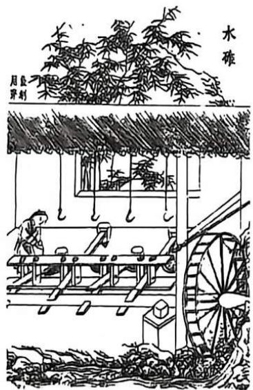

图4-1 连机水碓
{: .figure-caption }

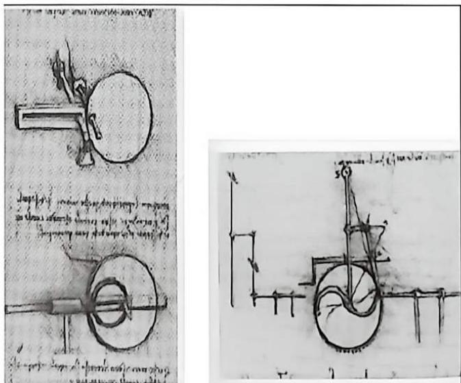

图4-2 达·芬奇绘制的凸轮机构
{: .figure-caption }

## 4.1 凸轮机构的组成和类型

### 4.1.1 凸轮机构的组成

如图 4-3 所示为内燃机中控制气缸的进气或排气的凸轮机构。凸轮 1 旋转时, 其曲面轮廓推动气阀做往复移动, 使之有规律地启闭 (关闭依靠弹簧恢复力的作用), 气阀的运动规律取决于凸轮轮廓曲线的形状, 从而满足内燃机对进、排气的工作要求。

如图 4-4 所示为自动机床的走刀凸轮机构。当凸轮 1 回转时，其曲线凹槽推动从动件扇形齿轮摇杆 2 绕 O 点摆动，带动齿条及其上的刀架 3 运动，以实现刀具的快速进刀、等速切削、快速退刀和停留一段时间以便完成更换工件等动作。

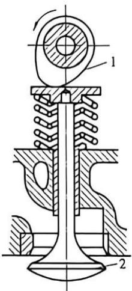

图 4-3 内燃机进、排气凸轮机构
{: .figure-caption }

1—凸轮；2—气阀。

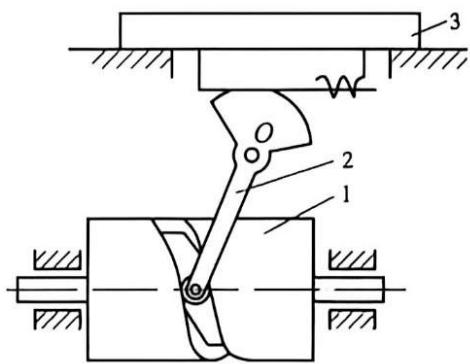

图4-4 自动机床走刀凸轮机构
{: .figure-caption }

1—凸轮；2—摇杆；3—刀架。

由以上两个例子可以看出，凸轮机构的主要特征是其含有一个具有曲面轮廓的构件——凸轮，依靠凸轮的曲面轮廓控制从动件的运动规律，从而使从动件能按预期的运动规律运动。可实现任意复杂的预期运动规律是凸轮机构的一大特点，因此，凸轮机构被广泛应用于各种自动化生产设备中。

### 4.1.2 凸轮机构的类型

凸轮机构的类型很多，常以凸轮和从动件的形状及其运动形式等的不同分类。

1. 按凸轮的形状分类

(1) 盘形凸轮机构。

(2) 圆柱凸轮机构。

具有曲面轮廓[图4-6(b)]的构件，绕圆柱体的轴线旋转。它可视为将移动凸轮轮廓绕在圆柱体上而形成的。

(3)圆锥凸轮机构。

其凸轮如图 4-7 所示，与圆柱凸轮机构相似，只是其轮廓位于圆锥面上。圆柱凸轮机构和圆锥凸轮机构是空间凸轮机构。

(0)
(b)

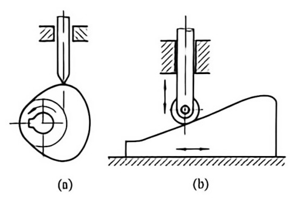

图4-5 盘形凸轮机构
{: .figure-caption }

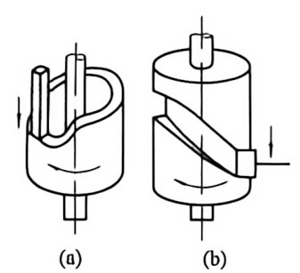

图4-6 圆柱凸轮机构
{: .figure-caption }

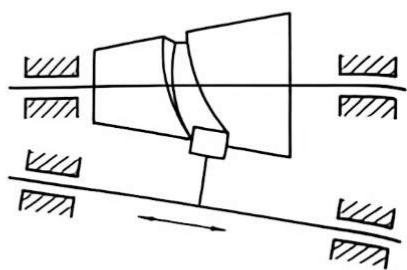

图4-7 圆锥凸轮机构
{: .figure-caption }

#### 2. 按从动件与凸轮接触处的几何形状分类

(1)尖顶从动件凸轮机构。

其从动件如图 4-8(a) 所示, 从动件以尖顶与凸轮接触, 特点是凸轮轮廓曲线的设计较为简单, 不会产生从动件运动失真的问题; 缺点是易磨损, 只适用于受力不大、速度不高的场合, 通常用于测量仪表中的机构。

(2) 滚子从动件凸轮机构。

其从动件如图 4-8 所示，从动件上铰接有滚子，由滚子与凸轮轮廓接触，故摩擦、磨损小，可传递较大的力，应用广泛。

(3)平底从动件凸轮机构。

其从动件如图 4-9 所示，从动件以平面与凸轮接触。其特点是在不计摩擦时，凸轮对从动件的作用力始终垂直于从动件的平底，故传力性能好；运动时接触处易形成润滑油膜，有利于减小摩擦和磨损，因此这种机构可用于高速场合，例如内燃机配气凸轮。

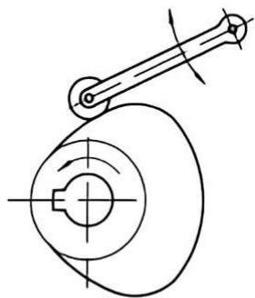

图4-8 滚子从动件凸轮机构
{: .figure-caption }

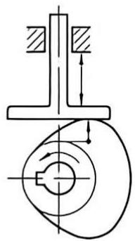

图4-9 平底从动件凸轮机构
{: .figure-caption }

#### 3. 根据从动件的运动形式分类

(1) 移动从动件凸轮机构。

其从动件做往复直线移动，如图 4-7 和图 4-9 所示。移动从动件凸轮机构中，若从动件导路中心线通过凸轮回转轴心，则称为对心从动件（图4-9），否则称为偏置从动件[图4-5(a)]。

(2) 摆动从动件凸轮机构。

其从动件做往复摆动，如图 4-8 所示。

#### 4. 按凸轮与从动件维持接触的方式分类

(1)力锁合的凸轮机构。

这种凸轮机构利用从动件的重力或其他外力(如弹簧力)使从动件与凸轮始终保持接触(图 4-8 和图 4-9)。

(2)形锁合的凸轮机构。

形锁合的凸轮机构依靠凸轮和从动件接触处的几何形状，使从动件与凸轮始终保持接触，常见有以下几种形式。

①沟槽凸轮机构。图 4-10(a) 中的盘形凸轮和图 4-6(b) 中的圆柱凸轮通过圆盘、圆柱上的沟槽保证从动件的滚子与凸轮始终接触。这种锁合方式简单，从动件的运动规律不受限制，但不能采用平底从动件。

②等宽、等径凸轮机构。图 4-10(b) 中的等宽凸轮套在从动件的框中, 且凸轮的任意两条平行切线之间的距离都等于框的上下两个平底之间的距离。图 4-10(c) 所示等径凸轮机构的从动件上装有轴心距离 (d) 不变的两个滚子, 与凸轮轮廓同时保持接触。要注意的是这种凸轮机构从动件的位移规律只能在凸轮转动 $180^{\circ}$ 的范围内任意选择, 而在另外 $180^{\circ}$ 的范围内从动件的运动规律受两个平底之间的距离不变或两个滚子中心之间的距离的限制不能任意选择。

③主回凸轮机构。图 4-10(d) 所示的主回凸轮由同一回转轴上的两个凸轮组成，两个凸轮分别控制从动件正、反运动方向，所以称之为主回凸轮。主回凸轮机构可用于高精度传动，但它的结构比较复杂，制造和安装精度要求较高。

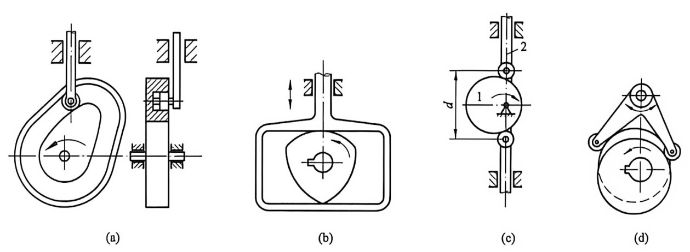

图4-10 形锁合的凸轮机构
{: .figure-caption }

## 4.2 从动件运动规律设计

### 4.2.1 凸轮机构的工作原理分析

下面以图 4-11(a) 所示的凸轮机构为例，分析其工作原理。凸轮通常做连续等速转动，而从动件则在凸轮轮廓的控制下，按预定的运动规律做往复移动。以凸轮轮廓最小向径 $r_{0}$ 为半径所作的圆称为凸轮的基圆。从动件与凸轮在 $A$ 点接触时, 从动件处于离凸轮中心最近的位置。当凸轮逆时针方向转过角度 $\delta_0$ 时, 轮廓 $AB$ 以一定的运动规律将从动件推到离凸轮中心最远的点 $A'$ , 这一运动过程称为推程。对应于推程的凸轮相应转角 $\delta_0$ 被称为推程运动角。当凸轮继续转过角度 $\delta_s$ 时, 从动件尖顶滑过凸轮上圆弧段轮廓 $BC$ , 从动件在离凸轮回转中心最远的位置停留不动, 此过程称为远休, 其对应的凸轮转角 $\delta_s$ 称为远休止角。当凸轮再继续转过角度 $\delta_0'$ 时, 从动件尖顶将滑过凸轮的 $CD$ 段轮廓, 从最高位置回到最低位置, 这一过程称为回程, 相应的凸轮转角 $\delta_0'$ 称为回程运动角。同理, 当基圆上 $DA$ 段圆弧与尖顶接触时, 从动件在距凸轮中心最近的位置停留不动, 此过程称为近休, 其对应的凸轮转角 $\delta_s'$ 称为近休止角。在推程或回程中从动件运动的最大位移称为行程, 用 $h$ 来表示。而对于摆动从动件凸轮机构, 从动件摆过的最大角位移称为摆幅, 用 $\phi$ 表示。

从动件位移 S 与凸轮转角 $\delta$ 间的关系可用图 4-11(b) 所示的从动件位移线图表示，其中横坐标表示凸轮转角 $\delta$ ，因为大多数凸轮做等角速转动，其转角和时间成正比，所以该线图横坐标也代表时间 t，线图的纵坐标表示从动件的位移 s。对于摆动从动件凸轮机构，纵坐标表示从动件的角位移 $\varphi$ 。

### 4.2.2 从动件常用的运动规律

典型的凸轮机构运动循环具有推程、远休、回程、近休四个阶段，如图4-11(b)所示，其中远休、近休过程从动件静止不动。下面介绍推程和回程阶段从动件常用的运动规律。

#### 1. 等速运动规律

从动件在推程(或回程)中速度保持不变，推程阶段的等速运动方程式见式(4-1a)，相应的运动规律线图如图4-12所示。

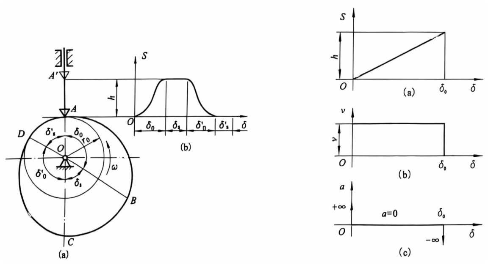

图 4-11 凸轮机构的运动循环阶段
{: .figure-caption }

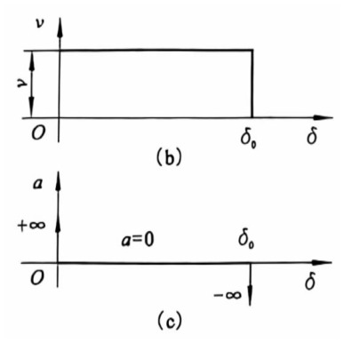

图4-12 等速运动规律
{: .figure-caption }

从图 4-12 中的速度线图可以看出，从动件的速度在推程运动起始和终止瞬时有突变，即此两瞬时的加速度在理论上由零值突变为无穷大，惯性力也应为无穷大。实际上，由于材料具有弹性，加速度和惯性力不致达到无穷大，但仍将有强烈的冲击。这种冲击称为刚性冲击。故这种运动规律只适用于凸轮转速很低的场合。

同理，可得回程时的运动方程式(4-1b)。

$$
\left\{ \begin{array}{l} s = h \delta / \delta_ {0} \\ v = h \omega / \delta_ {0} \\ a = 0 \end{array} \right.\tag{4-1a}
$$

$$
\left\{ \begin{array}{l} s = h (1 - \delta / \delta_ {0} ^ {\prime}) \\ v = - h \omega / \delta_ {0} ^ {\prime} \\ a = 0 \end{array} \right.\tag{4-1b}
$$

#### 2. 等加速等减速运动规律

要避免刚性冲击，就要避免从动件的速度突变，让从动件速度由0逐渐加速增大再逐渐减速降低为0，这可以用等加速等减速运动规律来实现。让从动件在推程的前半段做等加速运动，推程的后半段做等减速运动，推程阶段的等加速等减速运动方程式见式(4-2a)，分为加速段方程式和减速段方程式，相应的运动规律线图如图4-13所示。

这种运动规律的位移曲线是两条光滑连接的、开口方向相反的抛物线，速度线图是斜率一正一负的两条斜直线，加速度线图为两条平行于坐标横轴的直线。可以看出，在推程运动的始末点和前后半程的交接处，加速度也有突变，惯性力也有突变，但

其为有限值。这种突变形成的冲击称为柔性冲击。在高速下柔性冲击仍将导致相当严重的振动和噪声，因此这种运动规律只适用于中、低速场合。

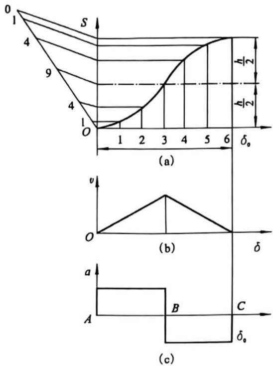

图4-13 等加速等减速运动规律
{: .figure-caption }

同理，可得回程时的运动方程式(4-2b)。

$$
\left\{ \begin{array}{l} s = 2 h \delta^ {2} / \delta_ {0} ^ {2} \\ v = 4 h \omega \delta / \delta_ {0} ^ {2} \quad (\delta = 0 \sim \delta_ {0} / 2) \\ a = 4 h \omega / \delta_ {0} ^ {2} \\ s = h - 2 h (\delta_ {0} - \delta) ^ {2} / \delta_ {0} ^ {2} \\ v = 4 h \omega (\delta_ {0} - \delta) / \delta_ {0} ^ {2} \quad (\delta = \delta_ {0} / 2 \sim \delta_ {0}) \\ a = - 4 h \omega^ {2} / \delta_ {0} ^ {2} \end{array} \right.\tag{4-2a}
$$

$$
\left\{ \begin{array}{l} s = h - 2 h \delta^ {2} / \delta_ {0} ^ {\prime 2} \\ v = - 4 h \omega \delta / \delta_ {0} ^ {\prime 2} \quad (\delta = 0 - \delta_ {0} ^ {\prime} / 2) \\ a = - 4 h \omega^ {2} / \delta_ {0} ^ {\prime 2} \\ s = 2 h (\delta_ {0} ^ {\prime} - \delta) ^ {2} / \delta_ {0} ^ {\prime 2} \\ v = - 4 h \omega (\delta_ {0} ^ {\prime} - \delta) / \delta_ {0} ^ {\prime 2} \quad (\delta = \delta_ {0} ^ {\prime} / 2 - \delta_ {0} ^ {\prime}) \\ a = 4 h \omega^ {2} / \delta_ {0} ^ {\prime 2} \end{array} \right.\tag{4-2b}
$$

#### 3. 余弦加速度运动规律

要进一步改善凸轮机构的动力性能，就要尽量减少冲击。将从动件的加速度规律设计成图4-14(c)所示的余弦变化规律，称为余弦加速度运动规律，可以消除等加速等减速运动规律中前、后半程的交接处惯性力方向的突变，使凸轮机构的动力性能得以改善。

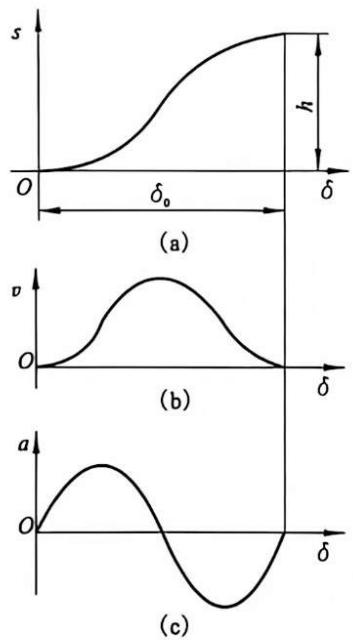

这种运动规律也是从动件在推程前半段做加速运动，后半段做减速运动，但由加速到减速的变化不是突变的，而是用余弦规律进行过渡。

余弦加速度运动规律推程的运动方程式见式(4-3a)，回程的运动方程式见式(4-3b)。

$$
\left\{ \begin{array}{l} s = h \left[ 1 - \cos \left(\pi \delta / \delta_ {0}\right) \right] / 2 \\ v = \pi h \omega \sin \left(\pi \delta / \delta_ {0}\right) / \left(2 \delta_ {0}\right) \\ a = \pi^ {2} h \omega^ {2} \cos \left(\pi \delta / \delta_ {0}\right) / \left(2 \delta_ {0} ^ {2}\right) \end{array} \right.\tag{4-3a}
$$

$$
\left\{ \begin{array}{l} s = h \left[ 1 + \cos \left(\pi \delta / \delta_ {0} ^ {\prime}\right) \right] / 2 \\ v = - \pi h \omega \sin \left(\pi \delta / \delta_ {0} ^ {\prime}\right) / \left(2 \delta^ {\prime}\right) \\ a = - \pi^ {2} h \omega^ {2} \cos \left(\pi \delta / \delta_ {0} ^ {\prime}\right) / \left(2 \delta_ {0} ^ {\prime 2}\right) \end{array} \right.\tag{4-3b}
$$

#### 4. 正弦加速度运动规律

将从动件的加速度规律设计成图 4-15(c) 所示的正弦变化规律, 称为正弦加速度运动规律。

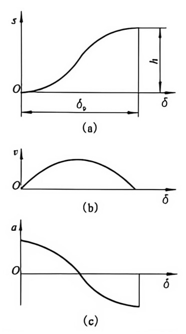

图4-14 余弦加速度运动规律
{: .figure-caption }

图4-15 正弦加速度运动规律
{: .figure-caption }

由图可见，这种从动件的速度和加速度均无任何突变，因而既没有刚性冲击，也没有柔性冲击，可适用于高速运动。

正弦加速度运动规律推程的运动方程式见式(4-4a)，回程的运动方程式见式(4-4b)。

$$
\left\{ \begin{array}{l} s = h \left[ \left(\delta / \delta_ {0} - \sin (2 \pi \delta / \delta_ {0}) / (2 \pi) \right] \right. \\ v = h \omega \left[ 1 - \cos (2 \pi \delta / \delta_ {0}) \right] / \delta_ {0} \\ a = 2 \pi h \omega^ {2} \sin (2 \pi \delta / \delta_ {0}) / \delta_ {0} ^ {2} \end{array} \right.\tag{4-4a}
$$

$$
\left\{ \begin{array}{l} s = h \left[ 1 - \delta / \delta_ {0} ^ {\prime} + \sin (2 \pi \delta / \delta_ {0} ^ {\prime}) / (2 \pi) \right] \\ v = h \omega \left[ \cos (2 \pi \delta / \delta_ {0} ^ {\prime} - 1) / \delta_ {0} ^ {\prime} \right. \\ a = - 2 \pi h \omega^ {2} \sin (2 \pi \delta / \delta_ {0} ^ {\prime}) / \delta_ {0} ^ {\prime 2} \end{array} \right.\tag{4-4b}
$$

以上各种运动规律的运动方程式可按下面的方法推导出来。以余弦加速度运动规律为例，如图4-14(c)所示，可设其加速度方程式为 $a=c_{1}\cos(\pi\delta/\delta_{0})$ ，其中 $c_{1}$ 为待定常数；将加速度方程式对时间积分（注意 $\delta=\omega t$ ），可得速度方程式 $v=c_{1}\delta_{0}\sin(\pi\delta/\delta_{0})/\pi\omega+c_{2}$ ，其中 $c_{2}$ 为待定积分常数；再将速度方程式对时间积分，可得位移方程式 $s=-c_{1}\delta_{0}^{2}\cos(\pi\delta/\delta_{0})\pi^{2}\omega^{2}+c_{2}\delta/\delta_{0}+c_{3}$ ，其中 $c_{3}$ 为待定积分常数。由推程运动的三个边界条件：当 $\delta=0$ 时，s=0，v=0；当 $\delta=\delta_{0}$ 时，s=h，就可以确定 $c_{1}$ 、 $c_{2}$ 、 $c_{3}$ 三个待定常数，从而得到余弦加速度运动规律的运动方程式。

#### 5. 组合运动规律

由上述 4 种运动规律的分析可知, 要避免从动件运动过程中发生冲击, 就要选用加速度曲线无突变的运动规律。但有时由于某种工作要求必须使用速度、加速度都有突变的等速运动规律, 此时可将几种运动规律曲线组合起来, 形成所谓组合运动规律, 就可以得到既能使用等速运动而又不会产生冲击的运动规律。

组合运动规律设计比较灵活，易于满足各种运动要求，因而应用广泛。组合运动规律类型很多，下面对两种比较典型的组合型运动规律做简单介绍。

(1) 改进型等速运动规律。

在凸轮机构中, 通常不采用单一的等速运动规律, 而是采用等速运动规律与其他运动规律组合的改进型等速运动规律, 从而消除等速运动规律两端出现的刚性冲击。如图 4-16(a) 所示为一种在等速运动的位移线图上添加两段圆弧而形成的组合等速运动规律, 两段圆弧分别将近休线图和远休线图与等速运动的位移线图相切连接。这种组合等速运动规律克服了单一的等速运动规律的刚性冲击, 但仍有柔性冲击, 若要进一步消除柔性冲击, 可在等速运动规律的两端用正弦加速度运动规律与其衔接, 如图 4-16(b) 所示。这种组合运动规律, 既无刚性冲击又无柔性冲击。

(2) 梯形加速度运动规律。

要降低从动件运动时的惯性力，就要使用加速度小的运动规律。在同等条件下，等加速等减速运动规律较其他运动规律的最大加速度要小，但其加速度曲线不连续，有柔性冲击。为消除此柔性冲击，可将等加速等减速运动规律的加速度曲线突变处用一段斜直线过渡，如图4-17(a)所示。图中加速度曲线由两个梯形构成，故称之为梯形加速度运动规律。这种运动规律的加速度曲线无突变，避免了柔性冲击。若进一步用正弦曲线代替上述斜直线，则可使加速度曲线光滑连续，如图4-17(b)所示。这种运动规律称为改进梯形加速度运动规律，它的加速度小，且没有刚性冲击和柔性冲击，具有良好的动力性能。

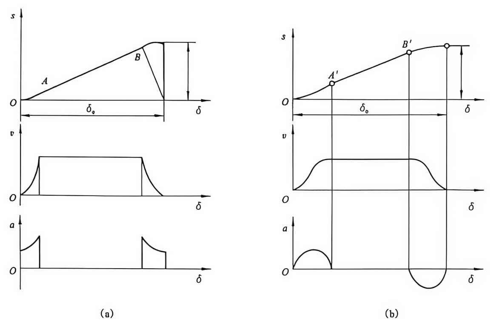

图4-16 改进型等速运动规律
{: .figure-caption }

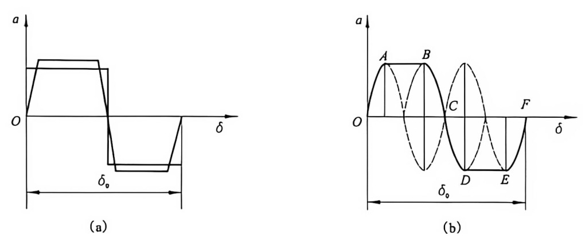

图4-17 梯形加速度运动规律
{: .figure-caption }

### 4.2.3 从动件运动规律的设计

进行从动件运动规律的设计时，应遵循以下原则。

#### 1. 从动件的运动规律无严格要求时可采用简单的凸轮轮廓曲线

当仅要求凸轮转过某一角度 $\delta_{0}$ 时，从动件运动一行程 h 或 $\phi$ ，而从动件动作的频率和速度均较低时，可采用圆弧、直线等简单的曲线来作为凸轮的轮廓曲线。

#### 2. 从动件的最大速度要尽量小

从动件运动的最大速度越大, 则从动件的最大动量就越大, 当从动件由于某种障碍而突然停止时将产生极大的冲击力。所以, 为了停、动灵活和保证安全运行, 希望从动件的动量要小, 特别是从动件质量较大时, 应选择最大速度较小的运动规律。

#### 3. 从动件的最大加速度要尽量小

从动件运动的最大加速度越大, 则惯性力就越大。由惯性力引起的动压力, 对机构的强度及磨损都有很大的影响。最大加速度是影响动力性能的主要因素, 故高速凸轮机构应选择最大加速度较小的运动规律。

需要注意的是，上述要求通常是互相制约、互相矛盾的，设计从动件的运动规律时要根据工作要求具体分析，弄清主次要求后进行选择。

表 4-1 列出了同等条件下从动件几种常用的运动规律的最大速度、最大加速度及冲击特性数据，并给出了推荐应用的范围，可供设计运动规律时参考。

表 4-1 从动件常用的运动规律的冲击特性数据

<table><tr><td>运动规律名称</td><td>最大速度/ \((m \cdot s^{-1})\) </td><td>最大加速度/ \((m \cdot o^{-7})\) </td><td>冲击特性</td><td>适用范围</td></tr><tr><td>等速运动</td><td>1.0</td><td> \(\infty\) </td><td>刚性冲击</td><td>低速、轻载</td></tr><tr><td>等加速等减速运动</td><td>2.0</td><td>4.00</td><td>柔性冲击</td><td>中速、轻载</td></tr><tr><td>余弦加速度运动</td><td>1.57</td><td>4.93</td><td>柔性冲击</td><td>中速、中载</td></tr><tr><td>正弦加速度运动</td><td>2.0</td><td>6.28</td><td>无冲击</td><td>高速、轻载</td></tr></table>

## 4.3 凸轮轮廓曲线的设计

根据工作要求选定了凸轮机构的类型、设计好从动件的运动规律和凸轮机构的基本尺寸（基圆半径、偏距等）后，即可以进行凸轮轮廓曲线的设计。轮廓曲线的设计方法有作图法和解析法。无论使用哪种方法，它们所依据的基本原理都是相同的。本节首先介绍凸轮轮廓曲线设计的基本原理，然后分别介绍作图法和解析法设计凸轮轮廓曲线的方法和步骤。

### 4.3.1 凸轮轮廓曲线设计的基本原理

凸轮轮廓曲线设计的基本原理是反转法。所谓反转法，是建立在相对运动不变性原理上的一种方法。如图4-18所示为一尖顶移动从动件盘形凸轮机构，在工作情况下，我们看到的是以机架作为静参考系，凸轮和从动件相对机架的运动情况；凸轮以等角速度 $\omega$ 按逆时针方向绕转轴 $O$ 相对机架转动，推动从动件按照工作所要求的运动规律相对机架移动。在设计凸轮轮廓时，选择凸轮作为静参考系而保持各构件在工作情况下的相对运动不变，则凸轮静止不动，机架以等角速度 $\omega$ 按顺时针方向绕转轴 $O$ 相对凸轮转动（反转），从动件相对凸轮则做复合运动：随同机架导路一起以等角速度 $\omega$ 按顺时针方向绕转轴 $O$ 相对凸轮转动(反转), 同时又在机架导路中按照工作所要求的运动规律相对机架移动, 此时从动件尖顶沿凸轮轮廓曲线运动。因此, 设计凸轮轮廓时, 只要让从动件做上述复合运动, 则其尖顶的轨迹便是凸轮轮廓曲线, 这就是凸轮轮廓曲线设计的反转法原理。

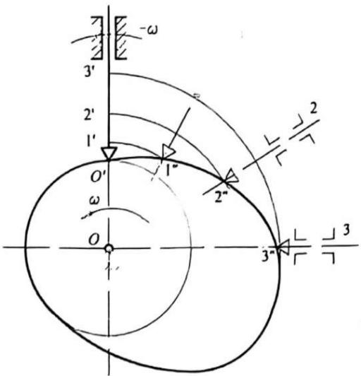

图4-18 反转法原理
{: .figure-caption }

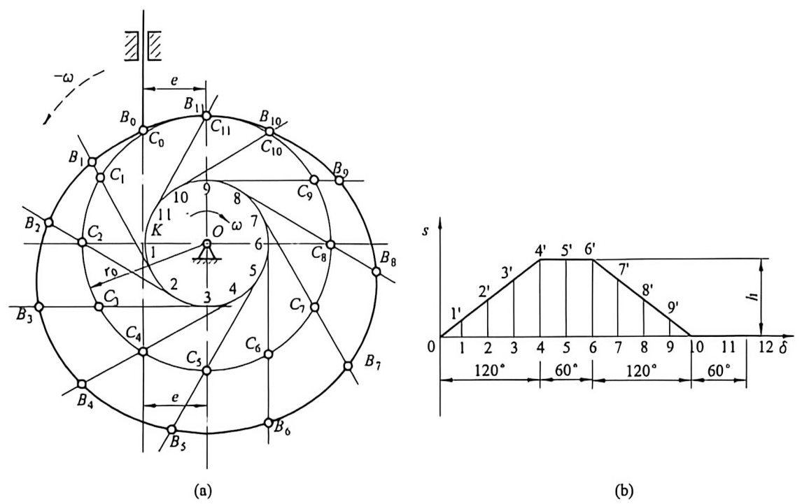

图4-19 尖顶移动从动件盘形凸轮轮廓曲线的设计
{: .figure-caption }

### 4.3.2 用作图法设计凸轮轮廓曲线

#### 1. 移动从动件盘形凸轮轮廓曲线的设计

(1) 尖顶从动件。

如图 4-19(a) 所示为一偏置移动尖顶从动件盘形凸轮机构。设已知凸轮的基圆半径为 $r_{0}$ ，从动件轴线偏于凸轮轴心的左侧，偏距为 e。凸轮以等角速度 $\omega$ 顺时针方向转动。从动件的位移曲线如图 4-19(b) 所示。依据反转法原理设计凸轮轮廓曲线可按下面步骤进行。

(b)

①选取适当的比例尺，作出从动件的位移线图，如图 4-19(b) 所示。将位移线图的横坐标分成若干等份，得分点 1, 2, …, 12。

②选取同样的比例尺，以 O 为圆心， $r_{0}$ 为半径作基圆；根据从动件的偏置方向和偏距 e 画出从动件的起始位置线，该位置线与基圆的交点 $B_{0}$ 便是从动件尖顶的初始位置。

③以 O 为圆心、e 为半径作偏距圆，该圆与从动件的起始位置线切于 K 点。

④自 K 点开始，沿 $-\omega$ 方向将偏距圆分成与图 4-19(b) 的横坐标相同的等分，得偏距圆上的分点 1, 2, …, 11。过各分点作偏距圆的切射线，这些线代表从动件在随同机架反转过程中所占据的位置线，设它们与基圆的交点分别为 $C_{0}$ , $C_{1}$ , …, $C_{11}$ 。

⑤在上述切射线上，从基圆起向外截取线段，使其长度分别等于图4-19(b)中相应的纵坐标高度，即 $C_{1}B_{1}=1^{\prime}1$ ， $C_{2}B_{2}=2^{\prime}2$ ，…，得点 $B_{1}$ ， $B_{2}$ ，…，这些点代表从动件依据反转法原

理在复合运动中尖顶依次占据的位置。

⑥将点 $B_{0}, B_{1}, B_{2}, \cdots$ 连成光滑的曲线，即为所设计的凸轮轮廓曲线。图中 $B_{4} \sim B_{6}$ 间和 $B_{10} \sim B_{0}$ 间均为以 $O$ 为圆心的圆弧。

(2) 滚子从动件。

对于图 4-20 所示的偏置移动滚子从动件盘形凸轮机构, 可以将从动件上的滚子中心点假想为尖顶从动件的尖顶, 先依据反转法原理, 作出从动件做复合运动时滚子中心 (假想尖顶) 的轨迹, 即图 4-20(a) 中的 $1^{\prime \prime}, 2^{\prime \prime}, \cdots$ 曲线, 此曲线称为凸轮的理论廓线。而凸轮的实际廓线是一条与理论廓线法向等距的曲线, 即曲线 $\eta^{\prime}$ 。实际廓线可以根据包络原理作出, 具体作图步骤如下。

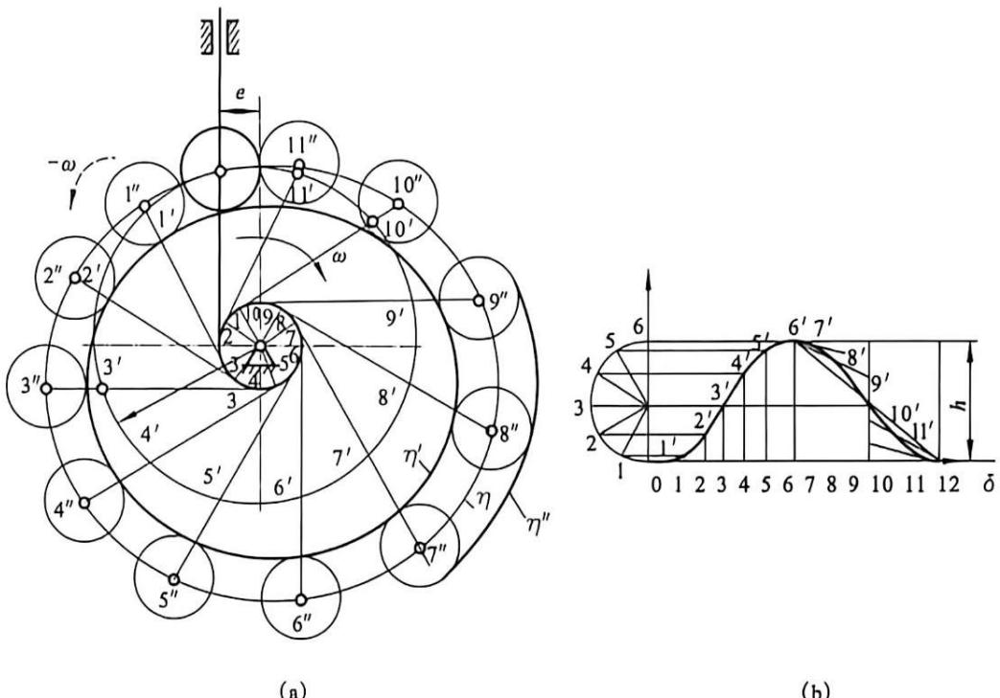

图4-20 滚子从动件盘形凸轮轮廓曲线的设计
{: .figure-caption }

①将滚子中心假想为尖顶从动件的尖顶，按照上述尖顶从动件凸轮轮廓曲线的设计方法作出曲线 $\eta$ ，这条曲线代表从动件依据反转法原理在复合运动中滚子中心的运动轨迹，称为凸轮的理论廓线。

②以理论廓线上的各点为圆心，以滚子半径 $r_1$ 为半径，作一系列滚子圆，得一滚子圆族。然后作这族滚子圆的内包络线 $\eta'$ ，它就是凸轮的实际廓线。实际廓线是理论廓线的等距曲线，即两曲线沿法线方向的距离处处相等，且都等于滚子半径。若同时作出这族滚子圆的内、外包络线 $\eta'$ 和 $\eta''$ ，则可得到图4-20(a)所示的沟槽凸轮的轮廓曲线。

要注意的是在滚子从动件盘形凸轮机构中，基圈半径 $r_0$ 是理论廓线的最小半径，而在尖顶从动件盘形凸轮机构中，可以将尖顶看成半径为 0 的滚子，因而凸轮的实际廓线与理论廓线是重合的，基圈半径 $r_0$ 既是理论廓线的最小半径也是实际廓线的最小半径。

(3)平底从动件。

平底从动件盘形凸轮机构的凸轮廓线的设计方法可用图4-21来说明。其基本思路与上述滚子从动件盘形凸轮机构相似，不同的是将从动件平底与基圆的切点 $B_{0}$ 作为假想的尖顶从动件的尖顶。具体作图步骤如下。

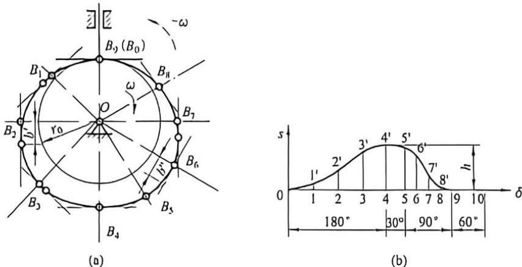

图4-21 平底移动从动件盘形凸轮轮廓曲线的设计
{: .figure-caption }

①将从动件平底与基圆的切点 $B_{0}$ 作为假想的尖顶从动件的尖顶，按照尖顶从动件盘形凸轮轮廓的设计方法，作出从动件反转时依次占据的各位置线 $O_{1}, O_{2}, \cdots$ ，再作出假想尖顶依据反转法原理在复合运动中占据的一系列位置 $B_{1}, B_{2}, \cdots$ 。

②过 $B_{1}, B_{2}, \cdots$ 各点，分别作射线 $O_{1}, O_{2}, \cdots$ 的垂线，得一直线族，这族直线代表依据反转法原理平底在复合运动中依次占据的位置。

③作该直线族的包络线，即可得到凸轮的实际廓线。

由图中可以看出，平底上与凸轮实际廓线相切的点是随机构位置而变化的，因此，为了保证从动件平底在所有位置都能与凸轮轮廓曲线相切，平底左、右两侧的宽度应分别大于导路中心线至左、右最远切点的距离 $b'$ 和 $b''$ 。

此外，当凸轮轮廓曲线确定以后，从动件无论是作成对心的还是偏置的，其运动规律都相同。因此，平底从动件盘形凸轮机构的凸轮轮廓曲线可以一律按对心从动件设计。

#### 2. 摆动从动件盘形凸轮轮廓曲线的设计

如图 4-22(a) 所示为一尖顶摆动从动件盘形凸轮机构。已知凸轮轴心与从动件摆动轴心之间的中心距为 $a$ ，凸轮基圆半径为 $r_0$ ，从动件长度为 $l$ 。凸轮以等角速度 $\omega$ 逆时针转动，从动件的运动规律如图 4-22(b) 所示。现在来设计该凸轮的轮廓曲线。

反转法原理同样适用于摆动从动件凸轮机构。让从动件相对凸轮做复合运动：随同机架铰链 A 一起以等角速度 $\omega$ 按顺时针方向绕转轴 O 相对凸轮转动（反转），同时又绕铰链 A 按照工作所要求的运动规律相对机架摆动，此时从动件尖顶的轨迹即为凸轮轮廓曲线。因此，凸轮轮廓曲线可按下述步骤设计。

①选取适当的比例尺，作出从动件的位移线图，并将推程和回程区间位移曲线的横坐标各分成若干等份，如图4-22(b)所示。与移动从动件不同的是，这里纵坐标代表从动件的角位移 $\varphi$ ，因此纵坐标的比例尺是 $1\mathrm{mm}$ 长度所代表的角度大小。

②以 O 为圆心、 $r_{0}$ 为半径作出基圆，并根据已知的中心距 a 确定从动件转轴 A 的位置 $A_{0}$ 。然后以 $A_{0}$ 为圆心，以从动件杆长 l 为半径作圆弧，交基圆于 $C_{0}$ 点， $A_{0}C_{0}$ 即代表从动件

的初始位置， $C_{0}$ 即为从动件尖顶的初始位置。

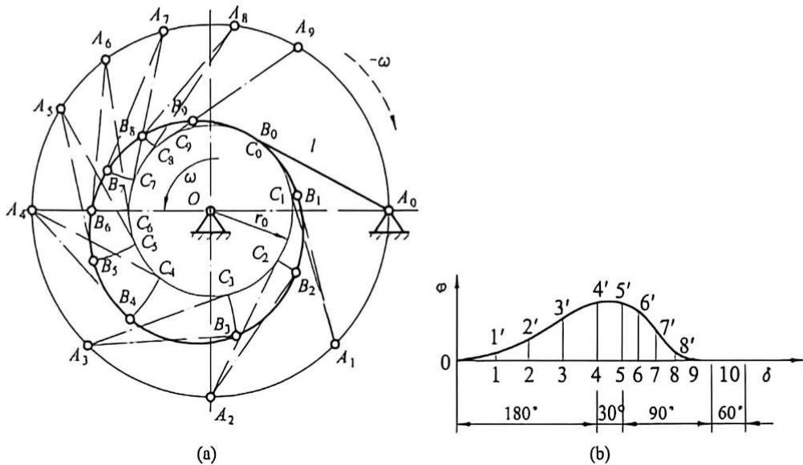

图4-22 摆动从动件盘形凸轮轮廓曲线的设计
{: .figure-caption }

③以 O 为圆心，以 $OA_{0}$ 为半径作圆，该圆代表从动件转动轴心 A 随同机架反转的轨迹，自 $A_{0}$ 点开始沿着 $(-\omega)$ 方向将该圆分成与图 4-22(b) 中横坐标对应的区间和等分。得点 $A_{1}$ ， $A_{2}$ ，…，它们代表反转过程中从动件转轴 A 依次占据的位置。

④分别以点 $A_{1}, A_{2}, \cdots$ 为圆心，以从动件杆长 $l$ 为半径作圆弧，交基圆于 $C_{1}, C_{2}, \cdots$ 各点，得线段 $A_{1} C_{1}, A_{2} C_{2} \cdots$ ，以 $A_{1} C_{1}, A_{2} C_{2} \cdots$ 为一边，分别作角 $\angle B_{1} A_{1} C_{1}, \angle B_{2} A_{2} C_{2} \cdots$ ，使它们分别等于图4-22(b)中对应点的纵坐标所代表的角位移，且使 $B_{1} A_{1} = C_{1} A_{1}, B_{2} A_{2} = C_{2} A_{2}, \cdots$ 得线段 $B_{1} A_{1}, B_{2} A_{2} \cdots$ 。这些线段即代表反转过程中从动件依次占据的位置， $B_{1}, B_{2}, \cdots$ 即为反转过程中从动件尖顶依次占据的位置。

⑤将 $B_{0}, B_{1}, B_{2}, \cdots$ 连成光滑的曲线, 即得凸轮轮廓曲线。由图中可以看出, 该廓线与代表从动件的各线段 $B_{1} A_{1}, B_{2} A_{2}, \cdots$ 在某些位置已经相交, 这表示凸轮与从动件可能发生空间位置干涉, 故在设计机构的具体结构时, 应将从动件做成弯杆形式, 或使凸轮的运动平面与从动件的运动平面相互错开一定距离。

需要注意的是，在摆动从动件的情况下，位移曲线纵坐标的长度代表的是从动件的角位移，因此，在绘制凸轮轮廓曲线时，需要先把这些长度转换成角度，然后才能一一对应地把它们转移到凸轮轮廓设计图上。

若采用滚子或平底从动件，则上述连 $B_{0}, B_{1}, B_{2}, \cdots$ 各点所得的光滑曲线为凸轮的理论廓线。过这些点作一系列滚子圆或平底，然后作它们的包络线即可求得凸轮的实际廓线。

以上介绍了作图法设计凸轮轮廓曲线的基本原理和方法。采用作图法设计凸轮轮廓曲线时，可借助 AutoCAD、SOLIDWORKS、PTC Creo、UG 等计算机绘图软件，以提高设计的速度和精度。例如，作从动件反转过程占据的一系列位置时，可用绘图软件中的“复制”或“阵列”工具；要获取凸轮轮廓曲线上各点坐标，可用绘图软件中的“尺寸标注”或“坐标标注”工具。

#### 3. 移动和摆动从动件圆柱凸轮轮廓曲线设计简介

如图 4-23(a) 所示为一移动从动件圆柱凸轮机构, 设计其轮廓曲线时, 可将此圆柱凸轮的中径 $R_{\mathrm{m}}$ (凸轮凹槽深度一半位置所处的半径) 的圆柱面展成平面, 得到一个长度为 $2 \pi R_{\mathrm{m}}$ 的移动凸轮, 如图 4-23(b) 所示, 其移动速度为 $v = \omega R_{\mathrm{m}}$ 。然后, 应用反转法原理, 将此整个凸轮机构加上一个公共线速度 $-v$ , 使之反向移动, 此时凸轮将静止不动, 而从动件则随其导路沿 $-v$ 方向移动, 同时又在导路中按预期的运动规律往复移动。在从动件的复合运动中, 从动件的滚子中心 $B$ 描出的轨迹 (图中的细实线 $\beta$ ) 即为凸轮的理论廓线; 切于滚子圆族的两条包络线 $\beta'$ 、 $\beta''$ 即为凸轮的实际廓线。

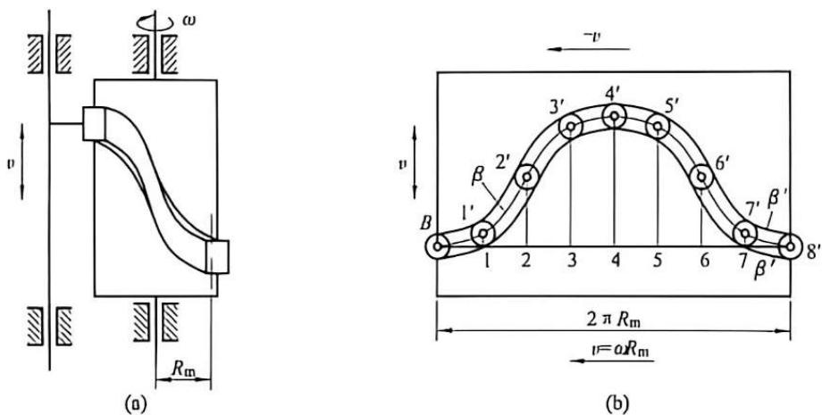

图4-23 移动从动件圆柱凸轮轮廓曲线的设计
{: .figure-caption }

如图 4-24(a) 所示为一摆动从动件圆柱凸轮机构。凸轮轮廓曲线的设计步骤与上述移动从动件的基本相同，不同的只是在反转运动中，摆杆一方面随轴心 A 沿线 AH[图 4-24(b)] 以速度 -v 移动，一方面绕其轴心 A 按预期的运动规律摆动，滚子中心 B 描出的轨迹即为凸轮的理论廓线。

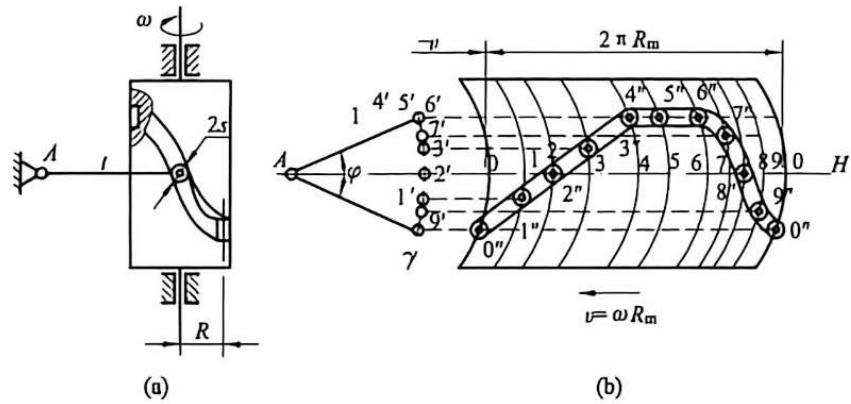

图4-24 摆动从动件圆柱凸轮轮廓曲线的设计
{: .figure-caption }

### 4.3.3 用解析法设计凸轮轮廓曲线

#### 1. 尖顶移动从动件盘形凸轮机构

如图 4-25 所示，设已知凸轮的基圆半径为 $r_{0}$ ，从动件轴线偏于凸轮轴心的右侧，偏距为 e。凸轮以等角速度 $\omega$ 逆时针方向转动。从动件的位移规律为 $s(\delta)$ 。下面说明建立凸轮轮廓曲线方程式的方法。

建立直角坐标系 Oxy 如图 4-25 所示，点 $B_{0}$ 为凸轮轮廓上推程的起始点。根据反转法原理，给整个机构叠加一个公共角速度 $-\omega$ ，则凸轮将静止不动，而从动件将一边绕凸轮中心反向旋转，一边沿导路按给定规律运动。当凸轮逆时针转过 $\delta$ 角时，从动件尖顶从 $B_{0}$ 点运动到 $B_{1}$ 点，反转后相当于从动件顺时针转过 $\delta$ 角（反转），导路到达 CB，从动件尖顶到达凸轮轮廓上点 $B(x, y)$ ，分别过 C 点和 B 点作水平和垂直辅助线，分别得到交点 D、E、F、G，以及 $\triangle OCE$ 和 $\triangle CDB$ ，则点 $B(x, y)$ 坐标为：

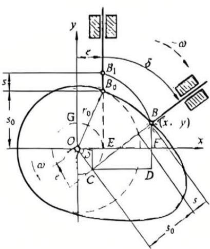

图4-25 解析法设计尖顶移动从动件盘形凸轮轮廓
{: .figure-caption }

$$
\begin{array}{l} x = O F = O E + E F = O E + C D = (s _ {0} + s) \sin \delta + e \cos \delta \\ y = F B _ {1} = D B _ {1} - D F = D B _ {1} + C E = (s _ {0} + s) \cos \delta - e \sin \delta \end{array}\tag{4-5}
$$

其中由 $\triangle OEB_0$ 得， $s_0 = \sqrt{r_0^2 - e^2}$ ， $e$ 为偏距。式(4-5)即为凸轮轮廓曲线的方程式。

#### 2. 尖顶摆动从动件盘形凸轮机构

如图 4-26 所示, 已知凸轮轴心与从动件摆动轴心之间的中心距为 $a$ , 凸轮基圆半径为 $r_0$ , 从动件长度为 $l$ 。凸轮以等角速度 $\omega$ 逆时针转动, 从动件的运动规律如图 4-26 所示。现在来设计该凸轮的轮廓曲线。

建立直角坐标系 Oxy，如图 4-26 所示，点 $B_{0}$ 为凸轮轮廓上推程的起始点。根据反转法原理，给整个机构叠加一个 $-\omega$ 的公共角速度，则凸轮将静止不动，而从动件将一边绕凸轮中心反向旋转，一边绕摆动中心按给定规律摆动。当凸轮逆时针转过 $\delta$ 角时，相当于从动件顺时针转过 $\delta$ 角（反转）， $A_{0}$ 到达 A，从动件尖顶到达凸轮轮廓上点 $B(x, y)$ ，分别过 A 点和 B 点作水平和垂直辅助线，分别得到交点 C、D、E、F，以及 $\triangle OAD$ 和 $\triangle ABE$ ，则点 $B(x, y)$ 坐标为：

$$
\begin{array}{l} x = O C = O D - C D = O D - B E = a \sin \delta - l \sin (\varphi_ {0} + \varphi + \delta) \\ y = B C = E D = A D - A E = a \cos \delta - l \cos (\varphi_ {0} + \varphi + \delta) \end{array}\tag{4-6}
$$

式中： $\varphi_{0}$ 为从动件的初始位置位角，依据余弦定律，由 $\Delta O\Lambda_{0}B_{0}$ 可得

$$
\varphi_ {0} = \arccos \left[ \left(a ^ {2} + l ^ {2} - r _ {0} ^ {2}\right) / (2 a l) \right]\tag{4-7}
$$

式 $(4-6)$ 即为凸轮轮廓曲线的方程式。

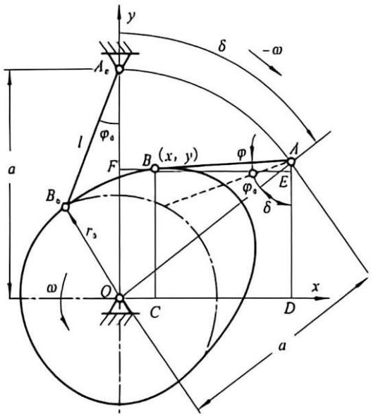

图4-26 解析法设计尖顶
{: .figure-caption }

摆动从动件盘形凸轮轮廓

从动件盘形凸轮轮廓

#### 3. 滚子从动件盘形凸轮机构

(1) 轮廓曲线的设计。

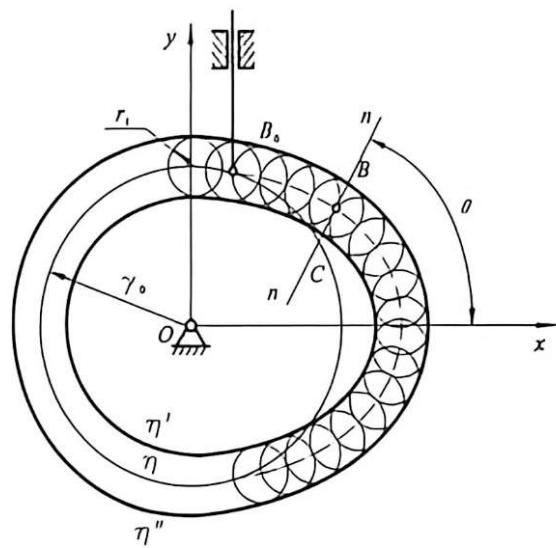

图4-27 解析法设计滚子移动
{: .figure-caption }

如图 4-27 所示, 设计滚子从动件盘形凸轮轮廓曲线可分如下两步进行。首先把滚子中心视为尖顶从动件的尖顶, 按上述尖顶从动件凸轮轮廓曲线的设计方法, 得到滚子中心在固定坐标系 $Oxy$ 中的轨迹 $\eta$ , 即为滚子从动件盘形凸轮的理论轮廓曲线。再以理论轮廓曲线 $\eta$ 上的各点为中心, 以滚子半径为半径, 作一系列的滚子圆, 此圆族的内包络线 $\eta'$ , 即为滚子从动件凸轮的实际廓线。对于沟槽凸轮有两条实际廓线 $\eta'$ 和 $\eta''$ 。

理论廓线与实际廓线互为等距曲线，有公共的曲率中心和法线。理论廓线与实际廓线在法线方向的距离处处相等，都等于滚子半径 $r_{1}$ 。

理论廓线上任一点 B 的坐标 $(x, y)$ 可根据式 (4-5) 按尖顶从动件凸轮轮廓曲线上点的坐标的求法求得。由高等数学可知，理论廓线上的点 B 处法线 n-n 的斜率（与切线斜率互为负倒数）应为

$$
\tan \theta = \mathrm{d} x / (- \mathrm{d} y) = (\mathrm{d} x / \mathrm{d} \delta) / (- \mathrm{d} y / \mathrm{d} \delta)\tag{4-8}
$$

式中：dx/dy、dy/dδ可由式(4-5)或式(4-6)对δ求导求得。

应当注意, $\theta$ 角可在 $0^{\circ} \sim 360^{\circ}$ 之间变化, $\theta$ 角具体属于哪个象限可根据式(4-8)中分子、分母的值的正、负号来判断。求出 $\theta$ 角后, 便可求出实际廓线上对应点 $C$ 的坐标为:

$$
\begin{array}{l} x ^ {\prime} = x \mp r _ {1} \cos \theta \\ y ^ {\prime} = y \mp r _ {1} \sin \theta \end{array}\tag{4-9}
$$

式中：x、y 为理论廓线上点 B 的坐标， $r_{t}$ 为滚子圆的半径。式中的上一组符号用于内包络曲线，下一组符号用于外包络曲线。式(4-9)即为滚子从动件盘形凸轮的实际廓线方程。

(2) 刀具中心轨迹方程。

在数控机床上加工凸轮轮廓，通常需给出刀具中心的直角坐标值。设刀具半径为 $r_{c}$ ，滚子半径为 $r_{1}$ ，若刀具半径与滚子半径完全相等，那么理论廓线的坐标值即为刀具中的坐标值。

当用数控铣床加工凸轮或用砂轮磨削凸轮时, 刀具半径 $r_{\mathrm{c}}$ 往往大于滚子半径 $r_{1}$ , 由图 4-28(a) 可以看出, 这时刀具中心的运动轨迹 $\eta_{\mathrm{c}}$ 为理论廓线 $\eta$ 的等距曲线, 相当于以 $\eta$ 上的点为中心, 以 $(r_{\mathrm{c}} - r_{1})$ 为半径所作的一系列圆的外包络线。当用钼丝在线切割机床上加工凸轮时, 钼丝半径 $r_{\mathrm{c}}$ 小于滚子半径 $r_{1}$ , 如图 4-28(b) 所示。这时刀具中心的运动轨迹 $\eta_{\mathrm{c}}$ 相当于以 $\eta$ 上的点为中心, 以 $(r_{1} - r_{\mathrm{c}})$ 为半径所作的一系列圆的内包络线。因此, 只要用 $|r_{1} - r_{\mathrm{c}}|$ 代替式 (4-9) 中的 $r_{1}$ , 便可由式 (4-9) 求出刀具中心的运动轨迹上各点的坐标值。

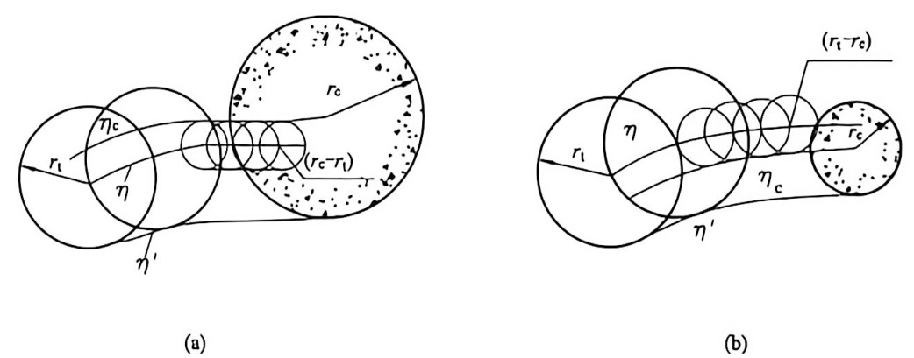

图4-28 刀具中心的轨迹方程
{: .figure-caption }

#### 4. 平底移动从动件盘形凸轮机构的设计

如图 4-29 所示, 凸轮自推程初始位置逆时针转过 $\delta$ 角时, 从动件上升位移 $s$ 。依据反转原理, 将从动件顺时针反转 $\delta$ 角, 此时凸轮与从动件在点 $B(x, y)$ 处接触, 根据三心定理, $P$ 点位于该位置时凸轮 1 与从动件 2 的速度瞬心, 有 $OP = v / \omega = \mathrm{d}s / \mathrm{d}\delta$ 。过 $P$ 点和 $B$ 点分别作水平和垂直辅助线, 得到交点 $C 、 D 、 E$ , 以及 $\triangle OPE$ 和 $\triangle PBD$ , 则点 $B(x, y)$ 坐标为:

$$
\begin{array}{l} x = O C = O E + E C = O E + P D = (r _ {0} + s) \sin \delta + (\mathrm{ds/d} \delta) \cos \delta \\ y = B C = B D - C D = B D - E P = (r _ {0} + s) \cos \delta - (\mathrm{ds/d} \delta) \sin \delta \end{array}\tag{4-10}
$$

## 4.4 凸轮机构基本尺寸的确定

凸轮机构的基本尺寸有基圆半径 $r_0$ 、滚子半径 $r_t$ 、偏距 $e$ 、移动从动件导路长度、摆动从动件的摆杆长度 $l$ 和中心距 $a$ 。这些基本尺寸对凸轮机构的结构、传力性能都有重要的影响，且这些基本尺寸相互制约、相互影响，如何合理地确定这些基本尺寸，是凸轮机构设计中要解决的重要问题。

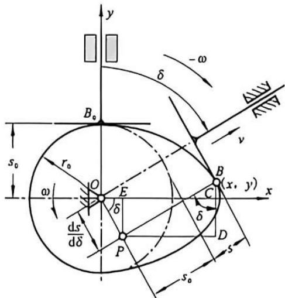

图4-29 解析法设计滚子移动从动件盘形凸轮机构
{: .figure-caption }

在设计凸轮机构的基本尺寸时，影响凸轮机构传力性能的一个非常重要的参数是压力角 $\alpha$ 。压力角 $\alpha$ 是一个表征机构传力性能的参数，机构的压力角 $\alpha$ 是机构中与机架相连的从动件所受驱动力的方向与该驱动力作用点的速度方向之间所夹的锐角。为了提高机构效率、改善传力性能，确定基本尺寸时务必使凸轮机构的最大压力角 $\alpha_{max}$ 小于或等于许用压力角 $[\alpha]$ ，即

$$
\alpha_ {\max} \leqslant [ \alpha ]\tag{4-11}
$$

根据理论力学分析和实际经验，工作行程和非工作行程的许用压力角推荐值如下：

(1) 工作行程。对移动从动件， $[\alpha]=30^{\circ}\sim38^{\circ}$ ；对摆动从动件， $[\alpha]=40^{\circ}\sim45^{\circ}$ 。

(2)非工作行程。无论是移动从动件还是摆动从动件， $[\alpha]=70^{\circ}\sim80^{\circ}$

如图 4-30 所示为偏置尖顶移动从动件盘形凸轮机构在推程中的一个位置。图 4-30(a) 中，从动件导路偏置在凸轮中心的右边；图 4-30(b) 中，从动件导路偏置在凸轮中心的左边。从动件的移动速度为 v，凸轮转动的角速度为 $\omega$ 。根据压力角的定义，可作出凸轮机构的压力角 $\alpha$ ，如图 4-30 所示。由瞬心的知识可知，P 为凸轮和从动件的速度瞬心，故有 $v = \omega \overline{OP}$ ，从而

$$
\overline {{O P}} = v / \omega = \mathrm{ds} / \mathrm{d} \delta
$$

(b)

又由图中的 $\triangle ACP$ 可得：

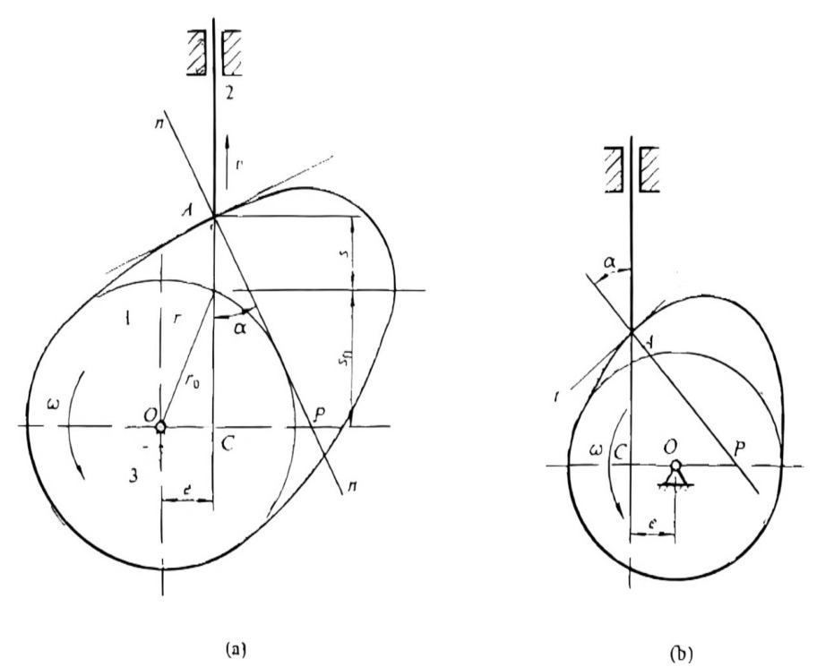

图4-30 凸轮机构的压力角
{: .figure-caption }

$$
\tan \alpha = \overline {{P C}} / \overline {{A C}} = (\overline {{O P}} \mp e) / (s _ {0} + s) = [ (\mathrm{d} s / \mathrm{d} \delta) \mp e ] / (\sqrt {r _ {0} ^ {2} - e ^ {2}} + s)\tag{4-12}
$$

式中：“ $\mp$ ”与凸轮机构的偏置方向有关，上式表示凸轮机构的压力角 $\alpha$ 与凸轮的基圆半径、从动件的偏置方向和偏距 $e$ 的关系。为了设计能满足已知运动规律且传力性能好的移动从动件盘形凸轮机构，必须选择合适的偏置方向和偏距 $e$ ，确定合理的基圆半径 $r_0$ 。

### 1. 凸轮基圆半径的确定

由式(4-12)可知, 加大基圆半径 $r_{0}$ , 可以减小压力角, 从而改善机构的传力性能, 但同时加大了机构的总体尺寸。因此, 设计时应根据具体情况, 抓住主要矛盾, 合理选定基圆半径 $r_{0}$ 。

(1)若机构受力不大, 且要求机构紧凑时, 应取较小的基圆半径, 这时可考虑按许用压力角的要求求出。先确定从动件的运动规律 $s = s(\delta)$ , 将从动件导路的偏置方位确定正确, 并选定偏距 $e$ , 将上述条件及许用压力角 $[\alpha]$ 代入式(4-12)可以求得对应于各个 $\delta$ 角的 $r_0$ 的一系列值, 这些值中最大的作为凸轮的基圆半径即可。

$$
r _ {0} \geqslant \sqrt {\left[ (\mathrm{d} s / \mathrm{d} \delta - e) / \tan [ \alpha ] - s \right] ^ {2} + e ^ {2}} \tag {4-13}
$$

(2) 若机构受力较大，且对其尺寸没有严格限制时，可根据结构和强度的需要选定凸轮的基圆半径 $r_{0}$ 。如图 4-31 所示，如果安装凸轮的轴的半径 r 已确定，则凸轮安装到轴上时，其实际轮廓的最小向径 $r_{m}$ 必须大于轮毂半径 $r_{n}$ 。如果凸轮与轴做成一体，则其实际轮廓的最小向径 $r_{m}$ 必须大于轴的半径 r。

### 2. 偏距 $\mathbf{e}$ 的大小和偏置方位的确定

如上所述，式(4-12)中“ $\mp$ ”与从动件导路相对于凸轮回转中心的偏置方位有关。即当点 $C$ 和点 $P$ 位于图4-31 根据凸轮结构确定基圆半径

凸轮回转轴心 O 的同侧[图 4-30(a)]时, 则式(4-12)中取“-”, 会使凸轮机构的压力角较小; 反之, 如果点 C 和点 P 位于凸轮回转轴心 O 的异侧[图 4-30(b)], 则式(4-12)中取 “+”, 会使凸轮机构的压力角较大。因此偏量方位的选择原则为: 应有利于减小从动件工作行程时的最大压力角, 以改善机构的传力性能。为此, 应使从动件在工作行程中点 C 和点 P 位于凸轮回转轴心 O 的同侧。也可根据式(4-12)得出“若从动件向上为工作行程, 且凸轮逆时针转动, 则从动件偏置在凸轮转动中心右侧是合理的。反之, 不合理”的判断方法。

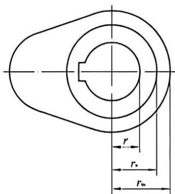

虽然偏距 $e$ 增大对减小推程压力角有利，但也不宜取得太大，一般可近似取为：

$$
e = v _ {\max} / (2 \omega)\tag{4-14}
$$

式中： $v_{max}$ 、 $\omega$ 分别为从动件工作行程的最大线速度、凸轮的角速度。

### 3. 滚子半径的确定

当采用滚子从动件时，应注意滚子半径的选择，否则从动件有可能实现不了预期的运动规律。如图4-32所示，设凸轮的理论廓线的最小曲率半径为 $\rho_{\mathrm{min}}$ ，滚子半径为 $r_1$ ，则两者之间的关系有以下几种情况。

(1) 当 $r_{\mathrm{t}} < \rho_{\min}$ 时, 实际廓线的最小曲率半径 $\rho_{\mathrm{amin}} = \rho_{\min} - r_{\mathrm{t}} > 0$ , 如图 4-32 (a) 所示, 凸轮实际轮廓曲线为一光滑曲线。

(2) 当 $r_{t} > \rho_{min}$ 时， $\rho_{amin} = \rho_{min} - r_{t} < 0$ ，这时实际廓线将出现交叉现象，如图 4-32(b) 所示。在此情况下，切制凸轮轮廓时，交叉点以外的轮廓曲线将被切掉，致使从动件工作时不能按预期的运动规律运动，造成从动件运动失真。

(3) 当 $r_{t} = \rho_{min}$ 时， $\rho_{amin} = \rho_{min} - r_{t} = 0$ ，实际廓线将出现尖点，如图 4-32(c) 所示。从动件与凸轮在尖点处接触时的接触应力很大，极易磨损，这样的凸轮工作一段时间后，同样也会引起运动的失真。上述情况(2)和(3)都是应该避免的，至于内凹的轮廓曲线，则不存在运动失真问题[图 4-32(d)]。

为了避免出现运动失真和应力集中, 实际廓线的最小曲率半径不应小于 3 mm, 所以应有:

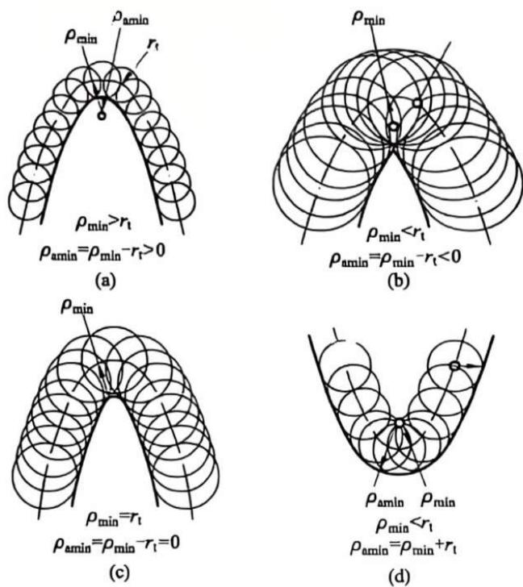

图4-32 滚子大小对凸轮实际廓线的影响
{: .figure-caption }

$$
r _ {1} \leqslant \rho_ {\min} - 3 \mathrm{mm}\tag{4-15}
$$

因此，对于外凸的凸轮轮廓曲线，应使滚子半径 $r_{\mathrm{t}}$ 小于理论廓线的最小曲率半径 $\rho_{\min}$ 。在用解析法求凸轮轮廓曲线时，可同时求得理论廓线上任一点的曲率半径 $\rho^{①}$ ，从而确定 $\rho_{\min}$ 的值，再适当地确定滚子半径。

通常为避免出现尖点与失真现象，可取滚子半径 $r_{\mathrm{t}} \leqslant 0.8\rho_{\min}$ ，并保证凸轮实际廓线的最小曲率半径 $\rho_{\min} \geqslant 1 - 5 \mathrm{~mm}$ 。如果不能满足此要求，就应增大基圆半径，有时则必须修改从动件的运动规律。另外，滚子半径也不能太小，还受强度、结构的限制，若直接用滚动轴承作为滚子，还应考虑滚动轴承的标准尺寸。通常取滚子半径 $r_{\mathrm{t}} = (0.1 - 0.5)r_{0}$ 。

### 4. 平底长度的确定

对于平底移动从动件盘形凸轮机构，只要运动规律相同，偏置从动件和对心从动件具有同样的轮廓曲线，故设计时按对心从动件设计凸轮轮廓曲线。

平底从动件也会出现运动失真的情况。一方面，要保证凸轮总是与从动件平底相切接触，则平底的长度需要足够大，否则就会出现运动失真。如图4-29所示，从动件平底与凸轮的接触点B的位置随机构的位置而变化，为了保证在任意位置从动件平底与凸轮轮廓均能相切接触，则平底左、右两侧的宽度应大于平底与凸轮接触点到从动件导路中心线的左、右两侧的最远距离 $L_{max}$ 、 $L'_{max}$ ，所以平底总长为：

而

$$
\begin{array}{r l} & L = L _ {\max} + L _ {\max} ^ {\prime} + (4 \sim 1 0) \mathrm{mm} \\ & L _ {\max} = (L _ {O P}) _ {\max} = (\mathrm{ds/d} \delta) _ {\max} \end{array}\tag{4-16}
$$

另一方面，凸轮轮廓向径相对于基圆半径不能变化太快，图4-33所示的情况也会产生运动失真。当凸轮基圆半径较小，为 $r_{0}^{\prime}$ 时，图中画出的相邻两平底的交点之间的距离较小，当此距离小到两交点重合时，凸轮轮廓将出现尖点，此时若再减小基圆半径将出现运动失真。解决这种情况产生的运动失真问题，可根据具体情况加大基圆半径，使实际廓线全程范围内各位置都能与平底相切接触。

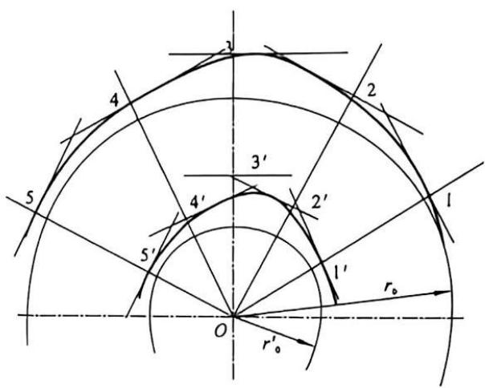

图4-33 平底从动件凸轮机构的运动失真
{: .figure-caption }

## 4.5 凸轮机构的应用举例

如图 4-34 所示的配钥匙机中, 钥匙架上同时固定有原有钥匙 4 与待配匙坯 2, 两者沿水平线相互对齐, 安装距离等于尖顶 3 与铣刀 1 的距离, 原有钥匙与尖顶接触时, 待配匙坯将与铣刀接触。钥匙架可绕转轴 5 摆动, 也可沿转轴 5 的轴线移动。配制钥匙时, 使原有钥匙轮廓与尖顶保持接触, 同时使钥匙架沿转轴的轴线移动, 则待配匙坯将被铣刀切出与原有钥匙相同的轮廓。其工作原理就是以原有钥匙为凸轮控制钥匙架的摆动, 以保证待配匙坯上被切出的轮廓与原有钥匙的轮廓相同。

如图 4-35 所示为一种炮管夹紧机构的示意图，图中 1 为一个圆周上均布有三条相同轮廓曲线的凸轮，当该凸轮绕其轴线在一定角度范围往复转动时，可推动与其接触的三个从动件 2、3、4 分别绕各自的转轴 C、B、A 摆动，使三个从动件上的夹紧爪能同时夹紧或放松它们所环绕的炮管（图中未画出）。与前面所见的摆动从动件盘形凸轮机构不同的是，凸轮转动轴线与从动件摆动轴线不平行，而是相错成 $90^{\circ}$ 夹角。

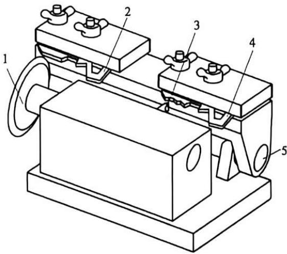

图4-34 配钥匙机
{: .figure-caption }

1—铣刀；2—匙坯；3—尖顶；4—钥匙。

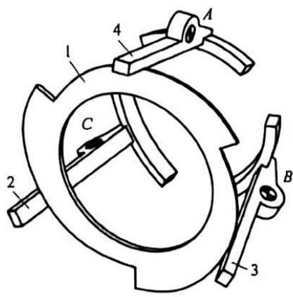

图4-35 炮管夹紧机构
{: .figure-caption }

1—凸轮；2、3、4—从动件。

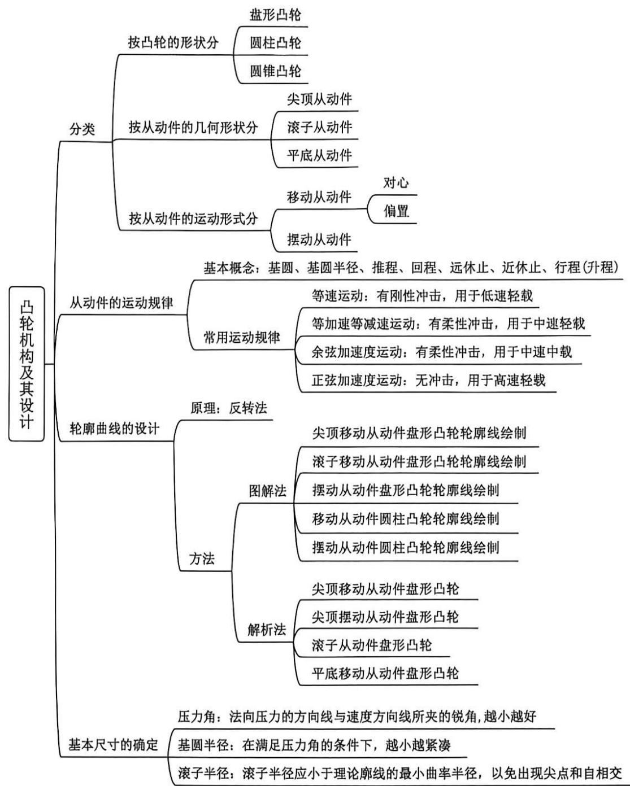

## 思考题与练习题

1. 凸轮机构有什么特点？

2. 从动件的运动规律是什么？对凸轮机构的性能有何影响？

3. 从动件常用的运动规律有哪些？哪些运动规律有冲击？是柔性冲击还是刚性冲击？

4. 凸轮机构的哪些尺寸对机构的运动和动力性能有影响？设计时这些尺寸如何确定？

5. 试根据凸轮机构压力角的计算公式分析最大压力角会在何处出现。

6. 图4-36所示为一偏置滚子移动从动件盘形凸轮机构, 试用作图法在图中作出: ①凸轮的理论廓线; ②基圆; ③从动件的行程 $h$ ; ④推程运动角 $\delta_{0}$ 和回程运动角 $\delta_{0}^{\prime}$ ; ⑤凸轮自图示位置转过 $90^{\circ}$ 时从动件的位移及凸轮机构的压力角 $\alpha$ 。

7. 图4-37为一滚子摆动从动件盘形凸轮机构，试用作图法在图中作出：①凸轮的理论廓线；②基圆；③从动件的行程角 $\Phi$ ；④推程运动角 $\delta_0$ 和回程运动角 $\delta_0^{\prime}$ ；⑤凸轮自图示位置转过 $90^{\circ}$ 时从动件的角位移及凸轮机构的压力角 $\alpha$ 。

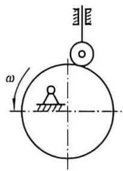

图4-36 偏置滚子移动从动件盘形凸轮机构
{: .figure-caption }

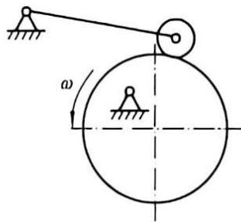

图4-37 滚子摆动从动件盘形凸轮机构1
{: .figure-caption }

8. 一偏置滚子移动从动件盘形凸轮机构, 基圆半径为 $40 \mathrm{~mm}$ , 滚子半径为 $10 \mathrm{~mm}$ 。从动件偏置于凸轮转动中心右侧, 偏距 $15 \mathrm{~mm}$ 。凸轮逆时针转动, 要求从动件的位移规律如下: 凸轮转过 $0^{\circ} \sim 120^{\circ}$ , 从动件以正弦加速度上升 $20 \mathrm{~mm}$ ; 凸轮转过 $120^{\circ} \sim 180^{\circ}$ , 从动件远休; 凸轮转过 $180^{\circ} \sim 270^{\circ}$ , 从动件以等加速等减速下降 $20 \mathrm{~mm}$ ; 凸轮转过 $270^{\circ} \sim 360^{\circ}$ , 从动件近休。试用作图法绘制凸轮的轮廓曲线。

9. 一平底移动从动件盘形凸轮机构, 基圆半径为 $40 \mathrm{~mm}$ , 凸轮逆时针转动, 要求从动件的位移规律如下: 凸轮转过 $0^{\circ} \sim 120^{\circ}$ , 从动件以余弦加速度上升 $20 \mathrm{~mm}$ ; 凸轮转过 $120^{\circ} \sim 180^{\circ}$ , 从动件远休; 凸轮转过 $180^{\circ} \sim 270^{\circ}$ , 从动件以等速下降 $20 \mathrm{~mm}$ ; 凸轮转过 $270^{\circ} \sim 360^{\circ}$ , 从动件近休。试用作图法绘制凸轮的轮廓曲线。

10. 图 4-38 为一滚子摆动从动件盘形凸轮机构，基圆半径为 40 mm，滚子半径为 10 mm。摆杆长 AB 为 45 mm，摆杆转动中心至凸轮转动中心的距离 OA 为 65 mm。凸轮逆时针转动，要求从动件的位移规律如下：凸轮转过 $0^{\circ} \sim 120^{\circ}$ ，从动件以正弦加速度上摆 $20^{\circ}$ ；凸轮转过 $120^{\circ} \sim 180^{\circ}$ ，从动件远休；凸轮转过 $180^{\circ} \sim 270^{\circ}$ ，从动件以等加速等减速下摆 $20^{\circ}$ ；凸轮转过 $270^{\circ} \sim 360^{\circ}$ ，从动件近休。试用作图法绘制凸轮的轮廓曲线。

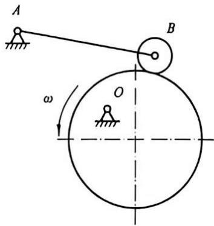

11. 试用解析法计算第8题的凸轮轮廓曲线的坐标值（以凸轮转角 $10^{\circ}$ 间隔计算）。

12. 试用解析法计算第9题的凸轮轮廓曲线的坐标值（以凸轮转角 $10^{\circ}$ 间隔计算）。

图4-38 滚子摆动从动件盘形凸轮机构2
{: .figure-caption }

13. 试用解析法计算第 10 题的凸轮轮廓曲线的坐标值(以凸轮转角 $10^{\circ}$ 间隔计算)。
