# 第5章 齿轮机构及其设计

**【概述】**

◎本章主要介绍：齿轮机构的应用及分类；渐开线的形成及其特性，渐开线齿廓的啮合特性；渐开线标准齿轮各部分的名称和几何尺寸；渐开线直齿圆柱齿轮的啮合传动；渐开线齿廓的切制；变位齿轮概述；斜齿圆柱齿轮传动；圆锥齿轮传动；蜗杆传动；其他曲线齿廓齿轮传动简介。

◎要求掌握：掌握齿廓啮合基本定律及共轭齿廓等基本概念；掌握渐开线及其性质，渐开线齿轮的啮合特性；熟悉渐开线齿轮各部分的名称、基本参数及各部分的尺寸关系，能对渐开线齿轮传动（包括直齿及斜齿圆柱齿轮、直齿圆锥齿轮、一般蜗轮蜗杆）进行几何尺寸计算，了解基本参数的选择；熟悉渐开线齿轮传动的正确啮合条件、连续传动条件及有关啮合参数；了解齿轮变位和变位齿轮传动的概念。

早在战国时期, 我国就已开始使用齿轮。在山西出土的青铜齿轮是迄今已发现的最古老齿轮, 2021 年又在陕西江村大墓中发现了制作精良的金属齿轮(图 5-1)。可以反映古代科学技术成就的指南车(图 5-2)和击鼓记里装置(图 5-3)也是以齿轮机构为核心的机械装置。

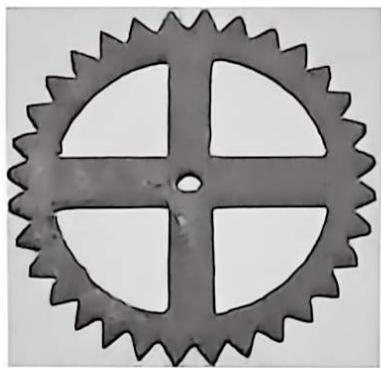

图5-1 江村大墓出土的齿轮
{: .figure-caption }

图5-2 古代指南车
{: .figure-caption }

图5-3 记里鼓车
{: .figure-caption }

如今中国高铁已经成为中国制造的一张“金名片”。齿轮是高铁的核心零部件，其工作性能直接决定了高铁运行的可靠性和安全性。与国外相比，我国幅员辽阔，南北地域温差大，东西地域跨度广，复杂的环境给高铁齿轮的可靠性提出了严苛的要求。长期以来，我国高铁列车的齿轮传动系统完全被德国、日本等国垄断。进口齿轮传动系统也在工作中出现了各种质量问题。为了打破垄断，实现核心技术独立自主化，我国经长期研究，重点研发了CRH380A等型号的高铁车用了齿轮传动系统，并实现了批量生产。如今我国的高铁齿轮已经实现全部国产化，彻底摆脱国外的垄断。图5-4为国产380A齿轮箱。

齿轮还是我国国徽上的图案之一，象征着工人阶级，也是工业的标志。

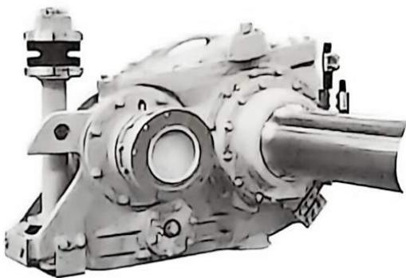

图5-4 国产380A齿轮箱
{: .figure-caption }

## 5.1 齿轮机构的组成和类型

### 5.1.1 齿轮机构的组成和特点

齿轮机构是由齿轮、机架组成的高副机构，它通过轮齿齿廓直接接触来传递任意两轴间的运动和动力，是各种机构中应用最广泛的一种机构。其主要特点为：①结构紧凑，传动平稳，能实现准确的传动比；②传动的速度和功率范围广、传动效率高，且工作可靠；③寿命长；④要求较高的制造和安装精度，成本较高。

### 5.1.2 齿轮机构的分类

按两个齿轮轴在空间的相对位置将齿轮机构分为：

(1) 平行轴齿轮机构。

(2)相交轴齿轮机构。

(3)交错轴齿轮机构。

(a)
(f)
(g)

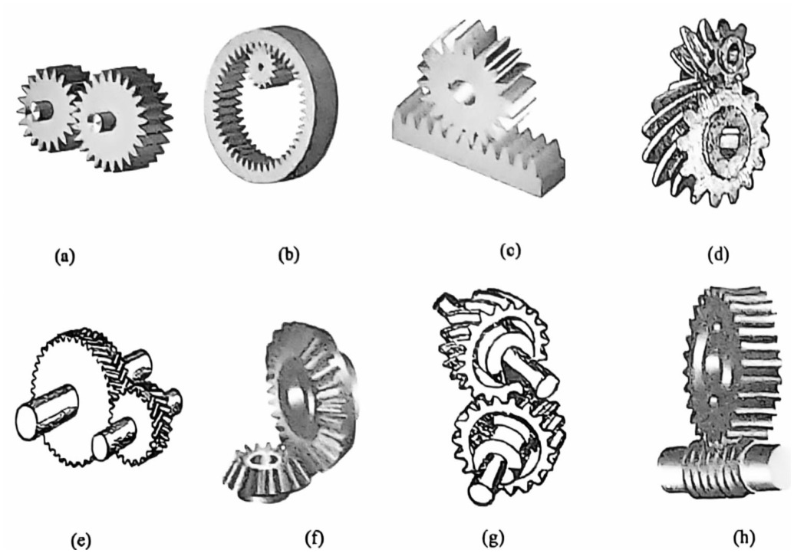

图5-5 齿轮机构的基本类型
{: .figure-caption }

(a)外啮合直齿轮；(b)内啮合直齿轮；(c)齿轮与齿条；(d)斜齿轮；(e)人字齿轮；(f)圆锥齿轮；(g)螺旋齿轮；(h)蜗杆蜗轮。

## 5.2 齿轮的齿廓曲线

一对齿轮的传动是依靠主动轮齿廓顺序推动从动轮齿廓进行的。齿廓形状不同，则两轮的传动比变化规律不同。

### 5.2.1 齿廓啮合基本定律

图 5-6 为齿轮 1 和齿轮 2 的两条齿廓曲线 $E_{1}$ 和 $E_{2}$ 在 $K$ 点啮合接触，过 $K$ 点作两齿廓的公法线 $n-n$ 与连心线 $O_{1}O_{2}$ 相交于点 $P$ 。点 $P$ 称为两轮的节点。由瞬心定律可知 $P$ 点是齿轮 1 和齿轮 2 的相对速度瞬心，故

$$
i _ {1 2} = \frac {\omega_ {1}}{\omega_ {2}} = \frac {\overline {{O _ {2} P}}}{\overline {{O _ {1} P}}}\tag{5-1}
$$

由上式可知, 一对传动齿轮的瞬时角速度比等于其连心线 $O_{1} O_{2}$ 被齿廓接触点的公法线分割的两段长度的反比。这个规律称为齿廓啮合基本定律。若传动比为常量, 则节点 $P$ 的位置在两轮的连心线上固定不动。当要求传动比按给定的规律变化时, 则节点 $P$ 的位置也要按相应的规律在两轮的连心

线上移动。

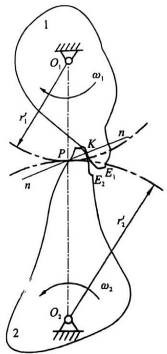

图5-6 齿廓啮合基本定律
{: .figure-caption }

取两平面分别固连于两齿轮并随之转动,节点(瞬心点) $P$ 必在两平面上描出两条封闭曲线,这两条封闭曲线称为节线 (亦称为瞬心线)。两齿轮的传动比为常量,则节线是圆,称为节圆,节圆半径用 $r_1'$ 和 $r_2'$ 表示。两齿轮节圆相切,其上的运动为纯滚动。两齿轮的传动比为变量,则节线是非圆曲线,如图 5-7 所示。实际生产中绝大多数齿轮机构的传动比为常量,其节线是圆,所以这种齿轮为圆形齿轮。凡能满足齿廓啮合基本定律的齿廓称为共轭齿廓。其齿廓曲线称为共轭曲线。

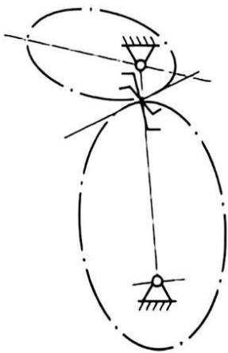

图5-7 非圆齿轮节线
{: .figure-caption }

### 5.2.2 齿廓曲线的选择

从理论上讲，能够满足齿廓啮合基本定律的共轭曲线有无穷多。受设计、制造、测量等多种因素限制，在机械中，常用的齿廓曲线只有渐开线、摆线和圆弧等少数几种曲线。由于渐开线齿廓具有较好的传动性能，且制造、安装、强度、效率、寿命及互换性等都能得到较好的满足，因此在实际生产中应用最广。

## 5.3 渐开线齿廓及其啮合特性

### 5.3.1 渐开线的形成及其极坐标方程

如图 5-8 所示，一直线在一圆周上做纯滚动（直线从位置 I 滚动到位置 II），直线上任一点的轨迹称为该圆的渐开线。这一直线称为渐开线的发生线，该圆称为渐开线的基圆。

取 $OA$ 为极坐标轴， $O$ 为极点。渐开线上任一点 $K$ 的极坐标分别用 $r_{\mathrm{K}}$ （任意圆半径或极径）和 $\theta_{\mathrm{K}}$ （展角或极角）表示。取渐开线的基圆半径为 $r_{\mathrm{b}}$ ， $\angle KOB$ 用 $\alpha_{\mathrm{K}}$ （压力角）表示，则以 $\theta_{\mathrm{K}}$ 为参数的渐开线极坐标参数方程为：

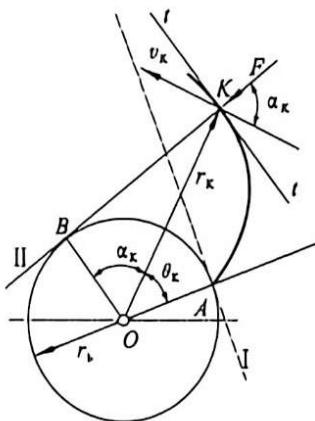

$$
r _ {\mathrm{K}} = \frac {r _ {\mathrm{b}}}{\cos \alpha_ {\mathrm{K}}}\tag{5-2}
$$

图5-8 渐开线的生成
{: .figure-caption }

$$
\mathrm{inv} \alpha_ {\mathrm{K}} = \theta_ {\mathrm{K}} = \tan \alpha_ {\mathrm{K}} - \alpha_ {\mathrm{K}}\tag{5-3}
$$

式(5-3)表明 $\theta_{\mathrm{K}}$ 随 $\alpha_{\mathrm{K}}$ 变化而变化, 工程上常将 $\theta_{\mathrm{K}}$ 称为 $\alpha_{\mathrm{K}}$ 的渐开线函数, 用 $\operatorname{inv} \alpha_{\mathrm{K}}$ 表示。为使用方便, 工程上常将不同压力角的渐开线函数计算出来列成表备查。

### 5.3.2 渐开线的性质

由渐开线形成过程，可得出渐开线性质如下：

(1) 发生线沿基圆滚过的长度等于基圆上被滚过的弧长，即 $\overline{BK} = \widehat{AB}$ 。

(2) 发生线是渐开线在 $K$ 点的法线; 渐开线上任意点的法线必与基圆相切。

(3) $\overline{BK}$ 为渐开线上任意点 $K$ 的曲率半径 ( $B$ 点是渐开线上 $K$ 点的曲率中心); 渐开线离

基圆越远的点，其曲率半径越大，渐开线越平直；反之，渐开线越弯曲。

(4) 渐开线的形状决定于基圆的大小。如图 5-9(a) 所示基圆越小，渐开线越弯曲；基圆越大，渐开线越平直。当基圆半径趋于无穷大时，其渐开线成为直线，如齿条的齿廓。

(5) 基圆内无渐开线。

(6)渐开线上各点的压力角不相等, 离基圆越远, 压力角越大; 基圆处压力角为零。

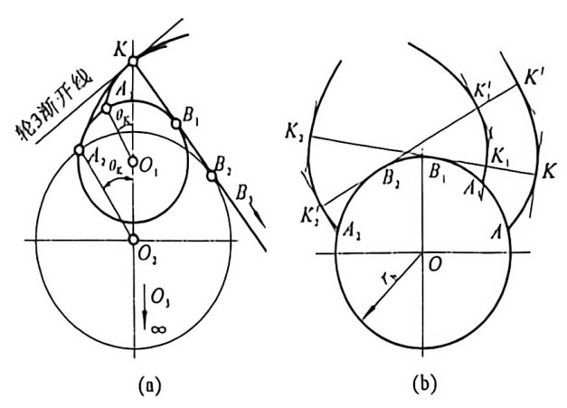

图5-9 渐开线的性质
{: .figure-caption }

如图5-8所示，齿廓上任意点 $K$ 的速度为 $\nu_{\mathrm{K}}$ ， $K$ 点的压力角为 $\alpha_{\mathrm{K}}$ ，则

$$
\cos \alpha_ {\mathrm{K}} = \frac {r _ {\mathrm{b}}}{r _ {\mathrm{K}}} = \frac {d _ {\mathrm{b}}}{d _ {\mathrm{K}}}\tag{5-4}
$$

(7)同一基圆生成的两条渐开线间公法线的长度相等(等距性), 如图 5-9(b) 所示。

### 5.3.3 渐开线齿廓的啮合特性

(1) 满足定传动比要求。

如图 5-10 所示,一对齿轮的渐开线齿廓在任意 $K$ 点接触,过接触点作其公法线 $n - n$ 。根据渐开线性质 (2) 可知,这一公法线必为两齿轮基圆的内公切线,切点分别为 ${N}_{1}$ 和 ${N}_{2}$ 在啮合过程中两齿轮接触点都在内公切线上,内公切线也是两齿轮的啮合线。同一方向的内公切线和两齿轮的连心线都为定直线,两线的交点 $P$ 为定点, 即传动比

$$
i _ {1 2} = \frac {\omega_ {1}}{\omega_ {2}} = \frac {\overline {{O _ {2} P}}}{\overline {{O _ {1} P}}} = \frac {r _ {2} ^ {\prime}}{r _ {1} ^ {\prime}} = \frac {\overline {{O _ {2} N _ {2}}}}{\overline {{O _ {1} N _ {1}}}} = \frac {r _ {\mathrm{b2}}}{r _ {\mathrm{b1}}} = \mathrm{常量}\tag{5-5}
$$

传动比满足齿廓啮合基本定律，且角速比为定值。式中， $r_{1}^{\prime}$ 、 $r_{2}^{\prime}$ 分别为两齿轮的节圆半径。

(2)传动可分性。

由式(5-5)可知，两齿轮制造安装好后，其基圆半径不会改变，中心距如有微小误差，其角

速度比仍不变。这种性质称为渐开线齿轮传动的可分性。

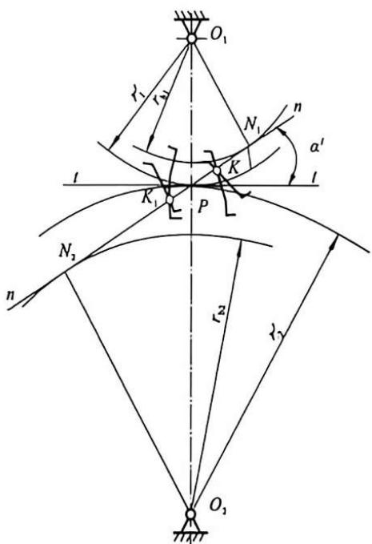

图5-10 渐开线齿轮的啮合
{: .figure-caption }

(3)传动平稳。

在齿轮传动的过程中，接触点都在公法线上，两啮合齿廓间的正压力始终沿啮合线方向，故传力方向不变，传动平稳。

同时，渐开线齿廓加工刀具简单，安装方便，因此应用特别广泛。

## 5.4 渐开线标准齿轮各部分的名称、基本参数和几何尺寸计算

### 5.4.1 渐开线标准齿轮各部分名称

以外齿直齿圆柱齿轮为例，各部分名称如图 5-11 所示。

(1)齿顶圆：过所有轮齿顶端的圆，其直径和半径分别用 $d_{\mathrm{a}}$ 和 $r_{\mathrm{a}}$ 表示。

(2) 分度圆：设计齿轮的基准圆，其直径和半径分别用 d 和 r 表示。

(3)齿根圆：过所有齿槽底部的圆，其直径和半径分别用 $d_{f}$ 和 $r_{f}$ 表示。

(4) 基圆：形成渐开线的圆，其直径和半径分别用 $d_{b}$ 和 $r_{b}$ 表示。

(5) 分度圆齿厚: 分度圆上轮齿两侧齿廓之间的弧长用 s 表示。

(6) 分度圆齿槽宽：分度圆上相邻两齿轮之间的弧长用 e 表示。

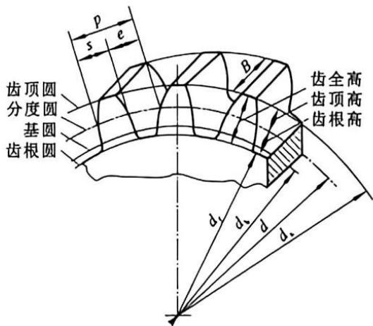

图5-11 齿轮各部分名称
{: .figure-caption }

(7) 分度圆周节(齿距): 分度圆上相邻两齿轮同侧齿廓间的弧长用 $p$ 表示。

(8)齿顶高: 轮齿分度圆到齿顶圆之间的径向高度用 $h_{\mathrm{a}}$ 表示。

(9)齿根高: 轮齿分度圆到齿根圆之间的径向高度用 $h_{\mathrm{f}}$ 表示。

(10)齿全高：齿顶圆与齿根圆之间的径向距离，用 h 表示， $h=h_{a}+h_{f}$

(11)齿宽: 轮齿的轴向宽度, 用 $B$ 表示。

### 5.4.2 齿轮参数、标准齿轮的尺寸计算

#### 1. 渐开线齿轮的基本参数

(1)齿数：齿轮整个圆周上轮齿的总数，用 z 表示。

(2) 模数：分度圆直径 $d$ 与齿数 $z$ 的比值，用 $m$ 表示。

为了计算齿轮各部分的几何尺寸，必须先在齿轮上选定一个圆(分度圆)作基准。该圆上的周长分别等于 $zp$ 和 $\pi d$ ，可得

$$
d = \frac {z p}{\pi} = m z\tag{5-6}
$$

式中：z 为整数，当取一定 p 值时可得不同 d 值；由于 $\pi$ 是无理数，这会给齿轮的设计、测量和制造等造成很多麻烦。为了简便起见，把齿轮分度圆的周节 p 与 $\pi$ 的比值规定为标准值，称其为模数 m。模数是计算齿轮的最基本参数，齿轮的很多尺寸都用某一系数与模数的乘积表示。模数越大，则齿轮轮齿越大。我国已规定了标准模数系列，表 5-1 为其中的一部分。

表 5-1 渐开线齿轮的模数 (GB/T 1357—2008)
单位： $\mathrm{{mm}}$

<table><tr><td>第一系列</td><td>1</td><td>1.25</td><td>1.5</td><td>2</td><td>2.5</td><td>3</td><td>4</td><td>5</td><td>6</td><td>8</td><td>10</td><td>12</td><td>16</td><td>20</td><td>25</td><td>32</td><td>40</td><td>50</td><td></td></tr><tr><td>第二系列</td><td>1.75</td><td>2.25</td><td>2.75</td><td></td><td>3.5</td><td></td><td>4.5</td><td>5.5</td><td>(6.5)</td><td>7</td><td>9</td><td>11</td><td>14</td><td>18</td><td>22</td><td>28</td><td></td><td>35</td><td>45</td></tr></table>

注：①本表适用于渐开线圆柱齿轮，对斜齿轮是指法向模数。
②优先采用第一系列，括号内的模数尽可能不用。

(3) 压力角: 分度圆上法向压力的方向线与线速度方向线所夹的锐角, 以 $\alpha$ 表示。《通用机械和重型机械用圆柱齿轮 标准基本齿条齿廓》(GB/T 1356—2001) 中规定, 分度圆压力角为标准值, $\alpha = 20^{\circ}$ , 在某些特殊场合也有采用其他值的。

(4)齿顶高系数 $h_{\mathrm{a}}^{\bullet}$ 和顶隙系数 $c^{\bullet}$ ：国家标准规定，对于标准正常齿其齿顶高系数和径向间隙系数分别为 $h_{\mathrm{a}}^{\bullet} = 1, c^{\bullet} = 0.25$ 。

#### 2. 标准齿轮的几何尺寸计算

标准齿轮是指 $m$ 、 $\alpha$ 、 $h_{a}^{*}$ 、 $c^{*}$ 取标准值的齿轮，它具有三个特征：①分度圆上具有标准模数和标准压力角；②分度圆上齿厚和齿槽宽相等；③具有标准齿顶高和齿根高。

为了计算和设计，渐开线标准直齿圆柱齿轮传动几何尺寸计算列于表 5-2 中。

表 5-2 渐开线标准直齿圆柱齿轮传动几何尺寸的计算公式

<table><tr><td rowspan="2">名称</td><td rowspan="2">代号</td><td colspan="2">计算公式</td></tr><tr><td>小齿轮</td><td>大齿轮</td></tr><tr><td>模数</td><td>m</td><td colspan="2">根据齿轮受力情况和结构需要确定,选取标准值</td></tr><tr><td>压力角</td><td>α</td><td colspan="2">选取标准值20°</td></tr><tr><td>分度圆直径</td><td>d</td><td>d1=mz1</td><td>d2=mz2</td></tr><tr><td>齿顶高</td><td>ha</td><td colspan="2">ha1=ha2=ha·m</td></tr><tr><td>齿根高</td><td>hf</td><td colspan="2">hfl=hf2=(ha·+c·)m</td></tr><tr><td>齿全高</td><td>h</td><td colspan="2">h1=h2=(2ha·+c·)m</td></tr><tr><td>齿顶圆直径</td><td>da</td><td>da1=(z1+2ha·)m</td><td>da2=(z2+2hn·)m</td></tr><tr><td>齿根圆直径</td><td>df</td><td>df1=(z1-2ha·-2c·)m</td><td>dΩ=(z2-2ha·-2c·)m</td></tr><tr><td>基圆直径</td><td>db</td><td>db1=d1cos α</td><td>db2=d2cos α</td></tr><tr><td>齿距</td><td>p</td><td colspan="2">p=πm</td></tr><tr><td>基圆齿距(法向齿距)</td><td>pb</td><td colspan="2">pb=pcos α</td></tr><tr><td>齿厚</td><td>s</td><td colspan="2">s=πm/2</td></tr><tr><td>齿槽宽</td><td>e</td><td colspan="2">e=πm/2</td></tr><tr><td>任意圆(半径为ra)齿厚</td><td>si</td><td colspan="2">si=sri/r-2ri(inv α1-inv α)</td></tr></table>

续表5-2

<table><tr><td rowspan="2">名称</td><td rowspan="2">代号</td><td colspan="2">计算公式</td></tr><tr><td>小齿轮</td><td>大齿轮</td></tr><tr><td>顶隙</td><td>c</td><td colspan="2"> \(c = c \cdot m\) </td></tr><tr><td>标准中心距</td><td>a</td><td colspan="2"> \(a = m\left( {{z}_{1} + {z}_{2}}\right) /2\) </td></tr><tr><td>节圆直径</td><td> \({d}^{\prime }\) </td><td colspan="2">(当中心距为标准中心距a时) \({d}^{\prime } = d\) </td></tr><tr><td>传动比</td><td>i</td><td colspan="2"> \({i}_{12} = {\omega }_{1}/{\omega }_{2} = {z}_{2}/{z}_{1} = {d}_{2}^{\prime }/{d}_{1}^{\prime } = {d}_{2}/{d}_{1} = {d}_{1/2}/{d}_{1/1}\) </td></tr></table>

例 5-1 已知一渐开线标准直齿圆柱齿轮的齿数 z = 18，模数 m = 3 mm。试求这一齿轮的基圆直径，齿轮在半径为 $r_{K} = 28 \, mm$ 处齿廓曲线的曲率半径及齿轮的几何尺寸。

解：

$$
\begin{array}{r l} d & = m z = 3 \times 1 8 = 5 4 \mathrm{mm} \\ d _ {\mathrm{b}} & = d \cos \alpha = 5 4 \times \cos 2 0 ^ {\circ} = 5 0. 7 4 \mathrm{mm} \end{array}
$$

由图 5-5 可知, 渐开线齿轮任意半径处齿廓曲线的曲率半径即为直线 $\overline{BK}$ , 其长度用 $\rho_{\mathrm{K}}$ 表示, 则

$$
\rho_ {\mathrm{K}} = r _ {\mathrm{b}} \tan \alpha_ {\mathrm{K}} = r _ {\mathrm{K}} \sin \alpha_ {\mathrm{K}}
$$

由 $\cos \alpha_{\mathrm{K}} = \frac{r_{\mathrm{b}}}{r_{\mathrm{K}}} = \frac{d_{\mathrm{b}}}{d_{\mathrm{K}}} = \frac{50.74}{56} = 0.906$ ，得 $\alpha_{\mathrm{K}} = 25.03^{\circ}$ ，故 $\rho_{\mathrm{K}} = 28\times \sin 25.03^{\circ} = 11.85\mathrm{mm}$

$$
\begin{array}{r l} & d _ {\mathrm{n}} = d + 2 h _ {\mathrm{n}} ^ {*} m = 5 4 + 2 \times 1 \times 3 = 6 0 \mathrm{mm} \\ & d _ {\mathrm{f}} = d - 2 (h _ {\mathrm{n}} ^ {*} + c ^ {*}) m = 5 4 - 2 \times (1 + 0. 2 5) \times 3 = 4 6. 5 \mathrm{mm} \end{array}
$$

其余尺寸从略。

#### 3. 其他尺寸

(1)任意圆上的弧齿厚 $s_{1}$ 。

如图 5-12 所示为渐开线齿轮上的一个轮齿。根据几何关系可得任意半径 $r_i$ 上的弧齿厚 $s_i$ 。

因为

$$
\begin{array}{r l} & s _ {\mathrm{i}} = \widehat {c c} = r _ {\mathrm{i}} \varphi \\ & \varphi = \angle B O B - 2 \angle C O B = \frac {s}{r} - 2 (\theta_ {\mathrm{i}} - \theta) \\ & = \frac {s}{r} - 2 (\text {inv} \alpha_ {\mathrm{i}} - \text {inv} \alpha) \end{array}
$$

所以

$$
s _ {\mathrm{i}} = r _ {\mathrm{i}} \varphi = s \frac {r _ {\mathrm{i}}}{r} - 2 r _ {\mathrm{i}} (\text {   inv   } \alpha_ {\mathrm{i}} - \text {   inv   } \alpha)\tag{5-7}
$$

式中： $\alpha_{i}$ 为齿廓在该任意圆上的压力角， $\alpha_{i}=\arccos\left(\frac{r_{b}}{r_{i}}\right)$ 。

(2) 固定弦齿厚 $\overline{s}_{i}$ 和固定弦齿高 $h_{i}$ 。

弧齿厚较难测量，通常用量具测量齿厚的弦长（标准齿条的齿廓与齿轮齿廓对称相切时两切点间的距离）。如图5-13所示，固定弦 $\overline{ab}$ 用 $\overline{s}_{\mathrm{i}}$ 表示；固定弦 $\overline{ab}$ 至齿顶的距离为固定弦齿高，用 $h_{\mathrm{i}}$ 表示。根据图5-13的几何关系，求固定弦齿厚和固定弦齿高。

$$
\overline {{s _ {1}}} = 2 \overline {{a P}} \cos \alpha
$$

因为

$$
\overline {{{a P}}} = \overline {{{c P}}} \cos \alpha = \frac {\pi m}{4} \cos \alpha
$$

所以

$$
\overline {{{s _ {i}}}} = \frac {\pi m}{2} \cos^ {2} \alpha\tag{5-8}
$$

$$
h _ {1} = h _ {\mathrm{a}} - \overline {{{P g}}} = h _ {\mathrm{a}} - \overline {{{a P}}} \sin \alpha = h _ {\mathrm{a}} ^ {*} m \frac {\pi m}{4} \cos \alpha \sin \alpha\tag{5-9}
$$

对于标准齿轮， $h_{a}^{*}$ 和 $\alpha$ 是定值，因此，固定弦齿厚和固定弦齿高只与齿轮的模数有关，即模数相同的齿轮，具有相同的固定弦齿厚和固定弦齿高。

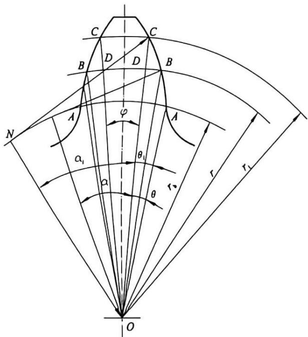

图5-12 任意圆上的齿厚
{: .figure-caption }

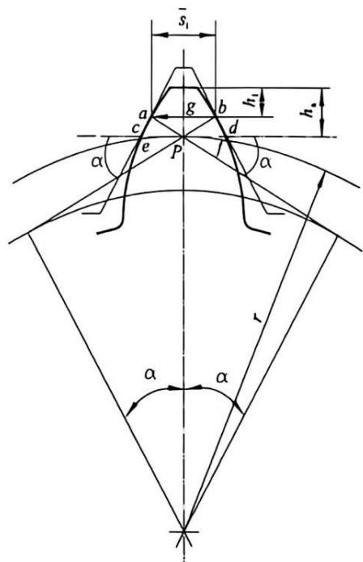

图5-13 固定弦齿厚
{: .figure-caption }

(3) 公法线长度。

公法线长度是指两反向渐开线齿廓间的法向距离。根据渐开线的性质，公法线必与基圆相切，如图5-14所示，这个距离可用游标卡尺直接量出。设测量时所跨的齿数为 $k$ 则公法线长度 $\pmb{W}$ 为一个基圆齿厚 $s_{\mathrm{b}}$ 和 $(k - 1)$ 个基圆周节 $p_{\mathrm{b}}$ 之和，即

$$
W = (k - 1) p _ {b} + s _ {b}
$$

因为 $p_{b}=p\cos\alpha=\pi m\cos\alpha$ ，又 $\alpha_{b}=0^{\circ}$ ，inv $\alpha_{b}=0$ ，代入公式(5-7)，得

$$
s _ {b} = m \cos \alpha \left(\frac {\pi}{2} + z \operatorname{inv} \alpha\right)
$$

所以

$$
W = (k - 1) \pi m \cos \alpha + m \cos \alpha \left(\frac {\pi}{2} + z \mathrm{inv} \alpha\right) = m \cos \alpha [ (k - 0. 5) \pi + z \mathrm{inv} \alpha ]\tag{5-10}
$$

上式表明：公法线长度是模数 $m$ 、齿数 $z$ 、压力角 $\alpha$ 和所跨测齿数 $k$ 的函数。测量公法线时游标卡尺的两卡脚必须与两反向渐开线齿廓相切，如图5-14所示。若所跨齿数过多或过少，则会使卡脚在齿廓的顶部或根部接触，从而影响公法线的测量精度。设游标卡尺的两卡脚与两渐开线齿廓正好切于分度圆上，其跨齿数 $k$ 计算如下：

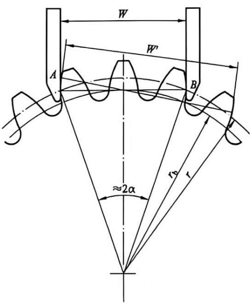

图5-14 公法线长度
{: .figure-caption }

因为

$$
\begin{array}{r l} \widehat {A B} & = 2 \alpha r = (k - 0. 5) p \\ & 2 \alpha r = d \alpha = m z \alpha \\ & m z \alpha = (k - 0. 5) \pi m \end{array}
$$

所以

$$
k = \frac {\alpha}{\pi} z + 0. 5 = \frac {\alpha}{1 8 0 ^ {\circ}} z + 0. 5\tag{5-11}
$$

$k$ 值必须圆整为整数, 所以实际上两卡脚与齿廓只需切于分度圆附近, 但这不影响测量结果。为了简化计算和使用方便, 通常将 $\alpha = 20^{\circ}$ 和 $m = 1$ 的标准齿轮公法线长度 $W'$ 和跨齿数 $k$ 计算并列表 (表 5-3)。实际应用中, 先从表中查出 $W'$ 值, 然后乘以实际齿轮的模数即可。

表 5-3 标准齿轮公法线长度 $W'$ 和跨齿数 $k(\alpha = 20^{\circ}; m = 1)$

<table><tr><td>齿数</td><td>k</td><td>W&#x27;</td><td>齿数</td><td>k</td><td>W&#x27;</td><td>齿数</td><td>k</td><td>W&#x27;</td><td>齿数</td><td>k</td><td>W&#x27;</td></tr><tr><td>9</td><td>2</td><td>4.5542</td><td>18</td><td>3</td><td>7.6324</td><td>27</td><td>4</td><td>10.7106</td><td>36</td><td>5</td><td>13.7888</td></tr><tr><td>10</td><td>2</td><td>4.5683</td><td>19</td><td>3</td><td>7.6464</td><td>28</td><td>4</td><td>10.7246</td><td>37</td><td>5</td><td>13.8028</td></tr><tr><td>11</td><td>2</td><td>4.5823</td><td>20</td><td>3</td><td>7.6604</td><td>29</td><td>4</td><td>10.7386</td><td>38</td><td>5</td><td>13.8168</td></tr><tr><td>12</td><td>2</td><td>4.5963</td><td>21</td><td>3</td><td>7.6744</td><td>30</td><td>4</td><td>10.7526</td><td>39</td><td>5</td><td>13.8308</td></tr><tr><td>13</td><td>2</td><td>4.6103</td><td>22</td><td>3</td><td>7.6885</td><td>31</td><td>4</td><td>10.7666</td><td>40</td><td>5</td><td>13.8448</td></tr><tr><td>14</td><td>2</td><td>4.6243</td><td>23</td><td>3</td><td>7.7025</td><td>32</td><td>4</td><td>10.7806</td><td>41</td><td>5</td><td>13.8588</td></tr><tr><td>15</td><td>2</td><td>4.6383</td><td>24</td><td>3</td><td>7.7165</td><td>33</td><td>4</td><td>10.7946</td><td>42</td><td>5</td><td>13.8728</td></tr><tr><td>16</td><td>2</td><td>4.6523</td><td>25</td><td>3</td><td>7.7305</td><td>34</td><td>4</td><td>10.8086</td><td>43</td><td>5</td><td>13.8868</td></tr><tr><td>17</td><td>2</td><td>4.6663</td><td>26</td><td>3</td><td>7.7445</td><td>35</td><td>4</td><td>10.8227</td><td>44</td><td>5</td><td>13.9008</td></tr></table>

例5-2 已知一渐开线标准直齿圆柱齿轮， $z_{1} = 21$ ， $m = 5 \mathrm{~mm}$ 。试求：齿轮的顶圆齿厚和公法线的长度。

$$
\begin{array}{r l} & s = \frac {1}{2} \pi m = \frac {1}{2} \times 3. 1 4 \times 5 = 7. 8 7 5 \mathrm{mm} \\ & r _ {1} = \frac {1}{2} m z _ {1} = \frac {1}{2} \times 5 \times 2 1 = 5 2. 5 \mathrm{mm} \\ & r _ {\mathrm{bl}} = \frac {1}{2} m z _ {1} \cos \alpha = \frac {1}{2} \times 5 \times 2 1 \times \cos 2 0 ^ {\circ} = 4 9. 3 3 4 \mathrm{mm} \\ & r _ {\mathrm{al}} = \frac {1}{2} m (z _ {1} + 2 h _ {\mathrm{a}} ^ {*}) = \frac {1}{2} \times 5 \times (2 1 + 2 \times 1) = 5 7. 5 \mathrm{mm} \end{array}
$$

$$
\alpha_ {\mathrm{al}} = \arccos \frac {r _ {\mathrm{bl}}}{r _ {\mathrm{al}}} = \arccos \frac {4 9 . 3 3 4}{5 7 . 5} = 3 0. 9 0 9 ^ {\circ}
$$

$$
\mathrm{inv} \alpha_ {\mathrm{al}} = \tan \alpha_ {\mathrm{al}} - \alpha_ {\mathrm{al}} = \tan 3 0. 9 0 9 ^ {\circ} \frac {3 0 . 9 0 9 ^ {\circ} \times \pi}{1 8 0 ^ {\circ}} = 0. 0 5 9 2 3 7
$$

$$
\mathrm{inv} \alpha = \tan \alpha - \alpha = \tan 2 0 ^ {\circ} \frac {2 0 ^ {\circ} \times \pi}{1 8 0 ^ {\circ}} = 0. 0 1 4 9 0 4
$$

$$
s _ {\mathrm{al}} = s \frac {r _ {\mathrm{al}}}{r _ {1}} - 2 r _ {\mathrm{al}} (\text {inv} \alpha_ {\mathrm{a} _ {1}} - \text {inv} \alpha) = \frac {7 . 8 5 \times 5 7 . 5}{5 2 . 5} - 2 \times 5 7. 5 \times (0. 0 5 9 2 3 7 - 0. 0 1 4 9 0 4) = 3. 4 9 9 \mathrm{mm}
$$

查表 5-3 可知：k=3， $W'=7.6744\ mm$ ，则 $W=W'm=7.6744\times5=38.372\ mm$ 。

## 5.5\渐开线直齿圆柱齿轮的啮合传动

### 5.5.1 一对渐开线齿轮正确啮合条件

一对轮齿能否正确进入和退出啮合是齿轮传动的必要条件。如图5-15所示，一对轮齿在 $K'$ 点开始进入啮合，经过一段时间啮合传动，这对轮齿到达K点啮合，这时后一对轮齿接替进入 $K'$ 点啮合。为了保证前后两对轮齿能同时在啮合线上接触，相邻两轮齿同侧齿廓沿法线的距离要相等，即 $\overline{K_{1}K_{1}^{\prime}}=\overline{K_{2}K_{2}^{\prime}}=\overline{KK^{\prime}}$ 。根据渐开线性质(1)可知： $\overline{KK^{\prime}}=p_{b1}=p_{b2}$ 。由 $p_{b1}=p_{b2}$ 可推得：

$$
\begin{array}{r l} & p _ {1} \cos \alpha_ {1} = p _ {2} \cos \alpha_ {2} \\ & \pi m _ {1} \cos \alpha_ {1} = \pi m _ {2} \cos \alpha_ {2} \\ & m _ {1} \cos \alpha_ {1} = m _ {2} \cos \alpha_ {2} \end{array}
$$

渐开线齿轮的模数和压力角已经标准化，若满足上式关系必须使两齿轮的模数和压力角分别相等，因此，可得一对渐开线齿轮正确啮合的条件：

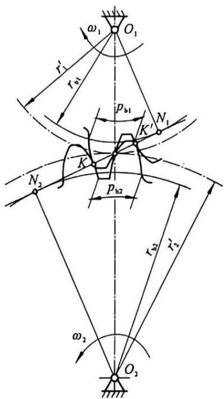

$$
\left. \begin{array}{l} m _ {1} = m _ {2} = m \\ \alpha_ {1} = \alpha_ {2} = \alpha \end{array} \right\}\tag{5-12}
$$

图5-15 正确啮合条件
{: .figure-caption }

### 5.5.2 连续传动的条件

如图 5-16 所示, 一对齿廓开始进入啮合时是主动轮 1 的齿根部分与从动轮 2 的齿顶接触, 所以, 开始啮合点是从动轮的齿顶圆与啮合线的交点 $B_{2}$ 。两轮继续转动, 啮合点的位置沿啮合线向 $N_{2}$ 方向移动, 从动轮齿廓上的接触点由齿顶向齿根移动, 而主动轮齿廓上的接触点则由齿根向齿顶移动。当这对齿廓的啮合点到达 $C$ 点时, 另一对齿廓进入 $B_{2}$ 点。一对齿廓的终止啮合点是主动轮的齿顶圆与啮合线的交点 $B_{1}$ 。前一对齿廓的啮合点到达 $B_{1}$ 点时, 后一对齿廓到达 $D$ 点。一对齿廓啮合点的实际轨迹是 $B_{1} B_{2}$ , 故 $B_{1} B_{2}$ 为实际啮合线。当两齿轮的顶圆加大时, 点 $B_{2}$ 和点 $B_{1}$ 趋近于点 $N_{1}$ 和点 $N_{2}$ (因基圆以内无渐开线, 点 $B_{1} 、 B_{2}$ 不会超过 $N_{1}$ 点和 $N_{2}$ 点）。线段 $\overline{N_{2}N_{1}}$ 称为理论啮合线。

一对齿轮若要连续传动，其临界条件是 $\overline{B_{1}B_{2}}=p_{b}$ ，其中 $p_{b}$ 为相邻两轮齿同侧齿廓之间的法向的距离（即基圆周节）。

若前一对轮齿齿廓的啮合点还未到达其终止啮合点 $B_{1}$ 点时，而后一对轮齿齿廓已到达开始啮合点 $B_{2}$ ，则连续传动更加可靠。这时一对齿轮传动，在啮合线上就有两对齿廓在两点同时啮合，即 $\overline{B_{1}B_{2}} > p_{b}$ 。

因此一对齿轮连续传动的条件是 $\overline{B_{1}B_{2}}\geqslant p_{b}$ 。为表达一对齿轮连续传动的情况，通常用 $\overline{B_{1}B_{2}}$ 与 $p_{b}$ 的比值 $\varepsilon_{a}$ 表示， $\varepsilon_{a}$ 称为重合度。一对齿轮连续传动的条件可表示为：

$$
\varepsilon_ {\alpha} = \frac {\overline {{B _ {1} B _ {2}}}}{p _ {\mathrm{b}}} \geqslant 1\tag{5-13}
$$

将一对外啮合直齿圆柱齿轮的几何条件代入上式，可得重合度的计算公式为：

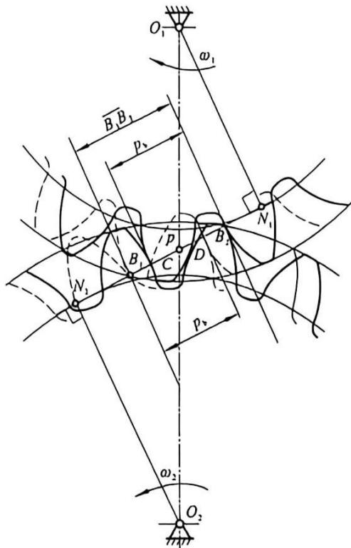

图5-16 连续传动条件
{: .figure-caption }

$$
\varepsilon_ {\alpha} = \frac {1}{2 \pi} \left[ z _ {1} (\tan \alpha_ {\mathrm{al}} - \tan \alpha^ {\prime}) + z _ {2} (\tan \alpha_ {\mathrm{a2}} - \tan \alpha^ {\prime}) \right]\tag{5-14}
$$

重合度越大，表示同时啮合的轮齿平均对数越多。对于标准齿轮传动，因其重合度恒大于1，故可不必验算。

### 5.5.3 标准中心距

一对齿轮传动的中心距为两齿轮的节圆半径之和。为了避免齿轮反向传动时出现空程和冲击，齿轮安装时要求啮合的轮齿间没有齿侧间隙(实际需要的间隙通过制造公差保证)，即一个轮齿的节圆齿厚等于另一个轮齿的节圆齿槽宽。由于标准齿轮分度圆的齿厚与齿槽宽相等，当两标准齿轮正确安装时其分度圆与节圆重合，满足轮齿间没有齿侧间隙的条件，因此标准齿轮传动的中心距为：

$$
a = r _ {1} ^ {\prime} + r _ {2} ^ {\prime} = \frac {1}{2} (d _ {1} + d _ {2}) = \frac {m}{2} (z _ {1} + z _ {2})\tag{5-15}
$$

例 5-3 已知一对渐开线标准直齿圆柱齿轮， $z_{1}=21$ ， $z_{2}=40$ ，m=5 mm。试求：这对齿轮的标准中心距和重合度。

$$
a = \frac {m}{2} (z _ {1} + z _ {2}) = \frac {5}{2} \times (2 1 + 4 0) = 1 5 2. 5 \mathrm{mm}
$$

$$
\varepsilon_ {\alpha} = \frac {1}{2 \pi} \left[ z _ {1} (\tan \alpha_ {\mathrm{nl}} - \tan \alpha^ {\prime}) + z _ {2} (\tan \alpha_ {\mathrm{n2}} - \tan \alpha^ {\prime}) \right]
$$

$$
\alpha_ {\mathrm{al}} = \arccos \frac {r _ {\mathrm{bl}}}{r _ {\mathrm{al}}} = \arccos \frac {m z _ {1} \cos \alpha}{m (z _ {1} + 2 h _ {\mathrm{a}} ^ {*})} = \arccos \frac {5 \times 2 1 \times \cos 2 0 ^ {\circ}}{5 \times (2 1 + 2 \times 1)} = \arccos (0. 8 5 8) = 3 0. 9 1 ^ {\circ}
$$

$$
\begin{array}{l} \alpha_ {a 2} = \arccos \frac {r _ {b 2}}{r _ {a 2}} = \arccos \frac {m z _ {2} \cos \alpha}{m (z _ {2} + 2 h _ {a} ^ {*})} = \arccos \frac {5 \times 4 0 \times \cos 2 0 ^ {\circ}}{5 \times (4 0 + 2 \times 1)} = \arccos (0. 8 9 5) = 2 6. 5 0 ^ {\circ} \\ \varepsilon_ {a} = \frac {1}{2 \pi} [ 2 1 \times (\tan 3 0. 9 1 ^ {\circ} - \tan 2 0 ^ {\circ}) + 4 0 \times (\tan 2 6. 5 0 ^ {\circ} - \tan 2 0 ^ {\circ}) ] = 1. 6 5 \end{array}
$$

### 5.5.4 中心距和啮合角

过节点 P 作两齿轮节圆的公切线 t-l，它与啮合线的夹角称为啮合角，用 $\alpha'$ 表示。由前所述可知，两渐开线齿轮传动中其啮合角为常数。由图 5-10 中几何关系可知，啮合角在数值上等于渐开线在节圆上的压力角。

中心距 $a^{\prime} = r_{1}^{\prime} + r_{2}^{\prime} = \frac{r_{\mathrm{b1}} + r_{\mathrm{b2}}}{\cos\alpha^{\prime}}$ ，即 $a^\prime \cos \alpha^\prime = r_{\mathrm{b1}} + r_{\mathrm{b2}}$ 。

而标准中心距为 $a = r_{1} + r_{2} = \frac{r_{\mathrm{b1}}}{\cos\alpha} +\frac{r_{\mathrm{b2}}}{\cos\alpha} = \frac{r_{\mathrm{b1}} + r_{\mathrm{b2}}}{\cos\alpha}$

可见，当中心距变动后，啮合角也会变化，但 $a' \cos \alpha' =$ 定值。由此可得中心距和啮合角之间的关系式：

$$
a ^ {\prime} \cos \alpha^ {\prime} = a \cos \alpha\tag{5-16}
$$

标准齿轮标准安装，即 $a' = a$ ，啮合角等于分度圆压力角。而非标准中心距 $a'$ 安装时（包括后面的变位齿轮传动），中心距和啮合角的关系式为式(5-16)。

## 5.6 渐开线齿廓的切制原理和根切现象

渐开线齿轮的加工有很多方法，如切削、铸造、冲压、成型加工等。切削是一种常用的齿轮加工方法，按其加工原理可分为成形法和范成法两类。

### 5.6.1 成形法

成形法加工所用的刀具有指状铣刀和盘状铣刀两种，在轴剖面内刀具的刃口与所加工的渐开线齿轮齿槽形状相同，如图 5-17 所示。

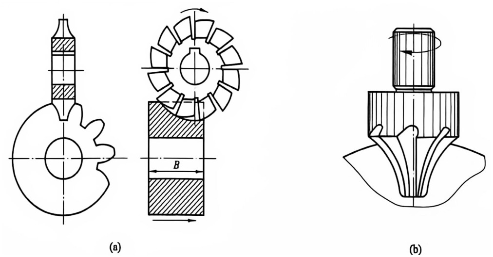

图5-17 成形法切齿
{: .figure-caption }

(a) 盘状铣刀切齿；(b) 指状铣刀切齿。

加工时，铣刀绕本身轴线旋转，同时轮坯沿齿轮轴线方向直线移动。铣出一个齿槽后，将轮坯转过一定角度再铣第二个齿槽，直至加工完成所有齿槽。这种切齿方法简单，普通机床就可进行加工，但生产效率低，故仅适用于单件生产。

齿廓渐开线的形状决定于基圆大小，压力角一定，同一模数下不同齿数的齿轮，其基圆大小不同，齿廓渐开线形状就不同。机器中常用的齿轮齿数为 17～150，因此，要想加工准确的渐开线齿形，就需要大量的铣刀，这实际上是做不到的。为了节省刀具数量，工程中规定相同模数的铣刀为 8 把（分别称 1～8 号铣刀），每号铣刀对应加工不同齿数范围的齿轮，如表 5-4 所示。采用成形铣刀加工齿轮，理论上就存在一定的误差。故此，成形法加工的齿轮精度低。

表 5-4 成形铣刀对应加工的齿数范围

<table><tr><td>铣刀号数</td><td>1</td><td>2</td><td>3</td><td>4</td><td>5</td><td>6</td><td>7</td><td>8</td></tr><tr><td>所切齿数范围</td><td>12~13</td><td>14~16</td><td>17~20</td><td>21~25</td><td>26~34</td><td>35~54</td><td>55~134</td><td> \(\geqslant\) 135</td></tr></table>

### 5.6.2 范成法

范成法亦称为展成法，是根据一对齿轮互相啮合时其齿廓曲线共轭互为包络线（因此范成法又称为共轭法或包络法）的原理来切齿的。用范成法切齿的常用刀具有齿轮插刀、齿条插刀和齿轮滚刀三种。

齿轮插刀加工齿轮，如图 5-18 所示。插齿时，插刀沿轮坯轴线方向做往复切削运动，同时保证插刀与轮坯按一对齿轮啮合传动（范成运动），直至全部齿

范成法加工齿轮

槽切削完毕。根据正确啮合条件，只要一对齿轮的模数和压力角相等就能实现啮合。因此，理论上一把插刀可以加工同一模数的所有齿数的齿轮。

用齿条插刀加工齿轮，如图 5-19 所示，其相对运动及相互啮合与齿轮插刀加工齿轮相似，区别在于齿轮插刀的范成运动变为齿条插刀的直线运动。

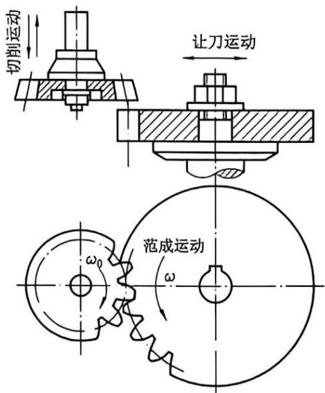

图5-18 齿轮插刀加工齿轮
{: .figure-caption }

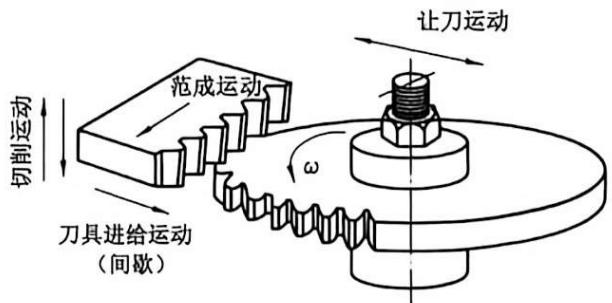

图5-19 齿条插刀加工齿轮
{: .figure-caption }

以上两种刀具都是间断切削，其生产率较低。齿轮滚刀加工齿轮，如图5-20所示，滚刀形状为一个具有轴向刃口的螺旋，如图5-20(b)所示；它的轴向截面为一齿条，如图5-20(a)所示。滚刀的转动就相当于齿条移动，因此，齿轮滚刀切齿相当于齿条插刀加工齿轮。不同的是齿条插刀的切削运动和范成运动由滚刀刀刃的螺旋运动所替代。这种加工方法能实现连续切削，生产率较高，是目前使用最广泛的齿轮加工方法。

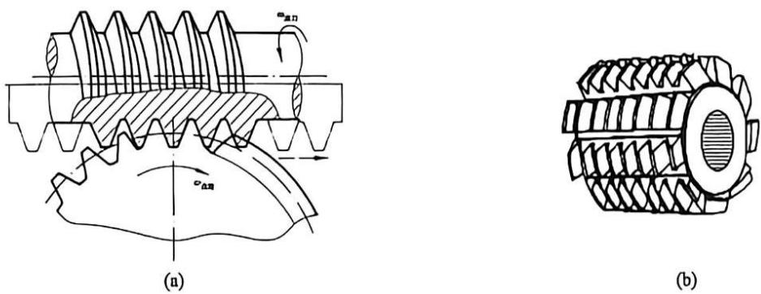

图5-20 齿轮滚刀加工齿轮
{: .figure-caption }

### 5.6.3 渐开线标准齿形和标准齿条型刀具

《通用机械和重型机械用圆柱齿轮 标准基本齿条齿廓》(GB/T 1356—2001)的规定，标准齿条的齿形根据渐开线圆柱齿轮的基准齿形[图5-21(a)]设计，刀具的分度线与被加工齿轮分度圆相切并做纯滚动，刀具的分度线与节线是重合的。为保证齿轮传动时具有标准的顶隙，齿条型刀具的齿形比基准齿形高出 $c^{*}m$ 长度，如图5-21(b)所示。由于这部分刀刃是圆弧，所以这部分刀刃加工出的不是渐开线。因此后面讨论渐开线齿廓的切削时，刀具顶部的这部分高度不再计入。

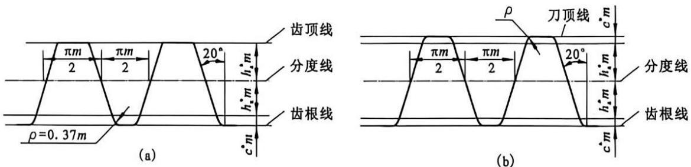

图5-21 渐开线基准齿形和标准齿条型刀具
{: .figure-caption }

### 5.6.4 根切现象及其产生的原因

用范成法切制齿轮，当被加工齿轮的齿数较少时，其轮齿根部的渐开线齿廓被切去一部分，如图 5-22 所示，这种现象被称为根切。产生根切的齿轮，除

其轮齿的强度被严重削弱外，还会使齿轮传动的重合度下降，对传动极为不利。

根切产生的原因是刀具的齿顶线与啮合线的交点超过了理论啮合线的极限点 $N_{1}$ , 如图 5-23(刀具实线位置)所示。由基圆内无渐开线的性质可知, 超过 $N_{1}$ 点的刀刃切不出渐开线齿廓, 而将根部已加工出的渐开线切去一部分 (如图中阴影部分)。由此可知, 要避免根切, 则刀具的齿顶线与啮合线的交点不能超过理论啮合线的极限点 $N_{1}$ 。当被加工齿轮的齿数较多时, 则刀具的齿顶线与啮合线的交点不会超过理论啮合线的极限点 $N_{1}$ , 就不会产生根切。

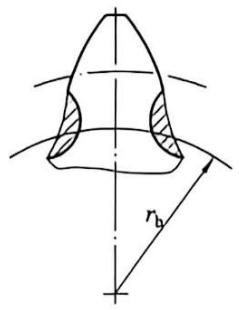

图5-22 轮齿根切现象
{: .figure-caption }

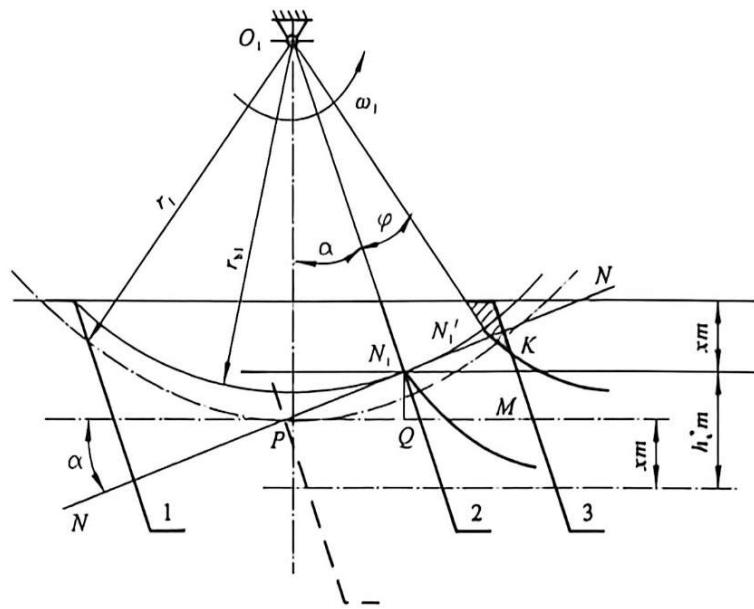

图5-23 根切原因
{: .figure-caption }

### 5.6.5 渐开线标准齿轮不根切的最少齿数

标准齿条型刀具切削标准齿轮时刀具与被加工齿轮的相互关系如图 5-24 所示。图中 $N_{1}$ 为理论啮合线的极限点。若刀具齿顶线与啮合线的交点不超过 $N_{1}$ 点，则

$$
h _ {n} ^ {*} m \leqslant \overline {{P N _ {1}}} \sin \alpha
$$

在直角三角形 $O_{1}PN_{1}$ 中，因为 $PN_{1} = \overline{O_{1}P}\sin \alpha = \frac{mz}{2}\sin \alpha$ ，代入上式得：

$$
h _ {n} ^ {\bullet} m \leqslant \frac {m z}{2} \sin \alpha \sin \alpha = \frac {m z}{2} \sin^ {2} \alpha
$$

于是 $z \geqslant \frac{2h_{\mathrm{u}}^{*}}{\sin^2\alpha}$ 。则不产生根切的最少齿数 $z_{\mathrm{min}}$ 为：

$$
z _ {\min} = \frac {2 h _ {a} ^ {*}}{\sin^ {2} \alpha}\tag{5-17}
$$

当 $h_{a}=1,\alpha=20^{\circ}$ 时， $z_{\min}=17$ 。

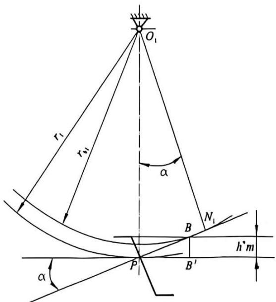

图5-24 不根切的最少齿数
{: .figure-caption }

## 5.7 变位齿轮传动

### 5.7.1 变位齿轮、齿轮不根切的最小变位系数

如前所述, 若要加工标准齿轮不产生根切, 其齿数不能少于 17。而在生产实践中往往要加工少于 17 个齿的齿轮, 又不能产生根切, 这时采用前述的加工方法就不能满足要求。如将刀具相对于被切齿轮沿径向外移一段距离 (刀具虚线位置), 用 $x m$ 表示 ( $x$ 称为移距系数或变位系数, $x m$ 称为移距量), 使得刀具的齿顶线与啮合线的交点不超过理论啮合线的极限点 $N _{1}$ , 就可避免根切。由图 5-23 可知, 刀具外移距离 $x m$ 应满足的条件为:

$$
h _ {a} ^ {*} m - x m \leqslant \overline {{{N _ {1} Q}}}, \text {   即   } x m \geqslant h _ {a} ^ {*} m - \overline {{{N _ {1} Q}}}
$$

因为 $\overline{N_1Q} = PN_1\sin \alpha = r\sin^2\alpha = \frac{mz}{2}\sin^2\alpha$ 代入上式得

$$
x \geqslant h _ {a} ^ {*} - \frac {z \sin^ {2} \alpha}{2}
$$

由式(5-17)可知 $\frac{\sin^2\alpha}{2} = \frac{h_a^*}{z_{\min}}$ ，代入上式可得：

$$
x \geqslant \frac {h _ {\mathrm{a}} ^ {*} (z _ {\min} - z)}{z _ {\min}}\tag{5-18}
$$

即最小变位系数为:

$$
x _ {\min} = \frac {h _ {a} ^ {*} (z _ {\min} - z)}{z _ {\min}}\tag{5-19}
$$

综合前述及上两式可知: 当被切齿轮的齿数 $z \leqslant z_{\min}$ 时, $x$ 为正值, 为避免根切, 刀具相对被切齿轮外移, 其最小移距量为 $x_{\min} m$ 。采用这种方法加工齿轮称为正变位, 被加工的齿轮称为正变位齿轮。反之, 刀具相对被切齿轮内移一段距离, $x$ 为负值, 但只要满足条件 $x m \geq x_{\min} m$ , 被切齿轮仍不会产生根切。采用这种方法加工齿轮称为负变位, 被加工的齿轮称为负变位齿轮。采用刀具需相对被切齿轮外移 (或内移) 方法加工的齿轮统称为变位齿轮。

与标准齿轮相比, 变位齿轮的各圆处的齿厚发生变化; 为保证一定的全齿高, 变位齿轮的齿顶高和齿根高也需要作相应变化; 一对变位齿轮啮合传动的相互关系也随之变化, 如传动的中心距、啮合角等。

### 5.7.2 变位齿轮传动设计

#### 1. 齿轮传动的安装条件

齿轮安装要满足两个条件: ①两齿轮啮合时轮齿间无齿侧间隙; ②一个齿轮的齿顶与另一个齿轮齿根间隙为标准顶隙。一对齿轮啮合传动时两齿轮的节圆相切并做纯滚动, 轮齿间没有齿侧间隙, 则一个轮齿的节圆齿厚等于另一个轮齿的节圆齿槽宽。当两标准齿轮正确安装时, 其分度圆与节圆重合, 是满足这两个条件的。而一对变位齿轮啮合, 要满足这两个安装条件, 传动参数及齿轮的各相关尺寸将发生变化。

#### 2. 变位齿轮的分度圆齿厚

如图 5-25 所示，用标准齿条型刀具切制变位齿轮时，刀具分度线与被切齿轮分度圆相切位置沿径向外移一段距离 $xm$ 后，刀具的节线与被切齿轮的分度圆相切并做纯滚动。这时刀具的节线齿槽宽比其分度线齿槽宽增加了 $2\overline{KJ}$ ，因此被切齿轮的分度圆齿厚也增加了 $2\overline{KJ}$ 。变位后的分度圆齿厚为：

$$
s = \frac {\pi m}{2} + 2 \overline {{{K J}}} = m \left(\frac {\pi}{2} + 2 x \tan \alpha\right)\tag{5-20}
$$

同理，被切齿轮的分度圆齿槽宽减少了 $2\overline{KJ}$ ，为：

图5-25 变位齿轮分度圆齿厚
{: .figure-caption }

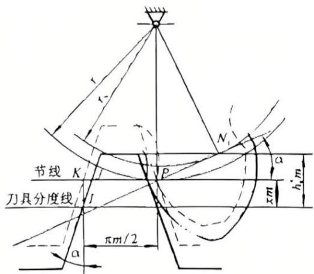

$$
e = \frac {\pi m}{2} - 2 \overline {{K J}} = m \left(\frac {\pi}{2} - 2 x \tan \alpha\right)\tag{5-21}
$$

#### 3. 无侧隙啮合传动方程式

设两齿轮啮合轮齿的节圆齿厚和齿槽宽分别为 $s_1'$ 、 $s_2'$ 、 $e_1'$ 、 $e_2'$ ，轮齿间无齿侧间隙条件有：

$$
p ^ {\prime} = s _ {1} ^ {\prime} + e _ {1} ^ {\prime} = s _ {2} ^ {\prime} + e _ {2} ^ {\prime} = s _ {1} ^ {\prime} + s _ {2} ^ {\prime}
$$

根据渐开线的性质和式(5-7)可得出相互啮合两齿轮节圆的周节、齿厚与分度圆的周节、齿厚之间的关系，并将其代入上式，经整理后得：

$$
p = s _ {1} - 2 r _ {1} (\text {   inv   } \alpha^ {\prime} - \text {   inv   } \alpha) + s _ {2} - 2 r _ {2} (\text {   inv   } \alpha^ {\prime} - \text {   inv   } \alpha)
$$

将分度圆周节和两齿轮的分度圆齿厚、分度圆半径与模数和齿数的关系代入上式，经整理后可得：

$$
\mathrm{inv} \alpha^ {\prime} = \frac {2 (x _ {1} + x _ {2}) \tan \alpha}{z _ {1} + z _ {2}} + \mathrm{inv} \alpha\tag{5-22}
$$

上式称为齿轮的无侧隙啮合方程式。该式表明，若两齿轮的变位系数和 $(x_{1}+x_{2})$ 不为零，则两齿轮的啮合角 $\alpha'$ 就不等于其分度圆的压力角 $\alpha$ ，两齿轮啮合时其分度圆和节圆就不再重合。齿轮的齿数和模数确定后，其分度圆就是一个固定圆，由于其分度圆和节圆不再重合，所以两齿轮传动的中心距就不等于其分度圆半径之和。

#### 4. 齿轮的中心距变动系数 y 和中心距 $a'$

设变位齿轮传动的实际安装中心距 $a'$ 与其标准齿轮的中心距 $a$ 之差为 $ym$ ，则：

$$
y m = a ^ {\prime} - a = \left(r _ {1} ^ {\prime} + r _ {2} ^ {\prime}\right) \frac {m \left(z _ {1} + z _ {2}\right)}{2}\tag{5-23}
$$

因为 $a' \cos \alpha' = a \cos \alpha$ ，即 $a' = a \frac{\cos \alpha}{\cos \alpha'} = \frac{m(z_1 + z_2)}{2} \cdot \frac{\cos \alpha}{\cos \alpha'}$ ，代入上式得：

$$
y = \frac {(z _ {1} + z _ {2})}{2} \left(\frac {\cos \alpha}{\cos \alpha^ {\prime}} - 1\right) \text {或} \cos \alpha^ {\prime} = \frac {(z _ {1} + z _ {2})}{(2 y + z _ {1} + z _ {2})} \cos \alpha\tag{5-24}
$$

中心距为：

$$
a ^ {\prime} = a + y m = \frac {m}{2} (z _ {1} + z _ {2}) + y m\tag{5-25}
$$

#### 5. 变位齿轮的齿顶高变动系数 $\Delta y$

按式(5-25)条件安装齿轮可以保证实现无侧隙啮合。但从保证标准顶隙方面看，其一对齿轮安装的中心距 $a''$ 应为：

$$
\begin{array}{r l} a ^ {\prime \prime} & = r _ {a 1} + c + r _ {f 2} = r _ {1} + h _ {a 1} + c + r _ {2} - h _ {f 2} \\ & = r _ {1} + r _ {2} + (h _ {a} ^ {*} + x _ {1}) m + c ^ {*} m - (h _ {a} ^ {*} + c ^ {*} - x _ {2}) m \\ & = r _ {1} + r _ {2} + (x _ {1} + x _ {2}) m \\ & = \frac {m}{2} (z _ {1} + z _ {2}) + (x _ {1} + x _ {2}) m \end{array}\tag{5-26}
$$

由式(5-25)和式(5-26)可知, 若要同时保证齿轮传动的无侧隙啮合和标准顶隙, 必须保证 $a' = a''$ , 即要求满足等式 $y = x_{1} + x_{2}$ 。可以证明, 只要 $x_{1} + x_{2} \neq 0$ , 总有 $y < x_{1} + x_{2}; a' < a''$ 。显然, 若按 $a'$ 安装只能保证齿轮传动的无侧隙啮合, 不能保证标准顶隙; 若按 $a''$ 安装, 能保证标准顶隙, 却不能保证齿轮传动的无侧隙啮合。解决这一问题的方法为: 按 $a'$ 安装保证齿轮传动的无侧隙啮合, 同时减少两个齿轮的齿顶高, 以保证标准顶隙的要求。两个齿轮的齿顶高减少量用 $\Delta y m$ 表示, 则:

$$
\begin{array}{r l} \Delta y m & = a ^ {\prime \prime} - a ^ {\prime} = (x _ {1} + x _ {2}) m - y m \\ \Delta y & = (x _ {1} + x _ {2}) - y \end{array}\tag{5-27}
$$

#### 6. 变位齿轮传动的类型及其特点

根据变位系数 $x_{1}$ 、 $x_{2}$ 之和不同，变位齿轮传动可分为零传动、正传动和负传动三种基本类型。

(1)零传动。 $x_{1}+x_{2}=0$ ，包括两种情况：① $x_{1}=x_{2}=0$ ，标准齿轮传动，是变位齿轮传动的特例。② $x_{1}=-x_{2}\neq0$ ，等变位齿轮传动（高度变位齿轮传动）。 $a'=a,\alpha'=\alpha,y=0,\Delta y=0$ ，节圆与分度圆重合。小齿轮采用正变位，大齿轮采用负变位，大、小齿轮的强度趋于接近，可相对提高齿轮的承载能力。

(2)正传动。 $x_{1}+x_{2}>0$ ，是不等变位齿轮传动（角度变位齿轮传动）。 $a^{\prime}>a,\alpha^{\prime}>\alpha,y>0,\Delta y>0$ ，两齿轮的分度圆分离，齿顶高需缩减。即使 $z_{1}+z_{2}<2z_{\min}$ 也不发生根切，结构较等变位齿轮构紧凑，轮齿的承载能力有较大提高。但其没有互换性，必须成对设计、使用；重合度减小，齿顶变尖。

(3)负传动。 $x_{1}+x_{2}<0$ ，是不等变位齿轮传动（角度变位齿轮传动）。 $a^{\prime}<a,\alpha^{\prime}<\alpha,y<0,\Delta y>0$ ，两齿轮的分度圆相割。重合度略有增加，但轮齿强度有所降低，一般仅用于配凑中心距的场合。

#### 7. 变位齿轮传动的设计步骤

变位齿轮传动设计问题主要可以分为如下两类。

(1)已知中心距的设计。这时的已知条件是 $z_{1}$ 、 $z_{2}$ 、m、 $\alpha$ 、 $a'$ ，其设计步骤如下：

①由式(5-16)确定啮合角：

$$
\alpha^ {\prime} = \arccos [ (a \cos \alpha) / a ^ {\prime} ]
$$

②由式(5-22)确定变位系数和:

$$
x _ {1} + x _ {2} = (\text {   inv   } \alpha^ {\prime} - \text {   inv   } \alpha) (z _ {1} + z _ {2}) / (2 \tan \alpha)
$$

③由式(5-23)确定中心距变动系数：

$$
y = (a ^ {\prime} - a) / m
$$

④由式(5-27)确定齿顶高变动系数：

$$
\Delta y = \left(x _ {1} + x _ {2}\right) - y
$$

⑤分配变位系数 $x_{1} 、 x_{2}$ , 并按表 5-5 计算齿轮的几何尺寸。

(2)已知变位系数的设计。这时的已知条件是 $z_{1} 、 z_{2} 、 m 、 \alpha 、 x_{1} 、 x_{2}$ , 其设计步骤如下:

①由式(5-22)确定啮合角：

$$
\operatorname{inv} \alpha^ {\prime} = 2 \tan \alpha (x _ {1} + x _ {2}) / (z _ {1} + z _ {2}) + \operatorname{inv} \alpha
$$

②由式(5-16)确定中心距：

$$
a ^ {\prime} = a \cos \alpha / \cos \alpha^ {\prime}
$$

③由式(5-23)及式(5-27)确定中心距变动系数 $y$ 及齿顶高变动系数 $\Delta y$ 。

④按表 5- 5 计算变位齿轮的几何尺寸。

表 5-5 外啮合直齿圆柱齿轮传动的计算公式

<table><tr><td>名称</td><td>符号</td><td>标准齿轮传动</td><td>等变位齿轮传动</td><td>不等变位齿轮传动</td></tr><tr><td>变位系数</td><td>x</td><td>x1=x2=0</td><td>x1=-x2x1+x2=0</td><td>x1+x2≠0</td></tr><tr><td>节圆直径</td><td>d&#x27;</td><td colspan="2">d&#x27;_l=d_l=z_im(i=1,2)</td><td>d&#x27;_l=d_1cos α/cos α&#x27;</td></tr><tr><td>啮合角</td><td>α&#x27;</td><td colspan="2">α&#x27;=α</td><td>cos α&#x27;(acos α)/α&#x27;</td></tr><tr><td>齿顶高</td><td>ha</td><td>ha=ha*m</td><td>ha1=(ha&#x27;+x1)m</td><td>ha1=(ha&#x27;+x1-Δy)m</td></tr><tr><td>齿根高</td><td>hf</td><td>hf=(ha&#x27;+c*)m</td><td colspan="2">hfl=(ha&#x27;+c*-xi)m</td></tr><tr><td>齿顶圆直径</td><td>da</td><td colspan="3">da1=da+2ha1</td></tr><tr><td>齿根圆直径</td><td>df</td><td colspan="3">df1=df+2hfi</td></tr><tr><td>中心距</td><td>a</td><td colspan="2">a=(d1+d2)/2</td><td>a&#x27;(d1&#x27;+d2&#x27;)/2</td></tr><tr><td>中心距变动系数</td><td>y</td><td colspan="2">y=0</td><td>y=(a&#x27;-a)/m</td></tr><tr><td>齿顶高降低系数</td><td>Δy</td><td colspan="2">Δy=0</td><td>Δy=x1+x2-y</td></tr><tr><td>实际中心矩</td><td>a&#x27;</td><td colspan="2">a&#x27;=a=1/2m(z1+z2)</td><td>a&#x27;=acos α/cos α&#x27;</td></tr></table>

例 5-4 已知一对渐开线齿轮 $z_{1}=12$ ; $z_{2}=43$ ; m=5 mm; $a'=138\ mm$ 。试设计这对齿轮传动。

解：

$$
a = \frac {m}{2} (z _ {1} + z _ {2}) = \frac {5}{2} \times (1 2 + 4 3) = 1 3 7. 5 \mathrm{mm}
$$

由于： $a'>a$ ; $a'\cos\alpha'=a\cos\alpha$

$$
\alpha^ {\prime} = \arccos \left(\frac {a \cos \alpha}{a ^ {\prime}}\right) = \arccos \left(\frac {1 3 7 . 5 \times \cos 2 0 ^ {\circ}}{1 3 8}\right) = \arccos (0. 9 3 6 3) = 2 0. 5 6 3 ^ {\circ}
$$

由无侧隙啮合方程式(5-22)得： $x_{1}+x_{2}=\frac{(\mathrm{inv}\alpha^{\prime}-\mathrm{inv}\alpha)(z_{1}+z_{2})}{2\tan\alpha}$

由(5-3)式： $\mathrm{im}20.563^{\circ}=\mathrm{Im}20.563^{\circ}\frac{20.563^{\circ}\times\pi}{180^{\circ}}=0.016246$

$$
\mathrm{inv} 2 0 ^ {\circ} = \tan 2 0 ^ {\circ} - \frac {2 0 ^ {\circ} \times \pi}{1 8 0 ^ {\circ}} = 0. 0 1 4 9 0 4
$$

$$
x _ {1} + x _ {2} = \frac {(0 . 0 1 6 2 4 6 - 0 . 0 1 4 9 0 4) \times (1 2 + 4 3)}{2 \times \ln n 2 0 ^ {\circ}} = 0. 1 0 1 4
$$

齿轮1不根切的最小变位系数为： $x_{1\mathrm{min}} = \frac{17 - 12}{17} = 0.2941$ 取 $x_{1} = 0.3$ ，则 $x_{2} = 0.1014 - 0.3 = -0.1986$

$$
d _ {1} = m z _ {1} = 5 \times 1 2 = 6 0 \mathrm{mm}
$$

$$
d _ {2} = m z _ {2} = 5 \times 4 3 = 2 1 5 \mathrm{mm}
$$

$$
y = \frac {a ^ {\prime} - a}{m} = \frac {1 3 8 - 1 3 7 . 5}{5} = 0. 1
$$

$$
\Delta y = x _ {1} + x _ {2} - y = 0. 1 0 1 4 - 0. 1 = 0. 0 0 1 4
$$

其他尺寸从略。

## 5.8 斜齿圆柱齿轮机构

### 5.8.1 圆柱齿轮的共轭齿廓曲面形成

如图 5-26(a)、图 5-27(a) 所示, 圆柱齿轮无论是直齿轮还是斜齿轮, 其齿廓曲面都是发生而在基圆柱上做纯滚动时, 发生面上的一条直线 ${KK}$ 在空间所走过的轨迹而形成的渐开面。所不同的是, 当发生面上的直线 ${KK}$ 与基圆柱母线相平行时, 则形成直齿轮的齿廓曲面; 当发生面上的直线 ${KK}$ 与基圆柱母线相交成一定角度时, 则形成斜齿轮的齿廓曲面。斜齿圆柱齿轮的端面齿廓曲线仍为渐开线。故从端面上看, 一对渐开线斜齿轮传动就相当于一对渐开线直齿轮传动, 所以它也满足齿廓啮合基本定律。

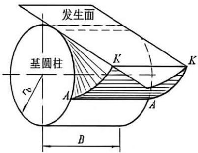

(0)

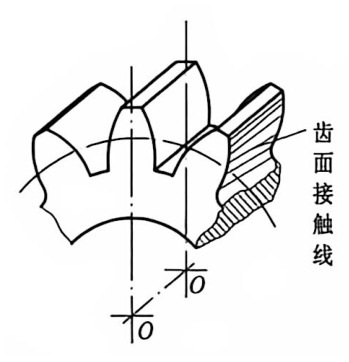

图5-26 直齿轮齿廓曲面形成
{: .figure-caption }

一对斜齿轮互相啮合时, 两轮齿面的接触线是斜直线, 如图 5-27(b) 所示。其啮合过程是在前端面从动轮的齿顶一点开始接触, 然后接触线由短逐渐变长, 再由长逐渐变短, 最后在后端面从动轮齿根部的某一点开始分离。这种啮合情况，减少了传动时的冲击和噪声，提高了传动的平稳性，故斜齿轮适于重载高速传动。

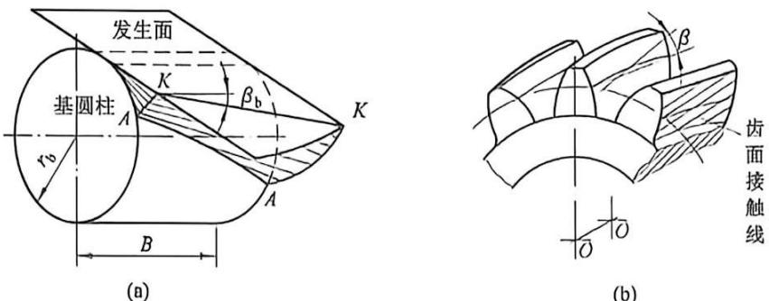

图5-27 斜齿轮齿廓曲面形成
{: .figure-caption }

### 5.8.2 斜齿轮的基本参数和几何尺寸计算

由于斜齿轮的齿廓曲面是一渐开线的螺旋面, 其齿轮端面 (垂直于轴线的截面) 的齿形和法面 (垂直于螺旋线方向的法向剖面) 的齿形不同, 因而齿形端面和法面的参数就不同。基于齿轮加工进刀方向为垂直于法面的, 以国家规定斜齿轮法面的参数 ( $m_{n}$ 、 $\alpha_{n}$ 、 $h_{an}^{*}$ 、 $c_{n}^{*}$ 等) 为标准值。但在计算斜齿轮的几何尺寸时却需按端面参数 ( $m_{1}$ 、 $\alpha_{1}$ 、 $x_{1}$ 等) 进行, 因此就必须建立法面参数与端面参数的换算关系。

(1)螺旋角、模数和压力角。

如图 5-27, 斜齿轮的齿廓曲面与其分度圆柱面相交的螺旋线的切线与齿轮轴线之间所夹的锐角(以 $\beta$ 表示)称为斜齿轮分度圆柱上的螺旋角(简称为斜齿轮的螺旋角)。它是斜齿轮的一个重要参数, 当斜齿轮的螺旋角为零时该斜齿轮就成了直齿轮。发生面上的直线 $KK$ 与基圆柱母线相交成角度 $\beta_{\mathrm{b}}$ , 其生成的渐开面与基圆柱的交线 $AA$ 为一螺旋线。该螺旋线的螺旋角等于 $\beta_{\mathrm{b}}$ , 即斜齿轮基圆柱上的螺旋角。斜齿轮的螺旋线旋向有左旋和右旋之分, 如图 5-28 所示。

为求法面模数 $m_{n}$ 与端面模数 $m_{1}$ 之间的关系，将斜齿轮沿其分度圆柱展开，如图5-29所示，图中阴影线部分为轮齿，空白部分为齿槽。由图可知：

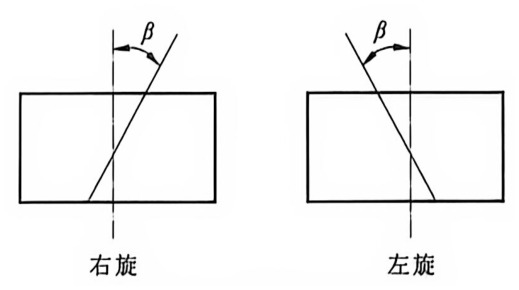

图5-28 斜齿轮的旋向
{: .figure-caption }

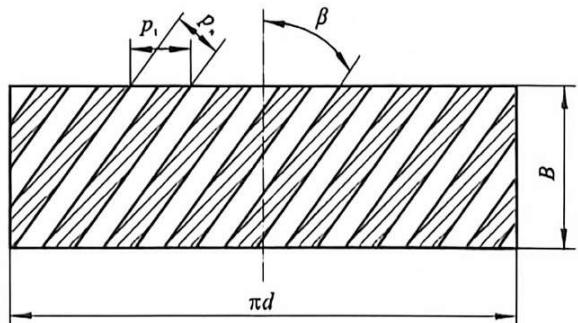

图5-29 斜齿轮分度圆展开图
{: .figure-caption }

$$
\begin{array}{r l} & p _ {n} = p _ {1} \cos \beta ; p _ {n} = \pi m _ {n}; p _ {1} = \pi m _ {1} \\ & m _ {n} = m _ {1} \cos \beta \end{array}\tag{5-28}
$$

图 5-30 所示为斜齿条的一个轮齿， $\triangle a^{\prime}b^{\prime}c$ 在法面上， $\triangle abc$ 在端面上。由图可知：
{: .figure-caption }

$$
\tan \alpha_ {n} = \tan \alpha_ {1} \cos \beta\tag{5-29}
$$

(2) 斜齿轮传动的几何尺寸计算。

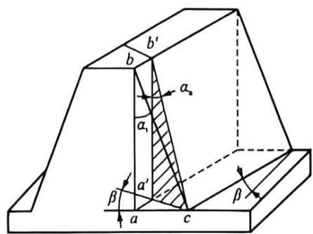

在端面上，斜齿轮与直齿轮完全相同。因此，斜齿轮几何尺寸计算用斜齿轮的端面参数参照直齿轮几何尺寸计算公式进行计算。其中斜齿轮的齿顶高

图5-30 斜齿条
{: .figure-caption }

和齿根高，无论是从法面还是从端面上看其高度都是相同的。

斜齿轮在其端面上的分度圆直径为：

$$
d = z m _ {1} = z m _ {n} / \cos \beta\tag{5-30}
$$

斜齿轮传动的标准中心距为：

$$
a = \left(d _ {1} + d _ {2}\right) / 2 = m _ {n} \left(z _ {1} + z _ {2}\right) / (2 \cos \beta)\tag{5-31}
$$

由式(5-31)可知, 可以用改变螺旋角 $\beta$ 的方法来调整其中心距的大小。故斜齿轮传动的中心距常作圆整, 以利加工。

斜齿轮也可用变位修正的办法来满足不同的工作要求。其端面变位系数 $x_{1}$ 与法面变位系数 $x_{n}$ 之间的关系为： $x_{1} = x_{n}\cos \beta$ 。一般按法面变位系数进行计算。

### 5.8.3 斜齿轮的啮合传动

直齿圆柱齿轮啮合时两齿面的接触线是与齿轮轴线平行的直线，如图 5-26(b) 所示，整个齿宽同时进入啮合也同时退出啮合，因此其传动平稳性较差。由于斜齿轮的齿廓沿齿宽方向倾斜，啮合时，两齿面的接触线与齿轮轴线不平行，如图 5-27(b) 所示，齿廓啮合时，一对轮齿的一端先进入啮合，然后沿齿宽方向逐渐啮合至另一端。两齿廓啮合过程中，齿面接触线的长度逐渐变化，说明斜齿轮的齿廓是逐渐进入接触，逐渐脱离接触的。因此斜齿轮传动比直齿轮平稳，冲击、振动和噪声较小，适于高速、重载传动。

(1) 正确啮合的条件。

在端面上, 斜齿轮与直齿轮正确啮合的条件相同, 即两斜齿轮的端面模数 $m_{\mathrm{t}}$ 和端面压力角 $\alpha_{\mathrm{t}}$ 相等即可满足斜齿轮正确啮合的条件。但是, 斜齿轮的法面模数是标准值, 所以正确啮合的条件为: 两斜齿轮的法面模数 $m_{\mathrm{n}}$ 和法面压力角 $\alpha_{\mathrm{n}}$ 相等; 外啮合时其螺旋角 $\beta$ 大小相等, 方向相反; 内啮合时方向相同。即

$$
\left\{ \begin{array}{l l} m _ {n 1} = m _ {n 2}; & \alpha_ {n 1} = \alpha_ {n 2}; \\ \beta_ {1} = - \beta_ {2} & (\text {外啮合}) \\ \beta_ {1} = \beta_ {2} & (\text {内啮合}) \end{array} \right.
$$

(2)重合度。

从端面上看斜齿轮的重合度与直齿轮相同，但由于啮合时其轮齿沿齿宽方向逐渐进入啮合并逐渐脱离啮合，因此斜齿轮啮合时走过的实际啮合线的长度

增加了。如图 5-31 所示, 从端面 I 上看, 一对轮齿从 $B_{2}$ 点进入啮合, 到 $B_{1}$ 点退出啮合, 但从齿宽方向上看这对轮齿并未退出啮合, 只有当端面 II 上的同一对轮齿到达 $B_{1}$ 点时才退出啮合。因此斜齿轮一对轮齿的实际啮合线比直齿轮多了 $\Delta L$ 长度。比照直齿轮重合度的计算方法有:

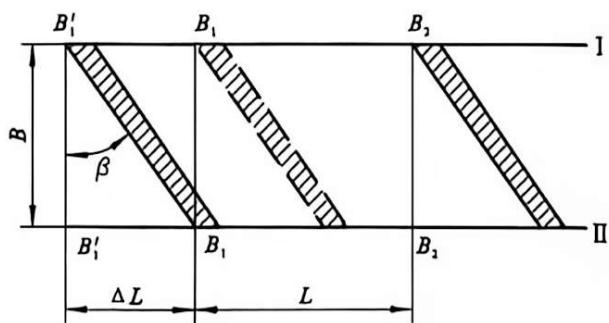

图5-31 斜齿轮重合度
{: .figure-caption }

$$
\varepsilon = \frac {L + \Delta L}{p _ {\mathrm{bt}}} = \frac {L}{p _ {\mathrm{bt}}} + \frac {\Delta L}{p _ {\mathrm{bt}}} = \varepsilon_ {\alpha} + \varepsilon_ {\beta}\tag{5-32}
$$

式中： $\varepsilon_{a}$ 为端面重合度，式中除代入的是斜齿轮的端面参数外，与直齿轮重合度计算相同； $\varepsilon_{\beta}$ 为轴面重合度。

$$
\left. \begin{array}{l} \varepsilon_ {\alpha} = \frac {1}{2 \pi} \left[ z _ {1} \left(\tan \alpha_ {\mathrm{at} 1} - \tan \alpha_ {\mathrm{t}} ^ {\prime}\right) + z _ {2} \left(\tan \alpha_ {\mathrm{at} 2} - \tan \alpha_ {\mathrm{t}} ^ {\prime}\right) \right] \\ \varepsilon_ {\beta} = \frac {B \sin \beta}{\pi m _ {\mathrm{n}}} \end{array} \right\}\tag{5-33}
$$

### 5.8.4 斜齿轮的当量齿数

用成形法加工斜齿轮时，刀具沿齿槽(螺旋线)方向做切削运动；切出的齿形在法面上与刀具的刀刃形状相对应。因此，用成形法加工斜齿轮在选择铣刀时需要知道斜齿轮的法向齿形。通常采用下述近似方法进行研究。

法面齿形

如图 5-32 所示，过斜齿轮分度圆柱上齿廓的任一点 c 作轮齿螺旋线的法面 n-n，该法面与分度圆柱的交线为一椭圆。其长半轴为 a，短半轴为 b。由高等数学可知，椭圆在 c 点的曲率半径 $\rho$ 为：

$$
\rho = \frac {a ^ {2}}{b} = \frac {d}{2 \cos^ {2} \beta}\tag{5-34}
$$

若以 $\rho$ 为分度圆半径，以斜齿轮法向模数 $m_{n}$ 为模数，取标准压力角 $\alpha$ 作一直齿圆柱齿轮；该直齿轮的齿形即可认为近似于斜齿轮的法面齿形。该直齿轮被称为斜齿轮的当量齿轮，该轮的齿数为斜齿轮的当量齿数。显然，若按斜齿轮的当量齿数选择铣刀型号即可加工出近似于斜齿轮

的法面齿形的斜齿轮。用 $z_{v}$ 表示斜齿轮的当量齿数，

因为

$$
m _ {n} z _ {v} = 2 \rho
$$

所以

$$
z _ {\mathrm{v}} = \frac {2 \rho}{m _ {\mathrm{n}}} = \frac {d}{m _ {\mathrm{n}} \cos^ {2} \beta} = \frac {m _ {\mathrm{t}} z}{m _ {\mathrm{n}} \cos^ {2} \beta} = \frac {m _ {\mathrm{n}} z}{m _ {\mathrm{n}} \cos^ {3} \beta} = \frac {z}{\cos^ {3} \beta}\tag{5-35}
$$

斜齿轮的当量齿数除用于选择铣刀型号外，在进行斜齿轮的强度计算时还用于选择相关的系数。

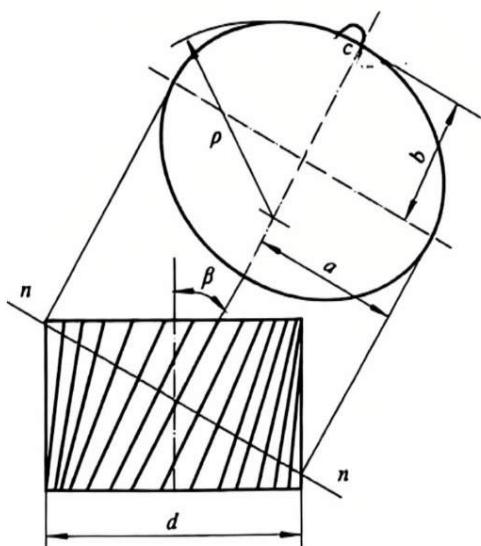

图5-32 斜齿轮的当量齿数
{: .figure-caption }

斜齿轮各参数及几何尺寸的计算公式列于表 5-6 中。

表 5-6 斜齿圆柱齿轮的参数及几何尺寸的计算公式

<table><tr><td>名称</td><td>符号</td><td>计算公式</td></tr><tr><td>螺旋角</td><td>β</td><td>一般取8°~20°</td></tr><tr><td>基圆柱螺旋角</td><td>βt</td><td>tan βb=tan βcos αt</td></tr><tr><td>法面模数</td><td>mν</td><td>按表5-1,取标准值</td></tr><tr><td>端面模数</td><td>m1</td><td>m1=mn/cosβ</td></tr><tr><td>法面压力角</td><td>αn</td><td>αn=20°</td></tr><tr><td>端面压力角</td><td>α1</td><td>tan α1=tan αn/cosβ</td></tr><tr><td>法面齿距</td><td>pν</td><td>pn=πmn</td></tr><tr><td>端面齿距</td><td>p1</td><td>pt=πmt=pn/cosβ</td></tr><tr><td>法面基圆齿距</td><td>pln</td><td>phn=pn cos αn</td></tr><tr><td>法面齿顶高系数</td><td>h*an</td><td>h*an=1</td></tr><tr><td>法面顶隙系数</td><td>cn</td><td>cn=0.25</td></tr><tr><td>分度圆直径</td><td>d</td><td>d=zm1=zmn/cosβ</td></tr><tr><td>基圆直径</td><td>db</td><td>db=dcos α1</td></tr><tr><td>最小齿数</td><td>zmin</td><td>zmin=zvmin cos3β</td></tr><tr><td>端面变位系数</td><td>xt</td><td>xt=xncosβ</td></tr><tr><td>齿顶高</td><td>ha</td><td>ha=mn(han+xn)</td></tr><tr><td>齿根高</td><td>hf</td><td>hf=mn(han+cn-xn)</td></tr><tr><td>齿顶圆直径</td><td>da</td><td>da=d+2ha</td></tr><tr><td>齿根圆直径</td><td>df</td><td>df=d-2hf</td></tr><tr><td>法面齿厚</td><td>sn</td><td>sn=(π/2+2xn tan αn)mn</td></tr><tr><td>端面齿厚</td><td>s1</td><td>s1=(π/2+2xt tan α1)m1</td></tr><tr><td>当量齿数</td><td>zt</td><td>z_v=z/cos3β</td></tr></table>

注：① $m_{1}$ 应计算到小数后第四位，其余长度尺寸应计算到小数后三位。
②螺旋角 $\beta$ 的计算应精确到 $xx^{\circ}xx'xx''$ 。

### 5.8.5 斜齿轮传动的优缺点

与直齿轮相比，斜齿轮具有下列主要优点：

(1)传动平稳。一对轮齿是逐渐进入啮合并逐渐脱离啮合的，故啮合时冲击小、噪声低，适用于高速传动。

(2)承载能力大。随着斜齿轮的齿宽和螺旋角的增大, 其重合度增大, 即同时参与啮合

的轮齿对数增加，适用于重载荷。

(3) 结构更紧凑。斜齿轮可以加工出齿数较少的齿轮而不产生根切。

斜齿轮的主要缺点是在啮合时会产生轴向分力，如图 5-33(a) 所示。当传递功率一定时，轴向力随着螺旋角 $\beta$ 的增大而增大，使传动效率下降，且轴的支承需采用向心推力轴承，因而结构设计就更复杂。

综上考虑，在斜齿轮设计时，通常取其螺旋角 $\beta=8^{\circ}\sim20^{\circ}$ 。为消除斜齿轮传动的这一缺点，可采用人字齿轮，如图 5-33(b) 所示。人字齿轮的轮齿左、右完全对称，啮合时所产生的轴向力相互抵消，因此，人字齿轮可以采用较大的螺旋角。但人字齿轮制造较困难、成本较高，主要用于高速、重载的传动中。

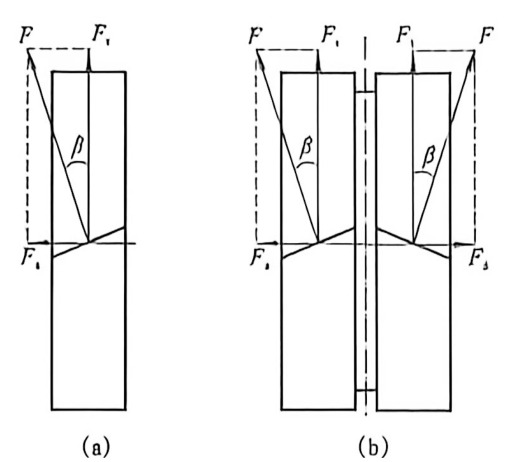

图5-33 斜齿轮上的轴向力
{: .figure-caption }

## 5.9 直齿圆锥齿轮机构

圆锥齿轮可用于两相交轴之间的传动。两相交轴之间的夹角可以根据需要选取，常用的是 $90^{\circ}$ 。圆锥齿轮的轮齿是分布在一个圆锥面上，如图5-5(f)所示。因此，前面所述齿轮的各种“圆柱”在圆锥齿轮里全部变为“圆锥”，如基圆锥、齿根圆锥、分度圆锥、齿顶圆锥。由于圆锥齿轮两端的尺寸不同，为了测量方便取大端参数为标准值。

### 5.9.1 齿廓曲面的形成

如图 5-34 所示，一发生面 S（圆平面，半径为 $R'$ ）在基圆锥（锥距 $R = R'$ ）上做纯滚动，发生面上一条过 O 点（发生面上与基圆锥顶点相重合的点）的直线 OK 在空间所形成的轨迹即为直齿圆锥齿轮的齿廓曲面。在纯滚动过程中 O 点是一固定点，直线 OK 上任意点的轨迹是一球面曲线，称之为球面渐开线，如图中 AK 即为一球面渐开线。因此，直齿圆锥齿轮的齿廓曲面亦可以看成由一簇球面渐开线集聚而成。

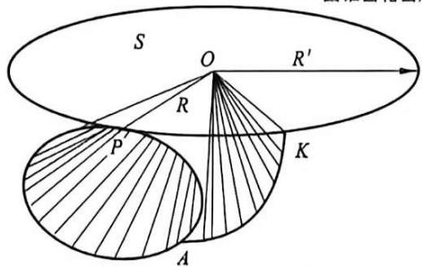

圆锥齿轮齿廓曲面的形成
图5-34 直齿圆锥齿轮齿廓曲面的形成

### 5.9.2 背锥和当量齿数

由于球面不能准确地展开成平面，使得圆锥齿轮设计计算及加工产生了很多困难。因此采用近似方法将球面展开成平面。

如图 5-35 所示为一球形圆锥齿轮的轴剖面图，三角形 OAB 表示分度圆锥，圆锥齿轮的当量齿轮而三角形 Oaa 和 Obb 分别表示齿顶圆锥和齿根圆锥。圆弧 ab 是其轮齿大端齿廓球面渐开线

与轴剖面的交线，在轴剖面上、过大端上的 $A$ 点作弧 $ab$ 的切线，该切线与轴线相交于 $O_{1}$ 点；以 $O_{1}A$ 为母线， $OO_{1}$ 为轴作一旋转锥面，该锥面与圆锥齿轮的大端球面相切，称这一旋转锥面为该圆锥齿轮的背锥。

由于背锥可以展开为一平面，将球面上的渐开线齿廓向背锥上投影，可得一投影曲线。这一投影曲线为平面曲线，且与圆锥齿轮大端齿廓球面渐开线的误差很小（当球面半径 R 与齿轮模数 m 的比值越大时，误差越小），因此在圆锥齿轮的齿廓分析中用背锥上的投影曲线近似代替球面渐开线。

如将背锥展开，可得一扇形齿轮。将这一扇形齿轮补足使其成为一完整的圆形齿轮，称这一完整的圆形齿轮为圆锥齿轮的当量齿轮。当量齿轮的半径为 $r_{1}$ 、齿数为 $z_{1}$ ， $z_{2}$ 为圆锥齿轮的当量齿数。

如图 5-35 所示，可以求得当量齿数 $z_{v}$ 。

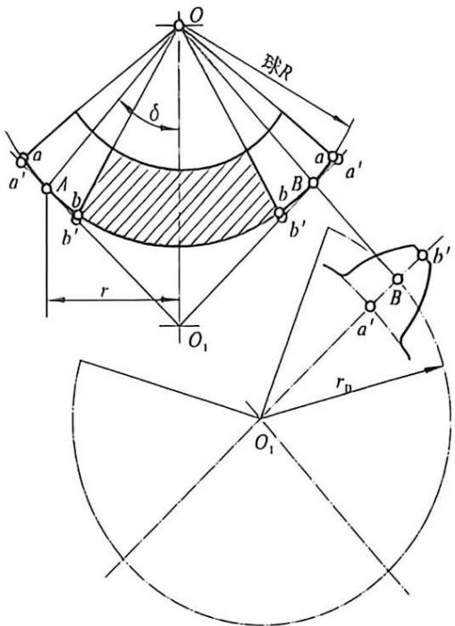

图5-35 背锥和当量齿数
{: .figure-caption }

$$
m z _ {\mathrm{v}} = 2 r _ {\mathrm{v}} = \frac {2 r}{\cos \delta} = \frac {m z}{\cos \delta}
$$

$$
z _ {v} = \frac {z}{\cos \delta}\tag{5-36}
$$

一对圆锥齿轮的啮合就相当于一对当量齿轮的啮合。因此一对圆锥齿轮的正确啮合条件是其大端的模数和压力角分别相等，此外其两齿轮的锥距还必须相等。

### 5.9.3 直齿圆锥齿轮的几何尺寸计算

由于圆锥齿轮的大端参数为标准值，因此在计算圆锥齿轮的几何尺寸时，以其大端的尺寸为计算基准。其压力角一般为 $20^{\circ}$ ，齿顶高系数 $h_{\mathrm{a}}^{\circ} = 1.0$ ，顶隙系数 $c^{\circ} = 0.2$ 。如图5-36所示，一对直齿圆锥齿轮的传动 $i_{12}$ 为：

$$
i _ {1 2} = \frac {\omega_ {1}}{\omega_ {2}} = \frac {z _ {2}}{z _ {1}} = \frac {d _ {2}}{d _ {1}} = \frac {\sin \delta_ {2}}{\sin \delta_ {1}}\tag{5-37}
$$

式中： $\delta_{1}$ 、 $\delta_{2}$ 为分度圆锥角。当 $\Sigma=\delta_{1}+\delta_{2}=90^{\circ}$ 时， $i_{12}=\tan\delta_{2}=\cot\delta_{1}$ 。对于直齿圆锥齿轮的几何尺寸计算，应注意其齿顶圆和齿根圆及传动比与圆

柱齿轮的不同。

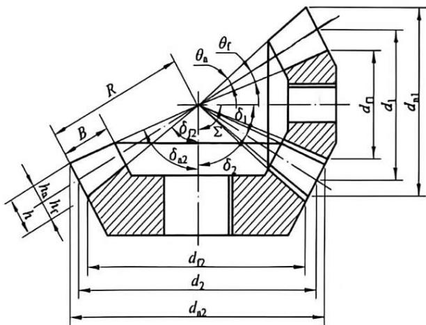

图5-36 直齿圆锥齿轮的几何尺寸
{: .figure-caption }

标准直齿圆锥齿轮名称及几何尺寸计算见表5-7。

表 5-7 标准直齿圆锥齿轮传动 $\left( {\sum  = {90}^{ \circ  }}\right)$ 的主要几何尺寸计算公式

<table><tr><td>名称</td><td>符号</td><td>计算公式</td></tr><tr><td>分度圆锥度</td><td>δ</td><td>δ1=arccot z2/z1, δ2=90°-δ1</td></tr><tr><td>分度圆直径</td><td>d</td><td>d1=mz1, d2=mz2</td></tr><tr><td>齿顶高</td><td>hn</td><td>ha1=ha2=ha* m</td></tr><tr><td>齿根高</td><td>hf</td><td>hπ=hf2=(ha*c*)m</td></tr><tr><td>齿顶圆直径</td><td>dn</td><td>dh1=d1+2hncos δ1, da2=d2+2hacos δ2</td></tr><tr><td>齿根圆直径</td><td>dl</td><td>dπ=d1-2hfcos δ1, dπ=d2-2hfcos δ2</td></tr><tr><td>锥矩</td><td>R</td><td>R=1/2√(d12+d22)</td></tr><tr><td>齿宽</td><td>B</td><td>B≤R/3(取整)</td></tr><tr><td>齿顶角</td><td>θn</td><td>不等顶隙收缩齿 θn1=θn2=arctan hn/R; 等顶隙收缩齿 θn1=θn2, θn2=θn1</td></tr><tr><td>齿根角</td><td>θf</td><td>θπ=θπ2=arctan hf/R</td></tr><tr><td>齿顶圆锥角</td><td>δn</td><td>δn1=δ1+θn1, δn2=δ2+θn2</td></tr><tr><td>齿根圆锥角</td><td>δf</td><td>δπ=δ1-θπ, δπ2=δ2-θπ2</td></tr><tr><td>当量齿数</td><td>zv</td><td>zv1=z1/cos δ1, zv2=z2/cos δ2</td></tr></table>

## 5.10 交错轴齿轮传动

### 5.10.1 螺旋齿轮传动

螺旋齿轮传动又称交错轴斜齿轮传动，如图 5-5(g) 所示。就单个齿轮而言，螺旋齿轮与斜齿轮完全相同，但其传动时与斜齿轮传动有较大区别。其传动的两齿轮齿廓相同，但两齿轮螺旋角大小可以不等，旋向可以相同或相反。其次，螺旋齿轮机构齿面之间是点接触，接触应力高，且齿面沿螺旋线方向存在相当大的滑动，功率损失大。因此它主要用于小功率传动。螺旋齿轮机构的啮合原理在渐开线圆柱齿轮齿面加工中有广泛应用，例如滚齿加工、剃齿加工等。

(1) 正确啮合的条件。

螺旋齿轮传动时其轮齿是在法面内啮合的，所以其正确啮合的条件为：两齿轮的法面模数和分度圆上的压力角分别相等且为标准值，即

$$
\left. \begin{array}{l} m _ {\cdot_ {n 1}} = m _ {\cdot_ {n 2}} = m \\ \alpha_ {\cdot_ {n 1}} = \alpha_ {\cdot_ {n 2}} = \alpha \end{array} \right\}\tag{5-38}
$$

由式(5-28)可知, 当 $\beta_{1} \neq \beta_{2}$ 时, 两齿轮的端面模数不等, 端面的参数也不等, 这是螺旋齿轮的又一特点。

(2) 几何参数和尺寸计算。

螺旋齿轮机构标准安装时, 节圆柱与分度圆柱重合, 两齿轮的节圆柱面相切于点 $P$ , 位于两交错轴的公垂线上。该公垂线的长度即为螺旋齿轮机构的中心距 $a$ , 如图 5-37(b) 所示, 即

$$
a = r _ {1} + r _ {2} = \frac {m _ {\mathrm{n}}}{2} \left(\frac {z _ {1}}{\cos \beta_ {1}} + \frac {z _ {2}}{\cos \beta}\right)\tag{5-39}
$$

可见, 螺旋齿轮传动的中心距 $a$ 可以通过改变两齿轮的螺旋角 $\beta_{1}$ 和 $\beta_{2}$ 的方法调整。过节点 $P$ 作两分度圆柱的公切面。两齿轮轴线在此公切面上投影的夹角称为两轴的交错角, 用 $\Sigma$ 表示, 交错角 $\Sigma$ 与两齿轮的螺旋角的关系为:

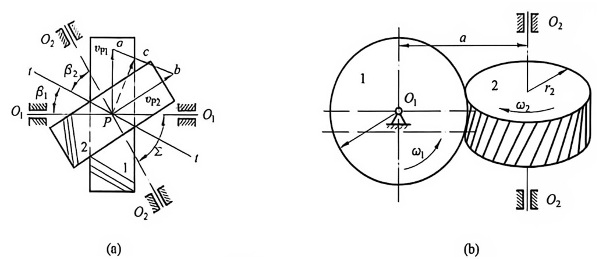

图5-37 螺旋齿轮传动
{: .figure-caption }

$$
\Sigma = \left| \beta_ {1} + \beta_ {2} \right|\tag{5-40}
$$

如螺旋方向相同, $\beta_{1}$ 和 $\beta_{2}$ 代入同号; 螺旋方向相反, 则 $\beta_{1}$ 和 $\beta_{2}$ 代入异号。若 $\Sigma = 0$ , 则 $\beta_{1} = -\beta_{2}$ , 螺旋齿轮传动变为斜齿圆柱齿轮传动。因此, 斜齿圆柱齿轮传动是螺旋齿轮传动的特例。

其他几何参数和尺寸计算与斜齿轮完全相同。

(3)传动比和从动轮的转向。

设螺旋齿轮传动的两轮齿数分别为 $z_{1}$ 和 $z_{2}$ , 以及 $z = \frac{d}{mt} = \frac{d\cos\beta}{m_n}$ , 则:

$$
i _ {1 2} = \frac {\omega_ {1}}{\omega_ {2}} = \frac {z _ {2}}{z _ {1}} = \frac {d _ {2} \cos \beta_ {2}}{d _ {1} \cos \beta_ {1}}\tag{5-41}
$$

即螺旋齿轮的传动比与分度圆的直径和螺旋角的乘积成反比。

螺旋齿轮传动中从动轮的转向可根据速度向量图解法来确定, 如图 5-37(a) 所示, 两齿轮分度圆柱的切点为 $P$ , 两轮齿在点 $P$ 处的切线为 $t - t_{0}$ 。设齿轮 1 为主动轮, 齿轮 2 为从动轮, 两齿轮在 $P$ 点处的绝对速度分别为 $\mathbf{v}_{\mathrm{p}_1}$ 和 $\mathbf{v}_{\mathrm{p}_2}$ 。由相对运动原理可知:

$$
\boldsymbol {v} _ {\mathrm{P} _ {2}} = \boldsymbol {v} _ {\mathrm{P} _ {1}} + \boldsymbol {v} _ {\mathrm{P} _ {2} \mathrm{P} _ {1}}\tag{5-42}
$$

式(5-42)中， $v_{\mathrm{P}_1}$ 的大小和方向已知， $v_{\mathrm{P}_2}$ 和 $v_{\mathrm{P}_2\mathrm{P}_1}$ 的方向已知（指向未知），因此可以求得 $v_{\mathrm{P}_2}$ 的大小和方向（指向），从而得知从动轮2的转向。

(4)螺旋齿轮传动的主要优缺点。

①选用螺旋齿轮传动可以实现两轴在空间交错成任意角度的传动。改变螺旋角方向可以改变从动轴转向。

② 在传动比较大的条件下，可适当选择两齿轮螺旋角，使两齿轮分度圆接近，强度接近。

③两齿轮啮合时，两齿廓是点接触，沿齿高方向和齿长方向都存在相当大的相对滑动。因此，螺旋齿轮轮齿磨损较快，传动的机械效率较低。

④螺旋齿轮传动时同样也会产生轴向力，从而使结构设计复杂。

螺旋齿轮传动不适于高速大功率的传动，通常仅用于仪表或载荷不大的辅助传动中。

### 5.10.2 蜗杆蜗轮传动

蜗杆蜗轮传动也是用来传递空间交错轴之间运动和动力的齿轮机构，如图 5-5(h) 所示，最常用于轴的交错角 $\Sigma = \beta_{1} + \beta_{2} = 90^{\circ}$ 的情况。它具有传动比大、结构紧凑、传动平稳等优点。我国自行设计制造的大型蜗轮蜗杆传动，其输出

转距已达几千牛米。在我国研制的 2.16 m 口径大型天文望远镜上，用于精密分度的蜗轮蜗杆传动的累积误差只有 5.6 分(分度)。蜗杆蜗轮传动在各种机械和仪器中得到广泛的应用。

(1) 蜗杆蜗轮形成。

若将螺旋齿轮机构中的小齿轮齿数减少到一个或几个, 分度圆直径也减小, 且螺旋角 $\beta_{1}$ 和齿宽增大, 这时轮齿将绕在分度圆柱上, 形成连续不断的螺旋齿, 形状如螺杆, 这就是蜗杆; 将大齿轮的螺旋角 $\beta_{2}$ 减小, 齿数增加, 使分度圆直径增大, 即为齿数较多的斜齿轮, 称为蜗轮, 如图 5-38 所示。蜗杆蜗轮可以看成是由螺旋齿轮机构演化而来的。

与螺旋齿轮相同，蜗杆蜗轮传动时其齿廓的啮合为点接触。为了改善接触情况，将蜗轮圆柱表面的母线制成圆弧形，部分包住蜗杆，用与蜗杆形状相似，齿顶高比蜗杆齿顶高多出一个顶隙的蜗轮滚刀来加工蜗轮。蜗杆蜗轮间啮合便可得到线接触，接触应力降低，承载能力提高。蜗轮的齿廓形状由蜗杆齿廓形状决定，所以蜗杆的齿形不同，蜗轮的齿形则不同。常见的蜗杆是圆柱形，最常用的是阿基米德蜗杆。此外，还有渐开线蜗杆和圆弧齿蜗杆等。

(2) 蜗杆导程角 $\gamma_{1}$ 。

导程角用 $\gamma_{1}$ 表示。导程角 $\gamma_{1}$ 为蜗杆螺旋角的余角，当 $\Sigma = 90^{\circ}$ 时， $\gamma_{1}$ 数值上等于蜗轮的螺旋角 $\beta_{2}$ 。设蜗杆的齿数（又称为头数）为 $z_{1}$ ，导程为 $l$ ，轴向齿距为 $p_{x1}$ ，分度圆直径为 $d_{1}$ ，将蜗杆沿分度圆柱面展开，如图5-39所示。由图可知：

$$
\tan \gamma_ {1} = \frac {l}{\pi d _ {1}} = \frac {z _ {1} p _ {\mathrm{x} 1}}{\pi d _ {1}} = \frac {m z _ {1}}{d _ {1}}
$$

(5-43)

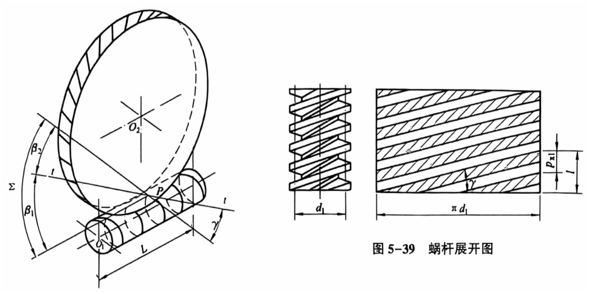

图5-39 蜗杆展开图
{: .figure-caption }

图5-38 蜗杆蜗轮传动示意图
{: .figure-caption }

导程角 $\gamma_{1}$ 的大小与蜗杆蜗轮传动的效率关系极大。 $\gamma_{1}$ 越大，传动效率越高，显然增加蜗杆齿数可以提高传动效率，《圆柱蜗杆传动基本参数》(GB/T 10085—2018) 规定蜗杆的齿数只能在 1、2、4、6 四个数字中选一个，实际中常取 $z_{1}=1$ 、2。因此，蜗杆蜗轮的传动效率是较低的。由机械自锁的概念可知，当 $\gamma_{1}$ 小于蜗杆蜗轮啮合时轮齿之间的当量摩擦角 $\varphi_{v}$ 时，机构将具有反向自锁性。

(3) 正确啮合的条件。

阿基米德蜗杆在其轴剖面上齿廓为直线，在轮齿法向截面上为外凸曲线齿形，在端面上的齿形为阿基米德螺旋线。这种蜗杆可以采用车削方法加工，制造方便，故其应用最广泛。图5-40为阿基米德蜗杆与蜗轮的啮合情况，垂直于蜗轮轴线并包含蜗杆轴线的剖面称为主平面（中间平面），在主平面内，蜗杆与蜗轮的啮合相当于齿条与齿轮的啮合。蜗杆蜗轮以主平面的参数为标准值，其几何尺寸的计算也以主平面内的计算为基准，因此蜗杆蜗轮正确啮合的条件是蜗杆与蜗轮在主平面内的模数和压力角分别相等，且为标准值。蜗轮的端面模数 $m_{t2}$ 和端面压力角 $\alpha_{t2}$ 分别等于蜗杆的轴面模数 $m_{x1}$ 和轴面压力角 $\alpha_{x1}$ ，即

$$
\left. \begin{array}{l} m _ {t 2} = m _ {\mathrm{x} 1} = m \\ \alpha_ {t 2} = \alpha_ {\mathrm{x} 1} = \alpha \end{array} \right\}\tag{5-44}
$$

当 $\Sigma = 90^{\circ}$ 时， $\gamma_{1} = \beta_{2}$ ，而且蜗轮与蜗杆旋向相同。

(4) 蜗杆分度圆直径 $d_{1}$ 和直径系数 q。

加工蜗轮时, 是用与蜗杆相当的滚刀来切制的, 蜗轮滚刀的齿形参数和分度圆直径必须与相应的蜗杆相同。从式(5-43)可知, 即使对于同一模数和齿数的蜗杆, 其分度圆直径也可能不同。为了限制蜗轮滚刀的数量, 国家标准规定了蜗杆的分度圆直径系列, 且与其模数相对应, 并令 $q = \frac{d_1}{m}$ , $q$ 称为蜗杆的直径系数。部分 $d_1$ 与 $m$ 对应的标准系数见表 5-8。

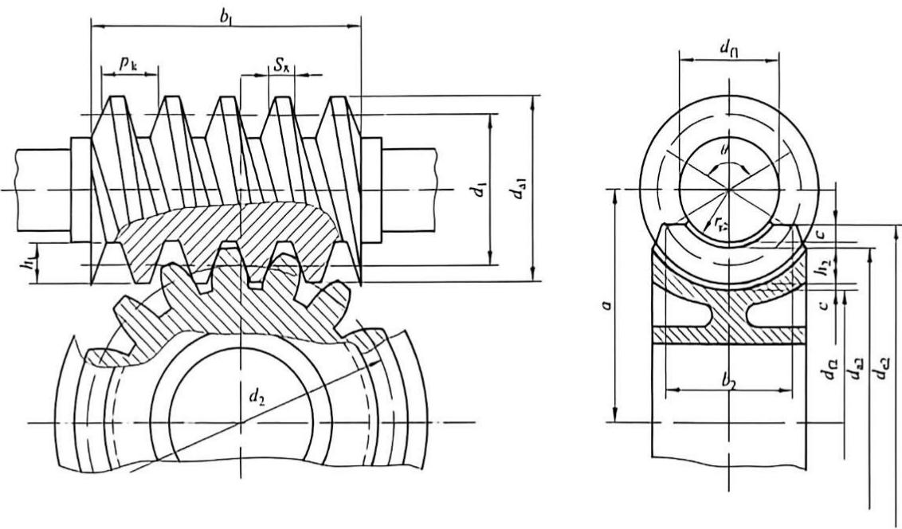

图5-40 蜗轮蜗杆啮合图
{: .figure-caption }

表 5-8 蜗杆分度圆直径与对应的模数
单位：mm

<table><tr><td>模数m</td><td>2</td><td>2.5</td><td>3.15</td><td>4</td><td>5</td><td>6.3</td><td>8</td><td>10</td></tr><tr><td rowspan="4">分度圆直径d1</td><td>(18)</td><td>(22.4)</td><td>(28)</td><td>(31.5)</td><td>(40)</td><td>(50)</td><td>(63)</td><td>(71)</td></tr><tr><td>22.4</td><td>28</td><td>35.5</td><td>40</td><td>50</td><td>63</td><td>80</td><td>90</td></tr><tr><td>(28)</td><td>(35.5)</td><td>(45)</td><td>(50)</td><td>(63)</td><td>(80)</td><td>(100)</td><td>(112)</td></tr><tr><td>35.5</td><td>45</td><td>56</td><td>71</td><td>90</td><td>112</td><td>140</td><td>160</td></tr></table>

注：摘自《圆柱蜗杆传动基本参数》(GB/T 10085—2018)，括号中的数字尽可能不采用。

(5)蜗杆蜗轮传动的中心距 $a$ 。

当蜗杆节圆与分度圆重合时称为标准传动，其中心距计算式为：

$$
a = \frac {d _ {1} + d _ {2}}{2} = \frac {m}{2} (q + z _ {2})\tag{5-45}
$$

## 5.11 其他齿轮传动简介

渐开线作为齿廓曲线有许多优点，但也存在一些固有的缺陷，主要有：

(1)在尺寸一定的条件下, 渐开线齿廓曲线的曲率半径相对较小, 齿轮的承载能力难以大幅度提高。

其他齿轮机构

(2)由于制造、安装误差及变形等,渐开线齿轮传动易产生载荷向齿轮一端集中的现象,降低了齿轮的承载能力。

(3)渐开线齿轮传动由于两轮齿廓在不同位置啮合时, 齿面间的相对滑动速度不同, 因

此使齿廓各部分的磨损不均匀。

因此人们一直在研究新的齿廓曲线。

### 5.11.1 圆弧齿轮传动

如图 5-41 所示，圆弧齿轮的端面齿廓或法面齿廓为圆弧。其中，小齿轮的齿廓为凸圆弧，而大齿轮的齿廓为凹圆弧[图 5-41(b)]。这种齿轮的轮齿必须是斜齿。

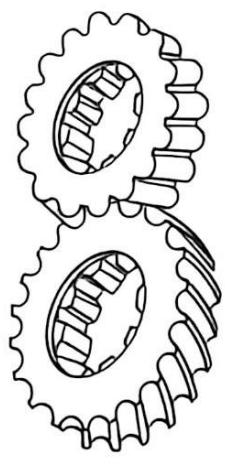

(0)

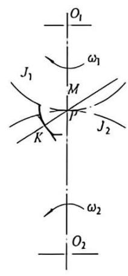

图5-41 圆弧齿轮传动
{: .figure-caption }

(b)

圆弧齿轮传动的优点：

(1)承载能力强。在尺寸和材料相同的条件下, 综合曲率半径大, 且齿廓凹凸结合, 其承载能力是渐开线齿轮的 $1.5 \sim 2$ 倍。

(2)对制造误差和变形不敏感。

(3)结构紧凑。圆弧齿轮没有根切问题，径向尺寸可以更小。

圆弧齿轮传动的缺点：

(1)对安装精度要求高。

(2)轴向尺寸相对较大。

(3)凹、凸齿面要用两把刀具来加工。

为了克服上述缺点，近年来采用了一种双圆弧齿轮，如图5-42所示，相互啮合的一对齿轮其齿顶均为凸圆弧，而齿根均为凹圆弧。大、小齿轮只需一把刀具加工。双圆弧齿轮传动目前已在高速大动力传动中广泛应用。

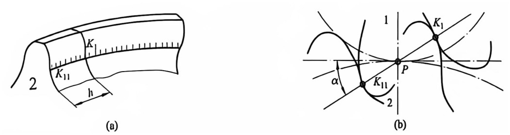

图5-42 双圆弧齿轮传动
{: .figure-caption }

### 5.11.2 摆线齿轮及钟表齿轮传动

在仪表和钟表传动中，尤其在增速传动时，也常采用摆线齿轮传动，其齿廓由内、外摆线组成(图 5-43)。

摆线齿轮传动与渐开线齿轮传动相比有如下优点：

(1) 相互啮合的两齿面为一凹一凸，故接触应力小(节点处啮合例外)。

(2)重合度较大,传动效率高(尤其在增速传动中)。

(3)不产生根切的最少齿数小(只有6个齿)，故机构可以更为紧凑。

有如下缺点：

(1)传动精度不及渐开线齿轮传动, 两齿轮的中心距必须十分准确, 否则不能保证定传动比。

(2)由于啮合角是变化的，故齿廓间的作用力也是变化的。

(3)精度要求较高，但制造却不易精确。

由于上述的缺点，摆线齿轮传动目前主要用于钟表和某些特殊仪表的增速传动中。

由于摆线加工较困难，在要求不高的齿轮传动中，为便于制造，常用圆弧代替摆线。

图 5-44 为三种圆弧齿廓的小齿轮齿形，这种齿轮主要用于钟表传动中，故称之为钟表齿轮。

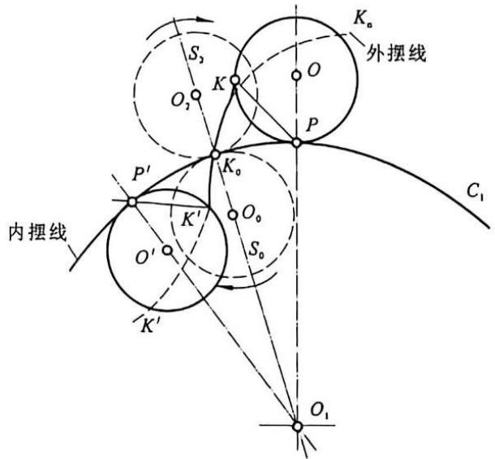

图5-43 摆线的形成
{: .figure-caption }

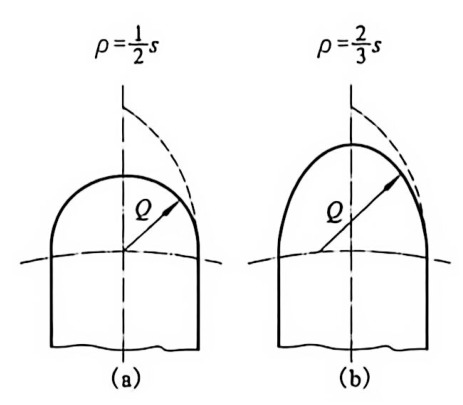

图5-44 用于钟表的圆弧齿廓齿形
{: .figure-caption }

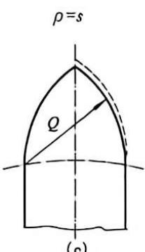

### 5.11.3 简易齿轮传动

如图 5-45 所示为简易齿轮，简易齿轮结构简单，一般可以冲压或注塑成形，制造方便，成本低廉；但其承载能力小，传动精度低，常用于受力不大、传动精度要求不高的场合，如办公用品、玩具、廉价钟表等。

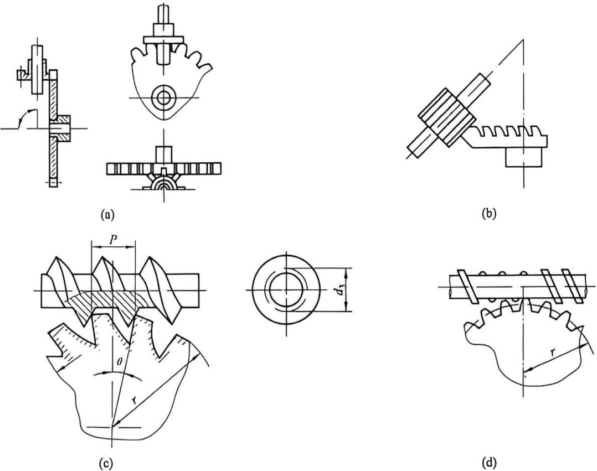

图5-45 简易啮合齿轮传动
{: .figure-caption }

### 5.11.4 面齿轮传动

面齿轮传动是一种圆柱齿轮与圆锥齿轮相啮合的齿轮传动, 用于两齿轮轴线相交的传动, 当两齿轮轴线正交即轴夹角 $= 90^{\circ}$ 时, 圆锥齿轮的轮齿将分布在一个圆平面上, 锥齿轮即为面齿轮, 从而泛称为面齿轮传动。其传动原理如图 5-46 所示 面齿轮

由于面齿轮传动具有承载能力高、质量轻(约为传统齿轮传动的60%)、振动小、噪质低等优点，故常用于高速重载，如航空动力传输等场合。但由于受根切和齿顶变尖的限制，面齿轮的齿宽不能设计得太宽，从而使面齿轮的承载能力受到了影响。

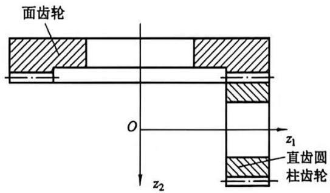

图5-46 面齿轮传动
{: .figure-caption }

### 5.11.5 球齿轮传动

球齿轮是依靠分布在两个节球面上的凸齿与凹齿相互接触来传递运动的(图 5-47)，具有传动灵活的优点，但也存在着承载能力低、加工难度大的缺点。

在一对球齿轮啮合过程中，两轮齿廓始终是点接触，两个球齿轮沿任何方向都能进入啮合状态，即两节球可实现沿任意方向的纯滚动，两轮极轴能做全方位的相对摆动。

球齿轮传动具有两个自由度，可以传递二维回转运动。由于二维运动特性是自然界中绝大多数生物运动关节所共有的，所以人们首先想到的是用球齿轮传动来作为仿生机械中的关节机构，如著名的 Trallfa 喷漆机器人柔性手腕机构。

(b)

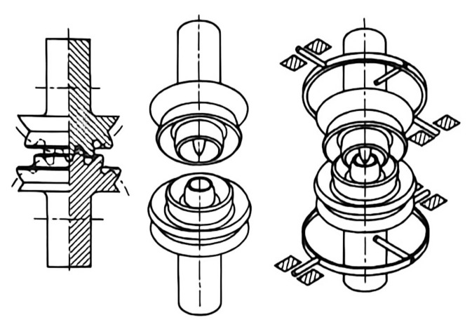

图5-47 球齿轮传动
{: .figure-caption }

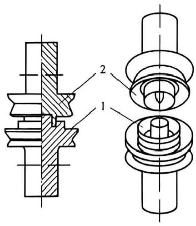

### 5.11.6 余弦齿廓齿轮传动

余弦齿廓齿轮以余弦曲线的零线为节线，以余弦曲线的一个周期为齿距，以余弦曲线的幅值为齿顶高构建而成。其齿顶部分与渐开线齿轮基本接近，而齿根部分，齿厚明显大于渐开线齿轮。啮合的重合度为 1.1\~1.3。啮合原理如图 5-48 所示。

余弦齿轮具有齿数少、单级传动比大、强度高、相对滑动小等特点。目前有应用在齿轮泵领域的研究实例，证明在一定程度上可缓解齿轮泵的困油现象。

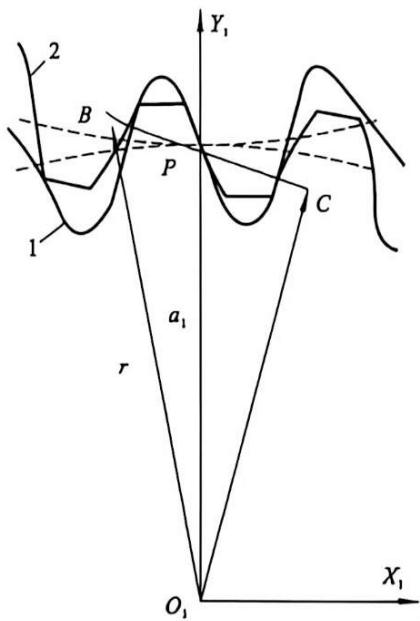

图5-48 余弦齿轮啮合传动示意图
{: .figure-caption }

## 本章思维导图

## 思考题与练习题

1. 如图 5-49 所示, $C$ 、 $C'$ 、 $C''$ 为由同一基圆上所生成的几条渐开线。试证明其任意两条渐开线(不论是同向的还是反向的)沿公法线方向对应两点之间的距离处处相等。

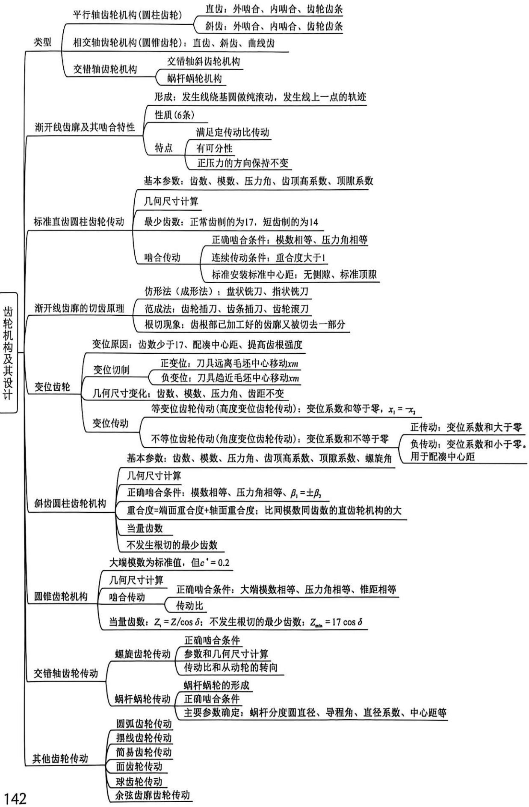

2. 渐开线具有哪些重要的性质？渐开线齿轮传动具有哪些优点？

3. 何谓重合度？重合度的大小与齿数 z、模数 m、压力角 $\alpha$ 、齿顶高系数 $h_{a}$ 、顶隙系数 $c^{*}$ 及中心距 a 之间有何关系？

4. 齿轮传动要匀速、连续、平稳地进行必须满足哪些条件？

5. 节圆与分度圆、啮合角与压力角有什么区别？

6. 何谓标准齿轮？何谓标准齿轮传动？标准齿轮传动

7. 齿轮齿条啮合传动有何特点？为什么说无论齿条是否标准安装，啮合线的位置都不会改变？

图5-49
{: .figure-caption }

8. 试问当渐开线标准齿轮的齿根圆与基圆重合时, 其齿数应为多少? 试分析齿轮的基圆和齿根圆随齿数的变化规律。

9. 何谓根切？根切产生的原因是什么？有何危害？如何避免？

10. 齿轮为什么要进行变位修正？齿轮变位前后，其参数 $z$ 、 $m$ 、 $\alpha$ 、 $h_{a}$ 、 $h_{f}$ 、 $d$ 、 $d_{a}$ 、 $d_{f}$ 、 $d_{b}$ 、 $s$ 、 $e$ 有无变化？如何变化？

11. 变位齿轮传动有哪些类型？各具有哪些特点？各用于何种场合？

12. 为什么斜齿轮的标准参数要规定在法面上,而其几何尺寸却要按端面来计算?

13. 斜齿轮传动具有哪些特点？什么是斜齿轮的当量齿轮？为什么要提出当量齿轮的概念？当量齿数与实际齿数的关系如何？

14. 在模数、齿数、传动比不变的情况下，有哪些方法可以调整齿轮传动的中心距？

15. 平行轴和交错轴斜齿轮传动(螺旋齿轮传动)有哪些异同点?

16. 何谓蜗杆传动的中间平面？蜗杆传动的正确啮合条件是什么？

17. 试确定如图 5-50(a) 所示传动中蜗轮的转向, 及如图 5-50(b) 所示传动中蜗杆和蜗轮的螺旋线的旋向。

18. 什么是直齿锥齿轮的背锥和当量齿轮? 一对锥齿轮大端的模数和压力角分别相等是否是其能正确啮合的充要条件?

19. 如图 5-51 所示, 测量齿轮公法线长度是检验渐开线齿轮精度的常用方法之一。试问: (1) 用卡尺的卡脚与齿廓的切点 (测点) 在齿轮的分度圆附近, 跨测齿数应为多少? (2) 当跨测齿数为 $k$ 时, 对于渐开线标准齿轮, 其公法线的长度 $L_{k}$ 应为多少? (3) 在测定一个模数未知的齿轮的模数时, 为什么常用跨测 $k$ 个齿和 $(k - 1)$ 个齿的公法线长度差来确定?

图5-50
{: .figure-caption }

(b)

20. 在图 5-52 中，已知基圆半径 $r_{1}=50\ mm$ ，试求：

(1) 当 $\tau_{g}=65\ mm$ 时，渐开线的展角 $\theta_{K}$ 、渐开线的压力角 $\alpha_{K}$ 和曲率半径 $\rho_{K}$ 。

(2) 当 $\theta_{k}=5^{\circ}$ 时，渐开线的压力角 $\alpha_{k}$ 及向径 $r_{k}$ 。

图5-51
{: .figure-caption }

图5-52
{: .figure-caption }

21. 一渐开线标准直齿圆柱齿轮, $z = 40$ , $m = 5 \mathrm{~mm}$ , $\alpha = 20^{\circ}$ , 求该齿轮的分度圆、基圆、齿顶圆直径, 以及 $d_{\mathrm{K}} = 205 \mathrm{~mm}$ 上的曲率半径 $\rho_{\mathrm{K}}$ 和压力角 $\alpha_{\mathrm{K}}$ 。

22. 一渐开线标准直齿圆柱齿轮, $z = 26$ , $m = 3 \mathrm{~mm}$ , $\alpha = 20^{\circ}$ , 求齿廓曲线在齿顶圆的压力角 $\alpha_{a}$ 、齿顶圆直径 $d_{a}$ 、分度圆曲率半径 $\rho$ 和齿顶圆曲率半径 $\rho_{a}$ 。

23. 一标准直齿圆柱齿轮, 齿数 $z = {35}$ ,模数 $m = 4,{\alpha } = {20}^{ \circ  }$ ,求此齿轮的分度圆直径、齿顶圆直径、齿根圆直径、基圆直径、齿顶圆压力角、齿根圆压力角、齿厚和齿槽宽。

24. 一对外啮合标准直齿圆柱齿轮, $m = 3$ , $z_{1} = 21$ , $z_{2} = 45$ , 试求这对齿轮的分度圆直径、齿顶圆直径、齿根圆直径、基圆直径、中心距、齿顶高、齿根高、径向间隙、分度圆周节、齿厚和齿槽宽。

25. 已知一对外啮合标准直齿圆柱齿轮传动的模数 $m = 5\mathrm{\;{mm}}$ ,压力角 $\alpha  = {20}^{ \circ  }$ ,中心距 $a =$ ${350}\mathrm{\;{mm}}$ ,传动比 ${i}_{12} = 9/5$ ,试求两轮的齿数、分度圆直径、齿顶圆直径、基圆直径及分度圆上的齿厚和齿槽宽。

26. 已知一对外啮合标准直齿圆柱齿轮传动的中心距 $a = 160 \mathrm{~mm}$ , 齿数 $z_{1} = 20, z_{2} = 60$ , 试求两轮的传动比、模数和分度圆直径。

27. 设有一对外啮合齿轮的 $z_{1}=30$ , $z_{2}=40$ , m=20 mm, $\alpha=20^{\circ}$ , $h_{a}^{*}=1$ 。试求当 $a'=725\ mm$ 时，两轮的啮合角 $\alpha'$ 。又当啮合角 $\alpha'=22^{\circ}30$ 时，试求其中心距 $a'$ 。

28. 已知一对外啮合变位齿轮传动的 $z_{1}=11$ , $z_{2}=45$ , m=3 mm, $a'=85\ mm$ ，试设计这对齿轮。

29. 已知一渐开线标准直齿圆柱齿轮, $z = 36$ , $m = 4 \mathrm{~mm}$ , $\alpha = 20^{\circ}$ , 试计算其固定弦齿厚和公法线长度。

30. 已知一对外啮合标准直齿圆柱齿轮传动的 $\alpha=20^{\circ}$ 、 $m=5\ mm$ 、 $z_{1}=19$ 、 $z_{2}=52$ ，试求其重合度。

31. 有一对外啮合渐开线直齿圆柱齿轮传动。已知 $z_{1} = 17, z_{2} = 118, m = 5 \mathrm{~mm}, \alpha = 20^{\circ}, h_{\mathrm{a}}^{*} = 1, c^{*} = 0.25, a' = 337.5 \mathrm{~mm}$ 。现发现小齿轮已严重磨损，拟将其报废。大齿轮磨损较轻（沿分度圆齿厚两侧的磨损量为 $0.75 \mathrm{~mm}$ ），拟修复使用，并要求所设计的小齿轮的齿顶厚尽可能大些，问应如何设计这一对齿轮？

32. 在某设备中有一对直齿圆柱齿轮, 已知 $z_{1} = 26$ , $i_{12} = 5$ , $m = 3 \mathrm{~mm}$ , $\alpha = 20^{\circ}$ , $h_{n}^{*} = 1$ , 齿宽 $b = 50 \mathrm{~mm}$ 。在技术改造中, 为了改善齿轮传动的平稳性, 降低噪声, 要求在不改变中心距和传动比的条件下, 将直齿轮改为斜齿轮, 试确定斜齿轮的 $z_{1}^{\prime}, z_{2}^{\prime}, mn, \beta$ , 并计算其重合度。

33. 在一机床的主轴箱中发现一渐开线标准直齿圆柱齿轮损坏, 需要更换。经测量, 其压力角 $\alpha = 20^{\circ}$ , 齿数 $z = 40$ , 齿顶圆直径 $d_{u} = 83.82 \mathrm{~mm}$ , 跨 5 齿的公法线长度 $L_{5} = 27.512 \mathrm{~mm}$ , 跨 6 齿的公法线长度 $L_{6} = 33.426 \mathrm{~mm}$ 。试确定这个齿轮的模数。

34. 设已知一对斜齿轮传动的 $z_{1}=20$ , $z_{2}=40$ , $m_{n}=8\ mm$ , $\beta=15^{\circ}$ (初选值), B=30 mm, $h_{a}^{*}=1$ 。试求 a (应圆整, 并精确重算 $\beta$ )、r、 $z_{v1}$ 及 $z_{v2}$ 。

35. 已知一对直齿锥齿轮的 $z_{1} = 27, z_{2} = 43, m = 3 \mathrm{~mm}, h_{\mathrm{n}}^{*} = 1, \sum = 90^{\circ}$ 。试确定这对锥齿轮的几何尺寸。

36. 一蜗轮的齿数 $z_{2} = 40, d_{2} = 200 \mathrm{~mm}$ , 与一单头蜗杆啮合, 试求:

(1) 蜗轮端面模数 $m_{t2}$ 及蜗杆轴面模数 $m_{x1}$ 。

(2) 蜗杆的轴面齿距 $p_{x1}$ 及导程 $l_{0}$ 。

(3)两轮的中心距 $a$ 。

(4) 蜗杆的导程角 $\gamma_{1}$ 、蜗轮的螺旋角 $\beta_{2}$ 。
