# 第6章 齿轮系及其设计

**【概述】**

◎本章重点介绍轮系的分类及定轴轮系、周转轮系、复合轮系传动比的计算，并简要介绍轮系的功用、效率、设计及其他类型行星传动。

◎通过本章的学习，要求熟练掌握定轴轮系、周转轮系、复合轮系传动比的计算方法；掌握轮系的分类和设计方法；了解各类轮系的功用、效率计算及其他类型行星传动。

由一对齿轮组成的传动机构结构简单，在工程实际中，往往需要由多对齿轮构成齿轮传动系统来满足各种不同的工作要求。例如日常生活中所用的机械手表，汽车、机床中的变速箱，航空发动机上所用的传动装置等。这种由互相啮合的一系列齿轮所组成的传动系统称为轮系。

我国东汉时已有不同形状和用途的齿轮和齿轮系，特别是在天文仪器方面已有比较适用的齿轮系。东汉以后出现了记里鼓车（图6-1）和指南车（图5-2）。三国时期的指南车除用齿轮传动外，还有自动离合器装置，在技术上又胜记里鼓车一筹。指南车无论向何方行车，车上的木人永远手指南方。车上带有能够自动调节转向的机构，大多数学者认为指南车巧秒地采用了齿轮系等机构，实现指南车运动的过程中，木人所在的构件转速近似等于0。北宋苏颂等人营建的水运仪象台以漏刻水力驱动，集浑仪、浑象和计时装置为一体，是天文观测、天象演示和报时系统为一体的大型自动化天文仪器，其中的传动系统即为齿轮系，由水轮传送的动力经一路齿轮系达到浑仪，另一路到达浑象，实现了多路输出，反映了中国古代能够设计出复杂机械的超高

水准。当今，齿轮系正向着大功率、大传动比、高机械效率、长寿命及小体积的目标发展，在传动原理和传动结构上仍有待深入探讨和创新。

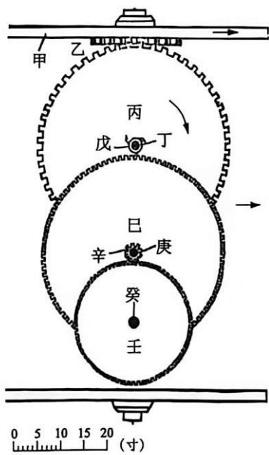

图6-1 北宋卢道隆制记里鼓车齿轮系图
{: .figure-caption }

## 6.1 轮系的类型

根据轮系运动时其各轮轴线的位置相对于机架是否固定，可以将轮系分为三类。

### 6.1.1 定轴轮系

轮系运转时, 若各轮轴线的位置都是固定不动的, 则称为定轴轮系。如图 6-2 所示。定轴轮系又分为平面定轴轮系和空间定轴轮系。由平面齿轮机构组成的定轴轮系称为平面定轴轮系, 如图 6-2(a) 所示; 除了包含平面齿轮机构外, 还包含有空间齿轮机构, 则这种定轴轮系称为空间定轴轮系, 如图 6-2(b) 所示。

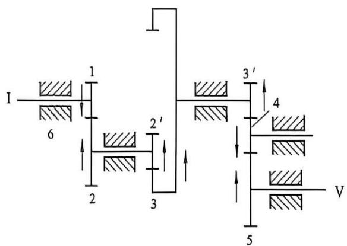

(a) 平面定轴轮系

图6-2 定轴轮系
{: .figure-caption }

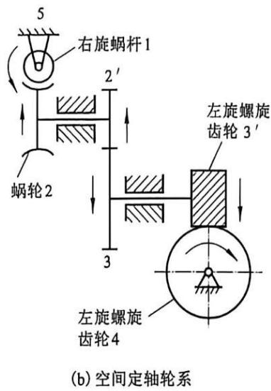

### 6.1.2 周转轮系

当轮系运动时, 其中至少有一个齿轮的轴线是绕另一个齿轮的轴线转动的, 这种轮系称为周转轮系。如图 6-3 所示的轮系中, 齿轮 1、3 和构件 H 分别绕互相重合的固定轴线转动, 而齿轮 2 的转轴装在构件 H 的端部, 并与齿轮 1、3 相啮合, 在构件 H 的带动下, 它可以绕齿轮 1、3 的轴线做周转。由于齿轮 2 既绕自己的轴线做自转, 又绕齿轮 1、3 的轴线做公转, 犹如行星绕太阳运行一样, 故称其为行星轮, 支撑行星轮 2 的构件 H 称为行星架或系杆, 与行星轮 2 相啮合且绕固定轴线转动的齿轮 1、3 称为中心轮。在周转轮系中, 由于一般都以中心轮和行星架作为运动的输入和输出构件, 故又常称它们为周转轮系的基本构件。基本构件都是绕着同一固定轴线回转的。

综上所述，一个周转轮系必定具有一个行星架、一个或固连的几个行星齿轮，以及与行星齿轮相啮合的中心齿轮。这种周转轮系称为基本周转轮系。

根据周转轮系所具有的自由度的数目不同，周转轮系可分为下列两类。

(1) 差动轮系。

如图 6-3(a) 所示轮系中, 中心轮 1、3 都是活动的, 该轮系的自由度为 2 ,

这种自由度为 2 的周转轮系称为差动轮系。

周转轮系

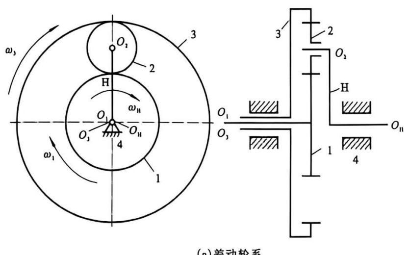

图6-3 周转轮系
{: .figure-caption }

(a) 差动轮系

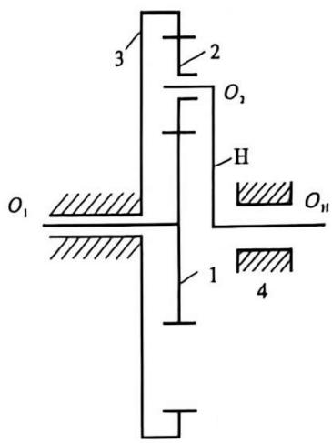

(b)行星轮系

(2)行星轮系。

如图 6-3(b) 所示轮系中, 若将中心轮 3(或 1) 固定不动, 该轮系的自由度为 1, 这种自由度为 1 的周转轮系称为行星轮系。

根据周转轮系中基本构件的不同，周转轮系还可以分为下列两类。

(1)2K-H型周转轮系。

它是由两个中心轮(2K)和一个行星架(H)组成。如图6-4所示是2K-H型周转轮系的几种不同形式, 其中图6-4(a)为单排形式(行星轮只有一个), 图6-4(b)(c)为双排形式(行星轮为双联齿轮)。

(2)3K型周转轮系。

它是由三个中心轮(3K)和一个行星架组成的, 行星架 H 仅起支撑行星轮使其与中心轮保持啮合的作用, 不起传力作用, 故在轮系的型号中不含“H”, 如图 6-5 所示。

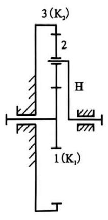

(a) 单行星轮

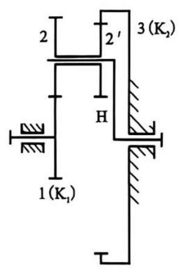

(b) 双联行星轮

图6-4 2K-H型周转轮系
{: .figure-caption }

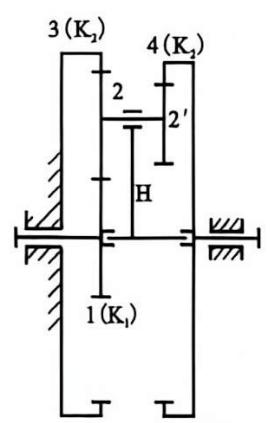

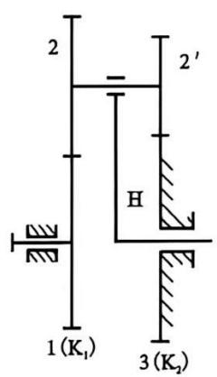

(c) 双联行星轮

图6-5 3K型周转轮系
{: .figure-caption }

### 6.1.3 复合轮系

在工程实际中，除了采用单一的定轴轮系和单一的基本周转轮系外，还广泛采用既包括定轴轮系又包括基本周转轮系，或由几个基本周转轮系所组成的复杂轮系，我们把这种轮系称为复合轮系或混合轮系。如图6-6所示的复合轮系中，中心轮1、3、行星轮2和行星架H组成一个差动轮系，而齿轮 $1^{\prime}$ 、5、 $4^{\prime}$ 、4和 $3^{\prime}$ 组成定轴轮系。

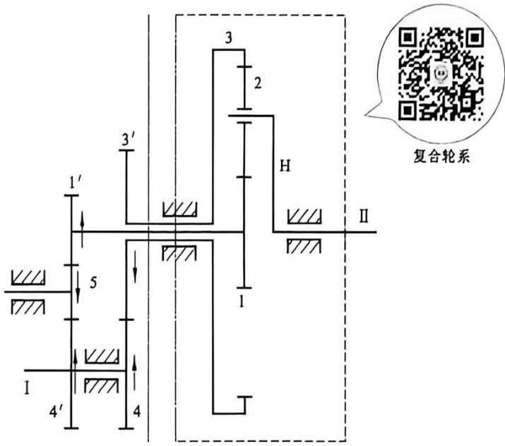

图6-6 复合轮系
{: .figure-caption }

## 6.2 轮系传动比的计算

所谓轮系的传动比, 指的是轮系中输入轴与输出轴的角速度(或转速)之比。例如设 $A$ 轴为轮系的输入轴, $B$ 轴为轮系的输出轴, 则该轮系的传动比 $i_{\mathrm{AB}} = \frac{\omega_{\mathrm{A}}}{\omega_{\mathrm{B}}} = \frac{n_{\mathrm{A}}}{n_{\mathrm{B}}}$ 。传动比的确定包括计算传动比和确定输入轴和输出轴的转向关系。

### 6.2.1 定轴轮系的传动比

#### 1. 传动比的计算

如图 6-2(a) 所示为一定轴轮系, 设 I 轴为输入轴, V 轴为输出轴, 各轮的角速度和齿数分别用 $\omega_{1} 、 \omega_{2} 、 \omega_{2^{\prime}} 、 \omega_{3} 、 \omega_{3^{\prime}} 、 \omega_{4} 、 \omega_{5}$ 和 $z_{1} 、 z_{2} 、 z_{2^{\prime}} 、 z_{3} 、 z_{3^{\prime}} 、 z_{4} 、 z_{5}$ 表示, 则轮系中各对齿轮的传动比如下。

由前面齿轮机构的知识可知，一对齿轮的传动比：

$$
\begin{array}{l} i _ {1 2} = \frac {\omega_ {1}}{\omega_ {2}} = \frac {z _ {2}}{z _ {1}}, \\ i _ {3 ^ {\prime} 4} = \frac {\omega_ {3 ^ {\prime}}}{\omega_ {4}} = \frac {z _ {4}}{z _ {3 ^ {\prime}}}, \end{array} \quad \begin{array}{l} i _ {2 ^ {\prime} 3} = \frac {\omega_ {2 ^ {\prime}}}{\omega_ {3}} = \frac {z _ {3}}{z _ {2 ^ {\prime}}}, \\ i _ {4 5} = \frac {\omega_ {4}}{\omega_ {5}} = \frac {z _ {5}}{z _ {4}}. \end{array}
$$

将以上各式等号两边分别连乘后得：

$$
i _ {1 2} \cdot i _ {2 ^ {\prime} 3} \cdot i _ {3 ^ {\prime} 4} \cdot i _ {4 5} = \frac {\omega_ {1} \omega_ {2 ^ {\prime}} \omega_ {3 ^ {\prime}} \omega_ {4}}{\omega_ {2} \omega_ {3} \omega_ {4} \omega_ {5}} = \frac {z _ {2} z _ {3} z _ {4} z _ {5}}{z _ {1} z _ {2 ^ {\prime}} z _ {3 ^ {\prime}} z _ {4}} = \frac {z _ {2} z _ {3} z _ {5}}{z _ {1} z _ {2 ^ {\prime}} z _ {3 ^ {\prime}}}
$$

式中： $\omega_{2'}=\omega_{2}$ ， $\omega_{3'}=\omega_{3}$ ，故

$$
i _ {1 5} = i _ {1 2} \cdot i _ {2 ^ {\prime} 3} \cdot i _ {3 ^ {\prime} 4} \cdot i _ {4 5} = \frac {\omega_ {1} \omega_ {2 ^ {\prime}} \omega_ {3 ^ {\prime}} \omega_ {4}}{\omega_ {2} \omega_ {3} \omega_ {4} \omega_ {5}} = \frac {z _ {2} z _ {3} z _ {4} z _ {5}}{z _ {1} z _ {2 ^ {\prime}} z _ {3 ^ {\prime}} z _ {4}} = \frac {z _ {2} z _ {3} z _ {5}}{z _ {1} z _ {2 ^ {\prime}} z _ {3 ^ {\prime}}}
$$

上式表明：定轴轮系的传动比等于组成该轮系的各对啮合齿轮传动比的连乘积，也即各对啮合齿轮中所有从动轮齿数的连乘积与所有主动轮齿数的连乘积之比。

综上所述，设 A 轴为定轴轮系的输入轴，B 轴为轮系的输出轴，则定轴轮系传动比计算的一般公式为：

$$
\left(i _ {\mathrm{AB}} = \frac {\omega_ {\mathrm{A}}}{\omega_ {\mathrm{B}}} = \frac {\text { 所有各对齿轮的从动齿轮齿数的乘积 }}{\text { 所有各对齿轮的主动齿轮齿数的乘积 }}\right)\tag{6-1}
$$

另外, 从图 6-2(a) 可以看出, 齿轮 4 同时与齿轮 $3^{\prime}$ 和齿轮 5 相啮合, 它既是前一对齿轮的从动轮, 又是后一对齿轮的主动轮, 故其齿数 $z_{4}$ 在式 (6-1) 的分子、分母中可同时约去,表明齿轮 4 的齿数不影响传动比的大小, 这种齿轮通称为惰轮或者过桥齿轮。惰轮虽然不影响传动比的大小, 但却可以改变传动方向, 在生产实际中经常采用。

#### 2. 转动方向的确定

(1)平面定轴轮系。

由于平面定轴中各轮的轴线都是平行的, 故其转向关系可以用“+”“-”来表示, “+”表示转向相同, “-”表示转向相反。一对内啮合圆柱齿轮传动两轮的转向相同, 不影响轮系传动比的符号; 而一对外啮合圆柱齿轮传动两轮的转向相反, 故如果轮系中有 $m$ 次外啮合, 则从输入轴到输出轴, 其角速度方向应经过 $m$ 次变号, 因此这种轮系传动比的符号可用 $(-1)^{m}$ 来判定。如图 6-2(a) 所示的轮系中, $m = 3$ , 因此

$$
i _ {1 5} = i _ {1 2} \cdot i _ {2 ^ {\prime} 3} \cdot i _ {3 ^ {\prime} 4} \cdot i _ {4 5} = \frac {\omega_ {1} \omega_ {2 ^ {\prime}} \omega_ {3} \omega_ {4}}{\omega_ {2} \omega_ {3} \omega_ {4} \omega_ {5}} = (- 1) ^ {3} \frac {z _ {2} z _ {3} z _ {4} z _ {5}}{z _ {1} z _ {2 ^ {\prime}} z _ {3 ^ {\prime}} z _ {4}} = - \frac {z _ {2} z _ {3} z _ {5}}{z _ {1} z _ {2 ^ {\prime}} z _ {3 ^ {\prime}}}
$$

式中：“-”说明输出轴 V 与输入轴 I 转动方向相反。

平面定轴轮系传动比的正、负号也可以用画箭头的方法来确定，如图 6-2(a) 所示。

(2)空间定轴轮系。

由于空间定轴轮系中包含有轴线不平行的空间齿轮机构, 因此, 不能说两轮的转向是相同还是相反, 这种轮系中各轮的转向必须在图上用箭头表示, 不能用 ${\left( -1\right) }^{m}$ 来判定。 $m$ 为外噪声次数

当空间定轴轮系首、末两轮的轴线平行时, 需要先通过画箭头判断两轮的转向后, 再在传动比计算式前加“+”“-”。例如: 图 6-2(b) 所示轮系的传动比为

$$
i _ {1 4} = \frac {\omega_ {1}}{\omega_ {4}} = - \frac {z _ {2} z _ {3} z _ {4}}{z _ {1} z _ {2 ^ {\prime}} z _ {3 ^ {\prime}}}
$$

当空间定轴轮系首、末两轮的轴线不平行时，在传动比计算式中不加符号，但必须在图中用箭头表示各轮的转向。例如：图6-7所示轮系的传动比的大小为

$$
i _ {1 4} = \frac {\omega_ {1}}{\omega_ {4}} = \frac {z _ {2} z _ {3} z _ {4}}{z _ {1} z _ {2 ^ {\prime}} z _ {3 ^ {\prime}}}
$$

各轮转向如图 6-7 所示。

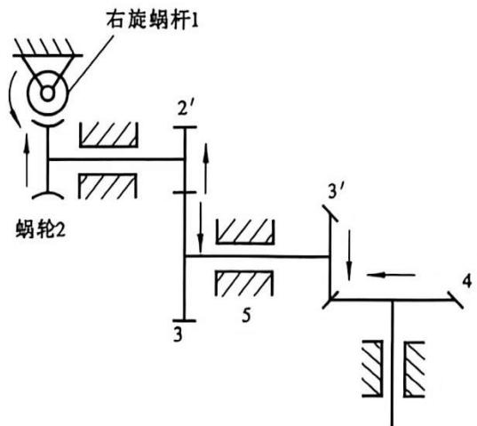

图6-7 首末两轮轴线不平行的空间定轴轮系
{: .figure-caption }

在周转轮系中，由于其行星轮的运动不是绕固定轴线的简单运动，所以周转轮系各构件间的传动比不能直接用求解定轴轮系传动比的方法来求。为了解决周转轮系的传动比计算问题，应当设法将周转轮系转化为定轴轮系，也就是

设法让行星架固定不动。由相对运动原理可知，如果给整个周转轮系加上一个公共角速度 $-\omega_{\mathrm{H}}$ ，各构件之间的相对运动关系并不改变，但行星架的角速度变成了 $\omega_{\mathrm{H}} - \omega_{\mathrm{H}} = 0$ ，即行星架变成固定不动。此时，整个周转轮系便转化为一个假想的定轴轮系，通常称此假想的定轴轮系为原周转轮系的转化轮系。

如图 6-8(a) 所示单排 2K-H 型周转轮系，当给整个轮系加上一个 $-\omega_{H}$ 的公共角速度后，其转化轮系如图 6-8(b) 所示，各构件的角速度变化情况如表 6-1 所示。

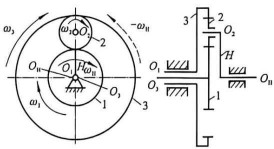

(a)周转轮系

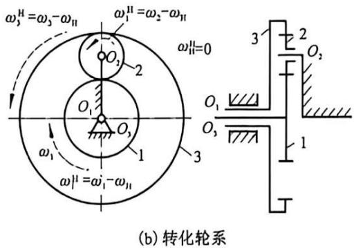

图6-8 周转轮系及其转化轮系
{: .figure-caption }

表 6-1 周转轮系转化轮系中各构件的角速度

<table><tr><td>构件</td><td>原有角速度</td><td>转化轮系中的角速度(即相对于行星架的角速度)</td></tr><tr><td>1</td><td> \({\omega }_{1}\) </td><td> \({\omega }_{1}^{\mathrm{H}} = {\omega }_{1} - {\omega }_{\mathrm{H}}\) </td></tr><tr><td>2</td><td> \({\omega }_{2}\) </td><td> \({\omega }_{2}^{\mathrm{{II}}} = {\omega }_{2} - {\omega }_{\mathrm{H}}\) </td></tr><tr><td>3</td><td> \({\omega }_{3}\) </td><td> \({\omega }_{3}^{\mathrm{{II}}} = {\omega }_{3} - {\omega }_{\mathrm{H}}\) </td></tr><tr><td>H</td><td> \({\omega }_{\mathrm{H}}\) </td><td> \({\omega }_{\mathrm{{II}}}^{\mathrm{H}} = {\omega }_{\mathrm{H}} - {\omega }_{\mathrm{H}} = 0\) </td></tr></table>

由于周转轮系的转化轮系是一个定轴轮系，因此该转化轮系的传动比可以按照定轴轮系传动比的计算方法来计算。

转化轮系的传动比为：

$$
i _ {1 3} ^ {\mathrm{H}} = \frac {\omega_ {1} ^ {\mathrm{H}}}{\omega_ {3} ^ {\mathrm{H}}} = \frac {\omega_ {1} - \omega_ {\mathrm{H}}}{\omega_ {3} - \omega_ {\mathrm{H}}} = (- 1) ^ {1} \frac {z _ {2} z _ {3}}{z _ {1} z _ {2}} = - \frac {z _ {3}}{z _ {1}}
$$

式中： $i_{13}^{H}$ 表示在转化轮系中齿轮 1 与齿轮 3 的传动比，而 $i_{13}$ 表示原周转轮系中齿轮 1 与齿轮 3 的传动比，两者是有区别的；齿数比前的“-”表示在转化轮系中齿轮 1 与齿轮 3 的转向相反。

根据上述原理，可写出周转轮系转化轮系中任意两轮的传动比计算公式。设周转轮系中任意两个齿轮 A 和 B (A、B 可以都是中心轮，也可以一个是中心轮，一个是行星轮) 的行星架为 H，则其转化轮系的传动比 $i_{4D}^{11}$ 可表示为：

$$
i _ {\mathrm{AII}} ^ {\mathrm{H}} = \frac {\omega_ {\mathrm{A}} ^ {\mathrm{H}}}{\omega_ {\mathrm{H}} ^ {\mathrm{H}}} = \frac {\omega_ {\mathrm{A}} - \omega_ {\mathrm{H}}}{\omega_ {\mathrm{H}} - \omega_ {\mathrm{H}}} = (\pm) \frac {\text {转化轮系中由} A \text {至} B \text {各从动轮齿数的乘积}}{\text {转化轮系中由} A \text {至} B \text {各主动轮齿数的乘积}} = f (z)\tag{6-2}
$$

要特别注意公式中“ $_{2}$ ”的确定及其含义，“ $_{2}$ ”只能代表在转化轮系中齿轮 A 与齿轮 B 的转向是相同或者相反的。

虽然上式只是求转化轮系的传动比，但不难看出，在已知各轮齿数的情况下，只要给定了 $\omega_{A}$ 、 $\omega_{B}$ 和 $\omega_{H}$ 三者中任意两个参数，由上式就可以求出第三个参数，从而可以得到周转轮系三个基本构件中任两个基本构件的传动比 $i_{\lambda B} = \frac{\omega_{A}}{\omega_{B}}$ 、 $i_{\lambda H} = \frac{\omega_{A}}{\omega_{H}}$ 和 $i_{\beta H} = \frac{\omega_{B}}{\omega_{H}}$ 。

在利用上式计算周转轮系传动比时，需要注意以下几点。

(1)式(6-2)只适用于转化轮系中齿轮A、齿轮B和行星架H轴线平行的情况。

(2)齿数比 $f(z)$ 是带有符号的，其判断方法同定轴轮系一样。即如果转化轮系为平面定轴轮系，可用 $(-1)^{n}$ 来判定。如果转化轮系为空间定轴轮系，则用画箭头的方法来确定。若转化轮系中齿轮A和B的转向相同时， $i_{AB}^{II}$ 为“+”；若转向相反时， $i_{AB}^{II}$ 为“-”。在利用式(6-2)求解转速或齿数时，必须先确定 $i_{AB}^{II}$ 的“+”或“-”。

(3) $\omega_{A}$ 、 $\omega_{B}$ 和 $\omega_{B}$ 是周转轮系中各基本构件的实际角速度，三者中必须有两个是已知的，才能求出第三个。若已知的两个转速方向相反，求解时一个代正值，一个代负值，第三个转速的转向则根据计算结果的“+”“-”来确定。

对于行星轮系来说, 由于其中一个中心轮是固定的, 设齿轮 $B$ 为固定轮, 即 $\omega_{\mathrm{B}} = 0$ , 可直接求出其余两个基本构件之间的传动比, 由式(6-2)得:

则

$$
\begin{array}{r l} i _ {\mathrm{AB}} ^ {\mathrm{H}} & = \frac {\omega_ {\mathrm{A}} ^ {\mathrm{H}}}{\omega_ {\mathrm{B}} ^ {\mathrm{H}}} = \frac {\omega_ {\mathrm{A}} - \omega_ {\mathrm{H}}}{\omega_ {\mathrm{B}} - \omega_ {\mathrm{H}}} = \frac {\omega_ {\mathrm{A}} - \omega_ {\mathrm{H}}}{0 - \omega_ {\mathrm{H}}} = 1 - \frac {\omega_ {\mathrm{A}}}{\omega_ {\mathrm{H}}} = 1 - i _ {\mathrm{AH}} \\ & \quad i _ {\mathrm{AH}} = 1 - i _ {\mathrm{AB}} ^ {\mathrm{H}} \end{array}\tag{6-3}
$$

上式表明: 在行星轮系中, 活动齿轮 $A$ 对行星架 $\mathrm{H}$ 的传动比等于 1 减去行星架固定不动时活动齿轮 $A$ 对原固定中心轮 $B$ 的传动比。

例 6-1 如图 6-9 所示轮系中，已知 $z_{1}=z_{2}=20,\quad z_{3}=60,\quad n_{1}=1\ r/min$ ， $n_{3}=-1\ r/min$ （设逆时针为正）。求行星架的转速 $n_{H}$ 和传动比 $i_{1H}$ 。

解: 该轮系是由 $1 、 2 、 3$ 和 $H$ 组成的差动轮系, 根据式(6-2)得

$$
i _ {1 3} ^ {\mathrm{H}} = \frac {n _ {1} ^ {\mathrm{H}}}{n _ {3} ^ {\mathrm{H}}} = \frac {n _ {1} - n _ {\mathrm{H}}}{n _ {3} - n _ {\mathrm{H}}} = (- 1) ^ {1} \frac {z _ {2} z _ {3}}{z _ {1} z _ {2}} = - \frac {z _ {3}}{z _ {1}}
$$

$$
\begin{array}{l} \text {即} \quad \frac {n _ {1} - n _ {\mathrm{H}}}{n _ {3} - n _ {\mathrm{H}}} = \frac {1 - n _ {\mathrm{H}}}{- 1 - n _ {\mathrm{H}}} = - 3 \\ \text {解得} \quad n _ {\mathrm{H}} = - 0. 5 \mathrm{r/min} \end{array}
$$

则传动比 $i_{\mathrm{1H}}$ 为：

$$
i _ {1 \mathrm{H}} = \frac {n _ {1}}{n _ {\mathrm{H}}} = \frac {1}{- 0 . 5} = - 2
$$

其中“-”表示 $n_{\mathrm{H}}$ 与 $n_{1}$ 转向相反。

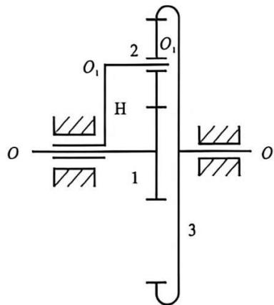

图6-9 差动轮系
{: .figure-caption }

例 6-2 如图 6-10(a) 所示的差速器中，已知 $z_1 = 49$ ， $z_2 = 42$ ， $z_{2'} = 18$ ， $z_3 = 21$ ， $n_1 = 200 \, \text{r/min}$ ， $n_3 = 100 \, \text{r/min}$ ，其转向如图所示。求行星架的转速 $n_H$ 。

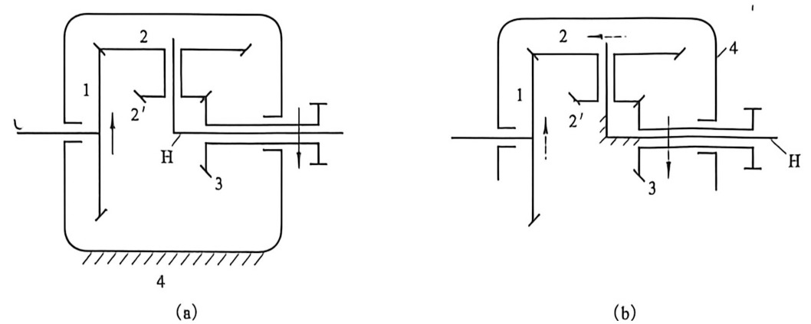

图6-10 差速器
{: .figure-caption }

解: 该差速器是由圆锥齿轮 $1、2-2^{\prime} 、 3$ 和行星架 $\mathrm{H}$ 所组成的差动轮系, 由式(6-2)得

$$
\begin{array}{r l} i _ {1 3} ^ {\mathrm{H}} = & \frac {n _ {1} ^ {\mathrm{H}}}{n _ {3} ^ {\mathrm{H}}} = \frac {n _ {1} - n _ {\mathrm{H}}}{n _ {3} - n _ {\mathrm{H}}} = - \frac {z _ {2} z _ {3}}{z _ {1} z _ {2 ^ {\prime}}} = - \frac {4 2 \times 2 1}{4 9 \times 1 8} = - 1 \\ & \frac {2 0 0 - n _ {\mathrm{H}}}{- 1 0 0 - n _ {\mathrm{H}}} = - 1 \end{array}
$$

解得： $n_{H}=50\ r/min$ 。

其结果为正，表明行星架 H 的转向和圆锥齿轮 1 的转向相同。

注意: 式中齿数比前面的“-”是由图 6-10(b) 所示转化轮系中通过画箭头确定的。

例 6-3 如图 6-11 所示为一大传动比减速器，已知 $z_{1}=100, z_{2}=101, z_{2'}=100, z_{3}=99$ 。求传动比 $i_{H1}$ 。

解: 该轮系是由齿轮 1、2-2'、3 和行星架 H 所组成的行星轮系, 由式(6-3)得

$$
i _ {1 \mathrm{H}} = 1 - i _ {1 3} ^ {\mathrm{H}} = 1 - (- 1) ^ {2} \frac {z _ {2} z _ {3}}{z _ {1} z _ {2 ^ {\prime}}} = 1 - \frac {1 0 1 \times 9 9}{1 0 0 \times 1 0 0} = \frac {1}{1 0 0 0 0} = \frac {n _ {1}}{n _ {\mathrm{H}}}
$$

解得： $i_{H1}=\frac{n_{H}}{n_{1}}=10000$ 。

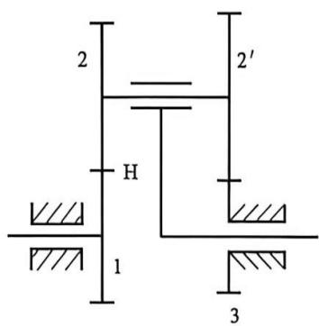

从计算结果可看出，齿轮 1 与行星架 H 的转向相同，且当行星架转 10000 转，齿轮 1 才转 1 转，可见行星轮系可以用少数齿轮得到很大的传动比。但这种轮系效率很低，且反行程

图6-11 大传动比减速器
{: .figure-caption }

(构件 1 为主动件) 将发生自锁, 一般用在仪表中测量高速转动或作为精密的微调机构。

若将 $z_{3}$ 由99改为100，其他齿轮的齿数不变，则其传动比为：

$$
i _ {1 \mathrm{H}} = 1 - i _ {1 3} ^ {\mathrm{H}} = 1 - (- 1) ^ {2} \frac {z _ {2} z _ {3}}{z _ {1} z _ {2}} = 1 - \frac {1 0 1 \times 1 0 0}{1 0 0 \times 1 0 0} = - \frac {1}{1 0 0} = \frac {n _ {1}}{n _ {\mathrm{H}}}
$$

解得： $i_{H1}=\frac{n_{H}}{n_{1}}=-100$ 。

即齿轮 1 与行星架 H 的转向相反。

比较两种结果可知，对于同一结构的行星轮系，当某一轮的齿数作较小变动，不仅可以导致轮系传动比的较大变化，甚至可以改变转动方向。这是其与定轴轮系不相同的地方。

### 6.2.3 复合轮系的传动比

由于复合轮系中包含有定轴轮系和周转轮系或包含几个基本周转轮系，因此，计算复合轮系的传动比时，既不能将整个轮系作为定轴轮系来处理，也不能将整个轮系作为周转轮系来处理。

正确计算复合轮系传动比的步骤为：

(1) 正确划分定轴轮系和基本周转轮系。

(2) 分别列出各基本轮系传动比的计算方程式。

(3) 找出各基本轮系之间的联系。

(4)联立方程式求解，即可求得复合轮系的传动比。

这里最关键的是找基本周转轮系。找基本周转轮系的方法是先找轴线活动的行星轮，支撑行星轮的构件就是行星架，与行星轮相啮合且轴线固定不动的齿轮便是中心轮。这样，行星轮、行星架和中心轮便组成一个基本周转轮系。其余的部分可按照上述同样的方法继续划分。找出各个基本周转轮系后，剩余的那些由定轴齿轮组成的部分就是定轴轮系。

例 6-4 如图 6-12 所示的轮系中，已知： $z_{1}=20, z_{2}=40, z_{2'}=20, z_{3}=30, z_{4}=80$ 。试求传动比 $i_{1H}$ 。

解：从图中可以看出，齿轮3的轴线是不固定的，它是一个行星轮，支撑该行星轮的构件H就是行星架；与行星轮3相啮合的定轴齿轮2'、4为中心轮，齿轮2'、3、4和行星架H组成一个基本周转轮系，且是一个行星轮系。剩下的齿轮1、2的轴线是固定不动的，组成一定轴轮系。所以该轮系是由一个定轴轮系和一个行星轮系串联而成的复合轮系。

在定轴轮系 1、2 中，由式(6-1)得：

$$
i _ {1 2} = \frac {n _ {1}}{n _ {2}} = - \frac {z _ {2}}{z _ {1}} = - \frac {4 0}{2 0} = - 2
$$

在行星轮系 $2^{\prime} 、 3 、 4$ 和行星架 $\mathrm{H}$ 中, 由式(6-3)得:

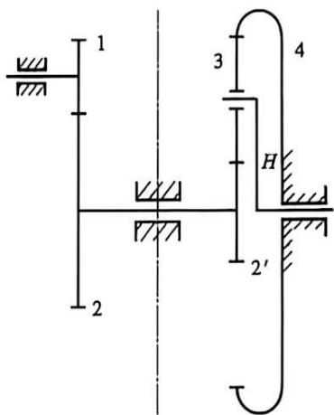

图6-12 复合轮系
{: .figure-caption }

$$
i _ {2 ^ {\prime} \mathrm{H}} = 1 - i _ {2 ^ {\prime} 4} ^ {\mathrm{H}} = 1 - \left(\frac {z _ {4}}{z _ {2 ^ {\prime}}}\right) = 1 + \frac {8 0}{2 0} = 5
$$

由于 $n_2 = n_{2'}$ ，联立求解：

$$
i _ {1 \mathrm{H}} = i _ {1 2} \cdot i _ {2 ^ {\prime} \mathrm{H}} = - 2 \times 5 = - 1 0
$$

式中：“-”表示齿轮 1 和行星架 H 的转向相反。

例 6-5 如图 6-13 所示的电动卷扬机减速器中，已知各轮齿数为 $z_{1}=25$ ， $z_{2}=50$ ， $z_{2'}=20$ ， $z_{3}=60$ ， $z_{3'}=18$ ， $z_{4}=30$ ， $z_{5}=54$ ，试求传动比 $i_{1H}$ 。又若电动机的转速为 $n_{1}=1000\ r/min$ ，求转筒的转速。

解: 在该轮系中, 双联齿轮 $2 - 2'$ 的几何轴线是不固定的, 随着构件 H(转筒)转动, 所以是行星轮, 支持它运动的构件 H 就是行星架; 和行星轮 $2 - 2'$ 相啮合的定轴齿轮 1 和齿轮 3 是两个中心轮，这两个中心轮都能转动。所以齿轮 1、2-2'、3 和行星架 H 组成一个差动轮系，剩下的齿轮 3'、4、5 的轴线都是固定的，组成定轴轮系。这个定轴轮系将差动轮系的中心轮 3 和行星架 H 联系起来，组成一个封闭系统。这种通过定轴轮系或行星轮系把差动轮系的两个基本构件（中心轮或行星架）联系起来形成自由度为 1 的复杂行星轮系称为封闭式行星轮系。

在差动轮系 1、2-2'、3 和行星架 H 中，有：

$$
i _ {1 3} ^ {\mathrm{H}} = \frac {n _ {1} - n _ {1 1}}{n _ {3} - n _ {\mathrm{H}}} = (- 1) ^ {1} \frac {z _ {2} z _ {3}}{z _ {1} z _ {2 ^ {\prime}}} = - \frac {5 0 \times 6 0}{2 5 \times 2 0} = - 6
$$

在定轴轮系 $3^{\prime}$ 、4、5中，有：

$$
i _ {3 ^ {\prime} 5} = \frac {n _ {3 ^ {\prime}}}{n _ {5}} = (- 1) ^ {1} \frac {z _ {5}}{z _ {3 ^ {\prime}}} = - \frac {5 4}{1 8} = - 3
$$

又因为 $n_{3}=n_{3'}$ , $n_{5}=n_{H}$ ,

联立求解得：

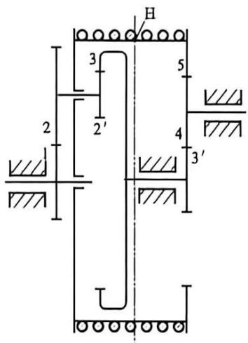

图6-13 卷扬机减速器
{: .figure-caption }

$$
i _ {\mathrm{IH}} = \frac {n _ {\mathrm{I}}}{n _ {\mathrm{H}}} = 2 5
$$

$$
n _ {\mathrm{H}} = \frac {n _ {\mathrm{H}}}{i _ {\mathrm{1H}}} = \frac {1 0 0 0}{2 5} = 4 0 \mathrm{r/min}
$$

转筒 H 和齿轮 1 的转向相同。

## 6.3 轮系的功用

轮系广泛用于各种机械中，它的功用可概括为以下几个方面。

### 1. 实现较远距离的传动

在齿轮传动中，当输入轴和输出轴相距较远而传动比却不大时，如图6-14所示，若只用一对齿轮传动，两轮的尺寸很大，如图中虚线所示；若改用轮系来传动，就可使齿轮尺寸小得多，如图中实线所示，这样，既减小了机器的结构尺寸和质量，又节约了材料，且制造、安装方便。

### 2. 实现大传动比传动

在工程实际中, 输入轴和输出轴之间往往需要有较大的传动比, 若仅用一对齿轮传动, 则两图6-14 实现较远距离的传动

轮齿数相差很大, 尺寸相差悬殊, 外廓尺寸庞大。若采用轮系, 特别是采用周转轮系, 可以用很少的齿轮, 并且在结构很紧凑的条件下, 得到很大的传动比。如图 6-15 所示为采用三对蜗杆蜗轮所组成的定轴轮系。蜗杆 1 为输入件, 蜗杆 4 为输出件, 三个蜗杆均采用双头左旋蜗杆, 三个蜗轮的齿数均为 40 , 由式 (6-1) 得其传动比 ${i}_{14} = {8000}$ , 通过画箭头可知齿轮 1 和齿轮 4 的转向相同。这是利用定轴轮系实现大传动比的例子。由此可见, 若采用定轴轮系, 只需适当选择齿轮的对数和各轮的齿数, 就可得到所需的大传动比传动。又如图 6-16所示为一大传动比减速器的运动简图，图中蜗杆1为输入件，行星架H为输出件，蜗杆1和5均为单头右旋蜗杆，各轮齿数为 $z_{1}=101$ ， $z_{2}=99$ ， $z_{2'}=z_{4}$ ， $z_{4'}=100$ ， $z_{5'}=100$ 。该减速器是由两个定轴轮系1、2和1'、5'、5、4'及一个差动轮系2'、3、4、H所组成的复合轮系，其传动比 $i_{111}=1980000$ 。

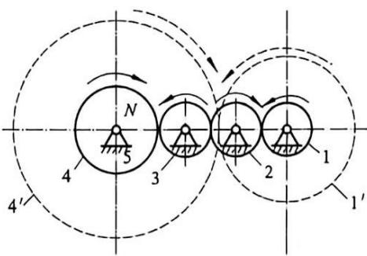

### 3. 实现变速与换向传动

输入轴的转动方向不变, 利用轮系可使输出轴得到若干种转速或改变输出轴的转向, 这种传动称为变速与换向传动。

变速器

如图 6-17 所示为汽车上常用的三轴四速变速箱的传动示意图。图中，牙嵌式离合器的一半 x 与齿轮 1 固联在输入轴 I 上，其另一半 y 和双联齿轮 4-6 通过滑键与输出轴Ⅲ相联。齿轮 2、3、5、7 安装在轴Ⅱ上，齿轮 8 则安装在轴Ⅳ上，操纵变速杆拨动双联齿轮 4-6，使之与轴Ⅱ上不同齿轮啮合时，可得到不同的输出转速。例如：设 $n_{1}=1000\ r/min$ ，图中括号内数字为各轮齿数。当向右移动双联齿轮使离合器 x 和 y 接合时， $n_{Ⅲ}=n_{1}=1000\ r/min$ ，汽车以高速前进；当向左移动双联齿轮使齿轮 4 与 3 相啮合时，运动经齿轮 1、2、3、4 传给Ⅲ，这时 $n_{Ⅲ}=596\ r/min$ ，汽车

以中速前进；当向左移动双联齿轮使齿轮6与5相啮合时，运动经齿轮1、2、5、6传给Ⅲ，这时 $n_{Ⅲ}=292\ r/min$ ，汽车以低速前进；当再向左移动双联齿轮使齿轮6与8相啮合时，运动经齿轮1、2、7、8、6传给Ⅲ，这时 $n_{Ⅲ}=-194\ r/min$ ，汽车以最低速倒车。

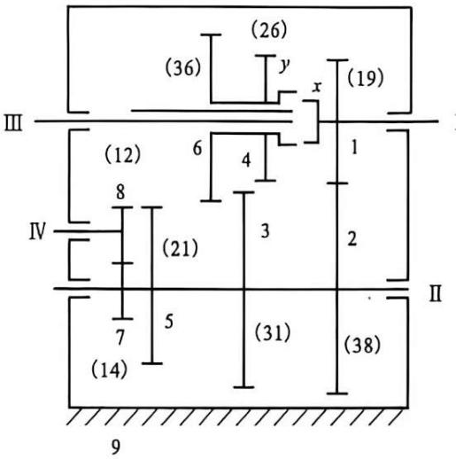

图 6-17 汽车变速箱
{: .figure-caption }

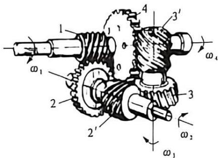

图6-15 实现大传动比传动
{: .figure-caption }

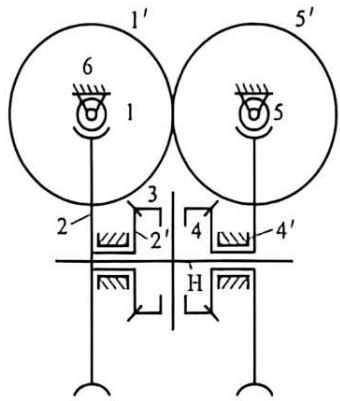

图6-16 大传动比减速器
{: .figure-caption }

如图 6-18 所示为用于车床上的换向机构，当手柄在图 6-18(a) 所示位置时，主动轮 1 的运动经过惰轮 2、3 传给齿轮 4，这时齿轮 4 与主动轮 1 的转向相反；当手柄在图 6-18(b) 所示位置时，主动轮 1 的运动经过惰轮 3 传给齿轮 4，这时齿轮 4 与主动轮 1 的转向相同。

换向转动 如图 6-19 所示为龙门刨床工作台的变速换向机构。其中，J、K 为电磁制动器，可分别刹住构件 A 和齿轮 3-3'，齿轮 1 与输入轴固连，构件 B 为输出轴，已知各轮

齿数。

当刹住 $J$ 时, 该轮系是由一个定轴轮系 1、2、3 和一个行星轮系 5、4、 $3^{\prime}$ 、 $B$ 所组成的复合轮系, 其传动比为:

(a)

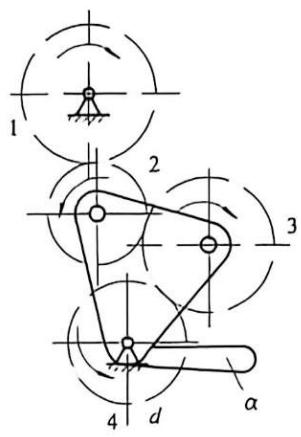

$$
i _ {1 l l} = i _ {1 3} i _ {3 ^ {\prime} l l} = - \frac {z _ {3}}{z _ {1}} \left(1 + \frac {z _ {3}}{z _ {3 ^ {\prime}}}\right)
$$

当刹住 $K$ 时, 该轮系是由两个行星轮系 1、2、3、 $A$ 和 5、4、 $3'$ 、 $B$ 所组成的复合轮系, 其传动比为:

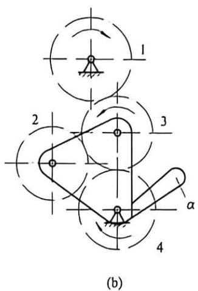

图6-18 车床换向机构
{: .figure-caption }

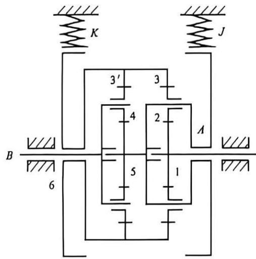

图6-19 龙门刨床变速换向机构
{: .figure-caption }

$$
i _ {1 B} = i _ {1 5} i _ {5 B} = \left(1 + \frac {z _ {3}}{z _ {1}}\right) \left(1 + \frac {z _ {3 ^ {\prime}}}{z _ {5}}\right)
$$

从计算结果可以看出，刹住 J 时，传动比小，输出轴速度高，为空回行程，此时输出轴与输入轴转向相反；刹住 K 时，传动比大，输出轴速度低，为工作行程，此时输出轴与输入轴转向相同。

### 4. 实现分路传动

在机械传动中，当只有一个原动件，而有多个执行构件时，原动件的运动可以通过多对啮合齿轮从不同的传动路线传给执行构件，从而实现分路传动。如图 6-20 所示的轮系为某航空发动机附件传动系统图。当主轴转动时，通过各对啮合齿轮可同时带动轴 I、Ⅱ、Ⅲ、Ⅳ、V 和 VI 转动。

### 5. 实现运动的合成和分解

由于差动轮系有两个自由度，当给定两个原动件的运动时，可以唯一确定第三个构件的运动，因此差动轮系可用来把两个运动合成为一个运动，反过来也可以把一个运动分解为两

个运动。汽车后桥差速器就利用了差动轮系对运动进行分解的特性。

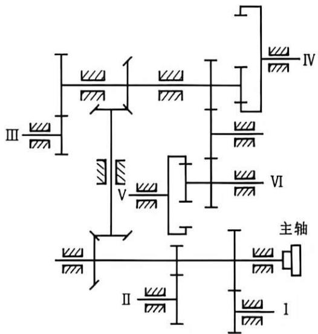

图6-20 实现分路传动
{: .figure-caption }

运动分解

如图 6-21 所示为汽车后桥差速器。汽车发动机的运动从变速箱经过传动轴传给齿轮 1，再带动齿轮 2 及固连在齿轮 2 上的行星架 H 转动。对于汽车底盘来说，齿轮 1、2 的轴线是固定不动的，故齿轮 1、2 组成一个定轴轮系。中间齿轮 4 的轴线是随着齿轮 2 的轴线转动的，所以齿轮 4 是行星轮，支撑行星轮的齿轮 2 便是行星架，与齿轮 4 相啮合且轴线固定的齿轮 3、5 是两个中心轮，由

于齿轮 3、5 都是活动的，所以齿轮 3、4、5 和 2 便组成一个差动轮系。该差速器是由一个定轴轮系和一个差动轮系所组成的复合轮系。

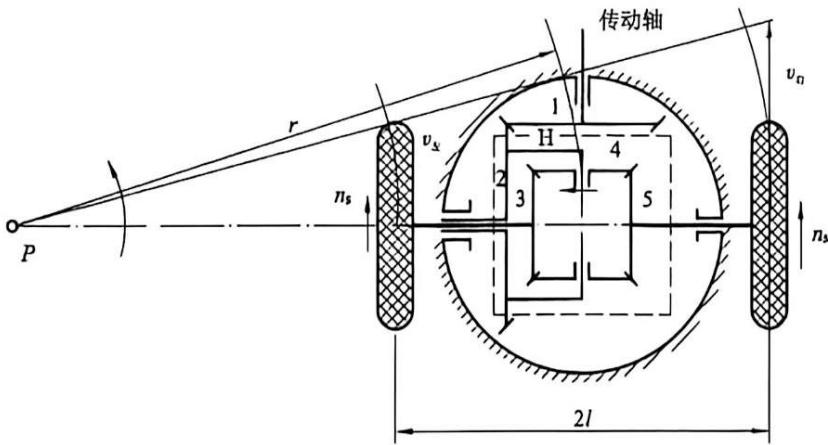

图6-21 汽车后桥差速器
{: .figure-caption }

在差动轮系 3、4、5 和 2 中，根据式(6-2)有：

$$
i _ {3 5} ^ {2} = \frac {n _ {3} - n _ {2}}{n _ {5} - n _ {2}} = \frac {z _ {5}}{z _ {3}} = - 1
$$

$$
n _ {2} = \frac {n _ {3} + n _ {5}}{2}\tag{a}
$$

当汽车在平坦道路上直线行驶时, 左、右车轮滚过的路程相等, 所以转速也相等, 因此有 $n_{3} = n_{5} = n_{2}$ , 表示齿轮 1 和齿轮 3 之间没有相对运动, 这时齿轮 3、4、5 如同一个整体, 一起随齿轮 2 转动。当汽车向左转弯时, 为减少轮胎与地面的磨损, 要求右车轮比左车轮转得快, 这时齿轮 3 和齿轮 5 之间发生相对运动, 轮系才起到差速器的作用。设两轮中心距为 $2l$ , 转弯半径为 $r$ , 因为两车轮的直径大小相等, 而它们与地面之间又是纯滚动 (当机构的构造允许左、右两后轮的转速不等时, 轮胎与地面之间一般不会打滑), 所以两车轮的转速与转弯半径成正比。故有:

$$
\frac {n _ {3}}{n _ {5}} = \frac {r - l}{r + l}\tag{b}
$$

联立(a)(b)两式求解得:

$$
n _ {3} = \frac {r - l}{l} n _ {2}, n _ {5} = \frac {r + l}{l} n _ {2}
$$

上式表明，汽车转弯时，差速器可以将传动轴的转动自动分解为两车轮的不同转动。

这种由圆锥齿轮所组成的汽车差速器机构也可以作为机械式加法机构和减法机构的一种。设选定齿轮1、2的齿数为 $z_{2}=2z_{1}$ ，则 $n_{1}=2n_{2}$ ，因此由式(a)得 $n_{3}+n_{5}=n_{1}$ 。上式表明：当使齿轮3转 $n_{3}$ 转和齿轮5转 $n_{5}$ 转时，齿轮1的转数就是它们的和。不仅如此，该机构还可以实现连续运算。将上式移项后得 $n_{3}=n_{1}-n_{5}$ ，因此该轮系也可以进行减法运算。

差动轮系这种合成运动的作用广泛用于机床、计算机构和补偿装置。

### 6. 在尺寸及质量较小的条件下实现大功率传动

在周转轮系中，常采用多个行星轮均匀分布在中心轮四周的结构形式，如图 6-22 所示。这样，不仅可大大提高承载能力，而且还可使行星轮因公转所产生的离心惯性力和各齿廓啮合处的径向分力得以平衡，从而大大改善受力状况。

此外，采用内啮合有效地利用了空间，加之其输入轴与输出轴共线，故可减小径向尺寸。因此可在结构紧凑的条件下实现大功率传动。

### 7. 实现执行机构的复杂运动

由于在周转轮系中, 行星轮既作自转又作公转, 行星轮上各点的运动轨迹是许多形状和性质不同的摆线或变态摆线, 因此, 在工程实际中常利用行星轮的这一运动特点来实现一些特殊要求。如图 6-23 所示的隧道挖掘机, 其铣刀刀盘与行星轮固连, 刀盘一方面绕自己的轴线 $O_{6}$ (亦即 $O_{7}$ ) 旋转, 行星架 $\mathrm{h}$ 又绕垂直于轴线 $O_{6}$ 的轴线 $O_{\mathrm{b}}$ 转动, 同时轴线 $O_{\mathrm{b}}$ 又绕与其平行的主轴线 $O_{1}$ 转动。这样铣刀刀尖的运动轨迹便是更为复杂的空间曲线。

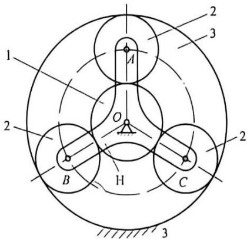

图6-22 周转轮系
{: .figure-caption }

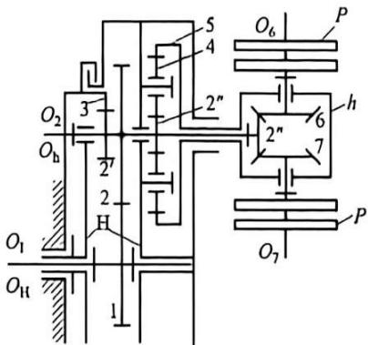

图6-23 隧道挖掘机
{: .figure-caption }

## 6.4 轮系的效率

轮系的效率计算一个非常复杂的问题，在工程实际中常用实验法来确定。

### 6.4.1 定轴轮系的效率

由于定轴轮系是由多对齿轮串联组成的，其传动效率等于各对啮合齿轮效率的连乘积，即

$$
\eta = \eta_ {1} \cdot \eta_ {2} \cdot \dots \cdot \eta_ {K}\tag{6-4}
$$

式中： $\eta_{1},\eta_{2},\cdots,\eta_{K}$ 为各对齿轮的效率，可通过查有关手册得到。上式表明：定轴轮系中，啮合的轮齿对数愈多，其传动总效率愈低。

### 6.4.2 周转轮系的效率

在计算周转轮系的效率时，也可以通过转化轮系找出周转轮系与其转化轮系在效率方面的内在联系。其理论依据为：齿轮啮合传动时，因齿面磨损引起的功率损耗取决于运动副作用力(法向力)、摩擦系数和齿面滑动速度。若将周转轮系加上一个公共角速度 $(-\omega_{H})$ 转化成定轴轮系，则原周转轮系与其转化轮系相比较，各构件的相对运动关系不变，故摩擦系数不变；另外，只要使周转轮系与其转化轮系作用的外力矩不变，则齿面间的法向力也不会改变，因此轮齿啮合处的摩擦损耗功率也不改变。这样，就可以用转化轮系中的摩擦损耗功率 $P_{f}^{II}$ 来代替周转轮系的摩擦损耗功率 $P_{f}$ 。

下面以图 6-2(b) 所示的 2K-H 型行星轮系为例来分析。

设作用于齿轮1上的外力矩为 $M_{1}$ ，角速度为 $\omega_{1}$ ，行星架的角速度为 $\omega_{H}$ ，则行星轮系中齿轮1传递的功率为：

$$
P _ {1} = M _ {1} \omega_ {1}
$$

在外力矩 $M_{1}$ 不变的条件下，转化轮系中齿轮 1 的功率为：

$$
P _ {1} ^ {\mathrm{H}} = M _ {1} (\omega_ {1} - \omega_ {\mathrm{H}}) = P _ {1} \left(1 - \frac {1}{i _ {1 \mathrm{H}}}\right)\tag{a}
$$

由上式可知: (1) 当 $1 \frac{1}{i_{\mathrm{IH}}} > 0$ , 即 $i_{\mathrm{IH}} > 1$ 或 $i_{\mathrm{IH}} < 0$ 时, $P_{1}^{\mathrm{H}}$ 和 $P_{1}$ 同号, 表明齿轮 1 在行星轮系和其转化轮系中的主从地位不变。(2) 当 $1 \frac{1}{i_{\mathrm{IH}}} < 0$ , 即 $0 < i_{\mathrm{IH}} < 1$ 时, 表明齿轮 1 在行星轮系和其转化轮系中的主从地位发生了变化。下面分两大类具体讨论。

(1) 在行星轮系中, 中心轮 1 为主动件, 行星架 H 为从动件。

①当 $i_{1H}>1$ 或 $i_{1H}<0$ 时，根据上面的分析，中心轮 1 在转化轮系中仍为主动件，此时，转化轮系中中心轮 1 的功率 $P_{1}^{H}$ 为输入功率，其效率为 $\eta^{H}=1\frac{P_{f}}{P_{1}^{H}}$ 则摩擦损耗功率为 $P_{f}=P_{1}^{\mathrm{H}}(1-\eta^{\mathrm{H}})$

将式(a)代入上式得:

$$
P _ {\mathrm{f}} = M _ {1} \left(\omega_ {1} - \omega_ {\mathrm{H}}\right) (1 - \eta^ {\mathrm{H}}) = P _ {1} \left(1 - \frac {1}{i _ {1 \mathrm{H}}}\right) (1 - \eta^ {\mathrm{H}})\tag{b}
$$

式中： $\eta^{H}$ 为转化轮系的效率，按定轴轮系的方法[式(6-4)]计算。

又因为在行星轮系中，中心轮1为主动件，其功率 $P_{1}$ 为输入功率，此时行星轮系的效率为：

$$
\eta_ {\mathrm{IH}} = 1 \frac {P _ {\mathrm{f}}}{P _ {\mathrm{l}}}
$$

将式(b)代入上式并整理得:

$$
\eta_ {\mathrm{IH}} = \frac {1 - \eta^ {\mathrm{H}} (1 - i _ {\mathrm{IH}})}{i _ {\mathrm{IH}}}\tag{6-5}
$$

②当 $0 < i_{\mathrm{1H}} < 1$ 时, 根据上面的分析, 中心轮 1 在转化轮系中为从动件, 其功率 $P_{1}^{\mathrm{H}}$ 是输出功率, 而输入功率等于输出功率与摩擦损耗功率之和。因此, 转化轮系的效率为:

则摩擦损耗功率

$$
\begin{array}{r l} \eta^ {\mathrm{H}} & = 1 \frac {P _ {\mathrm{f}}}{P _ {\mathrm{l}} ^ {\mathrm{H}} + P _ {\mathrm{f}}} \\ P _ {\mathrm{f}} & = \frac {P _ {\mathrm{l}} ^ {\mathrm{H}} (1 - \eta^ {\mathrm{H}})}{\eta^ {\mathrm{H}}} \end{array}
$$

由于此时在转化轮系中， $M_{1}$ 和 $(\omega_{1}-\omega_{H})$ 方向相反，故输出功率 $P_{1}^{H}$ 为负值，而摩擦损耗功率通常都用正值代入，因此，上式应写成：

$$
P _ {\mathrm{r}} = \frac {- P _ {1} ^ {\mathrm{H}} (1 - \eta^ {\mathrm{H}})}{\eta^ {\mathrm{H}}}
$$

将式(a)代入上式得:

$$
P _ {\mathrm{f}} = \frac {P _ {\mathrm{I}} \left(\frac {1}{i _ {\mathrm{IH}}} - 1\right) (1 - \eta^ {\mathrm{H}})}{\eta^ {\mathrm{H}}}\tag{c}
$$

在行星轮系中, 中心轮 1 仍为主动轮, 其功率 $P_{1}$ 为输入功率, 故此时行星轮系的效率为:

$$
\eta_ {\mathrm{IH}} = 1 - \frac {P _ {\mathrm{f}}}{P _ {\mathrm{l}}}
$$

将式(c)代入上式并整理得:

$$
\eta_ {\mathrm{LH}} = \frac {\eta^ {\mathrm{H}} - (1 - i _ {1 \mathrm{H}})}{i _ {1 \mathrm{H}}}\tag{6-6}
$$

(2) 在行星轮系中, 行星架 $\mathrm{H}$ 为主动件, 中心轮 1 为从动件。

①当 $i_{\mathrm{IH}} > 1$ 或 $i_{\mathrm{IH}} < 0$ 时, 根据上面的分析, 中心轮 1 在转化轮系中仍为从动件, 其摩擦损耗功率可按式 (c) 求出。因中心轮 1 在行星轮系中为从动轮, 其功率 $P_{1}$ 为输出功率, 且符号为负, 故行星轮系的效率为

$$
\eta_ {\mathrm{H1}} = 1 \frac {P _ {\mathrm{f}}}{- P _ {\mathrm{l}} + P _ {\mathrm{f}}}
$$

将式(c)代入上式并整理得:

$$
\eta_ {\mathrm{H1}} = \frac {i _ {1 \mathrm{H}} \eta^ {\mathrm{H}}}{\eta^ {\mathrm{H}} - (1 - i _ {1 \mathrm{H}})}\tag{6-7}
$$

②当 $0<i_{1H}<1$ 时，根据上面的分析，中心轮 1 在转化轮系中变为主动件，其摩擦损耗功率可按式(b)求出。由于此时中心轮 1 在行星轮系中仍为从动轮，故行星轮系的效率为：

$$
\eta_ {\mathrm{H1}} = 1 \frac {P _ {\mathrm{f}}}{- P _ {\mathrm{1}} + P _ {\mathrm{f}}}
$$

将式(b)代入上式并整理得:

$$
\eta_ {\mathrm{H1}} = \frac {i _ {\mathrm{1H}}}{1 - \eta^ {\mathrm{H}} (1 - i _ {\mathrm{1H}})}\tag{6-8}
$$

从上面的分析可以看出，行星轮系的效率是其传动比 $i_{1H}$ 函数。在行星轮系中，当转化轮系的传动比 $i_{13}^{H}<0$ 时，称为负号机构；反之，为正号机构。

行星轮系的效率变化情况可用效率曲线图来表示，如图 6-24 所示。

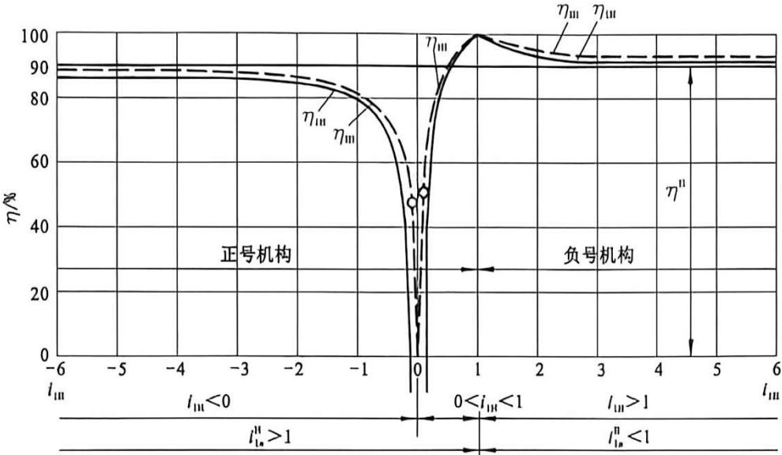

图6-24 行星轮系效率曲线
{: .figure-caption }

从图中可以看出，负号机构无论是用于增速还是减速，都具有较高的效率。所以对于传递动力的行星轮系，尽可能采用负号机构。但负号机构的缺点是传动比较小，若要增大传动比，势必要增大轮系的结构尺寸。而正号机构正相反，传动比大，结构紧凑，但效率低，特别是用作增速时，在某些情况下会出现自锁。

## 6.5 轮系的设计

### 6.5.1 定轴轮系的设计

定轴轮系的设计包括轮系类型的选择、确定各轮的齿数和选择轮系的布置方式。

#### 1. 定轴轮系类型的选择

在设计定轴轮系时，应根据工作要求和使用场合适当地选择轮系的类型。除了满足基本的使用要求外，还应考虑机构的外廓尺寸、效率、质量、成本等因素。一般情况下，优先选用直齿圆柱齿轮传动；当设计的轮系用于高速、重载的场合时，由于斜齿轮传动比直齿轮传动更平稳，承载能力更高，因此应优先选用平行轴斜齿圆柱齿轮所组成的定轴轮系；当需要改变运动轴线方向时，可采用含有圆锥齿轮传动的定轴轮系；当要求传动比大、结构紧凑或用于分度、微调及有自锁要求的场合时，应选择含有蜗杆传动的定轴轮系。

#### 2. 定轴轮系中各轮齿数的确定

要确定定轴轮系中各轮的齿数，关键在于合理分配定轴轮系中各对齿轮的传动比。

下面是在分配各对齿轮传动时应注意的几个问题。

(1) 各级齿轮的传动比应在其合理范围内选取。如单级圆柱齿轮传动, 其合理传动比范围为 $3 \sim 5$ , 最大值为 8; 单级圆锥齿轮传动, 其合理传动比范围为 $2 \sim 3$ , 最大值为 5; 单级蜗杆传动, 其合理传动比范围为 $10 \sim 40$ , 最大值为 80。当轮系的传动比过大时, 为了改善传动性能和减少外廓尺寸, 应当采用两级或多级齿轮传动。如当圆柱齿轮传动的传动比大于 8时，一般应设计成两级传动；当传动比大于30时，一般应设计成两级以上传动。

(2) 当轮系为减速传动时, 通常按照“前小后大”的原则分配传动比。同时, 为了使机构外廓尺寸协调和结构匀称, 相邻两级齿轮的传动比的差值不宜过大。

(3) 当设计闭式齿轮减速器时, 为了润滑方便, 应使各级齿轮传动的大齿轮直径尽量相近, 以利于浸油润滑。根据这一原则在分配传动比时, 高速级齿轮的传动比应大于低速级齿轮的传动比, 通常取 $i_{\text {高}} = (1.3 \sim 1.5)i_{\text {低}}$ 。

以上仅是分配各级齿轮传动比的一般原则，在实际应用时，还应根据具体情况进行具体分析，灵活运用。当分配了各级齿轮的传动比之后，就可以根据传动比来确定每一个齿轮的齿数。

#### 3. 定轴轮系布置方式的选择

同一个定轴轮系，可以有不同的布置方式。布置方式不同，其性能和使用范围也不相同，因此在设计定轴轮系时，应根据具体情况来选择。

如图 6-25 所示为两级齿轮减速器内所使用的定轴轮系，有下列三种布置方式。

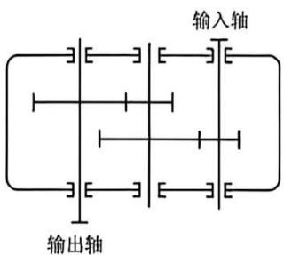

(a)展开式

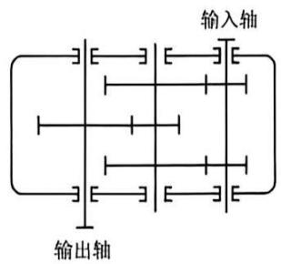

(b) 分流式

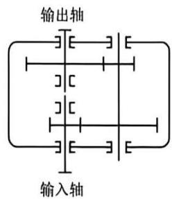

(c) 同轴式

图6-25 定轴轮系的布置方式
{: .figure-caption }

图 6-25(a)为展开式。其特点是结构简单, 但齿轮相对于轴承为不对称布置, 因此, 当轴受力产生弯曲变形时, 会使载荷沿齿宽分布不均匀, 故只宜用于载荷较平稳且轴有较大刚度的场合。
{: .figure-caption }

图 6-25(b) 为分流式。其特点是齿轮相对于轴承为对称布置，受力情况较好，但结构较复杂，常用于较大功率、变载荷的场合。

图 6-25(c) 为同轴式。其特点是输入轴与输出轴在同一轴线上，结构较紧凑，但中间轴较长，刚度较差。

### 6.5.2 行星轮系的设计

行星轮系的设计主要包括行星轮系类型的选择、行星轮个数和各轮齿数的确定。

#### 1. 行星轮系类型的选择

行星轮系类型的选择，主要应从传动比范围、效率高低、结构复杂程度及外廓尺寸等几方面综合考虑。当设计的轮系主要用于传递运动时，首先考虑能否满足工作所要求的传动比，其次兼顾效率、结构复杂程度、外廓尺寸和质量等；当设计的轮系主要用于传递动力时，首先考虑机构效率的高低，其次兼顾传动比、结构复杂程度、外廓尺寸和质量等。从机械效率的角度看，不管是增速传动还是减速传动，负号机构的效率比正号机构高。因此，如果设计的轮系用于动力传动，要求效率较高，应采用负号机构；如果设计的轮系还要求具有较大的传动比，而单级负号机构又不能满足要求时，可将几个负号机构串联起来，或采用负号机构与定轴轮系组成的复合轮系来实现较大的传动比。正号机构虽然能获得较大的传动比，且结构紧凑，但效率较低，特别是正号机构用于增速传动时，随着传动比的增大，效率将急剧下降，甚至出现自锁现象。因此选用正号机构时一定要注意。

#### 2. 行星轮系行星轮个数和各轮齿数的确定

行星轮系是一种共轴式(输入轴线与输出轴线重合)的传动装置, 并且在中心轮的四周均匀分布几个完全相同的行星轮。故在设计行星轮系时, 为了保证能装配起来并正常运转及实现给定的传动比, 其行星轮个数和各轮齿数的选择必须满足下列四个条件。现以图 6-4(b) 所示的单排 $2 \mathrm{~K} - \mathrm{H}$ 型行星轮系为例加以讨论。

(1)传动比条件。

为了满足行星轮系给定的传动比 $i_{\mathrm{1H}}$ 要求，根据式(6-3)得：

$$
i _ {1 \mathrm{H}} = 1 - i _ {1 3} ^ {\mathrm{H}} = 1 + \frac {z _ {3}}{z _ {1}}
$$

则

$$
z _ {3} = (i _ {\mathrm{IH}} - 1) z _ {1}\tag{a}
$$

(2) 同心条件。

同心条件即行星架的回转轴线应与两中心轮的几何轴线相重合。对于标准齿轮，也就是要求齿轮1和齿轮2的中心距等于齿轮3和齿轮2的中心距。根据齿轮的正确啮合条件，齿轮1、齿轮2、齿轮3的模数都相同，故有：

$$
\frac {m \left(z _ {1} + z _ {2}\right)}{2} = \frac {m \left(z _ {3} - z _ {2}\right)}{2}
$$

则

$$
z _ {2} = \frac {z _ {3} - z _ {1}}{2} = \frac {(i _ {1 H} - 2) z _ {1}}{2}\tag{b}
$$

上式表明两中心轮的齿数应同为奇数或同为偶数。

(3)装配条件。

在行星轮系中，为了提高承载能力和减少动载荷，通常采用多个行星轮均匀分布在中心轮的四周。这样载荷由多对齿来承担，可大大提高承载能力；又因行星轮均匀分布，使轮齿的啮合力和行星轮的离心惯性力得以平衡。在设计行星轮系时，其行星轮的个数和各轮齿数必须满足一定的条件，否则便装配不起来。因为当第一个行星轮装好后，中心轮1和3的位置便确定了，又因均匀分布的各行星轮的中心位置也是确定的，在一般情况下，其余行星轮有可能无法同时插入内、外两中心轮的齿槽中。

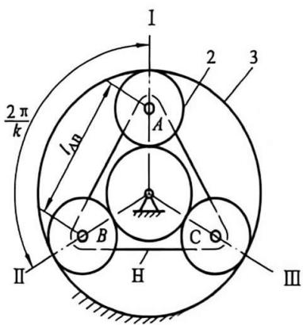

图6-26 行星轮系的装配条件
{: .figure-caption }

下面以图 6-26 所示的行星轮系来分析其装配条件。设均匀分布的行星轮的个数为 $k$ ，则相邻两中心轮所夹的中心角为 $2\pi / k$ 。现将第一个行星轮在位置 I 装入，固定中心轮 3，使行星架沿逆时针方向转过 $2\pi / k$ 到达位置 $\mathbb{I}$ 。这时中心轮 1 将按传动比 $i_{\mathrm{IH}}$ 的关系转过 $\varphi_{1}$ 角。

即

$$
i _ {1 1} = \frac {\omega_ {1}}{\omega_ {1 1}} = \frac {\varphi_ {1}}{\varphi_ {1 1}} = \frac {\varphi_ {1}}{2 \pi / k}
$$

则

$$
\varphi_ {1} = \frac {2 \pi}{k} i _ {\mathrm{III}}
$$

现如果在位置 I 又能装入第二个行星轮，则此时中心轮 1 在位置 I 的轮齿相位应与其回转角 $\varphi_{1}$ 之前在该位置的轮齿相位完全相同，也就是中心轮 1 刚好转过整数个齿，即 $\varphi_{1}$ 正好是整数个齿所对的中心角。设此时 $\varphi_{1}$ 为 n 个齿所对的中心角，则有：

$$
\varphi_ {1} = n \left(\frac {2 \pi}{z _ {1}}\right)
$$

联立解以上两式及式(a)得:

$$
n = \frac {z _ {1}}{k} i _ {\mathrm{IH}} = \frac {z _ {1} + z _ {3}}{k}\tag{c}
$$

由于 $n$ 必须是正整数，所以行星轮系的装配条件是两中心轮的齿数之和应为行星轮个数的整数倍。

(4)邻接条件。

为了保证行星轮系能够运动, 其相邻两行星轮的齿顶圆不得相交, 这个条件称为邻接条件。如图 6-26 所示, 相邻两行星轮的中心距 $l_{\mathrm{AB}}$ 应大于行星轮的齿顶圆直径 $d_{\mathrm{n} 2}$ 。如果采用标准齿轮, 则有:

$$
2 \left(r _ {1} + r _ {2}\right) \sin \frac {\pi}{k} > 2 \left(r _ {2} + h _ {a} ^ {*} m\right)
$$

即

$$
\left(z _ {1} + z _ {2}\right) \sin \frac {\pi}{k} > z _ {2} + h _ {0} ^ {*}\tag{d}
$$

为了设计时便于选择各轮的齿数，通常把前三个条件合并为一个总的配齿公式，即

$$
z _ {1}: z _ {2}: z _ {3}: n = z _ {1}: \frac {(i _ {1 H} - 2)}{2} z _ {1}: (i _ {1 H} - 1) z _ {1}: \frac {i _ {1 H}}{k} z _ {1}
$$

确定各轮齿数时，先根据上式选定 $z_{1}$ 和 $k$ ，满足在给定传动比 $i$ 的前提下，使 $z_{2} 、 z_{3}$ 和 $n$ 均为正整数，再验算邻接条件。如果不满足，则应减少行星轮的个数 $k$ 或增加齿轮的齿数。

另外，行星轮系具有体积小、质量轻、承载能力高等优点，这是因为在结果上采用多个行星轮均匀分布来承担载荷，并合理利用内啮合齿轮传动来减少空间尺寸。在理论上，各个行星轮的承载能力应是相同的。但实际上，由于行星轮、行星架和中心轮都不可避免地存在制造、安装误差及受力后的变形，往往会造成行星轮间的载荷分布不均匀，导致转动装置的承载能力和使用寿命降低。

为了尽可能降低载荷分配不均匀现象，提高承载能力，在设计行星轮系时，常把某些构件做成可以浮动的，用来减轻载荷分配不均现象，此即均载装置。均载装置的类型很多，有使太阳轮浮动的，有使行星轮浮动的，有使行星架浮动的，也有使几个构件同时浮动的，实际使用中需要合理地选择或设计均载装置。

## 6.6 其他类型行星传动简介

### 6.6.1 渐开线少齿差行星传动

如图 6-27 所示为断开线少齿差行星传动，其中中心轮 1 为固定的内齿轮，2 为行星轮，行星架 H 为输入轴，V 轴为输出轴，V 轴和行星轮用等角速比机构 3 相连，所以 V 轴的转速就是行星轮 2 的绝对转速。由于中心轮和行星轮的齿廓均为渐开线，且齿数相差很小（一般为 1-4），故称为断开线少齿差行星传动，又因其只有一个中心轮 K、一个行星架 H 和输出 V 轴，所以又称为 K-H-V 行星轮系。

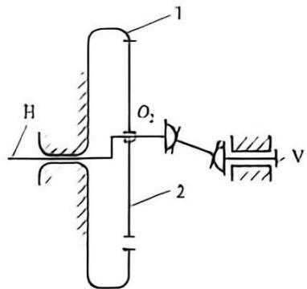

图 6-27 渐开线少齿差行星传动
{: .figure-caption }

这种轮系的传动比可根据式(6-3)求出:

$$
i _ {2 1 1} = 1 - i _ {2 1} ^ {1 1} = 1 \frac {z _ {1}}{z _ {2}} = \frac {z _ {1} - z _ {2}}{z _ {2}}
$$

则

$$
i _ {\mathrm{HIV}} = i _ {\mathrm{H2}} = \frac {1}{i _ {\mathrm{2H}}} = \frac {z _ {2}}{z _ {1} - z _ {2}}
$$

上式表明；两轮的齿数差愈小，传动比愈大，当齿数差 $z_{1}-z_{2}=1$ 时，称为一齿差行星传动，这时传动比最大， $i_{\mathrm{IV}}=i_{\mathrm{ID}}=-z_{2}$ 。但应注意：一齿差行星传动的输入轴和输出轴转向相反；为保证一齿差行星传动的内外齿轮装配，两个齿轮均需要正变位，以避免产生干涉。

渐开线少齿差行星传动具有传动比大、结构简单紧凑、体积小、质量轻、加工装配及维修方便、传动效率高(为80%-87%)等优点，在很多工业部门得到广泛的应用，主要用在大传动比和中小功率的场合。

### 6.6.2 摆线针轮行星传动

摆线针轮行星传动的工作原理和结构特点与渐开线少齿差行星传动相似。如图 6-28 所示摆线针轮行星传动由行星架 H、行星轮 2 和中心轮 1 组成，运动由行星架 H 输入，通过输出机构 3 由轴 V 输出，也是一种 K-H-V 型一齿差行

星传动。摆线针轮行星传动和一齿差行星传动的区别在于：在摆线针轮传动中，行星轮的齿廓曲线不是渐开线，而是变态摆线；中心内齿轮采用了针齿，又称为针轮。

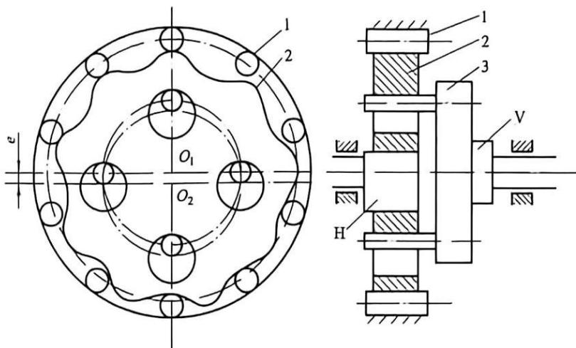

图6-28 摆线针轮行星传动
{: .figure-caption }

摆线针轮行星传动的传动比计算与渐开线少齿差行星传动的计算相同，其传动比为：

$$
i _ {\mathrm{HV}} = - i _ {\mathrm{H2}} = \frac {1}{i _ {2 \mathrm{H}}} = \frac {z _ {2}}{z _ {1} - z _ {2}}
$$

由于 $z_{1} - z_{2} = 1$ ，故 $i_{\mathrm{HV}} = i_{\mathrm{H2}} = -z_{2}$ ，即摆线针轮行星传动可获得大传动比。

摆线针轮行星传动具有传动比大(一级减速 $i_{\mathrm{HV}} = 9 \sim 115$ ，多级传动可获得更大传动比)、结构紧凑、传动平稳、承载能力高、传动效率高(一般为 $90\% \sim 95\%$ )、使用寿命长(是普通齿轮减速器使用寿命的 $2 \sim 3$ 倍)。因此，这种传动广泛用于军工、冶金、矿山、化工、造船等工业的机械设备上。其主要缺点是加工工艺复杂，制造精度要求高，必须用专用机床和刀具来加工其摆线齿轮，制造成本较高。

### 6.6.3 谐波齿轮传动

如图 6-29 所示为谐波齿轮传动，它由三个主要构件所组成：H 为波发生器，它相当于行星轮系中的行星架；齿轮 1 为刚轮，它相当于中心轮；齿轮 2 为柔轮，可产生较大的弹性变形，它相当于行星轮。通常波发生器为主动件，而刚轮或柔轮之一为从动件，另一个为固定件。

谐波齿轮传动的工作原理为：当波发生器装入柔轮内孔时，由于前者的总

谐波减速器

长度略大于后者的内孔直径，故柔轮变为椭圆形，使其长轴两端插进刚轮的齿槽中，形成两个局部啮合区，同时短轴两端的齿与刚轮的齿完全脱开。至于其余各处的齿，则视柔轮回转方向的不同，或处于啮入状态，或处于啮出状态。当波发生器连续转动时，柔轮长短轴的位置不断变化，从而使轮齿的啮合处和脱开处也随之不断变化，于是在柔轮和刚轮间便产生了相对位移，从而传递运动。由于柔轮的变形在柔轮周围的展开图上是连续的简谐波形，故这种传动被称为谐波齿轮传动。

在波发生器转动一周期间, 柔轮上一点变形的循环次数与波发生器上的波数(即滚轮数)是相同的。根据波发生器上装的滚轮数不同, 有双波传动(图 6-29)和三波传动(图 6-30)等, 最常用的是双波传动。为了有利于柔轮的力平衡和防止轮齿干涉, 刚轮和柔轮的齿数差应等于波发生器波数的整数倍, 通常取等于波数。

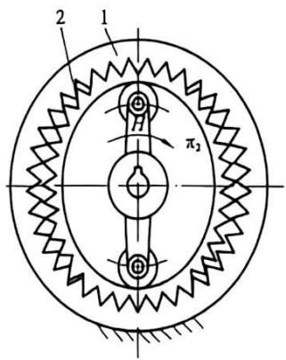

图6-29 双波传动
{: .figure-caption }

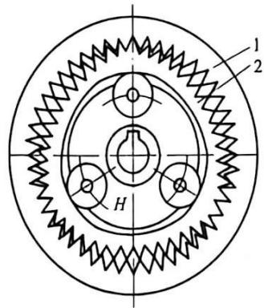

图6-30 三波传动
{: .figure-caption }

在谐波齿轮传动中，其传动比可按行星轮系的计算方法来求。当刚轮1固定时，波发生器H为主动，柔轮2为从动，其传动比为：

$$
i _ {\mathrm{H2}} = \frac {1}{i _ {2 \mathrm{H}}} = - \frac {z _ {2}}{z _ {1} - z _ {2}}
$$

上式与渐开线少齿差行星传动的传动比计算公式相同。“-”表示主从动件转向相反。当柔轮固定时，波发生器 H 为主动，刚轮 1 为从动，其传动比为：

$$
i _ {\mathrm{H1}} = \frac {1}{i _ {\mathrm{1H}}} = \frac {z _ {1}}{z _ {1} - z _ {2}}
$$

式中：“+”表示主从件方向相同。

谐波齿轮传动的主要优点有：传动比大，范围广（一级传动的传动比范围为 50～500，二级传动为 2500～250000），同时参与啮合的齿数多（为 30%～40%），故承载能力高；运动精度高，传动平稳；体积小，质量轻；零件数少，安装方便；效率高（单级效率为 70%～95%）。正因如此，谐波齿轮传动已广泛地应用于空间技术、能源、机器人、雷达通信、机床、仪表、造船、汽车、武器等各个工业领域。其缺点为：柔轮周期性变形，易发生疲劳损坏；需要的启动力矩大。

## 本章思维导图

## 思考题与练习题

1. 轮系有哪些类型？

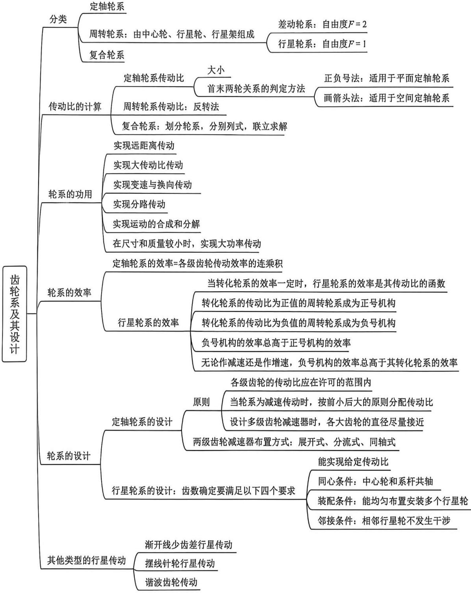

2. 在定轴轮系中, 如何确定首末两轮的转向关系?

3. 什么是惰轮？它在轮系中起什么作用？

4. 在计算空间定轴轮系的传动比时, 为什么不能用 $(-1)^{m}$ 来确定传动比的正负号?

5. 周转轮系中两轮转动比的正负号与该周转轮系转化轮系中两轮传动比的正负号相同吗？为什么？

6. 在由空间齿轮所组成的周转轮系中，能否用转化轮系法求传动比？它需要什么条件？

7. 在差动轮系中, 若已知两基本构件的转向, 如何确定第三个基本构件的转向?

8. 计算复合轮系传动比的步骤是怎样的？能否用给整个复合轮系加上一个公共的角速度 $-\omega_{H}$ 的方法来计算整个轮系的传动比？为什么？

9. 轮系的主要功用有哪些?

10. 行星轮系各轮齿数的选择必须满足哪几个条件？

11. 如图 6-31 所示的手摇提升装置中，已知各轮齿数为 $z_1 = 20$ ， $z_2 = 50$ ， $z_3 = 15$ ， $z_4 = 30$ ， $z_6 = 40$ 。试求传动比 $i_{16}$ 并指出提升重物时手柄的转向。

12. 如图 6-32 所示轮系中，各轮齿数为 $z_{1} = 20, z_{2} = 40, z_{2'} = 20, z_{3} = 30, z_{3'} = 20, z_{4} = 40$ 。试求：(1)传动比 $i_{14}$ ; (2)如要变更 $i_{14}$ 的符号，可采取什么措施？

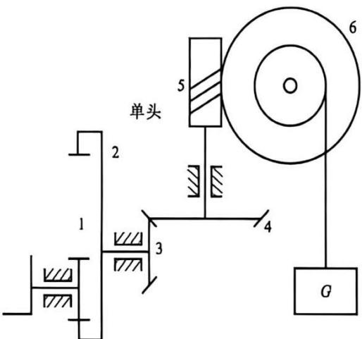

图6-31 手摇提升装置
{: .figure-caption }

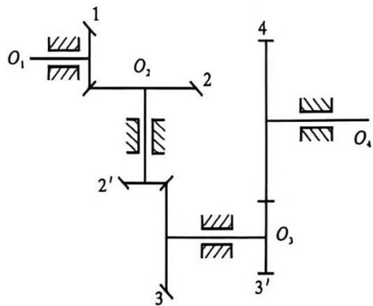

图6-32 定轴轮系1
{: .figure-caption }

13. 如图 6-33 所示的机械式钟表机构中，E 为擒纵轮，N 为发条盘，S、M 及 H 分别为秒针、分针和时针。已知： $z_{1}=72$ ， $z_{2}=12$ ， $z_{3}=64$ ， $z_{4}=8$ ， $z_{5}=60$ ， $z_{6}=8$ ， $z_{7}=60$ ， $z_{8}=6$ ， $z_{9}=8$ ， $z_{10}=24$ ， $z_{11}=6$ ， $z_{12}=24$ 。求秒针和分针的传动比 $i_{SM}$ 和分针与时针的传动比 $i_{MH}$ 。

14. 如图 6-34 所示为一滚齿机工作台的传动机构, 工作台与蜗轮 5 固连。已知: $z_{1} = z_{1 ^ {\prime}} = 20$ , $z_{2} = 35$ , $z_{5} = 40$ , $z_{7} = 28$ , 蜗杆 $z_{4 ^ {\prime}} = z _ {6} = 1$ , 旋向如图所示。若要加工一个齿数 $z_{5 ^ {\prime}} = 32$ 的齿轮, 试求挂轮组齿数比 $z_{2 ^ {\prime}} / z_{4}$ 。

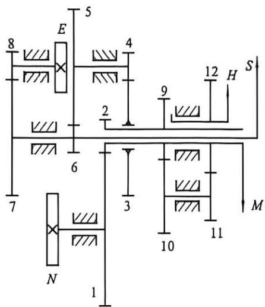

图6-33 机械式钟表机构
{: .figure-caption }

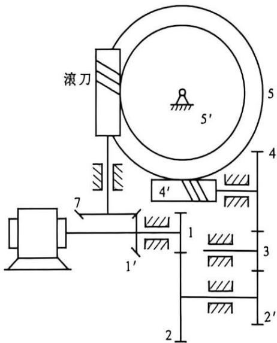

图 6-34 滚齿机工作台传动机构
{: .figure-caption }

15. 如图 6-35 所示轮系中，已知 $z_{1} = 18, z_{2} = 30, z_{2'} = 18, z_{3} = 36, z_{3'} = 18, z_{4} = 36, z_{4'} = 2$ （右旋蜗杆）， $z_{5} = 60, z_{5'} = 20$ ，齿轮的模数 $m = 2 \mathrm{~mm}$ ，若 $n_{1} = 1000 \mathrm{r} / \mathrm{min}$ （方向如图所示），求齿条 6 的线速度 $v$ 的大小和方向。

16. 如图 6-36 所示轮系中，已知各轮齿数为 $z_1 = z_2 = z_3 = z_5 = z_6 = 20$ ，已知齿轮 1、4、5、7 为同轴线，试求该轮系的传动比 $i_{17}$ 。

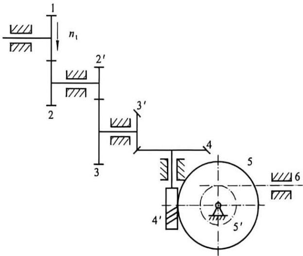

图6-35 定轴轮系2
{: .figure-caption }

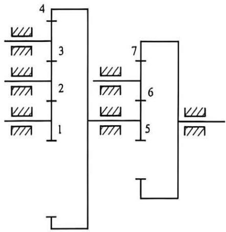

图6-36 定轴轮系3
{: .figure-caption }

17. 图 6-37(a)、(b)为两个不同结构的锥齿轮周转轮系，已知 $z_1 = 20$ ， $z_2 = 24$ ， $z_{2'} = 30$ ， $z_3 = 40$ ， $n_1 = 200 \mathrm{r / min}$ ， $n_3 = -100 \mathrm{r / min}$ 。求两轮系的 $n_{11}$ 。

18. 如图 6-38 所示轮系中, 已知 $z_{1} = 60$ , $z_{2} = 18$ , $z_{3} = 21$ , 各轮均为标准齿轮, 且模数相等。试求: (1) 齿轮 4 的齿数 $z_{4}$ ; (2) 传动比 $i_{1 \mathrm{~H}}$ 的大小及系杆 $\mathrm{H}$ 的转向。

19. 如图 6-39 所示轮系中，已知 $z_{1} = 20, z_{2} = 25, z_{3} = 15, z_{4} = 60$ ，齿轮 1 的转速 $n_{1} = 300 \mathrm{r} / \mathrm{min}$ ，求 $n_{\mathrm{H}}$ 的大小和方向。

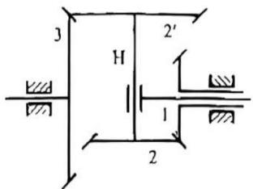

(0)

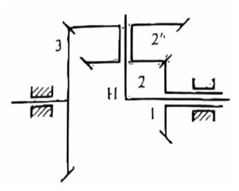

图 6-37 两种结构锥齿轮周转轮系
{: .figure-caption }

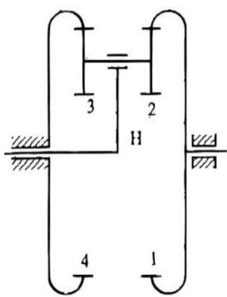

图6-38 周转轮系1
{: .figure-caption }

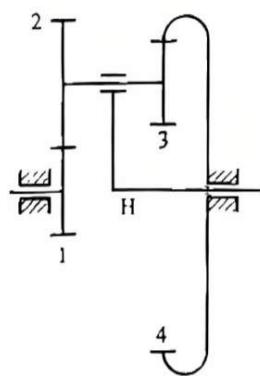

图6-39 周转轮系2
{: .figure-caption }

20. 如图 6-40 所示为一用于自动化照明灯具上的周转轮系。已知： $z_{1}=60$ ， $z_{2}=z_{2}$ =30， $z_{3}=z_{4}=40$ ， $z_{5}=120$ ，输入轴转速 $n_{1}=19.5\ r/min$ 。求箱体的转速。

21. 在图 6-41 所示的变速器中，已知 $z_1 = z_{1'} = z_6 = 28$ ， $z_3 = z_5 = z_{3'} = 80$ ， $z_2 = z_4 = z_7 = 26$ ，当鼓轮 A、B、C 分别被刹住时，求传动比 $i_{1H}$ 。

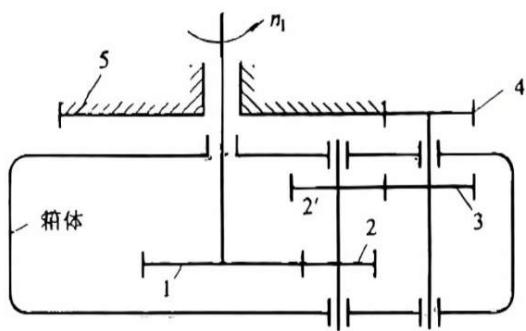

图 6-40 自动化照明灯具上的周转轮系
{: .figure-caption }

图6-41 变速器
{: .figure-caption }

22. 如图 6-42 所示轮系中，已知 $z_{1}=30$ , $z_{2}=26$ , $z_{2'}=z_{3}=z_{4}=21$ , $z_{4'}=30$ , $z_{5}=2$ (右旋蜗杆)，又已知齿轮 1 的转速为 $n_{1}=130\ r/min$ ，蜗杆 5 的转速为 $n_{5}=450\ r/min$ ，方向如图所示，求构件 H 的转速 $n_{H}$ 。

23. 如图 6-43 所示轮系中，已知各轮齿数， $z_{1}=2$ ， $z_{2}=50$ ， $z_{2}^{\prime}=24$ ， $z_{3}=48$ ， $z_{5}=20$ ， $z_{6}=40$ ，齿轮均为标准齿轮，标准安装，主动轮 1 转向如图所示。试求 $i_{16}$ ，并标出轮 2、5、6 的转向。

图6-42 复合轮系1
{: .figure-caption }

图6-43 复合轮系2
{: .figure-caption }

24. 如图 6-44 所示轮系中，已知： $z_{1}=20$ ， $z_{2}=30$ ， $z_{3}=z_{4}=z_{5}=25$ ， $z_{6}=75$ ， $z_{7}=25$ ， $n_{A}=100\ r/min$ ，方向如图所示。试求 $n_{B}$ 的大小和方向。

图6-44 复合轮系3
{: .figure-caption }

25. 如图 6-45 所示的减速装置中, 齿轮 1 装在电动机的轴上, 已知各轮的齿数: $z_{1} = z_{2} = 20, z_{3} = 60, z_{4} = 90, z_{5} = 210$ , 又电动机的转速 $n = 1440 \mathrm{r} / \mathrm{min}$ 。求轴 $B$ 的转速 $n_{\mathrm{B}}$ 及其回转方向。

26. 如图 6-46 所示电动三爪卡盘传动轮系中，已知各齿轮的齿数为： $z_{1}=6$ ， $z_{2}=z_{2}=\ 25$ ， $z_{3}=57$ ， $z_{4}=56$ ，试求传动比 $i_{13}$ 。

图6-45 减速装置
{: .figure-caption }

题图 6-46 电动三爪卡盘传动轮系
{: .figure-caption }

27. 如图 6-47 所示自行车里程表的机构中，C 为车轮轴。已知各齿轮的齿数为 $z_{1}=17$ ， $z_{2}=68$ ， $z_{3}=23$ ， $z_{4}=19$ ， $z_{4}^{\prime}=20$ ， $z_{5}=24$ 。当车轮转一圈时，指针 P 转过多少圆？

28. 如图 6-48 所示轮系中，已知各齿轮的齿数为： $z_{1}=28$ ， $z_{3}=78$ ， $z_{4}=24$ ， $z_{6}=80$ ，若 $n_{1}=1000\ r/min$ 。求：当分别将齿轮 3 或齿轮 6 刹住时，求构件 H 的转速 $n_{H}$ 。

图 6-47 自行车里程表机构
{: .figure-caption }

题图6-48 复合轮系4
{: .figure-caption }
