# 第7章 间歇运动机构及其设计

**【概述】**

◎在各类机械中，常需要某些构件作周期性的运动和停歇，能够将主动构件的连续运动转换成从动构件有规律的运动和停歇的机构称为间歇运动机构。本章主要介绍几种常用间歇运动机构的工作原理、类型、特点、设计要点及应用情况。

◎通过本章的学习，要求掌握各类机构的组成、工作原理、运动特点、功能和适用场合，以便以后在进行机械运动方案设计时，能够根据工作要求正确地选择执行机构的类型。

在机械中，常常需要某些构件实现周期性的运动和停歇。

图7-1为日用化学厂灌装冷霜的多工位自动机。在工作台7上设置了16个工位，其中工位1、5分别完成上空盒、灌霜、贴锡纸、盖盒盖和送出成品五个工艺动作。工位6为空工位。工作台需要周期性地回转和停歇。工作台停歇时，各工位完成工艺动作；然后工作台转动，每个工件都转到下一个工位，这个运动常常成为分度运动。工作台的间歇分度运动是由工作台下面一个具有间歇运动的分度机构8产生的。这种多工位工作台在机床和各种自动化机械中应用十分广泛。

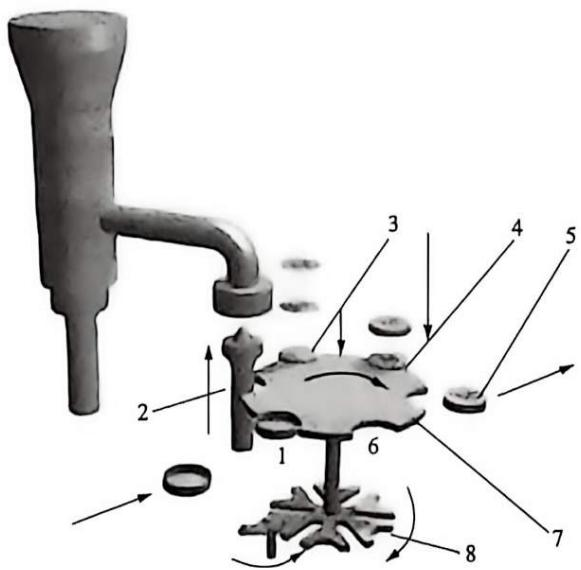

图 7-1 灌装冷霜多工位自动机
{: .figure-caption }

1—送人工位；2—灌霜工位；3—贴锡纸工位；4—盖盒盖工位；5—送出工位；6—空工位；7—工作台；8—分度机构。

## 7.1 棘轮机构

1954 年, 中国科学院考古研究所(现在的中国社会科学院考古研究所)展开了对东周王城的发掘, 很意外地发现了棘轮机构, 包括了棘轮和棘爪等结构, 如图 7-2 所示, 据考古学家推测, 这件棘轮也许可以用作战车的驻车制动装置, 这是世界范围内最早的棘轮实物, 体现了我国古代机械的成就。

### 7.1.1 棘轮机构组成和工作原理

棘轮机构的基本结构如图 7-3 所示，它主要由摇杆 1、棘爪 2、棘轮 3、止动棘爪 4 组成。当摇杆 1 逆时针摆动时，摇杆上铰接的棘爪 2 插入棘轮 3 的齿槽，使棘轮 3 同向转动某一角度，而止动棘爪 4 在棘轮 3 齿背上滑

过；当摇杆1顺时针摆动时，止动棘爪4阻止棘轮3反向转动，此时棘爪2在棘轮3齿上滑过，棘轮3静止不动，从而实现将摇杆1的往复摆动转换为从动棘轮3的单向间歇转动。为保证棘爪工作可靠，需利用弹簧5使止动棘爪4和棘轮3保持接触。

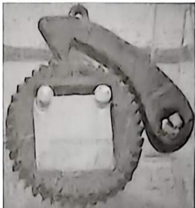

图7-2 东周棘轮
{: .figure-caption }

### 7.1.2 棘轮机构的类型

常用棘轮机构可分为轮齿式与摩擦式两大类。

#### 1. 轮齿式棘轮机构

按啮合方式可分成如图 7-3、图 7-5 所示的外啮合、内啮合棘轮机构。当棘轮的直径为无穷大时，变为棘条(图 7-6)，此时棘轮的单向转动变为棘条单向滑动。

#### 2. 摩擦式棘轮机构

如图 7-4 所示，其工作原理与轮齿式棘轮机构相同，只是用偏心扇心楔块代替轮齿式棘轮机构中的棘爪，以无齿摩擦轮 3 代替棘轮，利用楔块 2 与摩擦轮 3 间的摩擦力与楔块 2 偏心的几何条件来实现摩擦轮的单向间歇转动（构件 4 为制动楔块）。图示机构当摇杆 1 逆时针转动时，楔块 2 在摩擦力的作用下楔紧摩擦轮 3，使摩擦轮 3 同向转动；摇杆 1 顺时针转动时，摩擦轮 3 静止不动。

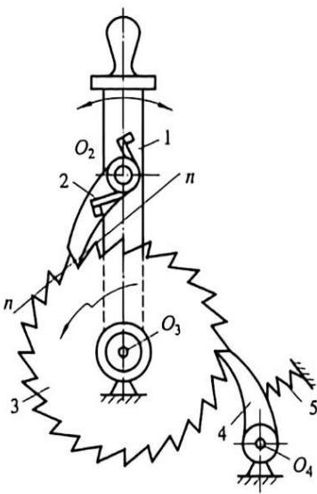

1—摇杆；2—棘爪；3—棘轮；4—止动棘爪；5—弹簧。

图7-3 外啮合棘轮机构
{: .figure-caption }

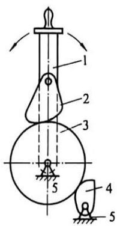

1—摇杆；2—楔块；3—摩擦轮；4—制动楔块；5—机架。

图7-4 摩擦式棘轮机构
{: .figure-caption }

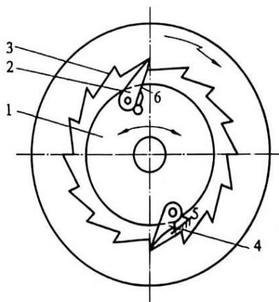

1—轴；2—棘爪；3—棘轮；4—棘爪；5—机架；6—棘爪。

图7-5 内啮合棘轮机构
{: .figure-caption }

常用的摩擦式棘轮机构如图 7-7 所示，当构件 1 顺时针方向转动时，由于摩擦力的作用使滚子 2 被压紧在构件 1、3 的收敛狭隙处，从而带动构件 3 一起转动；当构件 1 逆时针方向转动时，滚子 2 松开，构件 3 静止不动。

根据棘轮的运动方向又可分为:

(1)单向式棘轮机构: 如图 7-3 所示, 其特点是摇杆向一个方向摆动时, 棘轮可沿同一方向转过某一角度。如图 7-8 所示的双动式棘轮机构, 其特点是摇杆反复摆动, 钩头式[图 7-8(a)]或直推式[图 7-8(b)]棘爪都只能驱使棘轮沿单一方向间歇转动。

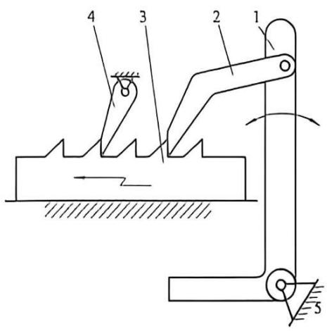

图7-6 棘条机构
{: .figure-caption }

1—摆杆；2—棘爪；3—棘条；4—棘爪；5—机架。

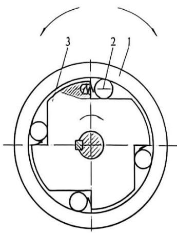

图7-7 常用的摩擦式棘轮机构
{: .figure-caption }

1—构件；2—滚子；3—星轮。

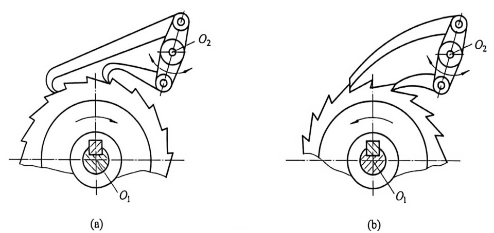

图7-8 双动式棘轮机构
{: .figure-caption }

(2)双向式棘轮机构: 如图 7-9(a) 所示, 当棘爪在实线 $AB$ 位置时, 棘轮沿逆时针方向做间隙运动; 当棘爪在虚线位置 $AB'$ 时, 棘轮沿顺时针方向做间隙运动。如图 7-9(b) 所示则是另一种双向式棘轮机构, 只需拔出插销, 将棘爪提起, 并绕自身轴线转 $180^{\circ}$ 放下, 即可改变棘轮的间歇运动方向。双向式棘轮机构必须采用对称齿形。

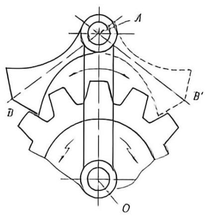

(0)

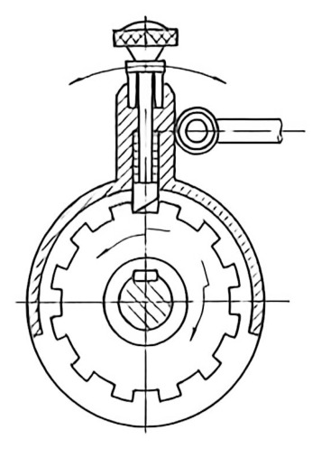

图7-9 双向式棘轮机构
{: .figure-caption }

### 7.1.3 棘轮机构的设计

#### 1. 棘轮模数和齿数的确定

与齿轮相同, 棘轮轮齿大小以模数 $m$ 表示, 但棘轮的标准模数按其齿顶圆直径 $d_{\mathrm{a}}$ 来计算:

$$
m = d _ {\mathrm{n}} / Z\tag{7-1}
$$

棘轮齿数与棘轮最小转角有关。由棘轮的使用条件可确定棘轮的最小转角 $\theta_{\mathrm{min}}$ ，因为

$$
2 \pi / Z \leqslant \theta_ {\mathrm{min}}
$$

所以

$$
Z \geqslant 2 \pi / \theta_ {\mathrm{min}}\tag{7-2}
$$

棘轮机构的齿形及其他尺寸计算可参阅有关书籍。

#### 2. 棘轮的齿形

单向转动的棘轮齿形一般为非对称梯形，载荷较小时可用三角形。

#### 3. 棘轮转角的调节

转角调节的方法有两种, 一种是利用棘轮罩来调节[图 7-10(a)], 通过改变棘轮罩位置,使部分棘爪行程内棘爪沿棘轮罩滑过, 从而实现棘轮转角的大小的调整。另一种是通过改变摇杆的长度来调节[图 7-10(b)], 通过调节曲柄摇杆机构中曲柄 $OA$ 的长度, 使摇杆摆角改变。

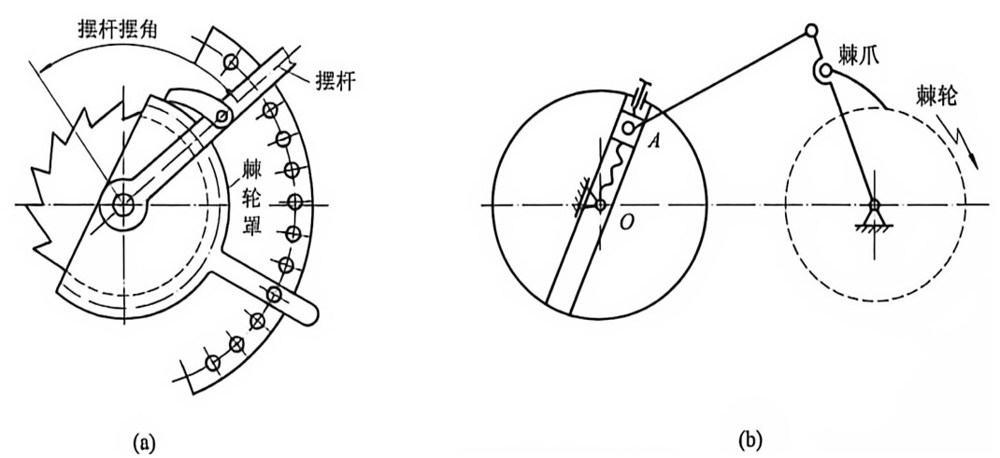

图7-10 棘轮机构转角的调节
{: .figure-caption }

图 7-11 所示棘轮齿面与径向线所夹角 $\alpha$ 为齿面倾角。为使棘爪在推动棘轮的过程中，棘爪顺利滑入棘轮齿根并压紧，则应使法向应力 N 对 $O_{1}$ 轴的力矩大于摩擦力 $F_{1}$ 对 $O_{1}$ 轴的力矩，即
{: .figure-caption }

#### 4. 棘轮机构的可靠工作条件

$$
\begin{array}{r l} & N \cdot O _ {1} A \sin \beta > F _ {\mathrm{f}} \cdot O _ {1} A \cos \beta \\ \text {则} & \tan \beta > F _ {\mathrm{f}} / N \\ \text {因为} & F _ {\mathrm{f}} = N \cdot f = N \cdot \tan \varphi \\ \text {所以} & \tan \beta > \tan \varphi \end{array}
$$

图7-11 楳爪顺利滑入棘轮齿根的条件
{: .figure-caption }

即

$$
\beta > \varphi\tag{7-3}
$$

式中：f 为棘爪与棘轮齿面间的滑动摩擦系数； $\varphi$ 为棘爪与棘轮齿面之间摩擦角； $\beta$ 为棘爪和棘齿接触点 A 的公法线与 $O_{1}A$ 线的夹角。

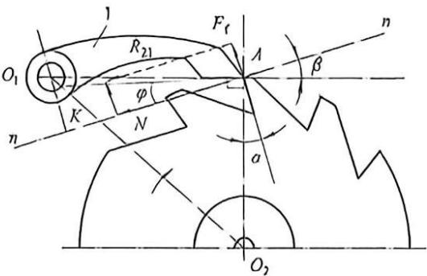

为使棘爪受力尽可能小，通常取轴心 $O_{1}$ 、 $O_{2}$ 和 A 点的相对位置满足 $O_{1}A \perp O_{2}A$ ，则 $\alpha = \beta$ ，又当系数 f = 0.2，摩擦角 $\varphi = 11^{\circ}18'$ ，因此一般取 $\alpha = 20^{\circ}$ 。

轮齿式棘轮机构的结构简单, 制造方便, 工作可靠, 从动棘轮容易实现有级调节等优点, 但工作过程中冲击、噪声、磨损都比较大。轮齿式棘轮机构常用于各种机械中, 以实现进给、转位、制动或分度的功能。摩擦式棘轮机构传动平

牛头刨床进给机构

稳，无噪声，从动棘轮的转角可作无级调节，但其运动准确性差，常用来做超越离合器。棘轮机构通常只适用于低速轻载的场合。

## 7.2 槽轮机构

### 7.2.1 槽轮机构和工作原理

如图 7-12 所示, 槽轮机构由装有圆柱销 A 的主动拨盘 1、开有径向槽的从动槽轮 2 和机架组成。主动拨盘 1 逆时针做等速连续转动, 当圆柱销 A 未进入径向槽时, 由于槽轮 2 的内凹锁止弧 $\widehat{nn}$ 被主动拨盘 1 外凸的锁止弧 $\widehat{mm'm}$ 锁住而静止; 当圆柱销 A 开始进入径向槽时, $\widehat{nn}$ 弧和 $\widehat{mm'm}$ 弧脱开, 槽轮 2 在圆柱销 A 的驱动下顺时针转动; 当圆销 A 在另一边开始脱离径向槽时, 锁止弧 $\widehat{nn}$ 又被卡住, 槽轮 2 又静止不动, 直至圆柱销 A 再次进入槽轮的另一个径向槽时, 又重复上述运动, 从而实现槽轮的单向间歇运动。

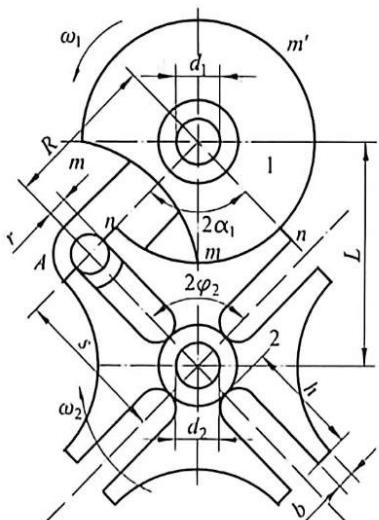

图7-12 外槽轮机构
{: .figure-caption }

### 7.2.2 槽轮机构的类型

传通平行轴间运动的槽轮机构，其中应用最广泛的是上述的外槽轮机构。此外，还有图7-13所示的内槽轮机构。外槽轮机构的主动拨盘与从动槽轮转向相反；内槽轮机构主动拨盘与从动槽轮转向相同，内槽轮机构停歇时间短，传动较平稳，所占空间小。

槽轮机构

传递相交轴运动的是空间槽轮机构，如图 7-14 所示，从动槽轮 2 是半球形，主动拨盘 1 的轴线及拔销 3 的轴线均通过球心，故又称为球面槽轮机构。主动拨盘 1 连续转动，从动槽轮 2 做间歇转动，转向如图。

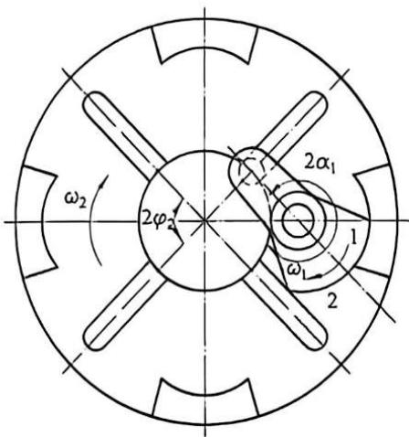

图7-13 内槽轮机构
{: .figure-caption }

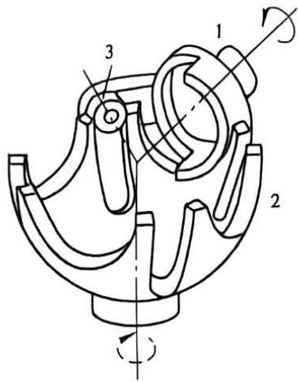

图7-14 空间槽轮机构
{: .figure-caption }

### 7.2.3 槽轮机构的设计

槽数 Z 和圆柱销数 n 的选取如下。

如图7-12所示的外槽轮中，主动拨盘1回转一周时，从动槽轮2的运动时间 $t_2$ 与主动拨盘1的运动时间 $t_1$ 之比称为槽轮机构的运动系数，用 $K$ 来表示，即

$$
K = t _ {2} / t _ {1}\tag{7-4}
$$

由于主动拨盘1通常做等速转动，运动时间 $t_2$ 与 $t_1$ 是与主动拨盘1的转角 $2\alpha_{1}$ 和 $2\pi$ 相对应的，故

$$
K = t _ {2} / t _ {1} = 2 \alpha_ {1} / 2 \pi
$$

为了避免圆柱销 A 在起动和停歇时与径向槽发生刚性冲击，圆柱销 A 进入和离开径向槽时，圆柱销的线速度中心线应沿着径向槽中心线方向。

如图 7-12 所示, $2 \alpha_{1} = \pi - 2 \varphi_{2}$ , 其中 $2 \varphi_{2}$ 为槽轮槽间角。设槽轮有 $Z$ 个均布槽, 则 $2 \varphi_{2} = 2 \pi / Z$ 。将上述关系代入式 (7-4), 可得槽轮机构的运动系数为:

$$
K = t _ {2} / t _ {1} = 2 \alpha_ {1} / 2 \pi = (\pi - 2 \varphi_ {2}) / 2 \pi = 1 / 2 - 1 / Z\tag{7-5}
$$

因为运动系数 K 必须大于零，所以外槽轮的径向槽的数目应大于或等于 3。从上式还可以看出，K 总是小于 0.5 的，这说明，这种外槽轮机构槽轮的运动时间总小于其停歇时间。

若欲使 $K \geqslant 0.5$ , 即槽轮的运动时间大于其停歇时间, 可在销轮上安装多个圆柱销。若在主动拨盘 1 上均匀分布 $n$ 个圆柱销, 则当拨盘转动一周时, 槽轮将被拨动 $n$ 次, 故运动系数

是单销的 $n$ 倍，即

$$
K = n (1 / 2 - 1 / Z)\tag{7-6}
$$

因 $K$ 应小于或等于1，故

$$
n \leqslant 2 Z / (Z - 2)\tag{7-7}
$$

由上式可得槽数与圆柱销数的关系如表 7-1 所示。

表 7-1 槽数与圆柱销数的关系

<table><tr><td>Z</td><td>3</td><td>4-5</td><td> \(\geqslant 6\) </td></tr><tr><td>n</td><td>1-5</td><td>1-3</td><td>1-2</td></tr></table>

同理可得出图 7-13 内槽轮机构的运动系数为：

$$
K = 2 \alpha_ {1} / 2 \pi = (\pi + 2 \varphi_ {2}) / 2 \pi = (\pi + 2 \pi / Z) / 2 \pi = 1 / 2 + 1 / Z\tag{7-8}
$$

由上两式可知，当内槽轮机构运动系数 0.5 < K < 1，槽数 $Z \geqslant 3$ 时，圆柱销数 n 只能为 1。

### 7.2.4 槽轮机构的几何尺寸计算

在设计计算时，先根据槽轮的转角要求选定槽数 Z，再根据载荷和结构需要选定中心距 L 和圆柱销半径 r，最后根据如图 7-12 所示几何关系求出圆柱销。

回转半径：

$$
R = L \sin \varphi_ {2} = L \sin (\pi / Z)\tag{7-9}
$$

槽顶高：

$$
S = L \cos \varphi_ {2} = L \cos (\pi / Z)\tag{7-10}
$$

槽底高：

$$
h \geqslant S - (L - R - r)\tag{7-11}
$$

锁止弧半径：

$$
R _ {\mathrm{s}} = R - r - b \quad (b \text {   为槽轮齿项厚   })\tag{7-12}
$$

### 7.2.5 改善槽轮机构性能的设计

图 7-15 为槽轮运动过程的某一瞬间, 拨盘和槽轮的转角分别用 $\alpha$ 和 $\varphi$ 来表示, 并规定 $\alpha$ 和 $\varphi$ 在圆柱销进入区为正, 在圆柱销离开区为负。

设圆柱销至槽轮中心的距离 $r_{\mathrm{x}}$ 、 $r_{\mathrm{x}}$ 为变量，由几何关系得：

$$
\begin{array}{r l} & R \sin \alpha = r _ {x} \sin \varphi \\ & R \cos \alpha + r _ {x} \cos \varphi = L \end{array}
$$

以上两式消去 $r_x$ ，可得：

$$
\varphi = \arctan \left(\frac {\lambda \sin \alpha}{1 - \lambda \sin \alpha}\right)\tag{7-13}
$$

式中： $\lambda=R/L$ 。令拨盘和槽轮的角速度分别为 $\omega_{1}$ 和 $\omega_{2}$ ，槽轮的角加速度为 $\varepsilon_{2}$ ，式中对时间求导可得：

$$
\frac {\omega_ {2}}{\omega_ {1}} = \frac {\lambda (\cos \alpha - \lambda)}{1 - 2 \cos \alpha + \lambda^ {2}}\tag{7-14}
$$

$$
\frac {\varepsilon_ {2}}{\omega_ {1} ^ {2}} = \frac {\lambda (\lambda^ {2} - 1) \sin \alpha}{(1 - 2 \lambda \cos \alpha + \lambda^ {2}) ^ {2}}\tag{7-15}
$$

由以上两式可以看出，当拨盘的角速度 $\omega_{1}$ 一定时，槽轮的角速度和角加速度的变化取决于槽轮的槽数。

槽轮机构的运动和动力特性，通常用 $\omega_{2} / \omega_{1}$ 和 $\varepsilon_{2} / \omega_{1}^{2}$ 来衡量，因而式(7-14)和式(7-15)表示了槽轮机构运动和动力特性。图7-16(a)和图7-16(b)分别给出了外槽轮机构的运动和动力特性变化的曲线，由图可知，随着槽数 $Z$ 的增加，运动趋于平稳，动力特性也得到改善。此外，当圆柱销开始进入和离开径向槽的瞬时，因角加速度有突变，故有柔性冲击，并且槽轮槽数 $Z$ 越多，柔性冲击越小。槽轮运动的角速度和角加速度最大值随槽数 $Z$ 的增大而减少。但槽数过多

将使槽轮体积过大，产生较大的惯性力矩，因此为保证性能，槽数正常选用4\~8。

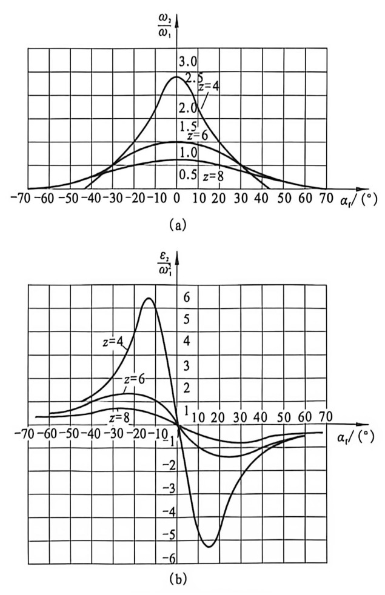

图7-16 外槽轮机构的运动和动力特性变化的曲线
{: .figure-caption }

(a)运动特性；(b)动力特性。

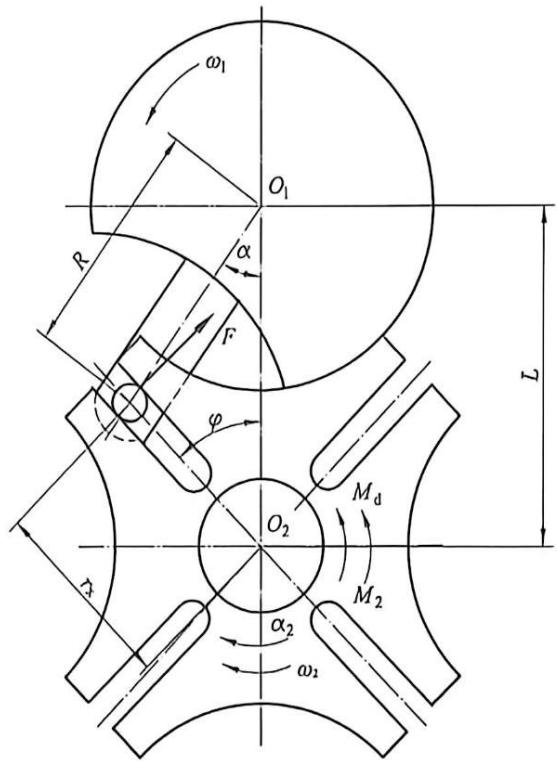

图7-15 槽轮机构的运动分析
{: .figure-caption }

槽轮机构结构简单，工作可靠，机械效率高，能准确控制转角，并能较平稳地间隙进行转位，但因其在启动和停止时有冲击，故常用于转速不高的自动机械、轻工机械及仪器仪表中。

## 7.3 擒纵机构

### 7.3.1 擒纵机构的组成及工作原理

擒纵机构(escapement)是一种间歇运动机构, 主要用于计时器、定时器等中。图 7-17(a)为机械手表中的擒纵机构, 它主要由擒纵轮 5、擒纵叉 2 及游丝摆轮 6 组成。

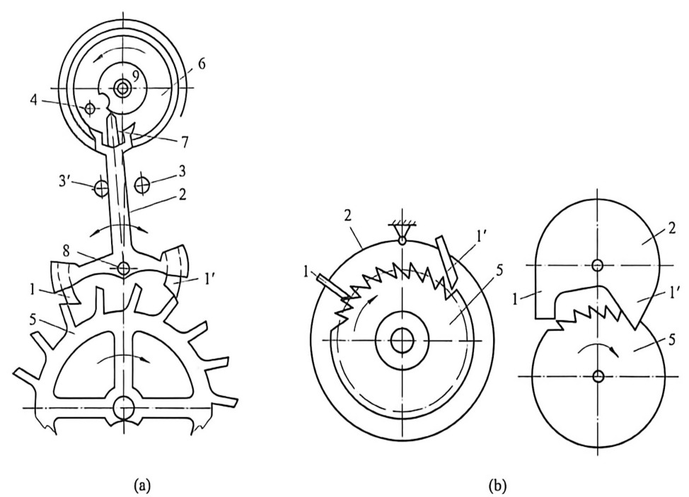

图 7-17 擒纵机构
{: .figure-caption }

(a)有固有振动系统型擒纵机构；(b)无固有振动系统型擒纵机构；

1、1'—左、右卡瓦；2—擒纵叉；3、3'—右、左限位钉；4—圆柱销；5—擒纵轮；6—游丝摆轮；7—叉头钉；8、9—轴。

擒纵轮 5 受发条力矩的驱动, 具有顺时针转动的趋势, 但因受到擒纵叉 2 的左卡瓦 1 的阻挡而停止。游丝摆轮 6 以一定的频率绕轴 9 往复摆动。图 7-17(a) 所示为游丝摆轮 6 逆时针摆动, 当摆轮上的圆柱销 4 撞到叉头钉 7 时, 擒纵叉 2 顺时针摆动, 直至碰到右限位钉 3 才停止。这时, 左卡瓦 1 抬起, 释放擒纵轮 5 使之顺时针转动, 而右卡瓦 1'落下, 并与擒纵轮另一轮齿接触时, 擒纵轮 5 又被挡住而停止。当游丝摆轮 6 沿顺时针方向摆回时, 圆柱销 4 又从右边推动叉头钉 7, 使擒纵叉 5 逆时针摆动, 右卡瓦 1'抬起, 擒纵轮 5 被释放并转过一个角度, 直到再次被左卡瓦 1 挡住为止。这样就完成了一个工作周期。这就是钟表产生滴答声响的原因。

### 7.3.2 擒纵机构的类型及应用

擒纵机构可分为有固有振动系统型擒纵机构和无固有振动系统型擒纵机构两类。

如图 7-17(n) 所示为有固有振动系统型擒纵机构，常用于钟表中。

如图 7-17(b) 所示为无固有振动系统型擒纵机构，仅由擒纵轮 5 和擒纵叉 2 组成。擒纵轮 5 在驱动力矩作用下保持顺时针方向转动趋势。擒纵轮 5 倾斜

2 组成。擒纵轮 5 在驱动力矩作用下保持顺时针方向转动趋势。擒纵轮 5 倾斜的轮齿交替地与左、右卡瓦 1、1'接触，使擒纵叉 2 往复振动。擒纵叉 2 往复振动的周期与擒纵叉 2 转动惯量的平方根呈正比，与擒纵轮 5 给擒纵叉 2 的转矩大小的平方根呈反比，因擒纵叉 2 的转动惯量为常数，故只要擒纵轮 5 给擒纵叉 2 的力矩大小基本稳定，就能使擒纵轮 5 做平均转速基本恒定的间歇运动。

这种机构结构简单，便于制造，价格低，但振动周期不稳定，主要用于计时精度要求不高、工作时间较短的场合，如自动记录仪、计数器、定时器、测速器及照相机快门和自拍器等。

## 7.4 凸轮式间歇运动机构

### 7.4.1 凸轮式间歇运动机构的组成和工作原理

凸轮式间歇运动机构一般由主动凸轮、从动转盘和机架组成。如图 7-18 所示为圆柱凸轮式间隙运动机构，主动凸轮 1 的圆柱面上开有一条两端开口、不闭合的曲线沟槽（或凹脊），从动转盘 3 的端面上有均匀分布的圆柱销 2，当主动凸轮 1 连续转动时，通过其曲线沟槽（或凹脊）拨动从动转盘 3 上的圆柱销 2，从而使从动转盘 3 做间隙分度运动。

### 7.4.2 凸轮式间隙运动机构的类型

除了圆柱凸轮间隙运动机构之外，还有蜗杆凸轮式间隙运动机构和共轭凸轮式间隙运动机构。

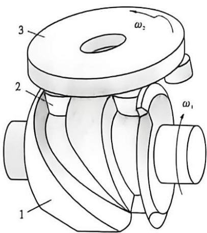

图7-18 圆柱凸轮式间隙运动机构
{: .figure-caption }

1—主动凸轮；2—圆柱销；3—从动转盘。

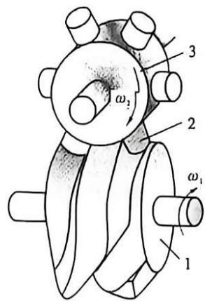

图7-19 蜗杆凸轮式间隙运动机构
{: .figure-caption }

1—主动凸轮；2—圆柱销；3—从动转盘。

蜗杆凸轮式间隙运动机构如图 7-19 所示，其主动凸轮 1 为圆弧面蜗杆凸轮，从动转盘 3 为具有周向均布柱销的圆盘，当主动凸轮 1 转动时，将通过转盘上的圆柱销 2 做间隙运动。

如图 7-20 所示为共轭凸轮式间隙运动机构，在主动轴装有一对共轭平面凸轮 1 及 1'，在从动转盘 2 的两个端面上装有均匀分布的滚子 3 和 3'，两个共轭凸轮分别与从动转盘两侧的滚子接触，在一个运动周期中，两凸轮相继推动从动转盘转动。

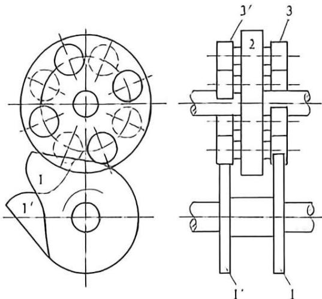

1、1'一共轭平面凸轮；2—从动转盘；3、3'一浪子。
图7-20 共轭凸轮式间隙运动机构

### 7.4.3 凸轮式间隙运动机构的设计

这里主要介绍圆柱凸轮式间隙运动机构设计的几个基本问题。

#### 1. 转盘的转位时间与静止时间

若凸轮转动一周的时间为 $t_{1}$ ，凸轮沟槽中螺旋角不为零的曲线所对应的角度为 $\theta$ ，则转盘的运动时间为：

凸轮式间歇运动机构

$$
t _ {\mathrm{d}} = \theta t _ {1} / 2 \pi\tag{7-16}
$$

静止时间为：

$$
t _ {i} = t _ {1} - t _ {\mathrm{d}} = (1 - \theta / 2 \pi) t _ {1}
$$

#### 2. 圆柱销数 $Z$ 的选取

(7-17)

一般按工艺要求预定 Z，但过少会引起凸轮与圆柱销的干涉。因此，对于单头廓线的凸轮， $Z \geqslant 5$ 。

#### 3. 主要参数设计

(1) 凸轮的最大升程 $h_{0}$ 。h 可由图 7-18 的俯视图 7-21 来求，即

$$
h = 2 R \sin \alpha\tag{7-18}
$$

式中：R 为圆柱销的中心回转半径； $\alpha$ 为动程角， $\alpha=\frac{\pi}{z}$ 。

(2) 圆柱销的直径 d。为保证传动精度，d 与凸轮槽宽度应相同。

(3) 凸轮的宽度 b。为保证从动件停止阶段的可靠定位，应使用两圆柱销同时与凸轮廓线接触。故直线段宽度 b 应等于相邻两圆柱销表面内侧之间的距离，即 b = h - d。

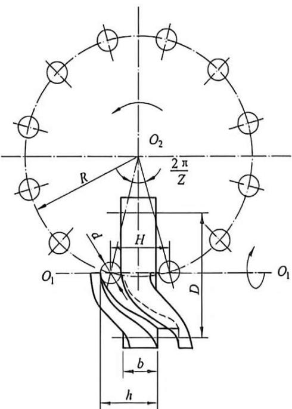

图7-21 圆柱凸轮间隙运动机构的设计
{: .figure-caption }

(4)凸轮平均半径 $D$ 。 $D$ 与凸轮廓线的压力角有关, 若压力角越过许用值, 则应加大凸轮的平均半径 $D$ 。

凸轮式间隙运动机构结构简单、工作可靠，转位精确，不需要专门的定位装置，且通过合理选择从动件的运动规律，可减少动载荷和避免冲击，使机构传动平稳。其主要用于轻工机械、冲压机械等高速、高精度的步进进给、分度等机构，但凸轮加工较复杂，精度要求较高，装配调整比较困难。

## 7.5 不完全齿轮机构

### 7.5.1 不完全齿轮机构的构成、工作原理和类型

不完全齿轮机构是由齿轮机构演变而成的一种间隙运动机构。与一般的齿轮机构相比(图 7-22)，其最大区别在于在主动轮上只做一部分轮齿，其余部分为外凸锁止弧，在从动轮上做出与主动轮轮齿相啮合的轮齿和内凹锁止弧，当主动轮做连续回转运动时，从动轮做间歇回转运动。当轮齿进入啮合区时，从动轮开始转动。当主动轮的轮齿退出啮合后，由于两齿轮的凸、凹锁止弧的定位作用，从动轮可靠停止，实现从动轮间隙回转运动。

如图 7-22(a) 所示的不完全齿轮机构中，主动轮 1 上只有 1 个齿，从动轮 2 上有 8 个齿，故主动轮转 1 转时，从动轮只转 1/8 转。如图 7-22(b) 所示的不完全齿轮机构中，主动轮 1 上有 4 个齿，从动轮 2 上有 4 个远动段和 4 个停歇段相间分布，每段上有 4 个齿与主动轮相啮合。主动轮转 1 转，从动轮转 1/4 转。

与齿轮机构相似，不完全齿轮机构有外啮合、内啮合、齿轮齿条式及圆柱和圆锥不完全齿轮机构。

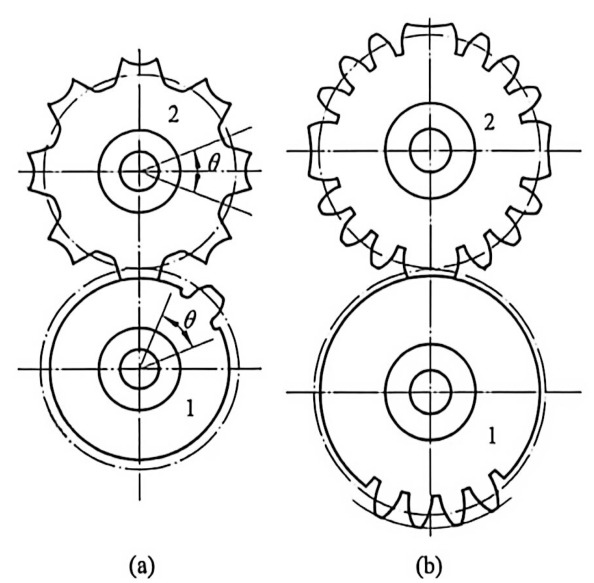

### 7.5.2 不完全齿轮机构的设计

#### 1. 主动齿首、末齿齿顶降低

1—主动轮；2—从动轮。

图7-22 不完全齿轮机构
{: .figure-caption }

若在主动轮首齿进入啮合时，主动轮的

齿顶被从动轮的齿顶挡住，不能进入啮合，则发生齿顶干涉。图7-23中主动轮中虚线齿与从动轮轮齿就发生了干涉。为了避免干涉现象的产生，可将主动轮齿顶高降低至 $r_{a1}^{\prime}$ ，这样首齿就能顺利地进入啮合。

不完全齿轮的主动轮除了齿顶降低外，末齿齿顶也应降低，而其他各齿保持标准齿顶高，末端修正的原因如下：从动齿轮每次啮合时，均应停在预定的位置上，而从动齿轮锁止弧的停止位置取决于点 D，而点 D 是首齿降低后主动轮齿顶圆与从动轮齿顶圆的交点。为了便于机构的正反转，点 D 与点 C 应对称于两轮中心线。

#### 2. 改善从动轮动力特性的措施

不完全齿轮机构在开始和终止啮合时，由于速度有突变时会产生冲击，故不适用于高速传动。为了改善从动轮的动力特性，可装置瞬心线附加杆，如图7-24所示，附加杆 $K$ 、 $L$ 分别固定在主动齿轮1和从动齿轮2上。

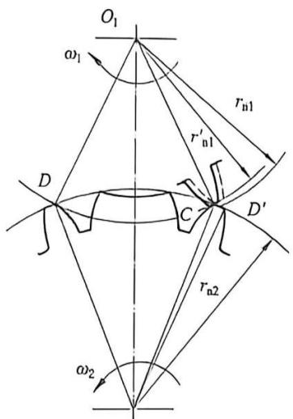

图7-23 不完全齿轮机构的干涉
{: .figure-caption }

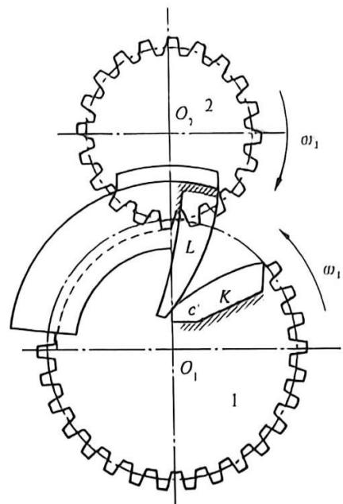

图7-24 装置瞬心线附加杆的不完全齿轮机构
{: .figure-caption }

当主动齿轮1的首齿与从动轮2的齿在啮合线上啮合之前，瞬心线附加杆 $K 、 L$ 先接触，这时从动轮2的角速度为 $\omega_{2} = \omega_{1} \frac{O_{1} c^{\prime}}{O_{2} c^{\prime}}$ ，式中 $c^{\prime}$ 为两齿轮相对瞬心。如开始运动时， $c^{\prime}$ 与 $O_{1}$ 重合， $\omega_{2}$ 可由0逐渐增大，不发生冲击，这时两轮在啮合线上啮合，然后首齿及其他齿相继在啮合线上啮合，以定传动比传动。同样末齿脱离啮合时可以借助另一附加杆使从动齿轮 $\omega_{2}$ 逐渐减至0。这样，在整个运动周期内就可保持速度变化平稳，以减少冲击。由于进入啮合时的冲击比脱离啮合时严重，所以经常只在进入啮合处装置瞬心线附加杆。

不完全齿轮机构结构简单，制造容易，工作可靠，容易实现从动轮停歇的次数、每次停歇的时间及每次转过的转角的要求，而且其调整范围比较大，设计比较灵活；但设计计算和加工工艺较复杂，从动轮在运动开始与终止时冲击较大，故一般用于低速、轻载的场合。不完全齿轮机构常用于多工位、多工序等有特殊要求的自动机或生产线上，实现间歇转位和进给运动。

## 7.6 间歇运动机构设计的基本要求

间歇运动机构常用于机床、自动机和仪器中，实现原料送进、成品输出、分度、转位、换向、擒纵、超越等功能。随着各类机械自动化程度和生产率的日益提高，对间歇运动的要求就更广泛，对它的运动、性能、功能等设计要求就更高了。

间歇运动机构的设计一般有以下几方面的基本要求。

### 1. 动力性能的要求

间歇运动机构的从动机构在一个很短的时间内要经过启动、加速、减速、停止的过程，会产生较大的加速度，从而产生冲击载荷。设计中为了尽量保证间歇运动机构动作平稳，特别要注意合理选择从动件的运动规律。

### 2. 从动件运动、停歇时间的要求

间歇运动机构中，从动件停歇的时间一般是机床或自动机进行工艺加工的时间；而从动机运动的时间往往是机床或自动机作送进、分度、转位等辅助工作的时间。间歇运动机构这个运动特性可用动停时间比 k 来表示：

$$
k = \frac {t _ {\mathrm{d}}}{t _ {\mathrm{i}}}\tag{7-19}
$$

式中： $t_{d}$ 为从动件在一个运动周期中的运动时间； $t_{t}$ 为其停歇时间。k 值越小，生产率会越高；但 k 值过小会引起启动和停止时的加速度过大，因此应合理选择 k 值。

### 3. 从动件运动、停止位置的要求

应根据工作要求选取从动件运动行程的大小，并注意从动件停歇位置的准确性。

## 7.7 应用举例

如图 7-25 所示的牛头刨床工作台采用棘轮机构实现横向进给，齿轮 1 带动齿轮 2 连续回转，通过连杆 3 使摇杆 4 往复摆动，从而使棘爪 7 推动固定于进给丝杆 6 上一端的棘轮 5 做单向间歇运动，进而带动工作台做横向进给运动。当需要改变进给量（即改变棘轮每次转过的角度）时，可调节 $O_{2}A$ 的长度。若需换向进给，则提转棘爪 7。

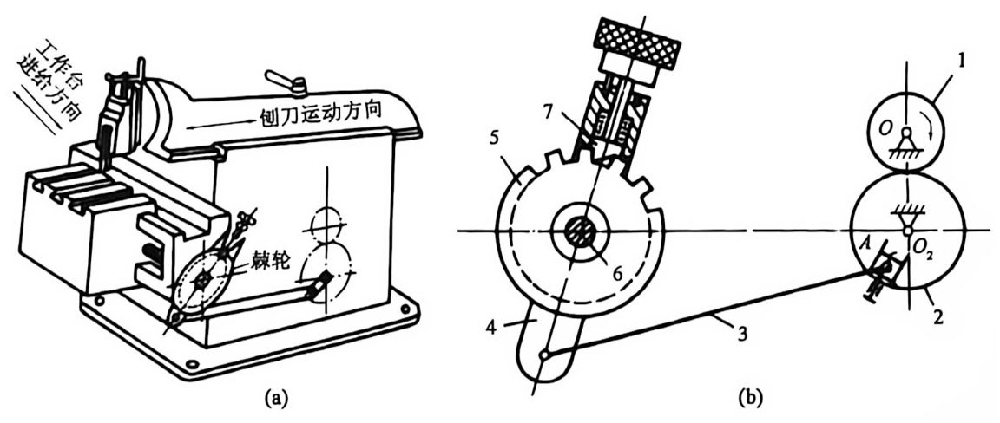

图7-25 牛头刨床工作台的横向进给
{: .figure-caption }

1—齿轮；2—齿轮；3—连杆；4—摇杆；5—棘轮；6—进给丝杆；7—棘爪。

自行车后轴中的“飞轮”，即为采用内接棘轮机构的单向离合器，如图7-26所示。正常前进时，主动星轮1驱动棘轮3(后车轮)转动；但当棘轮3的转速超过了主动星轮1的转速时，则两者自动脱开，各自自由旋转，此时的单向离合器又被称为超越离合器。

如图 7-27 所示为六角车床刀架转位机构，刀架上装有 6 种刀具，与刀架同轴的驱动槽

1—主动星轮；2—棘爪；3—棘轮。

轮 2 上开有 6 个径向槽，主动拨盘 1 每转动一周，驱动槽轮 2 转过 $60^{\circ}$ ，从而将下一工序的刀具转换到工作位置。

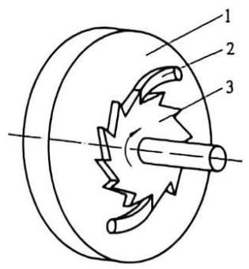

图7-26 单向离合器
{: .figure-caption }

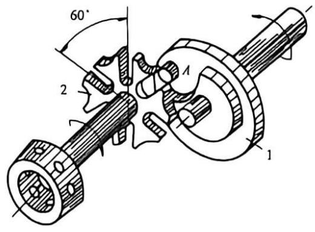

图7-27 六角车床刀架转位机构
{: .figure-caption }

1—主动拨盘；2—驱动槽轮。

如图 7-28 所示为钻孔攻丝机的转位机构。运动由变速箱传给圆柱凸轮 1，经转盘 2 及与转盘 2 固连的齿轮 3，传到齿轮 4，使与齿轮 4 固连的工作台 5 获得间歇的转位。

如图 7-29 所示的乒乓球拍周缘铣削专用靠模铣床是采用不完全齿轮机构来实现工件轴正、反转功能的。主动轴 1 带动铣刀轴 2 转动；另一主动轴 3 上的不完全齿轮 4 和 5 分别使工作轴正、反回转。当工作轴回转时，在靠模凸轮 6 和弹簧的作用下，使铣刀轴 2 上的滚轮 7 紧靠在靠模凸轮 6 上。

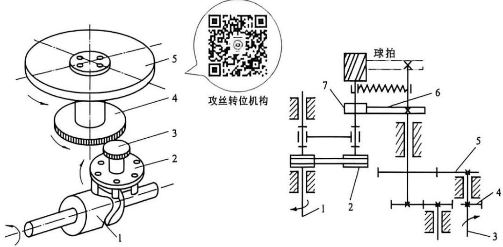

图7-28 钻孔攻丝机的转位机构
{: .figure-caption }

1—圆轮凸轮；2—转盘；3—齿轮；4—齿轮；5—工作台。

图7-29 乒乓球拍周缘铣削专用靠模铣床
{: .figure-caption }

## 本章思维导图

分类：轮齿式与摩擦式、单动式与双动式、单向与双向式

## 思考题与练习题

1. 齿轮机构要求有一对以上的啮合轮齿同时工作, 而槽轮机构为什么不允许有两个以上的主动拨盘同时工作?

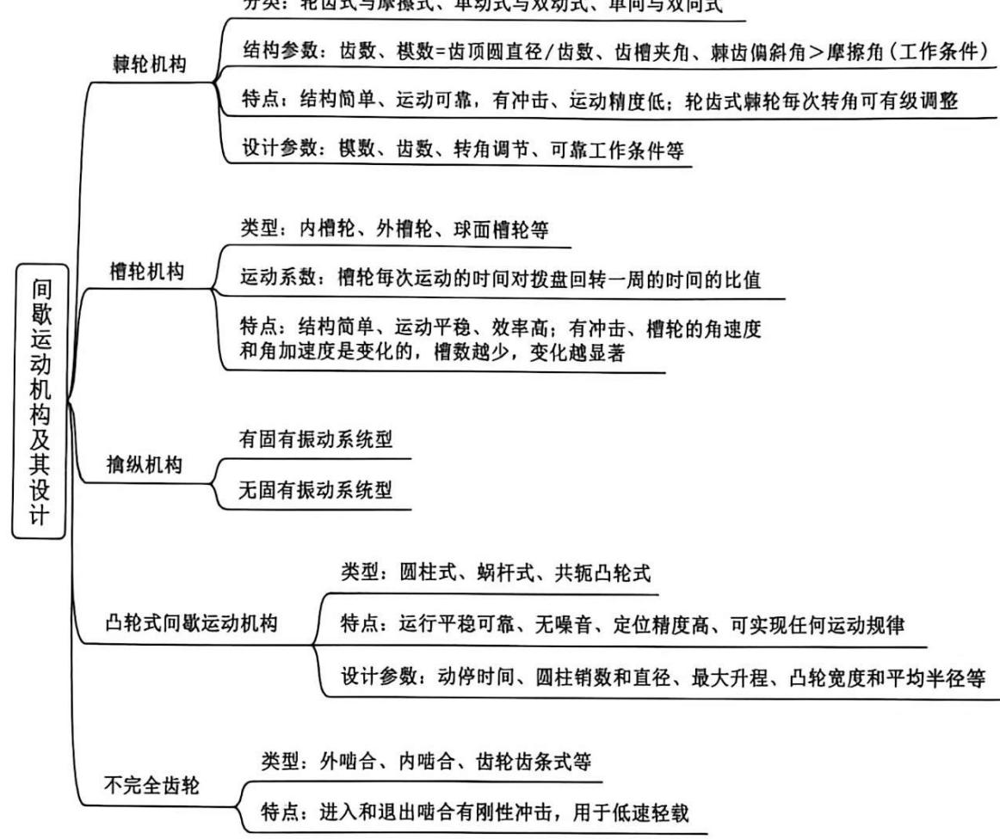

2. 棘轮机构除常用来实现间歇运动的功能外，还常用来实现什么功能？

3. 为什么槽轮机构的运动系数 $k$ 不能大于 1?

4. 为什么不完全齿轮机构主动轮首、末两轮齿的齿高一般需要削减？加上瞬心线附加杆后，是否仍需削减？为什么？

5. 棘轮机构、槽轮机构、不完全齿轮机构及凸轮式间歇运动机构均能使执行构件获得间歇运动，试从各自的工作特点、运动及动力性能分析它们各自的适用场合。

6. 擒纵机构也是一种间歇运动机构，应用这种机构的主要目的是什么？你能利用擒纵机构设计一种高楼失火自救器吗？

7. 为避免槽轮机构工作时刚性冲击和非工作时的游动，在设计时必须注意什么？应如何确定缺口弧的尺寸？

8. 在牛头刨床的横向送进机构中, 已知工作台的横向送给量 $s = {0.1}\mathrm{\;{mm}}$ , 送进螺杆的导程 $l = 3\mathrm{\;{mm}}$ ,棘轮模数 $m = 6\mathrm{\;{mm}}$ ,棘爪与棘轮之间的摩擦系数 $f = {0.15}$ 。试求：

(1) 棘轮齿面倾斜角 $\beta$ ;

(2)棘轮的齿数z;

(3) 棘轮的尺寸 $d_{\mathrm{a}}$ 、 $d_{\mathrm{f}}$ 、 $p$ ;

(4)棘爪的长度 $L$ 。

9. 已知牛头刨床工作台的横向进给丝杆, 其导程为 $5 \mathrm{~mm}$ , 与丝杆轴联动的棘轮齿数为 40 齿, 求棘轮的最小转动角度和该刨床的最小横向进给量。

10. 某自动机床工作台要求有6个工位, 转台停歇时进行工艺动作, 其中最长的工作时间为 $30 \mathrm{~s}$ , 拟采用槽轮机构实现转位工作。要求:

(1)试确定槽轮机构的类型、槽数和圆柱销数；

(2)计算槽轮机构的运动系数k;

(3)计算主动拨盘的转速 $n_{1}$ 。

11. 某装配工作台要求有 6 个工位, 每个工位在工作静止时间 $t_{j} = 10 \mathrm{~s}$ 内完成装配工序。转位机构采用单销槽轮机构, 试求:

(1) 槽轮机构的运动系数 k;

(2)主动拨盘的转速 $\omega_{1}$ ;

(3) 槽轮的转位时间 $t_{\mathrm{d}}$ 。

12. 在外接槽轮机构中, 已知圆柱销数为 2 , 运动系数 $k = 1/2$ , 主动轮转速 ${n}_{1} = {50}\mathrm{r}/\mathrm{{min}}$ , 如果设计者选用单销外槽轮机构来实现工作台的转位, 试求:

(1) 槽轮槽数 z;

(2) 槽轮的运动时间 $t_{d}$ ;

(3) 槽轮的静止时间 $t_{\mathrm{j}}$ 。
