# 第8章 其他常用机构

**【概述】**

◎在许多机器中，除了采用前面介绍的平面连杆机构、凸轮机构、齿轮机构和间歇运动机构等一些典型的常用机构外，还经常用到其他类型的机构。本章主要介绍螺旋机构、万向铰链机构、非圆齿轮机构、摩擦传动机构及广义机构的特点及应用，重点分析了螺旋机构、万向铰链机构和非圆齿轮机构的工作原理、运动特点及其应用。

◎通过本章的学习，要求掌握螺旋机构、万向铰链机构、非圆齿轮机构的工作原理及运动特点等。

## 8.1 螺旋机构

螺旋机构(图 8-1)是利用螺杆和螺母组成螺旋副来实现传动要求的一种常用机构，由螺杆、螺母和机架组成。一般情况下，它将螺旋运动转换为直线运动，同时传递运动和动力。螺旋机构结构简单、运动准确，能获得很大的降速比和力的增益，工作平稳、噪声小，合理选择螺旋升角可具有自锁性能，但存在摩擦损耗大、传动效率低等缺点。

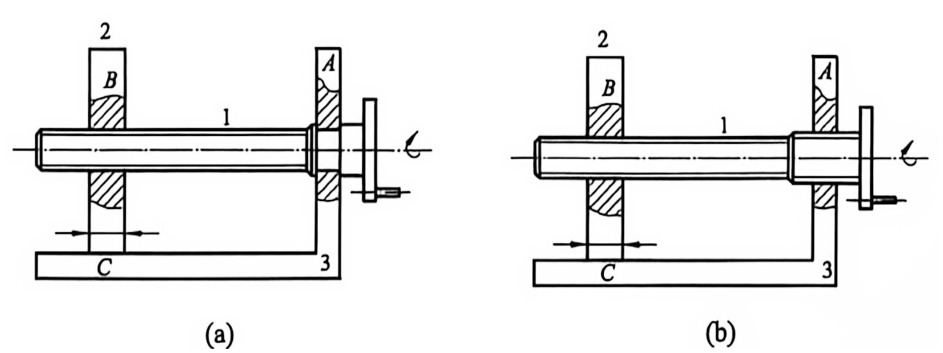

1—螺杆；2—螺母；3—机架；

A—转动副；B—螺旋副；C—移动副。

图8-1 螺旋机构
{: .figure-caption }

### 8.1.1 螺旋机构的工作原理

如图 8-1 所示为简单的螺旋机构, 其中构件 1 为螺杆, 构件 2 为螺母, 构件 3 为机架。图 8-1(a) 中, $B$ 为螺旋副, 其导程为 $l$ , $C$ 为移动副。当螺杆 1 转动 $\varphi$ 角时, 螺母 2 的位移 $s$ 为:

$$
s = l \frac {\varphi}{2 \pi}\tag{8-1}
$$

如果将图 8-1(a) 中的转动副 A 也换成螺旋副，便得到图 8-1(b) 所示的螺旋机构。设 A、B 段螺旋的导程分别为 $l_{a}$ 、 $l_{b}$ ，则当螺杆 1 转动 $\varphi$ 角时，螺母 2 的位移 s 为：

$$
s = (l _ {\mathrm{a}} \pm l _ {\mathrm{b}}) \frac {\varphi}{2 \pi}\tag{8-2}
$$

式中：“+”用于两螺旋旋向相反时；“-”号用于两螺旋旋向相同时。

由式(8-2)可知, 当两螺旋旋向相同时, 若 $l_{\mathrm{a}}$ 与 $l_{\mathrm{b}}$ 相差很小, 则螺母 2 的位移可以很小, 这种螺旋机构称为差动螺旋机构 (又称微动螺旋机构); 当两螺纹旋向相反时, 螺母 2 可以产生快速移动, 这种螺旋机构称为复式螺旋机构。

### 8.1.2 螺旋机构的类型及其应用

1. 按螺杆与螺母之间的摩擦性质不同，螺旋机构可分为滑动螺旋机构、滚动螺旋机构和静压螺旋机构

(1) 滑动螺旋机构。

滑动螺旋机构中螺杆与螺母的螺旋面直接接触，摩擦状态为滑动摩擦。滑动螺旋机构结构简单，制造成本较低，便于制造，易于自锁，但其摩擦阻力大，效率低，磨损快，故传动精度较低。滑动螺旋机构通常采用梯形螺纹和锯齿形螺纹，其中梯形螺纹应用最广，锯齿形螺纹用于单面受力，而矩形螺纹由于工艺性较差、强度较低等应用很少；对于受力不大和精密机构的调整螺旋，有时候也采用三角形螺纹。如图8-2所示为用于车辆连接的滑动复式螺旋机构，A、B两螺旋副旋向相反，根据复式螺旋机构的工作原理，螺母可产生很快的位移，使车钩E和F快速靠近或离开。

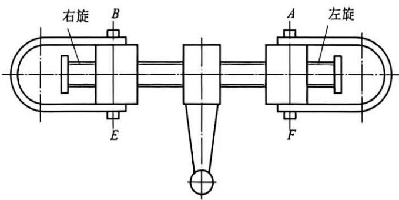

图8-2 滑动复式螺旋机构
{: .figure-caption }

(2) 滚动螺旋机构。

滚动螺旋机构中，螺杆与螺母的螺纹滚道间有滚动体，如图 8-3 所示。当螺杆或螺母转动时，滚动体在螺纹滚道内滚动，使螺杆和螺母间为滚动摩擦，提高了传动的效率和精度。滚动螺旋传动的效率一般在 $90\%$ 以上。它不自锁，具有传动的可逆性；但结构复杂，制造精度要求高，抗冲击性能差。已经广泛地应用于机床、飞机、船舶和汽车等要求高精度或高效率的场合。

(3)静压螺旋机构。

静压螺旋机构是螺纹工作面间形成液体静压油膜润滑的螺旋传动，静压螺旋传动摩擦系数小，传动效率可达 $99\%$ ，无磨损和爬行现象，无反向空程，轴向刚度很高，不自锁，具有传动的可逆性，但螺母结构复杂，而且需要有一套压力稳定、温度恒定和过滤要求高的供油系统。静压螺旋常被用作精密机床进给和分度机构的传导螺旋，采用牙较高的梯形螺纹，在螺母每圈螺纹牙两个侧面的中径处开有3-6个间隔均匀的油腔，同一母线上同一侧的油腔连通，用一个节流阀控制，如图8-4所示。油泵将精滤后的高压油注入油腔，油经过摩擦面间缝隙后再由牙根处回油孔流回油箱。当螺杆未受载荷时，牙两侧的间隙和油压相同。当螺杆受向左的轴向力作用时，螺杆略向左移；当螺杆受径向力作用时，螺杆略向下移。当螺杆受弯矩作用时，螺杆略偏转。由于节流阀的作用，在微量移动后各油腔中油压发生变化，螺杆平衡于某一位置，保持某一油膜厚度。

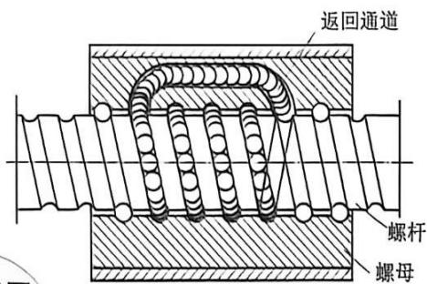

图8-3 滚动螺旋机构
{: .figure-caption }

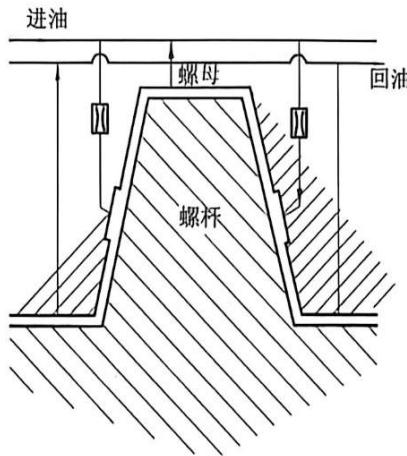

传力螺旋
图8-4 静压螺旋机构

#### 2. 按用途不同，螺旋机构可分为传力螺旋机构、传导螺旋机构、调整螺旋机构

(1) 传力螺旋机构。

传力螺旋机构以传递动力为主，要求以较小的转矩产生较大的轴向推力，用以克服工件阻力。这种螺旋机构主要承受较大的轴向力，一般为间歇性工作，每次工作时间较短，工作速度不高，并要求具有自锁性，广泛应用于各种起重或加压装置中。如图8-5所示为螺旋式压榨机，螺杆1两端分别与螺母2、3组成旋向相反、导程相同的螺旋副A与B。根据复式螺旋机构的工作原理，当转动螺杆1时，螺母2、3很快靠近，再通过连杆4、5使压板6向下运

动以压榨物件。

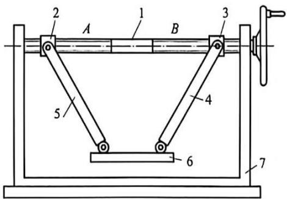

1—螺杆；2—螺母；3—螺母；

4—连杆；5—连杆；6—压板。

图8-5 螺旋式压榨机
{: .figure-caption }

(2)传导螺旋机构。

传导螺旋机构以传递运动为主，有时候也承受较大的轴向载荷。传导螺旋常需在较长的时间内连续工作，工作速度较高，因而要求有较高的传动精度，多用于机床的进给系统。如图8-6所示为机床进给丝杆机构，通过螺杆传动、螺母移动具有较高的传动精度。

(3) 调整螺旋机构。

调整螺旋机构用以调整、固定零件的相对位置，如机床、仪器及测试装置中的微调机构的螺纹。调整螺旋不经常转动，一般在空载下进行调整。如图8-7所示为一调整螺旋机构，利用螺旋机构调节曲柄的长度、螺杆1与曲柄2组成转动副 $B$ ，并与螺母3组成螺旋副 $D$ ，曲柄2的长度 $AK$ 可以通过转动螺杆1改变螺母3的位置来调节。

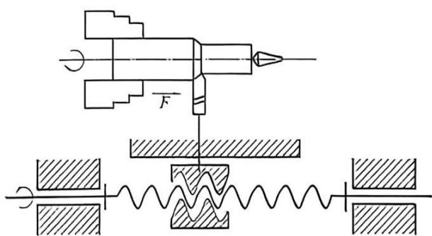

图8-6 机床进给丝杆机构
{: .figure-caption }

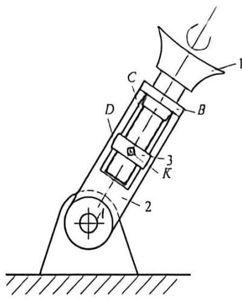

图8-7 调整螺旋机构
{: .figure-caption }

1—螺杆；2—曲柄；3—螺母。

## 8.2 万向铰链机构

万向铰链机构又称为万向联轴节或万向联轴器，它主要用于传递两相交轴间的运动和动力。其结构特点是两相交传动轴的末端均连着一个叉形支架，并用铰链与中间“十字形”构件相连，可允许主、从动轴轴线的夹角在一定范围内变动，是一种常用的变角传动机构。它广泛应用于汽车、机床、工程机械等机械传动系统中。万向铰链机构主要包括单万向铰链机构和双万向铰链机构。

### 8.2.1 单万向铰链机构

如图 8-8 所示为单万向铰链机构结构简图, 它是由两个传动轴的末端为叉形的构件 1 和 3、十字体 2 和机架 4 组成, 其中两个传动轴 1 和 3 分别与机架 4 构成转动副 A 和 D, 而两传动轴末端为叉形的构件 1 和 3 分别与十字体 2 组成

两个轴线相互垂直的转动副 B 和 C，并且这四个转动副的回转轴线会交于十字体的中心点 O，传动轴 1 与传动轴 3 所夹锐角为 $\alpha$ 。

如图 8-9 所示，当输入轴 1 转动一周时，输出轴 3 随之转动一周，故两轴的平均传动比为 1，但两轴的瞬时传动比却因两轴的瞬时角速度随时变化而不恒等于 1，其关系如下：

$$
i _ {0 1} = \frac {\omega_ {7}}{\omega_ {1}} = \frac {\cos \alpha}{1 - \sin^ {2} \alpha \cos^ {2} \varphi_ {1}}\tag{8-3}
$$

式中： $\varphi_{1}$ 为输入轴 1 的转角。

由式(8-3)可知，若输入轴1以 $\omega_{1}$ 等速回转时，输出轴3的转速 $\omega_{2}$ 将在 $\omega_{1}\cos\alpha$ 至 $\frac{\omega_{1}}{109\Omega}$ 范围内变化.

如图8-9所示为 $w$ ，在 $0^{\circ}$ 到 $180^{\circ}$ 范围内时，对应几个不同的轴同角 $\alpha$ 的 $i_{33}$ 随 $\varphi$ ，的变化曲线。从图中不难看出：当 $n$ 堵大时， $i_{33}$ 的波动幅度或不均匀系数也增大，故在实际应用中， $\sigma$ 一般为 $35^{\circ} - 45^{\circ}$ 。

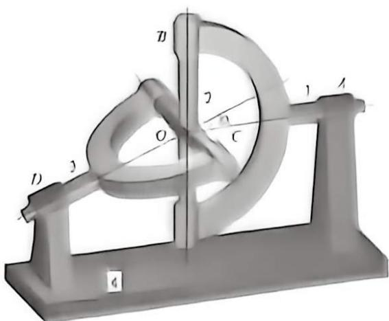

朝8-8 单万向铰链机构

### 8.2.2 双万向铰链机构

双方向铰链机构

右单万向铰链机构中，当主动轴等速回转时，其从动轴做周期性变速转动，这会影响机械运转的平稳性，并在传动中引起附加动载荷，使轴产生振动。为了改善这种情况，可采用双万向铰链机构，其构成可看作是用一根中间轴2和两个单万向联轴节将输入轴1和输出轴3连接起来，如图8-10所示。中间轴2常做成两段，采用花键或滑键连接，以适应传动中两轴间距离的变化。

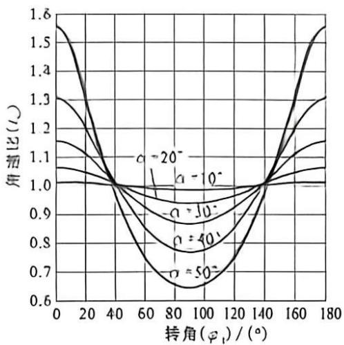

图8-9 $i_{j1}$ 随 $\varphi_{1}$ 的变化曲线
{: .figure-caption }

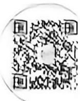

为了使输入轴1与输出轴3的传动比 $i_{31}$ 恒等于1，双万向铰链机构在安装时必须符合下面三个条件；

(1) 输入轴 1、输出轴 3 及中间轴 2 应三轴共面。

(2) 输入轴 1、输出轴 3 的轴线与中间轴 2 的轴线之间的夹角应相等，即应满足 $\alpha_{1} = \alpha_{3}$ 。

(3) 中同轴 2 两端的叉面应位于同一平面内。

双万向铰链机构能连接轴交角较大的相交轴或径向偏距较大的平行轴，并且在运转时轴交角或偏距可改变，径向尺寸小，而且按上述三个条件安装可保证等角速比传动，因此在机械中得到广泛应用。图8-11为双万向铰链机构在汽车驱动系统中的应用，变速箱1安装在车架上，而后桥 3 用弹簧与车架连接。汽车在行驶过程中，由于道路不平，会使弹簧发生变形，致使后桥与变速箱之间的相对位置发生变化。在变速箱 1 和后桥 3 传动装置的输入轴之间，采用双万向铰链机构 2 连接，以实现等角速传动。

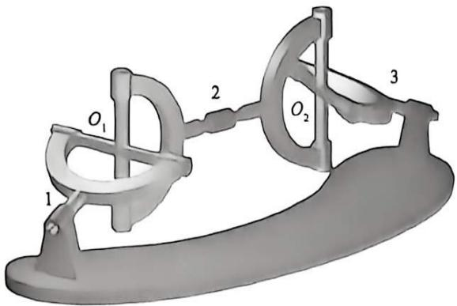

图8-10 双万向铰链机构
{: .figure-caption }

1—输入轴；2—中间轴；3—输出轴。

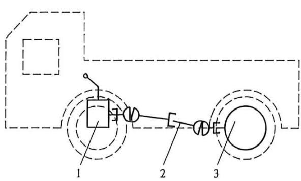

图8-11 双万向铰链机构在汽车驱动系统中的应用
{: .figure-caption }

1—变速箱；2—双万向铰链机构；3—后桥。

## 8.3 非圆齿轮机构

在机械中广泛应用的圆柱齿轮机构，其节线是圆形的，因此两个圆柱齿轮相互啮合时瞬时传动比为定值。假如一对齿轮的节线保持纯滚动，其中心距不变，而其瞬时传动比按一定规律变化，这样的节线是非圆形的曲线，沿着非圆形节线切出齿形，就成为非圆齿轮。目前，随着数控加工技术的日益成熟，较好地解决了非圆齿轮的加工难题，非圆齿轮机构正被广泛地应用。

### 8.3.1 非圆齿轮机构的工作原理和类型

如图 8-12 所示， $h_{1}$ 和 $h_{2}$ 是一对非圆齿轮的节线。当两轮啮合传动时， $h_{1}$ 和 $h_{2}$ 做无滑动的纯滚动，其切点 P 为节点，这时两轮的瞬时传动比为：

$$
i _ {1 2} = \frac {\omega_ {1}}{\omega_ {2}} = \frac {\mathrm{d} \varphi_ {1}}{\mathrm{d} \varphi_ {2}} = \frac {\overline {{O _ {2} P}}}{\overline {{O _ {1} P}}} = \frac {\rho_ {2}}{\rho_ {1}}\tag{8-4}
$$

式中： $\rho_{1}$ 和 $\rho_{2}$ 分别为两轮节线的瞬时曲率半径； $\varphi_{1}$ 和 $\varphi_{2}$ 为两轮的转角。

要使非圆齿轮的传动能够实现(也就是保证两轮节线为纯滚动接触)，必须满足以下两个条件：

(1)两非圆齿轮在任何瞬间的瞬时曲率半径之和应等于两轮固定回转中心距S，即

$$
\rho_ {1} + \rho_ {2} = S\tag{8-5}
$$

(2) 相互滚过的两段节曲线的弧长应处处相等, 即

$$
\rho_ {1} \cdot \mathrm{d} \varphi_ {1} = \rho_ {2} \cdot \mathrm{d} \varphi_ {2}\tag{8-6}
$$

根据以上两个条件可知, 每当小齿轮转动一周, 大齿轮节线 $h_{2}$ 与小齿轮节线 $h_{1}$ 之周长相对应的弧长的每一曲率半径应周期性地重复一次。因此, 节线 $h_{2}$ 应当由周期性重复的、全等的曲线线段所组成, 也就是节线 $h_{2}$ 的长度必须是节线 $h_{1}$ 长度的整数倍。

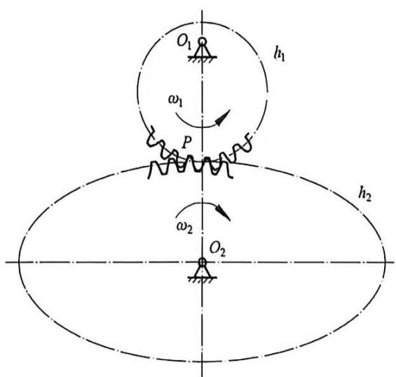

图8-12 非圆齿轮机构啮合原理
{: .figure-caption }

非圆齿轮的形式很多，常见的非圆齿轮的节线主要有椭圆形、卵形、螺旋形等几种，相应的非圆齿轮机构也有椭圆齿轮机构、卵形齿轮机构、对称三叶式叶形齿轮机构等，如图8-13所示。其中以椭圆齿轮机构最为常见。

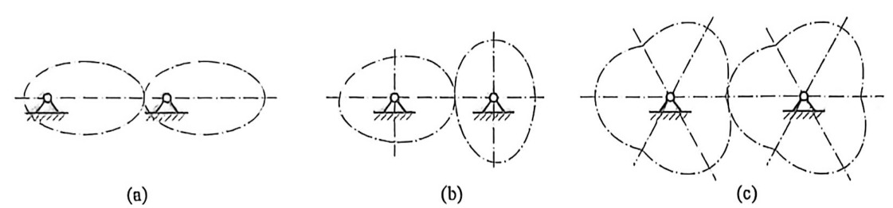

图8-13 三种非圆齿轮机构
{: .figure-caption }

(a)椭圆齿轮机构；(b)卵形齿轮机构；(c)对称三叶式叶形齿轮机构。

### 8.3.2 非圆齿轮机构的特点及其应用

非圆齿轮机构的特点是传动比按一定规律变化，常用在要求从动件速度需要按一定规律变化的场合。非圆齿轮传动机构在运动学方面的特性就是实现主动机构和从动机构转角间的非线性关系，因此可用它来代替通用的连杆机构和凸轮机构传动。其优点如下：

(1)与连杆机构相比, 结构牢靠、紧凑, 且传动较平稳。即传动时动平衡性好, 容易实现动平衡。这些都是在设计高速运转机构时必须考虑的关键因素。

(2) 比凸轮机构传动可靠。非圆齿轮机构的最大优点是能实现连续的单向循环运动, 而凸轮机构一般只能实现往复运动。另外当采用凸轮机构再现函数时, 为保证力封闭, 要使用附加弹簧装置, 这样在凸轮机构中就产生了额外动载荷。

(3)用非圆齿轮来实现按一定规律的变速传动, 要比用其他机构容易得多。这是因为它仅通过节曲线的改变就可以实现不同的传动比变化规律。而且, 当受力情况不好或在结构上难以实现时, 可以用几对非圆齿轮来实现。

非圆齿轮机构在机床、自动机械、仪器及解算装置中均有应用。如在辊筒式平板印刷机的自动送纸装置中，当纸送进到印刷辊筒之前，需要校准，这时要求纸的送进速度应该最小，以免纸被压皱；当纸往机器送进时，要求纸张速度近似等于辊筒的圆周速度，因此纸的送进速度是变化的。用一对椭圆齿轮就可以实现这一要求。在卧式压力机中，使用椭圆齿轮来带动压力机的对心曲柄滑块机构，使工作行程速度小、空行程速度大，这样可以改变工作行程与空行程的时间比，用以减少功率消耗，节省时间。在纺织机械中，利用非圆齿轮机构可以周期性地改变纬纱密度，以获得所需花纹的纺织品。除此之外，在剪板机、卷烟机、包装机、计量器及发射导弹、宇宙飞船的地面装置中也得到了较好的应用。

非圆齿轮可以与其他机构组合，用来改变传动的运动特性和改善动力条件。如与曲柄滑块机构、凸轮机构、槽轮机构等组合使用，用以实现某些特殊要求的运动。

## 8.4 摩擦传动机构

摩擦传动机构是由主动轮(或轴)与从动轮(或轴、杆、皮带等)的压紧力所产生的摩擦力来传递动力的。因其传动平稳、结构紧凑、无反向间隙、无噪声，加之过载时打滑等特点，得到了广泛应用。摩擦传动机构类型很多，根据传动距离、传动精度、传动力矩等设计要求，可采用不同类型的机构。例如，对于传动距离大、传动精度要求不高的场合可采用带轮传动；对于传动距离短、传动精

度要求较高的场合可采用惰轮间接传动或者主、从轮直接传动；而要求超精密传动的场合可采用传统摩擦传动和螺旋传动相结合的方式，即扭轮摩擦传动机构。下面简要介绍一下使用惰轮情况的摩擦传动机构。

惰轮的作用主要有改变从动轮转向、增加传动距离、调整压力角等，因此在传动机构设计时，必须注意以下两点。

(1) 确保正确的转向关系。

如图 8-14(a) 所示, 当主动轮逆时针转动时, 正压力 $N_{1}$ 和 $N_{2}$ 的合力使惰轮脱离主、从动轮, 但摩擦力 $F_{1}$ 和 $F_{2}$ 的合力促使惰轮压紧主、从动轮; 如图 8-14(b) 所示, 当主动轮顺时针转动时, 正压力和摩擦力都使惰轮脱离主、从动轮。因此给惰轮施加外力 $P$ 确保摩擦传动机构平稳运转时, 图 8-14(a) 相对于图 8-14(b) 只需很小的外力。

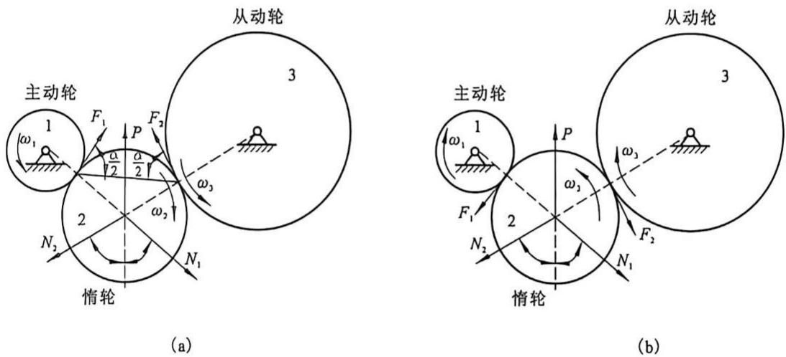

图8-14 转向不同时惰轮的受力关系图
{: .figure-caption }

1—主动轮；2—惰轮；3—从动轮。

(2)选择合理的压力角。

如图 8-14(a) 所示, 压力角 $\alpha$ 是惰轮中心与主、从动轮中心连线间的夹角。假设主动轮与惰轮的摩擦系数为 $f_{1}$ , 从动轮与惰轮的摩擦系数为 $f_{2}$ , 则摩擦力 $F_{1} = f_{1} N_{1}$ 和 $F_{2} = f_{2} N_{2}$ 。根据外力 $P$ 方向的受力平衡, 即

$$
\sum (F) = 0\tag{8-7}
$$

则有：

$$
P + f _ {1} N _ {1} \sin \frac {\alpha}{2} + f _ {2} N _ {2} \sin \frac {\alpha}{2} = N _ {1} \cos \frac {\alpha}{2} + N _ {2} \cos \frac {\alpha}{2}\tag{8-8}
$$

当 $N_{1} = N_{2} = N, f_{1} = f_{2} = \mu$ ，代入上式，得：

$$
\frac {P}{N} = 2 \left(\cos \frac {\alpha}{2} - f \sin \frac {\alpha}{2}\right)\tag{8-9}
$$

由式(8-9)可知, 存在压力角 $\alpha$ 使得外力 $P$ 等于零或接近零, 这时的传动最平稳、耗能最少。例如, 采用橡胶材料设计摩擦传动机构时, 由于橡胶的摩擦系数为 $0.5 - 0.7$ , 当 $P = 0$ 时, 从惰轮压力角在 $110^{\circ}$ 至 $120^{\circ}$ 之间选择最合理。

## 8.5 广义机构

广义机构是引入液、气、声、光、电、磁等工作原理的新型机构，其构件不再局限于刚性构件、动力源与原动件、执行件融为一体，构件与运动副融为一体，传动机构更简便地实现运动或动力转换。广义机构种类繁多，可以根据工作原理不同分为液、气动机构、电磁机构、振动及惯性机构、光电机构等；也可根据机构形式及用途不同分为微位移机构、微型机构、信息机构、智能机构等。下面简要介绍液、气动机构、光电机构、电磁机构、振动及惯性机构的工作原理和结构特点。

### 8.5.1 液、气动机构

液、气动机构是以具有压力的液体、气体作为工作介质来实现能量传递与运动变换的机构。它们广泛应用于矿山、冶金、建筑、交通运输和轻工等行业。

#### 1. 液动机构

液动机构与机械传动、气动机构相比具有下述优点：

(1)易于实现无级调速，调速范围大；

(2)体积小, 质量轻, 输出功率大;

(3) 工作平稳, 易于实现快速启动、制动、换向等动作;

(4) 控制方便；

(5) 易于实现过载保护；

(6)液压元件具有自润滑的特点，因而磨损小、工作寿命长；

(7) 液压元件易于实现标准化、模块化、系列化。

但也存在以下缺点：

(1)由于油液的压缩性及泄漏性影响,传动不准确;

(2)由于液体对温度敏感, 不宜在变温或低温下工作;

(3)由于效率低,不宜作远距离传动;

(4) 制造精度要求高。

如图 8-15 所示为液压夹紧机构，由摆动液压缸驱动连杆机构。这种液压机构可用较小的液压缸实现较大的压紧力，同时还具有锁紧作用。

#### 2. 气动机构

气动机构具有以下优点：

(1) 工作介质为空气，易于获取和排放，不污染环境；

(2)空气黏度小, 故压力损失小, 易于远距离输送和集中供气;

(3) 比液压传动响应快, 动作迅速;

(4)适于恶劣的工作环境下工作；

(5) 易于实现过载保护；

(6) 易于标准化、模块化、系列化。

自动贴标机

如图 8-16 所示为商标自动粘贴机示意图, 该机构使用了一种吹吸气泵, 这种吹吸气泵集吹气和吸气功能为一体, 吸气头朝向堆叠着的商标纸下方, 吹气头朝着商标纸压向方形盒产品的上方。当泵的吸气端在商标盒内吸取一张商标纸后, 沿顺时针转动至粘胶辊子, 随即滚上胶水, 当转动轮带着已上胶的商标纸转到下面由传送带送过来的方形盒产品上, 即被压向产品。当传送带带动粘有商标的方形盒至最左端时, 商标纸被压刷压贴于方形盒上。由此例可以看出, 如果限于刚性机构的范围, 不加入气动机构, 则很难实现这样复杂的工艺动作。

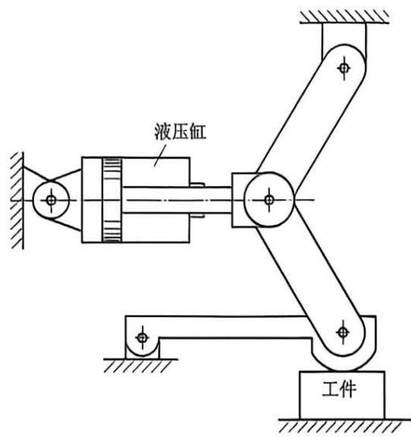

图8-15 液压夹紧机构
{: .figure-caption }

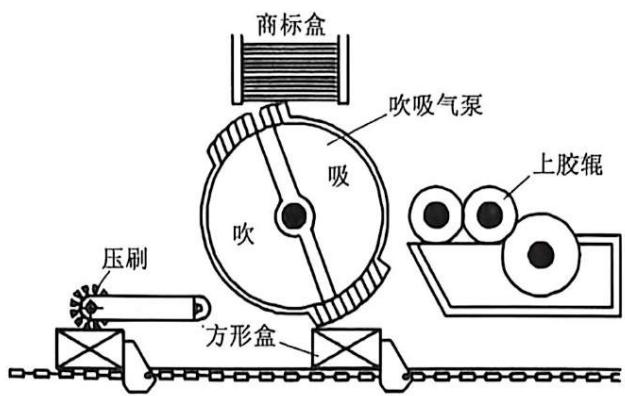

图8-16 商标自动粘贴机
{: .figure-caption }

### 8.5.2 光电机构

光电机构是一类在自动控制领域内应用极为广泛的机构，它是利用光的特性进行工

作的机构。通常由各类光学传感器(如光电开关、CCD等)加上各种机械式或机电式机构，形成光电机构。更广义的光电机构还包括红外成像仪与红外夜视仪等。

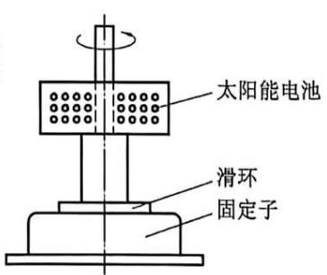

如图 8-17 所示为光电动机原理图, 3 个太阳能电池组成三角形, 与电动机的转子结合起来。太阳能电池为电动机的转动提供能量, 当电动机转动时, 太阳能电池也随之转动, 动力由电动机轴输出。由于受光面(即太阳能电池)是一个等边三角形, 即使光线入射方向改变, 也不影响光

电动机的正常启动与工作。

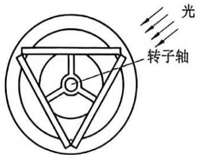

图8-17 光电动机
{: .figure-caption }

### 8.5.3 电磁机构

电磁机构是利用电磁效应将电磁能转换为机械能，产生驱动力，使执行构件实现往复运动和振动等，可十分方便地控制和调节执行机构的动作。它广泛应用于继电器机构、传动机构、仪器仪表机构。

如图 8-18 所示为电磁开关。电磁铁通电后吸合压杆、接通电路。断电后，压杆在复位弹簧作用下脱离电磁铁，电路断开。

### 8.5.4 振动及惯性机构

#### 1. 振动机构

利用振动产生运动和动力的机构称为振动机构。用来产生振动的方式有电磁式、机械式、音叉式或超声波式等。振动机构广泛用于散状物料的捣实、装卸、输送、筛选、研磨、粉碎、混合等工艺中。

如图 8-19 所示为利用电磁振动的送料机构示意图, 它由槽体、激振板簧、底座、橡胶减振弹簧及激振电磁装置(由铁芯线圈和衔铁构成)等组成。当交流电输入铁芯线圈, 产生频率 $50 \mathrm{~Hz}$ 的断电磁力, 吸引固定在料道上的衔铁, 使槽体向左下方运动; 当电磁力迅速减少并趋近零时, 槽体在激振板簧作用下, 向右上方做复位运动。当槽体向右上方运动时, 由于工件与槽体之间存在摩擦力, 工件被槽体带动, 并逐渐被加速; 当槽体向左下方运动时, 由于惯性力作用, 工件将按原来的运动方向向前抛射(或称跳跃), 工件在空中微量跳跃后, 又落到槽体上。如此周而复始的运动使槽体产生了微小的振动, 而槽体经过一次振动后, 在槽体上的工件就向前移动一定的距离, 直至出料口, 从而达到送料的目的。

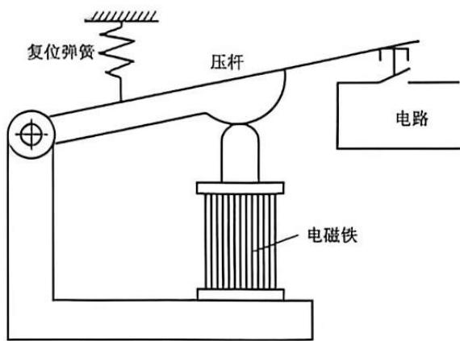

图8-18 电磁开关
{: .figure-caption }

惯性机构

#### 2. 惯性机构

利用物体的惯性来进行工作的机构称为惯性机构。如建筑机械中的夯土机、打桩机及一些特定场合使用的分离机等。许多情况下惯性和振动在这类机构中同时被利用，图8-19就是一个实例。另外，如图8-20所示为谷粒草秆分离机，在圆桶的内周有一些嵌槽，当它旋转时，由于谷粒的单位重量比草秆大，得到的离心力大，谷粒进入嵌槽被抛入圆桶内的承谷槽中，使谷粒与草秆分离。

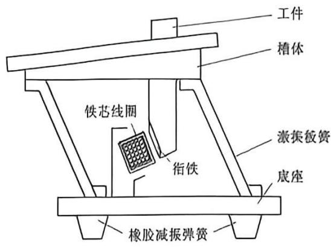

图8-19 振动送料机构
{: .figure-caption }

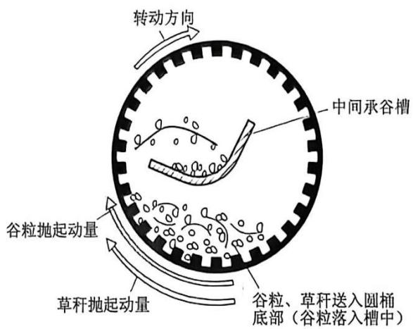

图8-20 谷粒草秆分离机
{: .figure-caption }

## 本章思维导图

<table><tr><td colspan="8">其他常用机构</td></tr><tr><td rowspan="44" colspan="8">螺旋机构</td></tr><tr></tr><tr></tr><tr></tr><tr></tr><tr></tr><tr></tr><tr></tr><tr></tr><tr></tr><tr></tr><tr><td></td></tr><tr><td></td></tr><tr><td></td></tr><tr><td></td></tr><tr><td></td></tr><tr><td></td></tr><tr><td></td></tr><tr><td></td></tr><tr><td></td></tr><tr><td></td></tr><tr><td>工作原理</td></tr><tr><td>将螺旋运动转换为直线运动,传递运动和动力</td></tr><tr><td>运动特点</td></tr><tr><td>运动准确、工作平稳,能获得很大的降速比和力的增益</td></tr><tr><td>摩擦损耗大、传动效率低</td></tr><tr><td>摩擦性质不同</td></tr><tr><td>用途不同</td></tr><tr><td>滑动螺旋机构</td></tr><tr><td>滚动螺旋机构</td></tr><tr><td>静压螺旋机构</td></tr><tr><td>传力螺旋结构</td></tr><tr><td>传导螺旋机构</td></tr><tr><td>调整螺旋机构</td></tr><tr><td></td></tr><tr><td></td></tr><tr><td></td></tr><tr><td></td></tr><tr><td></td></tr><tr><td></td></tr><tr><td></td></tr><tr><td></td></tr><tr><td></td></tr><tr><td></td></tr></table>

## 思考题与练习题

1. 如图 8-1(b) 所示的螺旋机构中, 若螺杆 1 上的两段螺纹均为右旋螺纹, $A$ 段的导程为 $l_{\mathrm{a}} = 1 \mathrm{~mm}$ , $B$ 段的导程为 $l_{\mathrm{B}} = 0.75 \mathrm{~mm}$ , 试求当手轮按图示方向转动一周时, 螺母 2 相对于机架 3 移动的距离。若将 $A$ 段螺纹旋向改为左旋, 而 $B$ 段的旋向及其他参数不变, 则结果又如何?

2. 若双万向联轴器连接既不平行也不相交的两轴转动，而且要使主、从动轴角速度相等，问需要满足什么条件？

3. 如图 8-8 所示的单万向联轴器中, 轴 1 以 $1500 \mathrm{r} / \mathrm{min}$ 等速转动, 轴 3 变速转动, 其最高转速为 $1732 \mathrm{r} / \mathrm{min}$ , 试求:

(1) 轴 3 的最低转速。

(2) 在轴 1 一转中， $\varphi_{1}$ 为何值时两轴转速相等？

(3) 轴 3 处于最高转速与最低转速时, 轴 1 的叉面处于什么位置?

4. 如何求非圆齿轮节线？非圆齿轮机构的基本关系式是如何表达的？

5. 何谓广义机构？它与传统机构有什么区别？

6. 液、气动机构的主要特点是什么？

7. 电磁机构一般可以实现哪些运动？

8. 光电机构的工作原理是什么？
